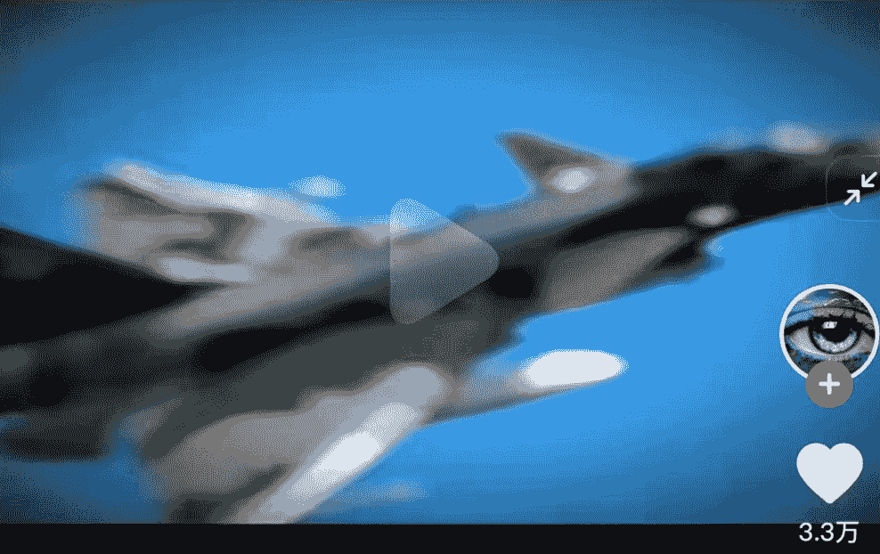
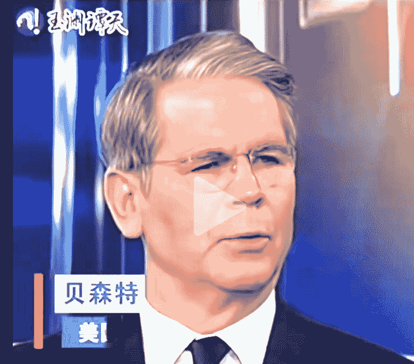

今天在群里聊了很多印巴战争。

想过印度会拉胯，但真没想到印度会这么拉胯。

而且，懂王还拉偏架了。

巴基斯坦也亲美，空军有很多F-16，对标我们的花费10C，懂王直接禁止巴铁用F-16对印度作战。

懂王本意是拉偏架，但没想到成就了中国军唱出了独角戏。

0比8的战损比，这种已经是代差的碾压了。

扫码加入 知识星球TOP 免费资源群
免费 | 每日免费获取高价值资源 可提供各类资源搜索服务 | 热门付费文章 各行行业报告 | 精选资源库 | 副业赚钱方法 | 职场实用资源 | AI政经自媒体

## 第八架印战机被击落
截止北京时间2025.5.7 13时

- 三架阵风战斗机
- 一架苏-30战斗机
- 一架米格-29战机
- 一架以色列苍鸽无人机

## 印巴最新消息！

——巴军的战术很有可能是：使用ZDK-03预警机在高空确保对斯里加平地的监控，然后指挥战斗机从高空进入以高打低、发挥PL-15E的远程优势。甚至可考虑用ZDK-03A预警机对HQ-9BE地空弹实施A射B弹，打击藏在山体后面的印度战斗机，没有别的可能性。这战术简直是绝了！

——巴方防御体系实现三大进程：

① 歼10C首次实战验证“忠诚掠机”系统，有人-无人协作战效能超出西方评估

② 新型ZDK-03预警机与翼龙-3侦察无人机构成“云-边缘”数据链

③ 依托地形构建的S-400/红旗9混合防空圈，实现72%的拦截概率

而且中国的歼10C只要4000万美元，单价仅是阵风的五分之一之一，却能在体系支撑下对抗2.4亿美元的法国精品，其他各路装备都是物美价廉的典范。

今天实战过后，中国的军火外贸四件套：
- 歼10C
- PL-15E
- 红旗9
- ZDK-03预警机

可以说是走红全球了，以后不愁卖了。

当然，这次印巴冲突，中国是罕见的加大了下场力度，至少前两次印巴冲突包括最近2019年那次，中国都没有如此加大力度。

背后自然不仅是一个印度，还有俄美的考量。

用巴铁袭掠印度，敲打背后的俄美。

印度则是典型的干大事而惜身，见小利而忘命。

本来印度耍滑头下巴铁，给美国交个投名状，还有美国拉偏架，以为能露面能谈好印美关税谈判，结果拉了一大大的。

连懂王都看不下去了。

## 印度向美国介绍对巴基斯坦行动 特朗普称“真可耻”

印度时间7日凌晨，印度驻美国大使发表声明称，印度武装部队的“辛杜尔军行动”之后不久，便向美国介绍了“辛杜尔军行动”，称该行动重点突出、精准到位。没有巴基斯坦的平民、经济或军事目标遭到袭袭。只有已知的恐怖分子经营的营地为目标。此举据美联社报道，美国总统特朗普曾称印度对巴基斯坦的军事行动“真可耻”。

当然，巴铁只在空军面上优势，在综合国力上远不如印度的。

真打持久战，巴铁只能依靠我们无条件低成本输武器，不然根本撑不住。

现在对巴铁最好的剧本，就是印度吃瘪后认输不打了，当没这回事。

这对印度也是最好的剧本，及时止损。

但是三哥的脑回路很奇奇的，万一三哥输红眼了，或者上头了，继续打也有可能。

毕竟，还有一个副战场在巴铁国内。

那就是国内分裂势力兜路支解放军。

这个出空军打不了的，游击队钻山沟里，需要的是打治安战的特种部队，巴基斯坦明显解决不了分裂武装势力。

我记得去年我们派了几百号去干这帮人，因为这帮恐怖袭击了我们援建的工程，还杀了我们几位同胞，去年干得不容易，带着无人机实战的杀伤上千。今年这帮人又出来了，没办法，分裂势力的土壤很深，确实可怕。如果巴铁压住国内的分裂势力，印度肯定还想打，还想拖死巴铁。巴铁压住国内，印度才会难而退。可能，我们又要派特种部队去援助巴铁。

## 印度战术的战术限制

军事只是其一，我们现在打了一套组合拳。

- 一架美洲虎攻击机
- 一架LCA光辉战机

## 中共政治局委员、国务院副总理何立与美国财政部长贝森特举行会

印巴最新消息！

这次会晤，是美国求我们的。

## 被问“谁主动”美财长紧张到巴铁

## 我们不想“脱钩”

美国先求，我们可以选择继续谈啊，为什么这次要谈？毕竟之前我们官方的说法是，美国想先把所有关税撤销再谈。在美国没有撤销关税之前，我们还是见了美国，这不是妥协吗？而且这个妥协就是5月6日发生的。因为5月5日，贝森特接受采访被问中美根本没有在谈。

## 美媒：贝森特证实中美仍就关税问题进行磋商

美国消费者和频道（CNBC）等美媒报道，美国总统特朗普4月9日宣布对部分国家加征税，声称在此90天时间内与各国谈判达成协议。“网指出，贝森特证实中美两国仍就关税问题进行磋商。而5月7日，中国可以说谈，你们美国的人去瑞士吧。

可以说，中国和美国会晤的决策时间，就是昨天，就是5月6日。而且同样是5月6日，中央决定7日召开一个股市的座谈会。

## 国新办发布会介绍“一揽子金融政策支持市场预期”有关情况

长安街1号（电报大楼西侧入口），国务院办公室2025年5月6日

也就是说，5月6日，我们作出了两个重大决定：一个是在美国撤销所有关税之前，派人和贝森特会；一个是批准各项利措施并在第二天举行提振股市的新闻。这两个都是昨天的决定。然后今天7日，我们就飞莫斯科参加普京的卫国战争纪念会。5月6日的两个决定，让美国又喜又惊。喜的是中国终于肯了，惊的是中国似乎在打组合拳。是的，和美国会晤，其实是以退为进。因为中国的真实想法，不是要和美国缓和，而是利用美国敲打欧洲。

因为中欧已经谈很久了，关于恢复中欧协议的谈判，欧洲因为美国关税重压的确缓缓和我们的关系，在谈电车光伏5G等产业禁令。

## 中欧就电动汽车价格承诺谈判，取代关税实现共赢

界面新闻2025-04-14 13:36 北京为此中欧都退一步，解除了当年新疆棉议题制裁有关人员——恰逢中欧建交50周年之际，双边关系也迎来了缓和。近日，欧洲议会在官网上宣布，中方已经解除了对欧方的相关制裁，与此同时，欧方也取消了对中方的相关限制。但中欧谈判还不够快，还没达到我们的速度。这次中国是利用会刺激欧洲进一步转向中国。你看，谈判地点就选择在欧洲瑞士。而中欧是全球除美国最大的生产国家和市场，中欧缓和速度一旦加快，反过来又会让美国陷入更大的战略被动，让懂王的关税算盘满盘输。这就是中国的以退为进。所以大家不必中美这次会抱有多大期待，更不必担心我们这次见面会亏。战略都是阳谋的，而阳谋都是无解的。

当贝森特在瑞士和哥哥见面后，不管贝森特拿出多少谈判技巧，都是战术行动，都是在做无用功，因为只要在欧洲地盘中美见面了，我们就达成战略目标了，美国对这个阳谋是无解的。5月6日作出的一个决策，就是贝森特在关税上以退为进，用无解阳谋刺激欧洲反美国。如果中美见面是以退为进的无解阳谋，那么另一个决策，就是见缝插针的突然袭击了。是的，今天开的这个大会，提出了很多措施。

## 一图速览！央行重磅发声

| 政策工具 | 操作内容 | 预期/作用 |
| :--- | :--- | :--- |
| 存款准备率 | 降低0.5个百分点 | 向市场提供长期流动性 |
| 结构性货币利率 | 下调0.25个百分点 | 预计将市场稳定 |
| 天期逆购利率 | 从目前的5%降至4% | 进一步扩大试点范围 |
| 科技创新贷款 | 增加5000亿元 | 支持优质技术改造 |
| 金融资产贷款 | 增加8000亿元 | 为市场注入更多增量资金 |
| 养老基金 | 增加3000亿元 | 支持服务消费 |
| 股票回购操作 | 增加8000亿元 | 维持市场活跃 |
| 房贷利率 | 下调20个基点 | 促进产业升级 |

（注：部分数据根据OCR内容修正整理）

## 加台与房地产发展模式适配系列制度

- 进一步扩大试点范围。
- 大力支持中长期，维持活跃市场。
- 尽可能支持小微企业。
- 修订《贷款管理办法》。
- 贷款额度至7万亿。
- 支持符合条件的全国性商业银行设立金融资产投资公司。
- 增加贷款额度，目前目前的8000亿元。
- 签约意向金额突破38000亿元。
- 深化科创板、创业板改革政策。
- 发布《上市公司重大重组管理办法》。
- 大力推动长期资金入市。
- 全力支持中央汇金发挥类准基金作用。
- 尽力帮助企业应对美加征税的冲击。

## 强化多层次资本市场产品和服务

- 外资通过QFII、沪深通等形式持有A股流通市值在万亿左右。
- 支持符合的外资机构申请证券投资业务资格。
- 鼓励境外投资机构依规设立境内人民币基金。
- 推进期货期权向境外投资者开放。
- 支持境内外交易所商品结算授权合作。
- 优化境外上市机制、流程，提高境外上市质量。
- 大力支持上海金融中心建设和巩固香港金融中心地位。
- 创造条件支持优质企业回归内地和香港。

数据来源：Wind。Wind是金融人士信任的平台，长按识别二维码查看更多资讯。

有关提振市场的几个措施，一共放了一万亿左右，而且全力支持中央汇金发挥类准基金作用。这个中金平准其实做了，去年为了拉牛市，中金对ETF的配置规模已达到1.05万亿元，涵盖48只ETF，合计持仓份额高达3716亿。问题是中金这个最大国家队还有多少子弹，说不准。官方的说法是这样：

问：中央汇金参与维护资本市场稳定有哪些资金来源？
答：一是资产实力雄厚。作为国有金融资本受托机构，中央汇金公司经营稳健，资产负债表健康。二是现金流充足稳定。中央汇金公司每年获得稳定的分红，可动的自有资金规模较大。三是融资渠道畅通高效。经过多年发展，中央汇金公司已建立起覆盖中长期、稳定的市场融资渠道，还可获得人民银行流动性支持。各界对股市平准基金规模的预期是两万亿左右。中金国家队至少还有万亿左右的子弹。还有就是文件明确写着“取消套房贷款利率下限”。——LPR是央行的基准利率，而我们的房贷款是各商业银行商定的市场利率。现在的基准利率是1.4%（原文误），而我们的房贷利率下限是3%，中间的息差是银行的利润。配合最近连线降息的大动作，专家预测最迟年底前，首套房利率铁定击穿3%大关，到两点多的利率。而且限于增量房贷，存量房还要降，能让房奴每月少给几千块呢，这不仅能托底楼市，也能刺激消费。这些都是对内的，重要的是对外。那就是这次真降息降准了：降低准备金率0.5个百分点；下调结构性房贷利率.25个百分点。之前分析，为了稳汇率，应该在6月美联储之后开启降息降准，这样保持稳定。之前中国行的宽松松政策一直跟着美储的降息节奏走，现在不跟了，而且突然袭先一步降息降准，这会让美国在明天更加内部撕裂。这是在中国激化美国内部矛盾斗争的手段。所以我，5月6日中国出了两招：一个是以退为进无解的中美会晤，一个是见缝插针突然攻击的小幅降息降准。然后回过头，再聊下楼市。中国楼市有三个黑天鹅：一个是懂王的关税贸易战，变成持久战。这对依赖外贸的广东、江苏、深圳等经济体是很很大打击，连带这些地方的楼市必然遭受最影响。这个黑天鹅正是正在经历的，而且概率打成持久战。之前中央一直犹豫不决，还是不让一线城市彻底放开购，不想献祭二三线来保一线，中央可能觉得自己还能稳住楼市吧，但是懂王关税这个黑天鹅来了。现在关税战是奔着持久战去的，本来6月都不会搞的，市场波动给了中国一个见缝插针偷偷放水的空间。中国大幅降息在未来还是有的，得等美联储动作。美联储很被动。因为中国这次见缝插针可以说是突然袭击，很难，因为中国抢跑的时机恰好选在美联储会议前一天。

| 5月8日 周四 | |
| :--- | :--- |
| 国内 | 02:00 美联储公布利率议 | 02:30 美联储主席鲍威尔召开货币政策发布会 |
| 海外 | 15:30 瑞典央行公布利率议 | 19:00 英国央行公布利率议 | 20:30 美国5月3日首次申请失业救济人数（万人） |
| 待定 | 亚太国际组织高级财政官员会议举行至5月9日 |
| 财报国内 | 中芯国际、华虹半导体 |
| 海外 | Shopify、飞石石油、武田制药、马士奇、华纳音乐、柏橡翰、Coinbase、科技联合能源 |

是的，明天就是美联储的5月会议了。现在美国情况是5月下旬通胀就会起来，关税传导作用就会显现，懂王一个劲要求明天就降息美元对冲关税负面影响要不要让自己玩砸，但民主党和美联储是坚决降息要等6月再说，就是想看懂王的笑话。
