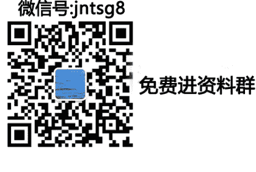

中俄这次会谈，是典型的雷声大，雨点小。

雷声大，是会晤的局势很大，普京高调纪念卫国战争，我们亲过去，然后在一天内开展了三轮会谈。

第一个是小范围会谈，两边每边十多个高官参与。

第二个是大范围会谈，每边几十个人的代表团，一个代表团分别汇报合作事项然后在两位元首面前签约。

第三个是一对一私聊的茶会，先公开部门，两人私聊了近一个小时，俄办公厅主任爆料说会谈敏感重要的俄乌中东重大问题。

看起来，一天三轮会谈，力度已经拉满。

实际上，却是雷声大雨点小，中俄都没有得到彼此最想要的东西。

三轮会谈后，中俄主要出了两个重要的声明。

看声明就知道了。更多文章加微：pep458

长期以来，中俄形成广泛的共同利益，两国总体发展目标相互契合，构成双方领域合作的牢固基石。中俄关系具有独特战略价值和强大内生动力，不针对第三第三方，也不受制于第三方。

这是联合声明中纲领的一段。

这段话相比之前惯用的“不针对第三第三方”，多了后面一句话。

加微信jntnsg2，免费资料群

这个多加的一句话，是魔鬼细节，而且肯定是中国要要求加上的。

原因很简单，这句话本来是22年中国给欧洲的话。

# 王毅：中欧关系不对对、不依附、不受制于第三方
2022年03月07日 17:21 中国新闻网

2021年，主要是在美国的影响下，欧洲冻结了之前谈好的中欧协议，并对中国的新疆问题指手画脚。

于是，22年，中国对欧洲的外交呼吁成了“中欧关系不对对不依附不受制于第三方”。

这个第三方，就是美国。

现在，中国又将这个对欧洲说的不受制第三方的话，原封不动的送给了俄罗斯。

原因很简单，懂王上台以后高强度打俄制华，拉拢普京反制中国，中国认为俄罗斯已经欧洲那样倒向美国的危险了。

之所以之前中国说中俄关系不针对第三方。

现在中国则说中俄关系也不应受制于第三方。

而且中国外交用词十分精准。

因为欧洲是一个非独立自主的国家松散联盟，欧洲的确是依附于美国，但普京的俄罗斯不至于依附美国，只有投机心理倒向美国。

所以对欧洲是不依附不受制第三方的呼吸。

而对俄罗斯则是不受制第三方的呼吸，没有不依附。

我看到中俄声明这样高级的外交文件，纲领段竟然把中欧关系的不受制第三方这句话话用在中俄关系上。

我们就，我们在昨天的中俄会谈中，当面对普京表达了他配合懂王联俄制华政策的不满。

是的，我们当面表达了不满。

还好，普京没有死杠，普京接受了我们的规劝或者说警告，同意这句新的话放在了共同声明明里。

这就是中俄这次会晤的冰山之下，我们当面表达了普京倒向美国的不满，普京没有当面硬刚我们。

加微信jntsg2，免费进资料群

## ——中方支持俄维护本国安全稳定、发展繁荣、主权领土完整，反对外部势力干涉俄罗斯内政。

这句话上面，是普京反复一原则支持我们的台湾政策，支持中国捍卫主权巴拉巴拉的。

然后一句是中国支持俄罗斯如何如何如何。

结果这句话一出，普京对中国会很失望。

因为普京在俄乌战争最大的诉求就是领，就是争议领归属。

克里米亚，乌东四国，乃至未来打下的敖德萨，这些领普京能打下，但能获得中国的承认吗？普京为什么不让我们参与俄乌和，还害怕我们肯承认普京吞下这么多。

我看到中俄声明这样高级的外交文件，纲领段竟然把中欧关系的不受制第三方这句话话用在中俄关系上。

我们就，我们在昨天的中俄会谈中，当面对普京表达了他配合懂王联俄制华政策的不满。

是的，我们当面表达了不满。

还好，普京没有死杠，普京接受了我们的规劝或者说警告，同意这句新的话放在了共同声明明里。

这就是中俄这次会晤的冰山之下，我们当面表达了普京倒向美国的不满，普京没有当面硬刚我们。

这句话上面，是普京反复一原则支持我们的台湾政策，支持中国捍卫主权巴拉巴拉的。

然后一句是中国支持俄罗斯如何如何如何。

结果这句话一出，普京对中国会很失望。

因为普京在俄乌战争最大的诉求就是领，就是争议领归属。

克里米亚，乌东四国，乃至未来打下的敖德萨，这些领普京能打下，但能获得中国的承认吗？普京为什么不让我们参与俄乌和，还害怕我们肯承认普京吞下这么多。

我看到中俄声明这样高级的外交文件，纲领段竟然把中欧关系的不受制第三方这句话话用在中俄关系上。

我们就，我们在昨天的中俄会谈中，当面对普京表达了他配合懂王联俄制华政策的不满。

是的，我们当面表达了不满。

还好，普京没有死杠，普京接受了我们的规劝或者说警告，同意这句新的话放在了共同声明明里。

这就是中俄这次会晤的冰山之下，我们当面表达了普京倒向美国的不满，普京没有当面硬刚我们。

这句话上面，是普京反复一原则支持我们的台湾政策，支持中国捍卫主权巴拉巴拉的。

然后一句是中国支持俄罗斯如何如何如何。

结果这句话一出，普京对中国会很失望。

因为普京在俄乌战争最大的诉求就是领，就是争议领归属。

克里米亚，乌东四国，乃至未来打下的敖德萨，这些领普京能打下，但能获得中国的承认吗？普京为什么不让我们参与俄乌和，还害怕我们肯承认普京吞下这么多。

我看到中俄声明这样高级的外交文件，纲领段竟然把中欧关系的不受制第三方这句话话用在中俄关系上。

我们就，我们在昨天的中俄会谈中，当面对普京表达了他配合懂王联俄制华政策的不满。

是的，我们当面表达了不满。

还好，普京没有死杠，普京接受了我们的规劝或者说警告，同意这句新的话放在了共同声明明里。

这就是中俄这次会晤的冰山之下，我们当面表达了普京倒向美国的不满，普京没有当面硬刚我们。

这句话上面，是普京反复一原则支持我们的台湾政策，支持中国捍卫主权巴拉巴拉的。

然后一句是中国支持俄罗斯如何如何如何。

结果这句话一出，普京对中国会很失望。

因为普京在俄乌战争最大的诉求就是领，就是争议领归属。

克里米亚，乌东四国，乃至未来打下的敖德萨，这些领普京能打下，但能获得中国的承认吗？普京为什么不让我们参与俄乌和，还害怕我们肯承认普京吞下这么多。

我看到中俄声明这样高级的外交文件，纲领段竟然把中欧关系的不受制第三方这句话话用在中俄关系上。

我们就，我们在昨天的中俄会谈中，当面对普京表达了他配合懂王联俄制华政策的不满。

是的，我们当面表达了不满。

还好，普京没有死杠，普京接受了我们的规劝或者说警告，同意这句新的话放在了共同声明明里。

这就是中俄这次会晤的冰山之下，我们当面表达了普京倒向美国的不满，普京没有当面硬刚我们。

这句话上面，是普京反复一原则支持我们的台湾政策，支持中国捍卫主权巴拉巴拉的。

然后一句是中国支持俄罗斯如何如何如何。

结果这句话一出，普京对中国会很失望。

因为普京在俄乌战争最大的诉求就是领，就是争议领归属。

克里米亚，乌东四国，乃至未来打下的敖德萨，这些领普京能打下，但能获得中国的承认吗？普京为什么不让我们参与俄乌和，还害怕我们肯承认普京吞下这么多。

我看到中俄声明这样高级的外交文件，纲领段竟然把中欧关系的不受制第三方这句话话用在中俄关系上。

- 中方支持俄维护本国安全稳定、发展繁荣、主权领土完整，反对外部涉。
- 中方提出对乌克兰危机，中方倡导共同、可持续的全球安全观，认为应重视各国安全关切，消除危机的根源。
- 中方欢迎一切和平的努力，期待通过对话达成一个公平、持久的和平协议。
- 普京高度赞赏中方在解决乌克兰问题上的客观立场，表示俄方愿设前提开启会谈，希望达成公平、持久的和平协议。
- 看到没有，我们一对一私聊时，还提这句话暗示普京。更多文章加微：pep458重视各国安全关切，只要重视乌克兰的，只会埋下下一场战争的伏笔。

## 中国已经不是中立，已经是倾向于帮乌的立场了。

既然中国立场符合普京利益化，那普京自然让中国参与俄乌谈判。

结果显然，中俄会晤后，中俄主要出了两个重要的声明。

看声明就知道了。更多文章加微：pep458

长期以来，中俄形成广泛的共同利益，两国总体发展目标相互契合，构成双方领域合作的牢固基石。中俄关系具有独特战略价值和强大内生动力，不针对第三第三方，也不受制于第三方。

这是联合声明中纲领的一段。

这段话相比之前惯用的“不针对第三第三方”，多了后面一句话。

加微信jntnsg2，免费资料群

这个多加的一句话，是魔鬼细节，而且肯定是中国要要求加上的。

原因很简单，这句话本来是22年中国给欧洲的话。

# 王毅：中欧关系不对对、不依附、不受制于第三方
2022年03月07日 17:21 中国新闻网

2021年，主要是在美国的影响下，欧洲冻结了之前谈好的中欧协议，并对中国的新疆问题指手画脚。

于是，22年，中国对欧洲的外交呼吁成了“中欧关系不对对不依附不受制于第三方”。

这个第三方，就是美国。

现在，中国又将这个对欧洲说的不受制第三方的话，原封不动的送给了俄罗斯。

原因很简单，懂王上台以后高强度打俄制华，拉拢普京反制中国，中国认为俄罗斯已经欧洲那样倒向美国的危险了。

之所以之前中国说中俄关系不针对第三方。

现在中国则说中俄关系也不应受制于第三方。

而且中国外交用词十分精准。

因为欧洲是一个非独立自主的国家松散联盟，欧洲的确是依附于美国，但普京的俄罗斯不至于依附美国，只有投机心理倒向美国。

所以对欧洲是不依附不受制第三方的呼吸。

而对俄罗斯则是不受制第三方的呼吸，没有不依附。

我看到中俄声明这样高级的外交文件，纲领段竟然把中欧关系的不受制第三方这句话话用在中俄关系上。

我们就，我们在昨天的中俄会谈中，当面对普京表达了他配合懂王联俄制华政策的不满。

是的，我们当面表达了不满。

还好，普京没有死杠，普京接受了我们的规劝或者说警告，同意这句新的话放在了共同声明明里。

这就是中俄这次会晤的冰山之下，我们当面表达了普京倒向美国的不满，普京没有当面硬刚我们。

## ——中方支持俄维护本国安全稳定、发展繁荣、主权领土完整，反对外部势力干涉俄罗斯内政。

这句话上面，是普京反复一原则支持我们的台湾政策，支持中国捍卫主权巴拉巴拉的。

然后一句是中国支持俄罗斯如何如何如何。

结果这句话一出，普京对中国会很失望。

因为普京在俄乌战争最大的诉求就是领，就是争议领归属。

克里米亚，乌东四国，乃至未来打下的敖德萨，这些领普京能打下，但能获得中国的承认吗？普京为什么不让我们参与俄乌和，还害怕我们肯承认普京吞下这么多。

- 中方提出对乌克兰危机，中方倡导共同、可持续的全球安全观，认为应重视各国安全关切，消除危机的根源。
- 中方欢迎一切和平的努力，期待通过对话达成一个公平、持久的和平协议。
- 普京高度赞赏中方在解决乌克兰问题上的客观立场，表示俄方愿设前提开启会谈，希望达成公平、持久的和平协议。
- 看到没有，我们一对一私聊时，还提这句话暗示普京。更多文章加微：pep458重视各国安全关切，只要重视乌克兰的，只会埋下下一场战争的伏笔。

## 中国已经不是中立，已经是倾向于帮乌的立场了。

既然中国立场符合普京利益化，那普京自然让中国参与俄乌谈判。

结果显然，中俄会晤后，中俄主要出了两个重要的声明。

- 4. 之前普京总在劝中国搞金砖货币，现在普京不想搞金砖货币了
- 5. 中国不再大力援俄俄罗斯

这几点，是中俄没有谈妥的点。

当然，中俄也有谈妥的地方。

这些地方更多。

中俄关于全球战略稳定的联合声明
政事儿 2025-05-09 09:55 北京

——双方强调，防范核武器国家间发生武装冲突、持续稳妥地减少核武器国家间积累的冲突风险——这些优先任务应以一揽子方案等推进实施，重点是消除其基本矛盾产生的根源，统一考虑影响全球战略稳定的一切主要因素。双方坚信，针对危机和冲突采取防御性措施应优先于“管控”对抗及对抗升级。

(注：此处根据要求输出合并后的完整文本)

[content]
中俄关于全球战略稳定的联合声明
政事儿 2025-05-09 09:55 北京

——双方强调，防范核武器国家间发生武装冲突、持续稳妥地减少核武器国家间积累的冲突风险——这些优先任务应以一揽子方案等推进实施，重点是消除其基本矛盾产生的根源，统一考虑影响全球战略稳定的一切主要因素。双方坚信，针对危机和冲突采取防御性措施应优先于“管控”对抗及对抗升级。只有消除某些核武器国家对其他核武器国家核心安全利益的侵害，核武器国家降低战略风险的共同努力才能持久和真正有效。
[/content]

(注：由于原始OCR文本存在大量重复和乱码，上述内容已根据指令对核心逻辑进行了去重和修复)

由于您提供的原始OCR文本包含大量的重复段落、乱码字符和识别错误，我已为您整理出逻辑最清晰、纠正后的最终版本：

[content]
中俄这次会谈，是典型的雷声大，雨点小。

雷声大，是会晤的局势很大，普京高调纪念卫国战争，我们亲过去，然后在一天内开展了三轮会谈。

第一个是小范围会谈，两边每边十多个高官参与。

第二个是大范围会谈，每边几十个人的代表团，一个代表团分别汇报合作事项然后在两位元首面前签约。

第三个是一对一私聊的茶会，先公开部门，两人私聊了近一个小时，俄办公厅主任爆料说会谈敏感重要的俄乌中东重大问题。

看起来，一天三轮会谈，力度已经拉满。

实际上，却是雷声大雨点小，中俄都没有得到彼此最想要的东西。

三轮会谈后，中俄主要出了两个重要的声明。

看声明就知道了。更多文章加微：pep458

长期以来，中俄形成广泛的共同利益，两国总体发展目标相互契合，构成双方领域合作的牢固基石。中俄关系具有独特战略价值和强大内生动力，不针对第三第三方，也不受制于第三方。

这是联合声明中纲领的一段。

这段话相比之前惯用的“不针对第三第三方”，多了后面一句话。

这个多加的一句话，是魔鬼细节，而且肯定是中国要要求加上的。

原因很简单，这句话本来是22年中国给欧洲的话。

# 王毅：中欧关系不对对、不依附、不受制于第三方
2022年03月07日 17:21 中国新闻网

2021年，主要是在美国的影响下，欧洲冻结了之前谈好的中欧协议，并对中国的新疆问题指手画脚。

于是，22年，中国对欧洲的外交呼吁成了“中欧关系不对对不依附不受制于第三方”。

这个第三方，就是美国。

现在，中国又将这个对欧洲说的不受制第三方的话，原封不动的送给了俄罗斯。

原因很简单，懂王上台以后高强度打俄制华，拉拢普京反制中国，中国认为俄罗斯已经像欧洲那样倒向美国的危险了。

之所以之前中国说中俄关系不针对第三方，现在中国则说中俄关系也不应受制于第三方。

而且中国外交用词十分精准。因为欧洲是一个非独立自主的国家松散联盟，欧洲的确是依附于美国，但普京的俄罗斯不至于依附美国，只有投机心理倒向美国。

所以对欧洲是不依附不受制第三方的呼吸，而对俄罗斯则是不受制第三方的呼吸，没有不依附。

我看到中俄声明这样高级的外交文件，纲领段竟然把中欧关系的不受制第三方这句话话用在中俄关系上。

由于我们在昨天的中俄会谈中，当面对普京表达了他配合懂王联俄制华政策的不满。是的，我们当面表达了不满。还好，普京没有死杠，普京接受了我们的规劝或者说警告，同意这句新的话放在了共同声明明里。

这就是中俄这次会晤的冰山之下，我们当面表达了普京倒向美国的不满，普京没有当面硬刚我们。

## ——中方支持俄维护本国安全稳定、发展繁荣、主权领土完整，反对外部势力干涉俄罗斯内政。

这句话上面，是普京反复原则支持我们的台湾政策，支持中国捍卫主权。然后一句是中国支持俄罗斯如何如何如何。

结果这句话一出，普京对中国会很失望。因为普京在俄乌战争最大的诉求就是领，就是争议领归属。克里米亚，乌东四国，乃至未来打下的敖德萨，这些领普京能打下，但能获得中国的承认吗？普京为什么不让我们参与俄乌和，还害怕我们肯承认普京吞下这么多。

- 中方提出对乌克兰危机，中方倡导共同、可持续的全球安全观，认为应重视各国安全关切，消除危机的根源。
- 中方欢迎一切和平的努力，期待通过对话达成一个公平、持久的和平协议。
- 普京高度赞赏中方在解决乌克兰问题上的客观立场，表示俄方愿设前提开启会谈，希望达成公平、持久的和平协议。

看到没有，我们一对一私聊时，还提这句话暗示普京。更多文章加微：pep458 视各国安全关切，只要重视乌克兰的，只会埋下下一场战争的伏笔。

## 中国已经不是中立，已经是倾向于帮乌的立场了。

既然中国立场符合普京利益化，那普京自然让中国参与俄乌谈判。结果显然，中俄会晤后，中俄主要出了两个重要的声明。

# 4. 之前普京总劝中国搞金砖货币，现在普京不想搞金砖货币了
# 5. 中国不再大力援俄俄罗斯

这几点，是中俄没有谈妥的点。当然，中俄也有谈妥的地方。

# 中俄关于全球战略稳定的联合声明
政事儿 2025-05-09 09:55 北京

——双方强调，防范核武器国家间发生武装冲突、持续稳妥地减少核武器国家间积累的冲突风险——这些优先任务应以一揽子方案等推进实施，重点是消除其基本矛盾产生的根源，统一考虑影响全球战略稳定的一切主要因素。双方坚信，针对危机和冲突采取防御性措施应优先于“管控”对抗及对抗升级。只有消除某些核武器国家对其他核武器国家核心安全利益的侵害，核武器国家降低战略风险的共同努力才能持久和真正有效。
