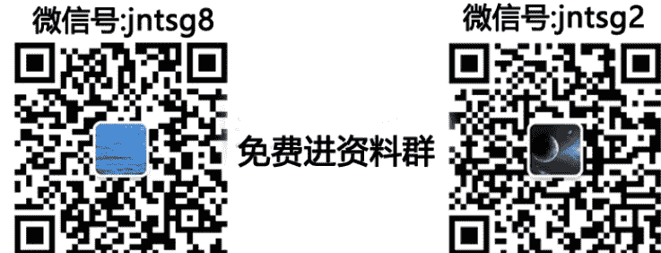
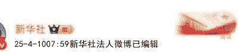
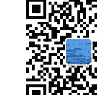

# 中美日内瓦谈判背后的男人

文/欧洲金靴

5月12日，中美双方发布会议达成的联合声明，双方达成多项积极共识。据中美联合声明，双方约定在未来90天内，美国对中国进口商品的额外关税——即最近这场关税对峙中加征的额外关税，将从145%降至30%（含10%的基础关税和20%的芬尼关税）；而中国对一些美国进口商品的关税将从125%降至10%。更多文章加薇：pep458

这次对美强硬谈判姿态以及取得的结果，堪称2016年南海军事对峙之后，十年来中国对外最强音——远远胜过特朗普第一任期时那轮贸易战所树立的国家形象。

当年的“鹤仙人”（指习某）可是连十九届中中三全会都不参加，火急火燎去白宫面见特朗普，最终也没能获得一份真正正义上利好中国出口的协议……

最搞的是，这“鹤仙人”连重之重的中全会都会没参加，可是特朗普竟然压根都没见他……弄得领袖没办法，在那种年春天的博鳌亚洲论坛上宣布中国将实施所谓的“四大开放”：包括放外资的市场进入限制、创造更优投资环境、加强知识产权保护、重组国家知识产权局局以及主动扩大进口，其中特别提到将“相当幅度”降低汽车进口关税……

这实质上是对美让步了。

后来《人民日报》出来挽尊，说这些措施与中美谈判无关，本就是强子那年的政府工作报告中就有计划的。

但只能说明两点：
①我们确实对美让步；
②党内高层意见不一，且对美投降派的力量压倒了领袖一侧。

当然，反制自然也随之祭出。

在同一阶段谋划并落地的，就是领袖这边的两个大动作：修仙+机构改革。

美国人的贸易战确实来势汹汹、让中国惊魂了一把，但也让党内的畏美派和崇美派暴露无遗——领袖的这两个大动作也算是借打力了。

从2018年春天之后，“定于一尊”的宣传势头越来越猛。

从这个角度看，如今圈全数被逐出核心舞台，以及“鹤仙”家族被被整（他儿子已经进去了），某种程度上都与中美贸易战1.0脱开关系。

各位还有印象吗，那次1.0战役，白宫国家经济委员会主任拉里·库德洛直接对外炫耀：“他（指的就是‘鹤仙人’）承诺了，会满足我们的很多要求。”同时授意《华尔街日报》报道“中国代表团承诺采购美国商品”，这引来我们外交部疯狂批辞……

即便如此，“鹤仙人”彼时在白宫、在特朗普面前有多少赢，虽无多少视频公开，但已让世人体会。

那年11月，我们又一次采取套路：请出“中美关系压舱石”基辛格，不远万里拉到北京，好吃好犒一顿，让他在美国国内内发挥余热，阻挡一下特朗普新政府的反全球化风暴。

基辛格的作用确实是显著的，不到一个月，领袖和特朗普终于在阿廷会面（参加G20峰会），双方微笑握手，宣布“缓期90天”。

可是让世界震惊的是，本以为美帝国主义真的收起爪牙了，可竟然就在“习特会”当天，美国勒令加拿大大报机构在温哥华将孟万舟“速捕”！

等于是对领袖飞龙骑脸。此乃前所未有考验，这是领袖一生中从未经历过的超级大考。

特朗普当时多么傲慢啊：“如果达成‘史上最大的贸易协议’有帮助，我愿意为一名面临被引渡美国的中国电信设备商高管的案子‘求情’。”

自2001年入世之后，我们几乎没有遇到什么重量级别的国家级羞辱，即使是南海争端，解放军也铁流尽出，没给国人丢脸，然而针对华为等新兴科技产业巨头的侮辱打压，我们确实有种浑身肌肉使不劲的感觉。

彼时，领袖身边的经济智囊团可以说没有什么“自己人”，大批所谓“开明派”盘踞要位，这也是七年前的贸易战1.0我们看来非常“掉节奏”、总是“跟着美国走”的原因。

在此之后，中储粮集团宣布“将分批从美国引进大豆”，海关总署宣布“允许美国米输入中国”，“鹤仙人”宣布“将再次赴美与特朗普总统会谈”（2019年1月底）……

美国人则故技重施，就在“鹤仙人”步入白宫（1月29日）的同一时刻，美国司法部宣布了对孟万舟的指控，并表示即将向加拿大提出对孟万舟的引渡请求——在“鹤特会”上，美国记者直接拿孟万舟事件向“鹤仙人”施压。

“鹤仙”怎么办？只能认怂。

两天后的1月31日，中方声明：“中方将采取有效措施推动中美贸易平衡发展。中方将有力度地扩大美国农产品、能源产品、工业制成品、服务产品进口，满足中国经济高质量发展和人民美好生活需要”。

再两天后的2月1日，中粮集团配合宣布：“近日，中粮集团又采购了上百万吨美国大豆”。

四个月后的6月底，日本大阪，又是G20峰会，“习特会”终于再次上演。

我至今仍记得那天在电视前看新闻，领袖在大阪说出那句“中美则两利，斗则俱伤，合作比摩擦好，对话比对抗好”之时，有多么的无奈……

更让人痛心的是，双方在大阪宣布“美方不再增新轮关税”，随即8月11日，毫无信誉的特朗普又宣布对华开启第四轮加税！2020年初，中美终于落地《中美经贸协议》，当时这似乎成了“鹤仙人”的政绩，但今天回看，我想并非如此。

《协议》要求中国扩大美国农产品、能源产品、工业制成品、服务产品进口要在未来两年的基数上增加不少于200亿美元。更重要的是，五年前那份《协议》还规定双方将在银行、证券、电子支付等领域提供公平、非歧视的市场待遇——正是这份《中美经贸协议》落地后，蚂蚁集团进入了快车道。

所以，各位可以明白为什么这次贸易战2.0，中国对美姿态较七年前已逐渐收敛。而且，今日中国产业韧性已发生巨变，对美出口占比降至7%，东盟取代美国成为最大出口市场（16%），并通过“一带一路”大幅分散风险。

从关键产业来看，2024年中国半导体自主率提升至30%，新能源汽车市占超60%，光伏组件占全球80%，中国产业链配套率超过90%，储能加工能力占全球市场90%，稀土产业这些都是七年前无法比的。

七年前，领袖身边有如此雄厚的智囊团，但也让党内的畏美派和崇美派暴露无遗——领袖的这两个大动作也算是借打力了。

从2018年春天之后，“定于一尊”的宣传势头越来越猛。

从这个角度看，如今圈全数被逐出核心舞台，以及“鹤”家族被被整（他儿子已经进去了），某种程度上都与中美贸易战1.0脱开关系。

各位还有印象吗，那次1.0战役，白宫国家经济委员会主任拉里·库德洛直接对外炫耀： “他（指的就是‘鹤仙人’）承诺了，会满足我们的很多要求。”同时授意《华尔街日报》报道“中国代表团承诺采购美国商品”，这引来我们外交部疯狂批辞……

即便如此，“鹤仙人”彼时在白宫、在特朗普面前有多少赢，虽无多少视频公开，但已让世人体会。

那年11月，我们又一次采取套路：请出“中美关系压舱石”基辛格，不远万里拉到北京，好吃好犒一顿，让他在美国国内发挥余热，阻挡一下特朗普新政府的反全球化风暴。

基辛格的作用确实是显著的，不到一个月，领袖和特朗普终于在阿廷会面（参加G20峰会），双方微笑握手，宣布“缓期90天”。

可是让世界震惊的是，本以为美帝国主义真的收起爪牙了，可竟然就在“习特会”当天，美国勒令加拿大大报机构在温哥华将孟万舟“速捕”！

等于是对领袖飞龙骑脸。此乃前所未有考验，这是领袖一生中从未经历过的超级大考。

特朗普当时多么傲慢啊：“如果达成‘史上最大的贸易协议’有帮助，我愿意为一名面临被引渡美国的中国电信设备商高管的案子‘求情’。”

自2001年入世之后，我们几乎没有遇到什么重量级别的国家级羞辱，即使是南海争端，解放军也铁流尽出，没给国人丢脸，然而针对华为等新兴科技产业巨头的侮辱打压，我们确实有种浑身肌肉使不劲的感觉。

彼时，领袖身边的经济智囊团可以说没有什么“自己人”，大批所谓“开明派”盘踞要位，这也是七年前的贸易战1.0我们看来非常“掉节奏”、总是“跟着美国走”的原因。

在此之后，中储粮集团宣布“将分批从美国引进大豆”，海关总署宣布“允许美国米输入中国”，“鹤仙人”宣布“将再次赴美与特朗普总统会谈”（2019年1月底）……

美国人则故技重施，就在“鹤仙人”步入白宫（1月29日）的同一时刻，美国司法部宣布了对孟万舟的指控，并表示即将向加拿大提出对孟万舟的引渡请求——在“鹤特会”上，美国记者直接拿孟万舟事件向“鹤仙人”施压。

“鹤仙”怎么办？只能认怂。

两天后的1月31日，中方声明：“中方将采取有效措施推动中美贸易平衡发展。中方将有力度地扩大美国农产品、能源产品、工业制成品、服务产品进口，满足中国经济高质量发展和人民美好生活需要”。

再两天后的2月1日，中粮集团配合宣布：“近日，中粮集团又采购了上百万吨美国大豆”。

四个月后的6月底，日本大阪，又是G20峰会，“习特会”终于再次上演。

我至今仍记得那天在电视前看新闻，领袖在大阪说出那句“中美则两利，斗则俱伤，合作比摩擦好，对话比对抗好”之时，有多么的无奈……

更让人痛心的是，双方在大阪宣布“美方不再增新轮关税”，随即8月11日，毫无信誉的特朗普又宣布对华开启第四轮加税！2020年初，中美终于落地《中美经贸协议》，当时这似乎成了“鹤仙人”的政绩，但今天回看，我想并非如此。

《协议》要求中国扩大美国农产品、能源产品、工业制成品、服务产品进口要在未来两年的基数上增加不少于200亿美元。更重要的是，五年前那份《协议》还规定双方将在银行、证券、电子支付等领域提供公平、非歧视的市场待遇——正是这份《中美经贸协议》落地后，蚂蚁集团进入了快车道。

所以，各位可以明白为什么这次贸易战2.0，中国对美姿态较七年前已逐渐收敛。而且，今日中国产业韧性已发生巨变，对美出口占比降至7%，东盟取代美国成为最大出口市场（16%），并通过“一带一路”大幅分散风险。

从关键产业来看，2024年中国半导体自主率提升至30%，新能源汽车市占超60%，光伏组件占全球80%，中国产业链配套率超过90%，储能加工能力占全球市场90%，稀土产业这些都是七年前无法比的。

七年前，领袖身边有如此雄厚的智囊团，但也让党内的畏美派和崇美派暴露无遗——领袖的这两个大动作也算是借打力了。

说到具体的“人”，不得不提这次贸易战中的核心操盘手：李成钢，商务部党组书记、国际贸易谈判代表兼副部长。

首先，这一次不再像七年前的“鹤仙人”那样天天往白宫跑，而是选择中立国家与美国进行谈判，这与贸易战1.0完全不同。

其次，这正是李成钢谈判地位的体现——他曾是我常驻WTO代表全权大使、常驻联合国办事处代表、其他国际组织副代表。

今年3月，李成钢结束四年的驻瑞士经历，回到商务部，被任命为部级国际贸易谈判代表兼副部长。

这次任命其前任王刚有推荐之功，两人不仅是老乡、北大校友（一个学士，一个博士），更是昔日同部同事、同事。李成钢得到上层青睐，简历丰富，政治立场坚定。

早在2012年底的第二届全国商务会议上曾表示：“签署投资协同时既宜过分强调‘东道国权’，也不能太侧重‘投资者保护’，应平衡立场，充分考虑中国国情。”这段话从一个商务部官员（法律司长）说出来不容易，足见此人非极端市场信徒或极端开放派。

今年2月，也就是李成钢升官前夕，在WTO总理事会上，中国代表发言，强调当下的贸易动荡以及对成员造成威胁的根本原因，是美方任意征关税、采取单边措施。这些“关税”冲击加剧了经济不确定性，扰乱了全球贸易，并可能引发国内通胀、市场扭曲，甚至是全球衰退。

这已经预示了中央将“国际贸易谈判代表”这一重要职务赋予他特殊使命，那就是对美关税谈判与贸易交锋。

3月底履新不到三天，特朗普“如期”发动关税战争，李成钢马上上任就开始了自己的工作，特别是瑞士那段经历起到重要作用。

这一次和七年前比，我们明显主动多了，且有世界秩序维护者的正义之。

中方在世贸组织对等贸易表达关注# 世界贸易组织在周日召开货物贸易理事年度首次会议。中方主动设置议题，对美国“对等税”措施及其影响表达严重关注，要求美国切实遵守世贸组织准则，避免对全球经济和多边贸易造成负面冲击。#多方批美国破坏国际秩序#多方评美国破坏国际贸易秩序#中方引发各方强烈共鸣。欧盟、英国、加拿大、日本、德国、挪、韩国、马来西亚、巴西、秘鲁、哈尔克斯迪、斯特得等46个世贸组织在此处发言，对美国“对等税”措施关注，呼吁美国切实遵守世贸组织规则。

4月下旬，瑞士联联邦主席瑞士尔和外交部长伊尼亚齐奥·卡西斯，分别访问美国和中国，此已显示不同寻（图中的“周四”指6月24日）。

