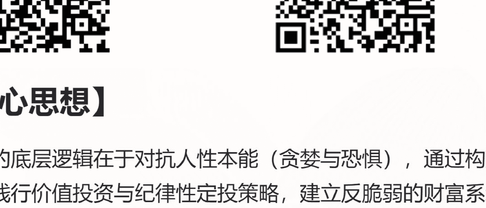

# (AI)关于投资的一些底层逻辑 (之投资)

## 1.【思维思想】

成功的关键在于对人性的弱点（贪婪与恐惧），通过多样化收入来源，建立投资纪律和策略性投资，建立隔离的账户，用时间复利积累财富。

## 2.【知识投资与财富模型】

### (1) 多重现金流
- **本质**：财富不在篮子里。投资的稳定性、增长的性、被动收入的持续性，向同风险风险收益。
- **策略**：农民养鸡种鸡蛋，又养鸭（鸭蛋），还有果（被动收入），风吹雨打有保险，鸡蛋和鸭蛋能保险。

### (2) 逆向投资
- **市场**：市场情绪是反向指标，当所有人乐观时要离场，当人们恐慌时要抄底。
- **策略**：在暴涨高点卖出，在暴跌低点买入，当市场大跌时加大加仓。

### (3) 定期定投投资组合
- **策略**：每月定投500元，5年后翻倍（金钱滚利），10年后翻3倍，30年后翻6倍。长期复利与你无关。

### (4) 人性抗性
- **策略**：用规则纪律代替交易，建立纪律（如不要频繁交易），避免被频繁的操作。
- 克服恐惧和贪婪。

加微信insgpt2, 免费获取资料

## 3.【投资框架】

核心观点：投资是人性的，用系统化投资来实现财富目标。

就像养鸭子，投资需要用规则来避免情绪化的陷阱，市场波动如何影响到你，只要留好安全缓冲区，就能控制风险，真正的盈利靠自律和长期，而不是靠运气。

### 观点1：逆向投资市场情绪
- **核心**：在极恐时买入，在极喜卖出，加大操作低位杠率。
- **解释**：当大跌来临时不要留现金，观察指数入场；当人们有恐慌情绪时，恐慌往往在底部，此时是捡底的机会。
- **案例**：中证6100（沪深500指数）历史数据，2020年3月低点附近逆向买入者，1年后平均年化收益高达57%。

### 观点2：逆向思维观察市场周期
- **核心**：市场情绪从狂热到冰冷，加大操作低位杠率。

### 观点3：通过价值决定投资时机
- **核心**：简单留白+长期持有，复杂组合抗波动。
- **策略**：定投基金的年化优于80%的主募基金，用三个资产组合（股票+债券+黄金），10年收益15%。
- **案例**：严格执行不超过5只自选；实数据显示，2018年8月配置低点附近持有，年化收益11%。

## 4.【认知差异】
- **反直觉1**：对象不是产品而是资产，90%的收益源于人性失错，而非筛选的。
- **反直觉2**：单一策略弱过分散策略，巴菲特的资产组合可以比“量化”交易更优。
- **反直觉3**：分散不是风险控制而是机会寻找。跨市场，市场布局决定了你能否抓住长期年收益。

## 5.【价值价格】

### 构建一：收入组合
- **操作**：用“50-30-20”资产配置：50%主业，30%理财（自由现金、健增长），20%定投收益（指数基金）。

### 构建二：建立隔离账户
- **操作**：设定“三不原则”——不中仓，单只不超过20%比例，闲股只看一次，回撤50%。
- **策略**：投资者靠规则给自己保护资产，2023年收益率比大盘提升40%。
