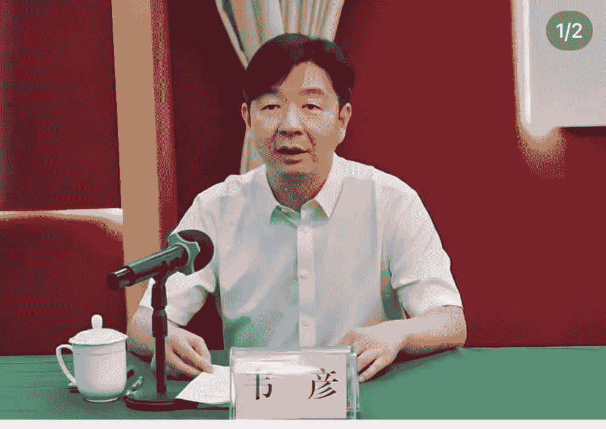
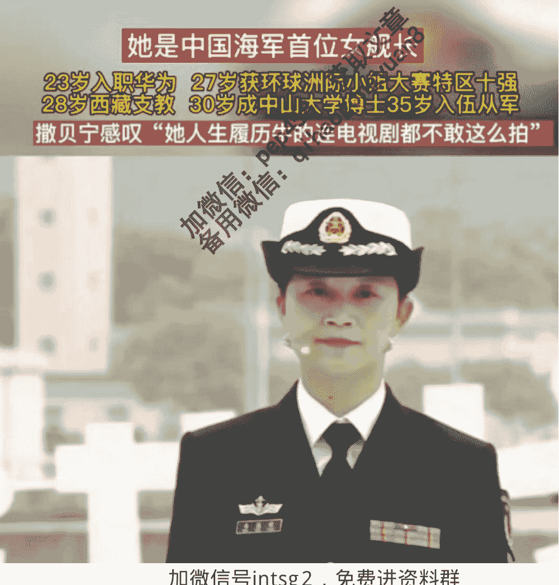

内塔如我所料，对加沙开展大屠杀了。

懂王制止过，没用，内塔就是要杀给懂王看，杀给伊朗看。

道理很简单，伊核协议是销毁作核武的高浓缩铀，而不是伊朗放弃核武技术研究，伊朗就算签了伊核协议也会继续搞搞核电站这些，一样有核武能力，就差核原料，只是这个核原料太难搞出出来了而且需要时间。

虽然懂王在这次伊核谈判中，额外加入了民用核技术的限制，一如懂王最近说的，伊朗没必要用民核能。

> ——特朗普在接受福克斯新闻台采访时说：“他们有很多石油，足够用300年，人们明白，这是资源最丰富的国家之一，而且很纯净。当你拥有无限的石油和天然气储备时，为什么需要民用核能？如果你拥有世界上最丰富之一的石油储备，为什么需要民用核能?”

加微信jntsg2，免费进资料群

但是在在，内塔看来，伊核协议依然是养虎为患，一旦美国衰落退出中东，伊朗完全可以偷偷摸摸重新搞核武。

内塔不要养虎为患，他要斩草除根，钻地弹灭伊核设施，不给伊朗有核武的可能。

进军加沙屠杀平民，内塔就是让伊朗强硬派反对伊核协议，也让伊朗亲美派看清，懂王是捏不住内塔的，懂签这个协议不代表内塔会遵守这个协议，以色列依然会时刻威慑伊朗。

然后是懂王这边。

懂王和华尔街那帮人还在架。

加微信号jntsg2，免费进群资料群

——5月15日，国际三大信评级机构之一的穆迪 (Moody's)，决定将美国主权信用评级从Aaa下调至Aa1。

——这家拥有116年历史的评级机构解释称，评级下调反映了十多年美国政府债务和利息支付率的上升，且该比率显著高于评级类似的主权国家。”

“虽然我们承认美国拥有强大的经济和金融实力，但我们认为这些实力已无法完全抵消财政指标的下滑。”穆迪在新闻稿中写道：

此此，全球三大评级机构对美国的主权信用评级保持一致，均给予美国第二高评级。此前，标准普于2011年8月将美国评级从AAA下调至AA+，惠誉评级于2023年8月将美国评级从AAA下调至AA++。

加微信jntsg2，免费进资料群

一般而言，下调主权信用评级将在一定程度上提高该国债收益率，以反映更高的风险，并可能抑制投资者对包括美股在内的美元资产的情绪。

果然，6月在即，美债危机近在眼前，美国反对派在美债这个问题上，死磕懂王。

懂王怒喷穆迪机构，说是政治操作，还用锅到拜登民民主党身上。

懂王对此的确很难办，因为不仅是民主党沃尔街反对他，连共和党内部也有人反反对他。

就是懂王最近的税改。

懂王台上改口了许多事。

一个油价就改开了，上台前说涨油价，现在说降油价。

加微信信号jntsg2，免费进资料群

# 上台前懂王还要全方位减税，现在懂王为了美债和财政，搞的新税改方案，又要给部分富人加加税。

共和党内部的保守派不干了，就这个税改法案，有5个共和党投了反对派，导致懂王没通过这个法案。

## 特朗普政府涉税改法案遭众院预决预算委员会否决

光明网 2025-05-17 08:15

当地5月16日，由共和党主导的美国众院预算委员会否决了一项涵盖税改和医保调整的特朗普政府法案。据悉，这项法案价值万亿美元。五位共和党内保守派与民主党一同投反对票。随着时间一步步推移到6月，懂王内事还有很多呢。然后，我们看看国内，看看广西。

加微信信号jntsg2，免费进资料群

广西反腐，完全是一个意外喜。

由头就是广西金湘军。本来金湘军是湖南人，又因为敏儿被查出来的。

但没想到，金湘军弄出了广西案。蓝天立的案件有三个调查方向：

- 往下查，深挖河池。
- 往上查，深挖上头。
- 往外查，深挖私下。

我们一个说。河池虽然是广西经济最落后的几个地区，但干部，河池是广西官场的本土派，其实加上桂林白色，不过白色小，两个群体其实是一个政治站位。

白色之所以和河池走到一起，是因为他们面对的对手，也是联合体。

那就是广西另外一个本土派，桂林+柳州，还有个玉林在旁边打极。

广西官场可以粗略概括为河池vs桂林柳州。

你要问了，广西首府南宁呢？南宁本地人少的可怜，而且南宁市委很少，南宁这个锅不能怪南宁人，怪河池人。

又要问了，广西到底是桂柳还是河池呢？过去十多年，一直是广西北部湾战略的，就是河池力推的。

加微信信号jntsg2，免费进资料群

之前广西三个战略选择：

- 北上，发展有工业基础且经济实力桂林柳州。
- 东进，对接广东和广东关系紧密的梧林。
- 南下，发展北部湾和珠三角竞争。

三个方向都没有河池份。原因很简单，河池在西北都是最穷的那种，广西战略倾向这边。

加微信信号jntsg2,免费进资料群

河池那帮出于自身利益问题，不愿意看到桂林柳州坐大，即使柳州GDP第二，桂林第三，两个地方有最好的工业基础，但河池依然坚决否定北上策略。

而广东省和广东省的历史悠久，广东照顾不过广西，所以广西在过去十多年，选择了南下大力发展北部湾策略。广西执行北部湾策略，且最近中央给广西一个运河的书记，挖好平陆运河就去了，未来十年广西也将坚持北部湾策略，这意味着桂柳在省内一直被压制。柳州是很惨的，上次地方问题被集火攻击，广西其他势力是看热闹。

而广西河池帮的老大，就是广西主席蓝天立，壮族人。

## 蓝天立与当年金湘军

蓝天立是当年金湘军同一批上来的干部。后落马的两正部：曾同期公选副厅，仕途交集20年

南方都市报 2025-05-17 11:57-南方都市报官方微信

——1998年4月18日，广西壮族自治区党委制定下发了《关于干部制度改革若干问题的决定》，首次面向全国公开选拔的30位副厅级干部。当年，拿出公开选拔的30个副厅职务包括自治区计委、经贸委、教委、科委副主任，人事厅、劳动厅、卫生厅、外经贸厅、民政厅、司法厅副厅长等，都是机构改革中仍要保留和加强的重要部门、重要岗位。

微信号：jntsg8
微信号：jntsg2

举在全国引起了很大的反响，区外的报名者接踵而至。彼时，35岁的蓝天立是广西自治区科技术处调员兼中国科技开发院广西分院院长助理，他盯上了自治科委副主任的岗位；33岁的金湘军，时任海南省社会保障局基金管理处长，则报了自治区劳动厅副厅长的岗位。

据广西日报，历时4个月，经过严格的考察、筛选，30名领导干部产生。1998年9月4日，广西自治区党委举行任命仪式，选拔出来的30名厅级干部发任命书。蓝天立走上了自治区科技厅（科委）副厅长的岗位，金湘军由出任自治区劳动厅副厅长。4月12日，中纪委宣布，金湘军上被查；一个月后，蓝天立被纪委立案审查、调查。

加微信信号jntsg2，免费进资料群

金湘军落马，牵出了蓝天立，而蓝天立是广西河池帮老大，深耕广西十年。其实广西一直在反腐，但没到蓝天立头上。去年落马的代表都不是本土派：

- 秦如培：长期在贵州任职，空降去年落马。
- 唐仁健：长期在农业部、中央财办任职，14年调任广西副主席，去年落马。
- 周家斌：山东人，08年来到广西，一直到桂林书记，不是本土派，偏桂柳帮。

蓝天立途反常的一个升迁，就是20年10月由省协主席改任省级政府“一把手”，蓝天立当时是全国唯一一人。蓝从一个原本要退休养老的政协，突然成为省长，打破常规的提拔任用。21年，干在山东当一号，虽然那时他搭上了这条线，有推荐副部级的权力，但其能量足够打破常规让蓝如此破格提拔。

只可能另其人。这个人大概是曾在广西过一号后来去北京的guo同志。

2007–2008年 广西壮族自治区党委书记
2008–2012年 广西壮族自治区党委书记，人大常委会主任
2012–2013年 某某党委书记

因为实在广西期间，蓝天迎来了一个仕途大进步，从河池一号升级为等同于副省长的副主席，而且被委以重任去北部湾。

2008.02–2011.1 广西市委书记，人大常委会主任（期间），2010.03.07在中广党校中青年干部培训学习
2011.11–2011.12 广西壮族自治区人民政府副主席、党委委员，梧州市委书记，市人大常委会主任
2012.01–2013.04 广西壮族自治区人民政府副主席、党委委员，北梧（广西）经济区规划建设委员会主任、党委书记（县），吴广综合规模规管委会主任、党委书记（兼），中国与马来软包产业园区委员会主任、党委书记（2012.10结束）

所以，虽然金湘军和蓝天是有义结的好兄弟，但两人头上的神是不同的。一个是，一个是。如果往上查，是可以查到这位神的。

加微信信号jnts2，免费进资料群

金湘军落马，牵出了蓝天立，而蓝天立是广西河池帮老大，深耕广西十年。其实广西一直在反腐，但没到蓝天立头上。去年落马的代表都不是本土派：

- 秦如培：长期在贵州任职，空降去年落马。
- 唐仁健：长期在农业部、中央财办任职，14年调任广西副主席，去年落马。
- 周家斌：山东人，08年来到广西，一直到桂林书记，不是本土派，偏桂柳帮。

蓝天立途反常的一个升迁，就是20年10月由省协主席改任省级政府“一把手”，蓝天立当时是全国唯一一人。蓝从一个原本要退休养老的政协，突然成为省长，打破常规的提拔任用。21年，干在山东当一号，虽然那时他搭上了这条线，有推荐副部级的权力，但其能量足够打破常规让蓝如此破格提拔。

只可能另其人。这个人大概是曾在广西过一号后来去北京的guo同志。

金湘军落马，牵出了蓝天立，而蓝天立是广西河池帮老大，深耕广西十年。其实广西一直在反腐，但没到蓝天立头上。去年落马的代表都不是本土派：

- 秦如培：长期在贵州任职，空降去年落马。
- 唐仁健：长期在农业部、中央财办任职，14年调任广西副主席，去年落马。
- 周家斌：山东人，08年来到广西，一直到桂林书记，不是本土派，偏桂柳帮。

蓝天立途反常的一个升迁，就是20年10月由省协主席改任省级政府“一把手”，蓝天立当时是全国唯一一人。蓝从一个原本要退休养老的政协，突然成为省长，打破常规的提拔任用。21年，干在山东当一号，虽然那时他搭上了这条线，有推荐副部级的权力，但其能量足够打破常规让蓝如此破格提拔。

只可能另其人。这个人大概是曾在广西过一号后来去北京的guo同志。

## 广西近期落马干部特征

- 李彦：梧州市市委书记，老家河池瑶族县
- 李文博：广西壮族自治区政法书记，曾任人民政府副市长、党委员、河池市公安局书记、局长
- 钦州市市委书记、市长、一级
- 钟宪：钦州市市委书记、市长、一级巡视员
- 黄炳利：防城市人大常委会党委员、副市长，老家河池瑶族县
- 潘涵庭：广西北部国际港务有限公司总经理，老家河池瑶族县

这就是蓝案第一个调查方向，往下挖，深挖河池。还有第二个调查方向，往上挖。因为蓝天立，上面有人。蓝天立虽然和金湘军是兄弟团，但蓝上面的人，不是干结。

加微信jntsg2，免费进资料群

## 广西反腐，完全是一个意外喜。

由头就是广西金湘军。本来金湘军是湖南人，又因为敏儿被查出来的。

但没想到，金湘军弄出了广西案。蓝天立的案件。

## 不再有遗憾了吧

南宁海关这次真的是捅了！查获30吨灰色粉末，标签为陶瓷釉料，实为纯度99%的战略物资，这些物资要是运往对岸，足够制造20枚导弹制导芯片，威力相当于装甲。谁能想到，一箱贴着“陶瓷釉料”的灰色粉末，差点成了国际市场的“硬通货”？

## 这个东西，比稀土还重要。

## 比稀土更稀缺的战争金属，美国也要大量进口，中国如何引领全球?每天新看点 2024-08-26 13:42 湖北

——在稀有金属中，有一种金属其稀缺性甚至超过稀土，被冠以“战争金属”的美誉，它就是钨。

——钨之所以被称为“战争金属”，来源于其独特的物理化学性质及其多个领域的广泛应用。钨及其化合物在合金制造、阻燃剂、半导体、军工等领域发挥着不可替代的作用。钨显著增强了合金的硬度和强度，是制造火控、轴承、电线包皮等产品的关键材料。同时，钨的化合物如三氧化二（钨白）是阻燃剂的重要原料，广泛应用于交通运输、电子电器、家居装修等领域。此外，钨还是生产半导体、红外线检测仪等高科技的重要原材料，这些应用进一步凸显了钨的战略价值。

# 广西梧州丰彦被审查调查

广西族自治区纪委监委2025年5月13日通报，梧州市委常委、秘书长丰彦因涉嫌严重违纪违法，目前正接受自治区纪委监委审查纪律审查和监察调查。以下为事件关键信息及背景梳理：

### 一、被查情况与通报

时间与职务：2025年5月13日由中央国家监委网站及广西自治区官网发布。自此通报引起，吕启轩、陈安安、冯卞，属副厅级干部。其被查消息由广西纪委委员网及多家央媒体同步发布，显示案件受关注较高。

主要问题：
官方通报仅提及“涉嫌严重违纪违法”，未披露具体细节。

是的，吴韦，那个家族的人。所以，陈刚代表广西委表态时，特意说了这句话。

# 蓝天立被查，广西族自治区党委：坚决拥护党中央决定

——自治党委坚决拥护。这次警示我们，没有免罪“丹书铁券”，也没有“铁帽子王”，任何人是谁，无论位置多特殊、身份多特殊，只要触犯了党纪法，都将受到严厉惩处。

加微信信号jntsg2，免费进资料群

没有丹书铁券，没有铁帽子王。说的就是另一位了。韦家另一位女舰长估计最近心情郁闷吧。

她是中国海军首位女舰长
- 23岁入伍，27岁获环球国际小强大赛特区十强
- 28岁西藏教文，30岁成中山大学硕士
- 35岁入伍海军

撒贝宁感叹“人生履历的这些电视剧都不敢这么拍”

加微信: pe
备用微信:
加微信号jntsg2,免费进资料群

韦家到底是小辈不懂事参与进来，还是整个家族都深度参与，这是决定韦家生死的问题。

毕竟，这些年云家叶这些牛逼很多的铁帽子家族，都年纪纷纷失势衰弱。韦家在这两家面前是远远不如的，真要深度参与走私案的话，就要复刻削藩故事了。

# 第三个要补充的，就是壮族自治的问题。

我在六年前就提出，广西要缓解内耗赢未来，就得区改省。从广西自治区，改革为广西省。

| 内容 | 路径 | 时间 |
| :--- | :--- | :--- |
| 1. 广西一步错，步错......(...) | C:\Users\Administrator\...广西 | 2019-01-19 14:50 |
| 闲话九州之十二：广西一步错， | C:\Users\A...\闲话九州州正传 | 2019-01-19 14:50 |

加微信号jntsg2，免费进料群

这蓝天立，如果不事，甚至可能复刻之前前两任广西主席席伟、清成杰，退休时去中央人大副副委员长。

广西是因为自治区，必须政治倾斜壮族人。而河池、百色因为壮族身份政治加分，在广西本土大不掉，制造了许多政治内耗。壮族满打打算就1500万人，广西总人口有5700万人，一个只占25%的少数群体，却牢牢持广西权力的基本盘。

河池、百色能崛起，也是因为他们壮族人口占比更多。柳州虽然壮族最多但占比只有53%，百色、是政治意义上的壮族市，政治倾斜+当地人抱团，催生了这两个本土派派。

- 百色市：总人口约378.8万，壮族约80%。
- 河市：根据2010年数据，人口约409万，壮族占78%。
- 南市：总人口约686.84万，壮族人口为339.04万，占总人口的50.9%。
- 柳州市：根据2008年数据，人口约368.66万，壮族占比53.38%。

所以，你别看蓝天立案涉及卖国的走私案，但这些案子都无法将河池白色帮连根拔。因为河池白色帮存在且强大的根基，不是上面有神仙，不是两地经济好，而是广西壮族自治区这个制度设计。

就是得倾壮族人，不倾斜就是违背祖制。国家不把广西从自治区改为广西省，这帮人只会春风吹生，体制内的汉壮群体只会继续制造政治内耗。

加微信信号jntsg2，免费进资料群

且，壮族的由来我早就写过了，完全是凭空造出来的，是毛主席当年为了防御台湾反攻大陆和分化桂系军阀在广西的群众基础，才搞出这个壮族的。这个看旧文就是了。

而且，我当年给出的解决方案，不仅仅是解决广西，我的用是中国将广西区省，只是一个试探，一个试验田。未来，我们应该进一步，先将内蒙古、西藏等地，最后是新疆，都从自治区改为省。

这就是我写民族系列给出的建议。

自治制度，是当年中国建国时期政治不成熟照抄苏联制度照马原原教民族主义的败笔，是一个会给中国埋雷的制度。

加微信信号jntsg2，免费进资料群

中国强盛的时候，自治制度还能hold住，一旦中国衰落，呵呵，自治制度这个雷就必然会在内外因素下被引爆，成为分裂独立的最大由头。这是必然的，我们现在这个时候欧美旧拿新疆西藏说事，我们一旦衰落了，就不是说事，而是里应外的行动了。

而各自治区中，要搞垮区改省的话，最有条件最适合过去也最合适当试验田的，绝对就是广西。这也是王教授搞民族融合观去视广西的原因。

所以，我对蓝案有三个目标：

- 初级目标：清洗河池百色派，扶贵帮，缓解广西内耗。
- 中级目标：严查走私案的幕后黑手，如果黑手不仅在广西还在中央，更要严，当然，如果有的话。
- 终极目标：借蓝案击广西壮族的高干部，开始酝区省，广西自治区改为广西省，为未来对新疆蒙古藏等棘手地区开省探路，为中华民族的未来拆掉这颗地雷。
