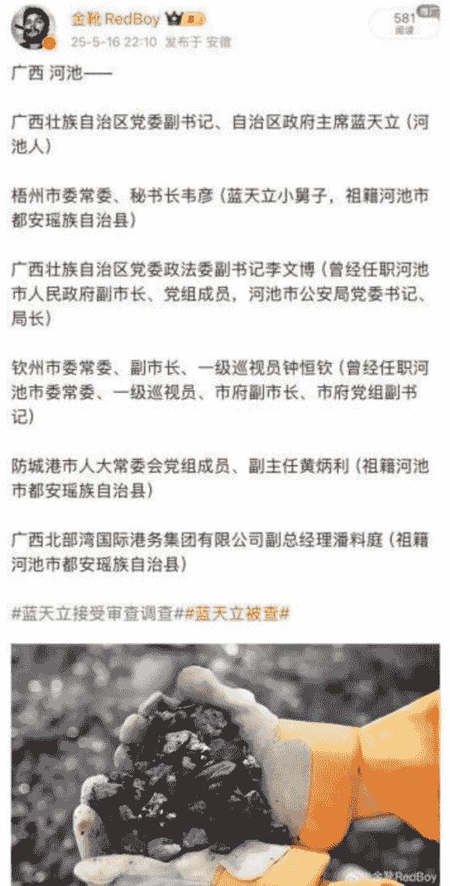

# 广西个沙瑞金，透过人事看深意

文 / 欧洲金靴

接上一篇广西蓝的文之后，再接着简单剖广西。阅读之前建议先将上一篇广西西长看一看。

16日，蓝落马之后，陈刚带领自治区党委立刻发声：“自治区党委坚定护。这次警示我们，没有免罪‘丹书铁券’，也没有‘铁帽子王’，任何是谁，无论位置多特殊，身份多特殊，只要触犯了党纪法，都将受到严厉处置。蓝立涉严重违纪，辜负了党中央、辜负了广西人民，严重损害了党的形象、广西的形象，破坏了广西政治生态和发展环境。”

没有丹书铁券……没有铁帽子王……

这是非常措辞严肃又意义深长的政治表态。

关于刚哥“身负天听之尊”的超强大背景，上一篇文章已做分析，而这一次在八桂头号地头蛇被拍死之后的发言，更是进一步佐证了刚哥的身份。

## 因为这番话的首倡者不是刚哥，正是领袖。

几乎整十年前，2015年2月，在省级主要领导干部学习贯彻的十八届中全会精神全面推进依法治国专题研讨班上，领袖雷霆教诲：“‘党纪法’不能成为‘橡皮筋’、稻草人’，无论是因为‘法盲’导致违纪违法，还是故意违规违法，都要受到追究，否则就会形成‘破窗效应’。明代冯梦龙在《警世通语》中说：‘人心似铁，官法如炉。’意思是心中冷酷如铁，终扛不住法律的熔炉。法治之下，任何人都不能存侥幸，都不能得免罚的‘丹书铁券’，也没有‘铁帽子王’。”

十年之后，成功扳倒广西“蓝大王”的刚哥意气风发，再次引用领袖金句，这直接揭示了一个事实：刚哥来广西是背负特殊使命的，不仅是接棒刘奇的发展蓝图（16日的讲话也提到“当前广西发展处于成型态势的关键阶段”），更是要肃清广西长久以来已经根深蒂固、尾大不掉、严重影响自治区新时代发展的土皇帝们。

这项工作对于刚哥来说不算陌生，看过上一篇的同志应该记得，他在青海就是这么干的。

来广西之前，他把青海官场整顿得“官不影响生”，成功把强省会（西宁）战略贯彻了下去——强省会战略不是一句口号那么简单，不是把大家召集起来开会就能实现的，它最大的阻力就在于省内政治团体（说白了就是地域帮派）的暗中阻力。

想想安徽合肥的强省会，从孙就开始直到老虞，接近二十年才真正成型（跨过GDP万亿关），这还是在安徽那些“朝中有人”的情况下（见合肥那番文章）。

仅4月以来，广西已三十三个厅以上干部被撸下。

## 第一个被刚哥拿来祭旗的就是以蓝为boss的河池帮：

多年来，广西在政坛有三大区域性政治抱团伙：河池帮、玉林帮、桂林帮；在商界则是湖南帮，由历史上湖南移民导致延续，今天的广西湖南商会、南宁湖南商会、桂林湖南商会影响力极大。

## 三个“政治帮派”中，属河池帮势力最大，触角最深最广。

当前，肃清仍未结束...

龙州的主官已经被冻升官了，他是蓝的侄女婿；崇左的主官估计是夜不能睡，他是蓝的同乡；钦州的主官和广西民族大学的主官想必怎样转反侧，这两是蓝的老表。

自治区主席必须由本地少数民族担任，在广西就是壮族，这是热知识；但还有一个冷知识：自治区规定，只能白白、河池、崇左、来宾几个地区的壮族人才担任，轮流坐庄，其他地方的壮族不能担任。

这就非常特殊。广西主席在国内数量最多的少数民族中，最稳定的壮族长期被称“壮王”，为壮族同胞们谋福利，这背后是广西财政以来惊人的支出。这一次被扳倒的“蓝”，据这两天询问了解，举例来说，一个生活在边境（距0公里）普通的壮族之家，一年也能获得至少万元的补贴，额外的医保也是政府代缴，法定假日还可以加分。多年牵扯涉案金额不亚。

这就是为什么河池帮能壮大的原因，他们控着河池一带战略物资国际黑市通道，赚得盆满钵。新闻都是公开的，南宁海关、香港海关以及缅甸等国秘密输送战略物资，这里摘录述都是由广西地下输出的。当前是我国真正义上卡全世界脖子，特别是卡美国军事大国的核心资源，也是我们这次中美博弈中腰杆，在美国脑袋上架起一柄摩克利斯剑。河池帮这么玩，可以期待一下日后的后果。

老实说，这就是区域自治制度在新时代凸显的弊端。利端是稳少数民族意志，让民族代表这是一种效率极高的安抚民心的手法；而弊端逐渐占量，那就是在自治区域深耕极易形成独立王国。多民族地区的团结才是真团结，单一民族地区的团结不是团结，那叫团抱”、“团伙”、“拉帮结派”。这里透露一个消息：前两任广西书记就和蓝不对付；去年底上任的刚哥，短短半年与蓝产生诸多。不过这一次，刚哥好了，他是带着宝剑南下广西的“桂版沙瑞金”。同时，这次大案的源头其实还是山西那个金。我前两天曾以为与蓝与金无关（因为简历无交集），但通过了解，两人在矿产走私中有深度交叉。

正是多地海关引爆了广西稀土黑市，进而将早已离开广西的金牵蓝，最后整个河池帮系统性塌方。

## 中国部署、严打稀土等战略矿产走私！

新闻 2025-5-9 17:40 广东深圳广电集团新闻媒体等...

为深入贯彻党中央、国务院部署，2025年5月9日，国家海关口协调办公室组织商务部、公安部、国家安全部、海关总部、最高法院、最高人民检察院、国家邮政局等部门在广东省召开战略矿产走私出口活动会，部署各部门具体工作。

会议指出，加强战略矿产出口管制维护国家安全和发展利益。国家对镓、钨、中重稀土等战略矿产实施管制以来，部分境外实体与内部非法人员相互勾结，不断翻新出口手段，试图逍遥。为避免战略矿产非法外流、遏制走私，切实维护国家安全，同时促进规范贸易，保障供应链稳定，打击战略矿产走私出口成为当前迫切且重要的工作任务。这个过程可以看出，反复的线路是一环扣着一环。

这就解释了为什么蓝在落马前，亦步亦趋跟在生态环境部的调研后，也带队去河池、百白、崇左“视察”，就是为了了解差同志们的检查深度。

蓝在广西屹立十年，整肃河帮的动作没有到头。

但无论如何，刚哥经此役（扳倒广西的高育良）已经是战功斐然了，仕进一步看涨。

那么通过人事看深意，为什么河帮这次成为被枪打下的出头鸟?

上一篇述，刘奇为广西规划了湘桂运河、平陆河两大超级内河工程，让广西一夜之间成为通江达海的航运枢纽核心地域，而这两条运工程，是一个永州萍湖—桂林平乐，一个是南宁—钦州—北部湾。

一域辐射一域，清晰无比。

# 广西个沙瑞金，透过人事看深意

# 陈刚在桂林调研

陈刚在桂林调研时强调

守牢生态底线发挥科教优势

打造世界级旅游推动桂林发展

文章最后放个小彩蛋。沙瑞金带着宝剑南下，这广西的（蓝已经被已经被倒了，那么广西的赵立春呢？巧不巧，有个小发现：蓝仕途的跃进大约是在2004-2007年，从副厅晋升正厅，紧接获得主政的机会，从此一路走高。而那时期，正好一位矿产有色金属专业出身的大佬主政广西……广西版《人民的名义》，我想应该未完待续吧。
