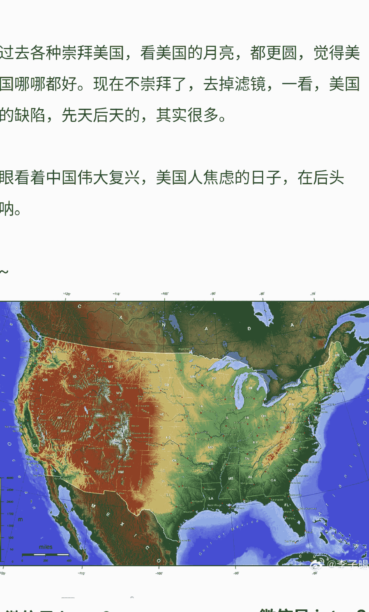

## 美国地理的劣势

2025/5/18 18:32

原本以为美国的地理条件得天独厚，俯视着我们。中国人多山，平地少，水旱涝灾害频发，美国的地理实是最是最劣的。

看完了一本书后，首先，发现美国那种“两大洋”的地理条件，其实是不咋好。两大洋，意味着两个地方都会遭受海上的攻击，毫无防御。

相比中国的背山环水，美国的“两大洋”就太差了。美国海军现在靠“倒车保险”，能够维持住面子。美国可能能力已经过去了。如果美国海军不用用了，又有强大的对手出现，美国完全再没有理由开放海军了（注：此处原文可能为“扩张”或“维持”，根据语境修正为逻辑通顺的“美国完全再没有理由维持其海军了”）。

也就是说，从地缘政治的角度来看，美国地理并不是劣势，甚至可以说是比较复杂的。

后来又发现，进一步的，从“纯地理”的角度来看，美国地理也不差。两大洋夹着，风暴从一路直到佛罗里达州，这很远很多人都知道，但还有其他。

我国一旦听到说美国，你以为美国就不会缺水了，缺水可不是问题。美国远离中国的内陆地区，缺水还是问题。美国中部那些地方，都是荒漠。纽约从那些地方有雪山，等于虚空中的城市。美国没有那么好的土地，缺水的地，比较差的。

美国西部呢？冰川剥蚀地，我国则是黄土层。无数的黄土沉积，华北的土层厚度，上千米，最厚的，几千米。

美国南部呢？冰川剥蚀了，土壤变得薄薄。土壤还经常被风化，所谓“大黑皮”，把土壤都吃光了。完全没法和中国的大平原比，差远了。

一言以蔽，美国那个地方，绝对不能养活亿人。

过去也是，人多是负担，工业化了才发现，人多是巨大的优势。整体体系工业，没有足够的工人，根本没有。过去各种崇拜美国，看美国的月亮，都觉得更好。

美国哪哪都好。现在不崇拜了，丢掉它，一看，美国的缺点，先是后天的，其实很多。

美国地理的劣势，其实很多。

看着中国大复兴之后，美国人焦虑的日子，在后头开始了。

