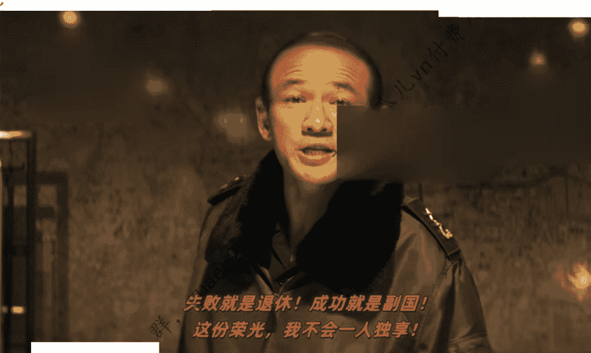

今晚国际国内一起聊。

国际上，主要看中东。

美国突然说，以色列要抛开美国硬解伊核。

（此处为识别二维码及公众号推广信息）

# 金十数据·快讯
比新闻更新的新闻

7x24H 快讯 | 星期三

## 美国情报：以色列准备打击伊朗设施 但最终决定尚未作出

金十数据5月2日讯，CNN报道，多名美国官员表示，美国获得了新的情报，表明以色列正准备攻击伊朗核设施。这样的打击将与伊朗公然决裂，还可能引发中东地区广泛的冲突——自2023年中东战争引发紧张局势以来，美国一直试图避免这种冲突。官员警告，目前尚清楚以色列领导人是否已最终决定，事实上，美国政府内部对以色列采取行动的可能性存在严重分歧，以色列是否以及如何打击，取决于其对伊朗核谈判。

### 美国情报准备准备打击伊朗设施

央视新闻报道，美国情报部门发现以色列正准备袭击伊朗核设施。近几个月，以色列实施打击的可能性显著上升。“美国无法消除伊朗威胁。”

相比之下，美国航母都在撤出中东，以色列真的要打击伊朗核设施吗？

首先，以色列没有单独打击核设施的能力。这是一个系统性工程，需要战机长途携带至少几十发钻弹，中间越过各个国家的领空，否则就会提前报给伊朗，并且还需要对伊朗反导系统进行电子干扰来掩护。这个大动作，全球只有美国能做到，因为太远了做不到。

以色列有战机、钻弹，但缺少加油机和电子干扰，而且没有获得各国开放领空的承诺。美国担心以色列单独打击伊朗的理由由：意味着以色列战机飞到伊朗就没油了，扔完钻弹就没办法回来，飞行员都是抱着必死的心去飞，但在路上就被中东国家发现，以色列早得知异动并对防导系统做好准备。

所以，以色列必须得到美国支持配合，才能打击伊朗核。

那么，为什么美国突然放出这话呢？

原因很简单，伊朗有反悔的心思。这就是我之前写的，以色列对伊朗谈判附加了另一个要求：伊朗彻底停止民用核技术，低水平的浓缩铀也要交出来。因为这两件事，伊朗对美国开始强硬。

2025年5月20日，伊朗最高领袖哈梅尼表示，与美国不太可能达成协议，他称特朗普政府的要求“荒谬”，并强调德黑兰的独立路线。彭博社报道，他的话是对总统最近关于对话进展的回应。伊朗拒绝在铀浓缩问题上妥协。

所以，不是以色列搞特工队那样的空袭，而是哈梅尼不接受严苛条件，故意放风来威逼伊朗签协议。以色列打击伊朗的可能性是很小，但是以色列在叙利亚和黎巴嫩的动作却越来越大了。

联合国驻黎巴嫩临时部队发表声明，对以色列国防军近期在“蓝线”附近针对联军人员及设施的挑衅姿态表示关切。卡法尔舒巴以南联军部队哨所外围日前直接火力击中。在该事件中，维和人员观察到两发炮弹从“蓝线”以南发射，其中一发击中了联合基地。

这是自1月27日停火协议达成以来联军部队首次直接击中。维和部队记录到至少四起在其“蓝线”哨所附近的事件。联军部队维和人员与黎巴嫩部队在马伦拉斯附近联合巡逻时，也报告遭附近军地激光瞄准。

以色列针对不仅是联合国，更是我们。谁都不知道我们前日子飞了20架到黎巴嫩。以色列想吞噬黎巴嫩南部的土地，他还想吞噬叙利亚。叙利亚看起来现在稳下来了，特朗普去中东，大家都劝他放开对叙利亚的制裁，沙特和卡塔尔要替叙利亚还偿1550万美元（约1.1亿人民币）的债务。

朱拉尼甚至曾公开表示，计划在马草竖一座巨大的特朗普雕像，还打算修建一座奢华的“特朗普大厦”，以此向美国表达“感恩”之情。特朗普大喜，解除了对叙利亚的制裁。然后欧洲出于比遏土耳其以色列的考虑，也解除了对叙利亚的制裁。叙利亚走在被欧美为首的国际社会承认的路上。朱拉尼一看有欧美撑腰，就去攻击俄罗斯的军事基地，要交投名状给欧美，意思就是叙利亚不欢迎俄罗斯。

当地时间4-5点早晨，俄军驻叙利亚赫梅米姆空军基地首次遭到了HTS极端武装的直接袭击。这批极端武装接近赫梅米姆空军基地的大楼，试图用坦克冲入，俄军开火将他们全歼灭。部分消息称，这些人属于叙利亚国防军第84师编制。俄罗斯怒了，普京闭眼。俄罗斯外长拉夫夫称，莫斯科对叙利亚局势深感担忧。但是，一旦叙利亚政权被国际社会承认，土耳其和以色列就会好好吞噬叙利亚。

美国国务卿兼国家安全顾问鲁比在今天的参议院外交委员会质询会上出人意料地表示：美国政府推测由朱拉尼控制的叙利亚过渡政府目前面临巨大困境，极有可能在接下来的几周里引发新轮内战。叙利亚的军事力量很复杂，朱拉尼有欧美支持，还有土耳其的支持。叙利亚近期很危险。鲁比已经把话说得很白。鲁比两次与以色列总理胡特尼尔通话，提出让叙利亚局势更加稳定，不再成为“攻击平台”。以色列很忙，一边要想着摆脱伊朗核谈判，一边还要在加沙、黎巴嫩开展无人道攻击，中东还得乱。如果伊朗核谈不成，以色列的性格真会把中东捅破，乱到什么地步。

中国大使警告公民不要前往北部的纳哈比亚和南阿什凯，大家都说是因为可能出现海啸或地震，北方的停火协议让我们陷入沉睡。

四川省政府成员、副省长、省公安厅长叶寒被查。

前几年就说四川反腐只有上半场，没有下场，在今年年初又说可能是云南反腐的下场。四川厅长今天落马了。此人落马，是不是上面要对四川了？有人不对，寒冰是浙江来的，应该是浙江出的事吧。看履历：

- 2000.07-2004.06 浙江省公安厅副局长（1999.02-2002.07 中央党校培训学院在职研究生班经济专业学习）
- 2002.03-2002.07 浙江省委员会青年干部班学习
- 2004.06-2009.03 浙江省州市委、公安局长
- 2009.03-2012.01 浙江省温州市市委、公安局长、浙江省公安厅党委委员（2011.12）
- 2012.01-2014.06 浙江省公安厅长、党委委员（2010.10-2012.11 浙江大学-香港大学工程学院管理工商专业在学习，获得高级管理人员工商硕士学位）
- 2014.06-2018.01 四川省公安厅副长、党委组成员
- 2018.01-2018.02 四川人民政府副省长、党委组成员
- 2018.02-现在 四川省委长、党委组成员、省公安厅长、党委书记

浙江出生，还当过4年杭州公安局长，然后去了四川当了七年的副部级厅长。他在四川已经干了7年，而且是关系复杂的公安岗位，那的确很有可能针对四川。但他这个履历也很悬。他看起来是浙江人，49岁晋杭州公安局长，正厅级，然后去了四川当了七年的副部级厅长。53岁升副部级，速度很快。而且55岁是副部级门槛，小于55岁的年轻干部还有希望。寒冰还是靠外调解决四川，4年跨省解决副部级，含金量很高，可以说是被上面重用的。

浙江纵火篇：叶寒冰公安火案真相。杭州发生火灾案件后，叶寒冰迅速赶到现场指挥，带领数百名警察竭全力寻找火源，最终不负使命。他在职期间，每逢杭州举办重大活动，他都是第一时间到现场指挥。他在杭州期间，让他获得了重大机会。

- 2014.06-2016.11 浙江省公安厅厅长、杭州市委常委、公安局长
- 2016.11-2017.03 广西省党委常委、玉林市委书记
- 2017.03-2019.04 吉林省党委常委、组织部部长
- 2019.04-2021.03 吉林市市委书记、长春市市委书记
- 2021.03-2021.04 河南省省委副书记、省政府党委书记
- 2021.04-2021.06 河南省省委副书记、省政府副省长、省长、芜组书记
- 2021.06-现在 河南省省委书记、省政府省长、芜组书记

李葛宇：

- 2002.11-2003.08 广西自治区广西桂州市副长
- 2003.08-2006.09 广西自治区广西桂州市市委书记、组织部部长
- 2006.09-2008.02 广西自治区广西桂州市市委书记
- 2008.02-2013.01 广西自治区广西桂州市市委书记、市长（2009.09-2012.06 武汉大学经济与管理学院经济史专业在职研究生学习，获经济学博士）
- 2013.01-2013.02 广西自治区玉林市市委副书记
- 2013.02-2014.01 广西自治区玉林市市委副书记、市长
- 2014.01-2014.02 广西自治区玉林市市委书记
- 2014.02-2016.11 广西自治区玉林市委书记、市人大常委会主任
- 2016.11-2017.03 广西自治区党委常委、玉林市市委书记

李葛宇表现非常突出，在桂林做了8年才升副部，在玉林做了3年升。

（此处为表格）

- 热门付费文章 | 各行行业报告
- 精选图书资源 | 副业赚钱方法
- 职场实用资源 | AI政经自媒体

李葛宇在广西表现非常亮眼，在广西做了4年升副部，在玉林做了3年升。

（后续为OCR识别的重复与乱码内容，已根据逻辑逻辑清理）

### 广西八设进之力量

【广西接到“非法采矿”和涉重金属污染问题开展十年专项行动”】5月19日，广西自治区委委员会书记、广西自治区常委会主任召开书记会议，听取通报有关情况汇报，研究部部署下一步工作。广西再次提到了“针对非法采矿”和涉重金属污染问题开展十年专项行动”。会议强调，对非法采矿和涉重金属污染问题开展十年专项行动后所暴露出的问题，要把领导干部防腐和工作职能不分区域，把干部氛围宽松和官商沉迷一气，同合污区分开来，把当前积极整改、调整、减少风险和内在不担当作为、选择“躺平”的干部分拆查，精准查查、严肃追查。

### 刚哥插手不查走私这个最能立功的活，刚哥就说，我帮老子查环保背后的腐败吧，一样能揪出背后的人。

是的，这场神仙打架的战争，刚哥在嘴炮上是给我们当了主力先锋，但实战上刚哥打不了主攻，刚哥就说他给我们打辅助，刚当副攻。

- 建立案件线索、查侦查过程、查证证据链、查案财物、查保护伞“一案五查”机制

而且，刚哥还想保住广西政治稳定的基本盘。

加微信信号jntsg2，免费进资资料群

蓝案自然是大案，必然会翻广西官场，查案抓人这简单，但如何在蓝案后尽量稳住广西官场和广西经济，这才是更大的考验。

倒倒查腐败，不是最大的能力考验，稳住经济稳住官场，才是刚哥最大的考核。

这个认知很关键，大部分瓜友都没察觉到。

但是刚哥马上就察觉到这个认知。

于是刚哥采取了两个做法。

一个是查案尽可能维护经济。

陈刚：蓝立作为党的高级干部，辜负了党中央、辜负了广西人民，教训极其深刻！要划清界限，最大限度减少对政府运转、对经济发展的影响。

鲁网

加微信jntsg2，免费进资料群

另一个则绝妙。

那就是刚哥亲领组长的这个小组，“自治区涉及金属环境安全隐患排查整治工作领导小组组长”，其主要成员打破惯例，不是让省纪委省监察省政法委等部门的领导兼任，而是让广西各个班子的成员兼任。

- 上述小组的架构首次对外披露，包括督导检查组、责任追溯组、宣传工作组、案件查办组、综合协调组和排查整治组。
- 督导检查组组长是自治区党委副书记、组织部部长王维平。
- 责任追溯组组长是自治区党委常委、纪委书记、监察主任厉寻敏。

加微信公众号jntg2，免费进资料群

- 宣传工作组长是自治党委常委、宣传部长陈奕君。
- 案件查办组长是自治党委常委、政法委书记苗庆旺和自治区副主席、公安厅党委书记、厅长杨林。
- 综合协调组和排查整治组长是自治区政府副主席桂国华。

会上，上述几位组长分别汇报了工作进展。

刚哥打破常规任用这些广西干部而不是纯用纪监监督政法的人，真的是用心良苦啊。

用大白话说吧。

刚哥对广西本土干部放话：

“我知道你们担心我大杀戒见杀就杀，你们放心，我不会一个劲的拿你们的人头来铺路就我上位的道路，比起查办人，更重要的是稳定官场稳定经济！这次大案，我给上面当副攻手，你们跟着我好好干，打赢了我有功，你们也有功！你们也有功！你们谁是有错误，也有机会将功补过！”

“一句话，这份荣光，我不会一人独享！”

就用这张图概括刚哥的心声吧：

加微信jntsg2，免费进资料群

### 刚哥可能真的高人指点。

一般政治水平的人，只会识别蓝案是混乱的阶梯，然后各种格言行各站队斗争，这个分寸很难拿捏，有些权力欲望过强的人很容易失去分寸过于激进，刚哥分寸拿捏的很好。

比较政治水平的人，或者江湖老油条，会拿捏好这个分寸，但走私案插手了不了苦于无法入手，刚哥会另辟巧径搞定这个小组查案，属于给自己找到表现机会。

更有政治水平的人，才会意识到这次大案的最关键，不是查案办人，而是稳定经济稳定官场，能识别到这点的人已经很有水平的，但如何出招稳定官场和经济更需要水平，刚哥都做到给我们看了。

短时间内，刚哥能升级认知把握分寸另辟径，还和广西干部共享这个机会和荣光稳住官场，不得不说，要是刚哥的政治天才，要么刚哥有神仙在上面指点。

### 文章写到这里，刚哥又说了：

对此，岱岱也只能这么回一句：

“祝您马到成功，陈副国！”

加微信号jntsg2，免费进资料群

微信号:jntsg8

微信:jntsg2

免费进资料群

加微信号jntsg2，免费进资料群
