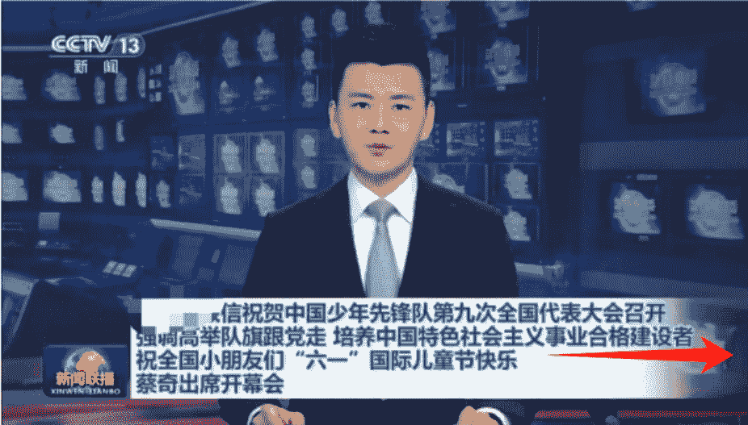
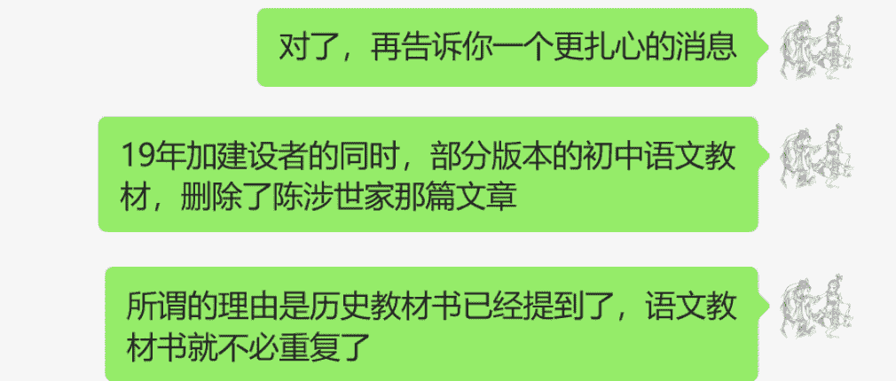

# 加微信jntsg2，免费资源群

都不是接班了

习近平致信贺中国少年先锋队第九次全国

习近平致信贺中国少年先锋队第九...

加微信jntsg2，免费进资源群

# 2019年改成社会主义合格建设者和接班人

2019年教育部将“培养德智体劳全面发展的社会主义建设者和接班人”列为年度重点任务。

普通人的培养目标是合格建设者，
年轻干部是特色社会主义接班人。

年轻干部是党和国家事业发展的力军，是特色社会主义事业的接班人。

所以瓜友们你们从小接受的教育，说所有年轻人是社会主义接班人，现在不对了，大部分年轻人只是合格建设者，甚至还有人是不合格的建设者。

年轻干部，才是接班人。

再次震碎，装都不装了。行，既然是牛马，那就要换个活法。

加微信号jntsg2，免费进资源群

牛马也有骨气

既然是牛马，竟然还想接班 🤡

想多了，兄弟们。

官方这样说了吗？

伍家位：普通人的培养目标是合格建设者，年轻干部才是社会主义接班人，年轻干部是党和国家事...

官方显然没有这样说啊。

## 微信信号:jntsg8
## 微信:jntsg2

免费进资料群

这样的大白话怎么能正常说说

之前用词是培养接班人，改成培养建设者和接班人。

至于谁是钦定的接班人，看这个。

# 培养德智体美劳全面发展的社会主义建设者和接班人

农民日报 2024-08-31 15:40 | 农民日报官方账号

# 培养德智体美劳全面发展的社会主义建设者和接班人

## “时习之·一席话”握紧接力棒，当好接班人

扬子晚报 2024-03-13 16:59

日前，2024年春季学员中央党校（国家行政学院）青年干部培训班在中央党校开班。习近平强调，年轻干部是党和国家事业发展的生力军，是中国特色社会主义事业的接班人。新征程上，年轻干部任重在肩、大有可为，必须牢记初心使命、顽强搏取，奋力成为历史的接棒。

加微信：jntsg8，免费进资源群

注意，别再背错了！人社回应：“陈涉世家”确认从语文教材中删除

关注 · 初中文知识 2023年03月02日 11:36

## ——近日，有网友发现，最新版初中文教科书删除了几代人耳熟能详的经典文言《陈涉世家》，整个初中课本都没有《陈涉世家》了。

——这篇已陪伴国人近60年的课文，有很多大家倒背如流的名句——“苟富贵，无相忘”、“燕霍安知鸿鹄之志”、“王侯将相宁有种乎！”

> 人民教育出版社：
> 考虑到《史记》在中国文学史上有重要地位，初中文传统教材在八年级上册从《史记》中选择“周亚夫韩信”替换“陈涉世家”，且避免历史学中出现重复内容。

19年，从教育培养接班人，变成教育培养建设者和接班人。

19年，教材试图删除陈涉世家，删除“王侯将相宁有种乎”那一句。

所以，毛时代那人民当家作主的政治理念，不是本时代的理念方向。

大部分人是建设者，从人民中来的年轻干部才是接班人。

当然，希望这些干部是真正的人民中来吧。

19年就改的事了，你们现在才发现，真是后知后觉。

加微信jntsg2，免费进资源群

所以社会阶级固化是被默认认同并且加强了......
所谓牛马，希望都都没有了......逼着你安心当个人矿就好。

教员时代也没有说过所有人都都是执政或者领导阶层。

教员时代当然没有这样说，只是年轻人是社会主义接班人。

也对，一九之后社会风气变衰，年轻人躺也是那时候开始有道理的和市场的对比。

对比比下年轻人是社会主义建设者和接班人，你对比比下就行了，不要自欺欺人了。

这个解读指向性有点明显。

你的意思是，加的好咯？

阶级形成无不可避免，而且上面不会搞阶级斗争去解决富分化。

我们安心做建设者，看董小姐们当接班就是了。

至于我们这类建设者最后能不能享受得到的回报，得看伟大事业接班的态度了。

就不要多想了，孩子语句教材上少了“王侯将相宁有种乎”。

这一句传承了千年的话，只能在书上删掉，无法在血液中删掉的。

当然，也可以麻醉自己，告诉自己两点，建设者加的好，“王侯将相宁有种乎”删的好，这还能继续赢。

加微公众号jntsg2，免费进资源群

这都是19年就改了的事。

我以为大家都不知道。

看来大家还是对政治细节的感知，太迟钝太滞后了。

一句话，毛时代人民当家做主的政治理念，不可能回去了。

现在的政治理念，是建设国家治理体系和治理能力。

只要治理，就是分对象的。

被治理的是人民。

治理的是干部。

当然干部也会受到人民的监督。

加微信公众号jntsg，免费进资源群

被治理的是人民。

治理的是干部。

当然干部也会受到人民的监督。 (注：此处部分OCR文本显示重复或错误，已按逻辑整合)
