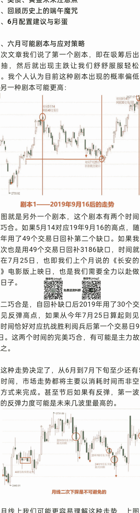
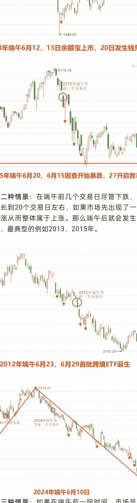

# 6月6日

北京报道 记者沈云峰

虽然端午节假期已经结束，但很多市民的心情依然高涨不减。一位市民表示：“这个假期过得非常开心，不仅感受了自然之美，还和家人聚在一起，这种感觉真的让我彻底放松了身心，对接下来的工作充满了期待。”

## 股市

此外，市场对科技板块的关注持续升温，随着相关政策的利好落地，部分芯片股、人工智能股表现出较强韧性。投资者应关注行业热点，寻找结构性机会。

## 全球股市

未来，投资者需密切关注主要央行的货币政策动向以及全球宏观经济数据的发布，这些将是影响股市走势的关键因素。

## 汇率

周一外汇市场维持平稳。人民币兑美元维持在7.23附近，人民币兑日元维持在6.45左右。全球主要货币汇率在窄幅内波动。
