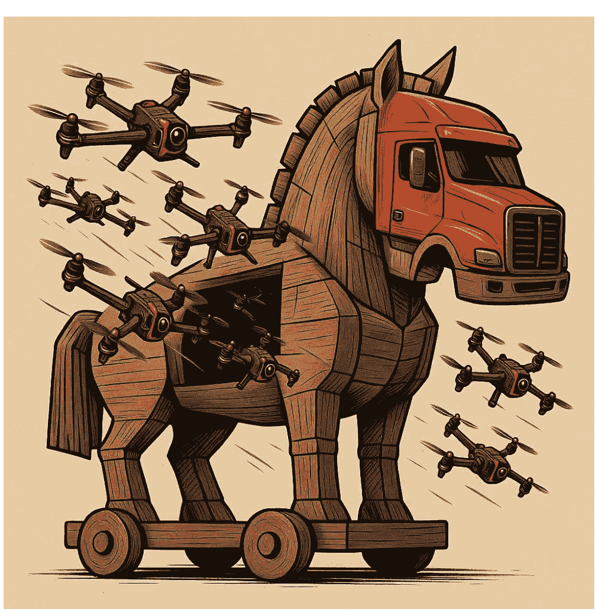
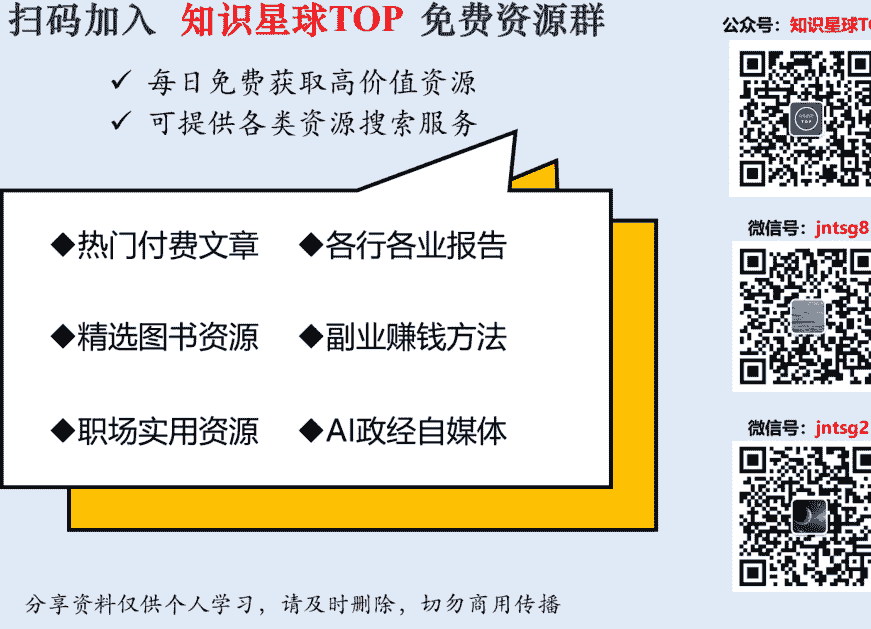
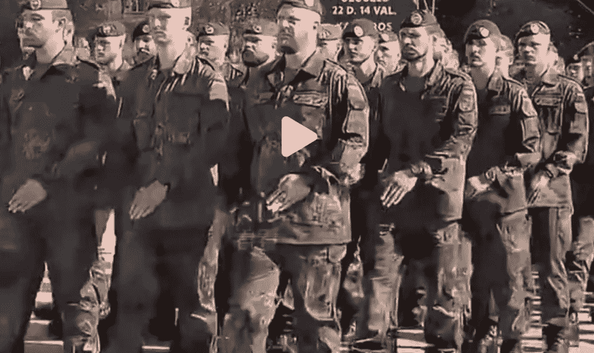

# 普京这把逆风。

大家都知道。

微信:jntsg8
微信:jntsg2
免费进资料群

只能说，普京和我们一样，顺风局就浪，逆风局反而强。

加微信号jntsg2，免费进资料群

当你觉得普京有优势的时候，普京一定会给你拉塔大的，比如初期顺利结果被哈尔夫大反攻，比如前线打得好好的内部瓦格纳事变，比如全线优势的时候被侵库尔斯克，还有这就就这次被偷家。

当你觉得普京拉胯不行的时候，普京又一定会给你惊喜，比开战初期卢布先贬值后升值，比如被反攻后开启巴赫穆特消耗战，比库尔斯克引入朝鲜军队和军事逆转战局。

兔子和毛熊都一样，顺风浪，逆风强，是真的很像啊。

不仅特征像，时间也像。

普京现在的逆风局，就是谈判谈无可谈，必须准备大规模反击报复，而且这个反击报复后，必然是俄乌战争进一步升级，乃至升级到欧俄战争。

毕竟，乌克兰已经明牌说，这次袭击是在欧洲军事体系支持下的，不是乌克兰一个国家干的，英法德都有份。

特别是继法国之后，连德国都跃跃欲试了。

加微信号jntsg2，免费进资料群

# 德国在危险的边缘疯狂试探
- 解除对乌武器射程限制
- 俄罗斯警告：德国已直接卷入
- 俄乌战争，再次成为俄敌人
- 俄媒体人：若莫斯科遭遇“金牛座”攻击，不排除回击柏林

据俄新社5月28日报道，俄罗斯外长拉夫罗夫在接受俄媒采访时，德国已直接卷入乌克兰冲突，并正走向崩溃。德国已再次成为俄罗斯的敌人。

我之前说的俄欧大战，普京还是有优势的，毕竟欧洲武备松弛，就算普京被偷袭损失惨痛，只要普京能争取到兔子当后援，就有源源不断的补给，欧俄战争普京就稳赢。

# 问题，欧俄战争一旦升级完，兔子会继续支持普京吗？

兔子这边，也逆风啊。

内外都逆风。

外部，是懂王软硬兼施，再次分化我们内部。

硬的一手是卡我们国产飞机的发动机，还有准备规模遣返27万中国留学生，这里有很多二代三代的，传导到内部扯皮很大，俏王还会放话说关税战不等90天到期，可能提前结束。

# 美方称中方违反中美日内瓦经贸会谈共识，商务部发声：美方倒打一耙，中方坚决拒绝无理指责

上游新闻 2025年06月02日 09:07
重庆 🕒 1348人 星标

懂王的理由是我们瑞士谈判后没有放松稀土出口管制，真是人至无贱则无敌。

软的一手，则是继续要和我们通电，要我们访美。

微信信号:jntsg8
微信信号:jntsg2

加微信号jntsg2，免费进资料群

JUST: 🇺🇸🇨🇳 President Trump and Chinese President Xi Jinping are expected to hold a phone call this week to discuss trade.

由 Google 翻译英语
最新消息：🇺🇸🇨🇳特朗普总统和习近平预计将于本周举行电话会议讨论贸易问题。

这个电话是谈6月14日安排的，如果谈得好，就会启动访美。

加微信号jntsg2

# 华盛顿办阅兵为特朗普庆生日？
- 美媒：美国陆军筹划在特朗普生日当天举行阅兵
- 将有超过6000名士兵参加
- 预计要花费数千万美元

资料画面

聚云新闻据美联社5月21日报道，美国陆军计划在今年6月14日特朗普生日当天举行阅兵。

加微信号jntsg2

实说，这个时候，上面的压力很大。因为内部真是一团糟。最近枪杆子又要：

- 陆军代理司令
- 后勤保障部
- 东部战委

接连出事，都是关键部门，工作刚稳定多久又出荡了。甚至传出之前被带走的卫东，已经die了。可能对他来说是最好的结局吧。震荡不断。

加微信号jntsg2

在月初的时候，就各种传出空出来的位置传闻。

- 说保留军政两个职位，
- 有说空出来的位置有老京上的，
- 有说丁上的，
- 有说重庆上的，
- 有说花上的，
- 有说退下来的人。

没办法，今年四中本来就是重要的一场会议，四中很难离开。某案加上经济问题，实在是难开。

我之前以为，有些人是要提前开四中，没想到有些人是想提前开北河。已经在策划提前开了。因为这几天没人进，就是要在扩大会上谈论这个事。

扩大会乃至河里会，我们很难知道开的如何，结果如如何。但目前看，极度乐观。

# 亮同志逝世

政见 2025年06月02日 19:07

其实5月21日就传出来了，现在是靴子落地。怎么说呢：上面现在军中最靠谱最能信任的，就是这位了。仅存的定海针人物。如果说是四爷，那这位就是十三爷。

加微信号jntsg2免费进资料群

询问：如果四爷丢了十三爷，四中还能坐稳位置吗？当然，我之前说过，万不得战争掀桌子选项。是的，还有究极选项。只能说，别人预判了你的预判，试图封杀你掀桌子的操作。

加微信号jntsg2

# 大势已去

5月7日印巴空战，中国降维打击的新军事形态惊艳全球，刚给我们巨大的军事信心，给美国在东亚带来巨大的战略压力，结果就出这些事。只能说，四中不是军事准备的问题，而是政治问题，主要是中美问题和内部问题。

扩大会似乎还在开，如果完成后就转场去河里会议，然后这边掀桌子的操作受制于人无法启动，那就是四个字：只要不开河里会，只要四从中开，就能优势在我。这把太逆风了，真不知道怎么微操到这个地步，连三爷爷都去了。

# 十三爷不去

我是万想不到会逆风到如此步，这位去了打击比导弹案还大。十三爷去了，而且在这么关键的时刻如此巧合的去了，令人后背发寒。

当年是十三爷配合一起肃徐老虎，是十三爷具体执行搞的军改，是十三一直直住不让后者起势。在导弹案爆发后空出来的位置也多从十三爷的部属嫡系中找人来填，历史证明，此人如此重要，四中怎么能失去十三爷呢？

现在环顾周围，无人敢信，无人可用。真的是孤家寡人。正在孤军奋战。只能孤注一掷。

我是个人希望中国运正常的，所以认为船行中难换舵。不管如何，中国对美斗争的主线不能动摇，不能变成和平投降，中国联俄抗美的战略决策也不能破坏，不能在这个时候背略普京换取美国友好。这是中国唯一的正确的胜利路线，众人皆知。美国在18年就说过，中美大争十年就能出来决定性结果，现在是伟大复兴的最后一公里路。坚持对美斗争，苦的是我们一代人，对和平投降，苦的是我们所有人和后代们。扩大会乃至河里会，我们很难知道开的如何，结果如如何。但如果中美通电，本月有美国访问，那么一切都会慢慢落出真相大白。

等吧，看吧。前面两次懂王求我们通电，还是无能狂怒，我们都不鸟，这次懂王却是如有神助，我们十分被动。不得不说，这次运气是站在懂王这边。来说也好笑，中俄真的是哥俩好，要逆风就一起逆风的那种。

> “我觉得，我和你的性格很相似。”
> “那就让我们一起顺风浪逆风强吧。”
