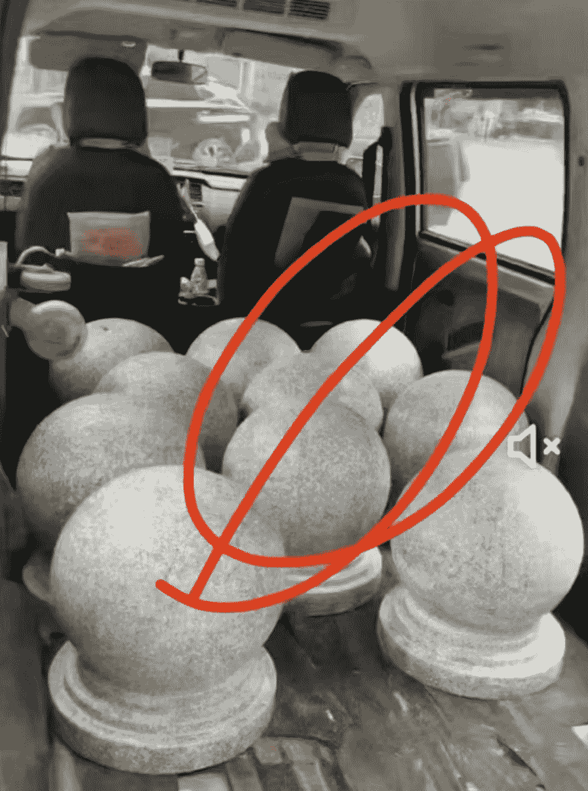
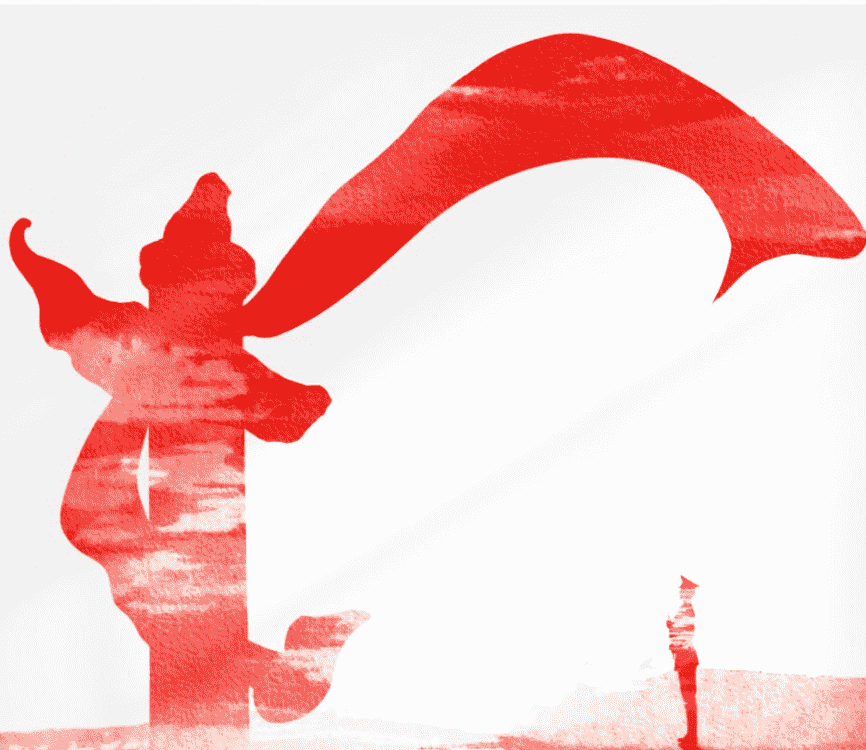
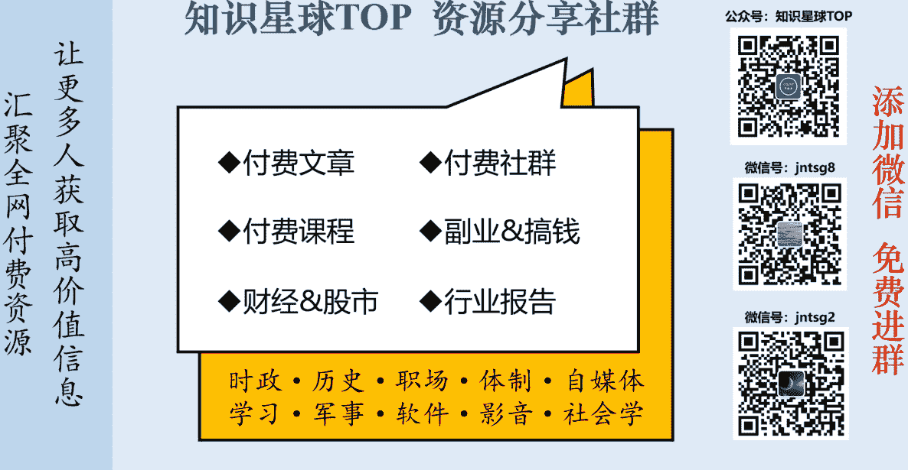

今天，让我们继续统战价值系列的第二篇。

上一篇，我们论述了统战价值在不同时代的不同特征，以及论述了利用价值是每个人的天赋价值，而国家选择统战对象会考虑统战收益率。

今天，我们聊聊统战价值的第二个类型，那就是破坏价值。

简单来说，利用价值和破坏价值，其实是一体两面的。

你的利用价值——这件事没有你帮忙的事情干不成了。

你的破坏价值——这件事要是使坏的事情也帮不。

这两个价值是一体两面的。

共产党在革命时期，在还没提出统一战线时期，自身就已经变相具有一定破坏价值的统战价值了。

国内战时期记载了很多，各地军阀对共产党的红色根据其实是睁只闭眼只睁睁眼的，不愿意下死功夫围剿，因为各地军阀知道最大的敌人是蒋介石的国民党，和共产党死磕没必要，碰碰个两个败伤反而让蒋介石摘桃子。

在我党初期发育时期，很多时候都是地方军阀变相放容，乃至礼送出境的。

包括两万五千里长征，桂系军阀白崇禧故意采用“不斩头，不杀腰，只击尾巴”的策略，暗中放围圈。蒋介石对对此极为愤怒，斥责白崇禧刻意纵容。当时各路军阀，除了手上已经有共党血情的何健下死手追击红军外，各路军阀都采取的是“送客式追击，敲粘式防堵”。

教员在星火燎原中，就精准论述了这一点，说军阀混战是红色根据能壮大的一个原因。

因为共产党自己能打，因为还有蒋介石这个更大的敌人，所以共产党对各地军阀具有一定的统战价值，并非是死敌。

难说后面教员提出统战价值，没有从各地军阀对待中共的方式中得到一些灵感。

这是斗争时期我党的故事，到了和平发展的当代，普通人也一样具有破坏价值。

破坏价值的最高等级，是造反。

《水浒传》已经告诉大家一个真理，想当官，杀人放火烧庙。

当朝廷你的成本大于招安你的成本时候，你就不会被铡而是被留。

这就是你的统战价值，造反能力的确是最高级别的统战价值。

连佛学都说了，人成佛要经历九八十一难，但坏人成佛只要放下屠刀就能立地成佛。

无他，坏人相比好人多了一个破坏价值，所以更被仗拉。

佛教也不可避免地从统战价值规律的。

但是，造反在古代农业社会是屡见不鲜的现象，但造反在信息社会的当代，则变得稀缺。

# 有个专家说，社会底层是不老百姓造反为前提。

| 序号 | 公号/星球/社群 | 原价 | 领域 |
| :--- | :--- | :--- | :--- |
| 1 | 生财有术 | 2765/年 | 副业、搞钱 |
| 2 | 尝宗吃肉群 | 365/年 | 时政、历史 |
| 3 | 记忆传承/碧锦树仙 | 365/年 | 成长、搞钱 |
| 4 | 欧洲金驼 | 328/年 | 时政、历史 |
| 5 | 卢克文青会 | 699/年 | 时政、社会 |
| 6 | 体制内主任 | 599/年 | 体制、职场 |
| 7 | 局外人的视界 | 666/年 | 金融、时政 |
| 8 | 溯源异望 | 4166/年 | 财富、成长 |
| 9 | 守夜人总司令 | 599/年 | 时政、经济 |
| 10 | 江宁字知府 | 365/篇 | 国际 |
| 11 | 政堂/顾子明 | 568/年 | 时政、经济 |
| 12 | 书院 | 1399/年 | 金融、财富 |
| 13 | 大树许多读 | 199/年 | 时政、成长 |
| 14 | 水底水 | 10000元 | 房产、经济 |
| 15 | 洪濑的宏观策略 | 4376/年 | 经济、搞钱 |
| 16 | 金大通/亥海南 | 4576/年 | 股票、行员 |
| 17 | 猫粤的世界 | 299/年 | 时政、社会 |
| 18 | 飞龙王 | 3600/年 | 股市、经济 |
| 19 | 米联储见闻 | 599/年 | 经济、金融 |
| 20 | 鉴茶财经院 | 330/年 | 房产、股票 |
| 21 | 藏在小时之外 | 365/年 | 成长 |

# 这句话真的是孙子说的

# 不要担心贫富分化

# 老百姓造反为底线

就是堵住问题增量

疏的方法则是意义深远，经济向好，保障就业，司法公正，男女优缓，降低居民贫债，减少贫富差距，提高社会和谐。用各种方式间接统战这批具有强大破坏能力的特殊群体。

这些就是大家一直讨论的话题，说到底，天下不患贫而患不均，不患贫而患不安。

与其在恶性事件已经出来后搞大力气亡羊补牢的性价比不高的统战。

加微信号jntsg2，免费进资料群

珠海市石墩子很畅销，各大商场都甚至出现供不应求的局面！

# 这能解决问题?

加微公众号jntsg2，免费进料群*

不如在无敌之人还没规模冒头之前下力促进社会公平公正。

加微信号jntsg2，免费资进阶资料群

# 共同富裕
推动社会进步与人民福祉

总结下本文篇文章。

论述了破坏能力是统战价值的一部分，而造反能力是最高级别的破坏能力，也是最具有统战价值的一项能力。

分析了为什么说随机杀人是现代社会的造反形式。

表达了个人对以后社会治安情况的一些不乐观。

分别列出堵和疏两项处理方法。

最后，尽管复还还是那三句话——

- 民族复兴，不是最大的社会凝聚力。
- 爱党爱国，不是最大的社会凝聚力。
- 公平公正，才是最大的社会凝聚力。

# 公平公正，永远是最正确的统战工作方式！

下一篇，是统战系列的最终篇，也是大家忽视最多的的一个点。

那就是普通人赢得统战价值，除了展现利用价值和展现破坏能力外，还有另外一个方向。

那就是加入组织获取组织价值。

是的，统战价值第三篇，看你是否有组织价值哦。

| 付费文章 | 付费社群 |
| :--- | :--- |
| 付费课程 | 副业&搞钱 |
| 财经&股市 | 行业报告 |

时政·历史·职场·体制·自媒体学习·军事·软件·影音·社会学