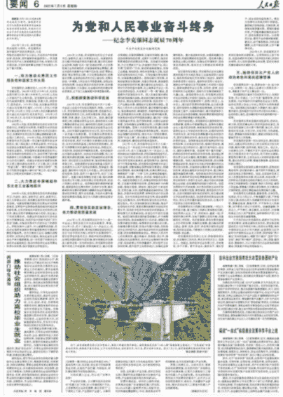
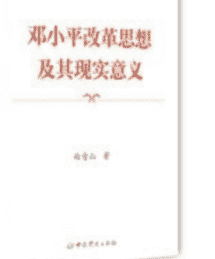

# 诞辰纪念，引人深思

文 / 欧洲金靴

本篇不长，仅作信息提供。

昨天是强子 70 周年生日，各位都应该看到了这篇官方文章：

其实实不是《人民日报》写的，文章是中共中央党史与文献研究室出的，由《人民日报》转载并分发给各中央官媒和地方官媒。

内容其实可以拆解，和两年前强子的说法差不差，但是有三处比较有趣的增墙——

① 增加了“坚持两个不动摇”，这在两年年前的结论里是没有的。

② 在抗疫那部分，较之说法，昨文增加了这样一段：“强化医疗资源和物资保障，全力救治患者，依据物资优化调整防控政策措施，及及时有效促进复工，加强保供稳价，最大程度保护人民生命安全和身体健康”——这是从较为官方的角度印证了那个流传已久的传：2022年的抗疫转向，是强子提出的。

③ 较之说法，昨文增加了这样一段：“强子同志深入扎实，积极倡导讲实、办实的工作风，带头反对形式主义、官僚主义。他提出，做好经营社会发展工作，没有捷径，实干为要。要坚持开头，真抓实干、埋头苦干，实结合创造性地。要充分发挥中央和地方两个积极性，鼓励地方地制宜、大胆探索，党委推动高质量发展。要强化问责，严厉整肃腐行政行为，坚决治理政治失信。以改革的办法，错不涵盖的精神难题，活力，给办事者鼓励，为担当者撑腰，以实现发展，以实干赢得未来。

微信：jntsg8

微信：jntsg2

免费进资料群

只能说，各位自行品味了。

就在昨日各家官媒纷纷转载后不久，耐人寻味的是，“求是”是把自己微公众号jntsg2，免费进资料群本转载的内容给删除了......

《求是》旧由中央党校管，所以删除之举或许并不难理解（党校校长X是“自己人”，号称“真正的部上”）。

至于昨天这篇纪念文章的操刀人，同样引人注目和深思：曲。

他是党内名著《研究习近平改革思想及其现实意义》的作者，在去年的习辰座谈会上获得发言机会。

加微信公众号jntsg2，免费进资料群

四年前，准确说是2021年底，正值第三份历史决议出炉阶段，曲在《人民日报》发表社论《改革开放是党的一次伟大觉醒》，痛批无产阶级文化大革命的同时，还让兴盛颇习、长哥、涛哥的执政程——唯独未为领袖留墨。

实在难评。

自2016年10月的十八届六中全会领袖首次正式被称为“核心”之后，党史逐步在官宣面上划分为三个历史阶段：毛主席“站起来”，习“富起来”，领袖“强起来”，而在各中央理论委员会和各地与单位在主笔第一系列文章时，要把五位领导人全部罗列，这已经成为党内宣传的政治规范。

更多文章加微：pe158

比如某单位要出一篇关于环境保护的社论，必须在文章里细数五位领导每个人时期对于环保事业各自的话和政策，体现我党历史的一脉相承、前后后，某种程度上这也是一种“秩序维护”。

但2021年12月曲的那篇《改革开放是党的一次伟大觉醒》，竟然不提领袖，只提习、长、涛......

而且该文中，习的足足引用了三次！却不见彼时早已成为各级理论规范的“四个自信”、“两个维护”......

那可是第三份历史决议出台的日子。

那篇文章后来在许多官媒平台被下架，我搜了一圈，陕西党史网还在，各位小伙伴：http://www.sxdsw.org.cn/dsjy/zzyj/v2a6bm.htm

对于了，这位曲同志的政历简历很有趣的，辈子没有一丁点纪检经营的他，2012年时竟然被招募，上调到中纪委员......
