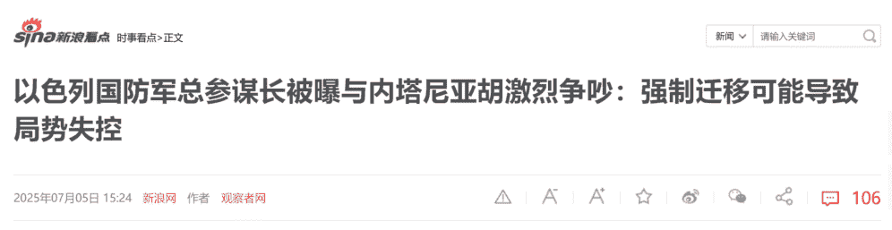

中东一段后，好多天没写国际了，现在都——补上。

东方方向，伊朗说自己大赢赢赢，内塔舔着伤口准备下一轮袭击。

> Eason Mao🐺✪ @KELMAND

以色列网站“HES”遭黑客攻击——震惊性泄露了以色列12日战争中的损失：
- 6名高级将
- 32名摩萨德官员
- 78名辛贝特特工
- 27名海军军官
- 198名空军军官
- 462名士兵
- 423名平民
已确认全部死亡。
铁穹系统损失：110亿美元

美国已经空运火药给以色列补充防空系统了。

而且为了以色列，美国减少了对乌克兰的军援。

——近日，美国白宫和五角大楼证实，美国暂停对乌克兰的部分支持。多家美国媒体报道称，这一决定源于美国军火库存过度下降的担忧。

在这段不能还手的时间里，内塔还得继续维护士气，就准备对加沙出手，将沙北部的人都强硬搬迁到加沙南部，然后正式吞加沙北部。

围绕这个激进决策，以色列内部现在正在吵架。

加微信jntsg2，免费进资料群

欧洲知道内塔准备这样做是继续雨事，也要制裁以色列。

内塔补充美国军火和拆迁加沙需要时间，这两件事完成后就是内塔再度偷袭伊朗的时候了。

中东的和平永远是短暂的。

中国则更不看好中东和平，已经在停火多日后，还发出外交警告。

# 知识星球TOP 资源分享社群

| 付费文章 | 付费社群 |
| :--- | :--- |
| 付费课程 | ◆ 副业 & 搞钱 |
| ◆ 财经 & 股市 | ◆ 行业报告 |

时政 · 历史 · 职场 · 体制 · 自媒体 学习 · 军事 · 软件 · 影音 · 社会学

让更多人获取高价值信息

江渠全网付费资源

添加微信 免费进群

加微信信号jntsg2，免费进群资料

# 重要通知：再次提醒中国公民前往伊朗

近期以色列与伊朗的冲突和谈判使得地区局势仍存在很大不确定性，伊朗形势依然严峻复杂。外交部领已提醒中国公民前往伊朗，中国驻伊朗大使馆提醒中国公民严格遵守相关安全提醒，已在当地的中国公民保护自身安全，做好应急准备，避免前往敏感区域。

如中国公民坚持前往伊朗，可能会面临极高安全风险，可能影响其获得协助的实效。

联系方式：

伊朗急救电话：115

伊朗报警电话：110

# 应该是中国的伊朗完成了10C的军火交易

> ——网传，2025年06月29日 02:24伊朗决定购买中国的歼-10C战机！关于此次购买数量，说法不一，有报道道称可能是36架，也有说法是40架（可能包含4架歼-10S双座型号），大致规模为三个战斗机中队。

加微信jntsg2，免费进资料群

——预计首交大大概是10架左右，每架的价格大概是9000万美元左右。歼战机只需要6000万美元，全套包括弹药、零部件、训练、备用发动机在内合格为9000美元，只有西方战机价格的一半左右。按中国标准，10架战机差不多可以组成一个中队。

——这一次对伊朗，哪怕空战挂载，以色列空军至少一半战机要选择，另外一半战机也必须降低对地轰炸量，这样以色列对伊朗空袭力度就可以下降75%，以色列军就不敢这么忌惮德兰，甚至战机全部对地轰炸。但伊朗有点脑，说初步给出的方案是用天然气换取歼-10C生产线。

加微信信号jntsg2，免费进资料群

我们自然不肯，傻子才肯。中国军工产能全球第一，只要钱到位，半年内交货不是问题，实在要急，甚至可以从美国装备中的歼-10C稍微改造后配，以色列空军快速形成战斗力。单卖歼-10就能削弱以色列空袭锐。如果中国再卖反导系统，以色列下次难以打痛了。这个骨眼上，中国估计是怕事，怕内塔利用伊朗公民。此轮被斩首的伊朗高官们已经藏好了，被报道位高官穿着平民衣服，一个手机电子产品都没有带，隐藏在平民中，还是被斩首了，泄露情报的鬼还没找到。内塔想报复中国军援伊朗，跨本土搞事是难度极高且不太可能的，但伊朗却是轻松松的。的确，近期以色列出发如果有外国敢军援就报复外国言论。就是伊朗贸易。可以看出，内塔在缓口气，伊朗也在买军火。加微信信号jntsg2，免费进资料群

这次只是中场休息，下半场要开始。看下半场我们的武器能不能早日发挥效了。上面不是说美国库存不够，选择优先给内塔而不是给俄罗斯。这个人很聪明，本来是主动削减对乌克兰军援，但懂王立马给普京打电话，意思是我是很有诚意，普京看这边诚意举上，昨晚电话了。

可惜，谈崩了。上一次懂王电话，两人谈了三个小时。这次谈了一个多小时。懂王谈完表示，普京还是要领土，停火谈判不可能，俄乌和谈毫无进展。

> ——美国广播公司（NBC）报道称，特朗普说，他在结束乌克兰危机上“没有取得进展”。
> ——特朗普还表示，他对此感到“不高兴”。

微信:jntsg8
微信:jntsg2
免费进资料群

普京方面表示，在这次电话前精准斩首了一位俄罗斯军方高级官，这是严重挑衅，是可忍不可忍，懂王的电话没用，挂完电话宣布对乌克兰境轰炸。

——乌军称，俄罗斯发射了330多架无人机，这是迄今为止规模最大的一次无人机袭击。加上导弹袭击，发射总数达到约550枚。所以俄乌继续打。大概率在今年就升级为俄欧战争。因为几个因素：

1、美国因素
懂王对普京的效果影响越来越小，甚至普京公开说懂王不要再来劝架了没用的，懂王很不爽。

——乌沙科夫称，特朗普在通话中表示希望迅速结束俄乌战争。——普京告诉特朗普，俄罗斯不会放弃在乌克兰的目标，俄罗斯认为与乌克兰的和平谈判是双边问题，美国不应积极介入。——特朗普表示，他对此感到“不高兴”。中东再度打开了懂王援内塔更多，对乌克兰支援有限，而下一轮中东又要打开，懂王只会让欧洲自己的力量去支援乌克兰。

# 2、普京做好扩大战争的准备

普京的关键是朝鲜。朝鲜已经打算再派3万部队前往俄罗斯。

——克兰GUR报告称，作为沙赫无人机和装甲系统的交换对价，朝鲜近期将派出近3万名士兵，增援俄罗斯。这批士兵不仅在库尔斯克协助俄军防御，还有很有可能在俄罗斯占领的乌克兰部分地区参与战斗。规模大概是去年参加库尔斯克反战朝鲜部队的3倍，是俄军即将发起大规模攻势的预兆。普京已经准备好进一步扩大战争，而乌克兰血条已经见底。

# 3、中国的态度至关重要

中国在3月份的时候，还想着劝俄乌，然后派部队去乌克兰。事实上俄欧都不认可这个方案，现在中国也没有念头了，甚至开始抛弃之前的中立立场，中国竟然开始偏向站队。原因有很多：一个是懂王在中东太硬，让欧洲改变立场，好谈判没了。中国看死活靠自己，也不慌着欧洲来找中国。

——彭博社报道，中国政府计划取消晚些时候举行的欧领导人会晤。彭博社称，这是凸显布鲁塞尔和北京之间紧张关系的最新迹象。彭博社引用知情人士称，应请求取消为期两天的欧领导人会晤。其中一名知情人士透露，是因为内部危机，中国寻求破局，维护和平才符合中国自身的利益。所以这次王毅去欧洲直接明了中国的真实立场。

那就是不可能让俄罗斯输。——香港《南华早报》引消息报道：“中国已告知欧盟，它不能让俄罗斯在乌克兰战争输。”据知情人士透露，中国外交部长王毅周三表示，北京不能让俄罗斯输，因为担心美国随后会将注意力转向北京。

王毅 however拒绝了中国为俄罗斯的军事行动提供支持（无论是财务还是军事），并表示如果有的话，冲突早就结束了。欧洲在中关系上执迷不悟，那就怪中国利用普京给欧洲上强度了。以上可以看出，懂王已经劝不住普京，普京要准备夏季攻势。而且这波攻势很大，不仅得到了朝鲜的生力军，很大概率会得到中国加强的军事援助，中国已经把丑话说在前头了。完全不排除这次攻势会让俄乌战争直接升级为全面的俄欧战争。中东半场休息，短暂的一段和平时间后，就是俄乌中东继续开火升级。这个时候，中国会怎样呢？

据彭博社报道，特朗普可能今年10月底访华。目前白宫正在与美国企业的CEO面谈，可能有望作为商务代表与特朗普赴华讨论中美之间的经贸问题。亚太复合组织峰将于10月下旬在韩国举行，东盟领人峰将在马来西亚举行。鉴于美国总统通常会出席以上峰会，特朗普的中国之旅或许在那时成行。10月访华是最好的消息，这意味着我们还有3个月的操作时间，意味着家里会议没有溃败。10月份，中国选边站的俄乌中东早已打开，中国帮谁就有优势，中国肯定想着届时利用这两处优势去跟懂王谈判。

当然更重要的还是多出的这三个操作时间。四中全会惯例是9月下旬和十月上旬开启。懂王10月访华，也是开完会后再见，是我们的最优剧本。目前信息比较杂，传最多的是魔都一号去重庆当一号，魔都二号上一号填坑，而空出来的重庆一号去北京当中主任大内总管。如果这个消息是真的，那就是太子之位已定。魔都一号变重庆一号看起来是平调实际上是降级，本质上意味着魔都一号退出了九龙夺嫡的竞赛，他失败了。成功上位的是重庆一号，大概会在四中上正式官宣为东宫。这只是在传的众多消息之一。毕竟，有太子意味着我们重大妥协。
