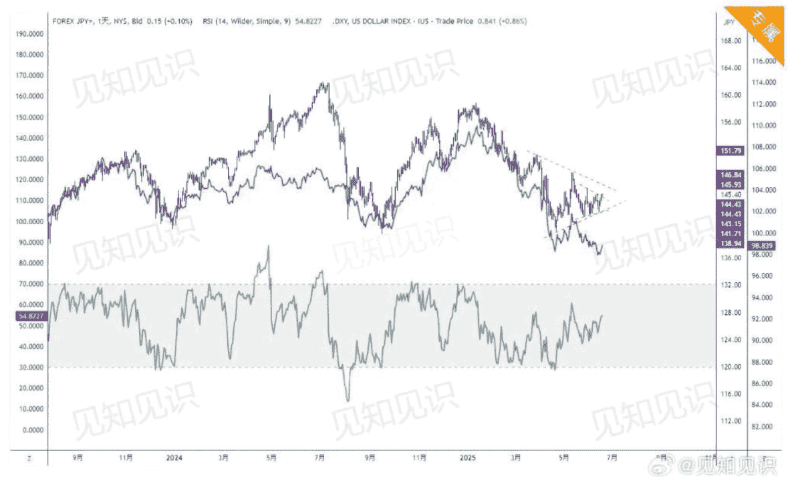
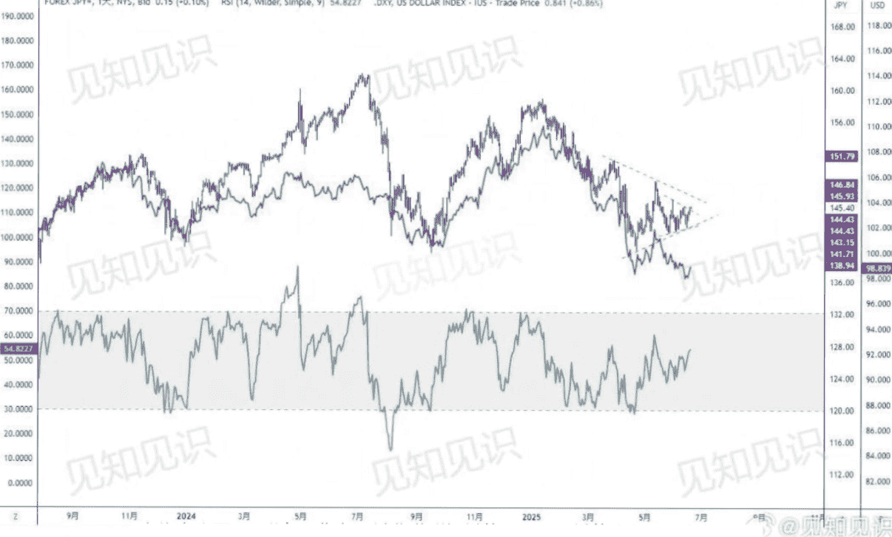
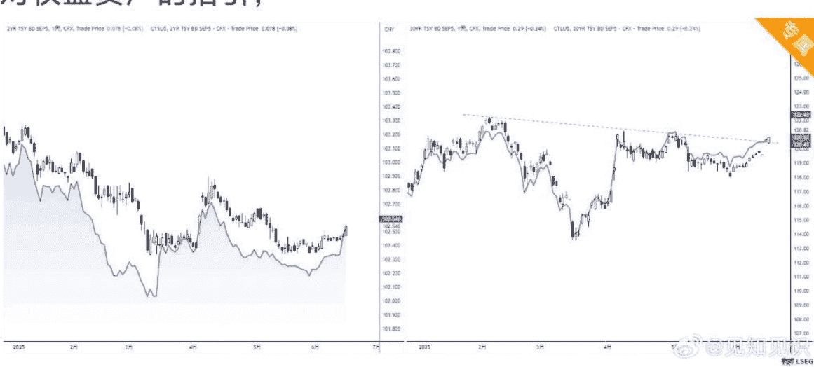
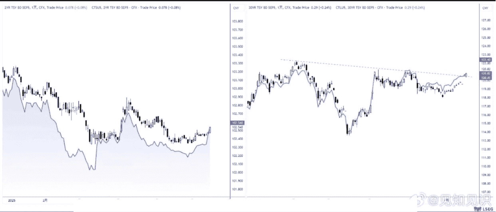
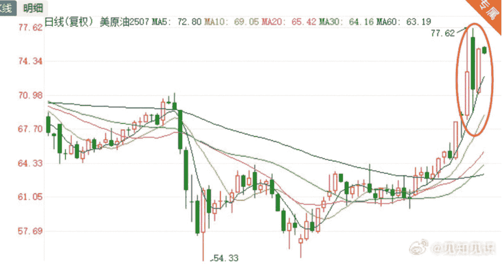
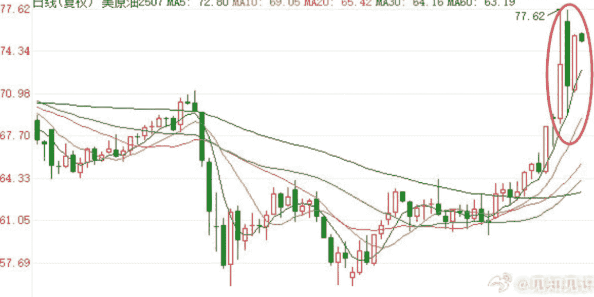

# 微博正文

见知见识
25-6-18 08:22 来自微博网页版
发布于 上海

【V+微博】日元在GS冲击结束后，汇率却没太跟随美元指数，这个原因之前森森解读，跨西洋避险资本流动是过去一个季度由欧元主导，而不是日元，欧洲陷入的是不断地降息利差拉大日元升值的路径，这和曾经的瑞士法很像，现在TA分析日元没有创新高（美下跌），反美国有技术变形没有突破的迹象；

日元瑞法 0.00562

大家都在搜 #大西洋 #美元指数

见知见识
25-6-18 08:28 来自 微博网页版
发布于 上海

# 【V+微博】新闻跟踪：隔夜俄罗斯对基辅发动了今年最致命的袭击，绍伊古去了朝鲜见了金

大家都在搜 #绍伊古

见知见识 👑
25-6-18 08:36 来自微博网页版
发布于 上海

# 【V+微博】关注中债2年期期货和30年期期货的走势，以及对权益资产的指引；

# 见知见识

25-6-18 08:42 来自微博网页版 发布于 上海

【V+微博】战争这东西的不可预测，唯一确定的是波动大，很容易被洗刷刷掉；

# K线 明细

日线(复权) 美原油2507 MA5: 72.80 MA10: 69.05 MA20: 65.42 MA30: 64.16 MA60: 63.19

