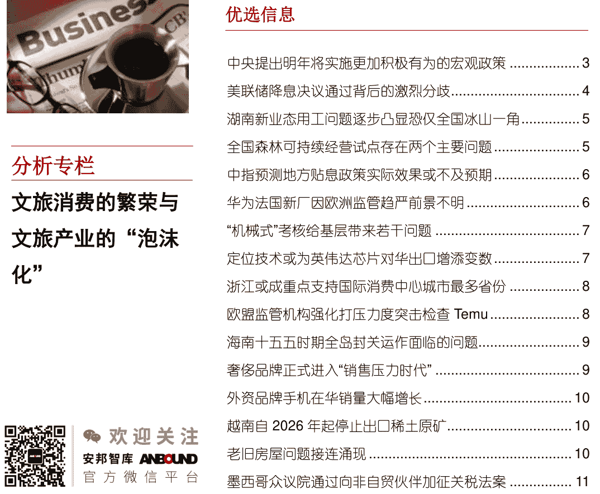

# 每日经济
ECONOMIC DAILY
安邦集团 中国宏观经济研究中心

2025 年12 月 11 日 星期四 总第 7558 期

# Business

# 分析专栏
文旅消费的繁荣与
文旅产业的“泡沫”化

欢迎关注
安邦智库 ANBOUND
官方 微信平台

| 网站 | www.andbound.com.cn | 邮箱 | aici@andbound.com.cn | 订购热线 | 010-56763030, 010-56763018, 010-56763028 | 服务热线 | 上海 021-62486072, 深圳 0755-86798863 | 成都 028-68222002, 杭州 0571-8722220, 重庆 023-96599777 |

# 【分析专栏】

【文旅的繁荣与文旅基础设施的逐渐，“泡沫化”】

近年来，随着消费升级，文旅越来越被认为是服务消费增长的重要组成部分，同时也成为经济增长的一个新增长点，各地经济区争相进入这一领域，意图以此推动地方经济结构的转型，实现“绿水青山”向“金山银山”的转化。

从满遍烧烤到天水麻辣，从“村超”到“超级”，文旅带来的已经经历经济效益，越来越多成为一种社会现象，不仅索引给这些地方带来了“流量”，也为地方政府带来直接的收入。2025年5月至7月，“超级”在范围内连续爆发，直接带动了旅游、出行、住宿、购物五个场所实现旅游收益37.9亿元，同比增长高达42.7%。超级不仅已吸引了全国的超级IP。数据显示，国内居民规模56.2亿人，国内居民支出总花费5.8亿万，同比增长17.7%。由此可见，文旅消费的确具有较大的市场潜空间，也因此很多地方能够引起消费的转型。

虽然，很多地方都开始推文旅消费和文旅产业发展，但在安邦智库（ANBOUND）的调研中，发现文旅看似繁荣的，却越来越多出现“泡沫化”的倾向。另一方面，地方出行、旅游并没有给文旅企业带来收益。十一集团的三个景区表现优异，只有两半的企业实现了利润增长；近六个景区收入同比下降，半数景区净利润同比下降。2021年，青海旅游投资集团有限公司及13个景区集团执行清算。作为其一个省级文旅产业的开拓者，给整个产业带来了增长。坐拥多个景区景区的张界华因亏损重重成为“老赖”。另一方面，景区投入不断增加，收入却停不下。数据显示，2019到2023年，A级景区数量增加3000多，平均收入却下降近40%。全国15.7万A级景区数量虽只能维持稳定，三成在盈利界线边缘，半数明确亏损。

在安邦智库的研究人员看来，目前文旅市场处于“冰火两重”的局面，情况本身是“旧模式”与“新需求”的脱节。旅游消费需求已经从此前的观光、打卡式需求，升级为“吃喝乐玩”的休闲、体验式需求，其推动文旅消费的需求，与传统文旅产业发展的节奏之间的矛盾越来越增大。

带来文旅扭曲的问题是需求与供给错位。例如，

2015年以来，在政策推动的“特色小镇”建设和发展中，很多镇的成功导致了同质化现象成为“文旅”的区域名义。截至2024年底，全国所有层级的特色小镇总数达到1200多个。住房和城市建设数据显示，截至2023年，403个特色小镇中旅小镇占比63%，主题重复率高达50%。云南一个一级城市曾规划建设10个“民族风景小镇”，最终仅3个生存。企占营销，许多特色小镇在打造文旅品牌的名下，实际上成为当地“文旅+地产”的模式。随着房地产泡沫的破灭，大量的特色小镇消失。即便使得，由于缺乏特色和运营，导致游客寥寥。中国旅游研究院报告显示，约60%的受访者认为小镇“雷同”，缺乏差异性，许多表示“文旅以外的商业业”。

同样，“文旅+体育”的日益流行，越来越多的城市热衷于举办马拉松比赛。根据中国马拉松赛官网统计，2023年全国举办了699场，参赛人数超过60万次；2024年增加至799场，参赛人数突破70万，赛事范围涵盖了全国51个省级行政区、261个市、537个县。中国田径公布的赛事目录显示，今年11月、12月共举办了116场马拉松赛，涉及18个省。不过，由于如此频繁的赛事，除了头部城市实现盈利，大部分小城市则是“热闹”，对旅游的带动作用更是“花钱一场”。

此就，很多地方缺乏“文旅”的耐心和经营，文旅的角色异化，是发展逻辑演化的结果。在疫情之前，一些地方希望以文旅作为产业的入口来实现“落地”；有的地方希望将文旅项目作为基础投资的“圈子”，有人用它换取投资的资金。在疫情后一轮文旅发展中，很多地方为了抢“流量”，希望重复复制，“旅游”的老套，直接热闹，话却说起来容易，同样因为在文旅供给中缺乏特色，缺少精细化和经营的难度，难以以“流量”换为“留量”。在“泡沫”破灭之后，这些不能成为“主业”的项目最终在市场上难以为继。

在新的阶段，旅游消费的融合趋势日益发现，但当地许多地方仍然处于“景区驱动”模式中，缺乏促进二次消费的能力，众多旅游者无法有效资源转换。目前在文旅2.0版，实际上旅游业本身已经成为城市消费的主战场，更多的消费来自其上的特色消费，或者旅游导游的餐饮、娱乐、住宿等其他类别，形成“旅游+消费”的新常态。起，景区化运营中，门票占比30%，在此70%中住宿、餐饮、文创等“二次消费”。与此相比，类似旅游仍然停留在门票收入模式下，难以覆盖成本，更因缺乏特色和运营被淘汰。

因此，由于消费升级和需求多样化，旅游产业正在从重资产开发向资源整合转变。在基础设施趋完善的背景之下，旅游市场转向了价值化开发，以及以“吃喝玩”等多种业态协同。如当前的“CITY WALK”，其线路优化和规划，以旅游作为主体。这种趋势不需要搞，更需要精细化的运营。曾创出百亿，青海藏域在政策支持下，首批景区、酒店、民宿等项目，也缺乏盈利，增长包含了赛事的相关经济，其本质是类似的供给模式，以创新满足多元化的需求，而不在于流量。

最终分析结论（Final Analysis Conclusion）: 在旅游消费潜力不断释放下，当前旅游产业存在严重的错位和扭曲，主要原因在文旅消费的繁荣与文旅基础设施的逐渐，“泡沫化”。

# 【政策：中央工作会议】

最近，12月10日至12日在北京召开的中央工作会议指出，良好开局。今年工作上要坚持发展、提质增效，适应大周期，继续实施积极的宏观政策，保持政策准确性，平衡总债和总量，提升治理效率。要增强政策一致性，加强发展和增长周期调节。要加强科学管理，优化支出结构，科学税收规模。要统筹发展和国际竞争力，增强国内需求，优化结构，扩大活量、存量，强化防范重点风险。深化全国统一市场建设，推进经济运行和谐稳定，实现高质量发展，能力突破。要扩大内需、科技创新、中小企业等重点领域，引导资金加力，灵活运用货币工具，重新评估财政政策，兜住“底线”。要增强政策取向性和有效，纳入政策规划取得一致性。健全周期管理机制，增强社会信心。

## 【形势要】美联储降息决议的激锐分析

10月10日，美联储以9比3票投票降25bp，决策层内部出现明显分歧，显示联储在解读上尚未达成共识。这种结构性分歧意味着未来决策路径的不确定性。从明确清晰指出，委员会在后删除了“失业处于低位”的表述，意味着不再认为劳动力市场足够强劲；对增长面临“通胀与高利率”的担忧，显示联储宽宽松政策将依赖依据数据触发的“反应函数”。美联储每月400亿美元短期债券购买计划标志着决策正在走向符合“有节奏”的要求。鲍威尔揭示了当前决策要点存在焦点缺失。他指出修正后的经济增速可能已转为负值。这一结论与近期持续运行减速的劳动力供给收缩相反，解释了为何在消费尚具竞争性时仍需“防御性措施”。言之，美联储并非刺激需求，而是试图前瞻应对冲击的政策转变。

## 【形势要点：地方政策实际效果不及预期】

近日，全国有多地出台贷款补贴，但由于行政层面持续要求，内部压力加大，未来政策可能呈现出“微不足”。总体来看，本次决议释放三类信号：政策空间有限、数据质量不够、政治敏感度高。

# 【形势要点：湖南用工进展缓慢】

近年来，随着产业升级，湖南用工分布存在差异、复杂化，受用工多元化、旧模式进展缓慢。案件数量显著高于其他市，全市案件数为48个；其中长沙、湘州、岳阳、怀化等地案件数较多，占比约60%；其中长沙案件较少，占比不足20%。安邦智库（ANBOUND）研究看来，湖南用工规模增大，工作时间长、劳动强度大、职业多样化，但工作形式多样，出现用工缺口。

# 【形势要点：森林可持续经营存在两个主要问题】

2023年以来，国家发布《森林可持续经营方案（2023-2025年）》，在全国开展了森林可持续经营试点。有关分析指出，虽然取得了较大的进展，但也存在两个主要问题。一方面，在政策与管理上，分类与经营混淆，自然保护需要。另一方面，资金主要依赖中央财政补助，缺乏长期投入、回报率低、难以进入集体化经营。

# 【形势要点：华为为法国面临前景不明】

人士透露，据明年透露，华为在法国阿尔普拉斯地区附近新建的工厂将于9月基本完成，这是华为在海外之外的5G相关生产工厂。项目初期筹获市场的重要性，但目前还有其他因素导致此项规划面临变数。从市场环境来看，欧洲5G调整较为宽松，限制了电信设备的空间。由于中国作为欧洲蓝牙市场，若有运营商选择华为的高性更换为华为，由于欧洲市场存在分化，少有14个欧盟国家跟随，西班牙等地更为明确“华为化”，为保持一致。整体来看，欧洲治理环境的不确定性仍占主导，华为在法国的项目已进入调整，等地已达成800万欧元补贴。

## 【形势要点】海南“十五五”期全岛封关运作面临的问题

海南12月10日发布“十五五”规划，明确将“高标准建设海南自由自贸港”为首要任务，标志着全岛封关运作进入实质性阶段。规划实施后可能面临的经济发展根基风险、区域发展不平衡及风险加大等挑战，强调需要加强区域协同与精准执行来破解。在协调层面上，规划要求加强与粤澳港湾、长三角等国内区域的联动，并扩大对外合作，形成“两个基地”、“两个枢纽”的战略功能，但如何避免同质竞争、实现政策效应需具体设计。

对外转型需要“智慧海关”建设与风险防控，通过大数据、人工智能实现关高效监管，并建立安全风险防控机制。对于规划涵盖的“45432”产业架构，资源能够聚集、聚焦“扩融机遇”等是实施关键。

值得注意的是，规划需明朗动态调整“零关税”，探索沿海业务制度型开放释放，控制制度转换的平稳过渡、数据跨境边界等细节仍需细化，考验后政策的衔接与配合。封关运作海南是政策引领，向开放边界的成功不仅取决于设施与政策设计，更取决于市场主体能否正确形成“梯式推进、闭环管理”的协同机制，从而在开放与安全中取得平衡。

## 【形势要点】奢侈品正进入“销售压力时代”

当前，奢侈品市场已进入“闭环”的黄金时代，销售压力明显显现。媒体显示，受经济波动影响，消费者信心下降导致消费影响，奢侈品品牌开始启动“防御态势”，不再核心客群范围内的消费者面临选择与活动减少、线下购物转型、徕宝等营销活动显著增长，却面临类似的销售销量困境。同时，品牌内部预算筹措、培训、活动规模缩减，显露出运营压力增大。今年，中产阶级购买频率下降、海外消费回流优势依然强劲，使得奢侈品的主客群结构发生变化。数据显示行业面临严峻：2025年上半年，LVMH利润大跌15%，开云集团利润下跌46%，广义流量规模的疲寂。

在销售压力背景下，奢侈品品牌推出新“闲店”，加速退出下线城市，将资源重新聚焦于一线核心圈和机场购物，并依靠会员服务、贵宾体验提升。与此同时，品牌也从“性能优化”转向“资金导向”，加大体验场、文化活动及新奢侈品牌的引入，反映出奢侈品生活的深度调整。尽管三季度中国市场需求出现回暖，但奢侈品行业整体已步入转型、体验与精准把握品牌为核心的“销售压力时代”，未来增长将更多依赖结构性创新而非自然回归。

## 【要点：外资品牌手机在华扩大增长】

据渠道报道，最新数据显示，外资品牌手机在华销售呈现复苏态势。2025年10月，以苹果iPhone为代表的外资品牌手机在中国市场出货量达702.7万，较去年的621.6万实现了13%的增长。此外，三季度iPhone出货量已创其历史第三高位，同比增长4%，在此之前第二季度更是出现过环比增长2.5%的强势反弹。

外资品牌手机的整体回暖与中国市场总体态势密切相关，10月中国手机出货量达3226.7万，同比增长8.7%。此外，外资品牌手机的表现放在宏大的市场中仍有优。然而外资品牌手机仍落逊于国产产品，国产品牌手机出货量2524万，市场份额达78.2%。

三季度市场，苹果虽在中国手机市场保持领先，但在中国市场的竞争地位日益严峻，其份额已落至12%左右，成为全球唯一领先的手机厂商（注：此处原文可能有误）。这反映出国产手机在技术创新的定位上，正缩小与国外品牌的差距，尤其在AI集成、影像技术、折叠屏等领域，华为、小米、vivo等品牌手机加强了竞争力。因此，外资品牌近期的增长能否持续，仍取决于在技术创新与本土化策略上实现性突破，以应对中国品牌的激烈竞争。

## 【要点：越南2026年起停止出口土地原料】

11月12日，越南国会通过了《质矿法》修订版，明确从2026年1月日起停止出口稀土矿石。同时对稀土矿资源的开发、开采、加工及深加工实施严格监管，仅允许生态国家授权的企业和组织参与相关活动，要求稀土深加工与现代工业系统深度对接，推动本土化完善产业链，稀土资源自给自足形成供应链安全。

从贸易角度看，这项策略与此前预测一致，2025年起停止稀土开采将形成效应。2025年1月，中国进口的稀土原料占比达52%。然而越南稀土原料对华出口占比较高，短期内不会引发供应危机，但部分依赖越南的中小型企业可能面临原料的采购成本调整，导致其不得不寻求国内储备或其他进口渠道，间接影响中国区域稀土供应链布局。

## 【社会反应：老旧房屋问题突出】

日前，吉林省当地居民反映，南某小区已有40年历史，小区前曾被多次检测鉴定为D级房屋，居民每天生活在“提心吊胆”的日子。前几年，有开发商用木质纸板覆盖，说是要改造，但后来再无音讯。不仅是建了40年的老房子，一些对“过年”的住宅也进入爆发期。

承德如入居民反映，富家园小区2003年竣工，距今已有22年，老旧小区，没有外墙保温，楼老旧，冬冷夏热，夏天下漏风，且老年人年居住多。

目前，我国住房主要分为几类：一是使用寿命已50年的房子；二是1975年左右的小房子；三是1980年以来的住房，房龄普遍超过30年。到2024年，我国房龄30年的住房占比达35%。这些房龄较高的小区，可能出现房屋变形、楼体破损、外墙漏水等问题，根据实际情况可判定为结构损伤房屋。房龄超过30年的老旧住宅，存在保温层失效、屋顶渗水、管道锈蚀、电线老化等风险。近日，相关人在老旧小区中发现，一些房龄较高的小区与周围环境不入，如今城市核心地带大多是小区杂乱、亟需修缮或重建的阶段。

## 【形势要点】众议会通过一项非贸易伙伴法案

据报道，众议会近日通过一项争议性法案，建议从今年起对非中国及其他亚洲国家，包括印度、韩国等国加征关税，税率高达50%。这项法案涵盖了汽车、纺织品、纸张、钢铁等进口，其中大部分商品的关税被设定为35%。

分析认为，此举旨在满足美国的需求，为即将到来的《美墨协定》铺路。詹姆斯 Greer近日表示，澳大利亚等国尚未纳入美国“贸易伙伴”，暗示这些北方伙伴将采取措施限制货物流入美国市场。由于众议会中商业团体的强烈反对，他们担心加征关税可能导致生产成本上升，并损害其在全球中的地位。下一步将参议会通过后正式实施。

# 【每日数据】

| 指标 | 价格（12月10日收盘价） |
| :--- | :--- |
| COMEX 金 | 2224.7 |
| NYMEX 原油 | 58.3 |
| ICE 布伦油 | 62.1 |
| 美元 | 104.66 |
| 镑 | 93.85 |
| 欧元 | 74.84 |
| 日元 | 50.42 |
| 瑞元 | 79.82 |
| 加元 | 155.84 |
| 港币 | 3807 |
| 沪深300 | 3147.39 |
| 恒生指数 | 4552.18 |
| 道指 | 25057.75 |
| 纳斯达克 | 23654.16 |
| 标普500 | 6886.66 |
| 日经 | 30148.82 |
| 台湾加权 | 28024.75 |
| 德国 | 13014 |
| 法国 | 2269 |

## 声明

安邦咨询是从事财经及公共领域分析的独立智库，本报告是基于公开信息的追踪和安邦团队调查撰写的产品，不能视为投资报告或建议。鉴于科学的基本属性，不能将其等同于媒体的传播信息。本报告所包含的信息、工具、观点，反映了安邦团队截至报告发布日做出的判断，仅供客户作为参考，不构成对客户的买卖建议，也不能承担客户的投资风险。本报告具有通用型属性，所提供的服务并不适用于所有客户，也不对客户提供个性建议。如果客户有特定的决策需求或信息需要，建议客户以个性化方式进行沟通。本报告具有知识产权，仅供签约的客户阅。未经安邦咨询的许可，本报告不得以任何制作形式的拷贝、复制或印制副本、或再次分发任何机构或其他人（包括同一集团），或任何侵犯本机构版权的方式使用。本报告中使用的商标、商标标识及标记均为本机构的。新媒体基于学术研究和观点对本报告引用的鼓励，但这种引用必须在损害本机构知识产权和业务的基础上的基础上。新媒体对本报告的引用应获得本机构官方渠道的许可，但不对于本报告观点的任何有意的引用和修改。有任何问题的回复、讨论或诉求，请使用“电话咨询”（TELEPHONE CONSULTING）及“在线咨询”（ONLINE CONSULTING）服务，直接向安邦咨询；电话咨询：010-56763019。在线咨询：research@anbound.com.cn。客户若有任何问题需要回复、详细的研究报告，请与研究部联系。签署合同后，安邦咨询正式向客户交付的产品，仅通过如下地址交付：anbound@anbound.com.cn、anbound@anbound.info、anboundmail@vip.sina.com、anbound.com，客户也可从安邦官方产品网站（www.anbound.info）获得。从任何其他途径收到的版本，都不能代表安邦产品，安邦概不。以上邮箱仅作为发送邮箱，客户反馈请回复 ai@anbound.com。

©2025 Anbound International Corporation. All rights reserved.

## 知识星球TOP资源 入群畅看全网付费资源

分享资源目录（部分）

| 序号 | 公众号/星球/V会员 | 原价 | 领域 |
| :--- | :--- | :--- | :--- |
| 1 | 生财有术 | 2765/年 | 侧业·搞钱·电商·自媒体 |
| 2 | 欧洲金轨 | 328/年 | |
| 3 | 悠悠（休体内中） | 365/年 | |
| 4 | 政事堂/顾子明私享 | 568/年 | |
| 5 | 卢克青云会 | 699/年 | |
| 6 | 江子知否 | 365/年 | 时政·经济 |
| 7 | 米联见闻 | 599/年 | |
| 8 | A视野 | 26/篇 | |
| 9 | 奶猫的世界 | 299/年 | |
| 10 | 体制内主任 | 599/年 | |
| 11 | 付鸭 | 1888/年 | |
| 12 | 洪澜的宏观 | 899/年 | |
| 13 | 金融通鉴/北海 | 4576/年 | |
| 14 | 丁长灵 | 1599/年 | 股市·财富·地产 |
| 15 | 鉴茶财经院 | 330/年 | |
| 16 | 雪花老头 | 66/篇 | |
| 17 | 飞凌龙 | 3600/年 | |
| 18 | 安民分析 | 28/篇 | |
| 19 | 水库欧大 | 6980/年 | |
| 20 | 智谷趋势 | 498/年 | |
| 21 | 记忆承载/智树西风 | 365/年 | 社会·职场·成长·认知 |
| 22 | U君/赢在八小时之外 | 365/年 | |
| 23 | 贰掌柜（学习笔记） | 99/年 | |
| 24 | 体制内主任 | 599/年 | |
| 25 | 外局人的视野 | 669/年 | |
| 26 | 潇沫异谈 | 4166/年 | |
| 27 | 大树协谈 | 199/年 | |
| 28 | 图书·报告等资源 | | |
| 29 | 影视·软件等资源 | | |

**VIP群：特惠88/年 + 每日分享所有资源+ 入群资料** (原价数万元)

**免费群：可免费进群+每日享部分资源**
