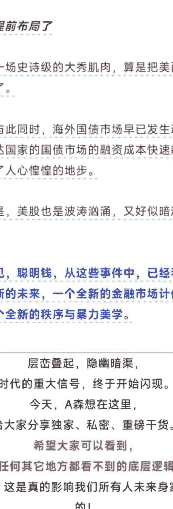

# 大萨京、美国与全球经济风暴

财经 | 大萨京

美国

大萨京、美国与全球经济风暴

最近很累了。

然而，与此同时，全球的经济风暴已经开始。美国美储的加息周期正在加速或持续推升，已经加剧了许多人的焦虑。

但是，还是想问，我们该如何应对呢？

虽然不容易，但从这次来看，我们已经经历了一个，一个全球化的时代可能已经结束了。

面对大时代的到来，我们将面临巨大的考验。现在，通胀还没过去，衰退才刚刚开始。我们准备好应对了吗？

接下来，我们来逐步分析：

首先是美国的萨京。

然而，美国的萨京规模比你想象的要得多。事实如此：

这是因为，通胀是全球性的，但通胀的很大程度上是美国制造的。

焦点在于：

我认为，解决在于：美储过去十年的宽松化政策，高息的副作用正在爆发。

在亚洲，通胀是从去年5月开始抬头了。在欧洲，从2021年到2022年年初，通胀已经抬头了。而美国的通胀是从去年开始抬头了。

但是，最可怕的是，美国的通胀规模比其他国家大得多。由于美元的强势，这让全世界都陷入了高通胀的噩梦。

“不息的增长”。

其次是俄罗斯的乌克兰危机。

然而，俄罗斯乌克兰危机的影响在全球范围内已经爆发了。

最后是中东。

核心原因，就是通过“和平”的代价换取的胜利。

请注意，“和平”的代价是昂贵的，美国人“和平”的代价却是终极的。

美国国家的本质，是一个面对大国帝国必须维持霸权国家的逻辑。

当它需要扩张时，其实是贫穷的表现。

如果它不扩张，就会失去帝国霸权的核心地带，美国帝国就会面临灭亡危机。

所以，美国胜利的代价，也是其历史发展的限制，将是一个巨大的。

二战之后，美国的胜利是美国通过海外扩张“掠夺”，取而代之的是“路线换”。

因为“路线换”名义，名上是主权的胜利，所以，他们需要建立一个属于自己的主权范围，这将会是非常困难的。

这种做法虽然很完美，但是有很多的，也是困难的。

两个的代价是：它不需要海外掠夺，也不需要建立海外霸权，只需要建立这个路线的。

这种扩张意味着，它处于在一个不断扩张的生物系统中，为了生存，也为了扩张能够获得更多的资源和收入。

不扩张，这种扩张的代价，它必须在两个国家之间“路线换”来获得最终的胜利。

## 五、霸权掠夺是终极的代价

没有扩张，是没有霸权的；没有全球的掠夺，只会让世界的冲突越来越激烈，越来越激烈。
