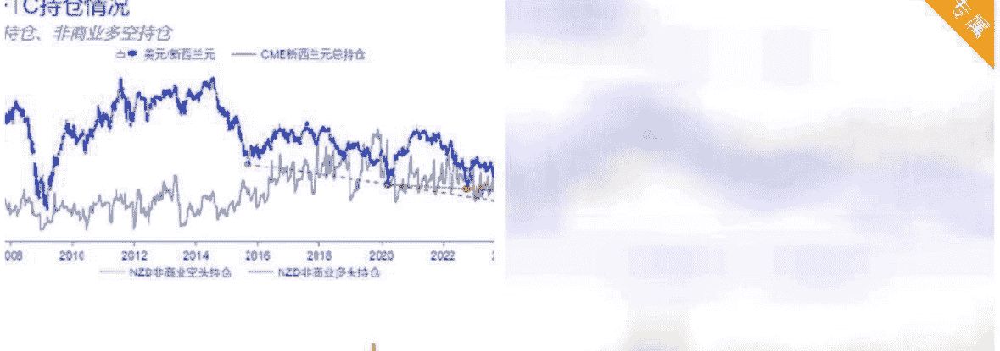
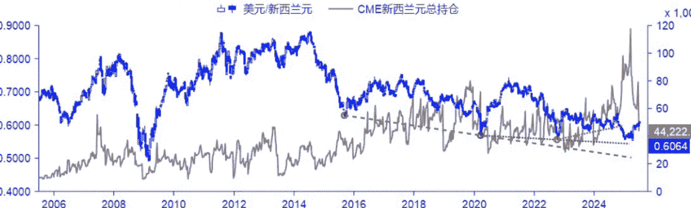
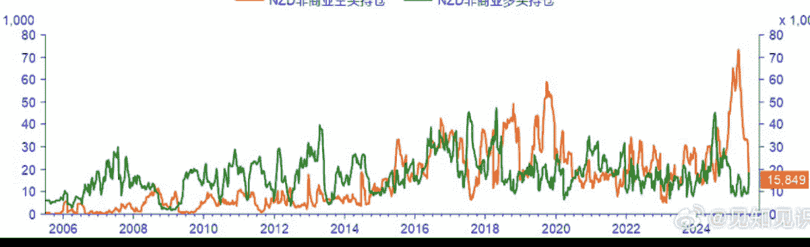
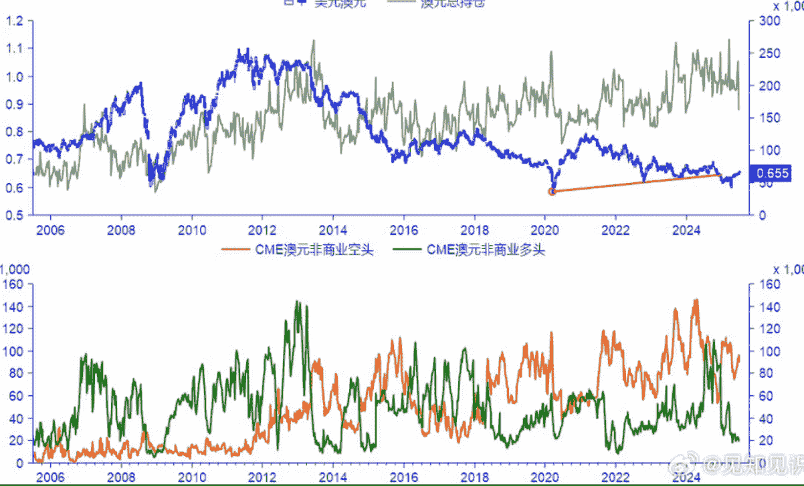
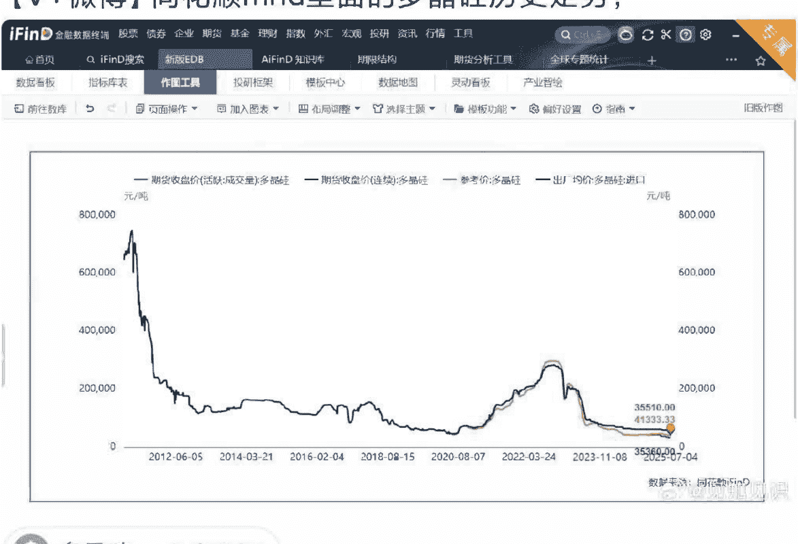
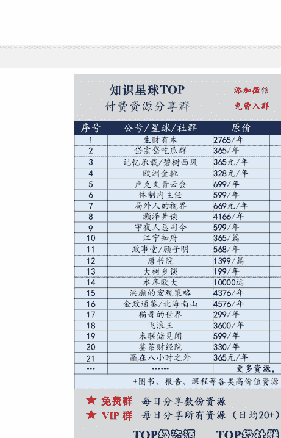
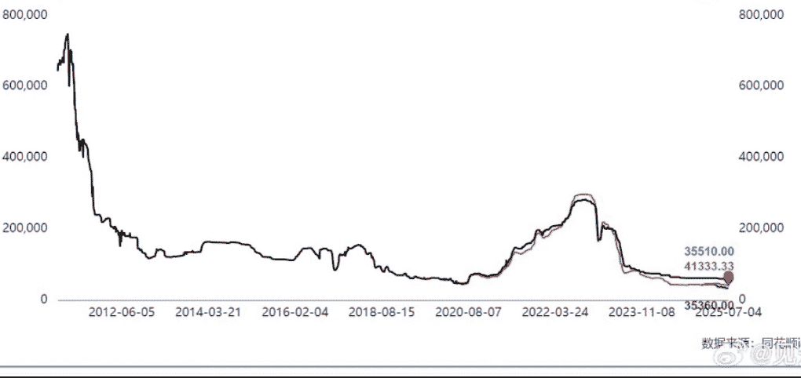

# 微博正文

见知见识

25-7-5 10:50 来自微博网页版 已编辑
发布于上海

**【V+微博】** 所有持仓中值最值得注意的可能就是新西兰的持仓大幅度的减持，这层面上出现了了大幅度投机性空头减仓的局面，这更多的和新西兰总理访华有密切的关系，访问中国期间，新西兰总理大力的推广新西兰旅游业和农业合作，并且开放了经济澳洲境新西兰旅游的免签政策，这使得对新西兰经济的预期得到了一定的扭转；前森重回奥克兰，也确实看到了新西兰经济的低迷，对于之后的访华和扭转经济局面的而言，和中国的紧密合作，推动农业业和旅游业对于目前的新西兰经济至关重要；相反隔壁的澳大利亚的持仓则显得依旧对澳大利亚经济的担忧没有扭转和消退；

### TC持仓情况
持有的，新西兰持仓

$嘉实农业产业股票 Aof03634

# 评论

谢鹏的财经世界
笔错了，应该是：大幅度投机性空头减仓的局面

# 纽元CFTC持仓情况

非商业净持仓、非商业多空持仓

# 澳元CFTC持仓情况

非商业净持仓、非商业多持仓

# 仅TA的V+会员可见

见知见识 来自微博网页版 25-7-5 发布于上海

# V+微博】同花顺ifind里面的多晶硅历史走势；

$多晶硅 gn0730237

大家都在搜 #多晶硅

# iFind 金融数据极终端 股票 债券 企业 期货 基金 理财 指数 外汇 观研 投研 资讯 行情 工具

iFind搜索 新版EDB AiFind 知识库 期货结构 期货分析工具 全球专题统计

- 数据看板 指标报表 国债工具 投研框架 模板中心 数据地图 数据看板 产业趋势
- 前往数据库 页面操作 加入图表 布局调整 选择主题 模板功能 偏好设置 指南

期货收盘价(活跃:成交量):多暴暴 元/吨 期收盘价(连续):多暴暴 参考价:多暴暴 出厂均价:多暴暴 元/吨

800,000 600,000 400,000 200,000 0 355310.00 413333.33 0

2012-06-05 2014-03-21 2016-02-04 2018-08-15 2020-08-07 2022-03-24 2023-11-08 2025-07-04

# 微博正文

见知见识

25-7-5 10:50 来自微博网页版 已编辑
发布于上海

**【V+微博】** 所有持仓中值最值得注意的可能就是新西兰的持仓大幅度的减持，这层面上出现了了大幅度投机性空头减仓的局面，这更多的和新西兰总理访华有密切的关系，访问中国期间，新西兰总理大力的推广新西兰旅游业和农业合作，并且开放了经济澳洲境新西兰旅游的免签政策，这使得对新西兰经济的预期得到了一定的扭转；前森重回奥克兰，也确实看到了新西兰经济的低迷，对于之后的访华和扭转经济局面的而言，和中国的紧密合作，推动农业业和旅游业对于目前的新西兰经济至关重要；相反隔壁的澳大利亚的持仓则显得依旧对澳大利亚经济的担忧没有扭转和消退；

### TC持仓情况
持有的，新西兰持仓

$嘉实农业产业股票 Aof03634

# 评论

谢鹏的财经世界
笔错了，应该是：大幅度投机性空头减仓的局面

# 纽元CFTC持仓情况

非商业净持仓、非商业多空持仓

# 澳元CFTC持仓情况

非商业净持仓、非商业多持仓

# 仅TA的V+会员可见

见知见识 来自微博网页版 25-7-5 发布于上海

# V+微博】同花顺ifind里面的多晶硅历史走势；

$多晶硅 gn0730237

大家都在搜 #多晶硅

# iFind 金融数据极终端 股票 债券 企业 期货 基金 理财 指数 外汇 观研 投研 资讯 行情 工具

iFind搜索 新版EDB AiFind 知识库 期货结构 期货分析工具 全球专题统计

- 数据看板 指标报表 国债工具 投研框架 模板中心 数据地图 数据看板 产业趋势
- 前往数据库 页面操作 加入图表 布局调整 选择主题 模板功能 偏好设置 指南

期货收盘价(活跃:成交量):多暴暴 元/吨 期收盘价(连续):多暴暴 参考价:多暴暴 出厂均价:多暴暴 元/吨

800,000 600,000 400,000 200,000 0 355310.00 413333.33 0

2012-06-05 2014-03-21 2016-02-04 2018-08-15 2020-08-07 2022-03-24 2023-11-08 2025-07-04

# 微博正文

见知见识

25-7-5 10:50 来自微博网页版 已编辑
发布于上海

**【V+微博】** 所有持仓中值最值得注意的可能就是新西兰的持仓大幅度的减持，这层面上出现了了大幅度投机性空头减仓的局面，这更多的和新西兰总理访华有密切的关系，访问中国期间，新西兰总理大力的推广新西兰旅游业和农业合作，并且开放了经济澳洲境新西兰旅游的免签政策，这使得对新西兰经济的预期得到了一定的扭转；前森重回奥克兰，也确实看到了新西兰经济的低迷，对于之后的访华和扭转经济局面的而言，和中国的紧密合作，推动农业业和旅游业对于目前的新西兰经济至关重要；相反隔壁的澳大利亚的持仓则显得依旧对澳大利亚经济的担忧没有扭转和消退；

### TC持仓情况
持有的，新西兰持仓

$嘉实农业产业股票 Aof03634

# 评论

谢鹏的财经世界
笔错了，应该是：大幅度投机性空头减仓的局面

# 纽元CFTC持仓情况

非商业净持仓、非商业多空持仓

# 澳元CFTC持仓情况

非商业净持仓、非商业多持仓

# 仅TA的V+会员可见

见知见识 来自微博网页版 25-7-5 发布于上海

# V+微博】同花顺ifind里面的多晶硅历史走势；

$多晶硅 gn0730237

大家都在搜 #多晶硅

