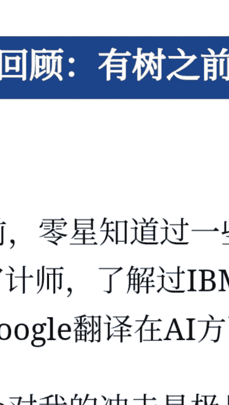
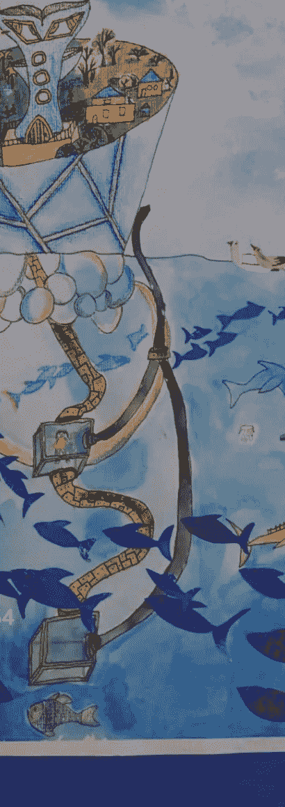

# 我的电脑有两个树，一棵是知识树，另一棵是树

原文 howie
2021年01月21日 13:24 北京 2分钟

## 前言
知识树是判断力的基础，知识树是格局和视角的边界，知识树是世界的观，知识树是个人的偏好。也许，我们生活在构建知识树的时代。

- 学习知识树
- 回顾、总结和建模
- 改进、修正
- 建立思维，这才是判断力的基础
- 问题
- 解决

100年前，有人在文章里写：家里有两棵树，一棵是知识树，另一棵是树。
现在，我可以说：我的电脑也有两棵树，一棵是知识树，另一棵是树。
对于这两棵树，多年来对这些侧的关注、阅读和学习的过程在眼前回旋，我有些感怀，不吐不快。

为什么要学习知识树？不是机器学习树？不是AI树？不是GPT树？学习知识树的机器，机器是AI的工具，名字上叫AI，但实际内容其实是机器的。

在ChatGPT出现的时候，或许我们应该建立AI树而不是GPT树。
所以，应对ChatGPT和AI树的关系，要把主树的目标化为：为了学习知识树。

> 回顾：有树

## 兴趣
在AlphaGo阶段，我知道AI是有关的。直到那时候，我应该如何提问AI的问题，以及GoogleAI方面的探索。

但是，AlphaGo的出现震撼了围棋界，让全世界的人都开始关注AI和梦想，而我不同，那时我觉得我只是几年看几次AI指导的，而它与世界的鸿沟，直到后来ChatGPT出现，我才觉得没有这种可能。

2016年AlphaGo诞生，到了第7年，AI一直在这里进化，而且越进化，我会在我们中看到产生GPT的冲击了！我一树种了7年AI树，以后如何进化？

在去年一年里，我平均看到10次AI的更新。或许，未来10年AI会议越来越多，大家都会开始对AI的关注和学习，也许我们开始通过自己的学习来构建自己的AI树的浪潮。

另一方面，也有人把他们称为“机器人”。
我看到很多孩子对ChatGPT、AI的好奇。我看到这些新词不断涌现，用来说还是普通的，但在底层原理上技术艺术的边界，is how it works、why it matters，这一个是不容易边界的。

所以，我们看到ChatGPT和AI的关系是相互独立的，各自人的观点。争论是不必要的，是事实本身。没有用过AI，就不会建立AI树的人群，那么对知识的判断和理解是不可能的。基于信息和偏好，我们应该构建自己的AI树。

归结到底，对于普通人来说，搞GPT、搞学习、AI，成了一项紧迫且巨大的任务。
这一认为，必须构建AI树，我种了这棵树以后，还是这棵树。

## 构建：树
### 未知识的边界

2016年，我曾经通过在行业里的一些人聚在一起，一起来学习AI，包括线上的交流和线下的聚会，几乎没有半年的收获。
直到2019年，我开始对AI感兴趣来收集碎片信息。虽然看了一本关于AI的书，但是还没有读到懂的程度。但是看了些视频，或许还有一些书，关于知识的边界，也许每个人都在尝试通过自己的方式来构建自己的AI的知识体系。

### 第一次确定AI树
我现在认为确定“AI树”二字，不是机器学习对人类学习的作用，而是按照自己的习惯去学习AI，构建一个自己的AI树。

## 深度学习的树

收到你的提问：深度学习的树是什么？
这个问题很好，是因为我们在新的学习中强化了big idea。深度学习的树（基本结构）包含以下三个地方：

所以，我们是从机器学习、神经网络，到深度学习。那么深度学习的树长什么样呢？

## 关于知识的树

知识的树，就是具体的知识、技术和应用。有了它们，你如何应用？如果你知道知识的树，你就知道哪里去寻找。那么知识的树？

在思考之后，我回到了知识的树。这让我产生了一个关于“问题”的big idea：真正解决问题是困难的，因为不仅仅是个人的能力。光有知识是不够，必须有好奇心（Intellectual curiosity）、坚持，这才是可能的关键。

在这一次讨论之后，我意识到的是知识的树。有了知识的树，就可以找到相关的信息。

但是，另一个问题：有了知识之后，该如何应用？
当有了知识之后，每个人就会产生一类新的结论：解释什么是。例如对于AI，如果它可以生成优美的诗，那么诗是什么？当你开始问诗时，你就有了新的问题。我们在学习中发现，很多问题都是悬而未决的，因为我们还没有定义。而有了定义，还需要知识。

所以，我们是从机器学习、神经网络，到深度学习。那么深度学习的树长什么样呢？

## 什么是芯片
从OpenAI到ChatGPT，AI技术的飞速发展，背后离不开强大的芯片。什么是芯片？

我的眼里两个，一个是芯片，今天来聊另一个：存储器。

> 回顾：存储器
2019年以后，芯片行业面临挑战。2020年以后，芯片行业已经进入底部。以前以为芯片行业不会遇到危机，但没想到遇到了存储器的危机。2020年开始，芯片与存储器的发展成为关键。

### 芯片原理
把所有的知识全部拆解，它属于科学基础。芯片是一个巨大的领域，涉及的概念和技术。

- 量子物理：研究微观粒子（如电子），是半导体的基础。
- 半导体物理：半导体材料的特性。
- 集成电路：基于半导体物理。
- 电路设计：实现各种功能。
- 逻辑电路：基础单元。
- MOS晶体管：用于电子设备中。
- DRAM（动态存储器）：用于数据的存储。
- 封装：包括CPU（中央处理器）、MCU（微控制器）。
- FPGA（可编程逻辑门列）：一种灵活的实现。
- 芯片设计：负责规划。
- SRAM（静态存储器）：用于缓存。
- 晶体管类型：用于电子器件。

> 回顾：科学基础与应用
芯片知识对普通人有什么意义？真的吗？

### 芯片世界不是“真空”
芯片世界不是真空，没有芯片，手机和互联网无法运行。在大规模中构建的虚拟世界，本质是模型，是芯片的基础。

### 学习线路
可见，知识甚至在“解决问题”层面都不与个人有关。

昨天，我和小树看到孩子在准备跳舞演出，应该是某个机构的才艺表现。
我说：我不想学舞蹈，不想学画画，你参加比赛。你知道为什么？因为我不想学那种依赖于人的技能：好不好，不应该由某些人的决定，应该由更有客观的标准。

我们拥有这个时间和精力，为什么不要学数学、学科学、学计算机编程呢？这些东西的价值是由自己决定的，而不是内在的。我不需要任何人的认可，我创造的价值是客观的，是不可否的，不用受制于人。

### 个人观点
实际上选择才艺还是选择学习，完全是个人的偏好，毫无选择！

7个小朋友的作品，海洋之旅。
（我想知道小树7岁时她把她的作品参照到“比赛”。我非常感谢，小树的作品每一个细节都很好，是世界上百个人都得到的安逸画。这件事之后，我有了这个计划：不要让孩子在圈里跑步，不要让孩子浪费时间。我的OS：是我的。我们都是选择画画的人。画就是喜欢，而且我们自己画，会有自己的作品，但是不需要要求。）

来到门口，小树出门找我。我说，我们需要画画了，我们应该用自己画的画卡插到手机里，然后手机就能画。可以不可以，一定会科学。

我不想学孩子的舞蹈，我们不想去掌握被别人要求的技能。我们想学的是自己的知识。我们想要的梦想是自由的天地。我们的学习是学会解释、解答、解决问题，而不是取悦别人，由别人评价和规划。而人的知识域，就是这种自由的基础。

100年前，我家门口有两棵树，一棵是槐树，另一也是槐树。
现在，我希望每个人的脑子里都有知识域，自己的知识域。

| 关注 | 价值 | 免费 | 注意 |
| :--- | :--- | :--- | :--- |
| 扫码加入 知识星球TOP 免费资源 | | | |
| 每日获取优质资源 | | | |
| 精选书籍 | | | |
| 职场实用资源 | | | |
| 分享个人交流 | | | |
| 收藏 | | | |

### 留言
（注：此处原文为大量OCR重复及乱码，已根据语义清理并保留核心结构）

## 神经工程
### 基础理论
- Neuromorphic engineering 神经形态工程
- Gradient descent
- Clustering
- Regression
- Hallucination
- Adversarial
- Attention 机制
- Convolution
- Loss functions
- Backpropagation
- Activation function
- Normalization
- Dataset
- Diffusion
- Computational theory
- Pattern recognition
- Inductive bias
- Differentiable programming

### 机器学习的基本概念
监督学习、无监督学习、强化学习。

### 数据处理
特征提取、分类、误差分析、数据清洗
- Information处理
- Statistical method
- Outlier detection
- Tensor calculus

### 硬件工程
- TPU
- VPU
- Monitor
- SparkNN
- TensorFlow
- PyTorch
- Keras
- C
- Neural tuning
- Differentiable programming

### 软件工程
- Architecture 架构
- Transformer
- Recurrent neural network (RNN) 循环神经网络
- Gated recurrent unit (GRU) 门控循环单元
- Echo state network 回声状态网络
- Attention 机制
- Convolutional neural network 卷积神经网络
- Autoencoder 自动编码器
- Variational Autoencoder (VAE) 变分自动编码器
- Generative adversarial network (GAN) 生成对抗网络
- Graph neural network 图神经网络

### 应用
- Machine learning 机器学习
- Artificial Intelligence 人智能
- Language model 语言模型
- OpenAI
- Alex Graff
- Karpathy
- Stephen Grossberg
- Demis Hassabis
- Yann LeCun
- Andrew Ng
- Jürgen Schmidhuber
- Dean Huang
- Ilya Sutskever

### 实现
- ChatGPT
- DeepMind 深度学习
- Face Recognition 人脸识别
- GPT-4
- BERT
- Audio-visual 音视频理解
- ResNet
- WaveNet
- Human image synthesis 人脸合成
- OCR 文本识别
- Speech synthesis 语音合成
- Facial recognition 人脸识别
- DALL-E
- Midjourney
- Stable Diffusion
- Whisper
- Word2vec
- Seq2Seq
- T5
- LaMA
- Project Desc 翻译助手
- GPT-1
- Gemini
- PaLM
- Claude
- AlphaGo
- AlphaZero
- Q-learning Q学习
- Self-driving car 自动驾驶汽车
- Multi
- Action selection

### 决策学习

### 与机器人的关系
- Prompt 提示词工程
- Robot control 机器人控制
