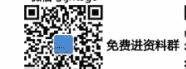
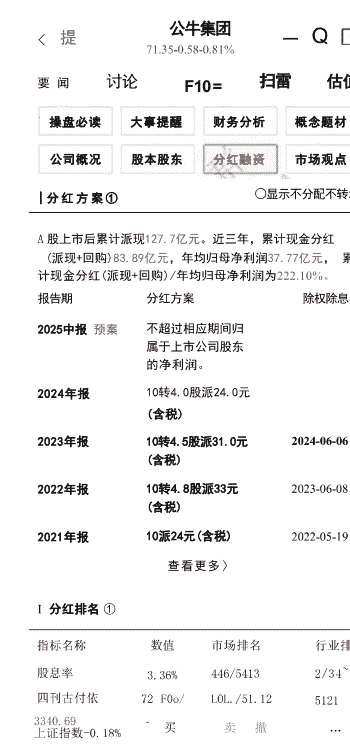

# 丁辰灵星球250531-250601问答精华汇总

提问：灵哥，五月银行暴涨，您估今年银行股还有百分之多少涨幅？是不是这个涨幅和指数涨幅是对应的？非常感谢更新更多文章加粮：pep45

丁辰灵回答：会有对应关系，先净值恢复，以后也是有机会超净值，我不是说了吗，看好A股后上一万点，可能需要六七年时间，银行再翻倍也算奇怪。

提问：稳定锚定美元，还锚定美债，这不是稳定美债，缓解美债危机？您怎么看？

丁辰灵回答：很多人问稳定货币的话，等下周我来写个贴子，这两天回南京看父亲了。

提问：请问灵哥，现在有一些美元理财，之前您说后美元可能会贬值，那现在是不是把美元理财购回一部分然后结汇比较好呢？如果是这样的话，这部分分钱买四大股票或者中海油股票作为稳健投资您觉得合适吗？

丁辰灵回答：也可以买港股

提问：公牛集团股份770，今年分配方案是10转增4派24元，收益率是多少？这个公司看起来现金流非常好，利润40%以上，分红也很大，加微int5g，进资料分享群

## 是否值得长线投资呢?我自己测算了大概收益

在35%，实际有这么多么？

- 1 分红排名③

丁灵灵回答:放出来给大家研究下，我这两天在南京过端岸，得空我仔细细看，

提问:请问灵哥，中科达这家公司有研究吗?在自动驾驶这块，他面临华为、特斯拉的竞争是否是否太大了，无法突围，包括合作的小米也是自研，而他的客户都是传统的玩家，汽车行业未来来只会头部前几寡头化吧

丁灵灵回答:没研究，自动驾驶很难赚钱

加微信intsg2，进资资料分享

丁辰昊：eda 就是华大，设备就是中微和拓荆，risCV 就是芯原

提问：灵哥，今天影石创新开始申购，对于弘光电有什么影响？

丁辰昊回答：上市之后不意外影石会被秒的，联股也会也会

丁辰昊：铜师傅也准备上市，小米也入股了，看好，比不上泡泡玛特但是没有IP的企业强，符合我之前说的标准。

| 免费 | 价值 | 及时 | 专注 |
|---|---|---|---|
| 扫码加入 知识星球TOP | 免费资源群 | | |
| ✓ 每日免费获取价值资源 | | | |
| ✓ 可提供各类价值资源搜索服务 | | | |

- ◆热门付费文章 * ◆各行各业报告
- ◆精选图书资源 * ◆副业兼钱方法
- ◆职场实用资源 * ◆AI政经自媒体

公众号：知识星球TOP 微信号：jntsg8 微信号：jntsg2

