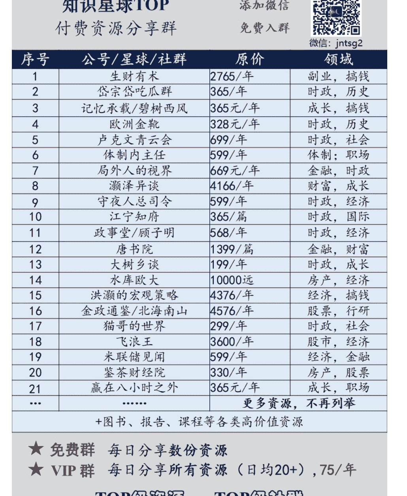

# 丁辰灵星球250712问答精华汇总

提问：灵哥，港股科技最近怎么有种从前A股的感觉啊，没人护盘跌六七天回暖一天又继续跌……求问灵哥怎么看？

丁辰灵回答：不是给你买的机会吗，等大涨的时候你再买，又要被套住了。

提问：灵哥好。瑞迈、亦斥仔、中国中免这些都在低位。未来能上万点的话，是不是得靠这些大权重呢？现在是否可以适当配置一些？

丁辰灵回答：我感觉这三家逻辑都不一样，上一万点要靠权重就是银行、保险地产这些比重更大，另外科技也会继续异军突起，所谓的高质量发展。当然这几家公司还是不错的，但好像和你的一万点没有太绝对的关联。

提问：请问灵哥，长亮科技占了稳定概念最近的很好，但是已经到了前高219，这里会有不会较大的阻力。短期来看这个公司的业绩基本能撑起它大的市值？

丁辰灵回答：的确是，看能不能突破不能就回落。业绩2025应该还可以，但当前炒稳定币也有点过了，不是价了。

提问：灵哥，工行股这段时间涨到了历史新高，但港股却在崩跌，帮忙解惑！

丁辰灵回答：这不奇怪啊，最近内部资金都在抱团增A股银行。

丁辰灵：

哥大读MBA荒芜的四年，这篇文章完整讲了现在西方教育体系的堕落，甚至已经用了魔教这样的词汇。

我突然想起这次去新加坡国立大学，本来这些年有一个国大和鲁鲁合作的学院，Yale US College，但听说要关停了。据说是 DEI和有意识形态渗透新加坡的风险，新加坡政府很明的，也不傻的。

某种程度上，其实亚洲很多国家包括我这次的新加坡，社会还是保守的。我感觉这些年中国大城市互联网反倒是跟着美国很激烈。生育率的下降说明了一切。

不过拨乱反正就好快了，大家信行，耐心等待吧。有时间好好读这这篇文章，你会触目惊心。

《不装了，哥伦比亚大学MBA两年亲历记：一场资本主义骗局》

# 丁辰灵

今天开会群成员关于银行的讨论，大概是有人吐槽银行涨太多，搞的一些小票不涨。后来莱慧就写好了几段语音，意思是很不能理解有什么好吐槽的。投资本来是一个容易的事情，一年前她在新加坡和我都播就说银行低估。

我也是多年前让大家关注A股的YYDS，排名第一的就是银行。逻辑这几年写了不知道多少遍，破译的垄断型国企。

还有很多人觉得为什么别的票涨，自己票不涨。但其实也经常会看到会员群里有人说，某某票涨，买少了这类之类的。

其实都会涨，区块链轮动。比如去年918美国超预期降息，之后A股启动，588000科创50ETF涨到1.2，涨幅超过70%。现在回撤到1.04，九月美国再超预期降息，大家觉得588000会涨多吗？

投资就是简单的，什么东西便宜买什么。如果连续大涨，离均值太多就卖一些，谁也不可能抓住底部和最高点。之前星球也发过ema指标，对于判断趋势反转更快一些。所以无论你用日线穿穿五日线，五日线穿十日线，还是其他指标，就出了一些，突破支撑位也出现一些。

大的原则是不变的，黄金之前买3500再买，英伟达4000美元不买，4万亿买，标普4000不买，6200买。这不是自己给自己降低胜率吗？

低买高卖，投资就是资产价格各种比，横向比，竖向比，中美比，和过去比，和趋势比。

希望大家多理解资本本质，附件是一个去年yyds还有一个是文慧今天的群分享。如下：

## 《不装了，哥伦比亚大学MBA两年亲历记：一场资本主义骗局》

笔者原籍四川，本科读于伦敦政治经济学院，修国际关系和政治科学。工作五年后，进入哥伦比亚大学商学院获得MBA学位。序幕：踏入哥伦比亚大学商学院之前，官方宣传如同一堂仪式：这是培养未来领袖的摇篮，是世界精英云集地，是用智慧将世界变得更好。我深信不疑，如同真理一般。那时我在哥伦比亚大学商学院，身边的几位教授每天讨论：西方权力的本质。

论两件事：

其一，“所有男人都是原罪”，给男人贴上“男权”标签；其二，在课堂上反复强调“尊重”、“仁爱”，却全然忽视了作为男性的性别歧视。

这段段时间，我偶然看到新闻：一名少女，父母早亡，独自打工，因营养不良最终凄惨死亡。我抑制不住情绪，那一刻发誓：从最好的商学院进入，用能力与智慧开启真正的希望。

然而，当我进入哥伦比亚大学商学院时，立即陷入截然相反：在这里，一个顶着“领袖”头的并非学术大师，而是华街和硅谷的高层经理人。他们被聘来教学，每周两次、每次三小时，这种安排无异对学生每年九万金。

低劣的教学质量不仅令人昏睡，更具有结构性的危害。这些教学往往带着明显的意识形态，他们有意或无意，通过精心设计的课程与语言，施加系统性洗脑。在培养未来领导者的脚下，把商学院培养成华街和硅谷联合体的哈丝钉。除去一切人的情感，将毕生使命为资本的持久运转和榨机而服务。

一个例子便可以：某次课上，一位硅谷中层管理者滔滔不绝谈论英伟达，称其市值高达亿美元，超越耐克、谷歌等巨擘。他说热情洋溢，仿佛这些财富与他同气。我忍忍不住问：“请问，英伟达是芯片制造商吗？”他毫不犹豫地回答：“当然，他们做芯片。”我当地指出这一事实性错误：英伟达根本没有制造能力，他们只是芯片设计，真正制造流程由台积电等厂商代，其本质与建筑设计或时尚工作室无异。这类荒谬至极的案例，竟是商学院从上而下的常态。

MBA期间，我曾选修一门气候变化课程。该课程的教师被校方大力宣传为环境治理与可持续发展的标杆，甚至在校内营造出近乎神化的舆论圈。课前我曾以为，能从他那里获得对环境政策、能源转型，以及气候经济的系统性理解。然而，令我失望至极。此教师本身只是有过能源行业的投资背景，其授课内容缺乏理论深度也欠缺逻辑，可谓空洞和无聊。

更为荒谬的是，他在课堂上将个人生活细节放大渲染，诸如“每日骑自行车上班”之类的微不足道的行为，被反复当作道德优越感的证明，就像世纪的牧师台下学生信徒布道，而恰好商学院存在着又一个完美的听众，既听又臭。这种表演的环保姿态，不过政治正确体系下的浮夸表现，缺乏对现实复杂性的认知，也无法对求真者产生真正的启发。我不禁反思：若环保理念的贯彻止于自行车这种象征性姿态，对校园资源的滥用、学生的通勤成本、城市的基础设施等结构性问题视而不见，那么这样的课堂究竟是在培养环保意识和探索路径，还是在塑造一种廉价的道德自洽？

这类现象背后，是商学院日益普遍的造神机制。学校通过传播某些标签化人物形象，赋予某种时代先驱的光环，试图借此吸引资源、打造自身叙事。然而我真正接触这些被神化的人，往往看到的只是又一个内容空洞、修辞浮夸、认知单薄的工具。这种文化氛围，非但不能推动学术进步，而是成为一个温床。

在商学院中，这种教育彻底打破了我们对高等教育的基本认知。一位来自芝哥的中年女老师，虔诚的天主教，对我们的学业要求非常严格，总是认真观察每一位学生在课堂上的学习状态。我常常想对她说：“像这样的老师，我个人非常尊重。”然而，在整个学院的大环境中，如此情操为风主角。虽然是真心为学生想着，还有人对此付出丝毫不无感，甚至是抵触。强制多元背景融合带来的价值要素。

表面上，学校将不同教育和职业背景的学生放在同一体系中，宣称这种组合有助于激发更大的协同与这种交流。DEI（多元、公平、包容）政策密切相关。表面看似推动，实则往往变成游戏。这种所谓的“包容”，本质上是一种文化放弃。

这种课堂究竟是在培养环保意识和探索路径，还是在塑造一种廉价的道德自洽？

来自不同背景的，往往有着截然不同的体系、思维结构与意识形态逻辑。他们之间不仅难以有效沟通，反而因强行置之引发冲突。有的学生来自国际关系和政治学专业，有曾在军中服役，有前中小教师，有画家或音乐人，还有传统的金融、会计或统计背景。这样的人群强行置于同一教学环境，所呈现的不是深度，而是形式化的互动，其本质是短视及交易化。

这一结构性问题在课程设计中尤为突出。例如，会计课程的内容设置，对于那些曾有金融或会计背景的职场老条而言是轻车熟路，甚至过于浅显；而对于一些原本出身社会背景的学生，或来自部队退役的同学来说，由于缺乏基础知识，课程难以真正发挥启发与教育的功能。这种大杂烩式的配置，未能激发个体潜力，反而掩盖甚至抹杀了不同学生在其原生领域中可以发挥的独特优势。从我个人角度看，那些来自会计、金融和统计专业背景的学生，并不具备真正的领导潜质。他们适应学院这种浅显、标准化的、缺乏创新的学习结构，也表现出某种复杂性与创造力的回避。他们不具备颠覆常规的能力，也缺乏作为领导者所需的气质与视野。他们的存在，只会加剧商学院趋向集体平庸。

这种问题也同样体现在所谓种族多样性上。学校通过设置各种种族配额制度，对不同族群进行人为的调配，尤其是对拉丁美洲学生的招收质量格外可见。实际观察而言，这类学生的整体表现不佳。在商学院中，这种现象并非偶然，而是与华尔街长期以战略有关。试图通过教育包装将年轻人纳入其体系，长期掌控地缘和经济。

这种生态，不仅在认知上制造了裂，在关系上呈现出一种扭曲倾向。令人讽刺的是，这位白人女同学在集体活动中遇到的另一位中国学生，情绪失控，在现场喧闹、哭泣。作为一名中国人，听到这些言论，直接向那位白人女同学指出：“你是中国人，你不应该在自己的土地上，这种行为外外是合理的。”这种行为，我感到羞耻与愤怒。这完全体现了商学院那套“去民族化”意识形态对人心的深层侵蚀。这种双重标准，恰恰体现了商学院的培养。

然而，让我更感哀的是，这位白人女同学在展现“包容”时，在面对中国同学时表现出了完全不同的态度。听完我的话后，她只是机械地回答：“不想变成民族主义，我想更包容一些。”这种所谓的“包容”，本质上是一种文化放弃。关怀文化、尊重外来者，这在商学院中本应该是可能的，而是懦弱，是对自身主权的背叛。

质的低下。

第二种活动体现出现极强的意识形态导向，可以说已带有加强迫害的性质。学校全力支持并主推的，正是那套女权与同性恋利益的话语体系。在华尔街及全球金融资本主义集团的直接或间接操控下，这些原本应基于平等原则探讨的问题，早已异化为一场立场政治仪式、话语洗脑乃至论审判。

正如“女性商业论坛”，凡有活动，必然高频强调“女性”身份，事事贴上“女性领导力”标签，其背后逻辑从来不是为真正处于边缘的弱势群体争取公正，而是为那部分早已拥有特权地位的既得利益女性开辟一条额外通道，将原本属于全社会的资源、机会与空间，转化为她们进一步攫利益的筹码。这其中的许多人视中那些真正受苦的底层女性，却不曾考虑背后复杂的社会结构问题。她们之所以高呼女权，不过是为了自身谋利，便于进入华尔街、便于在 DEI（多元、公平、包容）体制下脱颖而出，获得并不属于她们的席位与报酬。

而这类强行构建的意识形态场域，极大撕裂了学生之间原本可能存在的信任和和谐关系。我记得这一次，一位和我同乡的中国同学一起晚餐，原本是一次轻松的交流聚餐，氛围尚可。然而当谈到另一中国女进入某投资银行实习时，我随口问了一句：“现在市场环境不好，她是怎么拿到这个机会的？”她回答说，因为对方是“Diversity Candidate”，即多元群体。我出于自然的好奇，又追问一句：“她是属于哪一类 diversity?我们中国人不是多数情况下不算多元别的里的吗？”她回答：“因为她是女性。”我略感疑惑，又问：“全球男女比例大致是 1:1，怎么女性就成了多元群体？”

原本是一次松闲谈中的逻辑追问，瞬间激怒了这位女同学。她情绪激动，当提高音量反驳道：“女性怎么不是多元群体？你知道女性在职场中有多大的压力不懂吗？”坦率，我当时一脸错然。原本和谐的饭局瞬间间变成了一个意识形态堡垒。而这位女士，此前从未有过法学院背景，仅在商学院读短一年时间，就被洗脑至此程度，可见这套意识形态渗透之深，对人际关系与基本沟通腐蚀之巨。

正如印度裔美国新兴富豪 Vivek 在《Woke Inc.》书中言，华尔街与硅谷利益联合体在 2008 年金融危机选择全面押注左倾思想，并非出于道义觉醒，而是出于资本统治的战略维护。他们深知，唯有转移焦点，将论引导至“性别”“种族”“身份”这些虚幻而激烈的议题，才能掩盖“1% 对 99%”的真实阶级矛盾。在这场转移中的最大牺牲品，就是我们——生活中日常裂痕与崩溃边缘中的普通人。

更甚，学校在同性恋等群体议题上的态度，早已超出尊重与保护的范畴，演变为另一种形式的制度性推崇与灌输。我个人对同性恋并没有偏见，也有不少同性好友。但我所反对的，是学校以制度之力推动性别转化政策，不再只是允许存在，而是有意地引导更多原本未此倾向的正常人改变自身，加入这类群体，换取制度红利与职场上的特殊通道。

这根本并不是自由或包，而是一种深具操控图的意识形态压迫。在资本力量的加持下，假进步之名统治之实，将所有不服于它的声音边缘化和污化。表面上是尊重，实则是建立一套全新的等级制度。

第三种就是一整套由学校、华尔街与硅谷联合打造的这种运动。学校频繁将诸如黄仁勋引至校园，以演讲衷之名义麻醉之。黄氏不是一家科技企业的首席执行官，按理并不是资本运作体系的中层管理者。大佬文集固然经由商学学院的刻意包装与无限污染，他被造成宛若神祗的存在，仿佛一个技术与资本完美结合的未来先。许多学生在长期耳濡沐染与集体仰望之下，失去了独立判断，对其顶礼膜拜，依然如同中世纪信主教一般。

而这一切的背后，清晰可见的是一套政治经济操作逻辑。

### 人工智能与管理资本主义

提到人工智能浪潮，商学院再次一次充斥人类的本源。2023 年，当 ChatGPT 迅速跟入市场之际，商学院再次强调。我亲眼所见：某课堂上，老师提出一道问题，只需 ChatGPT 输入两分钟就能答案。这种行为具有象征意义，当 ChatGPT 涌入市场之际，商学院再次充斥人类的本源。2023 年，当 ChatGPT 迅速跟入市场之际，商学院再次强调。我亲眼所见：某课堂上，老师提出一道问题，只需 ChatGPT 输入两分钟就能答案。这种行为具有象征意义。

### 人工智能的本质与异化

管理资本主义内部的本源在于，劳动价值异化和再定义。由于不掌握创造能力，所有产品最终依赖。

令人震惊的是，在商学院公开鼓励学生用 ChatGPT 完成作业，理由是为了快速适应职场。这种做法的长期后果，必将导致教育系统的崩溃和社会结构的全面波动。一旦所谓 AGI（通用人工智能）真正实现，则人类的劳动与思考将沦为技术奴隶的附属。在这种情况下，当一个人开始习惯性将自身能力完全外包给工具后，他作为人的价值还剩几何？这正是资本主义深层图：剥夺个体的认知主权，异化所有形式的劳动，使人失去对生产链的掌控，更失去了基本的权利。

### 申请和求职

我进商学院和求职的过程，可以说一段屈辱史。回顾整个读商学院的过程，从最初动念至正式入学，耗费我整四年以及无数心血与隐忍。背后所倚仗的，是一个体的渴望通过努力改变命运的意志。

时间回到 2018 年，正值虚拟泡沫与消费主义思潮席卷之时，金融魔术取代了实质创造。“新消费”“Web3”“元宇宙”等口号如蔓遍华尔街、硅谷至全球，成为压倒一切的时代叙事，重复着百年前泡沫狂热的历史，实现人性原始的贪婪与愚蠢。而此时，我是一个需要靠潮来维持面包和生存的普通青年，希望在浮躁的时代潮水中寻求生存的保障。

我在本科一年后开始认真审视局势。身边一些同学已在各类所谓高端行业，主要是金融与管理咨询中回头，收入颇丰。然而这一切并非源于其作为社会贡献的真实价值，而是由美联储在全局范围内释义的廉价货币所虚构的幻象。我起初亦有过希望尝试进入这一领域。限于我的国际关系与政治学背景，偏重外交、地缘、安全等议题，对于金融与管理理论知识之甚少，完全可以是门外汉。

我开启了自学之路，刻苦学习金融知识，并报考各类投资资格考试。终仍无法与那些早在大学期间就接受过系统化培训和实习经验的竞争者抗衡。更重要的是，在深入理解之后，我意识到自己对金融这一行业本身有着真正的兴趣与热情。与其融入一条偏离心的心的，不如精准转向：宏观框架和战略分析，这才是我的强项。因此，我将职业转型的目标锁定在管理咨询领域拥有全球影响力的机构。

可惜现实再给我迎来重击。我向上述所有公司投递简历，无一石沉大海，甚至连一次面试机会都未得到。此时才得知自己的背景与实习经历，根本未触及它们设定的门槛。由此我得出一个唯一的策略：报考世界顶级商学院，获取 MBA 学位，作为通往理想的跳板。在这个看似公平、实则充满排斥的游戏中，只有通过系统认证，才有资格开启大门。

我此开展了长达四年的计划部署。其中 GMAT 考试就花了半年，最终取得 750 分，文科综合部分获得了 44 分，同样处于前%。此后是一系列辛苦而细致的筹备：每天完成工作后继续修改申请书，同时协调推荐信。在最后冲刺阶段，2022 年夏天，彼时因长期压力患疾病，身体虚弱，决定压缩精力用于申请。尽管如此，我咬牙坚持，每天带病完成工作，最终获得一张入场券，顺利进入哥伦比亚大学商学院。

在正式入学前，我便开始全面准备与咨询相关的内容，认真研读马克·波特的《战争策略》，并参加公司组织的项目演练，以亲身方式理解行业运作。入学后，我第一时间投入各类咨询课程，在课堂讨论中发挥优势。社团方面，我加入了管理咨询俱乐部，通过行业分享将咨询技能逐步内化。在面试方面，我几乎参加了所有知名公司的招聘活动——从大规模到各种聚会到一对一聊天。我严格遵循他们给予的“Playbook”，在每一次面试中虚心请教，以微笑和乐观的姿态打动每一位招聘官，并且毫不夸张地说，达到的程度远超许多人。

管理咨询求职过程的核心环节是案例面试。我在 2022 年 10 月起，入学后不到两个月，便已上手准备。其间我通过广泛阅读案例书籍，并借助校内外资源密集训练。无论是由企业组织还是通过我私人安排的模拟练习，我都积极参与。以下事实证明：

- 在一次由麦肯锡组织的大型案例面试活动中，我从参与者中脱颖而出，迅速自信地提出对案例问题的系统分析与解决方案，表达清晰，逻辑严密，赢得员工的高度评价。
- 到 2022 年 11 月，一位担任案例辅导的学长，在多轮练习后直言不讳地告诉我：“你已经不需要训练案例面试了。你的案例能力已趋于行业顶尖水平，接下来要将重心转向面向面试。”这一判断让我更加坚定了深耕咨询路线的信心。
- 在同期参与咨询行业申请的同学中，亦获得了广泛认可。他们普遍认为，在我的案例面试中不仅展现出出色的逻辑与分析能力，同时做到不怯场，思路开放，敢于在复杂问题面前提出看出，具备咨询行业拔尖选人的典型素质与风范。

然而，后续的一系列遭遇，令我对商学院、对这类企业、乃至整个资本主义世界的游戏规则，有了彻底而深刻的认知。这种认知的获得是在一次次现实打击中的顿悟。2022 年 12 月，各大咨询公司公布面试名单之际，我收获了全数的拒绝——十家咨询公司几乎无例外将我排除在外，唯独一家将我列入了“候补名单”，意味着在他们未能招到合适人的前提下，才给我第一次面试机会。

这一现实无异于晴天霹雳。回望过去四年，为了职业转型，步步为营，付出巨大精力，从书籍撰写、面试演练到社交适应，无一不套路。从华尔街到跨国企业，从导师口中的行业黄金法则到商学院讲师的成功逻辑，从未丝毫不懈，自问自己已将规则践行至极致。然而现实这冷酷的耳光击碎了我的努力与回报之间正比关系的信念，同时也怀疑人生本身的合理性与正义性。

与此同时，目睹那些平日表现平凡、专业能力不如人的同学竟纷纷拿到面试邀请，我的心里落差之大，非言语所形容。这种来自系统内部的否定，是对性格、奋斗以及价值取观的彻底挫毁。可以说，这种打击足以令常人心智崩溃，酿成不可挽回的悲剧。所幸，我的人生早已历经风浪，在失落与迷茫中强迫自己振作精神。

2023 年 1 月，我从纽约出发，独自前往吉尼亚州。在面对蓝山的静谧中思考时，忽然接到一封邮件，来自那家咨询公司将我列入“候选名单”，他们表示因未能如愿招到理想人才，最终决定给我一次机会。即便如此近乎绝望的境下，我依然选择快速调整心态，随即出发。

面试安排为线上形式。由于我所处的公寓紧邻莱姆区，治安极差，为了保证面试质量，我在相对安静的环境下完成了重要的面试。此次面试共三轮：首轮由一位合伙人主持，后两轮由两位面试官分别进行。第一位合伙人曾在华盛顿长期任职，涉政府事务多，恰好是国际关系学科出身，在短暂交谈中迅速找到切入点，我毫无保留地分享了独特经历。后续两轮同样顺利。针对案例，我们皆以创造性思维解决，不流于形式。尽管内心慌顿，我仍强作镇，在面试全程展现乐观与自信。面试结束，走出时代广场的大楼，置身于寒风凛冽的街头，不禁陷入思考。这条路走了如此久，步步维艰；当下面对的依旧是一片迷雾。这一刻，我想起佛家：人生如火，终将被吞噬。

不久，接到这家咨询公司来电，对方道：“有一个好消息，也有坏消息。”好消息是：你是我们面试过的候选人中最聪明、能力最强的一个。此话非虚，而是今天三位面试官会后达成的共识。尤其在你处理案例时，他们采用的逻辑是我从未见过的方式，兼具创新与实操价值，令人印象深刻。坏消息则是：鉴于当前经济环境收缩，岗位极其有限，我们不得不将你放入名单，若日后有名释放，将第一时间通知。这样，我就开始了长达两周的焦灼等待。等我发出询问邮件时，得到的却是“继续等待”。直到一个月后，结果尘埃落定。我再次失去了任何实习或工作的机会。希望之门从未真正开启，留下一记冰冷现实。

在之后的反思以及与不同人士的交流之后，我得出以下几点基于事实的结论：

首先，2022-2023 年是美国经济震荡的时期。疫情暴发之后，美联储采取了史无前例的量化宽松政策，信贷造成资产价格虚高、就业泡沫堆积。2021 年各类企业过度乐观，大肆挥霍，盲目招人。至 2022 年至2023 年，业界下行，市场泡沫破裂，科技行业裁员潮起彼伏，银行危机接连爆发，甚至有多大型金融机构面临流动性枯竭风险。由于向来依赖此产业链的咨询行业，自然也受到重塑，不得不收缩招募规模，裁员之势演愈烈。令人唏嘘的是，最初来到我们学校进行宣传与招募的那位咨询公司 HR，最后都被其所在公司裁员，作为系统支柱之一，也未能逃过制度的绞杀。

第二点，也是更为深层的不公在于，这些曾经高举“merit-based（能力为上）”旗帜的企业，早已抛弃了公平竞争，转而以身份政治为核心判断标准，建立一种类似于神权的等级体系。是否为非裔？是否为拉丁？是否来自拉丁美洲？是否不是女性？是否不是同性恋？所有的标准都必须遵循这些定义好的标签。能力、素养、专业性，统位于政治正确的招募原则。

这一机制的运行在商学院中体现得淋漓尽致。我亲眼目睹那些咨询行业毫无，甚至就连面试都应对吃力的人，仅凭一张身份标签，便得以在完全忽视其能力短板的情况下，一路通阻地进入顶尖咨询公司。有来自拉丁美洲的女同学，英文表达达……

综上所述，商学院的存在本质上就是一个精致包装的大骗局，是全球资本主义、华尔街、硅谷联合体主导的生态链中的一环。虽然不掌握决策核心，却负起意识形态塑造与培养的职能，直接或间接听于以上集团。它的目的不在于教书育人，而是为了这个资本驱动的体制源源地输送螺丝钉。而这套体系的终极目标，就在全球范围内吸血、垄断资源、封锁上升通道，把爱变成由他们少数垄断与编写的舞台，让一个人、每一个家庭的命运，终究只能在他们所定的剧本中运行。

