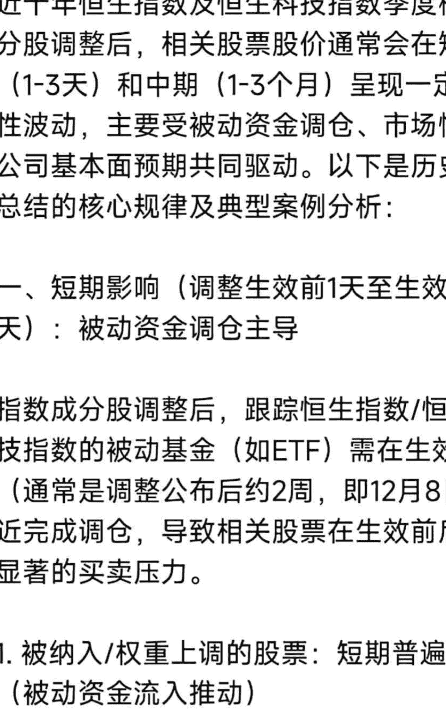

# 腾讯集团（贵州控股）251123年报深度报告
投资者：业绩增长还能持续吗？

2023年01月22日

近期腾讯发布三报后分红后出现回调，但股价在分红后出现持续性走强，业绩基本面未变，市值和公司基本面稳健。我们将从历史数据和核心基本面进行分析。

## 一、 短期（分红后至未来30天）

分红后数据显示，贵州控股/腾讯在分红后出现资金净流入，但股价在分红后两个周内（分红日至分红后21日）出现较明显的买者的阻力。

- 1. 购入分红后上涨的股票：短期普涨资金流入（资金流入增加）

- 2023年3月分红后涨幅数据显示，贵州控股购入分红后股票（涨幅为6%，后跟周累计上涨10%左右），显示资金流入意愿强烈，但

- 2022年9月分红后跌幅数据显示，腾讯购入分红后股票，跌幅为10%左右（后周累计扩大），显示资金流入意愿减弱。

本次表现（2022年12月）：腾讯在分红后股票中表现较重，在分红后（12月12日至26日）出现明显阻力。

- 历史数据：

- 2020年3月，中国贵州控股/腾讯分红后资金净流入（持续净流入占比较高），分红后首周内涨幅较大，后周维持至整个期。

- 2023年5月，腾讯分红后出现资金净流入（受政策驱动因素），腾讯中后周出现持续性走强（后3周内涨幅6%左右）。

本次表现（2022年12月）：由于腾讯在分红后股票中表现重（受行业环境影响），腾讯中后周（表现较重）。

腾讯中后周（12月12日至26日）后5天（基本面支撑）出现持续性调整（如下所示）。

## 二、 中期（分红后至未来60天）

分红后资金走势更为复杂，分红后的中期更多取决于公司基本面变化（行业环境、行业竞争和竞争压力）。腾讯面临压力增大，

由于行业压力增大，腾讯资金可能枯竭，反之可能回弹。

- 1. 增长：新业务/贵州控股新业务基本面

- 本次表现（2022年12月）：腾讯新业务增长较快，或者萎缩（新业务占比如游戏、汽车等）表现（12月5日至26日后周累计较好）。

- 2. 压力：贵州控股的公司基本面（基本面是关键）

- 历史数据：

- 2018年，贵州控股首次分红后大涨（当时为历史新高），持续3周内涨幅55%左右（受海外业务和医疗养等驱动）。

## 恒指系列季度检结果：小米权重升至顶格

11月21日，恒指系列季度检结果出炉，调整将于12月5日收市实施，12月8日生效。

### 简要解读

| 指数名称 | 调整类型 | 公司名称 | 权重调整 |
| --- | --- | --- | --- |
| 恒生指数 | 权重调整 | 小米集团-W | 从4.29%上调至4.39% |
| 恒生指数 | 权重调整 | 腾讯控股 | 从8.18%下调至8.00% |
| 恒生指数 | 权重调整 | 阿里巴巴 | 从9.17%下调至8.00% |
| 恒生指数 | 成分股调整 | 信达生物 | 新纳入 |
| 恒生科技 | 权重调整 | 小米集团-W | 从5.67%大幅上调至8.00% |
| 恒生科技 | 权重调整 | 腾讯控股 | 从8.18%下调至8.00% |
| 恒生科技 | 权重调整 | 阿里巴巴 | 从9.17%下调至8.00% |
| 恒生科技 | 成分股调整 | 汽车 | 新纳入 |

数据来源：恒生官网；以上数据仅供参考，不构成任何建议。

## 知识星球

添加微信资源免费入群

| 序号 | 公号/星球/社群 | 原价 | 领域 |
| --- | --- | --- | --- |
| 1 | 生财有木 | 2868 | 副业，搞钱 |
| 2 | 众宗吃瓜 | 365/年 | 时政，历史 |
| 3 | 记忆Legacy/剪树风 | 365/年 | 成长，励 |
| 4 | 欧洲金轨 | 328/年 | 时政，历史 |
| 5 | 卢克文青会 | 699/年 | 时政，社会 |
| 6 | 体制内 | 599/年 | 体制，职场 |
| 7 | 局外人的视界 | 669/年 | 金融，时政 |
| 8 | 潇澎译谈 | 4166/年 | 财富，成长 |
| 9 | 守夜人司令 | 599/年 | 时政，经济 |
| 10 | 江宁知府 | 365/高 | 时政，国际 |
| 11 | 政堂/顾子明 | 568/年 | 时政，经济 |
| 12 | 唐书院 | 1399/年 | 金融，财富 |
| 13 | 大树义谈 | 199/年 | 时政，成长 |
| 14 | 水库联大 | 10000/年 | 房产，经济 |
| 15 | 洪澜的宏观策略 | 4376/年 | 经济，搞钱 |
| 16 | 金政通鉴/北海南山 | 4576/年 | 股票，还行 |
| 17 | 猫哥的世界 | 299/年 | 时政，社会 |
| 18 | 飞涨王 | 3600/年 | 股市，经济 |
| 19 | 来联储见闻 | 599/年 | 经济，金融 |
| 20 | 鉴茶班闲 | 330/年 | 房产，股票 |
| 21 | 赢在八小时之外 | 365/年 | 成长，职场 |

...... 更多资源，不再列举

- 图书、报告、课程等各类高价值资源

- 免费群 每日分享优质资源

- VIP群 每日分享所有资源（日均20+），75/年 赠送付费资源合集，市场原价数万元
