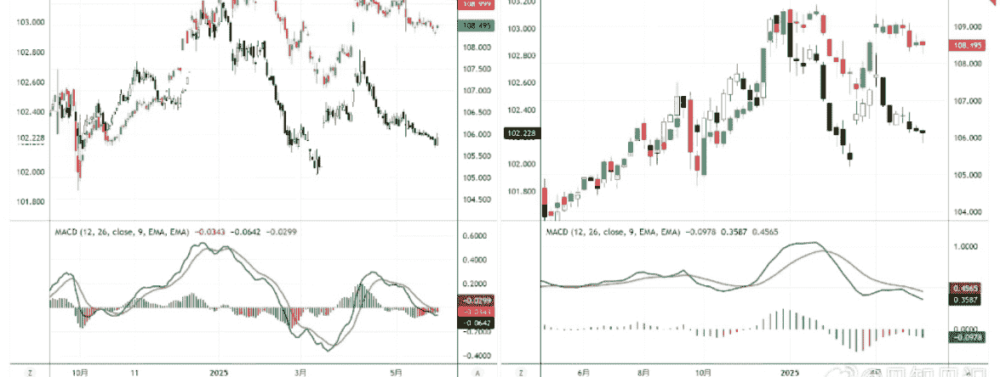
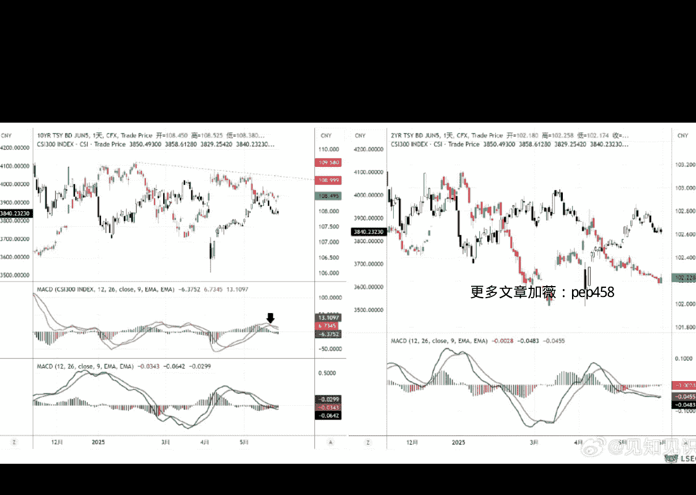
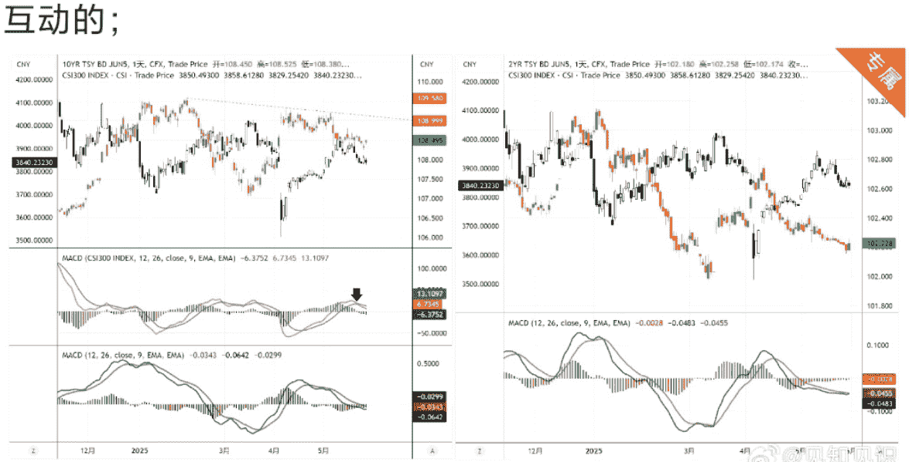
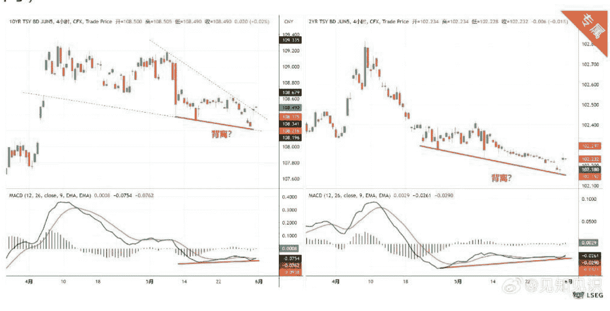

# 微博正文

仅限TA的V+会员可见

见知见识
25-05-30 17:07 来自微博网页版
发布于上海

【v+微博】中债十年期和两年期货的走势对比，左侧是日线图，右侧是周线图；本周都收了一个影线的锤子形；

小天鹅小鸟梅3.0新品上市，咨询客服领更多优惠!

# 评论 2

赞 7

支梓郭下周有数据，应该提前反应
25-05-30 18:11 来自北京

小优在_优量汇

# 微博正文

仅限TA的V+会员可见

见知见识微博
25-05-30 17:19 来自 微博网页版
发布于上海

鹏华沪深300指数增强的0058570

# 评论 2

赞 5

# 仅TA的V+会员可见

见知见识
25-05-30 17:27 来自微博网页版
发布于上海

【微博】如果我们放大国债期货的走势看4小时图来看，似乎左侧的十年期和两年期期货都走了一个技术分析的背离；

大家都在搜 #国债期货

小天小鸟乌梅新品上市，咨询客服更多优惠！

# 评论 0

还没有人评论哦~快来抢沙发！
找来抢

# 免费 价值 及时 专注

# 扫码加入 知识星球TOP 免费资源群

- 每日免费获取有价值资源
- 可提供各类资源搜索服务

| 热门付费文章 | 各行行业报告 |
| 精选图书资源 | 副业赚钱方法 |
| 职场实用资源 | AI政经自媒体 |

公众号:知识星球TOP 微信信号:jntsg8 微信信号:jntsg2

分享资料仅供个人学习，请及时删除，切勿商用传播