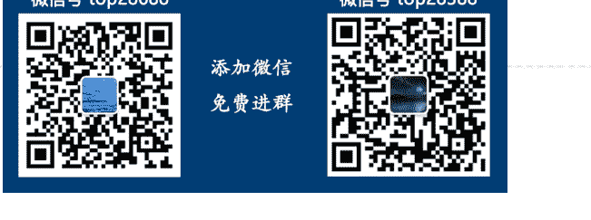
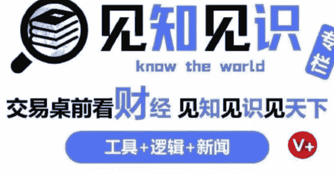

# 【V+专栏】你投我，我投你，你买我，我买它

一个关键问题：当前巨大的资本支出是否可能会带来风险？

2023年OpenAI的关键时刻可以说是爆发了人工智能的发展，特别是大家开始畅用通用模型和数据怎么变成实际应用。所以从2023年开始，这股应用化的势就拉动了上游的资本支出和基础设施建设，如数据中心和上游硬件。OpenAI快速起来起事，也反映了在上游旷达的股价和营收的明显增长上，之前我写过一篇报告：英语就是淘金时代卖铲的人。

到现在，毫无疑问上游的数据中心已经成了新一轮模型构建的核心。全球都在加速推进这些关乎未来生产的早期基建项目。不过眼下，投资者们在尝到了上游基建的甜头之后，正面临一个关键问题：当前巨大的资本支出是否可能会带来大风险？

加微信top28688，进资料分享群。

特别是这周英伟达与OpenAI签署合作协议，共同建设数据中心。根据项目落地进度，英伟达将逐步向OpenAI投资最高1000亿美元。同时，OpenAI斥300亿美元（分五年）向甲骨文算力资源，甲骨文则用400亿美元向英伟达显示卡。

随着“你投我，我投你，你买我，我买它”这种现金流相互循环环出现，华尔街那边也开始了类似的担忧了。

这就就像金矿时代铲子的主人获得了丰厚利润，但现金太多无法进一步利用，账面现金流过剩，若通过扩大产能进行投资，可能会引发供给大于需求，带来毛利率下滑的风险。对于金矿镇上绝对垄断的企业来说，当务之急不是增加产能的投入，而是扩大需求。

我们看到黄仁勋表示他们实际上主要是依据客户需求来安排订单的，并不会在需求之外盲目扩大产能。实际上，这句话表明，在垄断环境下，他完全理解核心价值，并维持当前的毛利率，从而使需求能够快速增长，这对于英伟达而言是最有利的利益。

此外，卖铲子的可以将大量资金用于直接支持客户购买自身设备，如果客户未来盈利能力强，不仅能带来额外回报，还能建立绝对垄断地位。例如，将OpenAI视为金矿，Oracle作为矿队，而英伟达则是提供核心的“金铲子”。

加微信top28688，进资料共享。

这种商业行为其实在很多城市都是比较常见和通用的手段。在许多建筑公司中，常常会将自身资金补贴给终端客户。例如房地产行业，我们将房地产买家比OpenAI，而Oracle类类似房地产开发或建筑公司，或钢厂或建材供应商（如玻璃制造商）扮演了类似Nvidia的角色。尽管产业特征不同，但在商业模型中，巨头相互投资锁定债借贷快速扩张和裂变。所有现金集中于需求端，进一步强化了头部垄断，具备单一分散效应无法比拟的优势。

OpenAI-骨文-英达通过相互锁定订单和投资，形成了第一个资金与技术互补的强大同盟，但一切依赖需求持续的扩张基础，否则捆绑关系会放大风险。一旦OpenAI代表的应用端需求不足，骨文和英达将面临削单和投资亏损。

曾经类似的事情在中国房地产市场经历过的：一是资金周转缓和和债务问题，上游建筑公司（如南通企业被大绑定）或建材供应商（如广州装修公司）就会被牢牢困住。

> “从商业角度看，它是一种战略联盟，旨在构建技术竞争优势；是从金融角度看，这是一种行情行为，正如曹莱以铁链环增强稳定性，却面临‘火烧灭地’的隐忧”

我相信人工智能这一大风口本身并没有疑问，各方都会为自身立场发声。例如，应用端会强调该领域的巨大潜力，上游数据中心和设备生产企业将会强调自己有巨大的需求。当前全产业链已基本清晰，人工智能基础投资的发展必将持续。

然而，对于投资者来说，这种增长的持续性才是最大的变数。如果需求无法跟上资本支出的扩张，这种循环循环的泡沫可能会破。

加微信top28688，进资料分享。
