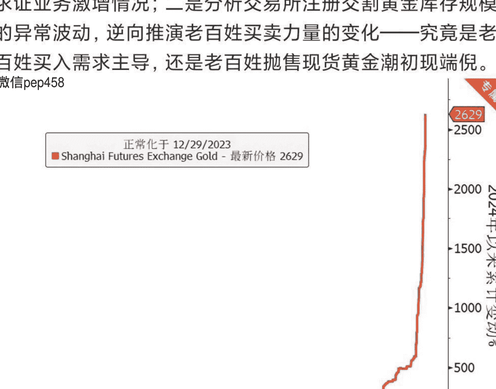

## 知知见识
25-10-16 18:30 来自微博网页版
发布于 上海

## 【微博】上海黄金交易所做了风险提示

| 黄金 | 交易所 | 新闻动态 | 产品服务 | 风险资讯 | 公会专栏 | 投资者服务 | 规则与条例 |
| --- | --- | --- | --- | --- | --- | --- | --- |
| 交易所公告 | | | | | | | |

## 关于做好近期市场风险控制工作的通知
来源: 时间:2025-10-16

各会员单位：

近期市场活跃，交易较多，国际黄金报价波动频繁。请各会员做好风险防范识别，根据风险性情况，维护市场稳定运行，督促投资者做好风险防范工作，合理控制仓位，理性投资。

特此通知。

上海黄金交易所
2025年10月16日
@财富见闻

黄金相关基金

# 大家都在搜
上海黄金交易所
加微信top28688，进资料分享群

## 关于做好近期市场风险控制工作的通知
来源: 时间:2025-10-16

各会员单位：

近期影响市场不稳定的因素较多，贵金属价格波动剧烈。请各会员提高风险防范意识，继续做好风险应急预案，维护市场平稳运行。同时，提示投资者做好风险防范工作，合理控制仓位，理性投资。

特此通知。

## 加微信top28688，进资料分享群

# 见解聚焦
25-10-16 18:43 来自微博网页版
发布于 上海

**【微博】最新策略邮件**：黄金零售业的股票，在黄金上涨的初始阶段往往表现亮眼。这一阶段金价升值直接刺激了黄金需求——无论是购买黄金首选还是投资黄金的热情都会升温，从而提振黄金零售业的业绩和利润。多数黄金企业并不囤货或拉抬价格，而是库存随着金价上涨而升值，但核心利润源于销售差（包括各项费用与销售）。

然而黄金进入第二轮涨势，市场格局陡然变化。此时群众中积累大量黄金，追涨力与资金双重驱动。尽管许多百姓享受着黄金增值的收益，但黄金零售业的股价未必跟随金价上涨，这一背离现象值得警惕。
若群众开始抛售黄金，为避免囤货拉抬价格，而是加速周转——将收回黄金熔成可交金箔，通过交易所换取流动资金，支撑日常收购需求。

这种市场转向可以通过两个维度观察：一是指向回收黄金供应链寻求业务增长情况；二是分析交易所注册黄金库存规模的异常波动，导致百姓买卖力量的变化——究竟是百姓购买需求为主，还是抛售现黄金潮初现端倪。

微信微458

正常于 12/29/2023

- Shanghai Futures Exchange Gold - 最新价格 2629

| 13 | 14 | 15 | 16 | 17 | 18 | 19 | 20 | 21 | 22 | 23 | 24 | 25 |
| --- | --- | --- | --- | --- | --- | --- | --- | --- | --- | --- | --- | --- |
| 全开源黄金珠宝混合ETF 022027 |

加微信top26888，进资料分享群

## 知识星球TOP
添加微信；资源分享群免费入群
微信:top28688

| 序号 | 公号/星球/社群 | 原价 | 领域 |
| --- | --- | --- | --- |
| 1 | 生财有木 | 2765/年 | 同业，搞钱 |
| 2 | 众宗众吃瓜群 | 365/年 | 时政，历史 |
| 3 | 记忆巷/毅树西风 | 365/年 | 成长，励 |
| 4 | 欧洲金轨 | 328/年 | 时政，历史 |
| 5 | 卢克青云会 | 699/年 | 时政，社会 |
| 6 | 体制内主任 | 599/年 | 体制，职场 |
| 7 | 局外人的视界 | 669/年 | 金融，时政 |
| 8 | 溯泽异迁 | 4166/年 | 财富，成长 |
| 9 | 守夜人司令 | 599/年 | 时政，经济 |
| 10 | 江宁知府 | 365/年 | 时政，国际 |
| 11 | 政堂/顾子明 | 568/年 | 时政，经济 |
| 12 | 唐书院 | 1399/年 | 金融，财富 |
| 13 | 大树乡谈 | 199/年 | 时政，成长 |
| 14 | 水库联大 | 10000/年 | 房产，经济 |
| 15 | 洪灏宏观策略 | 4376/年 | 经济，搞钱 |
| 16 | 金通鉴/北海南山 | 4576/年 | 股票，行研 |
| 17 | 猫哥的世界 | 299/年 | 时政，社会 |
| 18 | 飞浅龙 | 3600/年 | 股市，经济 |
| 19 | 米联诸见闻 | 599/年 | 经济，金融 |
| 20 | 茶茶财经圈 | 330/年 | 房产，股票 |
| 21 | 赢在八小时之外 | 365/年 | 成长，职场 |

...... 更多资源，不再列举

+图书、报告、课程等同类高价值资源

- 免费群 每日分享资源
- VIP群 每日分享所有资源（日均20+），75/年
- 赠送付费资源合集，市场价数万元
