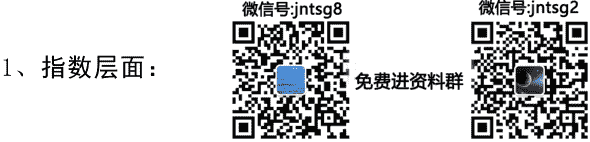

# 最近的一些个人思考

原文：轻风断断 公众：似水之流年 25年5月5日

假期快要结束了，休息时间也足够长，我们需要收心。

聊几个人观点，尽量简明扼要，不说废话。

1、指数层面：

纯技术结构，2024年2月，2024年9月，指数月级级别落下了两只脚，低点分别为2635、2689。对应的高点出现在2024年10月，3674点。

从波浪理论角度，2024年9月中旬到十月初，波浪上升为简单单形。

20241008—20250407为调整浪，复杂形态。

个人倾向于此轮调整已经在20250407一步到位。

之后会迎来日线、周线级别的浪。

经验来说，一浪简单形态，三浪会是复杂形态；三浪为复杂形态，未来的四浪会是简单单形。五浪在预判和讨论范围内（可能失败）。

千人浪，仅个人的分析。

2、行业层面：

个人倾向于坚守主线，看十做一，放弃非主线机会。

1、高质量智能制造

在没有人口红利的前提下，“高质量”三个字将是未来二十年最重要的定语。

智能化同样是未来几年的大趋势，制造立国，否则容易空化。

所以这是大方向、大趋势。

正应了那句话：世界潮流，浩浩荡荡，顺之者昌，顺逆者亡。

2、高质量科技金融

金融是百业之母。但非常有可能，机会已经不再是我们传统认知中的银行、保险业了。

传统金融的定位是“让利实体经济”。

叠加AI、数字经济、信贷、云计算、大数据、REITs的公司，机会可能更多。

### 三、高质量文化传媒

这里也包含了游戏输出出海。

## 三、投机层面。

今年计划用1%-3%资金参与重整方向。对于普通玩家，个人建议这个上限控制在10%之内。

## 四、时间周期。

因为海面对的干扰因素，时间周期成为最大的变量。

指数月线级别如果出现连续三根加速阳线，快速把账户做成零成本或者负成本。

## 五、止盈策略。

第一：零成本。

这个概念，大伙应该都耳熟能详了。

在你第一次完成翻倍的时候，取出本金，把利润留在场内，利用每一次涨赚免费筹码，然后一个大级别的顶部，离开市场。在种无与比放松的心态下，这是最好的交易状态。

第二：买入点卖点的角度。

针对波段级用户，你是什么级别的买入点，就在次级选择卖出。

第三：资金管理角度。

自己设置一个强行退出标准，这个因人而异。

我打个比方：牛市中后期，你在净值回撤20%的时候，强行退出80%仓位。

- 扫码加入 知识星球TOP 免费资源群
- 每日免费获取高价值资源
- 可提供各类资源搜索服务
- 免费 
- 热门付费文章 ◆各行业报告
- 精选图资源 ◆副业赚钱方法
- 职场实用资源 ◆AI政经自媒体

分享资料仅供个人学习，请及时删除，勿商传播
