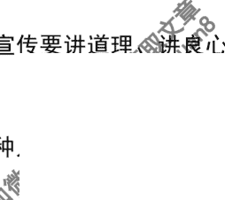

# 人性研究：从人的动物性解码人类的原始本能。

原创：主任 公众号：通的职职人生 25年5月28日

《人类简史》里有句话说得好：“如果你忘记了人类是动物，你就永远无法了解人性，你也无法理解历史。”

恩格斯说过：“人源于动物界这一事实已经决定了人永远不能摆脱兽性，所以问题永远只能在于摆脱得多少些，在于兽性或人性程度上的差异，道德规范尚要用到高级的人身上。”

达尔文说：“人类不过是进化的猿猴”。我们总是以万物长“自居”，却在欲望的泥潭中挣扎，贪婪时自私如孤狼，软弱此时如羔羊。

人的属性可以分为三层：动物性、社会性和神性。

- 人的第一性是生存本能，也就是动物性。
- 人的第二性是群体规则，也就是社会性。
- 第三性才是超越欲望的良知，也就是神性。

所谓的人性，不过是动物性披上了道德的外衣，本质还是围绕生存、繁衍、趋利避害的动物丛林法则。

人类的婚姻、道德、政治、文化、权力等都属于表象，是为了美化这个弱肉强强的规则，可以说人性就是为了美化自己而发明的一个词，从来就没没有什么人性。

人，本来是动物——即使是高级动物——动物的普通属性，必然包含在“人性”之中。人类的贪婪、自私、痛苦、狡猾、卑劣、虚荣、傲慢、嫉妒、狂怒、懒惰……等等，都是“人性”的成分。

无论你喜欢或不喜欢，谈论或不谈论，它们就是存在的。

有些人一直在宣传要讲真理、善良、情感。这些人分为两种：

1. 一是不懂人性，只看重表面意思，就是想和大众一起“守护”这些“真理”。
2. 另一种人则深谙人性，他们以利益为准则，用这些金冕堂皇的东西操控其他人。

前一种一直活在假象里；后面一种人一直活在真相里。于是，活在真实的人和活在假象里的人，每个人都是自私的，他们为了自己的利益做出相应的行为。
