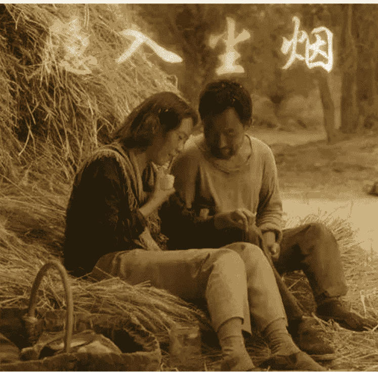

# 阶层固化，以及如何打破阶层固化？（含两种打破阶层固化方案）

## 知识星球TOP资源共享群
汇聚全网付费资源，让更多人获取高价值信息。添加微信免费进群。

等：知识星球TOP
微信：jntg8

- ◆ 付费文章 / 付费社群
- ◆ 付费课程 / 副业&搞钱
- ◆ 财经&股市 / 行业报告

涵盖时政·历史·职场·体制·自媒体学习·军事·软件·音影·社会学

微信：jntg2

## 精英必读！

8次阶层跃迁，及最后一次阶层跃迁详解！
房产税何时落地？及未来八大预测！（含投资方向）

↑↑关注我，国际，国内，社会，财经最深度的第一手资料。

我们今天聊的主题是阶层，其中也包括这个系统的运行规则。阶层是全球每个国家和地区千百年来都会面临的课题。以往来说，社会发展的演变点很多时候源头是因为阶层矛盾。以往来说，你知道那些比你穷的人都是怎么生活的吗？你又知道那些曾经富豪们在面对问题的时候是怎么思考的吗？这些人又是怎么升爬的？我们不会想不到在今天的世界上还有人能够隐入尘烟，也不知道环境的变化已经让很多权贵富豪阶层出现了非常大的波动，这就是阶层带来的隔阂，而这些隔阂会造成人与人之间出现巨大的认知差距。

加微信号jntg2，免费进群。

## 走入生烟

加微信jntg2，免费进资料群。

社会阶层是指具有相同或相似社会地位的成员组成的群体，同一群体之间态度、行为、生活模式、价值观都具有高度的相似性。阶层这个词其实是一个等的词，是根据各种不平等的现象把人们划分为若干社会等级。

可是近千年来各个地方都会有一种社会现象。我们往往把资源很多的人称为资本家或者权力阶层，次之叫中产阶级，再就是小产阶级或者无产阶级。

而阶级这一点其实在古代的中国和当今的印度更是体现得淋漓尽致。古代中国有土地所有，今日印度有深根蒂固的种姓制度，一部分人的命运也此挂钩，只要出生，就会自动进入这个等级，社会也掉到了对应的阶层。也是因为这一点，可能后的命运遭遇就九离十了。这就是一个阶层固化的社会带来的东西。

即便到了今天，无论哪里仍然有着权贵、中产和无产之间的差距，而且差异越来越大。尤其是2020年经历一轮动荡之后，有人生活困难，有人身价倍增。

加微信号jntg2，免费进资料群。

阶层分化是一种必然形成的社会现象。在社会形成的最初，人与人是完全平等，就像原始人时代，人类组成部落，一部分人打猎，一部分人守家，打猎回来的食物大家一起吃，人们互相帮助，就这样维持生活。

后来有一天，真的有人在工作之余达到了一头牛，这头牛让他一个人半年的伙食，而且是在工作时间之外额外多来的，他只需要上交给部落一部分，剩下的都是他人的。有了这些储备牛肉之后，他短期就不需要再出去工作了，而且他甚至还可以用一部分牛肉来雇佣其他猎人来为自己打工。

所以他主动拿出一部分牛肉分给几个猎人，不管他们今天是否打到猎物，都可以得到这些食物，但是也约定如果打到猎物，要给自己分30%。很多猎人为为了躲避风险，便选择接受这样的约定。他雇佣了十个人，每个猎人平均每个星期能达到20斤猎物，这样从每个人身上就能获得六斤肉，而每个猎人一个星期从这里拿走的固定薪水有五斤肉，所以相当于他通过雇佣这些人每个人每周就可以净赚十斤肉。于是从那之后开始，有人在不需要工作的情况下，每个星期也能获得一份收入。

后来随着时间的发展，我们就称这部分人的资本。

到这里我们能看到，一开始人和人还是平等的，但是随着时间发展，人们对于资源的获取方式和量慢慢出现了一些变化。起初首要劳动会创造资源，也会很好的让你温饱，但是当有人的食物开始积累的时候，他就可以用食物来雇佣人力，从而创造更多食物，这就是资源可以创造资源。

再者，权力也可以创造资源。

这样，社会演化的过程中，资源在不同人群之间越发分化，阶层就开始慢慢变形成了。不同阶层掌握的资源差距是巨大的，由此带来的认知也是巨大的。

同样的问题，不同类型的人会给出不同的解决方法，比如赚到更多钱这件事儿，无产和中产会努力勤奋工作。

## 微信公众号:jntg2
## 微信公众号:jntg2

拥有资源的资本会愿意一些可靠的项目，或者通过资本运作来获得资金。其实无产和中产并不是想不到这些，而是没有能力，因为还吃不饱，即使遇到了好的项目也错过，因为没有足够的资本。这就是阶层之间的差异。另一项则限制了发展，就是认知。权贵阶层拥有的资源和人脉，而且了解多，即使一次机会也能更快积累财富。

这个世界每个人都在做正确的事：工人要打工赚钱，资本家要投资获利，无产阶级要找到工作，执政者要保障一切稳定。所有人成了这个社会系统，这个社会系统在运转中，产生了资本家、中产、工人、农民、无产者，而这些阶级的话语权制定规则。

随着发展，阶层的改变会变得越来越困难。并不是每天工作从八小时变成了十个小时就能改变命运，也不是从主管晋升了经理就能跨越阶层。所以想要改变自己，就先看看环境。有时候只需要换个行业，收入就会提高很多，可能只需要换个城市，生活水平就会改善很多，或许也需要了解一些知识，或者考取几个证书，才能拿到一些领域的入场券。金字塔越往越拥挤，水池不通，这就是现在的市场情况。

## 破阶固化的两种解决方案

### 第一种：成为某个领域的头部
如果你在计算机领域好，那么成为头部的人才，基本年薪不会低于80w，甚至还入几十万。听懂了吗？先看看自己能不能对付，是否感兴趣且有耐心。如果不感兴趣，学会很痛苦；如果没有耐心，进步就会慢，成就极其有限。还要看你选择的行业，a行业头部年入200w，b行业头部年入100w。如果感兴趣且有耐心，肯定要选择a行业。

### 第二种：打造自己的产业
这个可以是自己开一个理发店、面馆、包子铺、小超市、网店、短视频账号、小平台等等。如北京捞，最早从一家火锅店开始，后来开了5、6个连锁店，一直到上市。当然，我只是举例子，不是让你盲开店，门店是大概率亏的。你要看店附近流量、客户口味、消费能力、成本管控等因素。这个问题，建议你找下身年入千万的人，学习一下经历。

我身边年入千万的，有做跨境电商的、开美容院的、做游戏的、包工的、做网红的、直播带货的、开几十家连锁等的。当然，我的建议是多听多看多学习。同时想够跨，比如房地产开发，门槛还需要千万，你够不够门槛？如开启连锁店，前期投入150w，利润模型怎么样？多久收回成本，亏损的概率有多大？除非你是有多年经验的老司机，否则不建议重资投入型的，因为你输不起。尽量做投入低成本的领域，比如短视频、新媒体。

### 第三种：资产配置
其实第三种不算打破圈层固化，它是帮助阶层跃迁。很多人说，乱投资才会变富，不投资不会亏。其实是错的。
