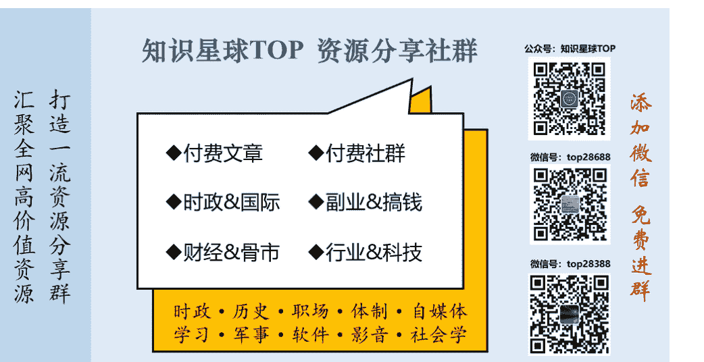
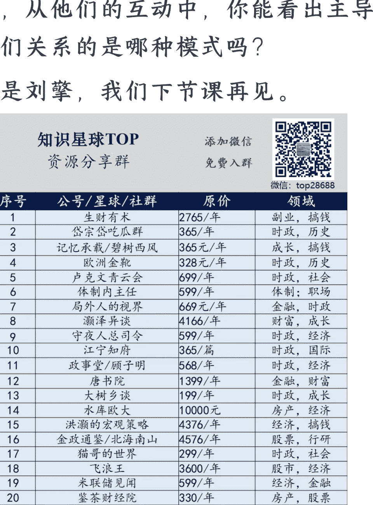

# 爱情的实践形态：亲密无间还是亲密有间?

250905 刘擎

欢迎来到《爱情哲学 30 讲》，我是刘擎。

在前面的课程中，我们提到，爱情虽然常常被称为“二人世界”，但更准确地说，它是一种三元结构：除了了作为独立个体的“你和我”，还包括一个共同生成的精神生命“我们”。这就带来一个真实的困惑：爱情生活到底应该追求“亲密无间”，还是保持“亲密有间”？

常见的回答往往是“又要保持亲密，也要保持距离”。这种回答听上去周全，却往往流于表面。要真正理解其中的张力，我们必须从哲学视角出发，探究这一问题的根源。这就是我们这一讲的任务。

## 爱情的双重性

“亲密无间”还是“亲密有间”？这种纠结的原因在于，爱情本身具有双重性。也就是说，我属于我自己，也属于“我们”。人与人之间交往说两种语言：一种是“我们的语言”，体现彼此的依赖；另一种是“我的语言”，突出主体自主。这使得爱情既丰富又充满张力。

在实际生活中，这种双重性表现为两种主要的关系模式：一是以个体独立为前提的“交易互惠模式”；二是以共同体的成长为核心的“融合共生模式”。

下面我将分别开展说明，你可以注意听听它们的区别。

### 1. 互惠模式：需求交换与功能性合作

先说互惠模式。

这是一种基于相互满足需求的功能关系模式，它的维持和发展主要依赖于双方都能付出与回报，比如分担生活的事务和开支、身心关怀和情绪支持、共享资源等等。

这种模式的基本假设是，人在任何关系中都具有独立性，爱情中也是如此。所以，在交易互惠模式中，亲密关系是一种特殊的合作联盟。当双方的付出和收益大致对等，尤其在主观心理上感觉公平时，关系才会足够稳定。一旦任何一方主观感受自己付出过多而回报不足，平衡就被打破，需要启动协调机制，达到新的平衡。

例如，如果爱情中只有一方主导关系、安排一切、表达关心，而另一方习惯地被接受，久而之，主动的一方可能因付出过多感到“心理不平衡”，要开始减少投入，要明确对方积极付出。如果这种协调机制失灵，造成长期、更严重的失衡，交易互惠模式就会陷入崩溃，关系就能破裂。

听到这里，你可能已经发现，交易互惠模式的运作逻辑主要从经济学的公平交易原则，既有稳定性，又有脆弱性。稳定的关键在于“供求的相对均衡”，而脆弱则来源于“供求失衡”。

### 2. 共生模式：生命融合与身份认同

现在来看共生模式。

如果说互惠模式关注的是“你和我个体之间的功能性交换”，那“融合共生”模式就是“我们”这个精神生命的存在方式。

前面提到，爱情是个体的深度交互，直到你与我之间的个体边界被消融，形成一个全新的融合生命——“我们”。这个融合的“我们”，要依赖双方不断的共同滋养才能持续生命。因此，“我们”在你与我的融合中诞生，也在共同的滋养中才能存在，这就是“融合共生”。

那么，这种模式在日常生活中有些体现呢？哲学家诺诺克提出过两个主要特征，第一是“共同福祉”，第二是“自主性限制”。

“共同福祉”就是真正意义上的“同甘共苦”。发生在所爱之人身上的，几乎所有好事和坏事，就等同于发生在你自己身上，彼此都能深刻地感受到对方的快乐和痛苦。所以，真正相爱的伴侣之间，往往能生成强烈的情感共鸣，彼此由衷而自然地尊重、关怀和支持对方。

那“自主性限制”是什么呢？从字面上来说，它是个体自愿地让渡部分的自主，服于“我们”这个共同体的主权。这个主权的基础来自于哪里？它源于一种平等的、相互尊重的谈判伦理。简单地说，遇到事情时，你不能像单身的时候那样自己说了算，而是需要和伴侣共同协商、达成共识。比如，你想去旅游，伴侣想去埃及，这就需要两个人讨论。现实生活中哪些事情需要共同决定，不同的伴侣存在差异，比如居住、是否要工作等。

### 3. 两种模式的关系

到这里，我们已经了解了两种基本模式。你可能想，理解这两种模式有什么用？至少有三个作用：

首先，它为我们提供了一个判断亲密关系属性的参考。两种模式并不是并列的。融合模式是爱情的本质，遵循尊重与奉献的原则；交易互惠模式是爱情的功能，依照公平的原理。如果一种关系逐渐从“融合模式”主导演变为“交易互惠模式”，那么这段关系就可能是不稳定的，离爱情越来越远。

其次，理解两种模式让我们看到亲密关系是一个动态过程。爱情不是在“亲密有间”与“亲密无间”之间简单的选题，而是在关系中找到平衡。为了方便，我们可以想象有一个光谱，左端是完全的融合共生模式，也就是“纯爱状态”；最右端则是彻底的交易互惠模式，称“合作状态”。大部分实际的状态处这两个点之间，位置越偏左，关系中的爱情就越高。不过一段亲密关系可能会随着时间而变化，许多伴侣从“纯爱”转向“合作”，在这个过程中培养深厚的感情。

最后，这两种模式的分析还有第三个作用：它可以帮助你在遇到冲突时看清楚的关系处于什么状态，“我们”这个共同体究竟有多大。刚才我们把两种模式想象光谱的两端，但在实践中它们往往交织在一起，并没有明确的界限。比如，双方都用心满足对方的需求这可以视为交易互惠行为，但同时将对方的快乐当作自己的快乐，这又是一种“融合共生”模式的操作。我在访谈中遇到的例子：一对三十多岁的夫妻面临一次的人生选择，男方事业有一个海外工作的机会，同时女方也获得了学院进修的机会。刚开始如果丈夫，妻子就得承担更多家务责任，自己的学业也会负担。经过协商，丈夫决定放弃，他的理由是从家庭的角度看，现在应该优先考虑妻子的发展。这种选择在单纯的交易互惠模式中是一次失衡，但把“我们”这个共同体的福祉置于优先位，这种选择就完全合理。做出决定后，妻子感谢了丈夫的无私，而丈夫的回应是：我现在最大的私心就是为了我们家好。这种，这种选择表明，这对夫妻的关系是以融合共生模式为主，而这个决定本身也会进一步强化他们的融合共生。

一般而言，融合共生模式主的关系在面对外部变迁和内部困境时，可能表现出更强的韧性，因为双方更看重“我们”，不容易在交易模式中“计较”。这背后反映出的深厚的生命联结和身份认同。如果亲密关系是由融合模式主导的，即使在痛苦、误解或冲突中，双方更愿意为了“我们”这个生命共同体而坚持努力，一起寻找解决方案。

回到开始的问题：“亲密无间”还是“亲密有间”？其实两种状态对应了我们讲述的两种模式：融合共生和交易互惠。

那么，面对一个特定的情景，你应该启动哪种模式呢？真正的答案是，你不用操心，你不用启动模式，模式会启动你！也就是面对特定的情景，你们亲密关系的状态会自动启动相应的模式。但是在在这个情景中，你可以在反思的意义上追问几个具体的问题。比如，你会思考伴侣做出决定背后的动机吗？伴侣的悲欢有多少程度是为了自己的悲欢？发生冲突的时候，你们考虑到的是个人得失，还是“我们”的共同福祉？

如果有这种自觉回头和反思的意识，你就可能和伴侣深入思考和沟通，一起分析和改善亲密关系的状况。这也是学习这课可能有的实用意义吧。

## 总结

好了，让我们总结一下：
爱情有两种实践模式。互惠模式像生意，讲究付出与回报的平衡；而共生模式像一个共同体，你的快乐就是我的快乐，但同时，我和我的受限于“我们”的共同利益。

大多数关系都混合了这两种模式，整体来说，一段亲密关系中，融合共生模式越占主导地位，关系中的“爱情”浓度就越高。

# 思考题

最后，留一道思考题给你：
你想想你自己，或者你周围的一对伴侣，从他们的互动中，你能看出主导他们关系的哪种模式吗

我是刘颖，我们下节再见。

