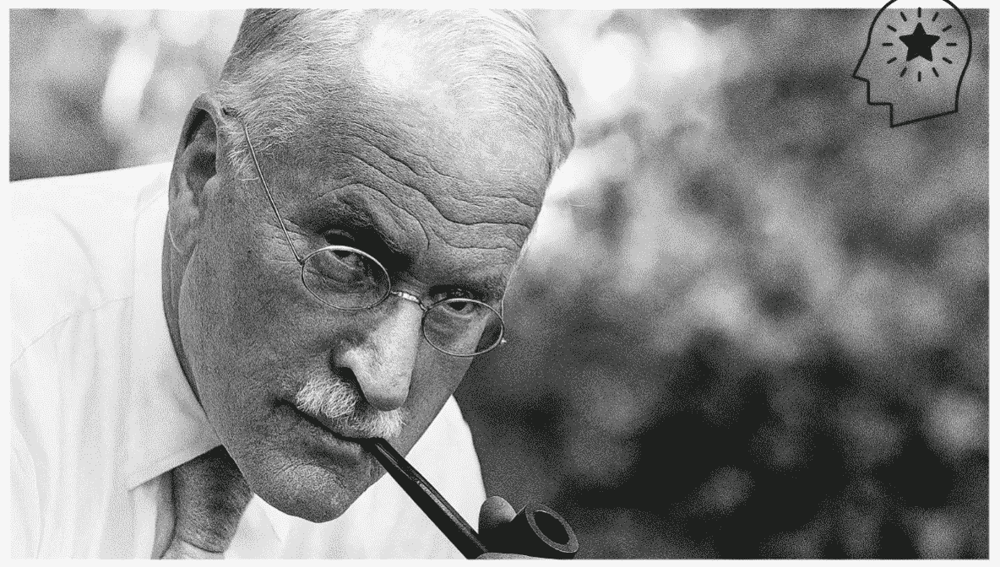

深度长文: 1482字

# 人可以很轻松地做成任何事

加微信进资料群

**本文核心解决议题**

**如何通过微习惯设计、合理反馈和内在契合，让人轻松地坚持并完成任何目标。**

有没有过这样的体验：想学英语，坚持三天就放弃；想健身，买了年卡却去过两次；想写点东西，结果被手机短视频消耗了整天。于是我们很容易得出一个结论：“我就是没有自律”、“做不到。”但内心里心理学告诉我们，事实恰好相反——我们其实可以轻松做到任何事。关键在于，你是否理解了“轻松做成”的底层逻辑。

## 一、 为什么很多事对我们来说那么“难”？

哈佛心理学界丹尼尔·福格曼提出过一个著名的理论——反讽过程理论。

比如：当你拼命告诉自己“不要紧张”、“不要想失败”，结果大脑反而会更加专注于“紧张”和“失败”。

这就是为什么：

- 越想自己早睡，越容易失眠；
- 越想集中注意力学习，越容易分心；
- 越害怕失败，越容易掉失败的循环

换句话说，不是事情本身难，而是我们的心理用错了努力。

## 二、 轻松做成任何事的三个心理学原理

### 1. 微效应 (Small Habits)

斯坦福大学行为科学家 BJ·福格研究发现：

习惯的本质，不是靠意志力，而是靠设计。

- 如果你想每天做俯卧，从1个开始，而不是50个；
- 如果你想开始写作，从写1句话开始，而不是3000字。

当起点小到“不可能失败”，习惯就能自然然而地积累。

### 2. 心流状态 (Flow)

心理学家米哈里·米克森米哈赖提出的“心流”理论表明：

当一个任务既太难，也不太简单，并且伴随即时反馈，我们就会进入一种忘我的投入状态。

所以，很多人能玩游戏到深夜，却很难坚持学习，不是因为懒惰，而是因为学习缺乏即时反馈和合理难度设计。

这意味着，任何事情只要被拆分和设计得足够合理，我们都会很容易沉浸其中。

### 3. 荣格的“自性”观点

荣格说过一句意义深刻的话：

> “一个真正的目标，是成为他自己。”

很多时候，我们觉得事情难做，并不是因为它难。

## 三、如何让自己轻松完成任何事？

结合心理学和荣格的观点，可以总结出一个公式：

轻松做成 = 微习惯设计 × 合理反馈 × 内在契合

具体操作是：

1. 把目标切到极小
   - 想写作？先写一句话；
   - 想健身？先做一个动作。

2. 创造反馈循环
   - 每天把学习进度标在纸上，给自己起一个“可见的成就感”；
   - 或找伙伴互相打卡。

3. 找到你的“荣格式契合”
   - 问自己：这件事和我的兴趣、价值、人格哪里可以对齐？
   - 想锻炼，不一定是跑步，可以是爬山、骑行、跳舞；
   - 提升英语，不一定是死背单词，可以是看剧、聊天、写日记。

当习惯足够、反馈及时以及方式足够契合，你会发现——原来以前那些“坚持不了”的事，竟然能轻松做到。

## 四、生活中的应用案例

- 学习：想学一门新技能，不要想着“一年精通”，而是每天 10 分钟，记录进度，找到自己最感兴趣的切口。
- 健康：不要强迫自己每天跑 10 公里，从每天晚饭后散步5分钟开始，等你喜欢这种放松，再慢慢加量。
- 工作：面对庞大的项目，不要想着“一次完成”，而是把它们切分成小块，每完成一块就给自己小奖励。

## 五、结语

荣格提醒我们：人生最大的任务，不是战胜别人，而是成为自己。

心理学提醒我们：轻松做成任何事，并不依靠意志力，而靠设计力。

所以，当你想下次做成某事时，不要再用力和自己较劲，换个方式，让它自然地发生。

你会惊讶地发现——原来，人真的可以很轻松地做成任何事。

## 知识星球TOP

添加微信
免费入群

微信:top28688

| 序号 | 公号/星球/社群 | 原价 | 领域 |
|---|---|---|---|
| 1 | 生财有木 | 2765/年 | 副业，搞钱 |
| 2 | 众宗众吃瓜群 | 365/年 | 时政，历史 |
| 3 | 记忆Legacy/땡树西风 | 365/年 | 成长 |
| 4 | 欧洲金轨 | 328/年 | 投资 |
| 5 | 卢克文青会 | 699/年 | 时政，社会 |
| 6 | 体制内主任 | 599/年 | 体制，职场 |
| 7 | 格外人的视界 | 669/年 | 金融，时政 |
| 8 | 溯泽异贷 | 4166/年 | 财富，成长 |
| 9 | 宁夜人总司令 | 599/年 | 时政，经济 |
| 10 | 江宁知府 | 365/篇 | 时政，国际 |
| 11 | 政堂/顾子明 | 568/年 | 时政，经济 |
| 12 | 唐书院 | 1399/年 | 金融，财富 |
| 13 | 大树乡村谈 | 199/年 | 时政，成长 |
| 14 | 水库恢大 | 10000/年 | 房产，经济 |
| 15 | 洪灏宏观策略 | 4376/年 | 经济，搞钱 |
| 16 | 金企通鉴/北海南山 | 4576/年 | 股票，行研 |
| 17 | 猫哥的世界 | 299/年 | 时政，社会 |
| 18 | 飞龙沃 | 3600/年 | 股市，经济 |
| 19 | 米联诸见闻 | 599/年 | 经济，金融 |
| 20 | 茶茶财经院 | 330/年 | 房产，股票 |
| 21 | 赢在八小时之外 | 365/年 | 成长，职场 |
