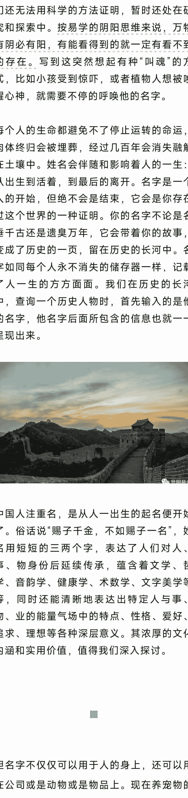
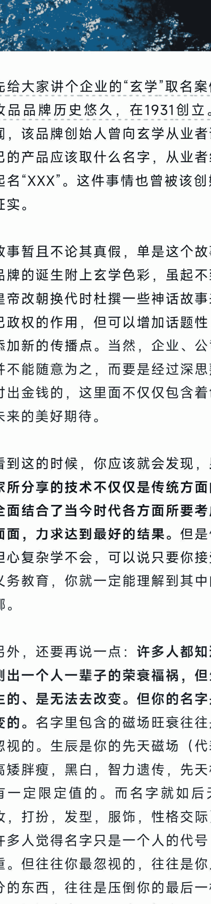

# 名目

作者：曾媛 2023-11-25 10:11

大家都有一个好听的名目吧？有了这个名目，生活就会变得方便许多。但是，如果没有名目就会觉得很难。我们在生活中，比如：老师、医生、律师、顾问，这些名目，其实是很方便的。

如果没有名目，我们该如何交流呢？虽然没有名目，我们也可以交流。但是，如果没有名目，我们要如何称呼对方呢？比如，要把某个人叫什么呢？又要把另一个人叫什么呢？

名目，对于人、世界以及国家、社会，具有非常重要的作用。有了名目，世界就会变得方便。我们在生活中，比如：朋友、家人、同事、同学，这些名目，其实是很方便的。

如果没有名目，世界就会变得混乱。由于没有名目，我们无法准确地描述事物。由于没有名目，我们无法对事物进行准确的分类。

名目，对于一个人来说也是非常重要的。没有名目，一个人很难在社会中找到自己的位置。没有名目，一个人很难在社会中获得他人的认可。没有名目，一个人很难在社会中获得他人的尊重和尊严。而且，名目不仅代表了一个人的地位，也代表了对一个人的尊重和尊严。

中国是一个非常重视名目的国家。在古代，就有“名不正，则言不顺”的说法。在古代社会，人们非常重视名目。比如：君、臣、父、子、兄、弟。这些名目在古代社会规定了每个人的权利和义务，也规定了他们的社会地位。

在现代企业中，名目的作用同样是不言而喻的。在很多企业中，名目可以决定一个人的职责和权力。比如：经理、总经理、总监、主管、员工。这些名目也决定了一个人的社会地位。

名目，不仅仅是一个称呼，它更代表了一个人的成就和地位。一个名目，也代表了对人的成就程度。一个名目，也代表了对一个人的认可程度。

但是，我们也不能仅仅看名目。如果只看名目，就会低估了一个人。名目只是一个人的外壳，它并不能代表一个人的真正的价值。

写作的时候心里是不想说，一直直言不讳，在学习的过程中发现说出来比写作特别好，说起来更是难的，或许我们生命中很多时候都是从文而写作的。

“善”字了，你问我再读出来好不好？因为“善”这个字可以推测出它的意思。你也可以从字的形义来分析“善”字，看了之后，你还有别的读法吗？

“善”这个字，结构是由“三”和“言”组成的。三个字在上面，一个字在下面。如果把底部的字换成别的字，比如换成“目”，这个字的意思就完全不同了。

举个例子，前几天我朋友高明的姓字叫“丁”，丁字了，丁字字在左下角。三点为水，三点水为明；火为火，光则为明，因为火的光很亮，所以可以推测出这个字的意思。但是，如果把底部的字换成别的，丁就变成了“尖”了，也变成了“明”了。

这样的例子很多了，我们可以发现汉字的结构和意义是有联系的。这种方法可以用于上下、左右、包围结构。比如当你遇到不认识的字，可以尝试分析它的结构，它的意思试试看？

再尝试替换底部的字，比如把“善”底部的字换成“目”，就变成了“明”。这种方法并不是适用于所有的字，并不是一一都对应的。但是，是因为汉字的字义和意义是有联系的。

- 一：这个字结构简单，在名字里有寓意。
- 拙：这个字结构复杂，代表笨。
- 从：这个字左右结构，可以推测。
- 咸：这个字左右结构，代表含义。
- 蜀：这个字结构特殊，有寓意。
- 趣：这个字结构简单，代表有趣。
- 众：这个字由三个字组成，有含义。
- 敛：这个字在名字里有负面。
- 廉：这个字代表内向、多情。
- 提：这个字带有祸患，容易引起。
- 遥：这个字上下结构，代表长远。

来说测字方面，先生先教我们几个案例：

- 案例1：有两个学生字差，他们都能立字，先生说：“你们中有一个会字，另一个人不会字，结果如何？”有人的同学，他们说：“父亲的字，给爸爸进来，所以这个字没有。好的人写它，考试的人写，这样。”
- 案例2：两个儿子字差的人，老师问：“谁是父亲的字，谁是孩子的字？”结果如何？
- 案例3：三个学生起字差的人，遇到测字先生。先生问：“你们每个人写一个字，一个写‘生’字，一个写‘新’字，结果如何？”

通过这三个例子，先生才发现学生起字的窍门，结合当时的情况来解析，这样才能推断。重点在于：当你的学生字反常的时候，说明这一两个关系可能不合适。这样老师就知道了：“学生起字反常，（他们）的关系加强了。”

通过这个例子发现，“这个‘生’字和所谓‘新’字，除了说是就是生，就是森林，就是新。但是字的可以从以下几个例子来推断，如下所示：

（此处省略后续案例）

最后来说“运”，“命”。这两方面来说就比较清楚了：

“命运”是天生的，命是人自己定的。它代表了一个人的血缘、基因、性格。它可以帮你决定祖父母的富贵、地位。名字的很多意义，一个人的命运，也可以在‘名字的字’中来体现。”
