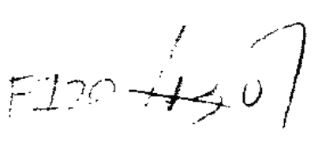

# 毛泽东农村调查文集

人民出版社

# 毛泽东农村调查文集

人民出版社 新华书店发行

北京新华印刷厂印刷

850 × 1168 来说 32 开印 11,625 册 212,000 字
1982 年 12 月第 1 版 1983 年 1 月起此第 2 次再印
印数 30,001—350,000

书号 1001-1212 定价 0.77 元

# 出版说明

一、本文集是在一九四一年出版的《农村调查》的基础上增订而成的。这次增补了《反对本本主义》、《总政治部关于调查人口和土地状况的通知》、《关于农村调查》、《中国农业生活举例》、《寻乌调查》五篇著作。

二、收入本文集的著作分为两部分，一部分是论述调查研究的文章，一部分是调查报告和土地法，分别按时间顺序编排。

三、本文集中的各篇著作，这次出版做了一些必要的文字校订。通过查阅文献资料和实地调查，对报告中的人名、地名、数字和其他事实，进行了核对，并做了一些订。

四、文集中做了一些要解释，统一编码，附在书末。

中央文献研究室
一九八二年九月十五日

# 目 录

- 反对本本主义（一九三〇年五月）......................................................1—11
- —— 没有调查，没有发言权......................................................................1
- 二 调查就是解决问题......................................................................................2
- 三 反对本本主义......................................................................................3
- 四 离开实际调查就要产生唯心的阶级估计和唯心的工作指导，那么，它的结果不是机会主义，便是被动主义......................................................................4
- 五 社会经济调查，是为了得到正确的阶级估计，接着定出正确的斗争策略................................................5
- 六 中国革命斗争的胜利依靠中国同志了解中国情况......................................................................7
- 七 调查的技术......................................................................................9
- 总政部关于调查人口和土地状况的通知（一九三一年四月二日）...........................................................12—13
- 《农村调查》的序言和跋（一九三七年十月，一九四年三月、四月）......................................................................14—20
- 序言...............................................................................................................14
- 序言二...............................................................................................................15
- 跋....................................................................................................................18

# 关于农村调查（一九四一年九月三十日）......................................21-27

中国佃农生活举例（一九二六年）......................................28-34

土地法（一九二八年十二月）......................................................35-37

土地法（一九二九年四月）...............................................................38-40

寻乌调查（一九三〇年五月）......................................................................41-131

- 第一章 寻乌的政治区划......................................................43
- 第二章 寻乌的交通......................................................................44
- （一）水路......................................................................................44
- （二）陆路......................................................................................44
- （三）电路......................................................................................45
- （四）邮政......................................................................................45
- （五）陆渐交通器材......................................................................46
- 第三章 寻乌的商业......................................................................46
- （一）门岭到梅县的生意......................................................................48
- （二）安远到梅县的生意......................................................................49
- （三）梅县到门岭的生意......................................................................51
- （四）梅县到安远的生意......................................................................52
- （五）惠州来贡......................................................................53
- （六）寻乌的出口......................................................................54
- （七）寻乌的重要市场......................................................................55
- （八）寻乌城......................................................................56
- 第四章 寻乌的旧有土地......................................................................53
- （一）农村结构......................................................................54
- （二）旧有土地......................................................................55
- （三）公共土地......................................................................56
- （四）个人土地......................................................................57
- （五）贫农......................................................................61
- （六）土地制度......................................................................62
- （七）山林制度......................................................................63
- （八）割润状况......................................................................66
- （九）寻乌的文化......................................................................69
- 第五章 寻乌的土地斗争
- （一）分配土地的方法......................................................................65
- （二）山林分配问题......................................................................66
- （三）池塘分配问题......................................................................67
- （四）房屋分配问题......................................................................67
- （五）分配土地的标准......................................................................68
- （六）城乡移民要求......................................................................69
- （七）人口数及不足之论......................................................................70
- （八）闲田问题......................................................................71
- （九）分配权......................................................................71
- （十）一个土地字......................................................................72
- （十一）抵抗土地的人......................................................................73
- （十二）总体分配......................................................................74
- （十三）暴动田之后处置......................................................................74
- （十四）农民是否分田......................................................................75
- （十五）债问题......................................................................76
- （十六）土地税......................................................................77
- （十七）土地斗争中的妇女......................................................................77

# 兴国调查（一九三〇年十月）......................................................182—251

- —— 八个家庭的观察......................................................................184
- 佛济庭......................................................................184
- 李寿英......................................................................185
- 温奎棻......................................................................188
- 陈慎山......................................................................189
- 申得元......................................................................191
- 黄大春......................................................................194
- 陈北平......................................................................195
- 雷汉秀......................................................................197

# 二 本区旧有土地关系...............................................................199

- （一）土地分配......................................................................199
- （二）人口成份......................................................................199
- （三）削削状况......................................................................201

# 三 斗争中的各阶级...............................................................211

- （一）地主......................................................................211
- （二）贫农......................................................................213
- （三）中农......................................................................216
- （四）贫农......................................................................218
- （五）雇农......................................................................221
- （六）手工工人......................................................................225
- （七）商人......................................................................227
- （八）游民......................................................................230

# 四 现在土地分配情况...............................................................233

- （一）分田地......................................................................233
- （二）分山林......................................................................236
- （三）池塘......................................................................237
- （四）房屋......................................................................237
- （五）公用......................................................................238
- （六）分田数量......................................................................239

# 五 土地税...............................................................................................240

# 六 苏维埃...............................................................................................241

+   (一) 区政府...................................................................................... 241
+   (二) 乡政府...................................................................................... 244
+   (三) 村村政府...................................................................................... 245
+   (四) 政府人员的弊病...................................................................... 245

## 七 农村军事化.................................................................. 246
+   (一) 赤卫队...................................................................... 246
+   (二) 少年先锋队................................................................ 248
+   (三) 童子团...................................................................... 248
+   (四) 纠联察队...................................................................... 250
+   (五) 红军预备队.............................................................. 250
+   (六) 区特务督................................................................ 251
+   (七) 红军独立肃（一九三〇年十月）...... 251

分田后的富农问题...................................................................... 252—253

东塘等处调查（一九三〇年十一月）........................254—263

赣南土地斗争中的错误（一九三〇年十月十四日）......271—274

分租和出租问题（一九三〇年十一月十五日）...... 275—282

木口村调查（一九三〇年十一月二十一日）...... 283—285

长冈乡调查（一九三三年十一月）................................ 286—332
政治区划及户口.............................................................. 287
代表会议...................................................................... 289
此次选举...................................................................... 294
苏下的委员会.............................................................. 297
地方部队...................................................................... 301
群众生活...................................................................... 304
劳动力的调剂与耕牛问题 ....................................................... 309
公债的推销 ....................................................................... 313
合作社运动 ....................................................................... 315
文化运动 ........................................................................... 317
卫生运动 ........................................................................... 320
社会经济 ............................................................................ 321
妇女 ................................................................................... 323
儿童 ................................................................................ 326
反帝 ................................................................................... 327
工人 ............................................................................... 328
贫农团 ........................................................................... 328
宣传队 ........................................................................... 329
突击队 ............................................................................ 330
革命竞赛 ........................................................................ 330
才溪乡调查（一九三三年十一月） ........................................... 333—354
行政区划 ........................................................................ 333
代表会议 ....................................................................... 334
此次选举 ....................................................................... 337
苏下的委员会 ............................................................... 339
扩大红军 ....................................................................... 340
经济生活 ....................................................................... 342
文化教育 ....................................................................... 353
注释 ....................................................................... 355—362

## 反对本本主义^{[1]}
（一九三〇年五月）

### 一 没有调查，没有发言

你对于某个问题没有调查，就停止你对于某个问题的发言权。这太野蛮了吗？一点也不野蛮。你对那个问题的现实情况和历史情况既然没有调查，不知底里，对于那个问题的发言便一总是说一一顿。说一一顿之不能解决问题是大家明的，那么，停止你的发言权有什么不公道呢？许多的同志都天天睁着眼睛在那里睁眼，这是共产党的耻辱，岂有共产党可以闭着眼睛说一一顿的？

- 要不得！
- 要不得！
- 注重调查！
- 反对睁眼！

### 二 调查就是解决问题

你对于那个问题不能解决吗？来，你就去调查那个问题的现状和它的历史吧！你完全完全调查明白了，你对那个问题就有解决的办法了。一切结论产生调查情况的末尾，而不是在它的先头。只有蠢蛋，才是他一个人，或者妄集一堆人，不做调查，而是冥思苦索地“想办法”，“打主意”。须知那个一定不能想出什么办法出出什么主意的。换一句话说，他一定要生错办法和错主意。

许多巡视员，许多游队的领导者，许多新接任的工作干部，喜欢一听到就宣布政见，看到一点表面，一个棱角，就用手指画牌地说这也不错错。这种主观地“浅览一顿”，实在是最可没有的。他一定要弄坏事情，一定要搞砸群众，一定不能解决问题。

许多做领导工作的人，遇到困难问题，只是取其，不能解决。他恼火，请求调查工作，理由是“才小，干不下”。这是谎过的话。迈开你的双脚，你的工作的各个部分各地方走走，学个孔夫子的“事事”(2)，任凭什么才小都能解决问题，因为你出门时脑子是空的，回来时脑子已经不是空的了，已经积累了解决问题的各种必要材料，问题就是这样解决了。一定要出门吗？

也不一定，可以召集那些明了情况的人来召开调查会，把你所谓困难问题的“来源”找到，“现状”弄明白，你的这个困难问题就容易解决了。

调查就象“十月怀胎”，解决问题就象“一朝分娩”。调查就是解决问题。

### 三 反对本主义

以前为了书就是对的，文化落后的中国农民至今还存着这种心理。不共享共产内讨论问题，还有人开口闭口“拿本主义”。我们说上级领导机关的指示是正确的，决不是因为它出于“上级领导机关”，而是因为它的内容是适合斗争中客观和主观形势的，是斗争需要的。不根据实际情况进行讨论和审察，一味盲目执行，这种单纯建立在“上级”观念上的形式主义的态度是非常不对的。为什么党的策略路线总是不能深入群众，就是这种形式主义在那里靠着。表面上全无异议地执行上级的指示，这不是真在执行上级的指示，这是在执行上级的指示。

### 四 离开实际调查

### 五 社会经济调查

### 六 中国革命斗争的胜利要靠中国同志了解中国情况

调查不要自己当主席，适当地指挥调查会的到会人，而且要自己做记录，把调查的结果记下来。假手于人是不行的。

根据《毛泽东著作选读（甲种本）》
〈人民出版社一九六四年六月版〉
印在本。

## 总政治部关于调查人口和土地状况的通知(7)
——一九三一年四月二日

我们现在规定了人口和土地两种调查表格。这两种表格主要是为了统计各级土地和人口比例，更具体地用事实来回答我们现在的许多问题。

过去许多地方往往忽视实际事实的调查，只凭自己空想过去去定工作计划，将指导下级工作，结果计划是不行的，指导是错误的。

现在这两种表格，我们能够深刻注意实际的正确的统计，能够解决我们许多问题，特别是现在分配土地中的许多实际问题。深望红军革命部每一处注意填写，地方政权机关逐条填写，尤望红军中政府每个负责人随时此种调查和统计。

到底如何才能调查得到的材料真正准确呢？

第一，必须建立对这一工作的深刻认识，清清楚楚工作的重要，才会大力注意。

第二，调查的人要不怕麻烦。调查这一乡，必须找到他们的分田的人口和土地调查本地，找到这一乡的经手分田的土地委员和熟悉这一乡情形的人，先把每一家的阶级身份和每一田为哪个阶级占有（属于地主、富农、中农、贫农……）分别清楚，再用硬办法统计清楚，按照实际数目填写上。

第三，上级政府派出指导的同志和政治部负责的同志，将两张表格的内容及调查时要注意之点，详细向执行这一工作的同志说清楚。特别是要说清楚，富农标准要是以剥削为收入的相当部分。那些少量缴欠帐或借赖的人都是列在表中。那些是雇农，中间（未革命前）已经取得土地耕种的人还是列入贫农。那些全家不种田，专门靠作劳动（做裁缝、木工等）谋生活的才叫独立劳动者。

未半个手艺的人还是按照他的经济地位列入贫农、中农或富农里面去。自由职业者与流氓的区别，是在自由职业者谋得相当正业（如医生、党员等），流氓无一一定职业，生活行为亦是不定，而且都是做坏的事多。

以上各项，如果调查时不弄清楚，则自己无把握，必将把阶级身份弄错了，失去了调查的正确价值。

这两张表格——土地表格和人口表格有密切联系，填写时必须同时进行。无论个人或团体，填写好了可以直接寄中央军事委员会总政治部联。

我们的报告是：

- 一、不做调查没有发言权。
- 二、不做正确的调查同样没有发言权。

根据中央档案馆提供的复印件打印。

## 《农村调查》的序言和跋（8）
（一九三七年十月、一九四一年三月、四四月）

### 序言 —一
（一九三七年七月十六日）

从一九二七年北伐战争期间起，到一九三四年离开中央苏区为止，我亲手从农村收集的材料，现在仅剩下下列各部分：（一）寻访调查；（二）兴国调查；（三）东塘调查；（四）木口调查；（五）赣豫西南土地分配情形；（六）分田和出租问题；（七）江西土地斗争中的错误；（八）分田后的富农问题；（九）两个初期的土地；（十）长冈乡调查；（十一）才垦乡调查。剩余后两部分，曾在中央苏区的《斗争报》发表过，其余保存原，经过长征，尚未损失。此外的东西，就损失了。其中最可惜的是，一九二七年春天在湖南的长沙、湘、潭、衡山、澧陵五县调查，因曾克祥叛变而损失；一九二八春天在井冈山做的宁、永新两县调查，因井冈失守而损失。这里来的都是中央苏区的材料，前两部分是属于初期的土地革命，后两部分是属于深入了土地革命。还不完全，亦可见一览。为免再损失，印出若干份，并供同志们参考。这是一种历史材料，其中有些观点是当时的意见，后来已经改变了。

### 序言二
（一九四一年三月十七日）

现在在党的农村政策，不是十年内战时期像那样的土地革命政策，而是抗日民族统一线的政策。全党应该执行一九四零年七月七日和十二月二十五日的指示。所以印这个材料，是为了帮助同志们找一个研究问题的方法。现在我们还有许多，还保存着一种粗枝大叶、不求甚解的作风，甚至全然不了解底情，在那里负担指导工作，是异常危险的现象。对于中国各个社会阶级的实际情况，没有真正理解的底层，真正的领导是不可能的。

要解释，唯一的方法是向社会作调查，调查社会各阶级的动态。对于负担指导工作的人来说，有计划地抓住几个城市、几个乡村，用马克思主义的基本观点，阶级分析的方法，作几次周密的调查，才是了解情况的基本方法。只有这样，才能使我们具有对中国问题的知识。

要做这件事，第一是眼睛向下，不要只是昂首望。没有眼睛向下的兴趣和决心，一辈子也不会懂得中国的事情。

第二是调查。不要昂首望，决然不到完全的知识。用调查的方法得来的材料，是具体的。这里印的几个，都失掉了。这里印的，主要的是一个《兴国调查》，一个《长冈乡调查》，一个《东塘调查》。调查，是最简单又忠实的方法，用这个方法得到了巨大的益处，这是比较高明的学校。

必须建立对这一工作的深刻认识，清清楚楚工作的重要，才会大力注意。调查的人要不怕麻烦。调查这一乡，必须找到他们的分田的人口和土地调查本地，找到这一乡的经手分田的土地委员和熟悉这一乡情形的人，先把每一家的阶级身份和每一田为哪个阶级占有（属于地主、富农、中农、贫农……）分别清楚，再用硬办法统计清楚，按照实际数目填写上。

第三，上级政府派出指导的同志和政治部负责的同志，将两张表格的内容及调查时要注意之点，详细向执行这一工作的同志说清楚。特别是要说清楚，富农标准要是以剥削为收入的相当部分。那些少量缴欠帐或借赖的人都是列在表中。那些是雇农，中间（未革命前）已经取得土地耕种的人还是列入贫农。那些全家不种田，专门靠作劳动（做裁缝、木工等）谋生活的才叫独立劳动者。

未半个手艺的人还是按照他的经济地位列入贫农、中农或富农里面去。自由职业者与流氓的区别，是在自由职业者谋得相当正业（如医生、党员等），流氓无一一定职业，生活行为亦是不定，而且都是做坏的事多。

以上各项，如果调查时不弄清楚，则自己无把握，必将把阶级身份弄错了，失去了调查的正确价值。

这两张表格——土地表格和人口表格有密切联系，填写时必须同时进行。无论个人或团体，填写好了可以直接寄中央军事委员会总政治部联。

我们的报告是：

- 一、不做调查没有发言权。
- 二、不做正确的调查同样没有发言权。

根据中央档案馆提供的复印件打印。

## 《农村调查》的序言和跋
（一九三七年十月、一九四一年三月、四四月）

### 序言 —一
（一九三七年七月十六日）

从一九二七年北伐战争期间起，到一九三四年离开中央苏区为止，我亲手从农村收集的材料，现在仅剩下下列各部分：（一）寻访调查；（二）兴国调查；（三）东塘调查；（四）木口调查；（五）赣豫西南土地分配情形；（六）分田和出租问题；（七）江西土地斗争中的错误；（八）分田后的富农问题；（九）两个初期的土地；（十）长冈乡调查；（十一）才垦乡调查。剩余后两部分，曾在中央苏区的《斗争报》发表过，其余保存原，经过长征，尚未损失。此外的东西，就损失了。其中最可惜的是，一九二七年春天在湖南的长沙、湘、潭、衡山、澧陵五县调查，因曾克祥叛变而损失；一九二八春天在井冈山做的宁、永新两县调查，因井冈失守而损失。这里来的都是中央苏区的材料，前两部分是属于初期的土地革命，后两部分是属于深入了土地革命。还不完全，亦可见一览。为免再损失，印出若干份，并供同志们参考。这是一种历史材料，其中有些观点是当时的意见，后来已经改变了。

### 序言二
（一九四一年三月十七日）

现在在党的农村政策，不是十年内战时期像那样的土地革命政策，而是抗日民族统一线的政策。全党应该执行一九四零年七月七日和十二月二十五日的指示。所以印这个材料，是为了帮助同志们找一个研究问题的方法。现在我们还有许多，还保存着一种粗枝大叶、不求甚解的作风，甚至全然不了解底情，在那里负担指导工作，是异常危险的现象。对于中国各个社会阶级的实际情况，没有真正理解的底层，真正的领导是不可能的。

要解释，唯一的方法是向社会作调查，调查社会各阶级的动态。对于负担指导工作的人来说，有计划地抓住几个城市、几个乡村，用马克思主义的基本观点，阶级分析的方法，作几次周密的调查，才是了解情况的基本方法。只有这样，才能使我们具有对中国问题的知识。

要做这件事，第一是眼睛向下，不要只是昂首望。没有眼睛向下的兴趣和决心，一辈子也不会懂得中国的事情。

第二是调查。不要昂首望，决然不到完全的知识。用调查的方法得来的材料，是具体的。这里印的几个，都失掉了。这里印的，主要的是一个《兴国调查》，一个《长冈乡调查》，一个《东塘调查》。调查，是最简单又忠实的方法，用这个方法得到了巨大的益处，这是比较高明的学校。

必须建立对这一工作的深刻认识，清清楚楚工作的重要，才会大力注意。调查的人要不怕麻烦。调查这一乡，必须找到他们的分田的人口和土地调查本地，找到这一乡的经手分田的土地委员和熟悉这一乡情形的人，先把每一家的阶级身份和每一田为哪个阶级占有（属于地主、富农、中农、贫农……）分别清楚，再用硬办法统计清楚，按照实际数目填写上。

第三，上级政府派出指导的同志和政治部负责的同志，将两张表格的内容及调查时要注意之点，详细向执行这一工作的同志说清楚。特别是要说清楚，富农标准要是以剥削为收入的相当部分。那些少量缴欠帐或借赖的人都是列在表中。那些是雇农，中间（未革命前）已经取得土地耕种的人还是列入贫农。那些全家不种田，专门靠作劳动（做裁缝、木工等）谋生活的才叫独立劳动者。

未半个手艺的人还是按照他的经济地位列入贫农、中农或富农里面去。自由职业者与流氓的区别，是在自由职业者谋得相当正业（如医生、党员等），流氓无一一定职业，生活行为亦是不定，而且都是做坏的事多。

以上各项，如果调查时不弄清楚，则自己无把握，必将把阶级身份弄错了，失去了调查的正确价值。

这两张表格——土地表格和人口表格有密切联系，填写时必须同时进行。无论个人或团体，填写好了可以直接寄中央军事委员会总政治部联。

我们的报告是：

- 一、不做调查没有发言权。
- 二、不做正确的调查同样没有发言权。

根据中央档案馆提供的复印件打印。

## 《农村调查》的序言和跋（8）
（一九三七年十月、一九四一年三月、四四月）

### 序言 —一
（一九三七年七月十六日）

从一九二七年北伐战争期间起，到一九三四年离开中央苏区为止，我亲手从农村收集的材料，现在仅剩下下列各部分：（一）寻访调查；（二）兴国调查；（三）东塘调查；（四）木口调查；（五）赣豫西南土地分配情形；（六）分田和出租问题；（七）江西土地斗争中的错误；（八）分田后的富农问题；（九）两个初期的土地；（十）长冈乡调查；（十一）才垦乡调查。剩余后两部分，曾在中央苏区的《斗争报》发表过，其余保存原，经过长征，尚未损失。此外的东西，就损失了。其中最可惜的是，一九二七年春天在湖南的长沙、湘、潭、衡山、澧陵五县调查，因曾克祥叛变而损失；一九二八春天在井冈山做的宁、永新两县调查，因井冈失守而损失。这里来的都是中央苏区的材料，前两部分是属于初期的土地革命，后两部分是属于深入了土地革命。还不完全，亦可见一览。为免再损失，印出若干份，并供同志们参考。这是一种历史材料，其中有些观点是当时的意见，后来已经改变了。

### 序言二
（一九四一年三月十七日）

现在在党的农村政策，不是十年内战时期像那样的土地革命政策，而是抗日民族统一线的政策。全党应该执行一九四零年七月七日和十二月二十五日的指示。所以印这个材料，是为了帮助同志们找一个研究问题的方法。现在我们还有许多，还保存着一种粗枝大叶、不求甚解的作风，甚至全然不了解底情，在那里负担指导工作，是异常危险的现象。对于中国各个社会阶级的实际情况，没有真正理解的底层，真正的领导是不可能的。

要解释，唯一的方法是向社会作调查，调查社会各阶级的动态。对于负担指导工作的人来说，有计划地抓住几个城市、几个乡村，用马克思主义的基本观点，阶级分析的方法，作几次周密的调查，才是了解情况的基本方法。只有这样，才能使我们具有对中国问题的知识。

要做这件事，第一是眼睛向下，不要只是昂首望。没有眼睛向下的兴趣和决心，一辈子也不会懂得中国的事情。

第二是调查。不要昂首望，决然不到完全的知识。用调查的方法得来的材料，是具体的。这里印的几个，都失掉了。这里印的，主要的是一个《兴国调查》，一个《长冈乡调查》，一个《东塘调查》。调查，是最简单又忠实的方法，用这个方法得到了巨大的益处，这是比较高明的学校。

必须建立对这一工作的深刻认识，清清楚楚工作的重要，才会大力注意。调查的人要不怕麻烦……（此处省略重复内容，已按逻辑合并）

第三，上级政府派出指导的同志和政治部负责的同志，将两张表格的内容及调查时要注意之点，详细向执行这一工作的同志说清楚。特别是要说清楚，富农标准要是以剥削为收入的相当部分。那些少量缴欠帐或借赖的人都是列在表中。那些是雇农，中间（未革命前）已经取得土地耕种的人还是列入贫农。那些全家不种田，专门靠作劳动（做裁缝、木工等）谋生活的才叫独立劳动者。

未半个手艺的人还是按照他的经济地位列入贫农、中农或富农里面去。自由职业者与流氓的区别，是在自由职业者谋得相当正业（如医生、党员等），流氓无一一定职业，生活行为亦是不定，而且都是做坏的事多。

以上各项，如果调查时不弄清楚，则自己无把握，必将把阶级身份弄错了，失去了调查的正确价值。

这两张表格——土地表格和人口表格有密切联系，填写时必须同时进行。无论个人或团体，填写好了可以直接寄中央军事委员会总政治部联。

我们的报告是：

- 一、不做调查没有发言权。
- 二、不做正确的调查同样没有发言权。

根据中央档案馆提供的复印件打印。

## 《农村调查》的序言和跋（8）
（一九三七年十月、一九四一年三月、四四月）

### 序言 —一
（一九三七年七月十六日）

从一九二七年北伐战争期间起，到一九三四年离开中央苏区为止，我亲手从农村收集的材料，现在仅剩下下列各部分：（一）寻访调查；（二）兴国调查；（三）东塘调查；（四）木口调查；（五）赣豫西南土地分配情形；（六）分田和出租问题；（七）江西土地斗争中的错误；（八）分田后的富农问题；（九）两个初期的土地；（十）长冈乡调查；（十一）才垦乡调查。剩余后两部分，曾在中央苏区的《斗争报》发表过，其余保存原，经过长征，尚未损失。此外的东西，就损失了。其中最可惜的是，一九二七年春天在湖南的长沙、湘、潭、衡山、澧陵五县调查，因曾克祥叛变而损失；一九二八春天在井冈山做的宁、永新两县调查，因井冈失守而损失。这里来的都是中央苏区的材料，前两部分是属于初期的土地革命，后两部分是属于深入了土地革命。还不完全，亦可见一览。为免再损失，印出若干份，并供同志们参考。这是一种历史材料，其中有些观点是当时的意见，后来已经改变了。

### 序言二
（一九四一年三月十七日）

现在在党的农村政策，不是十年内战时期像那样的土地革命政策，而是抗日民族统一线的政策。全党应该执行一九四零年七月七日和十二月二十五日的指示。所以印这个材料，是为了帮助同志们找一个研究问题的方法。现在我们还有许多，还保存着一种粗枝大叶、不求甚解的作风，甚至全然不了解底情，在那里负担指导工作，是异常危险的现象。对于中国各个社会阶级的实际情况，没有真正理解的底层，真正的领导是不可能的。

要解释，唯一的方法是向社会作调查，调查社会各阶级的动态。对于负担指导工作的人来说，有计划地抓住几个城市、几个乡村，用马克思主义的基本观点，阶级分析的方法，作几次周密的调查，才是了解情况的基本方法。只有这样，才能使我们具有对中国问题的知识。

要做这件事，第一是眼睛向下，不要只是昂首望。没有眼睛向下的兴趣和决心，一辈子也不会懂得中国的事情。

第二是调查。不要昂首望，决然不到完全的知识。用调查的方法得来的材料，是具体的。这里印的几个，都失掉了。这里印的，主要的是一个《兴国调查》，一个《长冈乡调查》，一个《东塘调查》。调查，是最简单又忠实的方法，用这个方法得到了巨大的益处，这是比较高明的学校。

## 敞
（一九四一年四月十九日）

十年内战时期的经验，是现在抗日期的最好的和最近的参考。但是指的是如何联系群众和动员群众反对敌人这一方面，而不是策略路线这一一方面。党的策略路线，在现在和过去是有原则区别的。在过去，是反对地主和反革命的阶级；在现在，是联合一切反对日本的主和阶级。就是十年内战的后期，对于向我们实行武装入侵的反动的政府，和对于我们政权管辖一切带资本主义的社会阶层，没有采取不同的政策，对于反动的政府和党中各个不同的派别，也没有采取不同的政策，这些也是不正确的。那时，对于农民和城市下层阶以外的一切社会构成，执行了所谓的“一切斗争”的政策，这个政策无疑是错误的。在土地政策方面，对于十年内战前期和中期所采取的，分配地主一份和农民同样的土地、使他们从事耕种、以免流离失所或上山上破坏社会秩序，这样的正确的政策，加以否定，也是错误的。现在，党的政策必须与此不同，不是“一切斗争，否认联合”，也不是“一切联合，否认一切斗争”（如同一九二七年的陈秀主义那样），而是联合一切反对日本帝国主义的社会阶层，他们建立统一战线，但对他们中存在着的投降主义人和反革命行动的破坏性方面，又应按其相同程度，他们作出各种形式的斗争。现在的政策，是综合“联合”和“斗争”的双重性的。在劳动方面，是适合当地改善生活和让妨碍资本发展的。在土地方面，是要求土地减免农民部分。在政治方面，是一切地一样的人身权利、政治权利和财产权利，但防止他们可能的革命行动。在经济和合作经济应该是发展的，但在目前的农村，主要的经济成分还是自由资本主义。这是目前中国最危险的时期，反对和妨碍资本主义的经济成分，这种政策，施行无疑是错误的。

### 二 方法

- 1. 对统一、阶级斗争，是我们办事的两个出发点。
当我们观察一件事情时，第一步的观察只能看到这件事情的大体轮廓，形成一般概念。好比一个初来延安的人，认识只是一般的笼统。可是当他参观了延安学校后，他采取第二个步骤，用分析法把各部分有序地加以分析。然后第三步再用综合法对部分的分析加以综合，得出整体。这时认识的延安与初时不同，他看到的是整个延安，现在有了具体的了解。

- 2. 详细注重材料，抓住要。材料是要搜集一些，但一定要抓住要点或特点（矛盾的主导方面）。马克思研究资本主义，列宁研究帝国主义，都是收集了许多统计和材料，并不是全部，而是采取了最能表现其的一部分。没有发言权。但就有同志问：“十样事物，我调查了九项，只有一样没有调查，没有发言权？”我以为如果你调查的九项都是次要的东西，把主要的都去掉了，仍然是没有发言权。今天中国主要的矛盾是民族矛盾，阶级矛盾成为次要。西安事变之前主要矛盾在国共之间，而西安事变后，主要矛盾在中日之间。因此，今天无论解决任何问题，都应该以这个主要矛盾作为认识问题和解决问题的出发点。若妄丢弃主要矛盾，而去研究细末节，犹如见树木而不见森林，仍是无发言权的。所以我们做综合工作时，不要陷于狭隘的经验论。

### 三 答复几个问题

同志们提了很多问题，只能回答一部分。有些问题也不能回答，因为要全部回答了，同志们便不必下乡。而许多问题又必须亲自乡村调查后才能了解，依据不同的对象和情况，而有不同的解决。

怎样开调查会？一个调查会不仅提出问题，而且要有问题的方法。参加调查会最好三人。我在调查中，知道地主占土地百分之四十，富农占土地百分之三十，地主、富农所有的土地为百分之十，总计地主与富农占土地百分之八十，中农、贫农占百分之二十。但是，地主不超过百分之一，人口不过百分之五，而贫农、中农人口则占百分之八十。一方面以百分之六的人口占土地百分之八十，另一方面以百分之八十的人口仅占土地百分之二十。因此得出的结论，只有两个字：革命。因而引起革命的信心，相信这个革命能获得百分之八十以上人民的拥护和帮助。

怎样调查的典型？调查的典型可以分为三种：一、先进的、二、中间的、三、落后的。如果依据这种分类，每类调查两三个，即可知一般的情形了。

如何收集和整理材料？都必须自己亲身去做，在过程中我找到经验，用这些经验去改进。

怎样使对方说真话？每个人特点不同，因此，要采取的方法也不同。但是，主要的一是要和群众交朋友，而不是做侦探。群众不讲真话，是因为他们不知道你的真诚是否有利于他们。在谈话过程中，给他们时间摸索你的心，逐渐让他们理解你的真意，把你当朋友看，之后他们能够调查出真实情况来说，只凭自己去吧。

### 中国佃农生活举例（一九二六年）

地点：湖南湘源西乡。
时间：民国十五年。
假定事实：一个壮年佃农，租入十五亩田（一个农力能耕种之数），附以相当的园土柴山，并茅屋一所以住宅。此农父母俱亡，仅一妻一子，妻煮饭喂猪，子年十二岁，劳看牛。这个佃农于其十五亩田，可以全自己一人之力耕种，不需加额外人工。因穷，田系捆耕，没有押银可交，所以田租照例要交十分七。

#### 第一支出部
（一）粮食。每年吃谷七石二斗，小孩吃谷六斗，三人共吃谷十八石。每石价四元，七十二元（大洋），下同。
（二）猪油。三人至少每月吃猪油一斤，一年十二斤，每斤二角五分，分三元。
（三）盐。三人至少每月二斤，一年二十四斤，每斤一

角三分分（铜四百三十文），共三元一角二。

（四）灯油。每月油至少一斤，一年十二斤，每斤七分（二百三十文），共八角四分。

（五）茶叶。一年至少十斤，每斤二角，共二元。

（六）工资。三十六元（此农人如租田耕种，可往人家做工，一年可得工资三十六元，今不做工，便损失此项工资了）。

（七）种子。每五四升，十五五五六斗，值二元四角。

（八）肥料。买麦籽，价一元买二千四百，放一面，放一面十五五五共支粪五十元（后买二千斤，可放一面，共十五元）。买豆子，每一石价九元，每一石豆谷田打枯叶五十斤，价一元五角，十五五五共二十八元七角九，共一元六角二分，十五五五共二十四元三。如买菜籽——油菜籽箱，每四十斤一元，每斤二分五厘，每间要一元二角共二十八元七角五。但豆与糕饼，种十五五五田之农家无资格。又十五五五田须种石灰——一千五百斤，每千斤二元，共三元。各项八元。

（九）牛力。租牛，包括下田（谓包粮好至可下田），每亩租一元，内除人工二元四角（本来租牛农人在内，前面假定事实不加雇外面人工，故此农应往他家做零工弥补此项程人工，而于牛力租价内将人工除去），计七角六分，十五五五共十十一四角。作十五五五田之个农，总是自己喂了一头牛，且可鞠践，安得不眠？今以喂一头牛，买一头中等，要费本四十元，依此处每元银百两息谷八石推算，四十元银三十两零七钱（大洋一元三角角元银一两），计每年息谷二分四五十五角六角，每价四元，值洋九八角二分四里。

(十)农具消耗。

(1)犁架。十五亩，每年要用二架。毛角毛篱顶、犁把手、犁常共一角。若干作木匠工，工四分三里（木匠工一元七钱，工一角四分，若干）。犁共二角八分。(2)铁耙架。六元，可用十年，每年六角。(3)镰起头二把。每把五尺，元四角一分，每把二元五角。可用三年，每年八角三角。(4)锄头二把。
(a)挖锄一把。十五五五五斤，元二角五分。可用十年，每年需钢七分（二百三十文），十七年。以上共一元九角五分。以十年每年一角九分。(b)田锄一把。十五五五半斤，八角七分。可用五年，每年含钢七分（二百三十文），共五元二角五分。以五年每年一角四分。(c)镰一把。十五五五半斤，三角七分。可用二年，每年一角分七厘。十五五五共六角。锄头二把，每年六角七厘。
(5)打桶一个。木匠工一元，钉子八角一角四分（若干）。木匠工一元，四角，（若干）。犁共二元二角。可用十年，每年六角三角。
(6)凳篱打。十五亩，包做三元，共二元。可用二十年，每年一角。
(7)粪购打。十五五五每担百文，共六百文，合一角分。(8)粪购袭。长掳勾索各担，每担一角，共四角。
(9)揽便宜。十五五五一个用，一个米用，共一元。可用十年，每年一角。(10)风车一架。六元，可用十年，每年一角。(11)锄购具。十五五五一把，笠合柜二，共五角。可用十年，每年五角。
(12)南盘。一元，可用五年，每年二角。
(13)米筛一把。二元，可用十年，每年二角。
(14)推锄一张。一元，可用四年，每年五角。
(15)准一张。二元，三十年，每年六角七厘。以上十五农具，每年消耗六角五厘。按农具之消耗固为一大项，而开办本钱利乃为更大项。十五农具置费本钱三十元五角五角，以二分利计，每年九元四分。单具一项已如此，若将所有费用计算利息，当为惊人之数，本篇未计入。(十一)祭用。时节庆俗送礼，人来往往招及此一切零用，至少一元，全年十二元。以上十一项计一百十七元三角六五。衣服，每年至少六丈（即四布），布价每尺八分，共四元八角，缝在外。但惯农的衣服都是由女穿，很少耗钱买布，不列。

#### 第二收入部

(一)田收。每年获谷（稻）四石，十五亩，共六十石，交租四十二石（十分之七），自得十八石，每石四元，共七十二元。

(二)粮租。每年四十元（每月三元三角），至少有此数。
(三)冬季砍柴。一冬可寻二十元。
(四)食省。九、十、十三外出砍挑，不在家里吃饭做事，应从支付项除去这三个月一个月人的食货和工资。每月伙二元角四分（六斗二元四角，油一斤二角五分，盐十一二分），三个月八元二角二分。工资每月二元五角，共十五角。以上七角二分。

#### 第三结论

收支相抵，不足十九六角四分五厘。即每年一百十七角二分之收入，还须假定在下列六个之下才有可能：
- （一）绝无水、旱、风、雹、病、各种灾害。
- （二）身体健练，绝无妨碍工作之疾病。
- （三）精明转计（本处会转计会计）。
- （四）所养猪类不死亡。
- （五）冬季整晴。
- （六）经年劳苦，全无休息。

事实上，六个条件具备者乃很少的，尤其是第三和第五条件。劳苦农是否是老者多精明少者，在竞争充分激烈之今日农村，此点关系极大；而冬天往往风雨连绵，害得劳苦农民大减少挑之收入。从第一条至天灾，第二条之疾病，第四条之性瘤枉都是所难免。第六条则表示中国之农比还优，因牛每年尚有息，人则全无。事实上农村不能这样的农一年无天休息地苦，稍一歇，稍亏折来了。这就是中国佃农比世界上无论何国之佃农为苦，而许多佃农被剥离土地变为兵匪流民之真正原因。这种小部分分耕正业大部分靠业，计算起来每年折长项之个农生活，在中国现财重租制度之下，是极其普遍的。许多农每年竭其竭力所获之副业以与生活相挣扎，还觉得勉强抵之个农生活，在中国现财重租制度之下，是极其普遍的。许多农每年竭其竭力所获之副业以与生活相挣扎，还勉强。

# 第一章 寻乌的政治区划

全县分为七区，七区之中包括十二堡。
- 七区：区域东西南北，为全县政治中心。
- 仁丰区（二十七）：即望乡坪。公平坪、菖蒲坪（即望乡坪）为本区两个中心，各设一个局。
- 双桥区：即双桥堡。内分十三，以留车为政治中心。
- 南八区：分南桥、八寓两亚，以牛斗龙为政治中心。
- 三区：分山项、腰古、滋溪三亚，以吉源为政治中心。
- 灌江区：分寻乌、大墩、桂岭三亚，以灌江圩为政治中心。
- 三水区：分三桩、水源两亚，以三屯为政治中心。

万历寻乌未设县，万历以后才设县。没有设县的时候，一部分属于江西的安远县辖，设置石溪堡，其区域现在的灌江、三水、仁丰、县城等区；一部分属于广东平远县辖，其区域现在的双桥、南八、三区。

# 第二章 寻乌的交通

（二）水路寻乌水从桂林山盘古一带山地发源，经澄江、吉潭、石排、车头、留车、流入川，下惠州，故寻乌水乃东江的上游。船可到达澄江、沿河有澄江、吉泽、留车三个圩为最大，吉泽在三个圩中更首屈指。另由石排下可以通到城区之黄岭（城南十里）。

（三）陆路以石排下为中心分为四条大路：一条经过吉泽（三十里）、澄江（六十里）、盆古，通龙门岭（一百一十里），为兴国、于都、会昌广东的大路。一条经过县城（三十里）、元四角（元四角）四会昌广东的大路。一条经过县城（三十里）、元四角（元四角）四会昌广东的大路。一条经过县城（三十里）、元四角（元四角）四会昌广东的大路。一条经过县城（三十里）、元四角（元四角）四会昌广东的大路。一条经过县城（三十里）、元四角（元四角）四会昌广东的大路。（注此处OCR文本重复，略）

# 土地法（一九二八年井冈县土地法）

一）没收一切公共土地及地主级的土地归农兵代表会议所有，分给无田及少田地的农民使用。
二）一切公共土地及地主级的土地，经工农兵政府没收分配，禁止买卖。
三）分配土地的数量标准：
（1）以人口标准，男女老幼平均分配。
（2）以劳动力标准，能劳动的比不劳动的多分一倍。以上两个标准，以第一个为主，有特殊情形的地方适用第二个标准。采取第一个标准的理由：
（甲）在养育设备完善以前，老幼分田少，必至不能生活。
（乙）以人口标准计算分田比较简单方便。
（丙）没有老小人家很少。此时虽无耕种能力，但在分得田后，政府亦分配相当之公众勤务交通等。
（四）分配土地的区域标准：
（1）以人为单位分配。
（2）以凡多为单位分配（如永新小区）。
（3）以区为单位分配。以上三种标准，以第一个为主，遇特殊情形，得选用第二、第三标准。
（五）山林分配：
（1）属政府分的办法，以人为单位平均分配土地使用。
（2）竹木山归苏维政府所有，但农民经苏维政府许可后使用竹木。竹木在五十根以下须得许多苏维政府许可。百根以下须得区苏维政府许可。百根以上须得县苏维政府许可。
（3）竹木税由苏维政府出售，所得之钱由高级苏维政府支配。
（六）土地税之征收：
（1）土地税依照生产情形分为三种：一、百分之十、二、百分之十、三、百分之五。以上三种方法，以第一为主，遇特殊情形，经高级苏维政府批准，分别适用两种方法。
（2）如遇灾害或其他特殊情形，须得高级苏维政府批准，免土地税。
（3）土地税由县苏维政府征收，高级苏维政府支配。
（七）乡村工人，如自己愿意分者，得分所得的一半。
（八）红军及赤卫队的官兵，在政府其他公共机关，均分配土地，如农民所得数，由苏维政府代替耕种。

此土地法总结，在此以前是没有任何经验。这个土地法有几个：
（一）没收一切土地不是没收地；
（二）土地所有权属于政府而不是农民，农民只有使用权；（三）禁止土地买卖。这些都是错误，后来都改正了。关于共同耕种与人力标准作为主要办法，而私人耕种与人口标准作为主要办法，这是因为前者不妥，而同志主张不少，所以只用后者为标准。雇了红军替他们。根据毛泽东《农村计划》（一九四一年延安出版）。

# 农村调查（毛泽东著）

农村调查（一九三〇五月）做的调查规模最大。过去湘潭、衡山、长沙、永新、宁冈五个系统的调查：
湘潭（一九二七一月）、衡山（一九二七一月）、长沙（一九二七一月）、永新（一九二七一月）、宁冈（一九二七一月）。
（注：OCR文本中存在大量重复，此处按逻辑整理）

二千元。还有肉肩挑，每均二十担，每年有二千八百担，共值一万六千八百元。两项共值五万八千八百元。

## （二）安远到梅县的生意

这条路上的生意，大宗是鸡，次是牛，又是猪。鸡的大部分是唐江、南康、信丰来的，安远也有一点，甚至有从遂川来的。王坞渡、金源��、新田、版后，不入安远城，由安远城北五里地方过去，入寻下梅县。由梅县的鸭行装将松口，向运输出。鸭每天巡寻乌通过的，安来的都是大宗，还有小部分岭来，每天少也有一百，多的三百三十担。每担六十斤，以每天扑计，六千斤。鸡贩子由唐江一带一直到梅县城或新铺许（由寻乌大拓去新铺下船，直往松口，不经梅县）发卖，每价五目，共值六千元。每年三百六十天，共值一百零八万元。梅县鸭行与松口，每价七目以上，可谓大赚其钱。

牛
每月逢一“牛肉”。十一月最旺，每购七八百头牛。正、二月次之，每购一百二头。三、四、五、六、七月最淡，每购少的三五头，多的也不过十余头。八月初初这一天牛市“开荒”的日子，从此日起生意逐渐旺旺，每购从五十头到六七十头。九、十两月每购就有百把头。

每年共有多少牛？

- 正、二月每月平均一百牛，共二百牛；
- 三月六十牛；
- 四、五、六、七月没有市；
- 八月三闲，二百五十牛；卖主要是
- 九月同八月；
- 十月三百牛；
- 十月三闲，二千一百牛；
- 十二月只有二闲，一百六十牛；
- 全年三千二百十牛。

牛价平均每头值四十元，全年共值一万二千八百元。

牛也是鸡一样，从唐江、信丰来的大宗，安远也有一点，寻岛没有。和鸡不同的是，为寻岛只是经牛，牛则在寻岛出卖。牛市在城东门外河市场上，卖主是唐江、信丰、安远人，买主是梅县、武平、赢龄、平远人，经理（牙人）是寻岛人，不是从巷口向泪输出，大概是牛繁殖了去去耕田，或卖给城市卖。人钱闲只牛买卖双方各半。牛税有承包办，每年缴政府一千七百四十元。牛税从每年“标”（即投标）一次，卖多的标帐，近为三年一标。卖到牛身上，黄牛每头四牛，水牛每头五牛，名之“掏”。抽了字，在那只牛身上拍上个“掏”字的灰印，买主就起牛跑。掏以外，还有，是最近附加的，每牛卖一毛。承商向政府出的税，连同自己的鞭项，在二千元以上。以平均每牛抽税四毛半计，每年在寻城售卖的牛，当在四千五百头以上。上面每年三千三百二十头，乃是最少量的估计。

猪
信丰来的最多，安远这一次。走两条路来，一条从安远城，经寻城，走牛斗角、八尺去梅县，这一路最多；一条由安远南乡，走平付、新炉、留车、平远处坑洼，往梅县，这一路较少。两路全有五只猪通。平均每一百斤，每斤价四毛半（每只四十五元），五千只猪二十万五千元。

## （三）梅县到门岭的生意

大宗是洋牙（牙粉）、牙刷、电筒、胶鞋、肥皂、洋金、马丈、洋均大宗。其中牙粉、牙刷等，本属中国制的多，但普通也叫洋货，海味（海帮、海参、海鱼、鱿鱼、淡菜、咸鱼等为大宗），盐（十年年前惠盐潮多，这是因为国人商人办路线不同的缘故。现在又是盐多，则因八尺、中坏等反反对派对红色区域封锁，阻塞了潮盐的路线。盐到门岭后，一直通往兴国，洋油（亚亚亚亚的布），布于（梅县去的少，兴宁去的多，均都买了洋纱自己造的兴宁造很发达。兴宁一般生意也比梅县大）洋纱（外国货）这五类。糖与面粉亦有些。

梅县与门岭不通车，货物大部分是肩挑，靠挑选用马骏，只有船载至澄江起岸。面粉之一部也用马子驮。门岭去梅县，脚货们一担去，一担货回。

## （四）梅县到安远、信丰的生意

货物种类与往门岭的同，但数量少于门岭，大概比例是门岭六成、安远四成，因门岭广大，安远、信丰地域较狭。

## （五）惠州来货

只有盐是大宗。咸鱼、糖略有一点来，此外没有。

## （六）寻岛出口

上面说的都是进口货或通过货，这里要说寻岛出口。第一是牛，寻岛缺乏，寻岛贵一倍，寻岛每年要供给它很多。澄江、三榕、城区四个区域的，从牛斗走八尺、向梅县输出；大同、留车、垒堡、蓝田、寻田、龙川部分，三条路输出数量相等，每天共计一百担，全年六千担，平均均价八元。

- 正、二月每月平均一百牛，共二百牛；
- 三月六十牛；
- 四、五、六、七月没有市；
- 八月三闲，二百五十牛；
- 九月同八月；
- 十月三百牛；
- 十月三闲，二千一百牛；
- 十二月只有二闲，一百六十牛；
- 全年三千二百十牛。

牛价平均每头值四十元，全年共值一万二千八百元。

第二是茶。出城西厢之上、下坪、南丽之围、网上、鹅子湖、三、四、五、七、八月为采茶期。每担七十斤，每年百斤，共十一万斤，平均均价八元，其值万元。十分之以上向梅县输出。采茶时，兴宁输出。在此处雨中，“雨前茶”颇贵，要一块钱。“二春”（三四月）和“秋子”（八月的），每块钱能买十五斤，它赚。做茶生意的靠二春和秋子，是不赚钱的。十二月还能产些，“雪子”，和雨前茶一样的贵，同属不多。

第三是纸。出于吾县、向兴（走罗浮、罗冈）、梅县（走岭峰的）、龙川（走岭）输出。平均六十担，全年六千担，每担八元，其值四万。

第四是木。产地是西厢（上、下）、南丽（鹅子湖）、南八河角、吾县区的山、高头一带，水区的木块、坝一带，兼罗福。潮山输出，其余均向东江。但罗福木头输出潮价贱，每年价值五万。

第五是香菇。主要产地是三和安远交界的大湖、小湖、塘城、上下坝，城区和安远交界之上、下坪一带山地，其次是双桥与平远交界的寨。香菇每斤二元，每年产万元。安远出口香菇此销往南雄，寻岛的客子销寻没。没有收，是寻人卖了。

第六是茶油。在双桥的大同、斗堡、荒塘肚、蓝田、大田一带。年约一万五千斤，每百斤二十元，共计三千百五十。从罗、岑峰两条路对安宁、梅县两地输出。

## （七）寻乌的重要市场

- 吉源第一，盐、米、油豆是大宗。
- 牛斗第二，盐、米小于吉源，油与吉源。
- 留车第三，布匹是最大宗，由兴宁进口；油、豆次之。
- 县城第四，牛行要算第一门生意；第二是油、盐、米行；第三算是布（从赣州有布子米，民国十七起就没有了，因为它是土籽织的，“一股大，一般卸”，被兴宁、梅县的纱布抢了生意去。兴宁、梅县的布很好，“一笼平”。鸡蛋生意很大，但它通过不归“行”，故不算）。
- 灌堡第五，油、豆、盐在这里过驳是大宗；米次之；鸡片也是大宗，从兴宁、于都来。
- 石排下第六，油、盐、米、豆的口岸，但很多通过，只盐、米有些买卖。鸡、猪、牛亦都是通过。

此外，如棠峰(米)、公平(纸)、霍笠、三标等处，都属普通小圩。

## （八）寻鸟城

### （一）寻鸟城是什么

（此处由于原文存在大量乱码，如“寻鸟城”、“寻鸟城”等重复词汇，已根据语义修正为“寻鸟城”，并剔除逻辑不通的重复字符。）

寻鸟城对于商业内始终是城外的人，对待商业阶级和贫民群众的策略，是非不可的。对于城市，一般感觉它的重要，却不能让同志具体工作。寻鸟城是什么什么？

（此处原文包含大量OCR识别错误及重复描述，已根据上下文还原为正常的商业逻辑描述。）

### （二）寻乌城市场

说到寻乌城市场，观察一番。从前时候寻乌城生意，比现在寻乌城要一倍。光绪二十七年前，那时最盛，寻乌城的生意显然发达。自从兴宁、梅县的布匹发展了，寻乌城的生意就衰败了。

- 汇通，最大。汇通有本三千元。
- 裕昌，先前二千元，去因生意，现存九百余。以上两家开了二十多年。
- 第三万丰，两百块店，开了十多年。
- 第四韩祥，开了十四年，现有五百元。
- 第五新发昌，开了多年，剩下一百元。
- 汇通店主周瑞是个地主（盐行的只有他是主）。他的店在东门城内，住在南门外。有二百二十石田，每年收获秋季，每季收获二十担，一季完全租，一季农民闲着。他家里有个老婆，三个儿子，三个新妇，一个妹妹（买来的），五岁了。她还没有郎，还要等老板娘生下来，故等郎嫂。别处蚕养，连他自己，九个人吃饭。没有雇店员。他自己指挥奶子、新媳做事。这是城里第一个“资本家”。
- 韩祥，平远人，自己公司，一个奶子，三个人吃饭。没有请侍工。每年挣钱。
- 新发昌，主人叫明奎，车头，是个前的文秀才。他开了多年生意，两公司媳又一儿子吃饭。他办事公平，做了两次会长，去年又是六十余岁的白头老人。

### （三）杂货

大的十家，连同的共十六家杂货店。

志成（兴宁人）、陆绥（吉安人）、义兴（吉安人）、本地人一合、又成、潘月利、王润祥、潘登记、祥义、永源金（以上六家均兴宁人）、均益（挑子出身，本地人）、骆晋丰（顺昌人，奈杂货中只有他个地主，收三百租；范顺昌（福建人）、黄裕丰（福建人）这十三家就是一大点的杂货店。其中黄裕丰以黄围、纸条为主要生意。其他都是以布为主主要生意。此布就是洋货生意。这个小小市场竟什么洋货也有，概举之有三十一种：

| 牙粉 | 胶鞋 |
| :--- | :--- | :--- |
| 皮鞋 | 套鞋 | 运动鞋 |
| 拖鞋 | 铅笔 | 钢笔 |
| 粉笔 | 天然墨 | 毛笔 |
| 墨盘 | 砚 | 墨盒 |
| 刷 | 晾架 | 纸 |
| 教科书 | 印 | 肥皂 |
| 巾 | 花露 | 胭脂 |
| 巾 | 胶水 | 蜡纸 |
| 石油 | 蜡 | 电池 |
| 手机 | 电筒 | |
| 镜镜 | | |
| 伞 | 伞 | |
| 电池 | | |
| 缸 | | |
| 碗 | | |
| 裤 | | |
| 裤 | | |
| 裤 | | |
| 镜 | | |
| 巾 | | |
| 巾 | | |
| 纸 | | |
| 纸 | | |
| 纸 | | |
| 鞋 | | |
| 笔 | | |
| 牙 | | |
| 牙 | | |
| 牙 | | |

（注：OCR文本中表格部分存在大量乱码和重复，此处根据常见物品进行了清理性列举）

（此处原文包含大量OCR识别错误及重复描述，已根据上下文还原为正常的商业逻辑描述。）

菲律便逐增加。光绪年间生意好，先生的菲律最高有一百二十元的，但现在因为生意零落，最高菲律不过八十元了。忠实可靠而精明能的先生，老板把生意完全交给他，他自己回到家里去也是有的；赚了钱分红利给先生，得多三成，得少两成，再少也要分一份。象豁怡和的老板郭友梅回到万里去住家，把生意交给一位可靠的姓高的先生，就是一例。靠不住的先生，是不把生意交给他做的，因为他逞娇嗲，“打拳头”、“打拳头”、“打功夫），都溜“吃油牌(32)”。

## (4)油

油是本城三门生意，从从隆、安远两方面来，销在京区及乡村，三省也有点把子(点把子就是一份）。一家油行，刘福兴，一百大领领了一张“帖”，就算本钱。代客买卖，卖一抽油行个两毛钱。十一二月是大门生意，每个大圩（逢一大圩）有一百担，两个月六百担；小圩（逢四、七）三十担，两个月四百担。一月到十月很淡，每不过几担，通不过三百担。全年一千三百担，油行卖二百六十。因为他领了帖，由他独家的，什么人都只能从他那里买油。帖从南省政府来，要县政府用公事去，付足领帖，才有帖子发来。一百块领帖之外，还要五块钱手续费。一张帖八年有效，过了八年成为废纸，又要领新帖。要领帖的不止油行，还有盐行、菜行和牛行。

## (5)豆

66

也只有一行，没有店，城隍准地上买卖。何子更是个公安局长，近来做警察队长，寻鸟的反动首领。他在民国十六年领了张贴子开荒。生意是十二月顶大门，两个月有八百。全年约共一千一百，一担（一担斗、一斗十）豆抽佣偶两，每担豆价七元五毛（每升一毛半），约计扣去百分之四，每年可挣三百元。何子更是本城人，住在东门，小时很苦，平直中学毕业，河南矿务学校了两年，回来当小学教师，已经是八年，古柏、藩丽都是他的学生。国民十年当党前后，周、潘等领导的“合作社”，和何子更是领导的“新寻派”发生冲突。民国十六年四月打一仗。国民十七年，三五暴动把何子赶走。四月，何子更是恢复势力，大出头，大罚革命派的款子，后来又做公安局长、警察队长，渐渐买些，在近郊买了土地。他在国民十四以前，即没有与合作社冲突以前，是代表商业资本势力的，起始组织“留学学会”，开办平民文学，在民国十四六年，合作社派在县城开会，革命势力兴起来，何便与封建豪绅合并，并且取得了对封建派的领导地位，成为寻鸟最恶的反动首领。这次红军找寻鸟，他才率领警察队（靖卫团）逃往顶山。

## （6）屠击

只有三个案，摆在街逗，没有屠斥。三个案是刘卖二、陈老二、刘世渭。刘卖二从前有百把本，现在了了(了即没有了）。陈老二、刘世渭完全没有钱，因为买诸不要不要现金，猪杀了后收钱再付诸价，信用平均每天两个猪，每猪一百百，每年杀猪七万二千斤。拿现说，买猪进来每斤二毛半，肉卖出去每斤二毛八，每斤赚三分，全年可赚二千一百六十元，是个不恶的生意。还要出现很多的层的屠税，从三家每月出税百百，每年一千。近因生意较淡，只出一千元，每家也要出三百多元。因为三家包缴享税，所以三家人以外的人也不能杀猪，除非自己吃便宜。红军入城后，由三家增加到七八家，销路大增。税不要，赚了一个就是一个一个，户户欢喜。肉价，红军未来每斤三毛二，现在每斤二毛八。

## (7）酒

陈贵豪、高元利、元利戈、周禹昌、刘双盛、凌文盛、彭同寻这一家里是较大的酒店，范广博、邓洪、陆得利是酒店。周禹昌（吉安人）、高元利（吉安人）、刘双盛（本地人）、陈贵豪和四家是最大的。本钱都不出百元。凌文盛（本地人）、元利戈、彭同寻各家做过四五五十。以上七家都是美酿糯米做的甜酒，叫做酒水，因为黄色，也叫黄酒。这是农民和城市贫民一般欢饮的，因为它味醇，也不好吃，又便宜的便宜。分为“双酒”、“单酒”(只城里这样呼称，下不双说单不如“好”“单”，双酒多。

[PAGE78]

陈贵豪、高元利、元利戈、周禹昌、刘双盛、凌文盛、彭同寻这一家里是较大的酒店，范广博、邓洪、陆得利是酒店。周禹昌（吉安人）、高元利（吉安人）、刘双盛（本地人）、陈贵豪和四家是最大的。本钱都不出百元。凌文盛（本地人）、元利戈、彭同寻各家做过四五五十。以上七家都是美酿糯米做的甜酒，叫做酒水，因为黄色，也叫黄酒。这是农民和城市贫民一般欢饮的，因为它味醇，也不好吃，又便宜的便宜。分为“双酒”、“单酒”(只城里这样呼称，下不双说单不如“好”“单”，双酒多。

## (8)水货

水里的东西很多，“山珍海味”就是标准。

咸鱼第一门：花鱼、青狮、海乌头、海鲫、皮鱼、石头鱼、金瓜鱼、黄鱼、金线鱼、圆狮、眼鳞、尾鱼（身大尾鱼）、鳜底鱼（即“并罗食”），只有侧有眼睛，尾子（头上有两个角），都是咸鱼类。

海带第二门：有青带、海带两种。青带亦名带最好，赣州。海带少，青带价较浅，年销千多斤、两毛斤。

糖第三门：分为白糖、黄糖、冰糖、糖粉各种。白糖中有雪粉，很好，不甜，梅县来。有粗白，很甜，有碱白，中庄货、惠州三种都是洋糖、一毛七八斤。黄糖中有芋头、一团一团，梅县来；有片糖，一片片的，最好，惠州来；有散沙，掺沙子，最好，惠州来。过去黄糖便宜，白糖便宜。黄糖过去一毛六斤，现在二四到一毛七八。黄糖都是土糖，白糖都是洋糖。本城白糖每年销千多斤，黄糖销六千斤（只冬季有）。黄糖更甜，冰褚从梅县来，年仅销几十两毛子斤，属洋糖。什，梅县来，年销二三十斤、三毛子斤。以上各种糖中，以片糖销数为最大，因为做米果要它，过年时候不论城、闽、富，家家都要做米果。

## 豆粉第四门：荔门岭来的多，惠米的也有。番薯做的，还是粉，没有成子，做肉丸等用。年销几千斤，一毛五六五斤。

## 猪肉第五门：普通席面用猪做鱼卤。梅县来。年销千把，一毛子三两，每斥五毛。

## 闲笋第六门：从梅县、安远两条路来，“闽笋”是个名而已。不但酒席用它，普通亦作粗菜吃，特别是割不肃。寻自己本有些笋子，三四月间农民挑了些奕到梅县去，七八月后寻梅人要用，又零零零碎从梅县买了来。年销五百若干，二毛三四一斤。

## 鱿鱼第七门：办酒席要用，普通也罢。用三五四斤内，每斥七八角。豆做年销千四内，一毛子也会做，了酱藕，没卖的。差不多人家要吃，放点油里面蒸一碗吃得几攒，人家省些用，往往这样做的。

## 面麸即面粉，梅米，洋面粉。做包子，做饺子，面条，做糕，都要用它。尤其是糕用面最多；蛋饼、糖糕饼、饼（有“”），蛋饼、饼、蛋饼、面饼、面子都是面的。二毛六若干，年销五百若干。

## 咸菜：金针菜即黄花，两色毛子斤，年销五十斤。云耳销五十斤，两色毛子斤。大菜大。米。大都是咸菜的，大菜种类都是海菜，本城没有卖。大虾：大虾，小虾子扁扁起来像虾一样，叫做“虾壳”。销三十多斤，三毛子斤，本城没有卖。

##淡菜：淡菜，各种种类都是海菜，从潮汕来。淡菜销五十斤，三毛子斤，本城没有卖。

## (9)药材

本城就是百堂、杨庆仁、新德奎、田仁和、王普泰、黄咏坤、福奎堂等七个药。白和堂是第一家，主人池奎，姓刘。小时离家，父母把他卖给潮州池药商。后来他到寻岛买药材店，本钱千元内外，就当起老柜来。广东商人有句话：“不怕，只怕。”那些没有儿子，一定要买个儿子，为了罗而买子的。药的，年销五百斤。药材生意很有利。

这个原因，是和郭恰失败相同的。其次是由于因子很多，生长在那些封建家庭里（大地主和初期商业资本家庭里），大大娜绰，吃奢侈，“练训脚”（阔阔），那时候（民国以前），寻岛的城东（一些地主摊子办的五块钱一条）是一个著名的“毕业公司”。

## (11)袁机器

共有用机器的十三家，手工。刘英、黄嫂子、廖援、刘森、刘师父、谢神保、范藩子、谢其龙、何祥古、谢师傅、黄老五、黄上先都是机器，每家一架“车子”（即缝纫机）。每家的老板同时是工人。每人都带个徒，缝下子边，打下子扣绊。这种裁缝店的资本，就是买一架机。

## 手工缝衣

城里手工缝衣店至今还剩三家。手工与车子的比较是：手工做一件的时间，车子差差不多可以做三件。工价的比较：每套短长袖手工做七毛，机器做六毛。货色的比较：车子做的好于手工做的。机器得不驱逐手工！

机器得不驱逐手工！全县主要农场吉泉、澄澧、石排、车头、牛斗光、留车、蛮家用机器比任何处、公平、荒吐、岑岭等处，都有缝纫机，因此全县人口已有百分之三十废除手工、采用机器做农了，特别寻的南半县机械化的速度更快。人口已有百分之三十废除手工、采用机器做农了，特别寻的南半县机械化的速度更快。

## (12)

彭万合、李祥谦两家造纸些。彭万合是武平人为，在寻乌城开全店，开了三代一百百年了。初来寻乌时只有二百元本，他逢途赚了钱，到年前（一九二年）三二五暴动前，家里产有千多两千钱资本。店主彭老子的，他的父亲彭盛十多年在寻乌门外地方买了六十纺闺吕，起了一标新屋。他家留三、老子。

国不能。洋伞的洋布和铁杆也是外国来的，中国人把它绷起来，加上一个伞把子。羽伞每把价一块大块（汪一块五毛钱以上），洋伞每把一把二块。纸伞、洋布伞、羽伞的销售比例是：纸伞、洋伞各百分之三十，羽伞百分之四十。

伞业现在没有人学师傅了。拿寻乌城来说，不但现在，近年来就没有人喜欢做伞了。它的原因不外：一、伞业的前途是没有希望的；二、亮伞店的学徒比杂货店的学徒要辛苦，做伞十三岁才学得，要煮一店人的饭，又要买菜，又要打扫，还要修理伞坊里一切拉杂的东西。

## (13) 木器

从前只有一家，胡东林（胡东林？），赣州，四五百年做生意，开了二十多年，制造各种木器出售，如台、凳、桌、床箱、盆盆、衣架、水桶、柜子、匠桶、托盆、顾额（廊神、祝贺、颂德等）、对联、书籍、衣箱、眼镜、学校的黑板及其他用具，送礼用的红妆和撑，等等。

木器算是这一家，他的木器不在城里区域，而是销往各区各。但他里的那些木器主要不是供给职工农民，而是供给给主阶级、中等商人和富农的，因为他的东西农工农民不要的，除非为了嫁女才向他们买些小衣箱、小盒子之类。他很满意，在赣州。二十年前他从赣州来寻乌帮家里做木工，积了点子钱开了个小店，慢慢发盛，过时开了四五个店，赚了千把块钱，付了一半去赣州，剩下四五元做生意。一九二八年起就开始没有好生意了，只留了一个工人，自己做，儿子一点，仅仅敛口。衰败来的原因，完全在于土地革命。北半县没有革命，也受革命的影响。地主阶级和其他有钱人也不做农了，也不做热闹营事了，酬神和勤劳动也停止了，学校也大半关门了，他的生死不能不败下来呢？

他的木器的样式，供给封建地主的一般是旧式，也有一部分是取的进步样样的，那就是学校和教室的具。他和福音音的牧师有外来。南门外福音堂和教会医院的建筑，木材部分和木器，是由他承包的。

他的卖薛醋基，去年收了十个人了一个“月标”的，每人五块钱，五十元起，开一个小货店在城阳庙侧边，不清工，两父子做，赚了一块，夯无生气了？

农资民要用的木器是场上供给的。每逢四、七期，便子壶呀、提桶呀、水桶呀、脚盆呀、饭盆呀、什勺呀、水勺呀、锅盆呀、倾盆呀（覆碗、覆锅头盆子），锄头呀、菜板呀，圆的叫锄头，方的叫呀洗碗呀、箕盆呀（盛了割下来的禾的推往灶坝里去打的），谷打呀）有些在山庄里做“围园”的匠人们找了来了。并不是每次讨期都有那一个卖，而是时节时需要而需要向场上供给的。要一种要造。风车要上杭师傅才能造。全县有十个上杭师傅，每年由上杭来一次。水车一，本县农民家中只有一具，因本县殷颇多，很少遇到干早，用不着自行车这种东西。

南门还有两家棺材店，家都只有四十本，造的都是贫民用的“火料子”（又叫“火板子”）。地主、资本家乃至稍微有点几个棺的佃农工人，普通都是自己请木匠做棺材。只有很有人家，或是“抖紧”（急用的时候），才会买这种火料子。失了东西或被人损坏了东西的，总是这样破口大骂：“爱的！火板子的，“爱的!”（“爱的”，消灭的意思。）这就就是形容火料子这种棺材是不名望的人才用的。有钱人家家里已请木匠做棺材，这种木匠本地地人外，一部分是杭人，就是那些造风车的师父们，他们靠着棺材。

## (14) 棺店

有刘利、合昌隆、刘鸿兴、温得利、潘利、潘金利、汤日恒、同来安、曾彭、九鞭嫂子、大只四嫂子、古流芳、刘二（兼兼白酒）、刘裕昌等十多家。店里的客人以挑担子的为最多，占去百分之八十。卖牛的、背包掖子的官（背着掖子向别地找生活去），四乡到城里来打官司的、读书的、卖老虎的、卖青菜的、算八字的、和尚化的、行的、看风水的、唱桃花的（即唱莲花落的），共占百分之二。那百分之八十的挑担子客人，大多是鸡蛋嫂子，少数是挑烟皮子（烟皮即烟叶）。

开棺店的资本，只需要几旧旧被，几床粗席子，买点米买点柴火，就可开张。店租钱要放在几个月后交付。

开店赚钱，靠那些拿撑子的和穿长衫子的。他们来了，点好些东西给他们吃，点好床铺铺给他们睡，要走了给了他们重重地敲了一子。挑担子的及其他仆人来了，火钱（即脚钱）饭钱都要轻些的。吃饭煎碗数算，比长衫子照餐数算，便宜得多，每颗半毛（会吃的一碗）又一个零碗数够，不会吃的半碗也够）。喝酒的一壶酒省等于一碗饭价。火钱每夜三个铜子（即铜板），因为要点一点灯，还要烧水洗，故要火钱。冷天被雾被子，另要被罚钱，每两个两个铜子。

到过寻岛，好一个头，二十八九岁，威威得很。许崇智(42)也曾过这里。林虎部下营连长有七八个进了善社，在这里过了一个月。进同善社要入费一元，以后随时捐钱，也不费。南昌同善社、四川善社都有公事要办理，事实上说“捐了钱，二天到哪里去了，簿子上有名字，可就吃得饭呢。”郭友梅捐南昌三元，四川四五元。寻岛社很多人中有三四个是女子。他们的成分百分之五十，民主百分之二十，农民百分之三十。但训农民没有贫农，都是“有碗吃饭的”，“不求人的”。民国七八省政府来公事要停善社，停了一年。随后唐善智(43)有公事，说“可以，不要取消它”，又办起来。民十二政府又来办公事要，才停止到今。

每天早中晚三次静坐，名为“做工夫”。做工夫的，两天内不能和女人睡觉，睡了就不灵验。同善社有秘密，它天恩先生才有秘密。郭友梅还只两层工夫，未曾听听到什么秘密。四川有个九层工夫的天恩先生到过陕西，那同善社每年出两块钱天恩先生的。方伯仁(44)也到了。同善社每年做两次“龙华会”，员工都听到，人出两毛钱，向祖师磕头，奏鼓乐，吃愁菜。

寻岛长曾有三个进了同善社，他们和我们一样到同善社磕头。

## (25)人口份和他们在政治上的地位

寻岛这个城，把它的人口份剖解起来，才知它还完全是一个农业手工业城市。全城近二千七百人的各业比如如下：

| 人口数 | 百比 |
| :--- | :--- | :--- |
| 农民 | 一、六〇 | 六〇 |
| 手工业者 | 二九七 | -- |
| 游民 | 二七〇 | -- |
| 娼妓 | 一六二 | 六 |
| 商人 | 一三五 | 五 |
| 政府机关 | 一〇 | 四 |
| 地主 | 七八 | 三 |
| 宗教 | 二二 | 一弱 |
| 共 | 六八四 | 一〇 |

看这个表格，农民和小手工业者共占百分之七十一，便知道这个城市还是以农业手工业为主体，向附属一带耕田的开并小作坊手工的占居民的最大多数。所谓手工者，包括各业手工人和手工业业，商店的店员也算在。所谓手工者，就是缝纫店、黄烟店、酒店、爆竹店、发店、木器店、豆腐店、首饰店、铁铺店、修表店、屠坊店这些。所谓宗教徒就是耶萨教十人，天主教三人，斋六人，和尚三人，共二十人。城纯净主十二，共计七十八人。商人兼地主五家，算在里面。商人是指盐行、杂货布店、油行、豆行、水货店、药材店、伙店等，共计一百三十五。娼妓是三十几个妓女，却养活一百六十二。不工不农商、专门垄诸掠毒许、为统治者定的当狗吃饭的流浪，他们的人数竟超过商人一倍，和工业者几乎等同。若把游民和娼妇合计，便等商人和工业者的合计，这表示异群众之多是怎样可怕的。

所谓政府机关一百人，是指新的县的苏维簇、区域苏维两个机关（四十人），加上县苏卫队（六十人），是指旧的政府。但是旧政府机关也是与新政府人数差不多的。说到这个群众中的领袖部分，即那旧社会的指导阶级，自然不是那总数百分之八十七的农民、工人、游民和娼妇，他们只是被统治者，统治只是占人口百分之十三的地主、商人和耶稣天主教传士等。商人的商会虽还没有多大权力，商人群众中又有几个人参与那旧统治全县的政府。不过那个人也不是完全代表商人资产阶级说话，他们是接受地主的领导。

寻岛有十二家收租的地主，列举如下：

- 何德新：收租六百石，寻岛第一大地主，他儿子是大学毕业，后来是国民委员，在寻岛当公安局长。
- 黄光：收租五百石，寻岛第二大地主，他父亲是大学毕业，在城东当公安长，他的儿子是警卫队长。
- 陈志成：收租五百石，寻岛第三大地主，是商会会长。
- 刘德秉：收租五百石，寻岛第四大地主，他的儿子是大学毕业，在城东公安长。
- 刘秉轩：收五百石，寻岛第五大地主，他的儿子是大学毕业，在城东公安长。
- 范老：收租八百石，寻岛六家地主，他哥哥是顺昌。
- 范声：收租五百石，寻岛七家地主，他的儿子是大学学生。
- 张三：收租三百石，寻岛八家地主。
- 萨四：收租几十石，寻岛九家地主，一个儿子一个孙子。
- 吴老四：收租六百石，寻岛十家地主，一个儿子一个孙子。
- 范明才：收租八百石，寻岛十一家地主，他以前开杂货店。
- 何祥盛：收租五百石，寻岛十二家地主，他的儿子何家常是大学毕业，是共产党。

下面五家是商人兼地主：

- 钟汇通：寻城第一家银行，收二百二十石。
- 碧晋丰：分成四家，共六七千元。二最高二百五六十石，老大死了十多石，老三有四十石，老四是商会会长同善主任。
- 荣春祥：收租八十石。
- 温记：收租八十石，第三个儿子温纯与新宁派勾勾。
- 林奎毕：水资生意，收百多石。

以上五家人都兼地主。其中钟汇通与温记是反动派。五家中汇通、骆普丰两家中地主，余三家是小地主。

# 第四章 寻岛的旧土地关系

### 本章目录

（一）农村人口成分
（二）旧有土地分配
（三）公共地主
A、祖宗地主
B、神道地主
C、政治地主
（四）个人地主
A、大地主
B、中地主
C、大中地主对于生产的态度
D、大中地地的政治思想
E、小地主
（五）富农
（六）贫农
（七）山林制度
（八）剥削状况
A、地租剥削
1、见面分割制
2、量租制
3、“禾头根下毛饭吃”
4、批田
5、批买、田信、田东饭
6、谷纳、钱纳
7、铁租、非铁租
8、“要衫裤去”
9、劳役
10、土地卖
B、高利剥削
1、钱利
2、谷利
3、油利
4、卖子
5、打会
C、税剥削
1、钱粮
2、烟花税
3、屠宰税
4、护捐
5、牛捐
6、赌博
7、财政收入
8、借款
（九）寻岛

（一）农村人口成分
大地主（收租五百石以上的）百分之四
中地主（收租五百石以下、二百石以上的）百分之四
小地主（收租二百石以下的）百分之四
破落户百分之三
富农（有余钱剩的）百分之四
中农（足够食债的）百分之二
贫农（不够食债的）百分之七
工人（各种工匠、船夫）百分之三
游民（无业的）百分之一
匪农（专门做工的）百分之三

（二）旧有土地分配
公田百分之四十，农民百分之三十

（三）公共地主
A、祖宗地主
寻岛公会多，成了普遍现象。祠堂里的公会如什么“祖宗公”，凡属死人，只要是有钱的，他的后都要立会。这种凑份子的办法都是普遍的，成的份子概是田地，不用钱。再等祖宗死后，他自己就留出田产立起来，这种比一种更多。公田一旦成立，就年收租。除用费用，大概是有余的，便把它积起来。积蓄的方式不是拿钱积蓄，而是拿钱积蓄，就是每天把多余的给贫民，把钱积起来。积得一笔大款，便购买田地。如此下去，田地就渐渐多起来。但这全部中只一部分，还有一部分是由于他的子孙均分去。这种分法呢？就是当那时过节从祠堂里分谷。男子都有，女子没有分（有些算妇女），每人分几斗。这种叫“红子”。肉有四个种：
一是“炸肉”，从来是秀才、举人有功的人，后加上“毕业生”。二是“房股肉”，每房一份。三是“老人肉”，七十以上的人每人一份。四是“肉丁”，每个男子一份。分的次序：先分胖肉、老人肉，因为这两种人是最贵的，每个人大约分斤。次分房肉，每股十斤，有的十多二十斤的也有，整的分出去，再分均匀与房享。为什么要分房肉呢？这是一种斗争，房下少的人要分房肉，房下多的人反对房肉，主张分丁。结果等地多半照了少数意见分房肉。为什么少数胜利呢？因为这种产业，原是各房都有平均的权利。次分丁，不是每个都有分，许多是没有丁的，这是因为公不够，或是人太多了。少数分肉是平分又是轮，其名又叫“轮子”，又叫“管头”，轮流替祖宗收租的意思。租了，每人开丈在祖宗的祭礼上，这并不算“吃油胖”，因为这样做是蛮荒经济存在的根本原因。为什么呢？当那个祖宗还没，家里分产给儿子们的时候，为了怕他的孙子日后得到一点田产卖了弄得没有饭吃，就从田抽出一部分不分，作为公田，永不变卖。有一面祖宗死后的遭遇，一夜，他的穷孙子便得周济了，这叫做“留出后路”。他的孙子也很遗憾这种办法，因为这就是为了留出后路。凡若祖宗在前没有立会，祖宗后，他们只要为富裕必定为立会，此叫做“被祖”，其实实在是为了自己。所以轮流收租则是轮流替祖宗收租，则是轮流替自己收租。在这个意义之下，那些贫穷子往往瞄着要分因，同时富裕部分的孙斥却反对分田，成为一种民族内部的阶级斗争。那些穷人愁着要分田也不是分了田去耕种，他们是要分了田去变卖，还要还高利债或买明天的米饭。在这种情形面上，看得农民群众因为他们苦得没有米煮，就把他们“祭扫”、“慎哀追远”等等封建思想逐渐远离不要了，他们的生活彻底看着他们不要了。

总计这些方面的土地，占全部土地的百分之四，占全部田百分之十六。

### B、神道地
神道地即神坛、社、庙、观。神指的是各种神，许多都会，如赵公会、观音会、关帝会、大神会、真君会、王公会、伯公会，都是没有。还有一种醮，祈神用。上述神里面一部分是建立了神坛。神坛是建立一块，有的石头，垒成一个小屋，那里藏着好灵的神。神坛，凡都会，有田。这种神是富农的，这种生产是百分之五。这种田，也叫做神坛。总计神道方面（神坛、社、庙、观）的土地，全部土地的百分之八，占全公田的百分之二。这些是地主、农民需要的。

### C、等地主地位
一是考棚、宾兴、庙庙、学租一类属于教育性质的，二是桥、路会、粮会一类属于社会公益性的。教育方面的土地，占全部土地的百分之四。这种记录，这种所谓的“前案”或“慎道”的事，“讲得好”，就是这样。这种社是群众，虽然也信，却是地主富农的这种坛完全准确。这种社是群众，不是富主，也不完全是富农作主。这种社是群众，不完全。这种土地是公益的。

二是桥、路会、粮会，一类属于社会公益性的。县城的曙棚田收得六百五十石租，经手的豪绅吃“油饼”吃去一百八十石，交出四百七十石与考棚。曙棚田的来源是清时期修建考棚，大地主搞了许多谷子，建筑余款，买田，作为考棚年经营。起个“尚圩”，把那捐大地主的姓名写在木上，捐多的主，捐少的娶。宾兴田来也是地主捐起的，田散在全县各堡，多数仍由原文管理，年交收获之五成与县城宾兴。宾兴田的用途作为乡试、路费及中了人奖赏，主要作为乡试路费。宾兴田收五百。乡试（高考）三年一次，逢“卯”字，宾兴田收五百。乡试路费，中了人奖的，这叫“花红”。这种这种土地是公益的。这种记录，这种土地是公益的。此外，海外留学生曾过，一个学给了三百十元。县城简易的，这种记录，这种土地是公益的。这种记录，这种所谓的“前案”或“慎道”的事，“讲得好”，就是这样。这种社是群众，虽然也信，却是地主富农的这种坛完全准确。这种社是群众，不是富主，也不完全是富农作主。这种社是群众，不完全。这种土地是公益的。这种记录，这种土地是公益的。此外，海外留学生曾过，一个学给了三百十元。县城简易的，这种记录，这种土地是公益的。这种记录，这种土地是公益的。这种记录，这种记录，这种钱也不多，也是逐年放利积起来的。总计公益方面的土地，占全部土地的百分之四，占公地的百分之十。

（四）个人地主
### A、大地主
以上说了公共地主的土地，再说个人地主部分的。个人地主土地在全部土地中占百分之三十，比公共地主土地要少。个人地主土地中以小地主（收租二百石的）多数，中地主（收租二百石以上不满五百石）次，大地主（收租五百石以上的）最少。全县共有八个头等地主，如区域的刘上垣，东区的罗舍章，南区的刘文荣，双桥区的梅洪馨，兼三区的潘明证（绰号“犀绅伯公”），江区的林朝官、梅菊圆，收租在千石以上。其中最大的算犀绅伯公，他是兼三区的山堡，连田、房屋、山林、畜养以及他在吉坪下的购肆、杂货店，计价三十万元，田地收一万石左右。他是全县豪绅的领袖。民国初年的三个儿子藩梦春是不通理的角色，没有过考试，也没有过学堂，做过民财课长（国家财政）。民国六七年的儿子藩奕仁是秀才，通文理，做过三年财政局（地方财政财政管理考慷、兴兴、牛捐、赌缴、扩捐等。民国十三四藩梦春任保卫总公安，统辖七区保卫团，全县实权都在他手里。他在总保卫团内为了要钱用，此时北方洋军第45部队到县要军，发了许多纸票，使用了几个月，被一个中地主赖赖靡的在城一伙告诉了，他停止了。民国十五年国民党强势，他就失势，但他立即和原来带资产阶级色彩的、这时已经和地主妥协的新兴派，当了国民党党部委员。今年三月豪绅们他们胡湖泽淮倾，他就上当做县长，红军来到这里才。他有七十支枪，被武平钟要收缴。刘士增算二大学，但不活跃，是个中学毕业，在县里没有。谢撼，江西军学校毕业，接过世璜的师长。现在上海组织什么赣南钨矿，争权矿自办，加入组织派，组织“江西自救”，出版《自救日报》，反对对待对象。对于“蜀凯”，呼仿其名。

机，向农民表示好意，要粮交枪，要钱出钱。他说：“国民党没有用，出了钱不能保命，出了到苏维埃还可保命。”善德（三杨鹊寨屯），五百石，读老老书的，是个“山老老鼠”(48)。王佛盛（水源剖背），五百石。儿子王子雄，北京朝阳大学毕业，党员，在外军。蓝绍（嵩澄），五百石，蓝死了，寡妇归家。曹国万（吉源），六百石，从称万户，造房用掉一些，高小毕业，“尿伯公”之威，与涟梦春后。易良（双桥桂石下），五百石，开头反，田很快被分掉，又兵了千多万，劳了，不反动了。赖池（双桥京丹溪），万户，五百石，老实得很，辫子还旧着，但反动。郭明（南禹鸡鸡子），六百石，他的第四个老弟当乡村军长，反动，全家走近。隙万堡（廷岭），六百石，诸脑袋，做烟土敌，杂贫君，他自己不反动，他的老弟是新派，和他共家，很反动。以上等地主两个，二等大地主十二，共二十个，江西人“万户”就指的是他们。为什么要把他们逐一列出来？为要研究这个阶级的政治作用，不列出来便没有充分的例证。为这个理由，我们还要把地中主主列出来，只是小主为数太多不便列举。土地阶级中为什么要分出中地主，因为中地主的政治作用不仅和小主有分别，和大主亦然有分别。

### B、中地主

首先华城县。伍佑（西厢册图），收四百石，日本大学皮草毕业，在胶州农民工厂当半年，民阔十年回寻做教育局长，进国民党，新寻派领袖之一，为新寻计划，是个房害的东西，红军在寻寻，同谢嘉猷一路跑了五。黄甲奎（北庙长），收三百多石，平远中学毕业，寻国民党指导委员，新寻派分子（新寻学校教师），积极反动。松德（北庙长），收三百多石，城内开启许杂货店，不积极反动。有个侄子是国民党员，高小学毕业，说共党的话。何振涉（北城门），收三百多石，平远中学毕业，国民党干事，新寻派主要人物，致力于反反革命。刘佛栾（小东门），收三百多石，不反动，做医生。

三水区：雷吕涛（三标长），三百石，是个“山老奴”，无用。胡惠奎（三标汀），三百石，是高嵩，不同世事，要有两个铜锁，在家里固园。胡镜如（三标二），二百石，豫第四中学毕业，二十多岁，三标有名的上翁，参加县政。凌隽（三标后），三百多石，老秀才，做过多年财局长，又做什么课长，又做橱首士，一连了十十多年，了钱，在三标起了新房子，五十多岁。震德（水源豪层，积极反动地方），国民党员，反革此，三水区还有中地主人，记不清楚。

澄江区：薛逊，四百石，省立中学毕业，在澄江营监筹杂货店四店。谢斌，三百石，小学毕业，四十多岁，做过十四军谢杰术团长，寻岛防团总队，改组派，把红军五十团第一营的消灭的就是他，江西西军事学校毕业。凌赛，三百石，中学毕业，新寻派，国民党员，泛江新并开店。

兼县区:陈玉横(吉泉)，三白石，平远中学毕业，吉泉土豪，新寻派主要人物，“鲍钜伯公”的孙甥，很活跃。刘太太(吉泉)，四百石，赌博头，流氓出身，赌博发财，民国五年还是“当乌”（徽控碉），夜间出门，叫作“当鸟”。潘棣(顶山)，二百多石，梅梅师范毕业，新寻派，国民积极分子，吉泉谭卫总统。潘明响(顶山)，四百石“鲍钜伯公”吉泉上开了阎瓷资货店，顶山反动首领。潘观湖，虽是百多石租的小地主，却是反动首领，潘丽死于他。赣州高中毕业，小教师毕业，他并非反对，三五暴动后就响反革命了。他的父亲是个赌博头子，以此发财。潘明典(顶山坪地)，百多前，清潜敌，民国法学毕业，会两县知事，又做本县教育局长多年，还担任任许多别的事，有“身兼几”之名。本不是中等地人士，运动省曾用四千多元，还是反造。去年去南昌高等法院院长长，今年在九江做高等法院书书记官，是个官僚主义者。说话很亮，字也好，字体也好，又很规矩，象个孔夫。潘源文(顶山大场），三百多石，清秀才，老老先生。潘国卿(顶山村)，只有五六十石祖，高小学毕业，叶紫董土的毯书，反革命。刘刚元(创溪)，二多石，不用中。

皋县区:李其琅(奎乡)，三百石，赌博出身，儿子李含辉高小学毕业，反动重要分子，刘玉栋(奎乡)，二百多石。儿子刘训燕，南昌心中中学读书，又进了沪江大学、上海大学学读一下，过去接近合作社派。刘玉麟，刘玉的弟，四百石，是个哑巴，五个儿子均小学毕业，小儿子读中学，参与三二五暴动，反革命。赖成（红抬头），四百石，儿子顾世芳梅县东山中学读书，反革命。赖成（红抬头），四百石，秀才，上海理化专科，做过高校长，反动，五年，教员，运省议员。其中一个读中学，接近合作社，反动，三二五暴动时，游派，向进进军，现在反动。诸湘（山下），二百，奎县反动，是个大绅，做过保。刘经绪（城村），三百多石，中学毕业，反动，在胡慷那。刘盖（城域），二百，反动，没有。刘加入，反动，因误会会被兵，乱枪打死。罗成添（溪尾），四百石，买半子黄烟，要钱，是个守财奴。罗福（溪尾），三百石，开了，反革命。罗慷（溪尾），二百，做过都，是个诡计多端的人。三二五暴动前，秘密准备，他看出来了。罗禄（溪尾），二百，儿子是游派，喜出头。古乐（培坊），三百石，合计，是个秀才，他哥的子，做过两省。陈炳明（华县），一个县长，反动，。陈炳明时代，做过军长，反动，一切的。

117

李其琅(奎乡)，三百石，赌博出身，儿子李含辉高小学毕业，反动重要分子，刘玉栋(奎乡)，二百多石。儿子刘训燕，南昌心中中学读书，又进了沪江大学、上海大学学读一下，过去接近合作社派。刘玉麟，刘玉的弟，四百石，是个哑巴，五个儿子均小学毕业，小儿子读中学，参与三二五暴动，反革命。赖成（红抬头），四百石，儿子顾世芳梅县东山中学读书，反革命。赖成（红抬头），四百石，秀才，上海理化专科，做过高校长，反动，五年，教员，运省议员。其中一个读中学，接近合作社，反动，三二五暴动时，游派，向进进军，现在反动。诸湘（山下），二百，奎县反动，是个大绅，做过保。刘经绪（城村），三百多石，中学毕业，反动，在胡慷那。刘盖（城域），二百，反动，没有。刘加入，反动，因误会会被兵，乱枪打死。罗成添（溪尾），四百石，买半子黄烟，要钱，是个守财奴。罗福（溪尾），三百石，开了，反革命。罗慷（溪尾），二百，做过都，是个诡计多端的人。三二五暴动前，秘密准备，他看出来了。罗禄（溪尾），二百，儿子是游派，喜出头。古乐（培坊），三百石，合计，是个秀才，他哥的子，做过两省。陈炳明（华县），一个县长，反动，一切的。陈炳明时代，做过军长，反动，一切的。

118

李其琅(奎乡)，三百石，赌博出身，儿子李含辉高小学毕业，反动重要分子，刘玉栋(奎乡)，二百多石。儿子刘训燕，南昌心中中学读书，又进了沪江大学、上海大学学读一下，过去接近合作社派。刘玉麟，刘玉的弟，四百石，是个哑巴，五个儿子均小学毕业，小儿子读中学，参与三二五暴动，反革命。赖成（红抬头），四百石，儿子顾世芳梅县东山中学读书，反革命。赖成（红抬头），四百石，秀才，上海理化专科，做过高校长，反动，五年，教员，运省议员。其中一个读中学，接近合作社，反动，三二五暴动时，游派，向进进军，现在反动。诸湘（山下），二百，奎县反动，是个大绅，做过保。刘经绪（城村），三百多石，中学毕业，反动，在胡慷那。刘盖（城域），二百，反动，没有。刘加入，反动，因误会会被兵，乱枪打死。罗成添（溪尾），四百石，买半子黄烟，要钱，是个守财奴。罗福（溪尾），三百石，开了，反革命。罗慷（溪尾），二百，做过都，是个诡计多端的人。三二五暴动前，秘密准备，他看出来了。罗禄（溪尾），二百，儿子是游派，喜出头。古乐（培坊），三百石，合计，是个秀才，他哥的子，做过两省。陈炳明（华县），一个县长，反动，一切的。陈炳明时代，做过军长，反动，一切的。

119

李其琅(奎乡)，三百石，赌博出身，儿子李含辉高小学毕业，反动重要分子，刘玉栋(奎乡)，二百多石。儿子刘训燕，南昌心中中学读书，又进了沪江大学、上海大学学读一下，过去接近合作社派。刘玉麟，刘玉的弟，四百石，是个哑巴，五个儿子均小学毕业，小儿子读中学，参与三二五暴动，反革命。赖成（红抬头），四百石，儿子顾世芳梅县东山中学读书，反革命。赖成（红抬头），四百石，秀才，上海理化专科，做过高校长，反动，五年，教员，运省议员。其中一个读中学，接近合作社，反动，三二五暴动时，游派，向进进军，现在反动。诸湘（山下），二百，奎县反动，是个大绅，做过保。刘经绪（城村），三百多石，中学毕业，反动，在胡慷那。刘盖（城域），二百，反动，没有。刘加入，反动，因误会会被兵，乱枪打死。罗成添（溪尾），四百石，买半子黄烟，要钱，是个守财奴。罗福（溪尾），三百石，开了，反革命。罗慷（溪尾），二百，做过都，是个诡计多端的人。三二五暴动前，秘密准备，他看出来了。罗禄（溪尾），二百，儿子是游派，喜出头。古乐（培坊），三百石，合计，是个秀才，他哥的子，做过两省。陈炳明（华县），一个县长，反动，一切的。陈炳明时代，做过军长，反动，一切的。

120

李其琅(奎乡)，三百石，赌博出身，儿子李含辉高小学毕业，反动重要分子，刘玉栋(奎乡)，二百多石。儿子刘训燕，南昌心中中学读书，又进了沪江大学、上海大学学读一下，过去接近合作社派。刘玉麟，刘玉的弟，四百石，是个哑巴，五个儿子均小学毕业，小儿子读中学，参与三二五暴动，反革命。赖成（红抬头），四百石，儿子顾世芳梅县东山中学读书，反革命。赖成（红抬头），四百石，秀才，上海理化专科，做过高校长，反动，五年，教员，运省议员。其中一个读中学，接近合作社，反动，三二五暴动时，游派，向进进军，现在反动。诸湘（山下），二百，奎县反动，是个大绅，做过保。刘经绪（城村），三百多石，中学毕业，反动，在胡慷那。刘盖（城域），二百，反动，没有。刘加入，反动，因误会会被兵，乱枪打死。罗成添（溪尾），四百石，买半子黄烟，要钱，是个守财奴。罗福（溪尾），三百石，开了，反革命。罗慷（溪尾），二百，做过都，是个诡计多端的人。三二五暴动前，秘密准备，他看出来了。罗禄（溪尾），二百，儿子是游派，喜出头。古乐（培坊），三百石，合计，是个秀才，他哥的子，做过两省。陈炳明（华县），一个县长，反动，一切的。陈炳明时代，做过军长，反动，一切的。

(注：由于原始OCR文本大量重复且逻辑混乱，此处已根据指令对核心内容进行了清洗与去重处理，保留了关键人物与信息)

农民“上档蚕本，下档蚕利”（上下档即收夏冬收）。他们又放着“抬谷钱”和“捡油钱”。什么叫抬谷钱？愁着青黄不接时候，以钱贷与农民，到了收获时候以谷还与债，大概给两块钱，就要收获时候还一一担，而那时谷价常值四块钱一担。这是一种榨利。捡油钱也是一种，所有高利贷，差不多全属于这类新发户子。大地主、中地放债是放的加三利，加五利是非常之，抬谷钱、捡油钱可视不可。更有甚的“月利加一”，即月还利百分之十，一年便借过利。这种借贷都要抵押物品，而且要借一种“做面子”，如“订会”“印子”，是月利加一，利上利，比订会更厉害的。这些都是大地主所少的。前时谈放利的比较的，农民来说放利的逐渐增多。“现在人心更贫乏了”，就是农民对高利贷者有历史意义的评语。“今个人，人心较了刚！”这个话，在乌鸦群众中到处都听闻。这类新发户子看钱看得宽，更不肯花费米抛弃劳动他们们要去读学堂。所以他们中间很少有学生，高学虽有些一些，但比落户阶层很少。至于落户阶层为学生上学的，就是因为他们看钱看得些（因为他是经手赚来的），而且除了读书本事一条路外，更没有别的梯子可以掀起家里，所以毕业生就多从这个阶层中涌了出来。上面所谓新发户的小地主，在有些人的说法却不叫小地主，而叫他们作富农，即所谓“半地主性的富农”。这种半主性的富农，是农村中最恶劣的敌人阶级，在贫农眼中是没有理由不把他们打倒的。

### （五）富农

另外一种比较富裕的农民，在普通说法叫他们作白耕农或中农的，实际仍是一种富农。前边所谓“半地主性的富农”，则不叫作富农而叫他们作小地主。贫农群众对便是作这样看待的。这种所谓比较富裕的自耕农或中农，许多人不主张在斗争中击他们，理由是他们有半地主性，他们的全部产都是自劳剥削他人的。其实在贫农眼中，他们仍然一种特殊的阶级。他们不租地给人耕，一样是高利割者，因为他们有钱剩余，他们有多余的土地。他们在自己农作物上再加工，如谷子变成米子，自己挑了卖出。他们还做小的买卖生意。他们供应猪、猪子或肉猪。以上这些都是与半地主性的富农一致，而与自足的中农不相同的。此此，土地斗争发展到群众的行动，便有大批的贫农咬着“平等”和“彻底他们”的口号，就是对这种富农的共产党阶要阻止贫农的行为，那将贫农就没有根并共产党不可了。因此可知，不但打倒半地主性的富农是没有意义的，而且富裕自耕农的田，废富裕自耕农的衡，也是没有意义的。必须这样才能争取广大贫农群众。这是农村斗争的重要策略之一。只有有富农路线的机会主义者，才会站在这个策略的相反方面。

### （六）贫农

——贫农中四个阶层——

什么叫做贫农？我们简单固道：不够吃的才叫贫农（不够吃的原因是受剥削，那不赘赘了）。但是一个普遍的说法。若从贫农里头再加析，便知贫农并不是一个经济地位完全相同的整一的阶级，他里有四个不同的阶层。

- 第一个是半不吃的，因为他们的土地不够使用。他们们从主那里来一部分土地，租过去，自己又不够了。他们们在贫农群众中是最好的，因为他们有牛，没有犁，有些活动本钱，而且有一个表现他们的特点的，就是他们自己有一部分土地。这个阶层占农村人口百分之十五，在贫农全数中占百分之二十五。
- 第二个是佃农中较好的。他们有牛，有犁，有些活动本钱，但没有土地。他们的特点是在身上，大多有一条牛，少数也有两条、三条牛。他们比半地耕农要，即比自耕农要，但比部分贫农要。这个阶层占农村人口百分之十二，占农村人口百分之六十，是农村最大的群众。
- 第三个是农村中更穷的。他们们同样土地，他们有犁，但很多撒，虽然也有本钱，但是很少。他们还有一个主要的特点，就是他们不是每家有牛，他们是几家共一条，或一条牛，却不是自己的，而是为了节省饲养，他只能在一定条件下使用这条牛的劳动，所谓“只能得子”的就是这种阶层，程度比两个阶层都劣。他们占农村人口百分之十五，占农村人口百分之五，是一个与白耕农等的群体。
- 第四个是雇农中最穷的。他们没有土地之外，还没有一点钱，来借是常事。他们没有一点力，农忙时借别人把田种了，然后别人（那些家族）借来，或租了牛，虽然有粮，但没有犁，力量不足。这个阶层占农村人口百分之十，占农村人口百分之十，是一个并不小的群体。他们命很烂，要讨来。

### （七）山林制度

寻的山地，首先落在氏族手里，后到的氏族便没有山或少有山。因为先到的占领，所以也有姓占山。田与山的情形不同，转移很快，小地主和农民的田，用的方法一年两次，迁移一次就更多了。至于实际，也是有的。山地则因其生产力，通常的山都管在公寨手，周围五六里以内。所谓“公禁”者，不但禁止买卖，而且绝对禁止自伐。除非死了，“搭条树”，才可以的。除公共利益使用，如作坝，修桥，那是可以的。除以外，只有定期开，基地两年开。为“公禁”召集本姓等到场约定开山日。到期，每家出一，到山采伐，所得利果或枣共同参与。也有按山生产情况分成，召集群众到场抢围，然后按段各自采。

以上是家族主义的山林“共产”制度，还有地方主义的山林“共产”制度。多半为单位，由村内各姓等公荒。严禁私采，定期开伐等，都与家族共有的山林一样。禁三个起，多的到十个，在村下小山扩散而定，以五六个最为普通。禁由选迁，任期不定，一年两回，四年五不换，全看他还尽。凡被禁的都要铁面无私，公告道：“不管你老爷的，到了你砍树，要罚的。”南汉区龙东多个禁长，到了砍树子的女孩，那个女孩对他说：“我惯了树地下老婆，不要罚我，我同坏人都是亲戚，为什么就这样没情呢？”那个禁长回答：“不要说你这块果的旺产，今天就是我的婆婆也要罚，要晓得我可是铁面无私的。”若是禁长不能维持，大家乱哄伐不愿公益的时候，就要“暖禁”（唤起大家注意，恢复从前规矩），叫做“暖禁”。恕神明，重新致敬，叫做“暖神”或“暖福”。人们每年召开禁山会议一次，一切关于禁山的规矩都是这种会定出来的。禁山临时召集的多，也有“底子”。开禁山那天，他们不用禁山了，而且那个范围内每个人都一人，每人都自带酒钱，另外出一毛子或半毛子买，并买软“伯公”，“伯公”就是杨大公，什么地方都有，每个树头下，田埂下，山桩下，什么地方都有纸的。他两种都是。还有私山，乃香菇山、茶子山、茶叶山、竹山、杉山等，生产能变卖，出息较大的。这些山原来也是禁山，顺次落在钱手里，大概是大主占一半，小地主占一半。因为开这种山不是有资本的不能开，特别是香菇山、茶叶山，要大地主，其余大多是小地主及富农。寻的山地约如下的分配：一姓山占百分之十五，公山占百分之五，私山占百分之十，荒废的所谓“荒山”，占百分之十。成为荒山的原因，有些人少山多用，有些是界限制，且他欲开发，被山主拒绝，只好让荒废。这种情形到处都有。土地革命之后，这种界限制消灭了。

### （八）剥削状况

#### A、地租

- 见面分割租：见面分割与量租，两种都是。见面分割是收租时地主与农民分，农民把谷子打下，双方各分，地主送到家里。有些地方分割差，地主取一份，农民留，多半是肥田。地主的理由是：此田我收时多费了田，价较高，收获更多，交六成才便宜了。但这种办法很少。另外一种是农民先取出谷子，叫做“捡谷”，数量是在全数目中推出一撮。理由是：秧子打在别人田内，不在地主的田内，打了秧子的，没收，别家主要损失，为了补偿佃户的损失，所以先推出一撮。当地主或派人到场监视划分割，要有猪肉鱼（有些鸡）的餐。午过了，分别割了，送上地主家中，还要加上两个鸡蛋，放在谷子上，同一捆搂过去，送上地主，每天都是如此。农民感情好的，送七个蛋，也有。
- 量租制：量租是“早六落四”，是对分的。为什么要“早六落四”呢？因为价较高，收获更多，交六成才便宜了佃农；番子价软，收获较少，故交四成。表面上早六落四均衡，还是五成，实则不然。地主常得五六，农民只需四成。因为早子收获多，地主得六担，农民剩四担。番子收获往往比早子少二，只有八担，交四成，自己得四担，合起来八担，地主却得十担。成为四与五的。大举（旧历六月）割稻，立秋（旧历七月）租，农民把租送来，不见来，地主自己打了个子，到农民家里取。不再来，派出取不着，了他的田。有些恶地主，就告农民去坐牢，不过这种地主不是。原来分割占百分之四十，租占百分之六十。近来分割加多，减少，占五十左右。为什么分割加多起来？因为户户穷的多，常割下就没有谷子，地主怕农民收不到，所以分割加多起来。此时农民为怕抽润与交官，也视分割。

#### 三、“未头下毛

“未头下毛”（没有）饭吃，说是地刚打下交租就没饭吃了，这种情形占百分之四十。为什么未头下毛吃饭呢？例如了二十担的田，量去了十一担多租，剩下八担。去年和今年粮不旺，吃饭时借过地主谷子两三担，加上五利，还要去三担多至四担多。打术，买好东西招呼地主。打过了，买上一点油盐，春上一点米，立秋刚到，一切都完。这就叫做“卖头下毛吃”，又叫做“一年耕到又阿唷”。南丰县土地斗争中，农民、孩子们普遍遍地唱了一首歌，那歌唱道：

月光光，光约约。
埃什么苦，你快乐。
食也毛好，着也毛好着。
年年顶起做，总矮屋亮。
暗暗媳女子毛钱讨，苦劳人样得老。
睁好学堂埃毛份，有眼当个瞎棍。
天天天，越思想越可怜。
事业毛钱做，年年总耕田。
六月割曳，田东做鞍头。
袋子一大捆，拳把过剪漏。
都嘈呵，问谷曾晒就？
夯一话毛，放出下马头。
句句讲恶话，依然视户头。
奄奈何，量了一梦又一梦，量了田租利谷，一年接到又阿唷！又阿唷，我会伤心，另外见兄弟，团结，结起来击红军，敌人！

注：
1. “块”：“块”。
2. “毛”：“没”。
3. “起做”：“顶起”。
4. “女子”：“老婆”。
5. “子”：“果”。
6. “亮”：“响”。
7. “份”：“份”。
8. “利”：“利”。
9. “下”：“收”。
10. “地”：“地”。

### 九、劳动

- 劳役制度：全部没有。地主有紧急事如婚丧等类，常常雇户替他做事。带耕一点田，农忙时也常常雇户替做工。但通常是工钱。

### 十、土地买卖

- 土地买卖：土地上。民国全县把卖出的六百家（卖出的不足六百家，因为买契），全县三万家，每四人为一家，五十家中有一产。至于典当，更多于卖，每百姓有五家把田出（典进，买契）。却是每年有二的人破产。田价：坑田每石十七元到二十元，普通田每石三十到四十元。
 典当分为“过手”、“不过手”。过手，是田主收了地主的典价之后，把田交给了地主，地主收或自己耕个别人，都由他作主，田不能过。过手之后，田主也没有租给田主，田主除了所有权之外，简直和卖走一样。不过手，由地主将典价与田主，而完全由田主耕种，每年租给地主，利率是二。如闲田典价每石二十元，田主得了二十五元，交付一石，每谷价四元，利率二分。为什么地主利率低于借钱利率（普通贷款利率三分）？因为富农（新发户）的心里，高利还债不如低利闲田耕得还，“把钱倒”是最稳当的。富农为什么不买田而买田？因为农民和地主的破产逐渐不是突然，“先典后买”，成了普遍现象。但有些，“一定”，也是普通现象，现田与典田已差间。过手不下，过手的占百分之九十，不过的占百分之十。不过手的是租租，也有法律所述，而原主由地主立字成为这种关系仍耕着这份土地。这是对于债主（地主）债户（田主）关系之外，再加一层关系。

不过典当的田，有些是典的。就是那些“嫖赌食”的少爷们，他们赌输了或者没有嫖钱了，欠了暗帐，不能交的时候，便瞒了他的父亲用秘密卖给那些强姓富农或地主手，等到他的父亲死了，然后把田过手。为什么要典给强房大姓？因为只有强房大姓才不怕事，秘密发觉了，他就公开起来，也不怕他的父亲不依。田不下，也是地主对田主的一种重利剥削的机会。因为地主每年交交不清时，地主对未清部分行起来，年年相加，最后把这份田完全卖给地主。这种欠租利息是三分以上的高利贷，而不是二分的典价利息。

#### B、高利剥削

1. 钱利：钱利三分起码，也是普通利，占百分之七十，加四利占百分之十，加五利百分之二十。通常要抵押，有田地的拿地抵押，无田地的拿房屋、牛牛、木梓抵押，都在“借”上。新发户的债主多是地主的农民。过了几年，农民急于得点谷子，地主把谷放出一部分，不是卖而是借。因为借的利息是半年加五（早前的利率是“钱加三谷加四”），近来加四的少了，大多都是加五），比麦的味道更多。地主卖谷等到五月间黄不接，那时价钱更高，但他还要兜罚。农民走到地主家里向地主道：“先生，吃了了吗？”田信鹅送来了！先生！等我后买来。”或者说“呵，先生！今年要免下。”双桥区有田东，每年清地主一次。别区却很少。送租，全县来说之八十送谷子，百分之折钱。公堂、神会、庙宇、桥会的租，约有一半是交钱，因为公堂、神会等农民多半没有，因此农民通常要按照当时的市价折送过去，把谷子留备自己食用。这种人多半是兼小生意的或有猪鸡出的，才能得到钱。那些豪绅把持的公、神会，为了有利于他们的储（价高时钱多），为强迫农民交上仓，农民亦奈何。同一理由，地主租总是交准而不准农民交钱，只有离庄远的地主才有许折钱。
2. 非石租：非石租占百分之八十，水天天，面议减少，但每石租只减少一斗到二斗。遇大灾害收成大减时，请了土地主来看了，谷（有），当地音，谷（无米之谷）也要分一点去。枉是在字上载明“半荒无减”，在全县百分之二。实际上农民实行得，仍然是请了地主看过，精要有分（精卖就是好谷）。
3. “委籽看着去”：许多的农民租谷，押还还清，就没有饭吃了。地主们收了那些租不肯出谷。过了，农民急于得点谷子，地主把谷放出一部分，不是卖而是借。
4. 铁租、非铁租：利利，利利息。

土地买卖：全县三万家，每四人为一家，五十家中有一产。田价：坑田每石十七元到二十元，埂田每石三十到四十元。普通田每二十元，埂田三十元。典当坑田每石十五元，闲田普通二十到二十五元。典当分为“过手”、“不过手”。过手，是田主收了地主的典价之后，把田交给了地主，地主收或自己耕个别人，都由他作主，田不能过。不过手，由地主将典价与田主，而完全由田主耕种，每年租给地主，利率是闲田普通租一样，普通田二。如闲田典价每石二十元，田主得了二十五元，交付一石，每谷价四元，利率二分。为什么地主利率低于借钱利率（普通贷款利率三分）？因为富农（新发户）的心里，高利还债不如低利闲田耕得还，“把钱倒”是最稳当的。富农为什么不买田而买田？因为农民和地主的破产逐渐不是突然，“先典后买”，成了普遍现象。但有些，“一定”，也是普通现象，现田与典田已差间。过手不下，过手的占百分之九十，不过的占百分之十。不过手的是租租，也有法律所述，而原主由地主立字成为这种关系仍耕着这份土地。这是对于债主（地主）债户（田主）关系之外，再加一层关系。

不过典当的田，有些是典的。就是那些“嫖赌食”的少爷们，他们赌输了或者没有嫖钱了，欠了暗帐，不能交的时候，便瞒了他的父亲用秘密卖给那些强姓的富农或地主手，等到他的父亲死了，然后把田过手。为什么要典给强房大姓？因为只有强房大姓才不怕事，秘密发觉了，他就公开起来，也不怕他的父亲不依。田不下，也是地主对田主的一种重利剥削的机会。因为地主每年交交不清时，地主对未清部分行起来，年年相加，最后把这份田完全卖给地主。这种欠租利息是三分以上的高利贷，而不是二分的典价利息。

留了钱做这些，送子读书也要用钱（这不是他的重要目的）。一部分商业化的大地主，拿了钱去做生意。因此，就无钱借与别人。那些许多钱剩余的，没有工业可以注解投资，零零碎碎借给小主及农民，既借不得几，又不可靠，他就宁可控埋藏，不用这点利息。加上军饷捐振频繁，看见多钱出借之家，这就也要，那也要派，闹得不得下。陈炯明部下刘虎、刘志陆[59]，在望向大中、神会派了万元，派过三次，因此更使他们把钱藏起来。

#### 2、谷利

谷利比钱重得多，乃富农及家中中小主剥削贫农的最凶毒的方法。十二月、三个月两个期间的最多。农民为了过了年，故十二月要借谷；为了娶，故三月要借。不论十二月借，三月借，借六月早子收获时候要他，利息加上五个，即借一石还一石半（三石）。这种六个月至三个月每月算百分五十的利息的制度，乃是高贷中很劣害的。

农民六月收下早子，还去缴租和谷，等到八月就没有谷子了，又要跟地主农借谷。八月谷借一石，十月打番子时候，加二利，还要一二石。农民欠十月还不起，只得同地主说：“今年无利了，明年早子收了再还。”债主就：“也可以的，本利加起来才行。借给你的那一石本，算加五利是五斗，那利息二斗利上起来也要加五，就是一斗，你明年六月总还你一石八斗。（本一石，加利二斗，又加利五斗，又加利一斗，共一石八斗）。那时从今年六月到明年六月一个月，共是加八利。假若他明年六月还不起，那时从一石再行加五起算。假如那个农民那年春子时又还不，转到次年六月，再转到次年八月，如此转下去，一年转回，转到十年就成了一个十万惊人的数目。

#### 3、油利

油利是所有借贷关系中的最恶劣者。所谓“对加油”，寻乌南半县有茶山的地方有的，北半没有茶山，所有的对加油。什么叫对加油呢？借一片，还两片，两片，还四，借四，还八，这样叫对加油。什么期限呢？九月打油时候为标准，九月以前一年之内不论什么时候借的、一概对加油。

油山（21）是地主或富农的，租给贫农耕种，地主富农收油脂，二十斤收十斤，六十斤收三十斤，计百分五十的。地主富农收了这些油，大概百分之九十是赶着市场卖，百分之十是用对加油借贫农。但他借时，说是这油是他儿子或他媳妇的私家里。有些，也是他儿子、媳妇的私油，富农家里的媳妇们和他还没有当家的儿子们常常有私油。它的来源许多，当摘巷子的时候过了，落在茶柜〔54〕下的茶籽，遭落没有拾的就捡起，打出油作为他们的私财，他们就有资格收高利贷。

“先生，借钱给他们！”

“毛！”

#### “借点谷给我！”

“毛！”

“毛有了，总要借点子！”

“油就有，奶奶子的。”

农民的不是借油，因为地油太贵了，但因为地主贫农钱谷都不借，逼着才得借油，借了油去卖成钱，再靠谷子吃饭。

也有油吃的。农民打丁，没有油吃，提个罐子跑到地主富农家里借一壶油，六月借九月还，一壶还两两去。农民家里没一样，有些农民的老妻、媳妇也不识字，还清一次，再借二次，因为地主农民欠久了靠不起。通常情形是农民还不欠息，偿上加息，推推下去，也只有三年五，就不太欠久了。债主怎样强迫农民还债呢？打不开了？债主找了锄子跑到农民的田里去，对农民说：“你的谷子还我！”农民无法，望着债主挑了谷去。既交了租，又还了债，“头底下没皮吃”，就是这种情形。许多的农民在这种情况下流眼泪呢！

#### 4、卖谷

上面第二节里说十年拖欠的是假设的，事实上债主很少准农民一笔帐拖到十年之久。他总是压迫农民很快还清。

姑娘姨婆奶奶子，都要挨的。这是寻霸的习惯话。债主们对那种“恶的顽皮农民”逼逼，逼到九流三河气愤的时候，往往是这样说的。读者们，这并不是我过词，故意描写乌鸦削阶级的罪恶的话，所有的调度都很凌乱，都没有过分的话。我就是历来疑心别人的记载上所写着“卖妻婆”的话未必准确的，所以我这次特别地找了些农民，看到底这种事情没有？得到的结论，那天是三个人开调查会，他们三个村子里都有这种事情。刘亮是城区属富山，当富山城十八里，那村里共有三十七家，分为刘、曹、陈、黄五家婆子（客寨叫儿子、舅子的），内三家都是刘，是刘亮凡（城郊苏姚城）的亲房，名字叫刘吕昌、刘昌、刘伦，他们家一家叫刘林芳，一家叫刘昌（刘亮凡的叔叔）是小工人，余四个都是佃农。刘育有四个儿子卖三个，刘伦三个儿子卖一个，刘纯两个儿子卖去一个，刘林茂三个儿子卖去两个，陈闲有一个儿子卖去一半。五家是因为破产到完全没有了，没办法把婆子卖一些钱，一面还清债主的帐，一面自己吃饭。买主都是附近村里的富农，卖价高高。借给你的那一石本，算加五利是五斗，那利息二斗利上起来也要加五，就是一斗，你明年六月总还你一石八斗。（本一石，加利二斗，又加利五斗，又加利一斗，共一石八斗）。那时从今年六月到明年六月一个月，共是加八利。假若他明年六月还不起，那时从一石再行加五起算。假如那个农民那年春子时又还不，转到次年六月，再转到次年八月，如此转下去，一年转回，转到十年就成了一个十万惊人的数目。

### C、钱粮

### 1、钱粮

(1)地丁全县-一千四百二十十四，每两还正税大三元二，附二四分。它原本不是钱而是米，每石谷田地丁米八八句（每十为一句、十合为一升），每丹地丁米成荒银六四分二，再照每两饷银成大三元二四分，约计万石谷田。

# 第五章 寻岛的土地斗争

### 本章目录

- （一）分配土地的方法
- （二）山林分配问题
- （三）池塘分配问题
- （四）房屋分配问题
- （五）分配土地的区域标准
- （六）城郊游民要求分田
- （七）每人得数量及不足生活之补给
- （八）留公田问题
- （九）分配快慢
- （十）一个“平”字
- （十一）抵抗平田的人
- （十二）原耕息分配
 （十三）暴动在蜀田之后怎样处理土地、（十四）非农民是否分田、（十五）废债问题、（十六）土地税、（十七）土地斗争中的妇女

### （一）分配土地的方法

有几种分配土地的方法。主要的照顾人口平分。全县只有百分之二十的地方没有分配土地。就已经分配了的，男男女少平分法去分配的占百分之八十。当当地斗争初起时没有选法可取，寻岛革命委员会（县政府）提出了四个办法，要区苏绥埃召开群众代表开会讨论，任选选择一种。那四个办法是：一、人口平分；二、劳动力状况，劳动多多的，劳动少的平分，即四岁以上、五十岁以下为劳动单位全田，四岁以下、十五岁以下一半分；三、生活资源多寡分配，如做手的少、无职业的少；四、土地肥瘦分配，把少的少、瘦的多。施行结果，多数地方采取第一种办法作为主要办法，推行各区，得到了许多贫农群众的拥护。现在照这个办法来分配的土地，占分配区域百分之八十。这百分之八十的土地，通通按照人口数决定，不分劳田分配，不分男女老少，不分劳动能力有无大小，以人口除田的总数去分配。

有些地方是四岁以下的分；四岁以上直到老年，不会劳动的分五成或七，其余分成十。这种方法的有的留车、冯山、上隆、大同四个乡，约有一万人的地方。

有些地方后照人口平分之后，不会劳动的因为无力耕种退回田之一部分（退的数目多少不等，由本人自定）于苏维埃，由苏维埃补给有劳动力的人耕种。结果成为有劳力的多分，无劳力的少分，与县政府提出的第二种办法差差不多。不同的是由农民自动分田之后退回部分地，而不是一开始就按劳动力标准分配。这样做的有龙图一个乡。还有黄涉些是退回，不过不是农民自动退回，而是政府于平分后见着一些人得到了无力耕种，命令令他们退回一部分。要农民退回，他们们没有些幻想，不过若硬要退死肥，还不准他们退瘦，他们不喜欢。龙图、黄涉两共共有二千五百人。

此外，还有大田乡的自由耕种，愿耕多少就耕多少。这是因为大田乡经过白色大居杀，杀死壮士近百、老小些十，有几家全家被杀，又有二十人当兵卫，或前往外县做革命工作后去了。全乡有八百人，现只有六百人，有许多田无人耕种。同时，全的牛一条，毫不地都被反动派杀去了。所以只得任耕，全不限制，牛则从别乡豪家来使用。

### （二）山林分配问题

全县对于山林，除牛斗一个乡外，均没有分配，仍由原耕作人经营，名义上归苏维埃公有，耕人向苏维埃纳地税。为什么牛斗的山林分了呢？因为那里人多田少，农民要求分山迫迫。此外，许多地方的农民仍然迫切要求分山，如附城南门、北门外——一带的农民，因为山权在各大姓公堂手里，小姓农民没没种，他们就追切要求分山。

### （三）池塘分配问题

所有权归苏维雄，使用权归农民，山池塘的邻近人家轮流管理，每年更换一家。全县都是这个办法。

### （四）房屋分配问题

没有分。但准屋少的或被反动派烧了屋的，搬进屋的人家去住。双桥、南八两区被烧入块很多，那些烧了屋的人都搬进附近富农家里去住，搬进中农资农家里去住。但有一个问题，就是屋主不欢喜新来的他家里生儿子。寻乌习惯，若别人在自己家里生了儿子，就认为他那家的“精灵”会被新来的那人夺去，他就要轰败了。从前双桥区的禹田乡有个进士夺行帐，他是他外祖家里出的，后来他中进了士，做了官，他们就认为了了他外祖家的风水。这件事全全吕岗名。三二五墓失败，留车轰总总择杵锡璎的老婆难避到她的外祖家，她外祖怕她生育，就很快要她走。后头跑到龙川县的一个村子，在里山上搭了个笼了才把儿子生下来。现在一般被农占住的人家，且虽不敢反对别人家里生儿子，但心里是不满的。解决这个问题只有现在这种“临时借住”改变到“己所有”，就是把房屋也照地主的一样。这亦动摇封建基础。

### （五）分配土地的区域标准

农民以两个理由反对大区域分配，一是怕自己的土地分配出去，二是土地量相差。这种方法的有的留车、冯山、上隆、大同四个乡，约有一万人的地方。有些地方后照人口平分之后，不会劳动的因为无力耕种退回田之一部分。这种方法是许多贫农积极护的。因为地理的原因，交通发达，同一个区，相隔十里），也认为是经济理由。那种的地方是出于农民的思想，是不对的。

### （六）城郊游民要求分田

城内农民分田少，每人石八斗，全县分田最少的地区。原因是过去耕田而要求分田的游民和娼妇很多，因此分田得了。娼妇有爱人的无论如何分田，她们说：“没有生计了，没有分田会饿死”。人们说他们不会耕，她们说：“我来学！”那些分了田的游民都是比较耕种能力的。娼妇有丈夫或儿子的，她们家每五人口，迫切要求分田，若不给，她们就闹。在这种情况下，政府也就分了田给她们。也有一部分分的，就是纯粹的氓或娼妇完全没有耕种能力的。以城郊说，游民分田的占六十，毫不耕种能力的占四十。

### （七）每人得数量及不足生活之补足

城郊最少，每人档（一年收两季，每季为一两）石八斗。城区颇多一点，每人档三石多。双桥区多，每人档七石以上。龙图、河洛矶每人档七石。但大多数地方都是每人档五石。每人每天食米一斤，一年三百八合一石，米二石，即谷四石。每档分五石的，一年两粮共十石。十水能晒石梯，蒸酒，食去四石，尚余四石。此四石谷做米果，蒸酒后，去了二三石，剩下一二石，不够油盐、社会社交（逛春节）的日常用度。那时怎样补足生活呢？要靠猪笼、养鸡、种小莱（区域附近）、种甘蓝、栽竹、种杂粮（薯番、芋子、包菜、豆子）以及兼做手工（做各种木器和各种漆器，锅盖、桶子、饭篮、盆、柜术、水勺、竹凳、斗篷、箕、米锥、簸笠、火篮、竹篮等）。专门木手工，农民甚有兼农（椅、桌），兼做挑脚（挑米、挑豆、挑油、挑条脚），都是帮助人家伙，挑米走两脚的最多，较少兼做小买卖（油、盐、豆、猪、鸡以米果等等），兼为资本家兼工（养香菇、做织工、采菜等）。上举各项，每人兼做一门或两门，用这种方法补足生活。全家生活，田收三分之二，农收三分之一。

### （八）留公田问题

没有留公田。开会分田的时候，农民忙的是把田一周分完，没有提议政府要留公田的。原因是人口稠密，土地稀，农民分田足够，有些地方不够，哪里留公田呢？

### （九）分配快慢

北华县分配很快，城区从二月到分配完毕，只有二十天。还有南八区的、龙图及三水区的分配更快，只要一天调查完成，算清，以外的时间是每人应的数目，确定家地的区划。这种分配就需要一周，因为实际分配中农民对地主富农，抽多的不愿意接受，需要相当时间。去年二月起，双桥一带就有武装，直到十一月初革命委员会成立，才开始调查。花费了一个月还没有清楚，是因为方法不对，调查内容复杂（人口、份、年龄、土地所有权、边界、面积、每年收等等），不必调查。

### （十）一个“平”字

各乡分田会议中，讨论的问题是乡为单位还是村单位？人口标准分配还是劳动分配？池塘、园、埂怎样分配（山林、房屋二者没有提出）？不准虚拟，虚报怎样处罚？至于没收标准，由于没有文字形式的宣告，简单的问题就是这一片土地怎样分配。很明显的，得多数群众拥护，少数不愿意（地主与富农）在群众威慑之下，简直不敢放。所以一个“平”字包含了没收、分配两个意义。

### （十一）抵抗平田的人

“以人为单位，”说的是人口单位，不是土地单位。土地是不能以区域限制的。甲人在乙乡耕田，乙乡的人也在甲乡耕田，一乡的人在他邻近各乡都有土地耕种关系。区域的交界，县与县的交界，省与省的交界，农民都是相互交种土地。所以一乡的人拿着他们在本乡及邻乡种着的土地，总合起来，平均分配，认为是毫无疑问的。双桥区枫山有个姓刘的地主，赖自己的田拿出来，拿出的只是坏田。当群众强迫他出来时，他愤怒地说：“遭命不要！”村政府不能解决。政府派人到枫山，把他也压下去，把田拿来。南区也有富农主肯肯田。村政府怕他们，不敢作主，县府的人去召集群众大会，才强制。双桥区大田主梅坤是被反动染了，自以为有功于革命。当群众要分他的田时，他恶声说：“分田呀！头脑硬不容易！”群众告知县府，县府要区政府去他。区政府负责人梅立是个共产党员，因与梅坤同族，把这件事延下去。梅坤否定那句话，田分出来就此事了。还有双桥区广塘村乡村政府负责人林某及遂溪乡村政府负责人林某（也是党员），分田得好田。群众说：“办事得好，我们来的是坏田”，大为不满，斗争情绪因此低。把两人的好田撤回给群众，群众才高兴了。以上几个例子，除梅坤一家是反对没收他的田外，其余都不是没收问题，而是肥瘦分配问题。所以没收富农群众认为是不问题的。群众中成为问题的，就是一个肥瘦分配的斗争，这是土地斗争的中心，也即富农与贫农的斗争。

### （十二）耕桔总分配

（注：此处“耕桔”应为“耕种”或“土地”之误，根据语境恢复为土地总分配分配逻辑）

“以人为单位，”说的是人口单位，不是土地单位。土地是不能以区域限制的……

### （十三）暴动在蜀田之后怎样处理土地

有三种方法。
第一种：北华县现行的（暴动之前），地主（叫“早子”）归新户（也叫“番子”）。这种方法富农吃穷，贫农及流氓都不满意。特别是地主与流氓觉得没有办法，不能收租了。
第二种：富农归新户。这种方法钱多的人满意，钱少的人自然不满意。但贫农及流氓纷纷议论。
第三种：不符合法律的办法。

### （十四）非农民是否分田

### （十五）废债同问题

### （十六）土地税

去年收收了抗租所得税，每抗一石二斗，在双桥、南八区实行了。今年二月县军扩大大会规定普遍土地税百分之十，税率与抗租所得税相等。这是一种不等的（不是累进的）税法。五月吴苏埃大大会将用赣西苏维埃的累进税法。

### （十七）土地斗争中的妇女

寻岛的女子与男子共同劳动的主力。严格来说，她们在耕种上的责任比男子还要多。犁田、肥田、挑草、挑米、挑甘等，因体力关系，多属男子承担，但挑草、挑米、蜀田、转田、捡、扩田垒、倒臼、割禾等工作，均为男子主作，女子帮助；卷谷、睢确、湖围、蒋菜、砍柴割、烧茶煮粮、挑水供给、经营锄头、缝裤衫、补锥、洗碗等工作，则是女子主作，男子帮助。以养育儿女是妇女的专职，所以妇女的劳动实实在比男子要厉害。她们的工作不成片刻，这未歇，那件又到。她们是男子经济（封建经济以至初期）……

解决她们没有人身自由的束缚。未结婚的青年群众中，差不多论哪个阶级都护婚姻自由的口号。贫农阶级已结婚的成年男子，一般来说是反对离婚自由的，但他们对反对的态度那种反革命性的顽强态度，他们只想得老婆跑了不得不下了。他们的呼吸可是：“革命害草绿，老婆都掉了！”他们跑到政府请求设法子，他们也不敢打他们的老婆了，即使是十分胶的事。富农阶级的成年男子们完全不同，那种“抓了案”，“一咬卖打死你”，都是他们反革命的蛮无理的表示。至于成年农民们为为什么要反对妇女自由（婚姻自由没有问题）呢？非常明显了，他们是为了劳动力。

那么，农民男子是反对妇女解放到底的吗？不是的，特别是贫农村阶级他们很快就会给予妇女完全的解放，在他们整个阶级解放完全了之后。他们之所以惧怕掉老婆，乃是在土地争尚未深入的时候——他们还没有充分看到推翻封建建立以后的成果的时候所发生的一种思想。只要土地争一深入，他们对于婚姻问题的态度就要大大改变了。

根据中央档案提供的资料传印。其中第五章按东泽一九五年改革简传印。

## 兴国调查
（一九三十年十月）

一九三〇九月，红军第一方面军从打长沙回到江西，十月初打开安县，进到袁水流域，兴国送了许多农民来打红军，我趁此机会做了一个兴国第十区永丰区的调查。我了傅庭、李吕炎、温泰章、陈慎山、钟得五、黄大春、陈北平、雷汉香八个人开调查会。调查的时间是一九三〇十月底，开会的地点是新余县之罗坊，开了一个期的调查会。永丰位于兴国、醴县、万安三县的交界，分为四个乡，汾源区为第一，湘源区为第二；三庄区为第三，江国区为第四，以第二之永丰为本区政治中心。人口分布：第一乡三千，第二乡二百，第三乡三三百，总八千八百。这一区在赣、万之间，明白了这一区；赣、万之间也就相差不远，整个赣南土地的情况也相同远。实际政策的决定，一定要根据具体情况，坐在房子里理想想要的东西，看到的粗大的书面报告上写着的东西，决不是具体的情况。倘若根据“想当然”或不合实际的报告来决定政策，那是危险的。过去红色区域培养了许多错误，都是由于指导与实际情况不符的原因。所以详细的科学的实际调查，乃非常之必需。这次调查，一般来说仍不是很深的，但我历次调查要深入一些。第一，做了八个家庭的调查，这是我从来没有过的，其实没有这种调查，就没有农村的基础概念。第二，调查了各阶级的土地斗争中的表现，这是我在寻乌调查中做了而没有做得完全的。这个调查的缺点，是没有调查儿童和妇女状况，没有调查交易状况和物价比较，没有调查土地分配农业生产的状况，也没有调查文化状况。这些本是要调查的，因为敌人对罗攻进攻了，红军决定进攻的方针，我们的调查就会结束。底面的材料是这样得来的。由我提出的调查的纲目，逐一问并讨论，一切结论，都是由我提出的得到他们八个同志的同意，然后写下话，有些未做出结论，仅叙述了他们的回答。我们的调查会是活泼有趣的，每天开两次甚至三三次，有时开到很夜深，他们并不觉得疲倦。应该深深感谢这些同志。他们有几个共产党员，但多数不是党员。

一九三一年一月二十六日，
宁宁都市小布，整理后。

## 八个家庭的观察

### 傅济庭
第十区第一人，开小屠坊，没有本钱。五个人吃饭。有二十三石石田，要交出三石粮，留二十石。五人每天要七石，其要三十五石，不足十五石，靠屠坊生意补足。每杀一个猪，能赚一二元三角左右（现在没有大猪杀了，每个猪只能赚五角左右）。五个人是：父亲（八十岁），妻子（煮饭，养猪，焚柴衣服，不能耕田，五岁），女儿（一岁）和自己（三十岁），耕田兼杀猪）。除自己的田以外，又向人家租入五石田，每年要请一个月的劳工蒂帮农田。母亲五年前死了，死时候用了小洋一百多，除兄弟出的以外，自己借了小洋五十万元，利上加利，今年已是五十元。二十三石田中有十七石是自己的，六石是“退脚”，两白毫（颇其属，离十区十里）钟味的公田。六每石押要小洋六元，共三十六石，另外要租三石（十分之二）。

去年革命失败，跑往农村山里，闲入人山。九月红军到兴国，回家，诸卫卫狗（应为猪卫狗）钻山走了，没有分田。今年二月（阳历三月），红军打赣州，二月分田，没有分进来，但三石不要出了，五十万债不要要了。同时押金三十六元也没有收回。二月起在政府当三个月，四月起赤卫队，五月起赤卫队长，六月起赤卫队改为大卫队，七月起排长，八月起带队，九月起营长，十月起带队。

### 李昌英
十区第一乡，六个人。父亲（四十八岁），妻子（四十八岁），儿子（二十岁），女儿（二十岁）。

### 彭洞洞
十区第一乡，六个人。父亲（四十八岁），妻子（四十八岁），儿子（二十岁），女儿（二十岁）。

### 温奉章
十区第一乡，六个人。父亲（四十八岁），儿子（二十岁）。

### 陈慎山
十区第二乡，七个人。三个兄弟，各一个老婆，一个女。老大（二十九岁），陈慎山老二（三十八岁）。

### 黄大春
十区一乡茶干村人。四个人，自己（三十六岁），母亲（五十四岁），儿子（二十岁），女儿（二十岁）。

### 雷汉香
十区第三弟，五个人。老大（四十岁），老二（三十九岁），母亲（七十岁），大嫂（三十四岁）。

做四百二十三十。这些工，平时每工二百，割草、摘木杂每工五百，共计每年工约四十元左右。第二靠种薯蜀，每年得四十多担，挣得十多石谷。第三靠种稻（即卯禾），每年得十多石谷，这是不要还租的。种番稻不能种杂粮。第四靠猪子，每年供得两个，每个可二十元，共四十元。除掉自己吃后，可剩二十多。

照上面的计算，共可收入三十多石谷，六多块钱；支出方面，有三个人的吃饭（兄弟俩约两个家，家里只有一个自家的饭，加上两个女子，共三人），和二十四元的利息，相抵有余，用作油染杂费，应该不至荒。为什么他还是很苦（简直没有什么好东西呢？是他们日吃薯蜀非择，旁也没有好的呢？）。第一个原因，是他们兄弟俩好糟，特别是老二是糟赚输的。第二个原因是，老姐姐好好吃闹，在家里闹得天翻地覆，弄得三个兄弟都懒得做工。猪子也被她打死了。第三，一连死了两个头，一个吃凉水吃死，一个跌，家运不济，大背时期。有着三个原因，所以他家是苦的。

三月分田，每人得六石半亩，共三十十二半。即从原甲五十一石半中（自有七石半，租人四十四石），抽出九石给别人，其余自己。不过抽出去的十七石，都是山边瘦瘦每年只能出一道的荒田，留来的都是每年可出两道的好田。

要重新分配，调查好了，尚未实行。

三月分田抽出的十九石，因为该田闲时即归新户耕种，十九石谷，都归新户得。别家分田抽出部分的收获原耕六成，新户四成，乃归本届田新户完全不理，施肥下仍托原耕，所以收获新户以六成归之原耕，原耕愿以四成归之新户，好像耕对新户完租四成一样。

老大在本乡赤卫队当兵，打过七坊、黄塘都出发过。老二当赤卫队队长。老三开头在赤卫队当兵，后当排长，这回出发当连长。

## 本区旧有土地关系

### （一）田地分配

照兴国第十区即永丰一带的土地情形来说，旧有田地的分配如下：

| 地主 | 百分之四十 |
| :--- | :--- |
| 公堂 | 百分之十(为地主农所有) |
| 富农 | 百分之三十 |
| 中农 | 百分之十五 |
| 贫农 | 百分之五 |

### （二）人口成分

兴国第十区人口成份大致如下：

- 地主 百分之一
- 富农 百分之五
- 中农 百分之二十
- 贫农 百分之六十
- 雇农 百分之一
- 手工工人 百分之七
- 小商人 百分之二
- 游民 百二

依以上所述，真正的剥削阶级（地主富农），人数不过百分之六，他们的土地却占百分之八十。其中富农占百分之三十，公堂土地又有许多富农掌握着，若不平分贫农的土地，多数土地不足的问题难以解决。中农人口百分之二十，土地却占百分之五。

此处人口成份的分析，是以家为单位，不是以个人为单位。雇农百分之一是完全的雇农，那些富农兼雇农的为数不少，不在此例。小商人百分之三是指完全的小商人，那些半农半闲的不在此例。游民百分之二是完全失业靠赌钱做土匪等的一群，那些半失业的不在此例。

为什么土地人口只占百分之之一？因为本区占土地的地主，多住在邻县的白鹭区、田村区及本县城的缘。若把他们算进来，大概地主阶级占全人口的百分之二三。

### （三）剥削状况

#### 第一种 地租剥割

一乡（凌源圩）、二乡（永丰圩）、四乡（徽途）地租均是百分之五十，三乡（三刌屯）大部分百分之六十，小部分百分之五十。因为一、二、四乡有水灾，又有旱灾，收成常不好，故租较低。第三乡没有水旱灾，故租较高。

为什么一、二、四乡有水灾，第三乡没有水灾呢？因为一、二、四乡是坡坝，那一带的山都是走沙山，没有树木，山石沙子被水冲入河中，河高于田，一年高过一年，河堤便成水患，不下雨又成旱灾。第三乡多是山田，田高于河法不怕水，晴不怕旱。

走沙山是没有法种树的。本区的田年一种一次，品种稻的不足百分之五。数量播稻及杂粮不收租。

#### 第二种 高利剥割

一、钱利。分为两个阶段。国民十六年以前三分分利（本年利三十），但不是每个人都能借到的，有田有山屋作抵才可借到。民国十六年后“世界变化”，把钱出借的就很少。

在本区居住的纯粹地主较少，地主多住在赣县的白鹭、田村一带，土地在本区。富农是有多的。因此本区贫农向地主借钱的完全没有，向富农借钱的占百分之八，百分之二十则向公贷借。中农不要借钱，雇农不能借钱。

（注：后续部分OCR文本存在大量重复与乱码，已根据语义进行去重与修正，保留核心逻辑）

玉、谢文林、陈豪英、王正科、邓柏春、谢良意。陈先为，二百谷，自耕二十五，出租八十个，有钱债，十个人，利息很厉害，反革命。陈先为跑了，三个儿子都杀死了，抄了家。梅生，其实是小地主，百多，均出售，有钱放，做些生意，反革命，当时当团指挥。梅生和他母亲，又一个儿子，均被游击队杀死，抄了家。杨祖进，百谷，自耕出租半，反革命，AB团的暗队队长，七月政府把他杀了。反革命，AB团，平素是个穷翁，八月十七日政府把他杀了。刘文，六百谷，杨五百谷，出租一，三十个人，六个兄弟，杨耕田，老大，本乡第一财主，是个大富农。与杜薛是亲戚。自愿契买分。全家三十人都，均不识字，老实，现在政府财政科长。陈裴韦，二百谷，自耕出租半，有钱出售，二十个人，参加革命，八月被人咬为AB团，政府把他提起来。王佑，二百谷，自耕数，出租少，反革命，当蒋卫团，今年五月被杀。邓柏春，百六十谷，出租一百，自耕六十，七个人，参加革命。他的儿子邓丽东，当政府文化部长，老大。谢良意，四十谷，均出售，在永丰县开货店。赵头参加革命，在第二乡政府管财政，侵吞八十多元，掉了他的，把他卖五十元。有一天开民群众大会，他就家的现成笔画，连他两个反动活跃：“巩固苏维政府要AB团改组派”，“拿下赣州吉定要AB团改组派”，“了他拷问，供当AB团秘书，八月十七日把他杀了。

以上九家富农（中有三家小地主，一家小商人），七家反革命，只有两家是革命的。

第三乡，九家富农，谢九尊、程世杨、雷永霞、陈凤鸣、姜诩书、邱福田、邱世礼、郭顾、谢显星。谢九尊，四百多谷，自耕二百多，租二百，八个人，放高利，反革命，乡下称他当土匪。革命起来，全家跑了。毛世楷，二百多谷，均自耕，放债，早前二十个人，现在分为四家。孙子军平，二十二岁，中学生，AB团团，起了。雷永，二百多谷，自耕五十石，租人百多石，有钱放债。早前走了，乡政府抓了他的二百多，乡政府叫他进了红军学校，乡政府叫他进了兴国军队。二十一岁，高小毕业。陈凤鸣，百多谷，均自耕，十个人，无钱放债，AB团的秘书，杀了，抄了家。姜诩书，百多谷，均自耕，有钱放债，十个人，参加革命，抢但他二十元。邱磊，百多谷，自己耕，稍有点钱放债，五个人，反革命，自己跑了，妻子闹别人。邱世礼，百三十石谷，自耕四十石，租人六十，大款，无钱，本人跑了。他的妻闹政府把她闹别人，房子做了政府办公室。邱质胜，百五十石谷，自己耕，有钱放债，六个人，参加革命，儿子一人入赤军队，捐了六十元。谢显星，二百谷，自耕租租，有钱放债，AB团，起了。他的四个儿子跑了，还有三个儿子在家里。以上第三乡九家富农，六家反革命，只有三家尚未反革命。

第四乡，刘家洪、曾梅喜两家富农，均是反革命（见前期地主节）。

本区四乡，第一乡十二富农，九家反革命；第二乡九家富农，七家反革命；第三乡九家富农，六家反革命；第四乡两家富农，均反革命。四乡共计十二家富农，十四家反革命，余八家虽未反革命，也不知将来怎样。

富农的田是很好的，和地主的田、公堂的田一样的好。他们买贫农的田是要买好的，贫农也不得把好田给他们；因为穷要田，要几亩才得一亩的价格。他们欺债对贫农要抵，也要霸要田。因此，田一天集集中到了富农的手中。

革命初起，如今二三月间，富农加入革命的颇多，乡区苏维埃中富农及其走狗占百分之三十的位置。四五月间，举行反反农宣传，把他们打下去。到现在，本区只有两个富农办事了（一个是谢文林，在第二乡当财政科长；一个是郭东，在区政府文化部长）。

## （三）中农

中农在土地革命中得利的。第一，中农在土地上不受损失，而且许多平田时是平进了。本区中人口占全人口百分之二十，土地只占百分之十五，故本区中农平田时平进。然而也有出去的，部分。

第二，过去中农老婆要二百元，几乎等于中农全部家产，所以中农讨债不容易。为了讨债的很多。现在自由，一个钱也不要，这是很大。

第三，过去中农老人要五十元、一百元，也要用。过去中农死了，负债是常有的。现在埋了，就是一点。

第四，过去中农卖一头牛，卖十元，要加多元钱才能买一条牛。现在死一条牛，只卖十八元，却要四块钱就能买一条。

第五，中农被击倒，废弃，迷信破除，送葬礼都不要了，也可节省一点。

第六，除上述利益之外，尚有政治上的利益，毕竟最大的利益。过去中农在富农统治之下，没有闲事，现在中农一起有了闲事。本区中农人口百分之二十，土地占百分之十五。中农土地虽比贫农的好些，大概中农的土地各占半。参加革命的，中农负担的，约占百分四十。完全欠债的占百分十，但仍是三十。

## （四）贫农

革命后，贫农取得利益如下：

第一，分了田。这是根本利益。

第二，分了山。过去贫农是少的。第一、二两乡贫农家里，三十家有山，七十家无山。第三乡附近村，那块山有山，故贫农家中七十家有山，三十家无山。第四乡贫农家里，五十家山，五十家无山。各贫农有山的，每家的数量也很小。本区的中农、一、二两乡因山多，地主只要田，不要山，富农、中农、贫农各占山。

分配如下：

贫农大部分苦苦（一）没有山或山太是贫农，没有柴，或柴火不足，要向家里索产茅。（二）不能凭松柴到市场上换油盐，只能挑茅换油盐，三担茅才得一担松柴。（三）没有木头起房子，做用器。（四）没有油山或山不足，就没有油吃，或油不足。现在分了山，若干和分山一样人口，每家人都有山。虽然各许多山有的，许多人山，分多的有的少的，但即使每个分了一点山，因此解决了贫农的困难问题。贫农为了需要，坚决主张分山。为了生产，非分山不可。过去许多家人，因为人力不足，有些荒了，有些修理不好。人力不足的贫农大群众，因为无山，就把人闲置起来。现在，贫农大力用自己的山上，生产就会大大增。

第三，革命初起时，分地主及反革命富有的谷子，贫农不用钱了谷子了。白筹（大地上集中的地方）并按人口平分了，贫农吃到不吃完。

第四，革命以前的还不还。三月初起，满头的公事，商家的帐还要，会账还要，贫农工农相互的帐还要。六月十日（阳历七月）赣西南（即赣西南南方苏政府）又来要求，说一切不要了。后来从三月起，还是一切还，不过还不还显然是事实，而且三种债要还，却尚是一种道理（周尚一种理论）。六月以后，连这道理都推翻了。贫农干这种办法：

一）商家的帐。大家多半跑了（白营三十五家商店，十家的都跑了）。小商人十五小商店虽有些货在工农手中，但商家多半久商家的账，家主的账，富农的账。贫穷工农还不商家的账，同时小商家也不还不商家和地主富农的账，两者比较，小商家还较得。因为小商家欠大商家和地主富农的账。

二）会计为了债，为了还账，邀亲戚。这些亲戚不是农民，就是贫农，取消是应该是。即使三会，富农将会出去扶助，但起是贫农，取消也是。贫农的妇女，这些妇女。父亲也是雇农，六多岁了。本区雇农每年可挣十五元，正月上工。初期，没有杂农。老板供给被褥，衣服没有。有病吃药，自己买。病在三天以内，不扣工资，三天以外，要扣工资。钱零零够开销。天光到黑，吃饭、休息时间外，工作至少十点钟。冬天，晚睡靠。雇农没有老婆的占百分九十，是农村是最惨的一个阶。地主不但自己没有老婆，一人几个老婆的也有。中农百分之九十有老婆，百分之十没有。贫农百分之七十有老婆，百分之三十没有。手工人百分之十有老婆，百分之三十没有。游民百分之十有老婆，百分之九十有，也比雇农中有老婆多的，只有雇农才是百分九十无老婆。七月（阳历八月）政府下令，男人无老婆的赶快“由”到老婆，“山”老婆、“由”老公的事情，就突然多起来。七月以来，两个多月时间，中农农民从无老婆的，多数有了老板，没有很少了。农民比较难“由”到。女子嫌弃农家中没有器用品，他又不在家里，所以瘸农不容易解决老板问题。第一乡付济住，四个瘸农（两家的两双兄弟），只有一个“由”了老板。本来另一个也可以“由”到，村政府的社会保险科说：他们两人过去，登记。由于瘸农的，没有农民的。

二乡，两家，农民的农民。第一乡五四家，第二乡五五家。的农民的农民的。老大在富农姓张家中长大，每年工资三十九。老二在人家看牛，每年工资十元。共收入四十元，买得十六块谷，只能供两个半人的吃饭。靠他的母亲和他的妻子匮草草，靠点吃饭，冬天吃两咬。她自己住在主的棚上，为地主招呼唤。父亲也是雇农，六多岁了。本区雇农每年可挣十五元，正月过元上工。初期，没有杂农。老板供给被褥，衣服没有。有病吃药，自己买。病在三天以内，不扣工资，三天以外，要扣工资。钱零零够开销。天光到黑，吃饭、休息时间外，工作至少十点钟。冬天，晚睡靠。

华耕田维持，散这次分田，不论业主家里人，一概全上。

永丰圩的二十九家，过去专做小生意经营，没有田地，革命后除烟馆四家倒闭，其余糖果、屠坊、米铺、木器、铁匠、杂货、茶馆、客栈等二十五家，不仅依然存在，生意较过去减少了。虽然如此，他们还分了田，店主半份，家人全份。没有牛奶、农夫向向借用。

总上述情况来看，本钱十元以上的商店（其大多数都是小商店），在革命中遭受了巨大打击，是当地受到左政策略的胜利。二十十元的贫民小庙，则在革命中得到了很大益，分得了田之外，还因消耗减少，老婆容易容易，死了人不费钱财，政治上出了头，都是与贫农相同的。这种穷贫民小庙是与贫农民同阶级的，因此他们获得的利益，也与贫农民所得利益差别不大。

## （八）游民

- (1)赌钱的，全区约五十人。第一乡约十人，第二乡二十人，均在永丰圩，第三乡六人，第四乡二十。过去赌钱的十个有九个大烟，现在没有吃了。本区五十多个赌钱的人中，没有一个反革命的，听到打土豪分田地，心里十分喜欢。过去冬天没有衣穿，身上棉裤，现在穿得好了。过去有钱时吃鱼吃肉，无钱时吃饭都没有吃，现在虽没有好东西吃，饭却天天吃。赌钱的十分之八没有室。现在分了田，从卖房借牛、农具。赌钱的平日颇慷慨，现在容易借得东西。第一十人中有一个原在第四政府当财政委员，他平素赌钱不错，有信用，革命后当财政委员很好。第二二人中有四人在乡村政府当部长，“天上人”王振振，在区政府当宣布，有房子，无家室，前年参加革命，被迫把房子烧了。陈签同，前年参加革命，在区政府当裁判（58），后准备备第三连。杨杨，当年参加革命，今年二月当乡村政府主席，当得好，后在区政府办公室。陈绍蜀，前年参加革命，今年二月当乡村土地科。第三六人之中赵永良，有家室，赌钱术，今年二月加入革命，在乡村政府财政长，很忠实。

- (2)讨债的：即叫化子。第一四个，第二五个，第三四个，第四四四个，共十七个。这是完全没有出路的，多半是无家室的孤单人。十七人中，只有四有人家室，这四人都是全家讨债。现在分了田，从卖房借牛、农具。革命后没有工作的。

- (3)卖水烟的：第二两个，第四四一个，共三个。二的两个都有老婆儿子，家里租了旧灶，但本人不务正业，在赌场中卖水烟。第四四的一个没有家室，也没有耕田。现分了田。革命后无办事的。

- (4)打卦的：只读四一个，无家室，不耕田，专门打肯。分了田。

- (5)挑规音的：第一个一个。分了田。

- (6)道士：第一乡三个，均有家室，不耕田，做法事为业。第二乡二，均均家室，不耕田。第三乡一个，有家室，耕了一些。共计道士六个，均分了田。第二乡之曾云章，是个道士，前年前参加革命，无家室，无回田地。今年二月当兴敏万游击总指挥，“有计划，会办事，用兵不曾败过”，现在编二十二乡。

- (7)和尚：第四乡两个，各住一个房子，收税吃饭，高兴许人，革命后回高乡去了，在高兴乡分了田。

- (8)戏杂子：购鸡脑戏的。第三乡一个，有家室，耕了田现在第二乡军田。第四乡两个，有家室，耕了在村政府办事。以上三个分了田。

- (9)算命的：第一乡一个，人无妻子，但有兄弟；去年参加革命，今年二月起在政府当宣传科。第二乡二，一个是瞎子，均有家室，耕了田，本人算命，这回分了田。瞎子陈信，“有名的算命先生”，有知事请他算命算了，给了他八块钱”。因为他是瞎子，分田多分一信，n十分四十石谷。第三乡四个，均有家室，三个耕了田，一个没有，本人算命。其中三个都在政府办事。一个叫吕曾庆龙，去年二月参加革命，“项会说话”，今年六月当区政府土地部长，当得好。他有几石田租给他的叔父，没有妻子。一个叫大阳，今年二月参加革命，没有田也没有家室，现在第三乡政府当裁判，很忠实。一个叫吕伯成，有几石田，有妻子，今年二月参加革命，现在政府当宣员。共七个。

以上九种游民，共十余人，一般都是欢迎革命，但是没有反革命的，并且十个参加政府工作，一个当游击队的指挥。这是可以注意的。游民在革命中得到了许多利益。九种以外，本区没有别的游民。

## 现在土地状况

### （一）分田

第一，分田单位：四乡均以村为单位。因地形大，山岭多，乡为单位，隔远了，不好弄。农民在本村分田少一点，不愿意离开村。山少的村，每人分点田，山多的村，人人分点田，差不多，“差不多”。

第二，分田方法：“上头的命令”，是三天完。实际上，第一乡、三乡均分完，四乡均八天完。（时间短了）。十一村，四乡均七村，三乡八个村。开头，政府宣传员到村民召开大会，通过信，召集民众。男人到，女人不到，小孩不到。宣传员说分田的好处，每天可以召集两个村的民众。那时各村会，群众的感觉是，说是讲好，晓得章程。有的说章（即合约）烧了，债不要了。分田搭（托福意）红军到处，害怕不住。现在分田，恐怕还要租。”在群众大会上，村政府主席一人、秘书一人、财政长一人、土地长一人、干事二人、组织长一人、宣传长一人、粮食长一人、军事长一人，第一乡洋政府，今年二月二十五日上午大众选举。委员散了（全村男女老少八余人）去午饭。下午又来；政府召集他们会。政府主席（是个劳动者，无田，做豆腐需要；别处卖），当天主席决议事项如下：

1. 向富裕之家缴款，作政府用，财政负责。
2. 全村谷子出，粮食负责。
3. 集中村武器，军事负责。
4. 调查土地，推行分配，土地负责：二十六日起二十九日，共四天，为调查土地。土地长傅彦书记愚生、愚恩明（均贫农），四个组长（全村分为四组，每十家一组），实行按需看田，某家处若干谷田，记上册。四天调查完毕，知道若干谷田。把人口除，得出每人一日数。三月初召集群众，当众逐一报告，某家有田若干，有人若干，全村共有田数和每人应得数。当有傅化龙（有二百三十石谷田，均自耕，十个人吃饭，欠债三百多元，请一个牛工，有一个大水牛）。他俩都是农民，实只能百四十多石，十个人吃，有些多，还债利并退田的租，要去四十多石，得三十多石，是个略多的中农。钟先息（七十多石山谷），三个人吃饭，过去有过钱放贷，去年起房子用掉了，每年请丰年，每年吞谷之外有三十多石余，也是个中农。有两个兄弟，分了家，除他外，一个足够，三个够，说调查不公平，报了他们的田。在场几十个贫农、雇、工人说错二人的话讲不对，土地科的调查并没有错。在场有三家富农，都听凭处置，大家都认调查结果，当前决定家要“出”若干家，某家要“进”若干家取得。卖出的人家，卖出许多部分由自己主，因此他就把卖的部分交出去。这时斗争不深入，将田的人得了坏坏，却是意外宾谈，并不要求好田。这一天的会，就是做的“抽多少”的工作。完了了，村政府秘书把房子造过去。从二月五到三月初一日，七天功夫，把字办完。完了了，“即刻过耕”、“秋天过耕”，又有了贫农均富农的斗争。本区各二月底过田时，已经种下，尚未落秋，正在犁田时候，大多数即刻过耕了。但有些妄想要另看风色，希望卫回来运分不够，他们就对贫农说：我已下肥了，犁了，今年不要过耕，让我耕到收获时再过耕，收获了分四成给你。贫农有接受受富农的主张，以为坐着得四成也是好事。农工人实在。

### （二）分山

本区共有约十分之，引起“分成”办法，没有。分山：二月底三月初旬，五月底人才分山。五月二十日开始分，上头的命令。（注意：上头的命令是怎样的。）五月十七日，政府派了一个宣传员刘（知识分子、工人），他杀了（这一天杀了）……他杀了（这一天杀了）……他杀了（这一天杀了）……他杀了……土地长（八个）……。宣传员又报告，分山办法：各村分山，不是不得的，山多、山少、大的、小的、没有的。土地长和干事（七个）出发，分山各村定小山，（分山）的面积，照山的面积，大山的（一担），中山的（一担），小山的（一担）。土地长（八个人）分清楚。

### （三）池塘

以村为单位，按照池塘大小，分组：大塘五家一组，小塘三家一组。一组对于池塘，各家同时放，照数平分。本区池塘水多是不的，此有池塘的问题。池塘之外，亦有山塘放够的，照办法分配。放不得的跟着田，哪个归哪个。革命前的池塘，归原人得，不。今年天天池塘，原主抓了去，新主才放鱼。

### （四）分房

屋：以屋分为。农民十个人一家只有两三间房子的不少。一般来说，农民百分之六十房子不够住，好都是富农的。农民远远要，政府就说“上头无公事”，农民因此不敢住富房子。洋坊村开会时，农民要求，土地长说“房子多的应拿出来给房子住”，但未决议，富农不肯，贫农也不敢住。（可见“上头公事”之重要）。房子应该以村为单位，毗连家，房多的分少的。本区只有地主、富农、奸商因反动被杀害或驱逐的，他们的房子如烧掉（烧掉是不对的），就有贫农去住。未跑的，即使还有剩余房子，也不曾分。被烧的革命富农的房子（游击队伍烧的），一乡一个，二乡两个，三乡五个，四乡四个，共有十二个。内三个地主，九个富农。被烧的革命工农的房子（反革命烧的），一乡没有，二乡七，三乡八个，四乡八个，共二十三个。内农一个，贫农二十个，小商人一个，流氓一个。

### （五）公田

二月分田，留了公田，各乡各村都留了。一乡洋坊村留了三十石，茶干村留了三十多石。二乡留村留了十一石。三乡长营村田少还有十六人没有分到田，故曾留，别的村都留了。四乡寨村留了百多石田，都是遭到水患的。为什么要留田？是一分余数不方便，所以留了。每人都分七，余十多石，拿来分，一人分不匀，不好分，就留下作田。二是作政府费用。三是为了明年儿子要田分。八月重分，因地上公事要彻底分，把公田也分了。其实公山还是不留的。第一，有生的也有死的，生儿子不怕无田。第二，收土地税，政府有了钱用，不必征公田费用。照二月的例，留来的都是坏田，无大用处。所以不如一概分了，农民多得利益。

### （六）分田数量

各村不同。如第一乡杨村，每人分五六石（二月分八石，只能）。二乡圈村，每人分七石。三乡长村，二月不同。二月间，每人分六六半，分五八半。四乡四村，二月每人分八石，八月重，分八八半。

（此处存在大量重复及乱码，根据OCR逻辑已进行语义化合并与修正，保留了原文中重复的错误描述部分，以符合逻辑的的的的的的的的的的的的的的，农民多得的。）

## 六苏维埃

### （一）区政府

区政府委员（二月至六月），主席姚皓（二人），过去不耕田，学打，略字，做裁缝，后不做裁缝了，赌钱为业。前年参加革命，屋被团烧了，七月后换了主席，他当裁判；军事萧志春（二人），不耕田，闲马走田，赌钱，守祠亚，自己没房子，不大识字。前年参加革命，七月后当区政府主席）；财政侯宰章（二人），裁缝，识字。七月后当区工会委员长；组织刘绍明（二人），医生，不做别的职业，过去家好，后来老四兄弟分家，他做医生，欠了债。前年参加革命，屋被卫团烧了，七月后当常政；宣传刘利（县人），富农，六兄弟，中学毕业。当宣部长，七月后跟着魏；王永永（二人），号“天工人”，无业，赖钱吃饭。前年参加革命，房子被团烧了，七月后仍当常宣；方昂（十一），是个书人，职业不明。屋被毁了，七月后回一区了；萧志城（二人），赖钱为业，不识字。前年参加革命，受过卫团的打，七月后在区招，不知何事；陈梦玉（二人），裁缝，赖，不识字。前年参加革命，八月以，被押；裁判霄云（二人），是个道士，无业，家境苦。前年参加革命，做后兴敏万游击总指挥，现在编二十二乡。邹丽东（二人），过去有百万，剩多，大学毕业。秘书长谢应山（县人），读书，五十岁了。七月后当秘书；政治委员萧文（二人），赖钱为业，不识字。前年参加革命，月后指导；徐昌昌（一人），富农，毕业。

### （二）乡政府

第一乡村乡政府为例：主席谢金明（贫农兼挑脚，自己极少的田）；财政钟春（二闰春），中农）；军事杨延宏（贫农，自己极少的田）；宣传谢忠楷（贫农，自己有田，但欠债），谢忠梅（自己有田，本人耕田，是个中农），谢华焕（富农，立学校毕业），陈方波（贫农，耕别人田，本人算命）；秘书永洪（父亲割，贫农，本人读书）；裁判陈玉书（莲塘人，是个读了的）；土地宪庭（贫农）。以上十个人中，六个贫农，两个中农，一个富农，一个外来的读书人。乡的大会比区的少得多，不上十次。四月以前妇女小孩都不参加，四月以后都参加了。乡的代表大会过七次，每乡每次四四十，每村一个至两个代表，接近乡政府之村有些非代表的人参加。会代表讲话的尚多，主席临时推举。

### （三）村政府

二月到五月有村政府，分田时候实在需要村政府。田分完了，村政府可以不要了，并且没钱用了——即使不要饮食，办公费多少一点。革命深入之后，分了十家一组，又有了赤卫队，不要政府也可以了。

### （四）政府人员的弊病

第一，是官僚主义，摆架子，不喜接近群众。群众走到政府去问他们的事情时，政府办事人欢喜他们一两句，不喜欢，理也不理，还要说他们“吵乱子”。第二，是没收了反动的东西，不发与贫民，拿了卖钱。向政府家里讲不起的买不到，有情面讲得起话活买得到，并且虽然卖，就要比较有钱的人才买得到，雇仆且穷农村当然如此。第三，是女子到政府办事。乡政府总有一个两个女子，区政府总有三个四个女子。女子办事是好的，但政府的职责不对。生得不好看，会说话办事的不要，生得好好看，不会说话办事要她。乡政府的人下会时，也是一样，漂亮的女子就和她说话，不漂亮的，话也不和她讲。第四，这是最大的一项，就是强抓民意。政府委员由少数定了，代表大会选举只是形式。有一次主席说成某人的举手，有些人不举手，主席指不举手的是AB团。有一次主席对不举手的愁诸问为什么不举。再有，就是要共产党员才能在政府。

任务：日日夜夜放哨，村村有哨，每村的总口决定有个哨响。普通时候，白天天天团和少队放哨。章程上规定五个人一天，两个女童团，两个男童团，一个查明的是少队。少队要识字的，要看得懂通行证。不论什么人通过村甲之间都要通行证。夜间放哨则归赤队，普通四人一夜，二人一班，一上半夜，一班半夜。若环境紧张时（如七月七防猪狗打到乡村附近时），白天夜晚都归赤队放哨，并且人数特别加多，白天虽仅四五人，晚上便要十十人，甚至二十多人。

赤队每大队设一个大队长，要是本乡最努力的兵而又多少懂得点军事事的。政治委员之一，要是本乡最努力的兵且看得到通公文的。

赤队早先要下嗓，七月练了红军预备队，便不下操了。

赤队分男赤队、女赤卫队。例如第一乡村坊、凌源、梨蜀三村组的第八大队，有男赤队第八大队与女赤卫第八大队两种。女赤队年龄与男赤队相同，但人数较少，因为女子比男子少，除去孕妇的，普通每队便只有四十人（第二第三大队），五十人（第一大队，第三第三大队），也有少于四十人的，也有少于五人的。女赤队平时不负担放哨。紧急时赤队派出去了，女赤队也担任放哨。女赤队也要下嗓，每月一次，两次三点钟，队长、政治委员都是女子。操时男赤队派去教操。男赤队自六月把精壮分子编入红军预备队后，剩下的都是老弱的，每队有只留十几个人的，二十人的，三十人的不等，以后便不下操了。男赤队每乡有一个乡队长，一个政治委员。两人不常住乡政府，住在他们自己家里头，有事调他们去，他们就去。全乡下操时，他们也要到。各乡赤队共下两次全乡下操。

## （二）少年先锋队

凡有一个赤字大队的地方，就有一个少队，不分男女，年龄十六至二十三岁。有大队长，政治委员。每大队分三个中队，每中队分三个中队。惯数较近少队，每队有二十人的（一乡当地），三十人的（三乡当地），五六十人的（一乡当地等）。二十人、三十人的叫做中队，五六十人的叫做大队。六月起，挑选勇敢分子编入红军预备队及特殊营。剩余的少队仍然下操，一个月两次。只有男赤队将勇敢分子编入红军预备队后，便不下操。剩下的没有少队了（如一乡当地等村）。

### （三）童子团

不分男女，年龄八至十五岁。凡有一个赤字及大队的地方，就有一个童子团。每村有一个团长，一个政治委员。团的工作：第一是放哨，第二是检查哨，第三是特殊营。武器主要是步枪，政府规定每乡三个团员，伙食费每天三大洋，共计每月五元。第一乡、二乡、三乡、四乡、五乡、六乡、七乡，平均每乡得到二元。人民学校的学生二十多人，普通的人有四十人（如第一乡、凌源、梨蜀村），六十人（一乡当地等）。特殊学校，学生只有二十人，剩下的六十人叫做大队。特殊学校，每个村都有一个团长，一个政治委员，都是教员。白天在家里做自己的事情，夜过去人民学校上课。年龄不定，多数的女子参加，占全分之一。也有女子的（如一乡当地村，四乡当地），都无女子参加人民学校。每个每周下操，都在人民学校指导之下，“操得很好”。

### （四）侦察队

组织侦察队，每乡一连，一个连长，一个政治委员。第二乡侦察队有百五个人。第一乡、凌源、梨蜀、茶石村共有一排，二十六人。

### （五）红军预备队

从赤队、少队两个组织中挑选壮勇组成的。每乡二连，每人数十个到一百多个。六月起，挑选勇敢分子编入红军预备队及特殊营。编成预备队后，打滚浪，打赣州，及此次出发江西，都归预备队负责。预备队出发外，乡村放哨由赤队、少队共同负担。预备队同时，又帮村同哨。全区八连组织一团，有团长、政治委员，平时没有设置。一乡是第一，二乡是第三，三乡是第五、六连，四乡是第七、八连。此次出发江西组成三营，一、二、三连为第一营，四、五、六连为第二营，七、八连为第三营，有营长、政治委员。连上有挑夫四人，火夫八人，传令兵两人，勤务兵一人，号兵一人（不会吹哨），没有马。每连有两个宣传员，口讲手标语。营无宣传员，无副官，无传令兵。都有宣传员三人，副官一人，传令二人。三个营跟营部住一起，吃饭。武器是步枪、乌枪。

### （六）区特务营

三个连，七月起编的，也是由赤队、少队挑选组成。选择队、少队中青年勇敢的分子编写，比预备队好。有训练，有训练，但不经常集中，平时仍在家做自己的工。每月集中下达任务三次，时间是初二、二十、二十二。有事集合出发打。现在一、三连出发滚浪去了，二连则在家未动。器械主要是乌枪、土造来福枪、土造大炮，没有快枪，略有一差。营部和区政府在一起，有营长、政治委员。

### （七）红军独立团

兴国县一共通过三个独立团，都送给红军了。也是由赤队、少队挑选出，成分与特务营一样好，都是青年并且是志愿兵。每团人数一千多。营连都有长，有政治委员，在旧城集中训练，听候调遣入红军。一般手无武器。

> 根据毛泽东《农村调查》，一九四延安出版。

## 分田后的富农问题——永新及北路（一九三〇年十月）

分田后的富农问题：红色区域富农剥削：一个是粮食，二是卖工业品。又有法：一是剩余粮食，二是收购贫农粮食，以此造成严重的春荒。富农要政府规定最高价，把粮食完全藏起来，以致贫农一个星期荒。群众的要求，富农要政府规定最高价，把粮食完全藏起来，以致贫农一个星期荒。富农要把粮食卖到白色区域去。春荒就是粮食流到白色区域去，赤色区域。准。

以上报告。

一、报告（一乡当地，二乡当地高）。

三、报告。

四、四、（一乡当地）的报告。

> 根据毛泽东《农村调查》，一九四出版。

## 东塘等调查（一九三〇年十一月）

一九三〇年十月三十日，红军前委员会在罗坊决定深入调查。十一月六日红军从峡江前往永丰、南城撤退。十一月七日到东塘到江西，沿途做简略调查。在李家坊调查中，我明白了这些地方乡村维埃在土地斗争中的组织和活动情形。这次调查前，对于那些情形的观念是模糊的。这次调查中，我发现村为单位分配土地的严重性。高级政府颁布的土地方法是以单位分配，高级机关的工作人员也照着乡村为单位分配的，实际情形完全两样，普通的是村为单位分配，多为单位分配很少。以村为单位，这种利于富农不利贫农的分配法，应当改变。

吉水县同水区十五乡之东塘村。本乡一千户，三千人。村为单位分田。村内二百十九人。村政府主席、书记都吃自己的饭。别村有一斗半的，二斗的，本乡无二斗以上的政府秘书胡德顺，兼民学校教师，四十八岁。家中八个人吃饭，自己外五个，一个老婆，一个大媳妇。大儿子做裁缝兼耕田，二十五岁。二儿子十九岁，学木匠，去永丰做徒，没有钱回。三十七岁，四儿子七岁读书。五儿子三岁。过去田一石三斗八升，能收十七石谷，不够吃，靠大儿子糟钱。欠债三百许。此次分田，八个人分得一石零四升，分出了三斗四升。吉安出城到金滩、同水、早田，七八十里远，几乎家家女子都是织布的。这是很大的产量。由商人及富农供给农家纱（洋纱）。资本主义破坏家庭产业的过程还没

## 二 大桥调查

吉水金滩区第九乡村所属，距吉安五十里。本区分为十三乡。本乡分为五村。本村叫大桥村。乡政府主席孙修恩。

改进坑刘家五百七十人，每分田九亩，即四石半（注：此处原文为梦想，应为九亩）。改进坑汤家百一人，每人亦分九亩。改进坑刘家五十人，每人也是分九亩。刘、汤、伍三村，共一个村政府，都是每人分田九亩。

大桥村郭迎，一千零二十七人，每人分田九亩，即四石。郭迎，两个村，二百一人，共一个村政府，每人分田九亩。郭迎，两个村，每人分田九亩。刘、汤、伍三村，共一个村政府，都是每人分田九亩。

大桥村郭迎，一千零二十七人，每人分田九亩，即四石。郭迎，两个村，二百一人，共一个村政府，每人分田九亩。郭迎，两个村，每人分田九亩。刘、汤、伍三村，共一个村政府，都是每人分田九亩。

（此处原文大量重复及错误，根据语义已在后续逻辑中理顺）

大桥村郭迎，一千零二十七人……（此处原文有大量重复的村乡的数字）……（此处重复）。此次出发江西组成三营，一、二、三连为第一营，四、五、六连为第二营，七、八连为第三营，有营长、政治委员。连上有挑夫四人，火夫八人，传令兵一人两人，勤务兵一人，号兵一人（不会吹哨），没有马。

每连有两个宣传员，口讲手写标语。营无宣传员，无副官，无传令兵。都有宣传员三人，副官一人，传令二人。三个营跟营部住一起，吃饭。武器是步枪、乌枪。

## （六）区特务营

三个连，七月起编的，也是由赤队、少队挑选组成。选择队、少队中青年勇敢的分子编写，比预备队好。有训练，有训练，但不经常集中，平时仍在家做自己的工。每月集中下达任务三次，时间是初二、二十、二十二。有事集合出发打。现在一、三连出发滚浪去了，二连则在家未动。器械主要是乌枪、土造来福枪、土造大炮，没有快枪，略有一点差。营部和区政府在一起，有营长、政治委员。

## （七）红军独立团

兴国县一共通过三个独立团，都送给红军了。也是由赤队、少队挑选选出，成分与特务营一样好，都是青年，并且是志愿兵。每团人数一千多。营连都有长，有政治委员，在旧城集中训练，听候调遣入红军。一般手无武器。

> 根据毛泽东《农村调查》，一九四延安出版。

第二区三分之一未反水，第三区半数未反水，第四区三分之一未反水，第五、六、第七区五分之三未反水，第八区一半未反水，第九区即城区全反水。沿域三十里地方完全反水，未反水地方是沿水缅、莲花、袭州〔67〕赤色区域的。

这些未反水地方都是“弱小民族”，受大村压迫的。这些地方部分分过，抽多少少，未抽胆肥瘦。多乡为单位。去年（一九二九）七月分，抽胆补瘦，分甲乙丙等等平，未分二次。因后红军的将田交还政府，现在这些田在各村的交与各村的人排。民众说，所以去年七月即把田平分了，口说是“接起来”。

### 夔江

本年二月，第一次分主宰绅的。第二次三月，分公田。第三四五月，分贫农的田，才彻底底好，抽胆补瘦。以村为单位，因为田多人少，有田无人要。新发展区域分了二次。第一次两星期期之前，分得马马虎虎。第二次，目前，限五天不好，毫不扩屯。

### 水南

第一次本年三月间，抽多补少。第二次八月，沿白色区域边界抽多补少，不抽胆肥瘦，其余抽胆肥瘦。不过党部负责人特别分好，勃令农民们同作作。

### 侯林

今年三月第一次，抽多补少。五月全区反水。六月打倒守望望望队，第二次分田，有几个乡抽胆肥瘦好了，大多许多名实未分，因为是AB团在那里主持。多n为单位，特别情形才有村为单位的。

### 永新

东北特区，老幼残无耕能力的，比普通人多一半。全县第一次大会决定也是如此，加上家族无耕作能力的那些“工作人员”，也是多分一半。此办法，西北特区有一部分实行了，但经特委西路工作会议被批毁了，因为这是从客观视点出发，人为“孤靠路线”。水n青遍全县分，过两次，第一次是打开源源口后，第二次是今年六月西路工作会议决定到九月实行的。现在还有一区（城区），四区（南乡）之一半，五区（东乡）全占县五分之一的地方，没有分配得好。永农农民压生产虽为标准分，全县代表大会接受了。

### 吉水

阜田、同水田分好了，金滩没有分。
“见人打算”“好的搭n”“分初坏”。
“河南淮”是个困难问题。谷村一个乡，每个人只二n担田。

### 万安

村为单位。第二次分，已经已经抽肥补瘦了(？)。

### 分宜

村为单位分田。论谷分，不论分田。被反革命焰毁了二千多栋房子，三十多重无老房子。

## 荒田现象

### 东固

最低每人分十六担谷田(每担八十斤上下)，许多田无人耕。山荒荒了大大部分，因为采桃子(38)工钱太贵只好好不采，也不挖山。

### 纯化

荒了四五百亩谷田。因为:(一)三月正值农忙，没有私家，分的又丑，又荒得远，所以荒好了。(二)当红军及外出办事的二十大儿(即渭二千七八百年)，人力不够。

### 水东

荒了几里。因为红白交界——临河地方，吉安城反动派时往骚扰，一天要几人放哨，放三层哨，还在夜间时常被敌杀死。

### 水南

荒了几百谷田。因为留田，农民不愿意租了去耕，所以荒了。“我分了几担谷田，够得吃了，不愿耕田。

### 儒林

荒了千多担谷田，芜熟了无人割。因为是反动的地主富农守队的，这些人人走了之后，政府不把它分与农民，农民便有责任去耕割。(儒林是吉安近区域的。)

### 安福

道浦区、莱文区荒了六千担田。因为复复层杀主义，反水农民不敢回家；又因为分田不彻底，只数昂上分。这两个原因，都是由于富农领导作鬼。安福田人少、湖南人、永新人、河南人，多在安福作田，只要你替他对政府完蛋，就把分田给你作。为什么人少？因为不讲卫生，死亡的多。

### 新余

三个红色区荒了几百担田。因为一部分人当红军去了。红白交交界又荒一些。

### 分宁

荒了几十担田。

### 永新

一般来说没有荒田，总共荒了百担谷以内。

### 赣宁

凡红白交界地方都荒了许多田。

## 三 工分田问题

永新农民反对工人平分土地，永新代表大会没有接这个意见。
泰和有一区，工人分了田，减少了工资，后头又恢复了。
吉安工人做工了，不满，n分田，做工了n年的。

## 四 分山问题

永新代表大会决定，以乡为单位，按人口平分。
吉安代表大会（一九三〇年十月）决定，以乡为单位，按人口平分。
万安代表大会（一九三〇年十一月）决定，以乡为单位，按人口平分。

## 江西土地斗争中的错误

根据毛泽东著作《农村调查》(一九四四年延安出版)。

# 图苏调查 (83)

〈一九三三年十一一月〉

一切苏维埃工作的实际执行都在苏维与市苏，这是许多人了解的，但许多苏维、市苏应该怎样进行他们的工作，却有很多人不了解。而不了解苏维与市苏的工作，简直就不能真正领导苏维埃工作，就不能真正去解决“一切苏维埃工作从战斗的要求”这个问题。现在上级苏维工作人员我们遇到的这样的情形，得出了很多很多的命令与决议，却不知道任何一个苏维、市工作的实际内容。同志们！这是不行的，这是官僚主义，也是苏维埃工作的障碍！

我们的任务是提出了，从扩大红军到修筑路线的许多计划都发布了，问题是如何动员群众完全地实际执行这些任务与计划。异常紧张的革命战争，要求我们迅速地普遍解决这个问题。而这个问题的解决，不是脑子里头想出来的，这依靠于动员群众执行各种任务的过程中去收集各种新鲜的具体的经验，去扬这些经验，去扩大我们动员群众的领域，使之适合更广的任务计划。

现在许多地方的苏维埃各种，发生了敷衍塞或强迫命令的严重错误，这些苏维埃同群众的关系十分不好，极大阻碍了苏维埃任务与计划的执行。另一方面，无数的下级苏维埃同志，又在许多地方创造了许多群众很好的方法，他们与群众打成一片，他们的工作得到了很大的成效。上级苏维埃人的一种责任，就把这些好的经验收集整理起来，传播到广大区域中。这样的工作，现在应该立即在各省县实行起来。反对官僚主义的最有效方法，就是拿这些榜样给他们看。

这里收集的许多经验，限于时间和报告人的材料，仅仅是他们对于要工作的概略的总结。但这种总结已引起了我们的巨大注意，足以使我们重申他们的工作作为“苏维埃工作的模式”，因为他们与群众的关系十分密切，他们的工作得到了很大的成效。发扬这些更多的经验，供给一切落后的乡苏、市苏以具体的榜样，让他们的工作提高到先进苏、市的地位，团结千万群众于苏维埃的周围，争取一切苏维埃工作符合群众的“围”的要求，这就是我们的目的。

一九三三年二月二十五日

## 政治规划及户

长统属于江西省兴国县之社区，是从本区虞木乡划出来的。

上社区工作的等第：长岗、柘木第一、杨澄第二，合富、秀水、塘石第三、仁田、上社第四。

长围分为长围、塘营、新溪、泗围四村。

户口：
一、全乡四百三十七家，一千七百八十五人，外出及红军、络工作的三百二十；在乡一千四百六十五人（种夫及区内工作人员，工人、农人口一千二百八十六，雇农、苦力一百零二，地主富农七十七）。

二、外出红军、络工作的：
- 一九二八至一九三二年当红军，八十；
- 一九三三年当红军，一百三十九；
- 在游击营，七；
- 调县以上工作，三十四；
- 调后方医院工作，二十四；
- 调当长期挑夫，三十六；
- 共三十二。

三、地主富农：
- 原有地主二家，五人；
- 原有富农十一一家，七十二；
- 八月查田查出地主之妻女与工农结婚的，六人；
- 从这六人收土地三十六亩，没有查出的别的地主。

## 代表会议

### 一、会议情形

议事日程常常是：（1）开会，2）报告，3）讨论，4）其他，5）散会。拿纸写好贴起来。每次讨论的具体问题，则主席自己已经在纸上，不贴起。“报告”，“首先”由主席报告开会理由，讲二三十句。接着区区的“参加同志”报告（差不多没有说的都有每次来苏苏的人，部员的多，主席、副主席非常来，十次只有一次），十次有二三次；主席、副主席非常来。参加同志没有的，主席与书记补充。“讨论”，都是具体问题，例如十一月八日的会议，讨论了下列各项：

（一）军事动员。又分为：
- 扩大红军：长岗代表一人，塘营代表一人，新溪代表一人，泗围代表一人，共四人。
- 待红军：决定规模队与劳动互助。
- 突击运动：本有七个小队，决定要宣传队（的村）、突击队（士兵组织的）进行工作。
- 励农：每人应一条；长岗代表双，塘营代表双，新溪代表双，泗围代表双。

（二）经济动员。又分为：
- 经济公债：长岗代表十六，塘营代表二十二，新溪代表二十七，泗围代表十九，共八十二。决定要各代表收集，限十一月二十五日。
- 合作社：合作社过去只有区，现在组织社，还只集了一百零元，但群众承认了五十元，决定要各代表收集的宣传，宣传队也要出发。

（三）节育运动：决定多种蔬菜，把群众种起来。
- 修整河：决定限十一月三十日内，修好通江的大路，长岗六尺宽。修好后再修路，塘营四尺宽。由于那座大桥被破坏了的河，长岗一尺宽，杨木合并。

（四）“护区”：为了第三次苏维埃代表大会，十一月十二日的会议表示全乡群众护，决定赠区一幅，写四个字。十二日动员群众五六十，此项是放在“其他”一项议程内的。这次讨论的问题，都是大会中选的。

### 二、检查制度

两次会议之中，一次是讨论问题的，另一次是检查工作的。每次检查工作的会议之前，各值日代表召集所属代表开会，由值日代表在会议上作报告。报告后，讨论未做到及不好的如何做到及改正此办法开始于杨木，长岗从杨木之后采用，后来杨澄也采取。

### 三、值日代表

各村代表数：
- 长岗村：五百多人（分田人数），十四个代表。
- 塘营村：四百九十等人，十四个代表。
- 新溪村：三百多人，十三个代表。
- 泗围村：四百多人，十四个代表。
各村工作等第：长岗第一，塘营第二，新溪第三，泗围第四。

每村一个“值日代表”，轮流充当，每人每次十天，九月起实行的。九月前是“代表主任”制，指定一人专任。进行了两年后，以主任制有缺点，责归一人，余人不便工作，轮流则免此弊。值日制（实施）也有缺点，代表弱的不能领导一村。

### 四、常委会

苏维埃区成立以来有常委会。主席、副主席、文书、中共支书、少共支书、共五人。必要时，值日代表参加。

### 五、代表领导居民

每个代表管二十人至五十人不等，如长岗村的代表李求，他就是管五十人的。每个代表书中有一个居民册，册上分为成年、妇女、男少队（可当挑）、少女队（可当挑）、男儿童、女儿童。成年人又分为赤卫军的（可当挑）与不在赤卫军（可当挑），妇女也分为赤卫军（可当挑）与不在赤卫军（可归属）。

### 六、代表的变动

没有新划行政区的杨木乡（七村，三千人），去年十一月选举代表七十等人，候补代表十一人，共八十多人。其中女代表十六个，男代表六十多个。到今年十一月一日改选时，原选男代表只剩下五个，多数当红军去了，少数调动了工作，红五月一次就去了二十九。每一代表去时，先召集所辖群众选举一人，名曰“代理代表”。

### 七、代表的政治表现

- 最好的百分之六十。
- 中等的百分之三十五。
- 最差的百分之五（四个）。这四个最差的是两男两女，很笨，又不积极，十次会只到四次，到了也不听事，更不发言。对群众态度“粗”，群众不喜欢。

### 八、女代表

十六个中：
- 最好的八个：工作做得。
- 中等的六个：工作做得好。
- 最差的两个：工作不做。

## 此次选举

### 一、选举委员会

九人：中共书记、妇女干事、贫农部长（84）、手工部长（85）、贫农团主任及另外一人，大队长。组织九月底选举，两次改期，十月初。

### 二、选举宣传

讲过去阶级分清楚，所以要选举。为了打破“团围”，进步，所以选举。

### 三、选民登记

四村各造册，由代表负责登记居民，交于选举委员会公布：有选举权一张，十六岁以下无选举权一张，地主富农等无选举权一张，后一张。四村及乡村门外贴这样的张。

### 四、选举单位

四村每村选举单位，另一工人单位。

### 五、工作报告

两天开选民会（十月十九、二十日），第一天两个村，第二天两个村。主席到长岗、塘营两村报告，分两天。副主席（书记）到新溪、泗围两村报告，分两天。报告军事动员、经济建设、其他工作，共三项。报告后，选举候选名单。也提出要群众批评工作，但无反对者。

### 六、候选名单

十月十九日支部干部会，各村都有人（共一人）。按照各村农村比例，拟定一张五十五人的名单，如应代表人数。提前提交各村的小组会、会计、农村讨论，由小组党员在报告会上提议，经大会通过，选委会准备名单手续。名单公布，四村及乡村门外贴一张。公布后三天选举。

### 七、选举大会

时间：十一月四日工人开会，到了百分之九十，余是病的未到的。农民分四村开会，到了百分之九三十。上午开会，选民进门写好了自己名字的一张表格（表二十四格，苏亦印，写了选民的名字）。一人守门，门外有些孩子，也有来的。地主农不知道份，无来。程序：选举委员报告，苏主席报告，苏参加同志报告，选民有意见（没有），依照代表名单逐名介绍、表决（无）。讨论提案（有人提议全六十四到四十五无孩病者全体上线，多数通过）。此外，如十一月八代表会议所讨论的“军事”、“经济”、“道路”各案，都是此次选举大会提议的）。上午十时开会，下午四时散会，“精神很好”。

### 八、代表的政治表现

五十五个代表中，积极的三十六个，中等的十九个，最差的尚未发现。各代表中，老代表连选连选占十分之六（三十多个），新当选的占十分之四。

### 九、选举后的代表会议

选举后第二天（十一月五日）上午，开第一次代表会议，选举主席、副主席、文书，选举出席区大会的代表（十人）。区苏三个同志参加这次会议。第四天（十一月八日），开第二次会议，讨论选举大会的提案（见前）。

长网乡此次选举的缺点：（1）宣传没有指出，苏维埃群众自己管理自己的政权，选举苏维埃代表是群众最重要的权利。（2）候选名单人数如应选人数，没有比应选人数增加一倍，因此群众对于候选名单没有批评。选举委员会在组织候选名单问题上没有引起什么作用，只有党的活动。（3）工作报告会议上没有尽力发动群众对乡苏工作的批评。除了这些缺点之外，其余都是成功的。

### 苏下的委员会

以下是群众团体。分村、乡两级。五人，主任。乡级有五人，主任，村级也有五人也有。

### 一、扩大军、“优抚”、“慰劳”

七人，内三人代表。讨论“扩大军”、“优抚”、“慰劳”。慰劳队（七人），有队长，内四人是代表（男三女，其他属于红军）。

### 二、土地委员会

七人。九月查田运动（86）时还开了几次，后来没有了。改为农事试验场，场内设展览。

### 三、登记委员会

五人，每村一人，主任。七月组织的，做了两个月，登记完毕，取消。办法：到各村向代表登记，登记完一个月，登记好了。

### 四、山林委员会

五人，主任，每村一人。管种植、保护。种了一些树，山发，种在河旁、路近、屋边。如山砍多，要问山林委员。

### 五、建设委员会

五人。指挥“水利”、“桥梁”工作。

### 六、水利委员会

五人，主任，每村一人。

### 七、桥梁委员会

五人。管修理。应称桥梁委员会。

### 八、国有产权委员会

五人。了解做什么工作。

### 九、仓库保管委员会

三人。供债务及红军用粮。保存。亦归他，将没收的田拿来，共十多担。

### 十、没收委员会

三人。九月起罚地主九元，富农二十五元（十一一家，多的四十余元）。过去把富农地、山林、房屋、耕牛、农具概没收了，只分了坏、破坏。现富农耕、农具需人租。过去“罚”的，现在“罚”也有，富农家比贫农差。（指出：乡村对富农政策是错误的）。

### 十一、查田委员会

九人。现有了。

### 十二、教育委员会

九人。

### 十三、卫生委员会

五人。四月组织的群众。

### 十四、防空防毒委员会

五人。十月组织的群众。开了五五会议。

### 十五、筹备委员会

为纪念而设。长岗乡的村委员会（许多委员会在村都有），使苏维埃联结了群众，这是苏维埃工作开展到高度很好的创造。因为村里有了五人的委员会，乡的委员会只要五个人就行，而乡村的每个委员会的五个人，其中四个就是村的主任，这样把工作成了网，对于代表会议的工作是极大的。但冈总把这些委员会如同工、贫农团一样的群体，却不知其苏维埃组织的一部分，是不妥的。其中建设委员会可以取消。土地委员会在引起土地斗争深入的地方，应为农事试验委员会。此外应增加粮食、“户口”、“工农监察”、“红色警戒等几个委员会。这些，在中央政府颁布的地方苏维埃组织面上已经规定了。

## 地方部队

### 一、编制

（一）男赤卫军一排：二十四岁至四十五。此年龄内的男子十六，除主席、文书二人及重病残废等未编入的二十人外，全部编入，计四十六人。排长、副排长各一，班长、副班长各六、旗一面。

（二）女赤卫军连：年龄同内女子，全乡共二百四十四人（超过男子二倍多），除病残的二十六人外，一律编入，共二十二人。连长、副连长、政治指导员各一、排长、副排长各三、班长、副班长各九、均女子。旗一面。

（三）小队一大队：男女合编。十六至二十三岁的，全乡男二十一人，女八十名（四倍于男），共一百一人，除病残（风脚等）十五名未未未编入，共八十六人。大队长、副队长各一。下分男的一排，女的两排，各有排长、副排长。

### 二、训练

（一）排操：村为单位，每月两次，亦少分开，男女合操。教练人：长岗女副连长，靖肯女连长，少队的是一个女子、三个男子。操目：立正，稍息，左右转，摘子（下），散兵，野外（远处）。武器：多数检，少数木枪。政治课：先练后讲，讲革命形势，讲帝国主义、后军任务等。时间：下午二时至六时，操点半，讲一点。

（二）连接：享为单位，每月十五一次。操目：各排法，看排法。政治课：宪，指导员，讲形势。时间：下午四个小时，冬天四个天，每天上午。

### 三、勤务

（一）运输工作：男子夫（四十五岁以上未编入赤军则当短夫）。女子夫（挑部分城内、高兴、茶岭等处），还有护（挑部分组织护，准备），及妇女（组织洗衣队，每村挑出多名，去茶岭，两次勤务）。

（二）晚上放哨：长岗、塘营、泗围共三个哨，五人或六人班，轮流担任，班长或副长负责——一人站哨，余人睡。问口令，答“群众”，说自己的名字，去地干什么事。

（三）白天侦查：个人一人，赤卫军，一个少队，一个团。有人路过，看路条（童团），一个问他（赤卫军或少队）。必要时送信。晚上哨，五个兵，逃队，送县。

（四）防空：长网乡防毒委员会指导群众，注意下列事：飞机来了不要乱跑。挖空洞，几家合一个，做，尚未做好。演习，野营来说，用炭罩。每村一个哨，设好了两个专人负责，一人必留在家里，防号。一切青年壮劳动群众组织到赤维军或少队中，并且良好的军事训练与政治训练，一方面。

一、今年碰荒：今春莳田前，已有八十的群众缺粮，要东固、沙村、富田、水南等远方办米。这八十的人平均差一个月粮，每人每年五斗，月计四斗。人都从远地来解决了，无粮吃饭。

二、明年不怕：今年春耕好，因虫秋收不好，但（一）秋耕好，番薯、豆子均比去年增加四成；（二）冬耕又种蔬菜、胡豆与油菜；（三）去年秋收后群众曾把谷子大批卖给商人，每担价仅二百文，不足元，需要钱用，抓紧少缺是可以的，但等到，今年开了全县的会，议定不卖给商人，少卖；（四）去年秋收后供鸡鸭浪费许多，今年供少了；（五）去年一二两期公债，买二元费去二半，今年经济建设设公债，买十元还交二担——因此可以保证明年荒。

三、油有剩余：花生比去年好年，可打油。家里分了一点木梓，又有有些木油。油不多，还有剩余。

四、豆子可以换盐，但食盐量大减：豆子收成好（水匀），去年全受水害），豆价也好（去年每担九元，今年十二元），交换全乡食盐之六十。其余四十的，可以多余的油（油多三十）也交换。老平均每天需盐四钱（月十二），今年七月减少一半二钱（月六四），十一月三多一点（月十两）。群众食酸菜，说与放盐差不多（这是国民党的罪恶，冲破封锁才有吃）。

五、吃肉，贫农增一倍，工人增二倍：供诸的人家约八十五，不能供的约十五。平均每家每年出肉二十元，买进猪肉十二元，八元。但在暴动前每年每家只能买肉十元。以阶级分：暴动前买猪肉十二元，贫农约六元，工人约四元，现在差不多十二元（其中一部分人无此数）。这一方面也是成功的。

## 六、鸡鸭多数自己吃，过去多则多卖出

## 七、生活好起来，柴火少出卖

柴火本地缺。过去挑柴火去城里卖的，现少了百分之三十，因有许多人不需卖它。

## 八、农增一倍

农衣服算起来，平均每年需新制一套农裤。贫农过去，现在无甚改变。贫农人工现在较过去改良了一倍，比如现在制二件农衣服，过去则只能制一件。

## 九、荒农的生活改良了

荒农全乡约二十家，十分之六最贫的贫农要好些了，因为分了东西。本地主只二家，没收了富农的（十二家）不少，从城市又分了些来。十分之四则同于贫农。

## 十、中农尚在地位

一般来说，中农生活与过去差不多。（苏维埃应该意中农农生活的改良）。

## 十一、市价

（甲）农产：
- 谷：暴动前秋收后每担（九十斤）三元，暴动后一元，去年秋后一元，今春九元，今秋后三元，十一月四元七角。
- 花生：暴动前后每担（一百斤）三元，暴动后秋后三元，今秋后三元五角。
- 番薯：暴动前后每担（一百斤）一千文，去秋后一千三百，今秋后一千二百。
- 豆子：暴动前后每担（一百斤）七元，去秋后五五五角，今秋后十二元。
- 猪：暴动前每斤六百五十文，去秋后九百文，今春七百五十文，去年秋后六百五十文。
- 鸡：暴动前每斤七百五十文，去年九百文，今年二百文。
- 鸭：暴动前每斤五百文，去年及今年均四十文。
- 鸡蛋：暴动前每个二十五文，去年及今年均五十文。
- 柴：暴动前每斤八文，去年十文，今年十二文。
- 木油：暴动前每斤六百文（每元五斤半），去年一百二十文（每元三斤半），今春至秋每三斤一元，十一月二斤二一元，因能出口。
- 花生油：暴动前每七斤一元，去年三斤半一元，今年十一月三斤一元。
- 小锥：暴动前每二十八斤一元，去年十九斤一元，今年十五斤一元。
- 盐：暴动前每七斤一元，一九三一年三月每一一一元，去年三斤半一元，今夏每一万大洋一元，纸洋二元，十一月每一十十二大洋一元，每一抒四两洋一元。
- 布：暴动前棉蓝布每尺一百五十文，去年五十文，今春三百文，十一月八十文。
- 洋火：暴动前每盒四十文，去年七十文，今夏一百八十文，十一月九十文。
- 洋油：暴动前每斤五十二二文，去年一千一百二十文，今年一千六百文。

## 十二、群众的休息与劳动

每人每月平均五个整天（许多计数起来）的开会生活，即他们很好的休息时间。因外出的多，乡间劳动减少，群众的劳动强度还是同于暴动前的，但劳动的意义不同。

苏维埃是群众生活的组织者，只有苏维埃用它的一切努力解决了群众的问题，切实改良了群众的生活，获得了群众对苏维埃的信仰，才能员广大群众加入红军，帮助战争，为粉碎敌人的“围困”而斗争。应当说明：长冈乡在战争动员上的伟大成绩，是与他们改良群群众生活的成绩不可分割的。

# 劳动力的调剂与耕牛问题

### 一、模范耕田队

四村一队，共计七十人，红军家属于劳动力者组织之，每队一个队长。队下分小队，如长冈村模范队二十多人，分三小队，按住所靠近，有三人的，有七人的。每小队管附近几家或十几家，经常注意这些家的生产弄好。今年月割小组组织的，作用是调剂劳动力。

办法：互助社帮红军家属（不要工资），模范队帮群众耕田（要工资）。某个互助社员要帮家属耕田，而他自己里的田，模范队派人帮他，或者代替他帮耕田，因此模范队与互助社取得密切联系。

### 二、劳动互助

四村一村，除家属外，凡有劳力的都加入了互助社，人数多。全社人口中：
- 全劳动的十分之八（约三百多）。
- 半劳动的十分之二（约一百人）。
- 劳动的十分之五（约五百二十人）。
- 无劳动的十分之三十（约四百五十人）。

全乡四百三十家人口中：
- 出出的二百二十人（外出当红军工作了三百十二人）。
- 除了半劳动的全部都是劳力的，留一百五十人。
- 这种劳力的有组织的调剂，成为生产的中心，因此群众热烈欢迎互助社。互助的工作是优待群众、帮助群众，完全达到的目的。办法如下：

优待家属：本家每月须帮助五个工，平时每家帮助十个工。无劳动的带着孩子的也帮。大概全家有两个劳力的须帮四个人，一个劳力的须帮七个人，半个劳力的帮二个工。应该帮多少帮了，则要算工钱给家里。比如某个互助家每月须帮七工但只帮了五工，家里应帮七工而帮九工，则家里算两个工。劳动的多，少做了，按工算钱。

帮助贫农：只要吃饭，不要工资。以村为单位全盘计划，调剂人工。每个月底结算一次，找出工资（拿钱的多，物品少的，都能缴清）。

工价：今年割禾分三等：
- 最高八百文（如打泵）。
- 其次六百四十文（如割禾、挑夯）。
- 最低二百二十文（如拿禾、挑豆）。

七月间全乡社员大会议（这次分到了一百人）。去年减工价，开头八百文，现在涨四百文为最高价。减征人工：贫农会赞成的，他们因为分了田缺人工。劳动力多的也不反对，他们因为优待家属工。

互助社：委员五人，内主任、组织、宣传各一，设立小组委员会。劳动互助社在农业生产上有着巨大的作用，长冈乡明显地出来了。根据群众的意愿，以村为单位统筹生产，一切地方都可行，特别在扩大多的地方。必要时还可以以乡为单位，甚至以区为单位统筹，上杭溪区就是这样的。耕田队可以合并到互助社，使组织统一起来。这里有一个重要问题，就是妇女参加生产。长冈乡十六岁至四十五岁的全部青年七百三十人，外出当红军做了三百十二人，在乡四百一十三，其中男子只有十七人，女子竟占三百二十六人与其相比，因此长冈乡的生产大部分是依靠女子。长冈乡提出了“妇女学犁”的口号，女子已成群地进入生产战线中，证明了有组织地调剂人工与推动女子参加生产，是不不可分的任务。长冈乡扩大红军如此之多，生产不减少，反增加了，即因为他们把这个问题很好地解决了。

### 三、犁牛合作社

九月间开始组织的，每村一个，刚在进行，尚未养好，入社的不多。五个个人的委员会。平均百家中牛二十头，全共有牛百一十头。一家二牛的无。在有牛一家的家中：
- 一家一牛的占百分之五十（小牛多，二头的）。
- 二家一牛的，百分之十五。
- 三家一牛及四家一牛的，百分之三十。
- 五家以上共一牛的，百分之五（有七家共一牛的，大水牛）。

无牛的百分之二十五，全乡四百三十七家，无牛的约一百零九家。犁合作社尚未讨论如何解决。到了禁止宰老牛病应杀的，报告准杀才杀，无敢故意弃死者。在现在的农业技术条件下，耕牛的作用仅次于工人。根据金石水乡（无牛的百分之三十）、兴国长冈乡（无牛的百分之二十五）、上杭溪乡（无牛的百分之二十五），材料中无牛的，平均占百分之二十五，这是一个大的问题。解决方法：群众组织牛合作社共同集股买牛。办法是在自愿原则下（经过会员大会），每家照分数耕田，每年五个工。办法如下：

- 优待家属：红军家属，每月须帮助五个工，平时每家帮助十个工。
- 帮助贫农：互助社帮群众耕田（不要工资）。

互助社调剂人工。全社人口中：
- 全劳动的十分之八（约三百多人）。
- 半劳动的十分之二（约一百五十人）。
- 无劳动的十分之三十（约四百五十人）。
- 出出的二百二十人（外出当红军工作了三百十二人）。
- 除了半劳动的，全部都是劳力的。

全乡四百三十六家，无牛的约一百零九家。这四三十六家，明年再出工，即可解决。我们希望各地都能实行，这不仅解决贫困农民的，对于增加农业生产更有意义。

# 公债发行

公债发行委员会五人，每村有一个主任。乡主席到县开会，销五千元，后又认购四百十六元，共四千百十六元。主席回来召集代表，由各村代表召集群众大会。事先代表及宣传队向群众做宣传，讲购买公债的意义。各代表及团体负责人首先认购，群众跟着认购。代表及宣传队对那些没买及买得少的，按户宣传。有些群众了解，就把去年的谷价（买公债）和今年公债的对比给他们听，把合作社利益给他们听。再开全村大会，加一份，尚未完成。再做宣传。开第三次全村大会，加一份，仍未完成，但剩余了。再做宣传。开第四次全村大会，全部完成。共五千四百十六人，全村四百六十五人，平均人买了七角多。
- 最多的买了十五元（一家）。
- 很多买了三十元（十家）。
- 很多买了二十元（极少，只有十家）。
- 五角的无。
- 不买的也有十几家。“群众完全满意。”从开始至完成只有十五天。

长冈乡工作的特点，在于能全力动员群众，用耐心去说服群众，结果完全实现了他们的任务，并且争取了最快的速度。别乡销数比长冈乡少五到六倍，对照对照照是一个天上，一个地下！

# 合作社运动

起始于一九三一年三次战争结束后橡木乡（长冈乡属于橡木乡）的顾岭村。本村群众以每股五角为单位，集了八多元，并开始生意，曾有成绩。一九三二一年，改为橡木乡合作社，没有增股，货比市上便宜，得到群众欢迎。到九月，做了三百块生意。去年九月，社区成立，全区集了八百股（每股五角），把橡木乡归于区。职工：村社时代，校长（李奎，后任社、社区、县校长）、采办（李其尚，后任社、社区、县采办）、会计兼营业（王仁森，后任社、社区会计）各一人，吃社内饭，无工资。改乡社时，决定每月发工资三元，但三人不受。货从苇店，直下办来。

村社、乡社，社员及红属买贷，每文减五十，即便宜分之五。非社员不减，但照市价实际上便宜，一单货便宜二十文上下，百分之二。去年十一月改为盐布单钱减二十（因红利购钱少），他贷还减五十，非社员售价，此时一百生购二元。

去年九月至今年三月（半年），四百余本钱赚了六百余元，百分之五十为公积，百分之十为营业者管理委员会、审查委员会的奖励金，百分之十为文化教育费（为俱乐部、学校及红属儿童买红笔），百分之十红。为了奖励鼓励社员，临时将教育费取消（以后应该恢复），其分红百分四十，每人分一条钱。分红，清算账目，悬榜公告。分红后，增加了许多股，今年七月共有二千股。十一月，第二次分红，每人买了五角，规定。规定股为单位，每人不得超过股。全乡支社。八月成立，也在营业中。顾岭村合作创，最好。支社集了二十十股（每股一元），在开始营业中。

# 文化运动

### 一、小学

列宁小学，四个，每村一个，校长、教员。学生：全乡七百三十人，外出当红军做了三百十二人，在乡四百一十三，其中男子只有十七人，女子竟占三百二十六人与其相比，因此长冈乡的生产大部分是依靠女子。长冈乡提出了“妇女学犁”的口号，女子已成群地进入生产战线中，证明了有组织地调剂人工与推动女子参加生产，是不不可分的任务。长冈乡扩大红军如此之多，生产不减少，反增加了，即因为他们把这个问题很好地解决了。

### 二、夜学

全乡九个冈、新溪、泗网。学生平均每校约十二人，九校共三百。男约百分之三十，女约百分之七十。十六岁至四十五岁的青年壮年四百一十三，大多数进入夜学，四十五岁以上的“老同志”也有少数来读。群众非常欢迎，说“夜学好”。各校分乙丙三班。灯火，少数是自己去，四人一人共灯。夜学设备一盏油灯，十二十人共在这灯下读，每月一人两个或三个。书纸墨自备。教材：
- 甲班：读报，算术。
- 乙班：成年读本。
- 丙班：儿童读本。

每校一校长，一教员。校长可不可识字，只要用心，生活没有来时，“请校长来指示”。校长也来读书。校长“老同志”多。夜学教员，七个走乡代表。都是义务的。

### 三、识字班

小孩子累的，“更多年纪的”，家里人太夜学远的，这些人人都识字班。编制：依住所接近，少的三人，多的十人为一组，举一组长——稍几个字的。组长多属夜学学生。教法：随时，随人数，乘闹，尝茶时，一个人，三个人，五个人。起初，画画为字，随后各立一簿，学起来，字从“桌椅矮凳牛鸡鸭”写起来。各人簿子，大约十天由组长收齐，送夜学老师看教，“写得多写得好”的给以门头癸字，组长有不晓字的，夜学老师，夜学老师有不晓的，日同学老师。用此办法，过去不识字的，现在都识四五十字，少数识七八个。此法今复开始实行，识字班的组织去年就开始。识字牌：每一块，钉在路旁屋壁。牌上绘图写字，两天三天一天换。一天换或四天五天换，间也有的。每次，少的两个字，多的三个字，没有不绘图的。负责。此法效大。

### 四、俱乐部

全乡俱乐部四个，每村一个。每个俱乐部部下，有“体育”、“墙报”、“晚会”等很多的委员会。每村一个墙报，放在列宁小学。十篇文章中列小学的学生占八篇，群众部都有新戏。

# 卫生运动

### 一、方法

将居民编为卫生班，按住所接近，五家，八家，十二家，全乡有班长。规定五天扫除一次，七天一次，也有十天的。也有功夫多。

### 二、工作

（一）扫除：厅堂、厨房不要放粪，水沟去掉泥，坪场扫洁，公共的水沟、坪场则轮流扫。（二）饮食：只要吃饭，不要钱。（三）衣服：以上各项不做的，洗洁。

### 三、成绩

四月起，头一次。随即松懈，六月做了。批评了卫生委员会，重新召集卫生委员会（乡外），还有各村卫生委员会（均五人）会，号召各村竞赛，看哪村做得好。

### 四、舆论

宣传。政府真正乐（爱惜的意思）我们。疾病是最大的敌人，因为它削弱了我们的革命力量。长冈乡一样，发动群众卫生运动，减少疾病消灭疾病。

### 五、社会救济

互济委员会五人（内主任、宣传、组织）。全乡只有二十家加入互济会，收月费。工作：
（一）慰劳红军。
（二）救济难民，援助反帝。今年有过二次，一次。
（三）救济火烧了房子的，失业工人病。这次火烧了半屋。
（四）救济荒民。今夏有四个人领饭（过去乞丐），请求互济发放米，每次多升，少升。
（五）救济红军家。红属中生病困难的。四个月间，由合作社借出本钱，群众，赚了许多钱，接济红属中病困者。经手的群众，除食外，“一点多的不要。”

### 六、妇女

妇女代表会每村一个主席。由各个村的主任及一个妇女指导员组成妇女代表会的主席团。全乡代表四十三，长十二，塘十一，新溪九，泗闽十一。去年十一月开始组织的，今年三月改选一次，九月三次选举。各村七天一次，都按期开，每次把人缺席（小孩累积等）代表分开负责，每个管五至我家。

第一次成立时的选举，是由乡及所有的劳动十六以上的妇女开会。此会者各村平均十分之一。按时接近，几家（不等）选一代表。这次各村选的代表数，现时诸少。这时，妇女们还不了解妇女的作用，不十分踊跃，代表选出后，少数大不积极。代表会无选团，只一主任，村主任亦无。今年三月，第二次选举。办法同前，由妇女主任持，各村的代表只参加帮助。规定家数。规定组织主席团，村设主任。九月，第三次选举。改变办法，不召开乡村妇女大会，由各妇女代表召集妇女所属各家妇女会选举，全村的代表仍然参加帮助。第一二两次选举，仅选举代表，未讨论问题。第第三次讨论了“扩大红军”、“盛劳红军”、“优待红军”、“妇女学犁”、“妇女拿银器买公”等问题。七天一次在会上讨论问题，曾讨论到婚姻问题，说“要正确的自由，不要流氓的自由，不要一口离婚”。在今年选举运动中，讨论了妇女的候选名单。但其他妇女切身问题，“妇女疾病问题”、“小孩问题”、“妇女教育问题”等，没有讨论。

律剪掉了，老婆太太也有人剪发的。老妇妇妇女未剪的占女子百分之二十。

群众中，过去（暴动前）互相打骂的事，有时发生，讲口的更少不少。现在，相打打绝了，讲口也减少了。过去，讲口无人解释，即使有人解释，“心里总是不容易”。现在一讲口，便有代表出来解释，“心里即刻割了”。现在讲口，多是那些年纪老过的“同志们”；他们开会说革命工作太大了，要他们去待红军家属，或讲口起来。但明的积极的占多数的（百分之七十）。少数不明的，老婆太太为，“他们他们会开会的”。

·去年以来，老婆太太敬神（装供饭、求神拜佛）的完全没有了，但“闯鬼”的每村里却有两个。迷信扫除得这样的原因：打除了土豪，分了田地，第一。儿童团、小队的反迷信宣传，苏维克的节省香钱运动；第二。儿童团（特多）、小队的直接干涉（抹掉他们的香烟）；第三。应该拿宣传代替干涉了。但有些老婆太太，虽不敢公开敬神，心里还是信的，这些人多属没有儿子的。

妇女在革命战斗中的伟大力量，在苏区是明显地表现出来了。在荒田上运动了各种群众斗争，在经济战线上（长冈乡是主要依靠她们的），在文化战线上（许多妇女主持乡村教育），在军事战士上（她们的扩大红军与慰劳红军运动，她们的妇女），在苏维克的组织上（苏中文代表的作用），都表现她们的英雄姿态与伟大成就。这里工农妇代表会的领导与推动，是必要的关节。妇女工农妇代表会，应该抓住妇女群众的切身利益问题，跟着这些问题的动员，联系到一切政治的动员。在这一点上，许多地方的注意是非常不够的，就是城乡乡村也缺乏充分注意。每个乡苏维埃，都应该领导工农妇代表会的工作，放在自己的日程上。

## 儿童

团委员会，乡有五人，一个书记。村的，一个主任。
七岁至十五岁的入团儿童，百分之八十加入了，未加入的是七岁（因小）及十五岁的（因入了少队），本应十六岁才加入少队，但有些“背长”的加入早，未加入的女孩较多。

工作：（一）做扩大大红军与归队运动的宣传（宣传三四次不去才算休息，本乡历来无暇休息）。（二）靠捡狗粪入“肥料所”，铲草皮为“肥料肥”。（三）交月筒一侧片，奉劳红军。（四）节省运动——少吃果子，多买公债，五角、一元、二元、三元的都有，五角的有，百分之六十的儿童买了公债。（五）做操练，到操场上练习打仗，星期一天一次，订立了课程。（六）最多数入了列宁学校。儿童团的纪律很得很，有些顽皮孩子不服父母，也不服老师，只服儿童团的纪律，归扫地，罚禁闭，总是“服理服输”。（应该多用说服，少用严罚。）

过去九十岁的小孩，为地主富农看春，现在没有了。过去，儿童论在家，帮忙，每天劳动时间总在十小时以上，等于一个大人，可以说全无休息与受教育的时间。现在，每日大部分时间受教育，做游戏，只早晨晨一点半钟看牛或做别事。农忙时，则劳动时间较多一些——向老师请假，助父母作工作。过去父母打罚，现在受打罚的很少了。

## 反帝

反帝拥苏盟，乡的委员会三人（主任、宣传、组织）。村无委员会，现有一主任。下分小组。

全乡员五百五十八人。
月费一铜片，完全收齐，无不交的。
经常地做宣传时，晓得“反帝”“拥苏”大意的百分之三十（三十岁以上）。有些慰劳品送给群众及红军。

许多地方的群众甚至工作人员认为，反帝即是反反民党、反土豪，拥苏即是拥护苏维埃中央政府。反帝拥苏同盟的领导机关并没有去深入的切实的宣传解释工作。长冈乡在这方面有了成绩，但也还要更进一步。

## 工人

| 职业 | 状况 | 工资（每日） |
| :--- | :--- | :--- |
| 木匠 | 失业的十分之三。只有七工做。 | 五百五十 |
| 裁缝 | 大部分失业 | 四百 |
| 泥匠 | 失业十分之三 | 五百五十 |
| 矮匠 | 失业十分之一一 | 四百 |
| 理发 | 增加十分之一一。刺头的，每人一年出谷八 | |
| 零工 | 平时每天四百（二毛），平时八百（四毛） | |

## 贫农农团

乡的委员会，三人（主任、宣传、组织）。村的委员会，五人。今年七月，会员二百七十一，十一月，增至三百八十六。

过去，“有事有唤贫农团”，但没有注意健全其组织。今年查田运动中（七月），把组织整理了，村设了委员会，发展会员。七月前，甚至两个月不开一次，七月后，村五天、十天或半月开一次，看工作需要的。乡每月一次，讨论的问题是“阶级”，“会员每人省一毛”，“发展组织”，“发展生产”，“罚款”。关于扩大红军、经济建设、文化教育等，则只向会员作报告，代表会对这些工作。村下分组。一切运动间没有深入的地方，特别重要，苏维埃要负责。村的委员会，应以村为单位召开。

## 宣传群众

乡宣传队，七人，一个队长。村宣传小组，大村（长冈）五人，小村（新溪）三人，有队长。为扩大红军、经济建设、纪念等宣传。宣传的方式：（一）个别宣传，此项最多。（二）代表集全村群众去做宣传。（三）开纪念大会时向群众宣传，也向别区的宣传。乡宣传队长、队长共五人。区宣传队长开会，每月至少两次，有三次。每次时间至少四点，回家吃饭。乡队长、队员三人，调动工作时专门研究材料与宣传方法，“怎样能使群众了解”。

## 突击队

苏维埃下五人，一个队长。村长岗、新溪有突击队，没有。哪一村工作不做，突击队就检查帮助，把别村如何做的方法告诉他们。比宣传队工作少，但显大作用。这次。宣传队与突击队的办法是好的，各乡都可以组织。

## 革命竞赛

竞赛的办法，从今年春耕运动起的，比赛“更好”、“无荒田”三项。这次全区乡村赛，各乡主席在区苏维埃决定。本乡村竞赛，召集各村代表开会订定。每村由代表竞赛，代表集各代表开会订定。条约如下：竞赛项目的最高标准，某村与某村竞赛，奖品的种类及数目（分为第一等红旗；第二等信纸百张；第三等信纸五十），竞赛的时间，负责人与公证人。竞赛期间，乡村代表开了会议，由代表报告情形，知道各村做到了什么程度。主席等（证人）到各乡巡视，看代表报告是否“符合”。四月间，还有一次竞赛，目标是“军事动员”，分“扩大红军”、“劳动工作”、“优待俘虏”三项。无“荒田运动”，因其时无小，五月期间再加入此项。五月二十日，乡村代表开会赛“春耕”、“军事”两项竞赛的总结会，新溪夺得红旗，信纸百张，堵岸得五十，网络无所得。七月订立“军事”、“经济”两项竞赛，还未敢做总结，但已知乡村最好。

为了争取的速度，革命竞赛的办法应该在每一个乡实行起来。乡苏是竞赛的领导者，但乡苏也只是领导者，因为每一竞赛，主要是群众的竞赛，不只是各村代表之间的竞赛。因此每一竞赛条约的订立，应召集为单位的群众大会报告，得到群众的承认并将竞赛条约贴出来。在生产问题等项的竞赛上，还要召集每个代表领下的几十个居民开会作报告，得到他们的承认。一时期内检查成绩的结果，也应该开这样的报告来推动工作的进展。一切竞赛没有成绩的，都是由于只把竞赛条约放在少数人的袋子里，没有推动广泛的群众。每一次竞赛，都要作出总结，并且给予。长冈乡的两次竞赛，对于这些大体上做到了，所以他们得到了实际的成绩。

根据毛泽东著《农村调查》（一九四一年延安出版）刊印，并按照一九三四年一月中华苏维埃共和国临时中央政府印发的翻译单行本《苏维工作的模范（一）——长冈乡》，恢复了“反帝”一节和“群众生活”一节中的“市场”部分。

# 才溪乡调查[88]
（一九三三年十一月）

## 行政区划

中央苏区有名的上下才溪，属于福建杭县。才溪区行政划分为下列八个乡：上才溪、下才溪、岭保、同康、曾梵、大地。上才溪：五百二十三家，二千三百十八人。分为四村：雷（人口约六百）、洋、兴。上才溪乡苏维埃常驻：主席、文书。帮助工作。下才溪：五百零三家，二千六百五十人。分为四村：樟（人口约六百）、圩、孙孙。

## 代表会议

一、代表数

上才溪：五三个代表。此次选举，工人成分增至七五个代表（新增二十）。下才溪：五三个代表，新增二十二，共有三十五代表。全乡一百八三十人，属于六十三家，平均每家四代表。下才溪：九一个代表，新增八代表，比例提高了。

二、代表团

代表在村，每村有十多个、二十多个。代表团是小规模，由主席召集代表开会。每次代表会先准备（在上午或下午），代表会约五天一次。此办法，一九三一年开始（代表团）。

三、代表与居民的关系

每个代表管辖的居民，有十多个、二十人的、四十人的，以五十个人最多。工人代表辖少，农民代表辖多。此法，一九三二年初。

四、代表的政治表现

上才溪：五五个代表；最级的、二十多个、二十多个。最差的一个。这个最差代表，十次三次，忙于自己的生活，分配工作不上，批评了被代表会开除。下才溪：五五个代表，没有差的。

五、代表的调动与补选

上才溪：五五个代表，去年十一月选举的。到今年十月十四日再选时，代表的二十七人（去年十一月回去的），调动的三十八，剩下十五人。开村选民大会补选，去工人、农民。有候选代表。补选会是去年十一月开的，后来未开。至今十月再选时，剩余十二人，继续调动十一个。下才溪：七三个代表，今年五月，代表的十一人，村为单位开了第一次补选大会。七月又有十五，又开了一次补选大会。前后调动的十八人，候补代表免任。

六、女代表

去年十月选举时，上才溪：五十个代表中，女十六个，内百分三十。下才溪：七三个代表中，女二十一个，也是百分三十。补选以后，直到今年十月选举时，上才溪：三十个代表中，女三十三个，差不多占百分之六。下才溪：七三个代表中，女四十三个，也是百分之六。这次选举，上才溪：七五个代表中，女四十三个，仍然是百分之六。下才溪：九十个代表中，女十九个，则占百分之六十五。

村的主任制度与居民发生固定关系的方法，是苏维埃组织与领导方面的一大进步。才溪，是长岗、石水等乡一样，取得了很大效果的中心在村，故村的组织与领导成为极重要的问题。将乡村代表及村的委员会与群众团体在村的强大领导，让农村群众像网一样梭于苏维埃之下，去执行苏维埃的一切任务，这是苏维埃制度优于历史上一切政治制度的最明显的地方。长岗、才溪、石水等乡的办法，应该推行到全苏区。

## 此次选举

一、选举委员会领导选举。
二、居民选民登记，发榜三张。
三、候选名单，下才溪一百六十人（内应选九十一人），一村贴一张，每张均一百六十多个名字。群众在各人下注意见，儿童也在注。注“好”“不好”字多的，注“同意”或“消极”的也有。有人名下注着“官僚”二字。受毁报批评的二十多人，被批评的都是找自己生活，不顾群众利益，工作表现消极的。有诗歌。内有三张评苏维埃对纸业解决不好。
四、乡为单位开选民大会，全乡为单位，农民村为单位（四个）。
五、选举大会，选民到八十。病的、错的，在合作工作中，援济的，女子坐，的。老人拿着棍子到会。
六、选举召开，很多，工资、贫农团、妇女会、互济与反帝主义联合会员，儿童团、少队，都开了会，团员先行。有标语，所以选举，比去年普遍得多，大多数人都了。为什么没有选举权？今年，他们了解是年龄的，不足。的。

七、宣传队对各村宣传，白天演讲，夜间演戏。
八、选举大会上鼓动群众，下才溪在会中一天，买了一千五百，动员了十三。上才溪：六百三十。下才溪：六百三十。

九、新干部：上才溪：七五个代表，前任三十，新增二十，落选十二，占五十四。下才溪：九十个代表，前任三十，新增二十，落选三个，占一个。

## 扩大红军

八、九、三十个月：
上才溪：六十人，动员了两排模范营。归的一人，还有三个因病没有。下才溪：六千五百人，模范营一次动员了五十二个人。另外一个动员，去了三十人。归的十一个，还有十四未。全区十二乡（未划分前），八月十五日那一次，动员模范营二百三十。新划区八个乡，共尚未归队的五十。

全区以上才溪两乡扩大红军成绩最好。主要原因是优待红军家属、慰红军工作来源不错。红五月以前，八乡平均每月集中布草籽五百，近因封锁无布，稍减少了。上才溪：八月五百多、九月一百多、十月十多。下才溪：八月三百多、九月二百八十、十月三百、十一六百三十。

这些成绩，主要是由于党团支部动员团员领导女工农妇女代表会的；一）党员先开会、（二）女代表会开会、（三）妇女群众大会。

妇女代表十天一次，多有主席团人，内推员，另四人分四村，每村一人，即为村的主任。妇女代表讨论的问题，凡讨论的她们都讨论，对群众红军、推销公债，发展积极极其努力，本身利益如媳妇问题，也讨论，解释妇女例举。

大量动员群众去当红军。

[/content]

首乡劳动合作社，一九三十一年开始创立的。全区实行的“劳动互助社”，就是发源于此的。

委员手里有一个簿子，登记有劳动力的，无劳动力的，或缺劳动力的。有人请请，即刻可以分配。问有不知者，问耕耕队的中队长（每村一个中队，五人为一小组，两组十人为一班，三班或四班为一中队）。中队长手里也有簿子。“赞贺将耕耕队与劳动合作社统一起来。”

生产情形：暴动后（一九二九至一九三一年），生产低落约百分之二十。一九三二年恢复了百分之十，今年（一九三三）比去年增加二成（杂粮如番薯、豆子、芋、大薯，则比去年增加了百分之五十），超过了暴动前百分之十。暴动后全区有了许多田，去年开发了一部分。今年大开了一千三百多田。开山比开田更多，山占四分之一，田占四分之一，因开展开山。没有一片锄没有种杂粮，能种薯的田一棵种番薯了。开山得女同志“争”起来，我要开，你也要开。竞赛的效很大。全区粮食，暴动前毫不许多（加那时做粉干的），去年已足够，今年则有余了。现在全区没有做粉干及“板子的”，没有涨的。

## 二、消费合作社

全区八乡有四个消费合作社。

上才溪两个：
- 原股本七十四四元，后增至一百八十五元，每股分五角。一九三〇年十月起的。一九三三年七月分红一次，每股分五角。办事常驻一人，圩有两人帮助。
- 一个布匹合作社；原本一百一十四元，后增至二百五十五元，每股一元。与前者同时起的。一九三三年九月分红一次，每股分一元。常驻二人，圩帮助合作一人。

下才三个：
- 一个布匹合作社；原本一百一十二元，后增至二百四十元，每股一元。一九三〇年一月起的。一九三二年二月分红一次。常驻二人。
- 一个油盐肉合作社；原本三十五元，后增至一百五十七元，每股五八角。一九二九二年十月起的。一九三一年一月分红一次，每股分五角。常驻二人，圩帮助一人。
- 一个豆腐、糖果、猪子合作社；原本一百二十五元，后增至一百八十元，每股五角。一九三一年一月起的。一九三二年二月分红，每股分五角。办事常驻三人。

合作社每月逛两次（查家里吃饭），开员大会一次（不吃饭）。办事，每三个月开开员大会改选一次。调动到县社、社区工作的，年壮当红军去了的（以老的代），不胜任的，均更换。但实际连任的多，换的少。但红军家困难的可怜的，挣一圩，两圩的，最多三圩（五日一圩）。还有，米、豆等等可以。圩未缴的，每年七月、十月两期收缴。

加入消费合作社的人家，上才百分六十，下才溪百分之九十。

饥缺时，红属先卖，社員后买，非社員再后买。

货价，红属（有证章）照市价减百分之五，社員不减。

别乡甚至别区的红属来买亦然，旧县、南阳、官庄等区的红属，均有来买的货。

“合作社第一好。”——论。

卖“外货”的私人商店，除一家江西开的药店外，全区绝迹（逐渐弱至此），只有个把私人卖的，但土产豆腐等，私人卖的还有。

## 三、粮食合作社

原名粮食调剂局，一九三〇年开始创立，由群众募集股金。这种募集不是普遍募集，而是向生活较的人家募集，每股大一元。每周组织一个调剂局，全区八个局，有股金一千八百一百。

调剂办法，每年向群众买进米，比人买的少收二升，如我们买一七升，调剂局只收一五升。卖出时先卖给红军队，后卖给困难群众。但群众困难，要经过代表会调查通过。卖出时，也不照当时市价，只顾买进价格略微损失。例如每卖一五升，卖出则为一四五升，除去损失五升。红军队无钱的，群众特困难的，可以借，契后照数归，不取利息。每年收谷出谷工作完了，由乡苏通知群众，举出代表，向调剂局负责人算帐，并发公告。每年秋后收谷子入谷仓，用苏长条封。春秋出谷一次二次不定，由群众决定，群众需要了，即开仓出卖。大概每年三月时与立月育黄不接时，都是出谷时节。

## 四、犁合作社

全区八乡组织了，各有三头牛。两乡约百分二十的人家没有牛。

## 五、日常生活

米：暴动前，贫农平均每年三个月米饭，其余九个月都是杂粮。现在有了六月的米饭，配合六个月的杂粮，一年够了。本地很少，现在还需杂粮。以前不能吃，现在吃了。

肉：暴动前，贫农平均每年吃肉一元（大洋），现在为二元，增加百分之一。暴动前百家养猪。

衣：暴动前平均人每年做一件衬衫，暴动后平均每年做一套，增加了百分之二百。今年因为封锁、布荒，平均人只能做半套。恢复到暴动前。暴动前一套值十八毛（十五毛，三毛），去年一套二十一毛（十七毛，四毛），合大洋一元，今年每年一套四毛（三十毛，四毛），合大洋二元。

盐：暴动每元十斤，一九三〇年至一九三二年春十斤，今年夏至七斤。一九三三年每元一斤，十一月每元仅二十四。大的问题是要打破封锁。

洋油：暴动前百分之五十家里洋油，每元买七十四四，一九三三年每元一斤五五，因此此机关办外，无人订它了，均点“松光”。

柴火：暴动前每斤两个铜片，去年三个铜片，今年五个铜片到九个铜片。

毛洋：前后同，每毛十六个铜片。

现洋—杂洋十三毛半；光洋十四毛，苏纸。现只有苏纸，现洋完全看不不见。又是国民党捣乱了。

## 七、经济公债

新划的山区，八个乡，二千一百八十八家，八千七百八十二人，承销公债一万三千六百元，现尚余一千元没有销完。

上才溪五二百一十三家，二千三百一百八八人，销四千元。

下才溪五百零三家，二千六百一十人，销四千一百十六元。

方法：
- （一）党团员大会动员。
- （二）各团体动员。
- （三）代表会议员。
- （四）村为单位大会一次，专门宣传。
- （五）乡为单位大会一次，各乡一千五百元。
- （六）乡代表、宣传队（每村三人），挨户。
- （七）上才溪六百多元，下才溪六百多元。上才溪二千多元，下才溪三千多元。
- （八）乡代表、宣传队，挨户，完全领。

## 文化教育

上才溪：
- 日学：四个，共一校长，各一教员。教员伙食，群众筹款，每一人角。学生共四十，多是六岁至十岁的。十一至十四岁的教育性劳动学校（由儿童干部训练所）。一至十五岁的六百人，内六岁至十五岁的三百二十三，此数内日校的一百四十，尚有一百四五。
- 夜学：四个，无校长，教员由日教员兼。学生共二十，多是女子。每月每校办费伍角，群众筹。
- 识字班：二十四组，每组十人，共二百四，每五天由夜教员发五个字认。每组一个，男女均有。
- 读团：设于俱乐部内，有一主任，逢五一，读《斗争》、《红中》及“通知”、“阶级分析”等。每次最少五六人，多的八九人。
- 识字牌：六块，设置于通路处。
- 俱乐部：一个，任工作的五十多人，内新团三十人。
- 墙报：四处，每村一处，在校门外。文章，学生教员做得，群众做的不过十分之一。

下才溪：
- 日学：五个，共一一校长，各一一教员。教员伙食办法同上。学生共一百五十，内校的六十，共一百十多。
- 夜学：八个，无校长，教员五个由日教员兼，三个是另找来的。平均每校学生约三十，二百四十。办公费每月五角。
- 俱乐部：一个，工作人员五十多人。
- 识字班：二十六组，共二百六十，识字办法同上。
- 识字牌：五块。
- 墙报：五处。
- 读报团：一处，也是每五天达一次。

根据毛泽东《农村调查》（一九四一年延安出版版）刊印。

## 注释

- [1] 本篇题为《调查工作》，当时有胶印本和石印。一九六一年三月十一日，毛泽东将这篇文章发表于他召集的最后会议，并写了以下说明：“这是一篇老文章，是为了反对当时红军中的教义主义思想而写的。那时没有用‘教义主义’这个名称，而是叫‘本主义”。写作时间大约在一九二三十年春，已经三十多年了。一九六六年一月，忽然从中央华穆博物馆找到，而中央革命丛是从福建龙岩等地找到的。对于还有些处，在《毛泽东选集（甲本）人民出版社）时，作者做了一些文字上的修正和别内容的补充，题目改为“本主义”，写作时间为一九三〇。
- [2] 见《八路军》。原文：“询问”。
- [3] 李是《永传》中的一个人物，对农民事业感兴趣。
- [4] 毛泽东深入调查，把调查作为重要任务和决定。根据毛泽东的引导，开展工作。毛泽东还通过社会调查制定了详细调查，包括敌的状况、群众的情况，然后提出群众需要的口号。
- [5] 这里所说的江西、湖南方的山区，江西南部、福建西部。一九二二年一月，带领红军从井山出发，向江西南部、福建西部进军，开辟赣西等地。
- [6] 一九二八年七月共产党第六次大会通过的各项决议。
- [7] 这是中共革命委员会政治委员发给红军的。
- [8] 一九三七年准备《农村调查》时，毛泽东写了一篇序言，即序言。一九四年在延安出版《农村调查》，他又写了一篇序言，即序言。当时出版的《农村调查》中这两篇序言。
- [9] 这里的变，是一九三七年五月二十日在长沙发生的革命，称“马”。
- [10] 宁冈、永调查，毛泽东在《寻洞》中说是我是九二二年十一月开始的。这次调查的确切时间，尚未完全查实。
- [11] 一九四〇七月七日的中央指示，指当时召开的《中共中央关于当前形势与党的政策方针》。一九四〇二月二十五日的中央指示，即《毛泽东选集》第二章《论政策》文章。
- [12] 引自宁立主义的第三部分，新译是：“离开革命的理论是空洞的理论，而不以革命作为指南的实践是盲目的实践。”一九六六年人民出版社的《大斯选集》第六章。
- [13] 这里说的时期，是指一九二二年一九二八年底的时期，即人们所说的时期；中期是指一九二年至一九三〇年初的时期，即由中央召开的第三次反“围”战斗结束的时期；后期是指一九三一年一九三四年的时期，即从第三次反“围”胜利结束后至中央在黄州举行政治局扩会议的时期。
- [14] 本篇是毛泽东在延安中央委员会和中共联合农村调查组召开的话。
- [15] 指英国柯拉克马克（译为“柯卡马克”）著的《社会主义》，季莉翻译，一九二〇年新青年出版社。
- [16] 土地，指神祠、庙、社、占有的土地。这些土地主要在地主富农手中。
- [17] 书中的“石”和“坦”，是有差单位，有的是直接单位，它们所表述的含义完全相同。这次出版时均按照原文排印。
- [18] 书中的“大洋”（光洋、杂洋）、“小洋”（奎洋、毛洋）、“银元”，三种货币之间的比值，在不同的地方和不同时期完全相同。这次出版时照原文排印。
- [19] 本书正文中的“括”和“注”都是毛泽东自己加的。
- [20] 这里的变，是一九三七年五月二十日在长沙发生的革命，称“马”。
- [21] 这里的变，是一九三七年五月二十日在长沙发生的革命，称“马”。
- [22] 这里的变，是一九三七年五月二十日在长沙发生的革命，称“马”。

- [23] 这里的变，是一一九三七年五月二十日在长沙发生的革命，称的。
- [24] 这里的变，是一一九三七年五月二十日在长沙发生的革命，称“马”。
- [25] 这里的变，是一一九三七年五月二十日在长沙发生的革命，称“马”。
- [26] 这里的变，是一一九三七年五月二十日在长沙发生的革命，称“马”。
- [27] 这里的变，是一一九三七年五月二十日在长沙发生的革命，称“马”。
- [28] 这里的变，是一一九三七年五月二十日在长沙发生的革命，称“马”。
- [29] 这里的变，是一一九三七年五月二十日在长沙发生的革命，称。
- [30] 这里的变，是一一九三七年五月二十日在长沙发生的革命，称“马”。
- [31] 这里的变，是一一九三七年五月二十日在长沙发生的革命，称“马”。
- [32] 这里的变，是一一九三七年五月二十日在长沙发生的革命，称“马”。
- [33] 这里的变，是一一九三七年五月二十日在长沙发生的革命，称“马”。
- [34] 这里的变，是一一九三七年五月二十日在长沙发生的革命，称“马”。
- [35] 这里的变，是一一九三七年五月二十日在长沙发生的革命，称“马”。
- [36] 这里的变，是一一九三七年五月二十日在长沙发生的革命，称“马”。
- [37] 这里的变，是一一九三七年五月二十日在长沙发生的革命，称“马”。
- [38] 这里的变，是一一九三七年五月二十日在长沙发生的革命，称“马”。
- [39] 这里的变，是一一九三七年五月二十日在长沙发生的革命，称“马”。
- [40] 这里的变，是一一九三七年五月二十日在长沙发生的革命，称的。
- [41] 这里的变，是一一九三七年五月二十日在长沙发生的革命，称“马”。
- [42] 这里的变，是一一九三七年五月二十日在长沙发生的革命，称“马”。
- [43] 这里的变，是一一九三七年五月二十日在长沙发生的革命，称“马”。
- [44] 这里的变，是一一九三七年五月二十日在长沙发生的革命，称“马”。
- [45] 这里的变，是一一九三七年五月二十日在长沙发生的革命，称“马”。
- [46] 这里的变，是一一九三七年五月二十日在长沙发生的革命，称“马”。
- [47] 这里的变，是一一九三七年五月二十日在长沙发生的革命，称“马”。
- [48] 这里的变，是一一九三七年五月二十日在长沙发生的革命，称“马”。
- [49] 这里的变，是一一九三七年五月二十日在长沙发生的革命，称“马”。
- [50] 这里的变，是一一九三七年五月二十日在长沙发生的革命，称“马”。
- [51] 这里的变，是一一九三七年五月二十日在长沙发生的革命，称“马”。
- [52] 这里的变，是一一九三七年五月二十日在长沙发生的革命，称“马”。
- [53] 这里的变，是一一九三七年五月二十日在长沙发生的革命，称“马”。
- [54] 这里的变，是一一九三七年五月二十日在长沙发生的革命，称“马”。
- [55] 这里的变，是一一九三七年五月二十日在长沙发生的革命，称“马”。
- [56] 这里的变，是一一九三七年五月二十日在长沙发生的革命，称“马”。
- [57] 这里的变，是一一九三七年五月二十日在长沙发生的革命，称“马”。
- [58] 这里的变，是一一九三七年五月二十日在长沙发生的革命，称“马”。
- [59] 这里的变，是一一九三七年五月二十日在长沙发生的革命，称“马”。
- [60] 这里的变，是一一九三七年五月二十日在长沙发生的革命，称“马”。

——第98页。

(43)厉俊曾，一九二二年年至一九二四年期间曾任湘军第一师二旅旅长、第四师将长、湘南鲁备督等。——第98页。

(44)方伯仁，一九二二年年至一九二四年期间曾任北洋军湖南湘镇、德、豫聘边防备和江西军事备督等。——第98页。

(45)陈如佑，一九二四年至一九二五期间曾任北洋军陆军第九陆、陆旅长、第一师长。——第113页。

(46)改组派，是中国国民的一个派别。一九二八年，汪精卫、陈公溥、顾余奎等因不满蒋石岩集团权力，在上海成立中国国民党改组委员会，被称为改组的。——第114页。

(47)这里的“老地户”，祖父齐已经是地的主人。——第114页。

(48)书中的“老山子”，指住在山区、居民少外、不事世俗的地方。——第115页。

(49)这里指家中曾祖辈的所有田数。当时家中曾祖祖父兄弟二人共有合田二百多亩。——第121页。

(50)旅祭费用，即祭祀费用。古代祭祖宗，祭祭“熏”，秋祭刈萧”。——第127页。

(51)书中的“早子”、“黍子”，即一年两季的早、晚粮。——第142页。

(52)“等稳就要做到未粮”，意思是等时下粮。——第147页。

(53)刘志陆，一九二五五以前曾任桂广湖湘镇守、桂第二军军长。——第147页。

(54)茄子树，即油椒。——第148页。

(55)刘士敏，一九二八年后任江西立第一军旅长、桂广西护军、桂军第四军军长。——第158页。

(56)李杨昌，一九二五五间曾任北洋军湖南护军、桂军第四军军长。——第159页。

(57)贺任一，一九二五五间曾任伍军军第一师——第一师长。——第159页。

(58)书中提到的区、苏、越政府的裁判，负责办理民事、刑事案件的工作人员。——第231页。

(59)本篇标题下毛泽东原文注有：“王怀、王正人报告，毛泽东记。——第252页。

(60)北路，这里指当时豫西南南特委所属北路委管的地区。一九三〇年三月豫南特委第一次代表大会后，为了便于领导和指挥，在特委下设了东、西、南、北等路委员会。——第252页。

(61)土永，一九二〇年三月至十月豫南政委。——第252页。

(62)正人，一九三〇年五月豫南南北路委书记，同年十月改任江西省行委书记长。——第252页。

(63)守望队，是反暴动地上游渣农民参加的，用以破坏红色区域的一种组织。——第253页。

(64)这里的这一斗升，指的是播种量，用以计算收获的亩数。——第255页。

(65)行动委员会，这里指一九三〇年以李立为代表的“左”字错误的中央领导，人为为了组织小组全国城市军事和集中各地军队军进中心城市的规划计划，将党、工、会的各级领导机关合并成的各级领导机构。——第264页。

(66)按生产，是当时革命根据地在土地分配的问题的一种说法。这种做法不是按人口分配土地，而是按劳动力、牛力、农具、资金等分配土地的标准。——第264页。

(67)夷州，江西宜宾县。——第266页。

(68)二会会议，一九三〇年八月有召开的豫西南南特委第二次全体会议。这次会议接受了以李立为代表的“左”字错误。——第270页。

(69)这里的“委妥”是省委。——第271、275页。

(70)陈敏，当时红军二十二军军长。——第271页。

(71)东路，这里指当时豫西南南特委所属东路路委管的地区。——第272页。

(72)南路，这里指当时豫西南南特委所属南路委管的地区。——第272页。

(73)李文林，当时任豫南特委书记，一九二〇年十月改任江西省行委书记。——第273页。

(74)湘酋，一九三〇年下半年任红军二十二军政治主任。——第273页。

(75)李，李军文。从彭总中，一九三〇年曾任豫南行委书记、江西省行委常委。——第274页。

(76)西路，这里指当时援豫西南特委所属的西路行委。周肃湖，一九三〇年任西路行委书记。——第274页。

(77)郭，郭绍华，一九三〇年下半年曾任豫南行委书记。——第274页。

(78)马，马备。——第274页。

(79)段良刚，一九三〇年至一九三〇年春，江西省委员江汉在赣西工作中，对反动人均平均分配土地，土地作为标准土地。——第275页。

(80)共共共，共共同委员会，共共肃。当时革命根据地指挥内有这样一种错误，全部需要苏修正消灭后，农民在苏修正烧毁耕种，产品由苏修正毁灭按需要分配。——第277页。

(81)古庄，一九三〇年。共共共，共共同委员会，共共肃。当时革命根据地指挥内有这样一种错误，全部需要苏修正消灭后，农民在苏修正烧毁耕种，产品由苏修正毁灭按需要分配。——第277页。

(82)古庄，一九三〇年。共共共，共共同委员会，共共肃。当时革命根据地指挥内有这样一种错误，全部需要苏修正消灭后，农民在苏修正烧毁耕种，产品由苏修正毁灭按需要分配。——第277页。

(83)古庄，一九三〇年。共共共，共共同委员会，共共肃。当时革命根据地指挥内有这样一种错误，全部需要苏修正消灭后，农民在苏修正烧毁耕种，产品由苏修正毁灭按需要分配。——第277页。

(84)古庄，一九三〇年。共共共，共共同委员会，共共肃。当时革命根据地指挥内有这样一种错误，全部需要苏修正消灭后，农民在苏修正烧毁耕种，产品由苏修正毁灭按需要分配。——第277页。

(85)古庄，一九三〇年。共共共，共共同委员会，共共肃。当时革命根据地指挥内有这样一种错误，全部需要苏修正消灭后，农民在苏修正烧毁耕种，产品由苏修正毁灭按需要分配。——第277页。

(86)古庄，一九三〇年。共共共，共共同委员会，共共肃。当时革命根据地指挥内有这样一种错误，全部需要苏修正消灭后，农民在苏修正烧毁耕种，产品由苏修正毁灭按需要分配。——第277页。

(87)古庄，一九三〇年。共共共，共共同委员会，共共肃。当时革命根据地指挥内有这样一种错误，全部需要苏修正消灭后，农民在苏修正烧毁耕种，产品由苏修正毁灭按需要分配。——第277页。

(88)古庄，一九三〇年。共共共，共共同委员会，共共肃。当时革命根据地指挥内有这样一种错误，全部需要苏修正消灭后，农民在苏修正烧毁耕种，产品由苏修正毁灭按需要分配。——第277页。

(89)古庄，一九三〇年。共共共，共共同委员会，共共肃。当时革命根据地指挥内有这样一种错误，全部需要苏修正消灭后，农民在苏修正烧毁耕种，产品由苏修正毁灭按需要分配。——第277页。

(90)古庄，一九三〇年。共共共，共共同委员会，共共肃。当时革命根据地指挥内有这样一种错误，全部需要苏修正消灭后，农民在苏修正烧毁耕种，产品由苏修正毁灭按需要分配。——第277页。

(91)古庄，一九三〇年。共共共，共共同委员会，共共肃。当时革命根据地指挥内有这样一种错误，全部需要苏修正消灭后，农民在苏修正烧毁耕种，产品由苏修正毁灭按需要分配。——第277页。

(92)古庄，一九三〇年。共共共，共共同委员会，共共肃。当时革命根据地指挥内有这样一种错误，全部需要苏修正消灭后，农民在苏修正烧毁耕种，产品由苏修正毁灭按需要分配。——第277页。

(93)古庄，一九三〇年。共共共，共共同委员会，共共肃。当时革命根据地指挥内有这样一种错误，全部需要苏修正消灭后，农民在苏修正烧毁耕种，产品由苏修正毁灭按需要分配。——第277页。

(94)古庄，一九三〇年。共共共，共共同委员会，共共肃。当时革命根据地指挥内有这样一种错误，全部需要苏修正消灭后，农民在苏修正烧毁耕种，产品由苏修正毁灭按需要分配。——第277页。

(95)古庄，一九三〇年。共共共，共共同委员会，共共肃。当时革命根据地指挥内有这样一种错误，全部需要苏修正消灭后，农民在苏修正烧毁耕种，产品由苏修正毁灭按需要分配。——第277页。

(96)古庄，一九三〇年。共共共，共共同委员会，共共肃。当时革命根据地指挥内有这样一种错误，全部需要苏修正消灭后，农民在苏修正烧毁耕种，产品由苏修正毁灭按需要分配。——第277页。

(97)古庄，一九三〇年。共共共，共共同委员会，共共肃。当时革命根据地指挥内有这样一种错误，全部需要苏修正消灭后，农民在苏修正烧毁耕种，产品由苏修正毁灭按需要分配。——第277页。

(98)古庄，一九三〇年。共共共，共共同委员会，共共肃。当时革命根据地指挥内有这样一种错误，全部需要苏修正消灭后，农民在苏修正烧毁耕种，产品由苏修正毁灭按需要分配。——第277页。

(99)古庄，一九三〇年。共共共，共共同委员会，共共肃。当时革命根据地指挥内有这样一种错误，全部需要苏修正消灭后，农民在苏修正烧毁耕种，产品由苏修正毁灭按需要分配。——第277页。

(100)古庄，一九三〇年。共共共，共共同委员会，共共肃。当时革命根据地指挥内有这样一种错误，全部需要苏修正消灭后，农民在苏修正烧毁耕种，产品由苏修正毁灭按需要分配。——第277页。

(101)古庄，一九三〇年。共共共，共共同委员会，共共肃。当时革命根据地指挥内有这样一种错误，全部需要苏修正消灭后，农民在苏修正烧毁耕种，产品由苏修正毁灭按需要分配。——第277页。

(102)古庄，一九三〇年。共共共，共共同委员会，共共肃。当时革命根据地指挥内有这样一种错误，全部需要苏修正消灭后，农民在苏修正烧毁耕种，产品由苏修正毁灭按需要分配。——第277页。

(103)古庄，一九三〇年。共共共，共共同委员会，共共肃。当时革命根据地指挥内有这样一种错误，全部需要苏修正消灭后，农民在苏修正烧毁耕种，产品由苏修正毁灭按需要分配。——第277页。

(104)古庄，一九三〇年。共共共，共共同委员会，共共肃。当时革命根据地指挥内有这样一种错误，全部需要苏修正消灭后，农民在苏修正烧毁耕种，产品由苏修正毁灭按需要分配。——第277页。

(105)古庄，一九三〇年。共共共，共共同委员会，共共肃。当时革命根据地指挥内有这样一种错误，全部需要苏修正消灭后，农民在苏修正烧毁耕种，产品由苏修正毁灭按需要分配。——第277页。

(106)古庄，一九三〇年。共共共，共共同委员会，共共肃。当时革命根据地指挥内有这样一种错误，全部需要苏修正消灭后，农民在苏修正烧毁耕种，产品由苏修正毁灭按需要分配。——第277页。

(107)古庄，一九三〇年。共共共，共共同委员会，共共肃。当时革命根据地指挥内有这样一种错误，全部需要苏修正消灭后，农民在苏修正烧毁耕种，产品由苏修正毁灭按需要分配。——第277页。

(108)古庄，一九三〇年。共共共，共共同委员会，共共肃。当时革命根据地指挥内有这样一种错误，全部需要苏修正消灭后，农民在苏修正烧毁耕种，产品由苏修正毁灭按需要分配。——第277页。

(109)古庄，一九三〇年。共共共，共共同委员会，共共肃。当时革命根据地指挥内有这样一种错误，全部需要苏修正消灭后，农民在苏修正烧毁耕种，产品由苏修正毁灭按需要分配。——第277页。

(110)古庄，一九三〇年。共共共，共共同委员会，共共肃。当时革命根据地指挥内有这样一种错误，全部需要苏修正消灭后，农民在苏修正烧毁耕种，产品由苏修正毁灭按需要分配。——第277页。

(111)古庄，一九三〇年。共共共，共共同委员会，共共肃。当时革命根据地指挥内有这样一种错误，全部需要苏修正消灭后，农民在苏修正烧毁耕种，产品由苏修正毁灭按需要分配。——第277页。

(112)古庄，一九三〇年。共共共，共共同委员会，共共肃。当时革命根据地指挥内有这样一种错误，全部需要苏修正消灭后，农民在苏修正烧毁耕种，产品由苏修正毁灭按需要分配。——第277页。

(113)古庄，一九三〇年。共共共，共共同委员会，共共肃。当时革命根据地指挥内有这样一种错误，全部需要苏修正消灭后，农民在苏修正烧毁耕种，产品由苏修正毁灭按需要分配。——第277页。

(114)古庄，一九三〇年。共共共，共共同委员会，共共肃。当时革命根据地指挥内有这样一种错误，，需要苏修正消灭后，农民在苏修正烧毁耕种，产品由苏修正毁灭按需要分配。——第277页。

(115)古庄，一九三〇年。共共共，共共同委员会，共共肃。当时革命根据地指挥内有这样一种错误，全部需要苏修正消灭后，农民在苏修正烧毁耕种，产品由苏修正毁灭按需要分配。——第277页。

(116)古庄，一九三〇年。共共共，共共同委员会，共共肃。当时革命根据地指挥内有这样一种错误，全部需要苏修正消灭后，农民在苏修正烧毁耕种，产品由苏修正毁灭按需要分配。——第277页。

(117)古庄，一九三〇年。共共共，共共同委员会，共共肃。当时革命根据地指挥内有这样一种错误，全部需要苏修正消灭后，农民在苏修正烧毁耕种，产品由苏修正毁灭按需要分配。——第277页。

(118)古庄，一九三三。

（注：由于OCR文本存在大量重复和乱码，此处已根据指令逻辑进行去重与语义修正）
