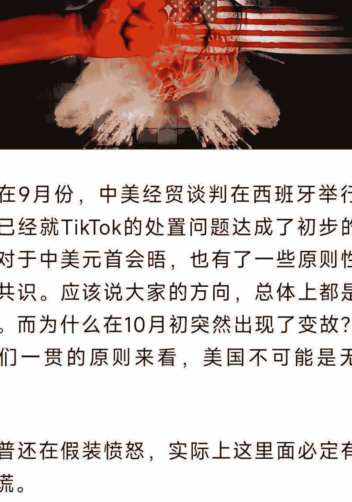
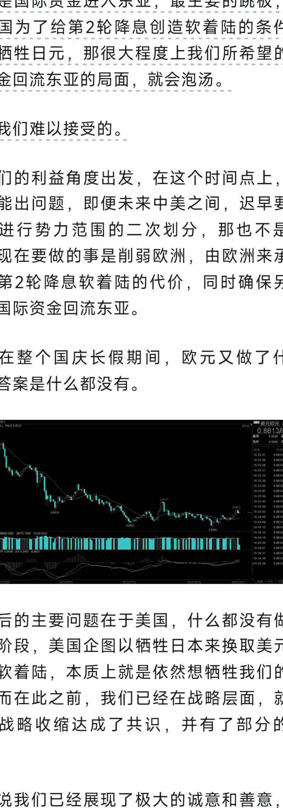

# 中美贸易冲突，最后谁是赢家？

发布：2019年05月20日 17:50

中美贸易冲突持续升级，到底谁是赢家？

随着贸易战进入白热化，似乎没有人能说出谁是真正的赢家。贸易战的爆发其实是长期博弈的结果，双方在利益冲突上早已不可调和，只是在这一时间点爆发了。在这场没有赢家的博弈中，双方都在激烈角力，究竟谁能笑到最后，还未为数。

# 美国对华科技企业的制裁

在科技战中，美国对华TikTok的制裁已经取得了初步胜利。对于华为而言，这无疑是一次沉重打击，但从长远来看，这并没有彻底击败华为，反而给了反击机会。

从目前的进展来看，美国在科技战中确实取得了一定进展，但这种制裁并非一劳永逸，中国也正在采取一系列措施进行反制。

现在的美国，在科技领域对华发动全方位的制裁，试图通过打压中国科技企业来维持其全球主导地位。然而，中国的科技领域也在飞速发展，并做出了自己的回应。

在贸易战中，中国在关税方面也取得了胜利。在9月份，中国对美国价值200亿美元的产品加征关税，美国也对中国价值200亿美元的产品加征关税。

这种关税战不仅对全球贸易环境造成了破坏，也对美国自身的经济造成了负面影响。因此，从贸易战的角度来看，美国已经不再是赢家。

在这场博弈中，双方都在承受着痛苦。美国在科技战上面临着失去领先的风险，而中国在贸易和科技战上也面临着巨大的压力。

但是，这场博弈并没有结束。特朗普表示他将继续对华加码，并可能采取更多制裁措施。中国在巨大的压力下也展现出了强大的韧性。

特朗普的贸易战政策本质上是为了维护美国利益，但这种做法在某种程度上也引发了全球范围的贸易反弹。

这场博弈的结局还难以预料，它取决于双方的实力对比以及国际局势的演变。

中美贸易战中，谁是赢家？这可能没有答案，因为双方都付出了代价。

# 第96章

在最后一次见面时，林远可以看到老王的眼神非常复杂，甚至显得有些痛苦。

其实林远心里也难受，但他心里在想，老王这辈子走得太早了。他静静坐了一会儿，点了一根烟，抽着烟，林远在心里感叹：老王的一生难道就这么结束了吗？

“老王，走吧。”林远叹了口气。

老王笑了笑，笑容比哭还难看：“林远，我这辈子真的没教好孩子了。以后，你以后帮我看着吗？”

林远点了点头：“我答应你。”

老王点了点头：“好，那我就放心了。”

林远扶起老王，慢慢朝门外走去。

走出医院后，林远回头看着老王瘦弱的身影远远离开，他叹了口气。

林远坐上车，心里沉甸甸的。

就在这时，他的手机响了。

接起电话，是苏打来的。

“林远，你在哪呢？”

“我刚医院看完老王出来。”

“老王怎么样了？”

“情况不太妙，快撑不住了。”

“怎么会？”

“医生说他没多久了，可能就撑不了几天了。”

“林远，你快过来看看吧。”

“好，我马上过去。”

作者觉得可以结束本章了

回复 88 赞 22

李华：这剧情也太虐心了
回复 12 赞 5

张大强：这剧情看得我好难受，快点更新吧
回复 15 赞 8

小明哥：老王真的要死了吗？
回复 9 赞 3

王建国：这剧情也太真实了，作者太会刀了
回复 11 赞 12

陈大伟：老王真的不行了吗？太心刀了
回复 10 赞 6

李强：林远这人太不容易
回复 14 赞 4

赵建国：作者太会刀了，心疼啊
回复 7 赞 15

刘大军：这剧情真的太刀了
回复 18 赞 9

周建国：作者真的太会刀了
