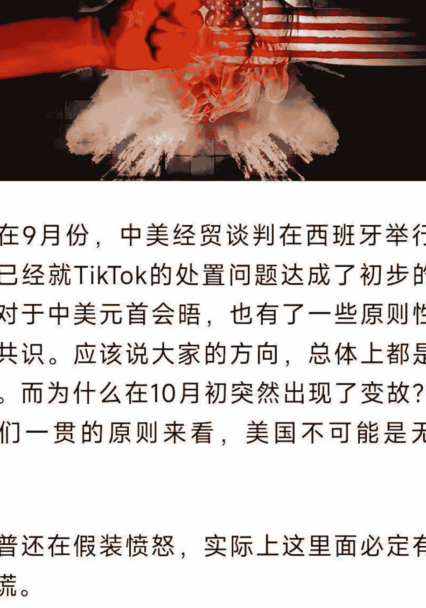
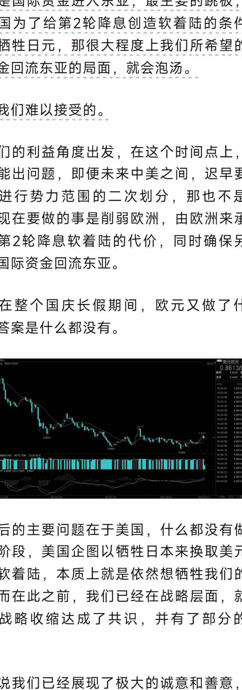
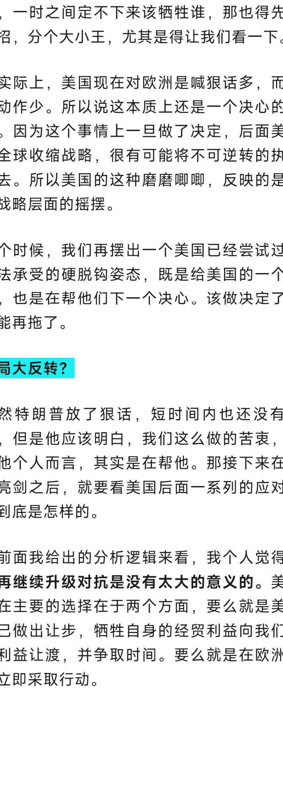

# 贸易危局：中美最后是赢家

作者：陈毅 六类财经
2019年05月20日 来源：北京

# 现在的贸易危局会如何发展？谁是赢家？

现在的贸易危局，似乎谁都做不出谁是赢家。大家都在猜谁最后是赢家，其实谁都不是赢家。现在的贸易危局，无疑双方都在受损。但是现在局势正在发生变化，这让大家都有了意外。现在的贸易危局，似乎并没有赢家。但是现在的局势发生了变化，这5000亿关税到底最后谁赢？这场贸易战，到底谁最后是赢家？

# 美国受损最大？

现在的贸易危局中，美国无疑是最大的受损者。因为美国是贸易逆差大国，在贸易战中，美国无疑付出了最大的代价。然而，在付出惨痛的同时，中国也付出了巨大的代价。

从目前的来看，美国无疑是受损最大的。但是，这并不意味着美国是赢家。随着局势的发展，美国真的是赢家吗？

现在的贸易战中，中国正在在西方面取得了胜利。双方已经在TikTok问题上取得了进展。对于美国来说，这已经有了一定的胜利。但是，对于中国来说，这只是一次小胜利，并不是真正的大胜利。

# 特朗普在贸易战中真的缩小了贸易逆差吗？

特朗普在贸易战初期的目标是缩小美国的贸易逆差。现在的看来，美国的贸易逆差不仅没有缩小，反而扩大了。但是，这在贸易战开始之前，美国的贸易逆差真的缩小了吗？

既然特朗普的目标是缩小贸易逆差，那么他的目标实现了吗？并没有。

在现在的贸易战中，中国也面临着巨大的压力。但是，中国并没有在压力下倒下。

原作者：十月

在我们重逢的味里，离别之路的第二天，在多年后，重逢却变成了一个让人难受的结局。

在我们重逢的味里，离别之后的第二天，在十年后，重逢却成了另一个告别。这二十六年的时间，像是一个漫长的等待过程。

当王启华看到她时，心里猛地一颤。她还是当年的样子，只是眼神里多了许多沧桑。原来，多年后的重逢也变得沉重了。

此时此刻，我们相对无，眼神里流露着万千的话，却又说不出。比起以前的重逢，这次的重逢更像是一个新的开始。

我们在重逢的氛围里，试图用各种轻松的方式来化解尴尬。我们谈笑，我们打闹，试图让这种尴尬在空气中慢慢消散。

我们在重逢的氛围里，试图用各种轻松的方式来化解尴尬。然而，这种轻松是虚假的，我们无法掩盖彼此之间的隔阂。

然而，这种轻松是虚假的，我们无法掩盖彼此之间的隔阂，因为我们之间已经疏远了太久了。

# 第96章

在最后的重逢中，我看到她笑了，只是笑容里那么苦涩。

我们再也没有重逢了。

作者：十月

赞 888

回复（22）

李建国
这剧情太虐心了，看得我想哭了。
回复

小王医生
作者太会写了，看得我心都碎。
回复

老张
这结局太真实了，作者太刀子了。
回复

王大强
希望他们以后能好吧，太不容易了。
回复

小明
我也看哭了，太有感了。
回复

老李
这就是生活啊，太现实，不容易了。
回复

阿强
作者好文笔，代入感强。
回复
