# 南半球财经250828

Jason不遇
2025-08-28 02:45

财政：作为宏观经济总量水平的核心指标，GDP减指数的变化与10期国债收益率呈现正相关关系，与中国国收益率水平。ROE是企业运用自有资本盈利能力的重要指标，反映了企业的经营效率和收益水平。此与国债收益率变动呈现显著相关性，美元指数作为反向货币的国际市场表现率指标，与中国国收益率水平存在负相关性。从金融体系运行的视角来看，货币市场调节代表了金融体系的资本运用，其变化直接反映了扩张“杠杆”的节奏，与国债收益率变动呈现显著相关性，变化差体现了银行的盈利能力，与国债收益率呈现较为显著相关性，背后或许反映了盈利能力和宏观环境的负向影响。直接融资与间接融资的关系反映了间接融资的构性，此类规律通常表明金融体系的链连接和完善，与国债收益率表现相关性。金融杠杆作为衡量金融活跃的指标，资本杠杆程度与风险承受能力与国债水平呈现相关关系。

年以来国债收益率受到多种因素的影响，简单的相关性分析不足以预测未来收益率趋势，为此，我们选择向量回归模型（vector autoregression model, VAR）作为分析工具，以确保研究未出现收益率的偏值。模型在2017年以后效果显著，基本地回应了收益率的波动趋势和拐点。在利用模型预测当年收益率走势后，发现近两个月基本显示，但10期国债收益率走高的反常需要进行解释，然后对当年内尤其是9月份利率收益率走势进行分析，计量模型预测结果显示，10期国债收益率在8月份继续上涨，9月份可能由转，四季保持中震荡走势；$财经

图 1: GDP减指数与国债收益率呈现相关关系:10年

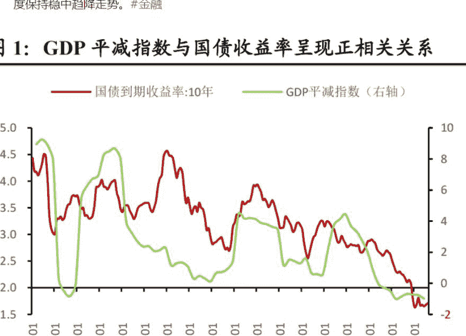

资料来源：Wind，财经研究院

## 图 4: 社融与国债收益率显著正相关关系

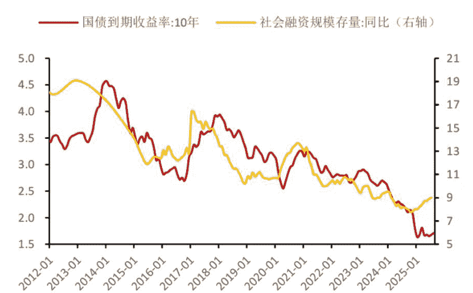

资料来源:WIND, 财信研究院

## 图 5: 净息差与国债收益率显著正相关关系

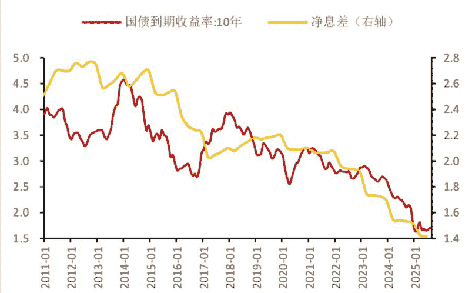

资料来源：WIND, 财信研究院

## 图 6: 直接融资/间接融资与国债收益率呈现负相关关系

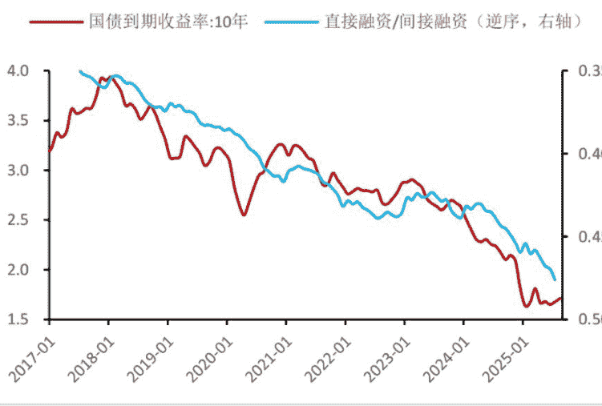

资料来源：WIND, 财信研究院

## 图 7: 金融部门杠杆率与国债收益率显著正相关

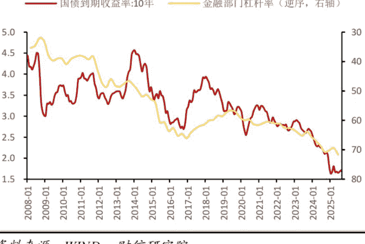

资料来源：WIND, 财信研究院

## 图 8: 样本内十年期国债收益率拟合图

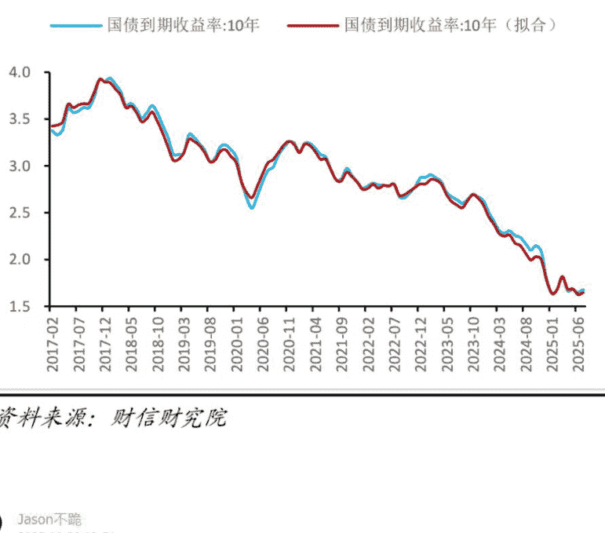

资料来源：财信研究院

Jason不遇
2025-08-26 02:51

银河：我们使用两个条件寻找中国历史上居民财富缩水的时期；居民增速连续下降3个月以上，发现1996年至今中国发生过7次居民财富缩水，分别是：第一次：1999.9-2000.5；第二次：2004.1-2004.5；第三次：2006.1-2007.1；第四次：2009.6-2010.1；第五次：2011.1-2011.9；第六次：2013.8-2014.12；第七次：2015.6-2018.6。居民财富缩水分为三类：通胀型、理财型、信心型。三类资产配置的收益表现：对通胀时期，股市表现为涨幅，长债收益率出现为极端；在理财时期，股市涨幅有限，市场表现为上涨，长债收益率表现为震荡。长债收益率在第四期间上升50BP。与过去七次财富缩水相比，本期居民缩水第一类是信心型，出现在宏观转型阶段，居民财富修复较慢，本期市场有望更广的修复，长债收益率上行空间在短期内还有结束，房价在底部与股市共振。

## 表 1 储蓄规模

| 序号 | 时间 | 户数 | 储蓄利率2007年变化 | CPI, PPI | 经济情况 |
| :--- | :--- | :--- | :--- | :--- | :--- |
| 1 | 1999.9月-2000.5月 | 9个月 | 20.9 | 0.4 | 1999年6月(-150BP)，金融市场外活跃，通胀缓解，PPI回升，投资复苏，出口增长 |
| 2 | 2004.1月-2004.5月 | 5个月 | 5.6 | 4.5 | 2002年2月(-270BP)，CPI5.3 PPI压力加大，出口高位，通胀缓，出口强劲，需求回暖 |
| 3 | 2006.3月-2007.10月 | 22个月 | 47.5 | 121 | 购房引起(-162BP)，CPI2.8 PPI外压力，出口保持高位，居民收入增加，通胀平缓 |
| 4 | 2009.6月-2010.1月 | 8个月 | 19.9 | 59 | 2008年11月(-2.3)，CPI0.5 PPI金融危机后外围活跃，中国消费复苏，出口增长 |
| 5 | 2011.5月-2011.9月 | 9个月 | 15.5 | 16.6 | 2010年10月(-125BP)，CPI3.1 PPI5.8 国内投资活跃，出口高位，通胀缓，出口强劲，需求回暖 |
| 6 | 2012.6月-2014.12月 | 17个月 | 68.3 | 5.2 | 2012年12月(-738BP)，CPI2.8 PPI0.5 金融危机后外围活跃，中国消费复苏，出口增长 |
| 7 | 2013.6月-2015.10月 | 36个月 | -39 | 17.5 | 2014年10月(-150BP)，CPI1.2 PPI1.8 出口增速放缓，消费规模缩减，基金投资减缓 |

资料来源：Wind, 中信国际证券研究院

## 图3：1996年至7储蓄家庭规模

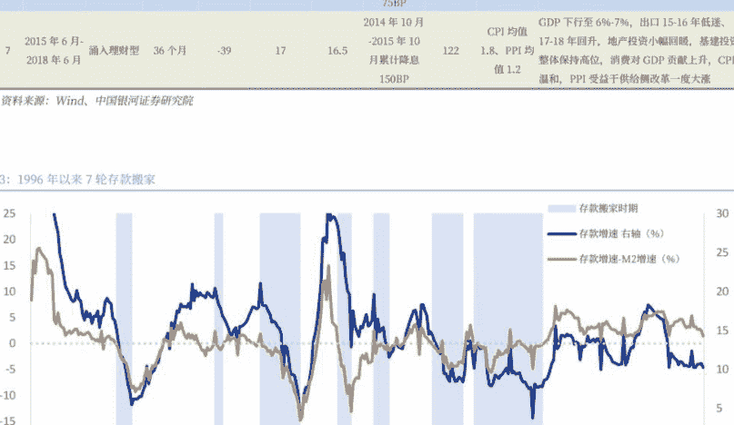

资料来源：Wind, 中信国际证券研究院

## 图23：当过去与现在“信贷型储蓄型家庭”的对比

| 阶段 | 触发因素 | 宏观环境 | 金融流动 | 取储收 | 不足之处 |
| :--- | :--- | :--- | :--- | :--- | :--- |
| 第一阶段 (1999-2000) | 连续性、“97年亚洲金融” | 经济开始复苏，通胀压力减缓 | 存款→存款 | 股市出现衰退时，储蓄制度初完善 | 市场经历宽松，小资金流动性在短期内萎缩，R资金流动性不足 |
| 第四阶段 (2009-2010) | “四次创业”、金融危机 | 政策宽松 | 流动性扩张储蓄和消费 | 存款→存款+股市 | 出口后，政策保护，在年后市场新行业活跃，生产力不足 |
| 第六阶段 (2013-2014) | 互联网崛起 | 经济转型期，CPI持续高 | 存款→理财/基金→股市 | 出现，在年后无互联网金融信誉，财富配置，但是某是承受者 |

数据来源：Wind, 中信国际证券研究院

## 图25:历史上七轮储蓄规模测算（亿元）

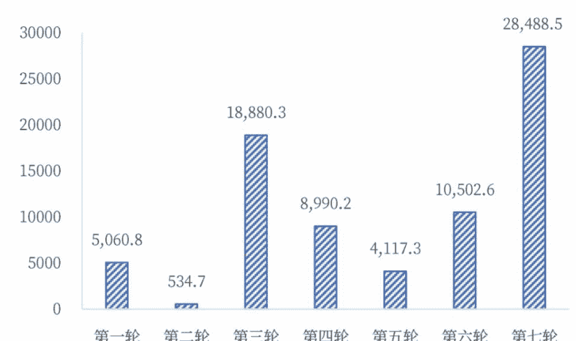

资料来源:Wind, 财信研究院

Jason不遇
2025-08-28 02:57

bloomberg：经济学家Ajubhat在一份报告中写道，如果停止购买俄罗斯石油，更高的燃料价格完全转嫁给消费者，通胀将增加5个基点。其他国家依赖俄罗斯石油对印度的影响。华尔街分析师认为从转向其他石油供应将导致印度采购成本增加。

## 印度是俄罗斯原油的最大买家

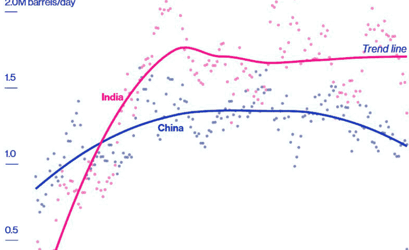

资料来源：彭博监测船舶数据

Jason不离
2023-08-28 03:09

bloomberg：非洲成为中国出口的热点，对非洲市场销售额同比增长25%，达到1220亿美元。尼日利亚、南非等地是中国产品的最大买家。工程机械是中国前7个月中对非洲增长最快的产品之一，同比增长63%。用车同比增长一倍，部分钢铁产品增长了两位。此时，需求增加，但对非洲的出口总额中的份额仍然不高，约为6%，大约的一半。需要策略向后，但对非洲的18种主要商品中，有14种的价格在1月到7月期间回，其中变压器和变速器降幅最大，达到39%。

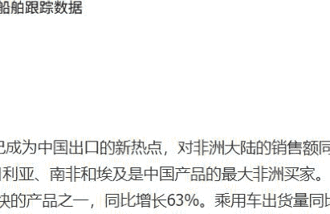

## 中国非洲销售额飙升，关税切断了与美国的联系

今年对非洲大陆的出口增长超过其他地方

- Africa / US / EU / ASEAN / Latin America

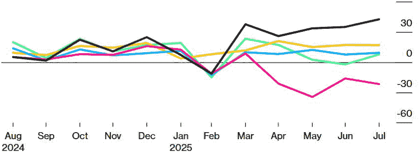

资料来源：彭博根据中国海关数据计算

## 尼日利亚、南是非洲的头号客户

五个国家购买了中国对非洲大陆出口44%的商品

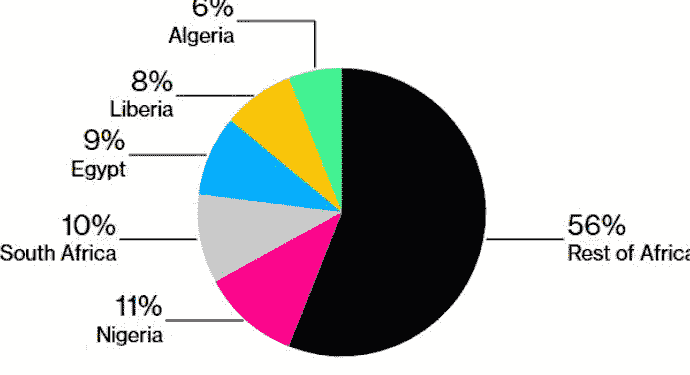

资料来源：彭博根据中国海关数据计算。
注：数字为2025年前七个月的数据。

## 中国对非洲出口的许多主要产品下跌

- Year-on-year change in price
- Electric storage batteries
- Passenger cars
- Insulated electrical cables
- Ships
- Air conditioning units
- Phones & telecom devices Air conditioning units
- Motorcycles & mopeds -0.6%
- Computers & data processing equipment
- Tires
- Construction machinery
- Trucks & vans
- Structural steel components
- Coated flat-rolled steel
- Synthetic woven fabrics
- Hot-rolled flat steel
- Rubber or plastic footwear
- Electrical transformers & converters

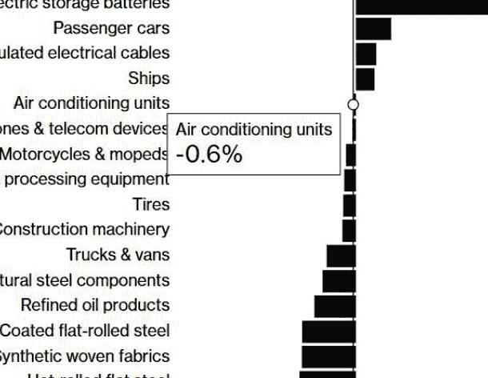

资料来源：彭博根据中国海关数据计算
注：数字为1-7期间与去年同期相比的变化。

东向：从股盈率与年收益率对比可以看到，比值率高于1以上，股市水平处于平稳。从市场上涨的结构来看，呈现显著的不均衡性，结构性明显，以前行业为代表的大资金进聚提升挖掘压力，后期加大科技为代表的成长股，大科技为核心驱动策强势行情，而转能功能表现相对较弱，市场的资金性转向可能向科技领域持续转移。我们认为以科技为代表的结构性行情在相当长时间内是常态，中国市场需要一个长期的科技不断驱动能够有效发展，一个长时间内形成类似于美国纳斯达克的结构性特征，而辅以一大成长性的中小，市场将跟随避险指数。

## 图13: 除息率/十年期收益率

| | |
| :--- | :--- |
| 2.20 | 4400.00 |
| 2.00 | 4200.00 |
| 1.80 | 4000.00 |
| 1.60 | 3800.00 |
| 1.40 | 3600.00 |
| 1.20 | 3400.00 |
| 1.00 | 3200.00 |

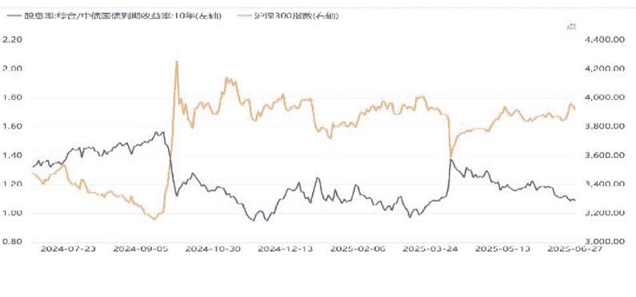

请仔细阅读报告中的免责声明

## 图19: A股上市公司调研数量

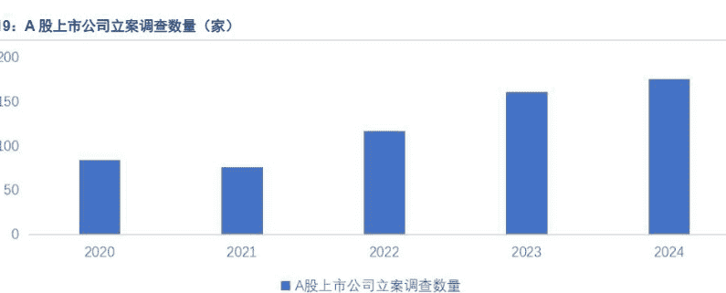

A股上市公司调研

资料来源：同花顺，中信研究院

Jason不愁
2025-08-28 08:13

bloomberg：韩国物价指数回到了历史高点，即使政府在6月份限制抵押贷款之后，首尔物价在过去八周内上涨，这使得韩国政府的政策不得不，然而今年为止，自7月以来，韩元汇率跌超过6%，使其本季度表现最差之一

## Rising Home Prices: Bank of Korea's easing has coincided with Seoul's rising home prices

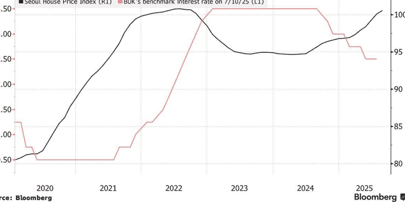

中金：7月，企业利润同比下降1.5%，应收账同比3.7%。根据我们测算，7月成本下降的因素在企业利润增速改善中贡献了5.2个百分点。

图表1：企业利润、工业增加值与PPI对比

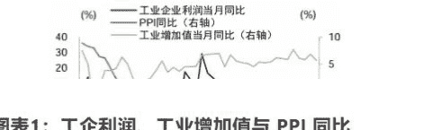

资料来源：iffind，金公司研究部

Jason不遇
2022-08-28 03:28

中信：当前贸易增速仍在高位，出口增速整体平稳，与人民币汇率有一定分化，若适当收效，意味着存在一定的升值空间人民币预期，外资流入更为容易，短期出口结算规模可见，汇率或成为后续拉动A股和港股的黑马。

# 金融

图 9：近年来出口增速与人民币汇率的相关性，人民币存在一定的升值空间

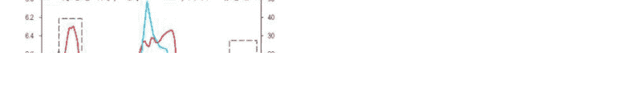

## 图 9:若近年来出口增速与人民币汇率的相关性，人民币存在一定的升值空间

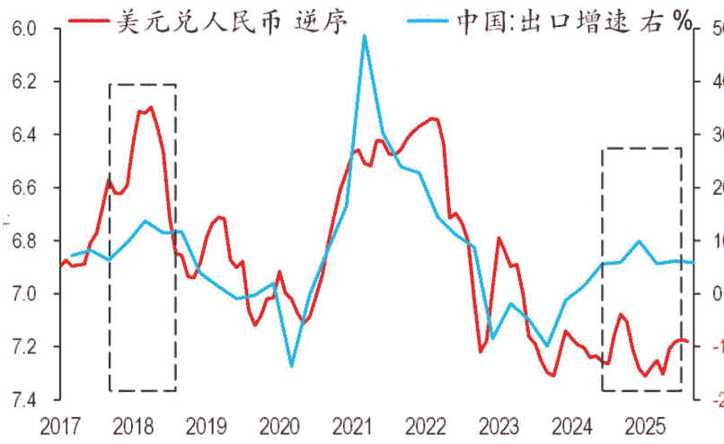

Jason Lee
2025-08-28 03:34

作为影响全球最重要的两个影响因素，美联储将暂时“宽松”，接下来要可能是日本行为。这也是我们今年一直关注的“长债”。难题彻底重置了下周。一个日本长收益的外溢效应已成预见，下一个引爆可能是日本银行重新加大。这个风险已经被美国财联看到了。在8月的采访中他曾提到“美联储加息”。日本加息是有意思的。这种银行发行转向“指导”的操作并不常见。作为首席首脑的贝森的逻辑非常直接：现在多年来日本银行落后于曲线，导致日本通胀及其预期通胀距离无法解决，使得长债债券频繁抛售，这也会引发美债。日本当前的通胀压力将得不到便宜

# 其他国家经济收益

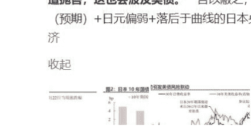

按照FVOCI投资，长期投资的计量方法有成本法和权益法两种，权益法之下，无论被投资企业是否分分红，投资方都可以根据持有比例确认投资收益和其他综合收益，同时调整股权投资的账面价值。

在具体处理过程中，计入长期投资的前提条件是要对被投资单位有控制和重大影响，在国际通用的保险业规定中，持有20%的股权可以认为是控制和重大影响。这规定在执行过程中将持有比例超过5%（达到标准）就视为控制和重大影响。

2023年至2024年我国银行的银行价格低于其净资产，有些银行的价格未满足净资产的一半，意味着保险资金买入银行可以获得100%的收益盈利。

以中国平安为例，该集团从2023年开始实施新会计准则，也是从2023年开始购买入银行的。该集团2024年持有的股票市值为4373亿元，比2022年增加2086亿元，期间主要主持银行，2024年获得综合投资收益2665亿元，比2023年增加80%。平安集团的财报报告显示，2024年的综合投资收益率为5.8%，比2023年上升了2.2百分点。

银行的上市对市场定价配置起到积极作用，而且有利于银行融资，但银行上市也可能面临经营风险。

- 1. 银行行业与业绩的风险。正常情况下，价格低于净资产的上市公司都是业务较差或前景不好，正常情况下这些上市股票不应成为保险公司投资的对象。我国银行与上市股票的市值水平低于其净资产，是因为银行的经营状况日趋严窄。2022年之前，我国银行的存款利差在2%以上，2022年收益缩小至1.91%，2023年银行的利差为1.69%，2024年银行利差为1.5%，至2025年第一季度，银行的利差降至1.43%，银行的利差已经经不起波动。银行的净收益与不良贷款率再次出现“倒挂”，意味着银行的利差不能覆盖三项成本（权益成本、运营成本、资本成本），对银行行业是一个巨大的挑战。从银行的净资产收益率数据显示，2005年之前，我国银行的净资产收益率高达20%左右，随后持续下降至10%。以工商银行为例，该2020年至2024年的银行净资产收益率分别为11.29%、10.64%、9.97%。

在银行盈利能力下滑的背景下，银行报价面临压力，这一趋势显然是持续维持的。一旦后续收益跟不上，银行市值将衰退，风险的银行将成为落后者。

从保险资金的角度来看，如果银行负债表内核投入程度增加，保险资金的银行就会受损，银行的风险将传递到保险。

- 2. 银行持续上涨对其他行业产生扩散。银行板块的市值较大，该板块的持续上涨必然引发市场资金的关注，不仅吸引投资资金，而且私募基金和公募基金也参与其中。例如，某投资高科技的主题基金持有银行板块的现象，截至2025年上半年，该基金的前10重持仓全部为银行，其持有的银行市值占该基金权益的60%。

股市的使命是促进进步，推动新生产力的发展。对美国股市，我国股市市值最大的上市公司为传统产业，而美国股市市值最大的上市公司为高科技企业。2020年以来，我国股市市值结构曾经有过好转，例如蓝市值排名前10的上市公司中出现了德时代等科技公司，但最近两年银行股市市值大幅跃，我国的股市结构再次回归传统产业，高科技类股市市值被挤出。

## 四、保险资金中投对股市市场的冲击

鼓励保险资金增加投资股票市场的力度，是期待保险资金成为耐心资本，成为稳定市场的中坚力量。保险资金的特点是规模大，如果监管到位不到，保险资金可能利用其优势成为市场的操纵者不利于市场的稳定。

> Jason不露
2025-08-28 03:51
BirthGauge: 韩国的总和生育回升，从每名妇女0.721个孩子增加到0.748个孩子 #其他
国家经济

<Population dynamics and dynamic rates>
<unit: people (cases per 1000 people)>
| | number of births | natural increase | number of deaths | number of marriages | early marriage |
|---|---|---|---|---|---|---|---|---|
| 2024.6p | 18,244 | 4.4 | 26,878 | 6.4 | -8,634 | 16,948 | 4.1 | 7,206 | |
| 2025.6p | 19,953 | 4.8 | 27,270 | 6.5 | -7,317 | 18,487 | 4.4 | 6,777 | 1.6 |
| | 1,709 | 0.4 | 392 | 0.1 | 1,317 | 0.3 | 1,539 | 0.3 | -429 | -0.1 |
| | 9.4 | | 1.5 | | | | | | | |

## Jason不炖
2025-08-28 03:53

## 内蒙古失眠#八卦

2025-08-26 09:05 来自微博网页
发布于 江苏 微信pe458

多位内蒙古自然资源领域企业家透露，王莉多年的老蜜全国第二大矿铜贸易商、全国第一大矿钢贸易商、全国第一大矿营贸易商、全国第一大矿铁贸易商、全国第一大矿营煤炭贸易商、全国第一大矿铁贸易商、铁矿、煤炭融资刚性贸易商。

2025-08-26 09:05 来自微博网页
发布于 江苏

多位内蒙古自然资源领域企业家透露，王莉多年的老蜜全国第二大矿铜贸易商、全国第一大矿钢贸易商、全国第一大矿营贸易商、全国第一大矿铁贸易商、全国第一大矿营煤炭贸易商、全国第一大矿铁贸易商、铁矿、煤炭融资刚性贸易商。
