# 南半球聊财经250829

Jason不霆
2025-08-29 05:38

信达：当下消费制造业周期转折特殊，这两轮制造业大类行业中最大的不同之处，这意味着本轮“反内卷”需要配合实施需求侧政策工具的必要性在提高。经济数据

当前阶段与2015年在宏观背景上似乎相似。今年5月以来，工业企业盈利仍徘徊，但股市呈现显著上涨，这种工业企业盈利低、市场走强的阶段在2015年也出现。从宏观背景上看，两轮均处于推进产能治理的调整期。2014年各地在需求侧回落后过产能，而当“反内卷”背景下，强调调整重点进行产能治理，推动政策逐步有序。

对比两轮制造业大类行业表现，对比两轮的制造业大类行业：
1）2014-2015年期间，原材料利润表现最差，消费制造业利润表现稳健。消费制造业在2014年下半年的增速虽较高，但此后回落，相比之下，消费制造业的表现较为稳健。
2）今年季节恰恰相反，消费制造业利润持续在区间内收缩。从4月以来，消费制造业利润持续在区间内缩小。

盈利结构与2015年并无不同。总体来看，当前推进产能治理背景与2015年有着相似，但相比之下，2014-2015年消费制造业利润基本保持稳健，而消费制造业利润持续负增长，这是两轮制造业大类行业表现的不同。这意味着“反内卷”需要配合实施需求侧政策工具的必要性在提高。

# 加微信jntsg2，资料免费分享

## 图 10: 今年，消费制造行业利润增速最好

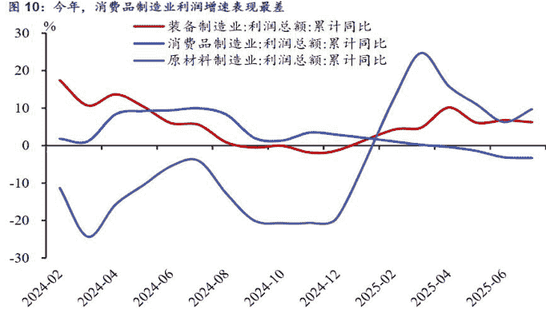

资料来源: ifind, 进数据研究中心

2025-08-29 05:43

Tavi Costa: 1996年第一次，全球银行（除美国）持有的黄金占比超过美债#金融

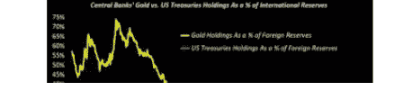

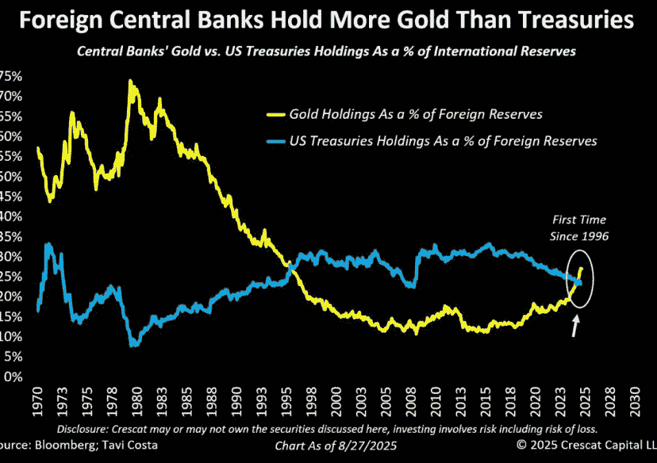

# 微信jntsg2，资料分享群

# Jason不霆

2025-08-29 05:53

中金:这次A股激荡，市场上有多少事发生，比如国家政策调整、低利息震动、存款储国家说、美元贬值驱动、创新反转驱动。综合来看，前面四种震荡存在某种基础或未置的逻辑问题，或者是作为牛市的基础条件不能为驱动力，而后两种震荡的解释相对较大。更深层次来看，后两个假说，实际上是全球市场节奏的顺序，全球市场节奏的将取决于股市的转型和资金的流向，影响力大到——一国和一国一市场的基本驱动力。我们在《在股市中寻找盈利的产业》中指出：要从国际市场节奏加剧的发现，来理解全球资产的走势，它并不取决于美元的首要因素，本质是美元资产的安全完全出现问题了，股市再涨就是安全了。这一点主要在于美元资产之间的相关性。从美国资产波动的活跃程度来看，还可能影响收益质量，如果美元资产安全完全通缩，水泥，我们认为美国不会发生储蓄性危机，但这种结构性变化可能对美元资产体系所需要的制度基础和相关性产生影响。本次调研显示市场体系首要因素的方向将变化，并决定全球资金流向何方，其中哪种碎片化特征在在全球范围内的配置使得资金流向回国，欧洲的资金流向欧洲，亚洲的资金流到中国，中国的资金流回中国美国或香港，还是更显著的本土化的替代。多元化意味着非美元外，投资者会寻找更多资金来维持非美元资产的可能性。这种情况下，资金流向转换的力度将占上风，旧的资产配置和新的格局转换的力度将主导。碎片化中国在海外的资金流向。根据美国际储部最新数据，截至至2025年第二季度，中国持有有美元3390亿美元，由于多元化驱动全球资金再平衡，或有部分资金回中国市场，港股作为离岸人民币资产有望直接挂接。由于A股和人民币的相关，港股权重也将对股市具有强效的外溢效应。

#球市场节奏顺序可能是牛市的核心驱动力，而特朗普的一系列操作无疑是大有助益。

虽然资金流向和乐观预期对股市的影响可能性超过基本，但股市短期是“投票票”，中期收起是“修复机器”，估值修复和情绪结束后，仍然需要基本支撑。$金线

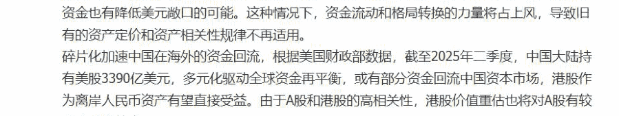

# 微信intjs2，资料分享群

## 图表7：美债安全溢价缩小：不同方式测算的美债收益收益率指标均显示下降趋势

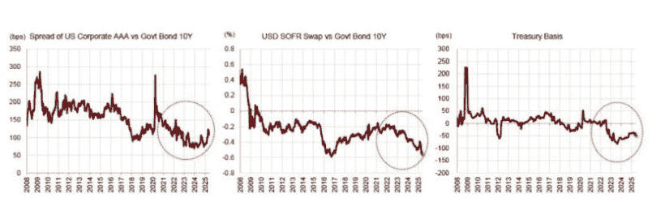

注: 1) 参考文献Szoke等(2024), Krishnamurthy和Vissing-Jorgensen(2012), Du等(2023), Schnabel(2024), Obstfeld和Zhou(2023)。2 右侧Treasury Basis为3个月期美债利率相对于8种货币(CAD, CHF, DKK, EUR, GBP, JPY, NOK和SEK) CIP条件的差值均值，其中，分别为3个月期外币收益率，分别为即期和3个月期隐含汇率。
3) 中平均为10日均值；资料来源:Bloomberg，中金研究部。

## 图表8：美股波动幅度

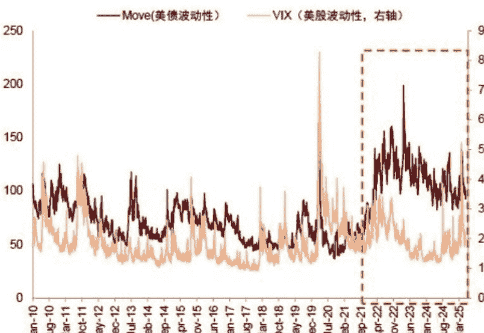

资料来源:Bloomberg，中金研究部

加微信jnts2，进资料分享群

## 知识星球

添加微信 付费资源免费入群 微信: jntsg2

| 序号 | 公号/星球/社群 | 原价 | 领域 |
| :--- | :--- | :--- | :--- |
| 1 | 生态有木 | 275/年 | 副业，搞钱 |
| 2 | 容从群众 | 365/年 | 时政，历史 |
| 3 | 记忆承载/树风 | 365/年 | 成长，搞钱 |
| 4 | 欧洲金靴 | 328/年 | 时政，历史 |
| 5 | 卢克文会 | 699/年 | 时政，社会 |
| 6 | 体内主任 | 599/年 | 体制；职场 |
| 7 | 外局人的视角 | 669/年 | 金融，时政 |
| 8 | 激迸异谈 | 416/年 | 财富，成长 |
| 9 | 守夜司令 | 599/年 | 时政，经济 |
| 10 | 江宁知府 | 365/年 | 时政，国际 |
| 11 | 政堂顾子明 | 568/年 | 时政，经济 |
| 12 | 唐书院 | 1399/篇 | 金融，财富 |
| 13 | 大树乡 | 199/年 | 时政，成长 |
| 14 | 水库欧大 | 1000/远 | 房产，经济 |
| 15 | 洪灏的宏观策略 | 436/年 | 经济，搞钱 |
| 16 | 金政通鉴北海道山 | 476/年 | 股票，行研 |
| 17 | 猫留的世界 | 299/年 | 时政，社会 |
| 18 | 飞沫王 | 3600/年 | 股市，经济 |
| 19 | 米联储见闻 | 599/年 | 经济，金融 |
| 20 | 鉴茶院 | 330/年 | 房产，股票 |
| 21 | 赢在八小时之外 | 365/年 | 成长，职场 |
| ... | ... | ... | 更多资源 |
| ... | ... | 75/年 | 所有资源 |

## 图表9：1970年代布雷顿体系崩溃后，美债利率下降，“锚”作用下，全球资产增大

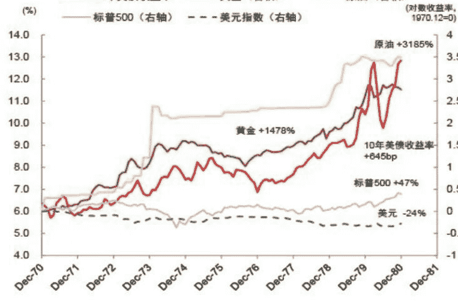

资料来源：Bloomberg, 中金研究部

## 图表11：中国持有美股规模约3400亿美元，有显著的回流

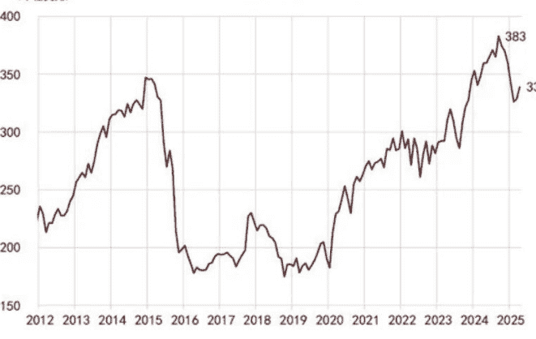

注：截至2025年6月

资料来源：TIC, 中金研究部

加微信jntsg2，进资料分享群

# Jason不霆

2025-08-29 05:57

华西：根据昨天A股反转走势判断，股市似乎顺利通过了部分测试，“九百三”变得更加观望，如果这一背景下，股市短期或延续震荡。与此同时，资金流入增加，进一步增加了股市的压力。

截至2025年8月28日，ETF代表性产品收益率稳健的经济数据推动美股创历史高，虽然缓解了通胀涨，但也引发了人们对回购的预期。预计周五公布的一份报告显示，7月份包括食品和能源的个人消费价格涨2.9%，这是五个个月最快的速度。至于英达，分析师们虽然看好，根据模型对比博格的数据，对于芯片龙头的长期前景，至少有10家公司在期市场上活跃，将目标价上调至3%至202.6美元。

#其他国家

加微信ntsg2，进资料分享群

## 美国第二季度经济扩张速度加速上调商业投资增幅较大

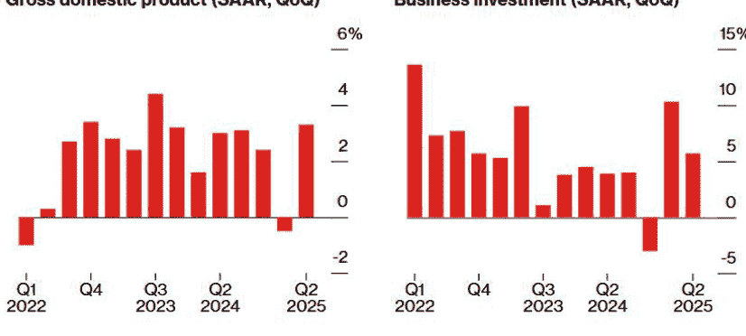

资料来源：经济分析

## 美国通胀率逐渐远离美联储目标潜在价格压力的速度预计将达到五个来的最快速度

- Change in PCE price index (YoY) Core PCE price index (YoY) Estimates

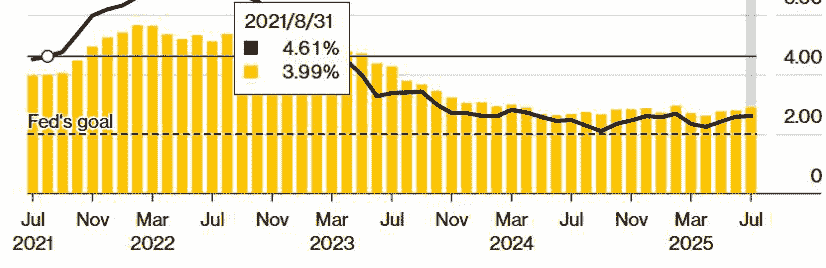

资料来源：彭博社经济分析

注：核心个人支出指数不包括食品和能源

加微信jntsg2, 资料分享群

# Jason不霆

2025-08-29 06:03

zerohedge: 根据CoinGlass的数据，自8月21日以来，现以太坊ETF的资金流入高达18.3亿美元，而比特币基金占比其中的十分之一，为1.71亿美元。周三的最新交易日延续了这一涨势，以比特基金的资金流入到31.0亿美元，而跟比特币基金的资金流入仅为8110万美元。本周以太坊的恢复速度快于比特币，ETH价格从周二的低点上涨了5%，而比特币同期仅上涨了2%。

| 项目 | Fund Flow |
| :--- | :--- |
| Grayscale Ethereum Trust ETF - Fund Flow | 5.6034 |
| Ghares Ethereum Trust ETF - Fund Flow | 262.627 |
| Fidelity Ethereum ETF - Fund Flow | 20.529 |
| Bitwise Ethereum ETF - Fund Flow | 0 |
| VanEck Ethereum ETF - Fund Flow | 3.3452 |
| Franklin Ethereum ETF - Fund Flow | 1.00 |
| Invesco Galaxy Ethereum ETF - Fund Flow | 2.283 |
| ETH ETF Net Flow | 307.1988 |

# Jason不霆

2025-08-29 06:11

国信:测算显示，7月GDP增速可能下滑至4.3%，8月经济改善较大。

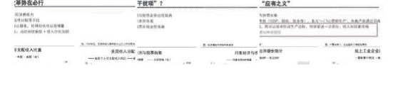

加微信jntsg2，进资料分享群

## 中长期分配改革势在必行

- “内需”真是增强能力
- 短期可以通过结构性投入手段
- 中长期靠突破很难，越后容易
- 总量特点持续增长优化分配结构

| 年 | 中国 | 美国 |
| :--- | :--- | :--- |
| 2000 | 66.0 | 79 |
| 2002 | 62.5 | 78 |
| 2004 | 55.0 | 77 |
| 2006 | 52.0 | 76 |
| 2008 | 50.0 | 75 |
| 2010 | 47.5 | 74 |
| 2012 | 45.0 | 73 |
| 2014 | 42.5 | 72 |
| 2016 | 40.0 | 71 |
| 2018 | 38.0 | 70 |
| 2020 | 36.0 | 68 |
| 2022 | 34.0 | 66 |

数据来源：Macromond，世界研究中心

## 观：市场为“通软”

- 2023年初，经济增速出现背离
- 年初，国内利率走软
- 二季度前，股市走软

## 变化：微妙的“均衡”

- 政策对名义GDP关注度上升
- 增速需权衡内部两个价格；通胀与汇率
- 实际GDP增速稳定 (5%+)

## 经济：“前高后稳”成为共识

- 节要者，下半年增长能成为共识
- 乐观情形，Q3在经济低位增长持续4.8%-5%，Q4在从高基数增速至4.5%-4.7%
- 中性情形，Q3经济增速持续下降，9-10月消费旺，政策Q4逐步反弹

## 基本水平转向“均衡”，可预期稳定

## 股市量化目标

- 考虑到，“内外热”+新动能进入阶段性阶段，这一中期，股市与基本面联动有望加强

## 小结：股市“新行情”

- 资金宽松+基本面回暖+政策支持有望成立

# 上证指数点位-2019-2022-2023

# 存款与股市走势

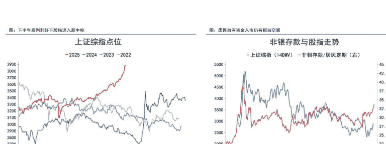

加微信jntsg2，资深，资料分享群

# Jason不跑

2025-08-29 欧洲汽车市场在7月创造了15个月来的最大涨幅，上个月注册同比增长5.9%到109万。插电式混合动力汽车在7月份涨幅最大，达到52%，电动汽车的销量增长了三分之一，这是自1月份以来的最好。然而对电动汽车和插电式混合动力汽车的需求增加，混合动力汽车（没有充电）继续占据欧洲最大的份额，占注册量的三分之一以上。至于制造商，特斯拉公司继续遭受损失。埃·马斯克（Elon Musk）的品牌上月销量下降了40%，市场份额为0.8%。大众汽车、福特汽车和马的销量均实现两位数增长，而比亚首次被纳入这一月度统计，7月份额涨到1.2%。

## 欧洲新车销量增长6.9%

# 欧洲7月新车销量增长5.9%

- Increase in new-car registrations

资料来源：欧洲汽车制造联合会

# Jason不霆

2025-08-29 ANZB8月新西兰房地产：更新对今年房价预测至0%，动能依然软，只能期待待息作用 #其他国家经济

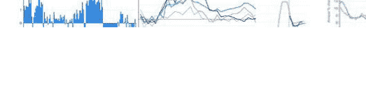

加微信jntsg2，进资料分享群

Further cuts to the OCR are likely to stabilise the housing market

But near-momentum in the market remains weak

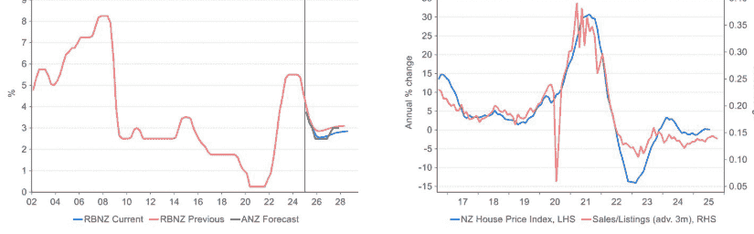

## Weighing this up, we have trimmed our 2025 house price growth to around zero, and see 5% growth in 2026

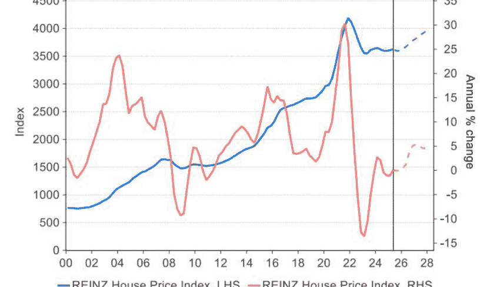

加微信jntsgg2，进资料分享群

## Figure 7. Total housing market inventory

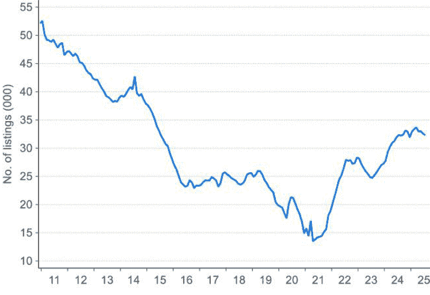

Source: realestate.co.nz, Macrobond, ANZ Research

## Figure 8. Sales-to-listings ratio

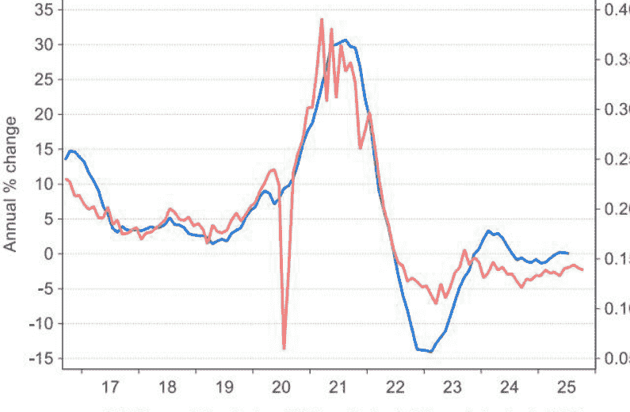

Source: REINZ. realestate.co.nz. Macrobond. ANZ Research

加微信jntsg2，进资料分享群

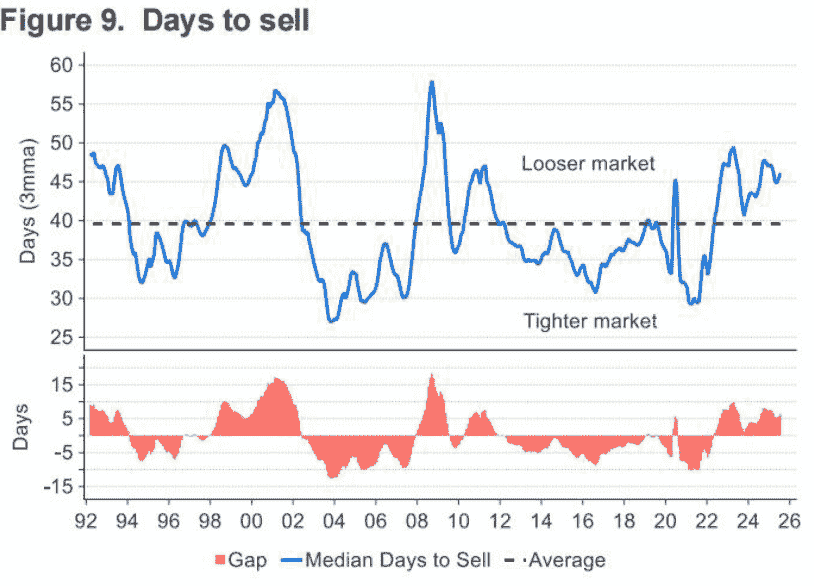

Source: REINZ, Macrobond, ANZ Research

## Figure 10. Auction clearance rate vs ANZ price forecast

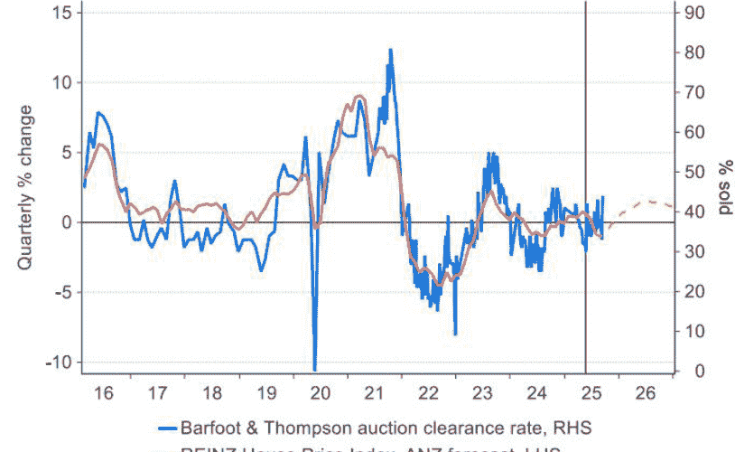

Source: REINZ, Barfoot & Thompson, interest.co.nz, Macrobond,

加微信jntsg2，进资料分享群

Jason不离
2025-08-29 07:13

## 高嵩: 中国家庭信债能力率（DSR）——（债务还款+利息支付）一年家庭可支配收入，2014年为11%，2024年为19%。#金融

Exhibit 21: We believe stress on household leverage ratio and household debt service ratio would likely still be manageable (derived from debt repayment + interest payment)/ household disposable income, our estimated China numbers vs. DMs (mainly Japan and the US)

## Exhibit 21: We believe stress on household leverage ratio and household debt service ratio would likely still be manageable
Household debt service ratio (DSR), derived from (debt repayment + interest payment)/ household disposable income, the estimated China numbers vs. DMs: (mainly Japan and the US)

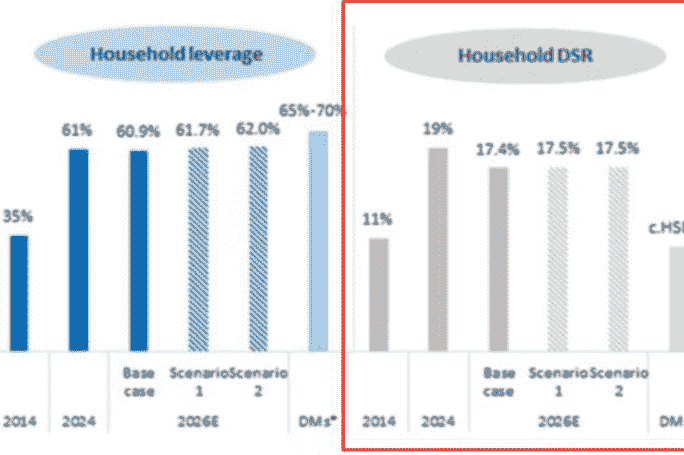

DM*: mainly taking references from US and Japan during normal periods (i.e. excluding Great Financial Crisis).

Jason不离
2025-08-29 07:40

各经济体2024年的家庭信债比率，数据来自自BIS#自制图

加微信jnts2，进资料分享群

## 2024家庭债比率
南半球脚财经

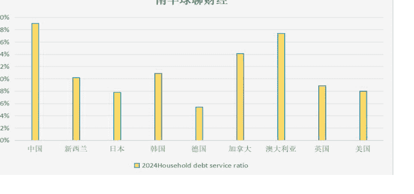

Jason不离
2025-08-29 12:37

bloomberg: 随着股市的延续，中国月度股成交创历史新高#A股

- 由于宏观经济仍然偏弱，中国股市流动性变动的反弹引发了华街分析师的持续关注。
- 追踪沪300指数的12个月目标是估值回归和有利的市场定位，而摩盛利指出投资者将更加关注市场热度。
- 两家公司的分歧反映了投资者对不同风险状况的关注，因为反弹更多由于流动性的推动。
- 由于宏观经济仍然偏弱，中国股市流动性变动的反弹引发了华街分析师的持续关注。
- 围绕中国，策略将沪300指数12个月目标从4500点上调至高位，支持了有利的市场定位。相比之下，摩盛利指出投资者将更加关注市场热度。
- 尽管近期存在回调压力，但上升态势仍支持。鲍威尔在一份报告中指出，“与宏观经济基本面相反，流动性因素和估值扩张是一场全球上涨的主动力，包括中国。”
- 经济低迷，中国股市依然活跃。8月至今上涨约10%，表现最好月份之一，日均成交量2.2万亿元（美元）。

李涛 | 经费

- 额外的流动性仍然可用于股权配置；然而，只有在企业盈利和政府政策能够落实的情况下，“包括Laura Wang在内的摩盛利分析师在一份报告中写道：“正如之前股市短暂的反弹尝试证明的那样，反弹持续性的障碍仍然在于基本面和长期宏观增长前景。”
本月早些，汇丰控股分析师提出他们对中国股票的目标衡量是足够的国内流动性，预计到年底综合指数将达到4000点，而收盘价为3843.6。汇丰银行还估计，到年底，沪300指数将达到4600点。摩根大通策略师认为，全球政策宽松和中国当前的流动性激增正在提供强大的影响力。他们估计，到年底，沪300指数将上涨24%，MSCI中国指数将上涨35%。
股市牛市将保持不变，任何调整都提供机会，“包括Raj Batra和Wendy Liu在内的摩根大通策略师在一份亚洲市场报告中写道：“然而，在特别拥挤的情况下管理风险非常重要。”

加微信jntsg2，进资料分享群

中国股市本月创下纪录成交量，凸了牛市的强度，牛市正在吸引越来越多的投资者。尽管银行和监管机构暗示他们可能会让事情降温，但中国的市场兴奋度很高，因为美国的关税和房地产危机给经济带来了压力。金利证券研究总监Dickie Wong表示，内地股票的流动性“预计未来将保持高位”，“短期内可能出现获利回，但A股已经进入牛市，并在向前走。”

## Goldman Sees 10% Upside For CSI 300

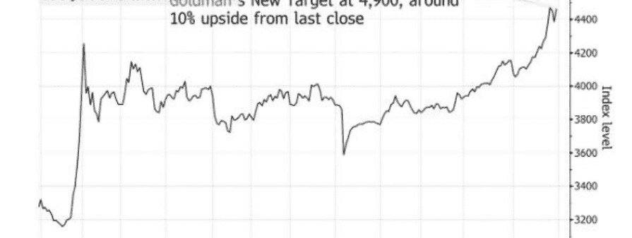

在投资者等待阿里巴巴业绩的同时，同行的收益清楚地表明，该行业的过度竞争正在造成损失。JD.com最近的外卖增长符合预期，此前美团警告，由于“非理性竞争”将出现巨大损失。

随着经济乐观情绪的增强，中国央行推高人民币，引发了人们的猜测，即在强劲的出口增长前景更加光明之后，中国央行将微妙地转向支持汇率走强。虽然高盛上调了中国股票目标，摩盛利分析师指出了市场过热的新迹。

## 加微信jntsg2，资料分享群

- 中国股市本月创纪录的成交量，本月平均成交量超过了10月份创下的前高。
- 投资者的情绪继续延续，尽管对美国关税和房地产危机的担忧，但在岸基准沪深300指数本月上涨了约10%。
- 中国在岸股票的跃升得到了国内交易员、外国投资者资金流入以及通过沪深300期合约进行投机的支持。

## 中国股市本月创纪录的成交量引起了越来越多的投资者。

根据彭博社的数据，本月平均成交额为2.2万亿元人民币（3090亿美元），超过了10月份政府刺激闪电战后创下的2万亿元人民币的前高。在岸基准沪深300指数本月上涨了10%，成为全球表现最好的指数之一。

尽管一些证券公司和基金经理已经减少了减仓并限制了购买，但投资者的情绪受到担忧。尽管人们对美国关税和缘政治引发的房地产危机情绪仍然很高。但此反弹仍在华尔街策略师之间发生分歧。而盈盛集团的那些提出如摩盛利的其他人则指出了中国基准的目标过热。

## China's Monthly Average Turnover Heads for Record High

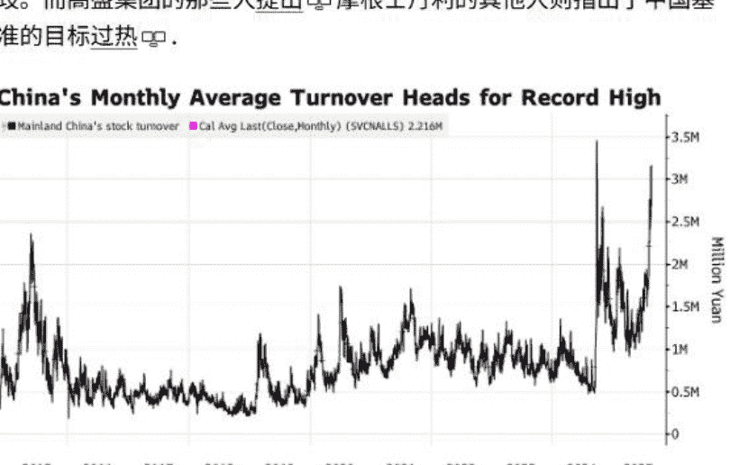

加微信jntsg2，资料分享群

# Jason-不蛋

JPM: 从2019年以来，西班牙劳动年龄人口（15至64岁）增长了4.5%，新增超过110万人。每年约有50万劳动年龄移民涌入西班牙，这足以抵消西班牙本土劳动力的减少

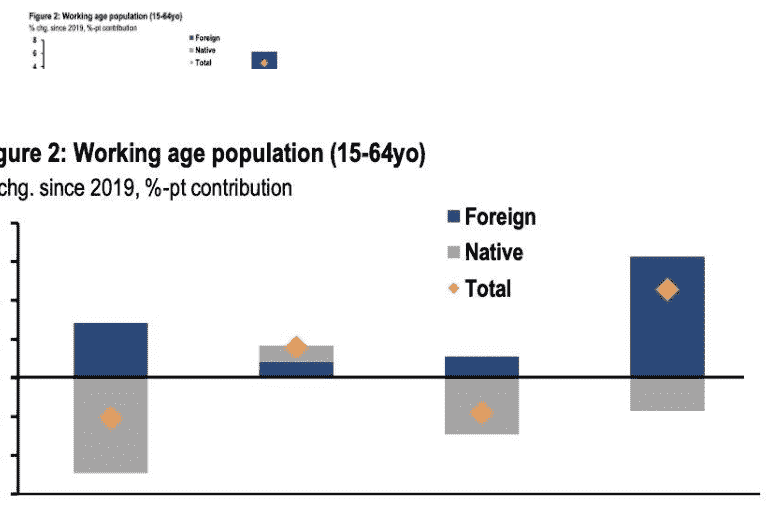

## Figure 2: Working age population (15-64yo)
% chg. since 2019, %pt contribution

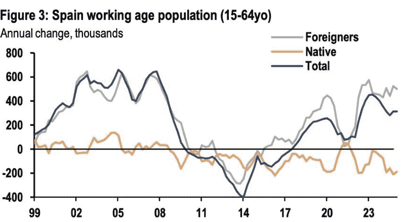

## Figure 3: Spain working age population (15-64yo)
Annual change, thousands

Source: Eurostat, J.P. Morgan

Based on country of birth; Source: Eurostat, J.P. Morgan
