# 南半球财经要点

Jason不聊
2025-08-30 14:00

彭博：中国央行正在推动人民币率走高——金融

## Yuan Fixing at Faster Pace This Week

由于央行正在推动人民币增长，引发了人们对强劲的出口增长前景光明之后，幽微调整转向支持人民币汇率的预测。央行正在推动人民币增长，幽微调整转向支持人民币汇率的预测。

中国人民币银行每天基准利率上调了近一来的最大幅度，这可能表明当局对货币走势感到满意，并希望实现逐步升值。

人民币在中国人民币银行的支持下上涨，可以通过增加买家购买力和刺激消费增加中国的经济效益，也为美国的贸易谈判提供支持。

微信号:jntsg8
微信号:jntsg2

免费进料群 

- 中国央行正在推动人民币增长，引发了人们对强劲的出口增长前景光明之后，幽微调整转向支持人民币汇率的预测。
- 中国人民币银行每天基准利率上调了近一来的最大幅度，这可能表明当局对货币走势感到满意，并希望实现逐步升值。
- 人民币在中国人民币银行的支持下上涨，可以通过增加买家购买力和刺激消费增加中国的经济效益，也为美国的贸易谈判提供支持。

中国央行正在推动人民币增长，引发了人们对强劲的出口增长前景光明之后，幽微调整转向支持人民币汇率的预测。

中国人民币银行每天基准利率上调了近一来的最大幅度，尽管货币基本保持不变。一些市场观察人士表示，这可能表明当局不仅对货币走势感到满意，而且希望实现逐步升值。

此举表明，中国的战略与早年有所不同，当时中国试图在与美国的针对性的关税战中保持人民币稳定。政策制定者正面临着市场对货币升值的呼声，因为贸易紧张张弛局势缓和改善了该国的增长前景并推动了当地股市的上涨。

## 加微信jntsg2，进资料分享群

## China Boosts Yuan Fixing at Faster Pace This Week

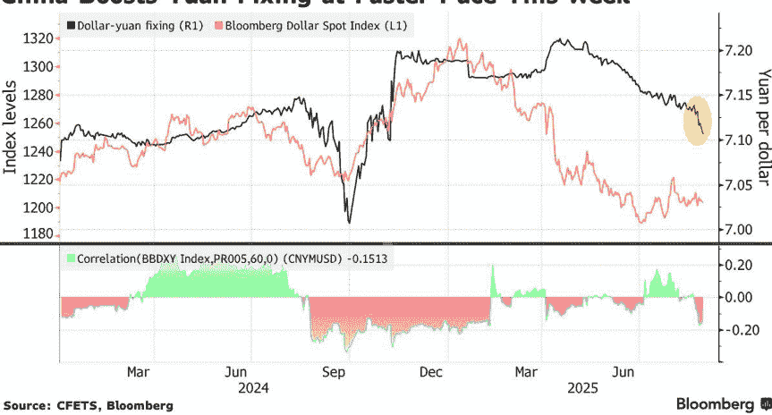

人民币在中国人民银行支持下持续升值，可以提高家庭购买力和刺激消费增加中国的经济增长——这迄今来一直是增长的主要拖累因素。人民币走强也将有助于维持与鲍纳·德·特朗普总统的贸易谈判，该政府过去曾指责中国人为维持人民币贬值以刺激出口。

**彭博策略师怎么说：

本周的价格走势将唤醒世界各地的外汇交易者。美元兑人民币明显跌破7.15，引发了一波的离岸市场买空。鉴于隐含波动率略高于一个区间，人民币多有进一步上涨和走高的空间。

- Mark Cranfield, Markets Live 策略师。阅读更多关于 MLIV 的信息。

中国人民银行本周加强了人民币的固定利率，该货币兑美元汇率限制在2%的波动，周为0.4%。这是自去年9月以来最大的涨幅。周五，汇率定为美元7.1030，为11月以来的最高水平。

加微信jntsg2，进资料分享群

由于人民币一贸易伙伴的交易价格低于五年平均水平，政策制定者在需要时为货币提供了额外的缓冲。

法国巴黎资产管理高级策略师Chi Lo表示最近的美元疲软“为中国银行提供了一个机会之窗，可以引导人民币回到中期贸易交易区间”。

鉴于经济尚未完全走出困境，中国人民银行的微妙做法是有道的。央行在5月份下调了利率和存款准备金，但这些国家的消费和固定资产投资依然如此。

Gavekal Research 中国经济学家家何伟 (He Wei) 表示，货币走强可能有助于提振此类需求，至少是微不足道的。“货币升值对投资者的信心有积极影响，从而引发金融市场的积极反应”。他说。

对于包括美国、特拉华在内的策略师来说，随着贸易关系的延长，北京的外汇管理也可能“向美国官员发出积极信号”。银行建议投资者兑一篮购买人民币。

Jason不鑫
2025-08-30 03:06

zerohedge: 美国7月核心PCE价格指数同比增长2.9%，为5月末最快速。尽管核心PCE通胀数据符合预期，未打击市场对9月下降的信心，但仍处于美联储“软区”，引发市场对路径险调整的迹象。收入方面，自2022年12月以来，私人工工资（同比增长5.1%）多次快于政府人工（4.8%）。摩森·丹利表示，美联储已经开启下降的大门，但开始有多大力度，取决于劳动力市场软化是否仍影响通胀风险。今天的数据符合预期，市场焦点锚放在就业上，9月下降的概率仍占上比例。#中国经济

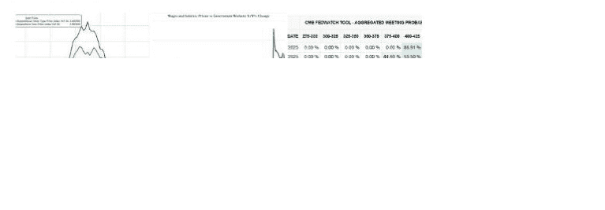

## 加微信jntsg2，进资料群

## CME FEDWATCH TOOL - AGGREGATED PROBABILITIES

| MEETING DATE | 275-300 | 300-325 | 325-350 | 350-375 | 375-400 | 400-425 | 425-450 |
| :--- | :--- | :--- | :--- | :--- | :--- | :--- | :--- |
| 9/17/2025 | 0.00% | 0.00% | 0.00% | 0.00% | 0.00% | 88.91% | 11.09% |
| 10/29/2025 | 0.00% | 0.00% | 0.00% | 0.00% | 44.50% | 55.50% | 0.00% |
| 12/10/2025 | 0.00% | 0.00% | 0.00% | 29.79% | 70.21% | 0.00% | 0.00% |
| 1/28/2026 | 0.00% | 0.00% | 0.00% | 78.50% | 21.50% | 0.00% | 0.00% |
| 3/18/2026 | 0.00% | 0.00% | 39.26% | 60.74% | 0.00% | 0.00% | 0.00% |
| 4/29/2026 | 0.00% | 0.00% | 76.50% | 23.50% | 0.00% | 0.00% | 0.00% |
| 6/17/2026 | 0.00% | 44.16% | 55.84% | 0.00% | 0.00% | 0.00% | 0.00% |
| 7/29/2026 | 0.00% | 80.50% | 19.50% | 0.00% | 0.00% | 0.00% | 0.00% |
| 9/16/2026 | 0.00% | 23.57% | 76.43% | 0.00% | 0.00% | 0.00% | 0.00% |
| 10/28/2026 | 43.50% | 56.50% | 0.00% | 0.00% | 0.00% | 0.00% | 0.00% |
| 12/9/2026 | 0.00% | 56.18% | 43.82% | 0.00% | 0.00% | 0.00% | 0.00% |

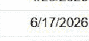

Jason凯
2023-08-30 04:09

彭博: 根据联储对美国周五发布的最新调查，8月份美国消费者指数因经济前景良好下降，消费者预计明年一年通胀率将降至4.8%，约63%的消费者预计明年一年薪资增长率上升，#其他美国经济

## 美国消费者信心回升
尽管通胀仍扰不安，长期通胀指标本月有所改善
Consumer sentiment index
Expected long-term inflation rate

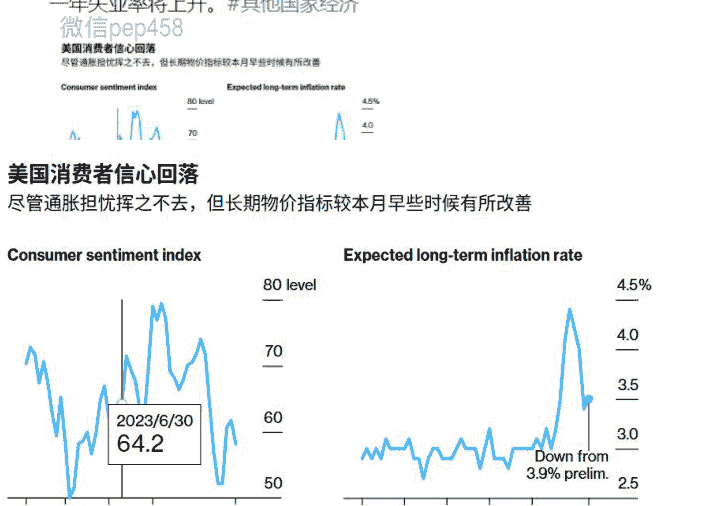

数据来源: 彭博大学
注：预计未来5到10年的平均通胀

## 微信jnts2，进阶资料分享群

数据：从2014年以来，中国工业生产已经经历了三次扩张，分别发现在2018年、2021年至2023年。2020年二季度到2023年一季度，在长达三年的里，我国产能扩张速度高于增速，分行业产能过剩和内卷竞争等问题的出现，都离不开这次。我国PPI和GDP指数增速入负，也发生在这一时期。目前，一个结构变化是：截至2025年二季度，我国规模以上工业总产量已增速至4.6%，增速低于GDP，有助于部分行业产能过剩、内卷竞争等问题转折。目前产能扩张速度依然高于增速，问题缓解速率缓慢。

理论上，产能过剩和PPI低迷存在密切，考虑历史数据，产能过剩增大时，PPI往往处于低位；产能过剩下降时，PPI往往上升。历史，产能过剩缓解和PPI回升带来了一轮牛市。例如2016-2017年，供给侧改革取得明显，产能得到缓解，产能利用率从低点72.9%升至78%，PPI从转折开始升至7.8%。工业企业盈利改善，A股、沪指从2900点升至3500点以上。2020年下半年至2021年上半年，导致产能过剩，产能利用率从低点67.3%升至78.4%，PPI由负转正，工业企业盈利改善，A股再度牛市，沪指从3000点升至5800点。

## 图9：产能增速和GDP增速的对比

| | GDP增速:同比 | PPI增速:同比季度平均 | 工业总产能增速:实际数据 |
| :--- | :--- | :--- | :--- |
| 2014-12 | 2015-06 | 2016-06 | 2017-06 | 2018-06 | 2019-06 | 2020-06 | 2021-06 | 2022-06 | 2023-06 | 2024-06 | 2025-06 |

资料来源：iFind，信达研究中心

## 加微信jnts2，进资料群

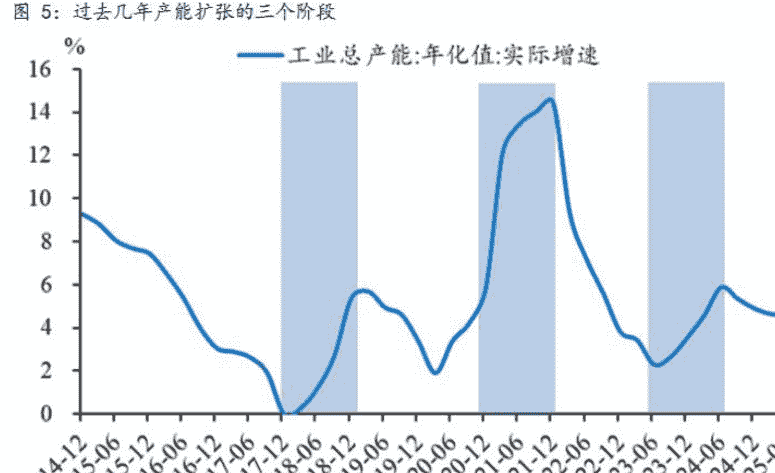
资料来源: iFind, 信达证券中心

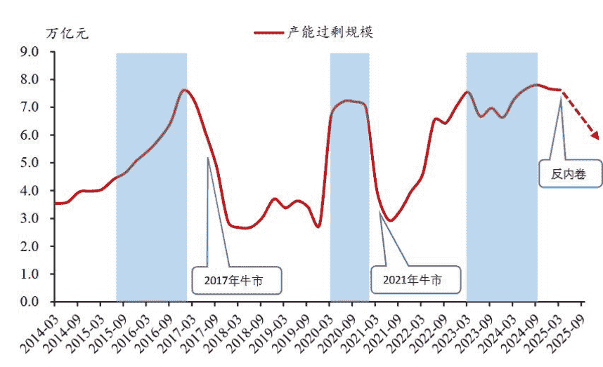
资料来源: iFind, 信达证券中心, 预测趋势

## 加微信jntsg2，进资料分享群

Jason不错
2023-08-30 04:23

华夏：存款资金与全A市值比值：全A滚动12月累计涨幅首次突破20%阈值作为牛市行情开启信号，居民存款资金与全A市值比值处于低位作为居民存款资金入市信号，居民存款资金平均出现在主升行情前4个月。全A滚动资金自低位增长至20%的过程中，上涨股市绩底部明朗，吸引居民存款资金加入市场，同时资金量有望进入主升行情。

非银：存款资金与同比均值：存款资金同比均值差异从低位快速恢复作为居民存款资金的信号，居民存款资金领先于主升行情前，同样资金量进入主升行情。

从历史复盘来看，2009、2014、2017、2020四轮A主行情中，仅有2015年为牛市行情，其他三行情从牛市逐步转为牛市行情，债券转，10年收益率持续。上涨行情：牛市行情期间，债表现主要为调整，国内收益率整体缩小。

## A股收益

## A股蓄收益明显，居民存款加速入市

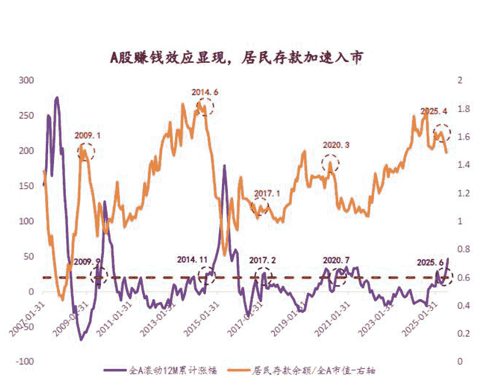

加微信jntsg2，进资分享群

## 居民存款增量助推行情进入主升阶段

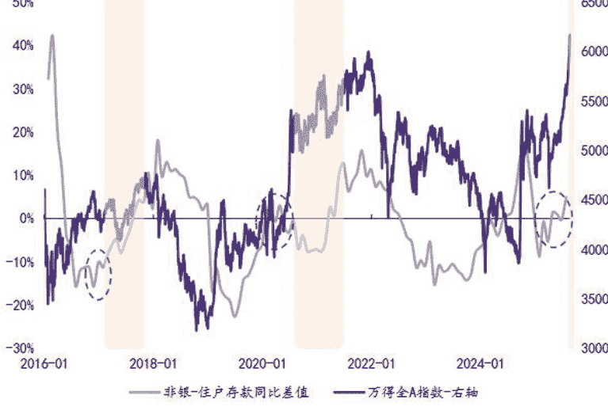

## 2025年1-7月非居民存款累计增加46.9万亿，创下除015年以外的新高

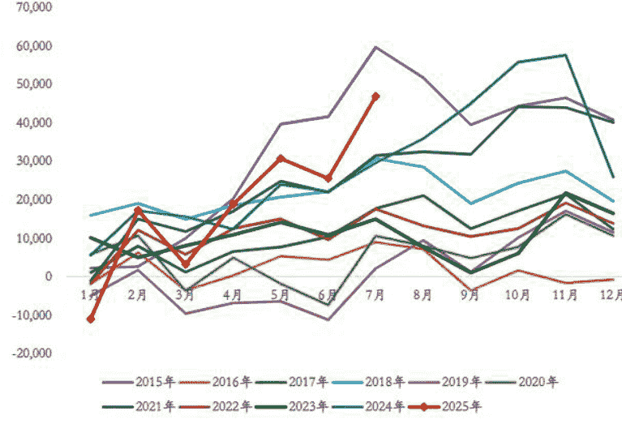

加微信jntsg2，进资料分享群

## 7月债型基金收益回升趋势显著

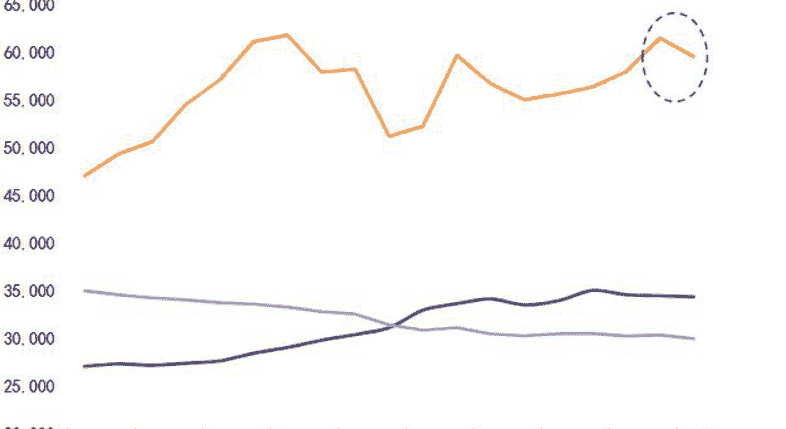

### 3.4.4、A股行情估值：五种方法，当前仍处于中段

> 方法一从市盈率角度看，万份A股与10年国债收益率溢价作为A股行情参考指标，参考2015年行情指标低为0.48%，2021年行情指标高为63%。

> 方法二从股息角度看，根据历史分位进入A股合理区间作为A股行情参考，参考2015年行情指标低为1.94%，2021年行情指标高为17.9%。

> 方法三从债角度看，根据回购率与溢价作为A股行情参考，参考2015年行情指标低为6.35倍，2021年行情指标高为3.55倍，截至2022年8月，回购率为6.48倍，处于历史高。

权益类估值历史区间（百分比）成交量与水平

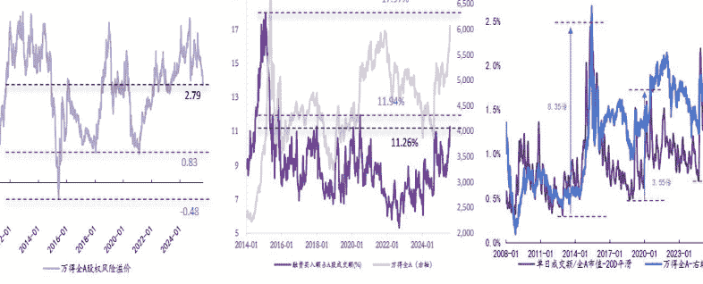

加微信jntsg2，进阶资料群

## 华泰证券

> 方法一：从收入角度看，存款变动幅度作为房价参考，参考2015年最高点后低幅度为58.9%，2021年最高幅度为30.77%，2025年7月，该指标回幅为49，下降至17.29%，仍有空间。

> 方法二：从占比角度看，均变幅度作为房价指标，参考2015年最高幅度为17.2%，2021年最高幅度为96.6%，2025年7月，该指标回幅为33.3%，仍有空间。

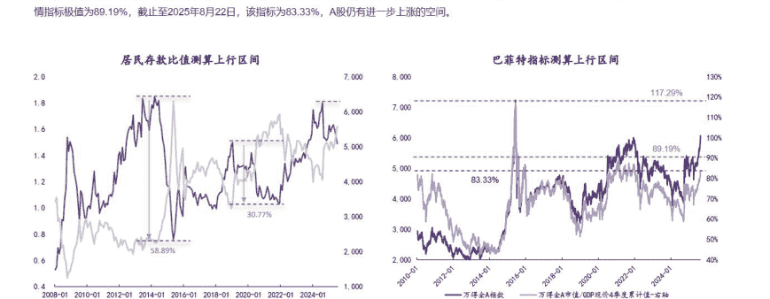

Jason-陈锋
2025-08-30 04:47

数据：2025年上半年，4个一线城市的平均房价同比下降3.3%；2个二线城市的平均房价同比下降3.3%；3个三线城市的平均房价同比下降1.3%。从数据来看，持续下行，存量房面临销售困难，部分选择出售，从而增加了住房市场的供给；在政策支持下，住房的供给增加，刚需不足。从需求来看，压力较大，尤其是刚需住房群体，导致一线城市住房市场需求持续下降；二线城市住房市场需求群体增长长期，稳定性周期窄，购买意愿和能力有限。从房价回报率看，2025年2.5%，三线城市平均房价回报率为2.75%。

## 房价各线城市平均房价回报率

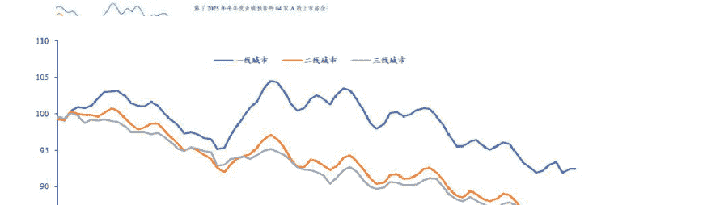

图7 贝优城市住房指数（月度，2018年1月=100）

数据来源：贝优研究院。

加微信jts2，进阶分析群

## (二)六超上市企业出现亏损

近期披露了2025年业绩报告的64家房企来看，有40家房企预计亏损，占比为62.5%，亏损规模合计为427亿元~538亿元。

其中，万科在2025上半年的亏损幅度最大，亏预测100亿元~120亿元（见表1），六超上市企业出现亏损，意味着房企的经营状况未得到实质性改善。

上市房企出现亏损的主要原因包括：第一、营收和毛利率下降。销售疲软，交付节奏减少，营收和项目毛利率下降，导致出现经营性亏损。第二，存货价值。房企下行导致亏损。在建工程、未售、自持房地产等存货资产价值减值，新增计提资产减值准备。其三、处置资产亏损。

在债务压力下，为了回笼资金，房企开始折价出售资产或持有的股权，价格低于价格，产生亏损。

Jason unique
2025-08-30 04:53

8月长江商学院显示，企业收缩指数（ACI）为46.9，低于之前的47.7。销售和利润指数明显放缓，年内企业收缩周期比去年长4个月，反映同期海外扰动；二是本期的6-8月和营收收缩周期对应，企业的库存前期上升，投资前期指数下降，招工前期指数下降。投资前期指数反映需求萎缩，上半年并不高，到6月尚在53.0以上；7-8月较快回到48-49之间，价格波动，前期指数高于7月，但低于6月；房价前期指数落在年内低位。

我们曾用长江商学院ACI来代表经济基本面，用全球指数代表权益市场，今年6月之前两个指标高度吻；6-8月出现走势背离。从中期，经济...

## 权益类历史区间（BCI）

数据来源：Wind, GF发证券

## 图表14: 万证300指数与工业企业总利润同比 (%)

- 万证300指数:月同比 中国:利润总额:规模以上工业企业:当月同比

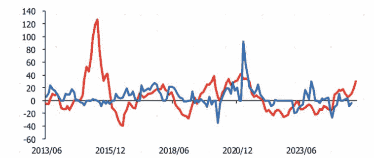

资料来源:WIND。上海申万国证券研究所、国家统计局、长城证券产业金融研究院

## 图表15: 中万汽车指数与汽车制造业利润环比变化（亿元）

- 申行业指数:汽车 汽车制造业利润环比变化（亿元，右轴)

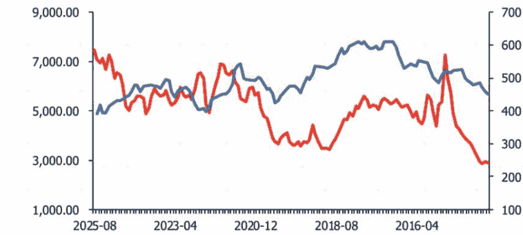

资料来源:WIND。国家统计局、上海申万国泰证券研究所、长城证券产业金融研究院

## 图表26: CRB 现货指数与黄金价格（美元/吨）

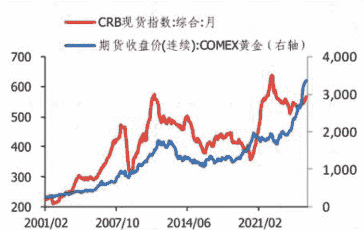

资料来源:WIND. COMEX. 长城证券产业金融研究院

## 图表33: 大类资产配置收益

| | 6月 | 7月 | 8月 | 9月 |
|---|---|---|---|---|
| 原油 | 5% | 5% | 5% | 5% |
| 沪铜 | 5% | 0% | 0% | 5% |
| 金价 | 5% | 5% | 5% | 0% |
| 沪深300 | 5% | 5% | 5% | 5% |
| 上证500 | 5% | 5% | 5% | 5% |
| 纳斯达克工业指数 | 5% | 5% | 5% | 5% |
| 日期债券指数 | 5% | 0% | 5% | 5% |
| 日经225 | 5% | 5% | 5% | 5% |
| 德国DAX | 5% | 5% | 5% | 5% |
| 澳洲资产指数 | 5% | 5% | 5% | 5% |
| 10年月中债 | 10% | 10% | 10% | 10% |
| 2月中债 | 10% | 10% | 10% | 10% |
| 10年美债 | 5% | 5% | 5% | 5% |
| 2年债 | 5% | 5% | 5% | 5% |
| 日本10年国债 | 5% | 5% | 5% | 5% |
| 德国10年国债 | 5% | 5% | 5% | 5% |
| 澳洲10年国债 | 5% | 5% | 5% | 0% |
| 日元 | 0% | 5% | 5% | 5% |
| 美元 | 5% | 5% | 5% | 5% |
| 欧元 | 5% | 5% | 5% | 5% |

资料来源:长城证券产业金融研究院

## Jason Li
2025-08-30 03:55

华章：2025年7月与历史同期相比，各类资产的收益风险比发生了天地的变化，由于美国的政策转向，黄金收益风险比上升。国内权益资产，由于资金的流入，收益比显著下降，波动率增大。而纯债指数，收益率大幅下降，波动又有所收，导致其收益风险加剧。资产价格的经历，有涨、跌和震荡三个阶段，研究和投资的重心是寻找不同周期之间转换的节点。通过各类资产的研究，我们发现可以以股票、债券的定价，运行在流动性、风险、偏好和行为的框架之下。

## 金融

### 表1：各类资产的收益风险比（%）

| | 沪深300 | 上证50 | 万指 | 中证债（3年） | 中证债（10年） | 黄金 | 上证500 | 市ETF | 沪深300 | 人民币 |
|---|---|---|---|---|---|---|---|---|---|---|
| 2025年1-7月 | 2.78 | 2.16 | 1.63 | 1.35 | 1.18 | 1.72 | 0.76 | 0.74 | 0.57 | 0.51 | 0.93 |
| 47.90 | 19.20 | 50.95 | 54.20 | 24.00 | 20.80 | 21.70 | 18.90 | 16.83 | 14.30 | 13.50 |
| 2020-2024年 | 2.05 | 0.42 | -0.15 | -3.76 | -7.50 | 5.30 | 4.36 | 8.30 | 20.30 | 15.20 | 5.10 | 6.50 |
| 13.50 | 9.60 | 25.00 | 20.30 | 10.00 | 29.60 | 24.50 | 21.60 | 21.10 | 19.50 | 22.70 |

各类资产的收益风险比：流动性，直观理解为市场资金的难易。来说，央行实施宽松的货币政策，市场资金充足，利率处于较低水平。投资者可以降低成本，便利杠杆，推动资金进入市场（股市或债市），带动资产上涨。

风险积累，更多是未来的预期与隐含。如果预期未来情况发生变化，可能导致悲观看待事情的发展，使得决策变得更加谨慎和保守，不愿意承担可能的风险，表现出收益风险偏好。相反，如果未来充满希望，认为未来的事情发展将越来越好，从而从更乐观的看到变化，对收益除去一些事情，即顺险恰好。把这些个人的预期加到总量层面，就能体现其对资产定价的影响。行为内在，对于市场产生两个维度的影响，一个是短期均衡的影响，往往在参与者均衡周期的底部；同样是在参与者中情绪敏感者观察的是结构性均衡。一些机构的资金属性及偏好，给特定板块带来增量资金，从而其定价。

## Barchart: 白银从2011年以来首次翻升至40美元以上

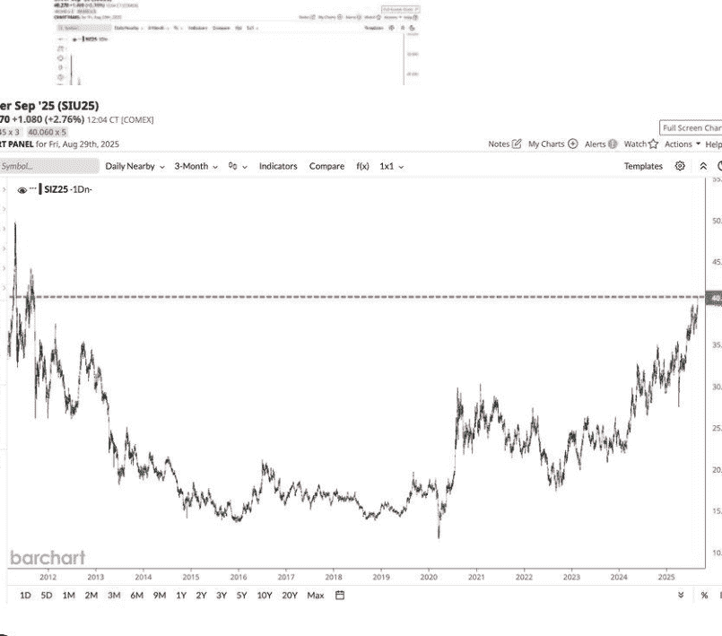

Silver Sep 25 (2U25)
40.279 -1.080 (-2.62%) 12:04 CT (COMEX)
CHART.MARKETS: Fri, Aug 29, 2025

## 江苏的债务比率（备份）

经常刚到江苏城市足球联赛的圈子，却盯了前面的榜——南通第一，镇江第二。我们跨越界，从债务角度，江苏13个地市债务推“老大”呢？（债务越少=越省钱好了）我准备了3个视角：

- 地方性债务/财政预算收入（2024年）——
苏州第一，万仗债务率仅为148.8%，垫底的是镇江，，118.4%；
- 接着看视角：
(地方性债务+城债债务)/财政预算收入（2024年）——

## FT: 中国“五大银行”面临消费者的压力，净息差低于预期

在中国经济放缓和工资上涨季节性收敛后，五大银行公布了一系列业务领域的恶化。以工商银行（ICBC）和中国建设银行（CCB）为首的银行是世界第二大银行，总资产超过19万亿人民币（27万亿美元）。数据显示中国工商银行，其净息差从6月份下降至最低值，也非彭街社编辑分析师穆塞尔副总裁首席Nicholas Zhu表示：“房地产市场的萎缩和消费者支出的收紧正在重塑银行的需求。抵押贷款和零售业务是银行更高的风险，”补充道，“这是一个结构性逆转，也是许多行业关注的趋势。”通胀压力导致中国经济带来，由于大多数家庭财富在房地产上，政府通过鼓励信贷来对抗通胀，但信贷需求仍然低迷。截至6月，中国工商银行报告，其不良贷款总额超过110亿元人民币，是去年同期的两倍多；中国建设银行报告，其不良贷款率在第二季度升至2.5%；中国农业银行报告，消费贷款违约率连续四季度上升，这三家贷款总数增加了一倍多。

违约，加上宽松的银行政策和3%左右的低利率，损害了银行的盈利能力。平均净息在过去三个半年中有所下降，上次高于2%。

Chinese state banks report record-low interest margins at year-end
BOC — CCB — ICBC — ABC

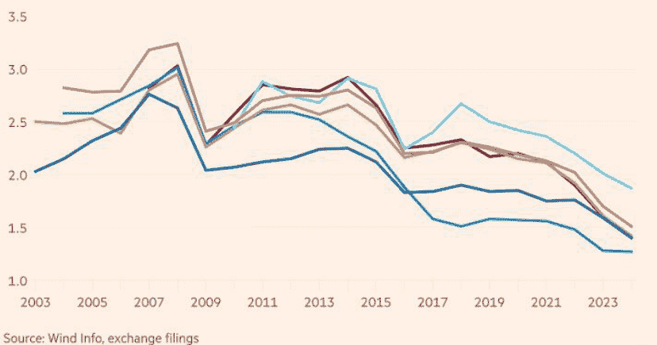

Source: Wind Info, Wind exchange filings

## 

分析师表示，对进一步挤压贷款机构谨慎态度的政策制定者没有采取激进的货币举措来提振信贷需求。相反，他们选择降低并补贴贷款人的息支出。“政策立场已经达到了不再牺牲利润支撑增长，”摩根士丹利分析师 Richard Xu 表示。徐说，坏账可能会在未来几个季度恶化，然后趋于稳定，并补充说由于风险增加，银行被迫退出贷款。“该行业可能复制之前零售贷款30%的年增长率，”他说，“事实证明，激进的推动不可持续，只会增加风险。”

## 知识星球TOP

| 序号 | 公号/星球/社群 | 原价 | 领域 |
|---|---|---|---|
| 1 | 业有木 | 2765/年 | 副业、搞钱 |
| 2 | 从众群众 | 365/年 | 时政、历史 |
| 3 | 记忆承载/雯树西风 | 365元/年 | 成长、搞钱 |
| 4 | 欧洲金靴 | 328元/年 | 时政、历史 |
| 5 | 卢克文克青会 | 699/年 | 时政、社会 |
| 6 | 体内主任 | 599/年 | 体制；职场 |
| 7 | 外局人的视野 | 669/年 | 金融、时政 |
| 8 | 灏泽异谈 | 4166/年 | 财富、成长 |
| 9 | 守夜人总令 | 599/年 | 时政、经济 |
| 10 | 江宁知府 | 365/篇 | 时政、国际 |
| 11 | 政堂/顾子明 | 568/年 | 时政、经济 |
| 12 | 唐书院 | 1399/篇 | 金融、财富 |
| 13 | 大树乡谈 | 199/年 | 时政、成长 |
| 14 | 水库欧大 | 10000 | 房产、经济 |
| 15 | 洪灏的宏观策略 | 4376/年 | 经济、搞钱 |
| 16 | 飞浅云 | 4576/年 | 股票、行研 |

