# 南半球聊财经250905

Jason不离
2025-09-05 03:04

FT: 高胀预测，若特朗普对美联的攻击将损害美国央行的独立，金价可能接近每盎司5000美元。黄金今年已累计上涨35%，成为表现最好的资产之一。#金融

金融

最后回响：2025-09-05 05:08

该基准预测，到2026年金价将升至每盎司4000美元。但特朗普曾表示，如果私人投资者大规模购入美元资产，如美国国债，金价可能被推高。

> “如果美国国债此时持有的51%的黄金，金价将升至接近每盎司5000美元，”特朗普曾说。

“我们对黄金的配置是双倍配置”，百达资产管理(Picet Asset Management)的多元资产投资组合经理阿齐·赖(Arun Arun)表示。在特朗普击国库之前，他会考虑增加金头。”

“由于近期行情反弹，我们预计金价还会再上涨，这让我们在信心上继续持有黄金超配。”

近年来，各国不断增加黄金，推动金价上涨，而私人投资者将黄金大量纳入投资组合，作为对抗通胀的工具。高胀显示，自2022年俄乌冲突爆发以来，各国央行的黄金购买量已经增加了五倍。

贝莱德投资研究(BlackRock Investment Institute)的分析师指出：“在一个不断的世界里，可靠的分散化工具越发稀缺。”

## 微信 jntsg2, 资料分享群

## Gold prices have soared this year

$ per Troy ounce

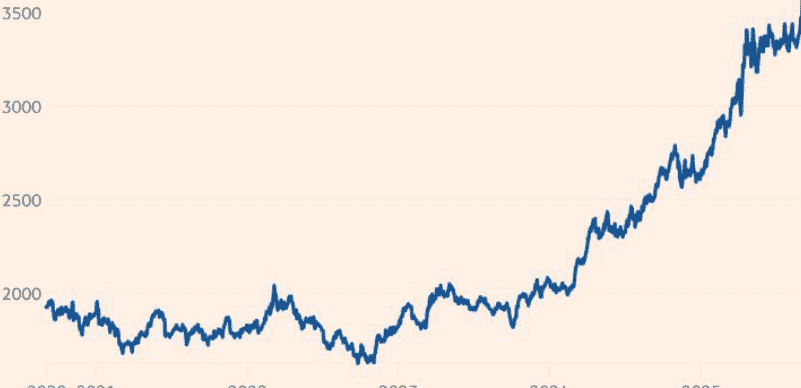

Source: LSEG via markets.ft.com，显示今年金价大幅飙升。

baseline¹¹, given the very small size of the physical gold ETF market relative to Treasury bonds, at only 1% (Exhibit 3). For example, we estimate that if 1% of the privately owned US treasury market were to flow into gold, the gold price would rise to nearly $5,000/oz, assuming everything else constant. As a result, gold remains our highest-conviction long recommendation in commodities space.

Exhibit 3: Central bank reserves diversification into gold has been sizable, driving gold prices meaningfully higher since 2022. Private diversification could be the next giant leap for gold prices

| Central Bank & Other Institutions Gold Purchases Tonnes on London OTC (Monthly Average) | Tonnes | Trillion USD | Latest National Outstanding Value As Multiple of Gold ETF Market |
| :--- | :--- | :--- | :--- | :--- |
| 90 | | 80 | | 175 |
| 80 | | 70 | | 150 |
| 70 | | 60 | | 125 |
| 60 | | 50 | | 100 |
| 50 | | 40 | | 75 |
| 40 | | 30 | | 50 |
| 30 | | 20 | | |
| 20 | | 10 | | |
| 10 | | 0 | | |
| After Freezing Russia Central Assets (Feb 2022-Jun 2025) | Before Freezing Russia Central Gold Reserves (Jan 2006-Jan 2022) | Privately Owned US Treasuries | Gold ETF |

Source: Haver Analytics, Bloomberg, Goldman Sachs Gold Investment Research

## 加微信jnts2，资料分享群

## Jason不离
2025-09-05 03:19

zerohedge: 上证综合指数连续3天下跌，正如高盛报告所写，自上周刚时候以来，已经迹象表明监管机构或为反弹降温。然而高盛团队在收盘时介入提振市场。高盛PB数据显示，自上个月中国股市多头主导了资金流动。,A股

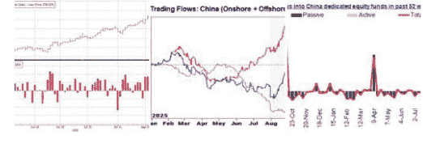

A股

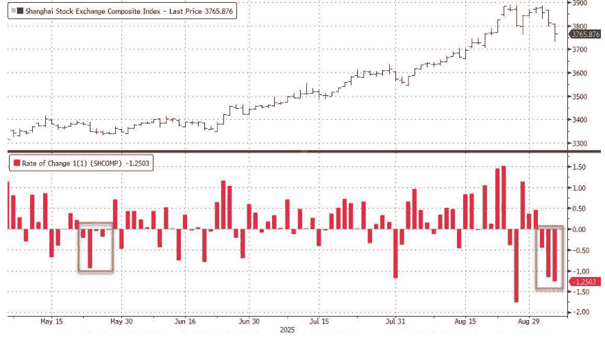

加微信jntsg2，进资料分享群

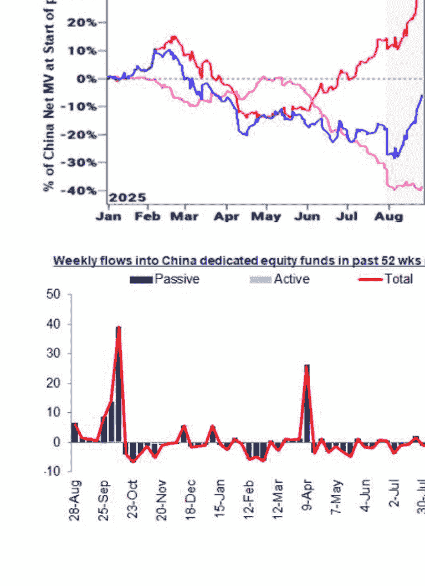

加微信jntsg2，进资料分享群

## Jason不
2025-09-05 03:31

bloomberg: 韩国除了政府，企业也在积极鼓励生育。Booyong宣布为每个孕员员工提供1亿韩元补贴，该优惠将延续到近三年。韩国的生育率去年仅为0.75，全球最低，首尔仅只有0.58。按照目前的增速，预计到2072年人口将减少之一。Booyong的补助金额，几乎是韩国人均收入的两年，去年有28名员工选择孩子。其他企业也开始效仿Booyong，第一个孩子提供100万美元，第二个孩子提供7000美元，三个孩子提供2000美元。调查显示：86%的人表示补助帮助他们考虑更多的孩子，96%的人表示补助有助于平衡家庭。其他公司如斗山，没有任何补助金额可能不够，理由是相同的。从长期来看，没有补助的环境实在太糟糕了，随着政府有了迹象，近年来出生率首次上升，今年1月到5月比去年上升了7%。首尔人口密度高，长期来看，还需要吸引年轻人从结婚和生育。此外，这些企业的竞争一个孩子都得到了。韩国/首尔

## 生育率下降韩国/首尔

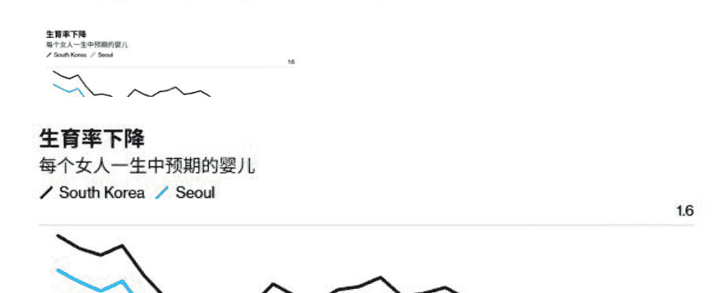

| 1997 | 2010 | 2020 | 2024 |
| :--- | :--- | :--- | :--- |

资料来源：韩国统计局

## 加微信jnts2，资料分享群

## Jason-陆
2025-09-05 03:36

CMF: 关税导致的贸易全球化收缩了市场需求，降低了实体经济收益率；金融化（稳定）加剧了全球竞争，资产收益率也会下降，因此，从长期来看，贸易逆全球化或金融化面临一定的下行压力

## 金融

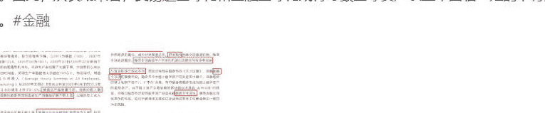

## 加微信jnts2，进阶资料群

从关税来说，进口价格上升，进口数量下降，相对提高本土产品的竞争力。美国制造业发展由于劳动生产率缓慢，甚至下降，导致美国产品价格上升。依据美国劳工部（BLS）和美联储的数据，自危机以来，制造业劳动生产率没有提升，甚至下降。2007年Q4、2009年Q2、2019年Q4和2020年Q分别由于危机和疫情冲击，劳动生产率出现了大幅下滑。同时，工人小时收入（Average Hourly Earnings of All Employees, Manufacturing）从2007年末的18.8美元上升至2025年6月的35.3美元，工人小时率已经上升了19%，劳动生产率停滞不变，结果却是制造业的商品不断上涨让工人收入增长。

## 加微信intjs2，进利

要持续减少外债规模，这种办法是减少贸易差。美国关税政策人为抬高进口价格，并试图制造贸易回流，减少贸易差带来的全球需求，降低全球生产带来的利润以及相应的投资收益率。

与贸易全球化不同，美国出台了固定的方案。稳定币作为链上资产的支付，法规规定了“1:1”关系，可以使得稳定成为避险资产。由于数字资产交易区块链技术使得“去中心化”的特征，导致市值计算的数字资产价值具有不可控性，具有自主性带来的冲击风险。

随着数字资产发展，数字资产规模不断增长。目前，加密、以太坊的规模扩大到2亿美元，尤其是RWA（现实世界资产）的币化，金融资产、商品、房地产以及无形资产均可币化，将数字资产引入区块链世界确权、流转和交易。稳定币是数字的币化，也是目前RWA最成功的案例，例如比特币市值超过2800亿美元，成为连接金融与数字资产的重要桥梁。

币化是金融产品创新的延续形式，并不是一切都可以化的，由于资产可编程，可细分高价值资产为小额币化，满足小投资者需求。在此，理论上，币化表达的资产的无限性，决定了币化是金融产品创新的延续形式。

## 加微信jtsg2，进阶资料

## Jason不易
2023-05-09 03:42

高盛：2008年之前，供应的延伸和商品的自由流动锚定了物价，但此后，全球贸易占GDP比重的全球化进程进入停滞。随着商品转向内向，大宗供应变得更具色彩并遭遇一个“控制刚”。大宗商品供应的集中化和杠杆正在全球范围内上演。在供应领域，我们预计到2030年，美国将占全球供应三分之一的LNG，并且已开始出口与关税协议挂钩，增加了对于出口的风险。传统的组合应对两种风险（制度性脆弱与供应冲击）。黄金、大宗商品正在成为应对未来风险不可或缺的核心资产。

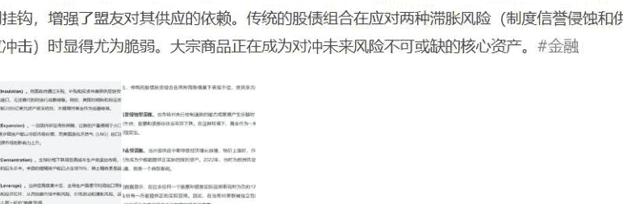

## 金融

- 第一步：绝缘 (Insulation)，各国政府通过关税、补贴和投资来确保供应安全，尽可能用国内生产替代进口。无法的则进行战略储备。例如，美国对钢铁和钛征收关税，以及各国政府在俄罗斯300亿美元能源被封锁后，大幅增加资金作为金融对冲。
- 第二步：扩展 (Expansion)，一旦国内供应得到保障，过剩的产量将用于出口。高价频繁，OPEC+逐步扩产以供给市场，美国液化天然气（LNG）。
- 三步：集中 (Concentration)，价格下跌导致供应逐渐集中到少数低成本国家。中国的精炼产能占全球70%，更是超过90%。
- 第四步：杠杆 (Leverage)，当供应高度集中后，各国可用出口限制，将其作为地缘政治杠杆，从而增加价格波动和通胀风险。反过来会促其他国家进入新轮“绝缘”阶段。

## 加微信jnts2，资料分享

高的报告指出，传统的股票组合在两种通胀压力下表现不佳，使其多元化效果折扣。第一种是限制性通胀。当市场对中断通胀的能力和意愿产生预期（如1970年代），通胀率、股票将会双舞。第二种是供应冲击型通胀。外部供应导致增长放缓、物价上涨，作为受冲击的核心。2022年，外部供应约40%的流量就是一个典型案例。报告数据显示，在任何12个月周期内，黄金往往提供实际回报。因此，在当前对美储独立性的担忧下，除了黄金，多元化配置同样重要。

FT: 根据四周公布的一项英国调查，截至8月的三个月，英国企业年化率为2021以来最糟糕的数据。这表明财政大臣霍切·里夫（Rachel Reeves）上调工资的决定仍在产生影响。“企业很难通过调工资应对工资收，只能裁员。”

## 加微信intjs2

## British businesses report the worst employment growth since 2021

Annual % change — Single month 3 month average

Source: Bank of England- Decision Maker

Line chart of Annual % change showing British businesses report the worst employment growth since 2021

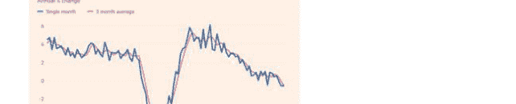

## Jason不遇
2022-09-05 03:46

bloomberg: 英国在权对中国征收关税，预计该提案将提交国。英国关系（Cambria-Sheldon）正在采取新的举措。这种贸易冲突是英国政府考虑西岸的一部分，旨在保护国内工业和发展的战略的一部分。“我们对关税的使用是为了保护产业，”Sheldon表示，“我们正在考虑采取此类行为，意味着英国有权根据利益做出反应，并采取不同的行动。”根据路透社报道，英国政府对中国包括在内的范围，将在五月公布的2023年预算的一部分。拟议措施将涵盖英国内的产品并提供受影响产品的详细说明。

## 加微信jntg2，资料分享

墨西哥总总理克劳迪·谢因鲍姆(Claudia Sheinbaum)在周四下午的新闻发布会上表示，墨西哥政府正在考虑包括在中国内的未签定的国家征收关税。新关税将成为政府所收的“墨西哥计划”的一部分，这是一项促进国内工业和发展的计划。“我们正在考虑将关税作为我们一直提出的墨西哥计划的一部分，”Sheinbaum补充道，“中国是中国没有达成的国家之一，“它并不是唯一的国家。”Sheinbaum表示，新关税影响的行业将在适当的时候释放。她没有具体说明所考虑的费率，也没有具体说明更多的时间。据路透社上周报道，墨西哥计划将提高对中国的一些亚洲国家的关税，作为本月公布的2026年预算的一部分。额外的关税将涵盖汽车、纺织品和塑料在内的广泛产品，旨在保护该国家免受进口产品的影响。

Jason LaBaugh
2025-09-05 03:50

zerohedge: 13年前，时任欧洲央行长马里奥·德拉哥打开了流动性闸，以防止欧元崩溃。从那时起，结构性问题一直没有解决，我们现在再次面临相同。现在欧洲央行需要准备应急工具了。由于通胀率在上升，已债累累国家的再融资成本也在上升。其他国家经济

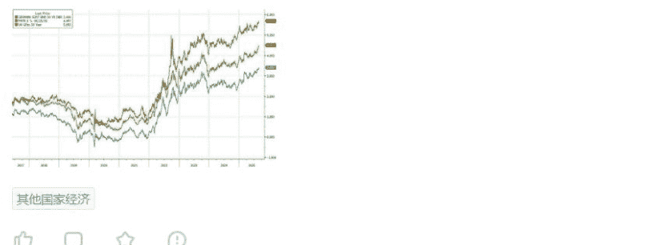

## 加微信jntsg2，进阶

## Last Price

| | | |
| :--- | :--- | :--- |
| GERMANY GBT BUB 30 YR | 3.406 | |
| FTRK 3 % 05/25/55 | 4.497 | |
| UK Gilt 10 Year | 3.695 | |

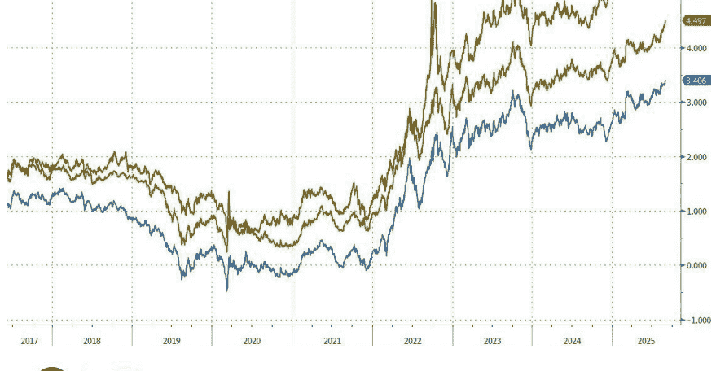

## Jason不跑
2025-09-05 03:58

发哥:经过6.23以来，上证指数出现了第一次较为明显的回调，并且开始考验20日均线。过去60牛市，阶段性跌破20日均线并不不见，跌破20日均线后，一回99%。市场大多nT+5、T+20、T+180日跌率分别为60%、67%...上证指数出现了第一次较为明显的回调...跌破20日均后...上证指数...幅度2.9%。A级

## 图 2：历史上中国收日后回撤较大的原因复制

| 有效持续天数 | 收日后回撤 | 涨跌幅 | 原因 |
|---|---|---|---|
| 1996-06-18 | 1996-06-26 | 7% | 无资金影响，筹码获利好因素等因素引发回调 1996年8月引发二次回回 |
| 1996-12-16 | 1996-12-25 | -8.0% | 政策调整回调 1996年12月13日，习近平的意见引起关注，收日16日执行了10%的限幅 |
| 1999-09-29 | 1999-09-21 | -17.0% | 国际市场大跌引发回调 1999年09月23日，引起全国关注，通过了《（中共中央）关于加强企业发展和发展的宏观政策的意见》 -10.3%，“政策”引发市场恐慌情绪 |
| 2000-08-20 | 2000-08-25 | -7.7% | 政策性调整 2000年08月17日，深圳上海股市交易暂停，证监会发布新规、发行制度等9个政策实施停牌后，市场出现恐慌性暴跌下跌 |
| 2000-12-22 | 2001-02-22 | -9.1% | 政策调整 2000年11月20日，证监会发布公告，保护投资者利益表示关注 2000年12月，证监会主表示关注涉及历史问题的流通问题（“股市割肉问题”） |
| 2005-06-15 | 2005-07-19 | -2.5% | 政策调整 2005年6月7日，政策引发回调 |
| 2005-09-22 | 2005-12-06 | -4.7% | 政策调整 2005年10月4日，三项工业改革宣布成立，作为第一个通过分股改革全流通的政策 2005年09月11日，PPP政策引发回调 2005年11月，证监会发布公告，保护投资者利益，维护股市历史问题的流通问题 A股面临三重因素导致资金流入压力 |
| 2006-07-13 | 2006-08-07 | -8.8% | 宏观环境 2006年07月5日，上调基金规模500亿元 2006年07月8日，75%个股税率，财政部发布将将加强制收居民所得税 |
| 2019-04-25 | 2019-05-09 | -8.8% | 政策调整 2019年04月12日，央行召开会议表示，“对好明年总量保持合理增长” 2019年04月15日，外债发行紧张，特种筹备将针对2000年中国产品减险 |
| 2020-03-09 | 2020-03-27 | -11.8% | 外部环境 2020年02月28日，海外股市暴跌，全球资产遭遇重击 2020年03月15日，美股大回调 |

数据来源：Wind; 广发证券研究中心

## 加微信intsg2，进资资料分享群

## Jason-Down

2025-09-05 04:09

开源：6月来，6-8月非主题 ETF 的规模增长加速，净流入达到2279亿元。主题 ETF、行业 ETF、策略型 ETF 都得到了显著的流入。我们认为，这三类 ETF 更具有行业特性，且具有极强的针对性；相比基金，居民资金在选择上往往倾向于 ETF。从侧面来看，这类 ETF 的流入代表了居民资金的动向。居民资金已进入“暴增”。近三个月表现佳，净流入规模增大。截至8月，市场最大的 ETF 是沪深300 ETF、上证300 ETF，总规模达到1333亿元。近三个月，净流入178亿元。我们发现 A 股表现好以后，我们认为居民资金流入的方式改变了 ETF。由于 A 股的规律，我们忽略了居民资金尚未开启市场，我们认为居民资金流入的方式，因此 ETF 已经成为居民资金的重要选择。

img/d6e59407d58ab5172ec92ade3_14.png

图1:过去三个个月，非主题 ETF 和均衡 ETF 流入趋势相反非均衡 月度流入规模（亿元）

img/d6e59407d58ab5172ec92ade3_14.png

数据来源：Wind、证券研究所

## 加微js2，进资料分享群

## 图4：历史上A股出现新发主动基金规模上行，但本轮在大资金级别的背景下失效了——指数型+混合型（含灵活配置）基金累计规模（截至8年（后））—三月平均线—上证收益率（右轴）

img/d6e59407d58ab5172ec92ade3_15.png

数据来源：Wind、衍研究所

2025-09-05

bloomberg:中国消费者正把旅行目的地从海外转回国内，预计创造270亿美元市场，财会很“消费替代”。另外150亿美元来自

| 中国主要国家 | Consumption in GDP |
|---|---|
| China | 39% |
| United States | 68% |
| Japan | 51.4% |
| High income | 50.4% |

注：数据来自彭博数据来源：Wind、世界银行、各国政府统计、经济计划（截至2023年），经作者后绘制

img/d6e59407d58ab5172ec92ade3_15.png

## 加微信jntsg2，进资料分享

## 中国家庭消费

| Share of household consumption in GDP |
| --- | --- |
| China | 39.6% |
| EU | 51.6 |
| Japan | 55.5 |
| United States | 67.9 |
| World | 56.4 |
| High income | 58.7 |

资料来源：世界银行
注：“高收入”代表高收入国家。中国、欧盟、世界和高收入国家的数据是2023年的。日本的数据是2022年的，美国的数据是2024年的。

2021-09-05

华创：对类上市公司，将现金流量表中的“收到的费”做分子，“支付的各项税费”做分母，可以衡量该公司的税费返还率（实际扣除的税费比例）。来看，观察近30年全国上市公司税费返还率，长期保持约5%~10%和全国名义GDP增速、广义财政收入对应）。2024年全国税费返还率15%，明显高于长期水平。

img/d6e59407d58ab5172ec92ade3_16.png

## 加微信jntsg2，进阶资料分享群

### 图表6 税费返还率（上市公司，2005~2024年）

img/d6e59407d58ab5172ec92ade3_17_0.png

数据来源:Wind，华财测算

2025-09-05

广发：预计8月实际GDP约4.76%。8月名义GDP同比模拟预测在3.5%附近，预计8月平减指数为1.28%，经济数据

img/d6e59407d58ab5172ec92ade3_17_1.png

## 加微信jntsg2，进资料分享群

## 图38: GDP月度实际指数

img/d6e59407d58ab5172ec92ade3_18.png

数据来源：Wind, 广发证券研究中心

## 图39: 周度名义GDP与实际利率

img/d6e59407d58ab5172ec92ade3_18.png

数据来源：Wind, 广发证券研究中心

## 图40: 周度名义GDP与国债利率

img/d6e59407d58ab5172ec92ade3_18.png

数据来源：Wind, 广发证券研究中心

## 图36: 预计2025年8月实际增长-1.28%

img/d6e59407d58ab5172ec92ade3_18.png

数据来源：Wind, 广发证券研究中心

## 图37: 半年度指数

img/d6e59407d58ab5172ec92ade3_18.png

数据来源：Wind, 广发证券研究中心

## 微信jts2，进资料分享群

2025-09-05

Gave：中国效率一直处于明显的下降，不是包括房地产一起，“说明”多钱带来的效益越来越，投资回报倒下滑。中国投资驱动增长模式面临严峻。

img/d6e59407d58ab5172ec92ade3_19.png

## Outside housing, the decline in China's capital productivity is unabated China's marginal product of capital, with and without housing

img/d6e59407d58ab5172ec92ade3_19.png

## 加微信jntsg2，进资料分享群

2025-09-05

NBER论文：利用美国税务局(IRS)行政数据，匹配了福布斯400大富豪榜与个人、企业、遗产与税收报表，测算美国富人群（约顶前400名）的实际税负，2018-2020年，400名超级富豪的实际总税率平均24%。低于普通人（全体人口平均）约30%。低于高薪劳动者（顶务群体）约45%。

img/d6e59407d58ab5172ec92ade3_20.png

ABSTRACT
We use income and wealth data for the top 1% of households by spanning Forbes 400 list members from 1984 to 2018. In this framework, we estimate the total effects of income taxes on high-wealth individuals to labor and investment. We find that capital gains taxes have a negative effect on labor supply, reflecting the fact that wealth inequality is driven by low taxable income relative to wealth for the wealthiest individuals. We also find that capital gains taxes have a significant negative effect on an average of positive work. However, we find that income taxes have no significant effect on savings. Top 400 households held 63% of their wealth in the US paid an average effective tax rate of 17%, which fell by 1.5 percentage points since 2018.

Anthony B. Chetty
University of California, Berkeley
chetty@berkeley.edu

Daniel Tyler
University of California, Berkeley
tyler@berkeley.edu

Emmanuel Saez
Department of Treasury
sae@treasury.gov

Gabe Zucman
University of California, Berkeley

## 加微信jntsgg2，进资料分享群

## How Tax Do US Billionaires Pay? Evidence from Administrative Data

Akkan S. Balkier, Emmanuel Saez, Danny Yagan, and Gabriel Zucman

NBER Working Paper No. 34170
August 2025

## ABSTRACT

We estimate income and tax for the wealthiest US households by matching Forbes 400 individuals to the group 2010–2020. In our benchmark estimate, the approximate all-tax business, estate, and gift tax rates paid relative to economic income—of the "top-400" leveraged 24% in 2018–2020 compared with 39% for the full population and 45% for Americans. This lower effective income-tax rate on the wealthiest is substantially driven by low taxable income relative to economic income. They sell their stocks. Top-owned passed businesses report negative taxable income in spite of positive book income, further limiting their effective tax rate which fell from 27% to 24% in 2018–2020, explained both by a smaller share of income being taxed and by income being subject to lower tax rates. Estate and gift taxes contributed to

img/d6e59407d58ab5172ec92ade3_20.png

8、行业内卷严重和用工成本是当前企业经营面临的最困难。71%的企业认为“行业内卷式激烈竞争”，产能过剩、低价竞争等问题影响企业的生存和健康发展；62%的企业认为“用工成本”和47%的企业认为“税费社保负担重”，反映了企业转型多为业务企业人数密集区域，红利空间有限，软性减税压力增大；41%的企业认为“数字化转型慢、创新能力不足”，说明中小企业创新转型的难度很大，甘于自身能力不足；“应收账款严重”（38%）和“资金链未到位”（24%）等也占有一定的比例。

| 行业内卷竞争严重 | 71% |
| --- | --- |
| 用工成本 | 62% |
| 税费社保负担重 | 47% |
| 数字化转型慢、创新能力不足 | 41% |
| 应收账款严重 | 38% |
| 公平竞争落实不到位 | 24% |
| 资金紧张、融资困难 | 20% |
| 监管机构执行不规范 | 18% |
| 能源、原材料、物流成本 | 17% |
| 市场准入难 | 16% |
| 国际环境变化冲击（例如额外加税、订单减少） | 12% |
| 没有遇到太大的困难 | 5% |

图2 受调研企业经营面临的最实在困难

加微信jntsg2，进资料分享群

# 高盛：美国投资者对股票的配置创历史新高#美股

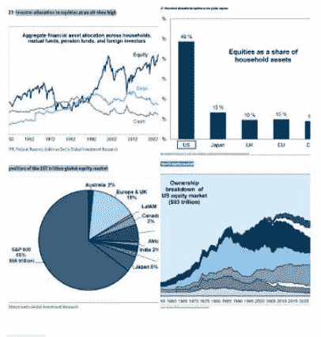

Exhibit 23: Investor allocation to equities at an all-time high

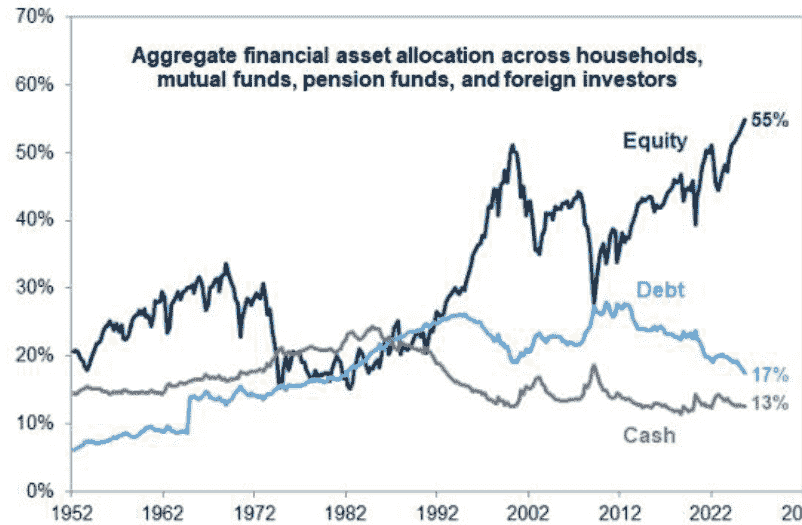

Source: EPFR, Federal Reserve, Goldman Sachs Global Investment Research

## Exhibit 27: Household allocation to equities across global regions

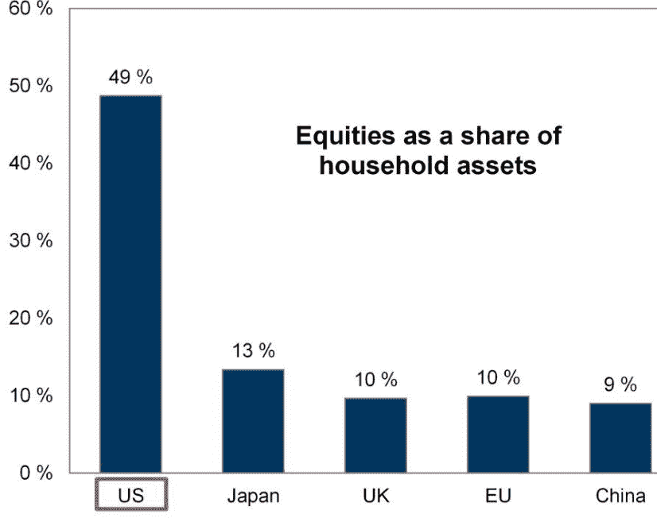

Source: Federal Reserve Board, EPFR, B001, Haver Analytics, Goldman Sachs Global Investment Research

## Exhibit 29: Composition of the $87 trillion global equity market

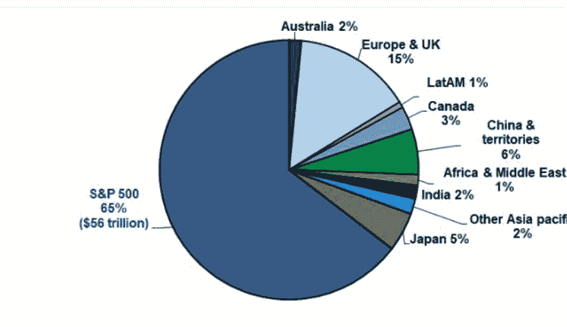

Source: FactSet, Goldman Sachs Global Investment Research

加微信jntg2，资料分享群

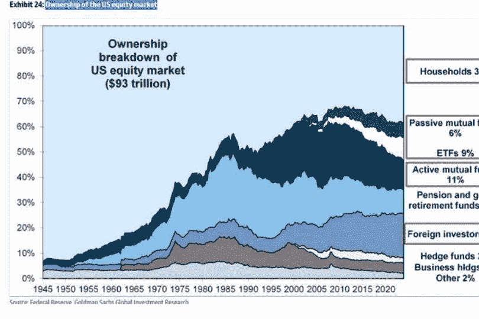

Jason-嘉融
2025-09-05 11:11

# CME：9月美联储息几乎100%确定了#

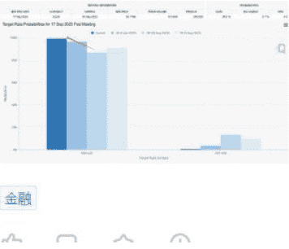

加微信jntsg2，进资料分享群 金

## Target Rate Probabilities for 17 Sep 2025 Meeting

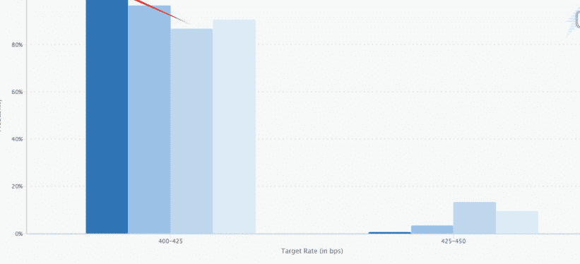

加微信jntsg2，进阶资料分享群

# 知识星球TOP 付费资源分享群 添加微信 免费入群

微信: jntsg2

| 序号 | 公号/星球/社群 | 原价 | 领域 |
|---|---|---|---|
| 1 | 生财有木 | 2765/年 | 副业，搞钱 |
| 2 | 怂容怂容吃瓜群 | 365/年 | 时政，历史 |
| 3 | 记忆承载/碧树风 | 365/年 | 成长，搞钱 |
| 4 | 欧洲金 | 328/年 | 时政，历史 |
| 5 | 卢克文会 | 699/年 | 时政，社会 |
| 6 | 体制内主任 | 599/年 | 体制，职场 |
| 7 | 外局人的视角 | 669/年 | 金融，时政 |
| 8 | 灏泽异谈 | 4166/年 | 财富，成长 |
| 9 | 守夜人司令 | 599/年 | 时政，经济 |
| 10 | 江宁府 | 365/篇 | 时政，国际 |
| 11 | 政堂/顾子明 | 568/年 | 时政，经济 |
| 12 | 唐书院 | 1399/篇 | 金融，财富 |
| 13 | 大树乡谈 | 199/年 | 时政，成长 |
| 14 | 水库欧大 | 10000远 | 房产，经济 |
| 15 | 洪灏的宏观策略 | 4376/年 | 经济，搞钱 |
| 16 | 金政通鉴/北海道山 | 4576/年 | 股票，行研 |
| 17 | 猫豹的世界 | 299/年 | 时政，社会 |
| 18 | 飞浅 | 3600/年 | 股市，经济 |
| 19 | 米联储见闻 | 599/年 | 经济，金融 |
| 20 | 鉴茶财经院 | 330/年 | 房产，股票 |
| 21 | 赢在八小时之外 | 365元/年 | 成长，职场 |
