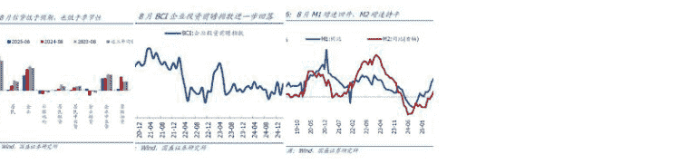
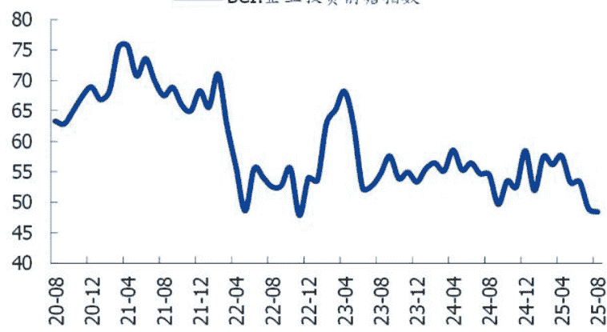
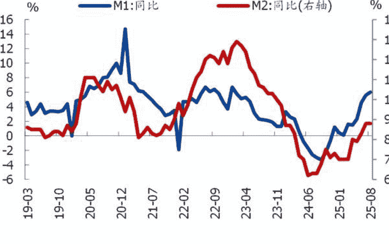

# 南半球理财250913

Jason不离
2025-09-13 02:33

国监：8月新增信贷低于预期，低于季节性，结构未好转。整体来看，居民端贷短、长贷同比连续两个月少增，指向改善，地产产债仍弱。企业短贷同比多增，但要慎防特征缓解。中期信贷连续两个月少增，企业投资意愿减弱，8月M1同比增长6%，较上月进一步抬升0.4个百分点，一方面基础数据一步走稳，另一方面居民存款活跃可能仍是主拉因素，同期非贷增速缓慢。#金融

金融：微信pep458

## 图1：8月信贷低于预期，也低于季节性

| | 2025-08 | 2024-08 | 2023-08 | 三年均值 |
|---|---|---|---|---|

资料来源：Wind，国盛证券研究所

加微微信top28688，免费进资料群

## 图表3: 8月 BCI企业投资前瞻指数进一步回落

资料来源: Wind, 国信证券研究所

## 图表6: 8月 M1 增速回升，M2同比持平

资料来源: Wind, 国信证券研究所

加微信top28688，免费进资料群

Jason不离
2025-09-13 02:41

## 李需当：9月11日下午，在中国人民大学深圳研究院等主办的社会科学沙龙中对大类资产产出下半年展望。# 金融
