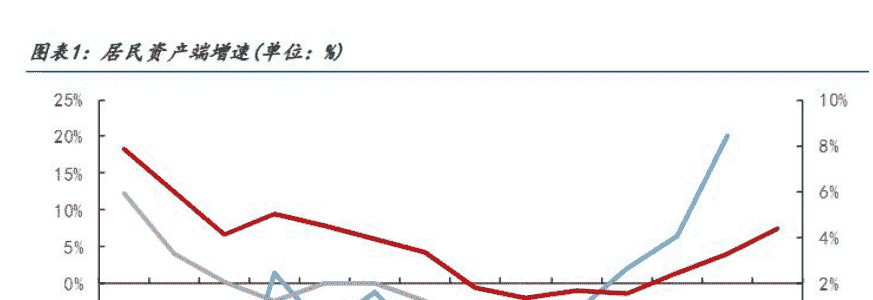
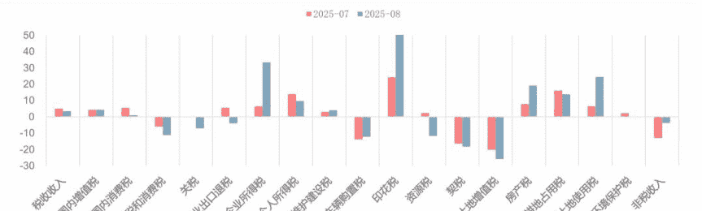
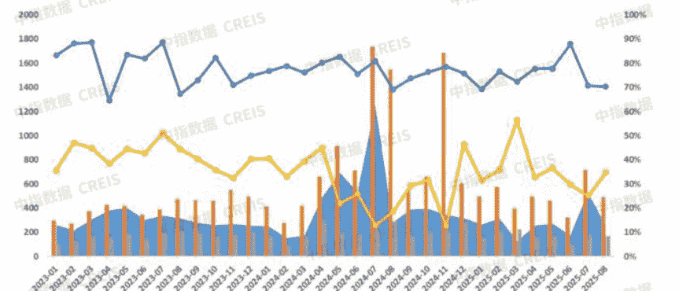
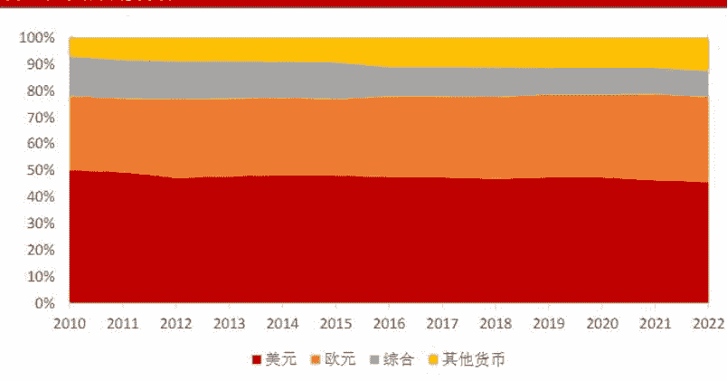
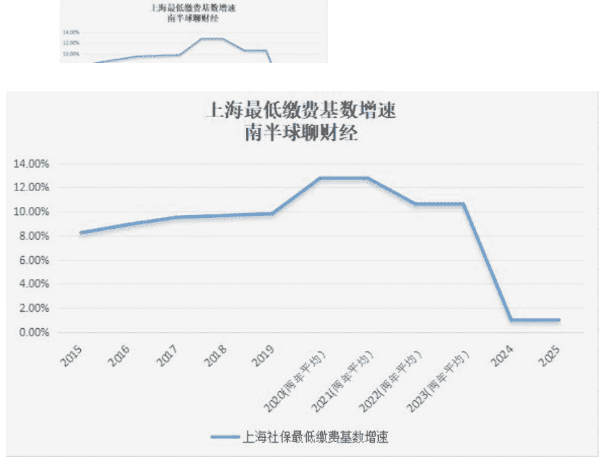
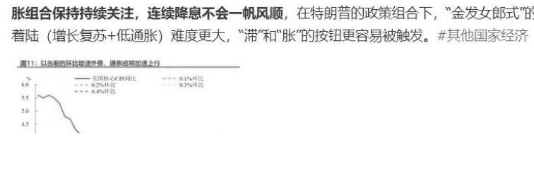
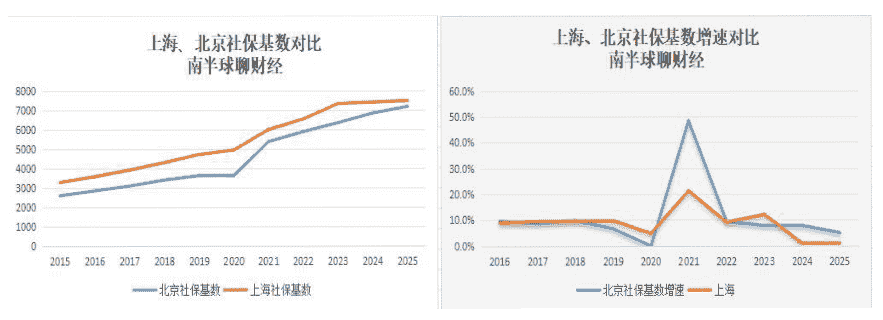

# 南半球聊财经250919

Jason不遇
2025-09-19 03:02

民生：在股市涨的持续下，证券交易印花税已经连续两个月高涨（月环比增速为125.4%、8月进一步增长226.0%）。根据我们测，8月证券交易印花税对公共财富收入总体的拉动高出4.6个百分点。这一拉动幅度甚至于去年'94年股市行情。除此之外，个人持有股期的增长与股市有一定的联系。根据财政部要求，个人持股期限不超过1年的，其息红利可能需要缴纳个人所得税，因此此期股市行情也可以在一定程度上提升个人所得税。#TAX

图1：股市活跃度拉升证券交易印花税增长

| | 沪涨：股票、成交金额：同比 | 收入：证券交易印花税：当月环比 |
|---|---|---|
| 300 | | |
| 250 | | |
| 200 | | |
| 150 | | | |
| 100 | | | |
| 50 | | | |
| 0 | | | |
| -50 | | | |
| -100 | | | |
| 2023-02-03 | 2023-07-12 | 2024-02-05 | 2024-10-25 | 2025-03-28 |

数据来源：ifind，民生证券研究院

数据来源：ifind，民生证券研究院

图2：证券交易印花税对公共财政的拉动不错

| | 对公共预算收入的拉动：其他特殊 | 对公共预算收入的拉动：证券交易 | 一般公共预算收入：同比增长 |
|---|---|---|---|
| 80 | | | |
| 60 | | | |
| 40 | | | |
| 20 | | | |
| -20 | | | |
| 2023-02-03 | 2024-02-24 | 2024-08-25 | 2025-02-08 |

数据来源：ifind，民生证券研究院

图3：股市高涨时，个人所得税表现不优

| | 沪涨：股票、成交金额：当月环比 | 个人所得税：同比增速（含税） |
|---|---|---|
| 300 | | |
| 250 | | |
| 200 | | |
| 150 | | |
| 100 | | |
| 50 | | |
| 0 | | |
| -50 | | |
| 2024-05 | 2024-08 | 2024-11 | 2025-02 | 2025-05-28 |

数据来源：ifind，民生证券研究院

# 微信进资料群

# 微信：top28688，进阶资料分享群

# Jason不涵

2022-09-19 01:09

国：从居民资产结构表来看，居民资产结构以房地产等资产为主，金融资产特别是股票居民资产比例接近中期。2025年非金融资产、居民资产占居民总资产的45.5%，金融资产占比51%，其中存款、股票、证券基金占比分别为33.4%、5.4%、5.2%。住房价格持续受影响，住宅增速接近去年，占居民资产的比重从54%下降至2025年二季度的45.4%。股票增速出现波动，2022年股票资产结构在居民资产中表现显著。但自2024年季度开始，受益于A股行情，股票资产结构由弱转为拉动，2025年二季度居民股票占比增长21%（同比多5.4万亿），拉动居民同比增长增长1个百分点。股票和资产累计增长1.3个百分点。低侧的高净值客户是股票上涨的主要因素，这导致股票财富的支持有限，且股票一直上涨。上期数据显示2022年，459.3万户持股市市值在100万以下占比0.7%，占自然居民者持股市占比49%。10.6%的自然净值客户持股市市值的79%。图1：居民资产增速（单位：%）

来源：wind，国泰研究所

# 加微信：top28688，进资料群

# 图2：A股市场参与者 | 持市值(亿元) | 占比 (%) | 客户数(万户) | 占比 (%) |
|---|---|---|---|---|
| 散户 | 107571 | 23.19 | 4549.32 | 99.71 |
| 其中:10万元以下 | 3421 | 0.74 | 2269.14 | 49.74 |
| 10-50万元 | 11325 | 2.45 | 1373.06 | 30.10 |
| 50-100万元 | 9360 | 2.03 | 423.79 | 9.29 |
| 100-300万元 | 16202 | 3.50 | 338.56 | 7.42 |
| 300-1000万元 | 14690 | 3.17 | 111.22 | 2.44 |
| 1000万元以上 | 52353 | 11.31 | 33.55 | 0.74 |
| 个人投资者 | 260413 | 56.25 | 5.86 | 0.13 |
| 专业机构 | 93546 | 20.35 | 7.16 | 0.16 |
| 其中:量游户 | 1216 | 2.42 | 0.00 | 0.00 |
| 公募基金 | 28650 | 6.18 | 0.71 | 0.02 |

来源：交易所，中国证券研究院

高价值客户往往面临着更高的风险承受、价值更为多元化，往往能够在市场下获取超额收益。亚洲高价值品种，在2014年7月至2017年12月的基金波动中，85%的投资者（基金金额在5000万以上）遭受了亏损（基金金额为2690亿元），而如此高价值投资者（基金金额在1000万以上，投资者数量超过0.5%）则没有在2020年初遭受亏损。策略的一方面是选择时机，高价值客户往往在市场底部布局，并在市场高位之后卖出市场，高价值客户面临的风险是相同的。另一方面是策略的选择，在市场低迷时，高价值客户倾向于购买股票的，而非买入基金，这往往与此相反。正是由于2014-2015年期间，基金行情使得中小个人投资者由于杠杆盈利面临大幅亏损，由于抗风险能力有限，中小投资者在市场震荡中尽可能远离。

Jason2025-09-19 03:13

中信建投：8月以交易基金为基础的收益（-18.3%）、土地增值（-25.8%）下降进一步扩大，与房产表现持平。市场线下，8月土地收入（-5.8%）大幅回落13个百分点。但还有环房税（+19.1%）、土地使用（+24.4%）增速进一步加快，标准总体水平上升的背景下，预计盈利难度加大。#TAX

# 加微信微2888，获取资料共享

图表 3：一般公共预算分项当月增速 (%)

数据来源：Wind, 中信建投

Jason-不嵩
2025-09-19 03:18

中信院：8月上海新增253套各类拍卖房源，交易挂拍493套，成交171套，各类法拍成交均价19751元/平方米，成交价70.3%。2025年1-8月，上海各类法拍房源累计48.5万套，成交10.7万套。 图：2023-2025年8月上海市场交易趋势

数据来源：CREIS中国-二手房数据（点击查看）https://u.fang.com/ytcn/

# 微信top2888，进资料群

# Jason不涵
2025-09-19 03:22

中国：今年数据显示，无论是全国还是山东、江苏等省，债务压力加大。目前进入大规模置换周期，大量债务压力较大。考虑到自身融资能力不足、债务结构较弱，高成本融资维持杠杆“扩容”来置换债务，易引发置换需求继续维持高息融资的恶性循环，加强信用释放。由于存在不确定性等背景下，商融资风险进一步深化。

#TAX

| 表1：近年来各省债券置换周期 | 2023年周期次数排名 | 2024年周期次数排名 | 2025年1-8月周期次数排名 |
|---|---|---|---|---|
| 山东 | 59 | 3 | 130 | 67 | 1 |
| 河南 | 22 | 4 | 36 | 21 | |
| 江苏 | 6 | 8 | 15 | 11 | 3 |
| 重庆 | | 4 | 11 | 8 | 7 |
| 南 | | | 3 | 1 | 6 | 5 |
| 贵州 | 60 | 2 | 55 | 5 | 6 |
| 陕西 | | 6 | 8 | 17 | 4 | 7 |
| 四川 | | 1 | 14 | 7 | 3 |
| 安徽 | | | 2 | 13 | 15 | 8 |
| 辽宁 | | | 1 | 14 | 11 | 3 |
| | | | | 6 | 10 | 2 |
| 湖南 | | 4 | 11 | 11 | 2 | 11 |
| 云南 | 62 | 1 | 64 | 8 | 13 |
| 湖北 | 9 | 7 | 8 | 13 | 13 |
| 新疆 | | 1 | 14 | 2 | 13 | 13 |
| 福建 | | | | 15 | 13 | 13 |
| 江西 | | | | 13 | 13 |
| 青海 | | 11 | 5 | 2 | 13 |
| 甘肃 | | | | 15 | |
| 山西 | | | | 15 | |
| 西藏 | | | | 15 | |
| 内蒙古 | | 5 | | 10 | |

数据来源：聚交所，中诚信国际研究院整理

# 微信top26888，进资料分享群

bloomberg: 比特对美元升值表示满意，且问题踢了欧洲。#金融

# 博客智能的要点

- 美国财政部部长斯泰·贝森特表示，今年人民币对美元实际上上走。
- 人民币其他主要货币下跌，其中欧元对美元下跌约10%。
- 贝森特表示，中国与美国的贸易是升的，与美国的贸易是下降的，今年美国对华贸易逆差可能发生。

Supply Lines 时事通讯。

整体利率、关税和物资冲击正在重塑企业并扩张。了解商业的新机遇可能。
- 博社可能会向我们发放优惠和促销活动。

关注

交换我的信息，即我表示我同意隐私政策和服务条款。

美国财政部部长斯泰·贝森特表示，他对人民币对美元的走势感到满意，同时指出人民币对美元贬值给欧洲带来了挑战。“好吧，”贝森特谈到今年机会时，“人民币对美元实际上更强了，”指的是人民币，“它处于历史低水平，对于欧洲来说是一个问题。”根据博社周编辑数据，今年为止人民币对美元汇率上涨了3%，大多数是日元或欧元对美元升幅较小，其他主要货币跌值。欧元对美元跌了约10%。中国与美国的贸易增长了9%，与美国的贸易增长了14%，，”贝森特说，“我们正在取得平衡。今年贸易逆差可能减少30%。”

# 加微信info，进资料群

# Jason不涵
2025-09-19 03:29

FT: 特朗普首次儿子 Eric Trump 表示，加密货币的需求可以通过吸引全球投资流入美国，“数字资产繁荣将把万亿资金从各地流入美国。”

 更新于9月18日，这一举措推动了比特币和其他创造了历史。特朗普家族的加密货币版涵盖了True Social Bitcoin ETF、两种加密币，以及属于特朗普媒体与科技集团（Trump Media and Technology Group）的比特币金库业务。

# 微信直播28688，资料分享群

# 霍莱克·特朗普今年推出的MELANIA和$TRUMP加密币，称其有点“好玩”。

“人们想推代币，或者推某个选手；他们想推一位名人，或者一个知名品牌。或者他们就对某个人感兴趣，不是通过加密货币买下个人的一小部分。”他补充说，他曾在没有一些美国金融机构赞助的情况下创立了家和加密相关的公司之间。他表示：“几乎就像大行和现代金融的最终复刻。”几个月前，特朗普集团（Trump Organization）发起了第一资本（Capital One），其在描述的账户里政治到2021年被关闭，然而否认了这一点。你会发现自己不需要他们。实话，你也不太想念他们。”他补充说，特朗普指的是他是华尔街“所有”最大的机构以及他们的“高层人士”。美国行业首席总裁说，加密货币与美元一比锚定的数字现金，如果提供更高收益，可能会把资金从传统银行中抽取。白宫宣布希望，包括比特和Circle在内的货币发行方，在7月份会通过第一个主要加密货币法的监管，能够让美国购买财政部每年发行的价值万亿美元的债务。运作能够从这些货币中获利收益。霍莱克·特朗普去年共同创立了World Liberty Financial Inc，这是一家由其家族支持的加密项目运营，一种名为USD的与美元钩的稳定。根据财务披露文件，截至2024年初，特朗普持有1575万股WIFI股份。按照周的交易价格考虑，其价值超过30亿美元。霍莱克·普获得了家族从加密业务中获得的财政收益。他说：“如果我父亲还将想要复生，他最不能做的事情就是竞选总统——我们所做的一切恰合让人生无此表现。”

# 加微信top28688，进资料群

# Jason不跪

2025-09-19 03:37

zerohedge: 以太坊的退出压力上周超过260万枚 ETH，价值120亿美元，等待长达44天。沉重的抛售压力即将到来。以太交易所ETH的流动性和购买现货资金不断增强，正在吸收大部分抛售压力。

Jason-不诡
2025-09-19 03:36

日经：日经平均指数9月18日首次站上45000点大关，年初以来的涨幅已经超过美国和欧洲的股市。指数创历史新高。不仅短线交易获利的基金...

## 日经平均指数的涨幅超过了欧洲股市
## 欧洲STOXX 600指数
## 日经平均指数
## 美国标500指数

以2024年底的数值为100进行指标化

1 2 3 4 5 6 7 8 9

Jason-不诡
2025-09-19 03:51

大国际：央行货币政策的操作被视为一个为了目标的“有效”名义”，以避免不同时间点上政策取向不带来“一系列”的偏差。根据国际货币基金组织（IMF）的分类，货币政策命名又主要包括：汇率锚（Exchange rate anchor）、货币政策目标、通胀目标框架（Inflation-targeting framework）以及其他货币政策框架（Other monetary framework）。

在使用汇率指数的经济体中，其中“货币锚”的选择仍以美元为主，但比重有所下降。2010年，以美元为主的经济体有59个，2022年该数量下降到37个，正如所汉语，老鼠退出美元为主的经济体。总体来说，以美元为主的“货币锚”的经济体所占比例的下降。

选择汇率指数+通胀目标，随着政策重心转向对经济与货币政策的自主性。该政策要求允许汇率波动并具有灵活的金融市场，有效的货币政策传导机制以及充足的抗冲击能力，以消除汇率波动带来的影响。核心优势在于能够灵活利用汇率工具应对内部产出和通胀压力，尤适合经济结构复杂、内需为主的大型经济体。金融

## 加微信top28688 更多资料分享群

## 图2 汇率储备中的货币占比

数据来源：IMF AREAER, 大公国际整理

## 表2 2022年汇率制度选择与货币政策框架矩阵（个数）

| 货币政策框架 | 汇率 | 货币总目标 | 通胀目标框架 | 其他货币框架 |
| --- | --- | --- | --- | --- |
| 汇率制度（占比） | | | | |
| 硬货币（占比） | 100.0% | | | |
| 无锚法定货币 | | 14 | | |
| 货币集团 | 12 | | | |
| 软货币（占比） | 59.8% | 17.2% | 11.5% | 11.5% |
| 传统硬货币 | 39 | 1 | | |
| 稳定化变安排 | 8 | | 4 | 4 |
| 爬兑硬货币 | 2 | | | 1 |
| 类似爬制 | 2 | 8 | 6 | 5 |
| 水平软货币 | 1 | | | |
| 浮动（占比） | | 9.5% | 52.4% | 38.1% |
| 浮动 | | | 6 | 24 | 2 |
| 自由浮动 | | | 9 | 22 |
| 其他（占比） | 16.6% | 27.8% | 11.1% | 44.4% |
| 其他有管理安排 | 3 | 5 | 2 | 8 |

数据来源：IMF AREAER, 大公国际整理

其中，大分类下的占比数字表示汇率制度对对应货币政策框架的使用占比。

## 加微信top28688，进资料分享

## Jason-不诡
2025-09-19 03:52

各地昨天终于公布社保缴费基数，上海同比缩减#自制图表

上海最低缴费基数增长趋势
南华联财经

## Jason-不诡
2025-09-19 03:57

民生：我们一再强调，降息是问题的开始，不是结束，降多了，降快了，通胀风险；降少了，降慢了，特新增仍是风险。点钟显示年内75bp降息，相比增加了25bp，还是契合了鲍威尔在杰克逊霍尔会议上乐观的论调，但与米联及其后宫官理想的150bp相比不小。美独特的竞争之力刚刚开始，从经济动态来看，我们依然对持续宽松后的增长通道和软着陆保持持续关注，连续下去就不会会有风险，在特新增的政策引导下，“婴儿式的软陆（增长+低通胀）难度更大，“滞滞”和“胀”的按钮更容易被错割#其他国家经济

## 微信top28688，进资料分享群

## 图11:当前的环比增速外挂，通胀或加速上行

| 2023/1 | 2023/6 | 2023/11 | 2024/4 | 2024/9 | 2025/2 | 2025/7 | 2025/12 |
|---|---|---|---|---|---|---|---|
| 美国核心CPI环比 | | | | | | | | |
| 2%环比 | | | | | | | | |
| 4%环比 | | | | | | | | |

数据来源：南华财经研究团队

## Jason-不诡
2023-09-19 09:14

华泰：落地后短期震荡，长期不变。FOMC维持宏观经济的充足决定。本次会议（2023.09）维持基准在5%-5%区间，继续缩小负债规模。美联储对通胀表示担忧，由于劳动力市场可能面临压力，支持未来10月降息，我们预计美联储内降息次数从次到次。FOMC符合预期，降息周期内还有两次降息。联储上调通胀预期，并将调利率。鲍威尔在会议上表示乐观，考虑到就业市场仍面临压力，再次降息25bp（2023.09.18），美联储对通胀预期，我们预计美联储内降息次数从次到次。预防衰退风险，市场对持续加息担忧。降息后一段时间可能形成“缺口”。中长期衰退的隐忧，我们认为黄金具有长期配置。近期联储放宽了未来出现通胀风险，但给出的利率路径更低，这表明货币转向较为激进。全球格局重塑下，美元走弱加大，明年2026年结束周期。需求。这种结构性需求为黄金提供了底部支撑，黄金长期趋势依然，仍建议低点吸入，关注成长性和价值支撑机会。

## 加微信 XXX，获取深度报告

## 2015-2025北京最低社保基数比上海，超过10%#自制图表

上海、北京社保基数对比
南华联财经

上海、北京社保基数对比
南华联财经

加微信top28688，进资料分享群

## 知识星球TOP
添加微信免费入群
微信:top28688

| 序号 | 公号/星球/社群 | 原价 | 领域 |
|---|---|---|---|
| 1 | 生财有木 | 2765/年 | 副业、搞钱 |
| 2 | 众宗吃瓜群 | 365/年 | 时政、历史 |
| 3 | 记忆Legacy/剪西风 | 365/年 | 成长、财富 |
| 4 | 欧洲金轨 | 328/年 | 时政、历史 |
| 5 | 卢克文青云会 | 699/年 | 时政、社会 |
| 6 | 体制内主任 | 599/年 | 体制、职场 |
| 7 | 局外人的视界 | 669/年 | 金融、时政 |
| 8 | 澎湃异谈 | 4166/年 | 财富、成长 |
| 9 | 宁人司令 | 599/年 | 时政、经济 |
| 10 | 江宁知府 | 365/篇 | 时政、国际 |
| 11 | 政事堂/顾子明 | 568/年 | 时政、经济 |
| 12 | 唐书院 | 1399/年 | 金融、财富 |
| 13 | 大树乡谈 | 199/年 | 时政、成长 |
| 14 | 水库联大 | 10000元 | 房产、经济 |
| 15 | 洪灏宏观策略 | 4376/年 | 经济、搞钱 |
| 16 | 金融通鉴/北海南山 | 4576/年 | 股票、行研 |
| 17 | 猫哥的世界 | 299/年 | 时政、社会 |
| 18 | 飞龙沃 | 3600/年 | 股市、经济 |
| 19 | 米联诸见闻 | 599/年 | 经济、金融 |
| 20 | 茶茶财经圈 | 330/年 | 房产、股票 |
