# 南半联购经费250927

Jason不羁
2025-09-27 03:07

信达：A股资金流入年度跟踪，资金流入占自由流通市值比例约为1.4%，资金为小市值流入状态。#A股

表1：A股资金流入年度数据（亿元，年度）

| 资金流入额 | 2010年 | 2011年 | 2012年 | 2013年 | 2014年 | 2015年 | 2016年 | 2017年 | 2018年 | 2019年 | 2020年 | 2021年 |
| :--- | :--- | :--- | :--- | :--- | :--- | :--- | :--- | :--- | :--- | :--- | :--- | :--- |
| 1. 总计 | 8220 | 5845 | 2290 | -976 | 2480 | 3465 | 3641 | -1231 | -4269 | -8200 | 8640 | 6443 |
| 2. 流入 | 6290 | 4010 | 3888 | -1145 | 4460 | 5305 | 5907 | -1971 | -1997 | -1182 | 540 | 4500 |
| 3. 流出 | 2150 | 2735 | 1152 | -2121 | -2030 | -1365 | -3264 | -760 | -776 | -1018 | 2443 | 1943 |
| 4. 净额 | 4050 | 4010 | 2736 | -1146 | 2430 | 3940 | 2643 | -471 | -1225 | -7182 | 6197 | 2557 |
| 5. 占比 | 4.8% | 4.0% | 3.3% | -1.4% | 1.4% | 1.9% | 1.6% | -0.3% | -0.5% | -0.9% | 0.7% | 0.6% |
| 6. 大盘 | 3500 | 2500 | 2000 | -500 | 2000 | 2800 | 3000 | -500 | -1000 | -6000 | 5000 | 4000 |
| 7. 中盘 | 320 | 110 | 310 | 779 | 190 | 519 | 177 | -191 | -997 | -187 | 119 | 500 |
| 8. 小盘 | 220 | 200 | 426 | 232 | 263 | 621 | 476 | 365 | 345 | 1105 | 188 | 900 |
| 9. 医药 | 100 | 100 | 100 | 100 | 100 | 100 | 100 | 100 | 100 | 100 | 100 | 100 |
| 10. 消费 | 100 | 100 | 100 | 100 | 100 | 100 | 100 | 100 | 100 | 100 | 100 | 100 |
| 11. 电子 | 100 | 100 | 100 | 100 | 100 | 100 | 100 | 100 | 100 | 100 | 100 | 100 |
| 12. 能源 | 100 | 100 | 100 | 100 | 100 | 100 | 100 | 100 | 100 | 100 | 100 | 100 |
| 13. 机械 | 100 | 100 | 100 | 100 | 100 | 100 | 100 | 100 | 100 | 100 | 100 | 100 |
| 14. 银行 | 100 | 100 | 100 | 100 | 100 | 100 | 100 | 100 | 100 | 100 | 100 | 100 |

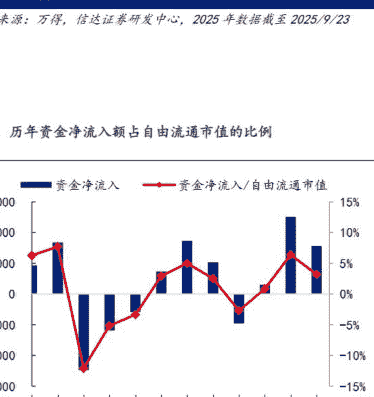 来源：信达、投信研究中心，2025年截至2025-9-23

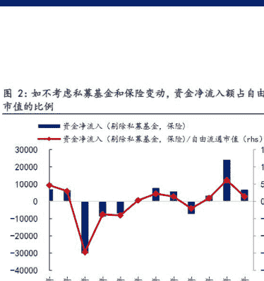 来源：信达、投信研究中心，2025年截至2025-9-23

## 图8：2025年以来融资融增加了5459亿元（单位：亿元）
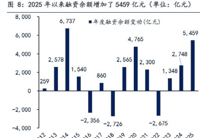 来源：万得、Choice证券中心，2025年5月23

## 图9：2025年8月-9月融资比变化（单位：亿元）
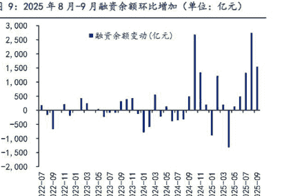 来源：万得、Choice证券中心，2025年5月23

## 图10：全A股流通市值趋势（单位：亿元）
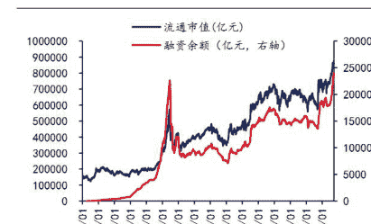 来源：万得、Choice证券中心，2025年5月23

## 图11：流通市值较2016年以来更高水平（单位：涨幅）
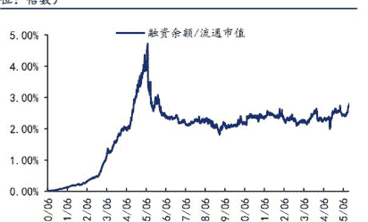 来源：万得、Choice证券中心，2025年5月23

## 图20：2025年5-6月净收入增速高于同期平均（单位：亿元）
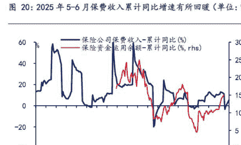 来源：万得、Choice证券中心，2025年5月23

## 图21：2025年初净利润增速较2024增加了（单位：亿元）
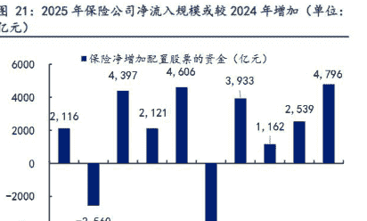 来源：万得、Choice证券中心，2024年、2025年预测

## 图24：2025年资本净增规模趋势
## 图25：2025年7月资本净增规模同比上升
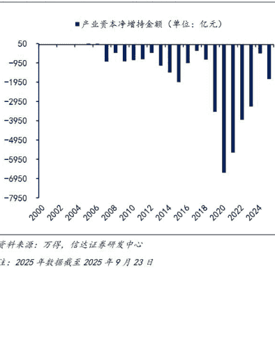
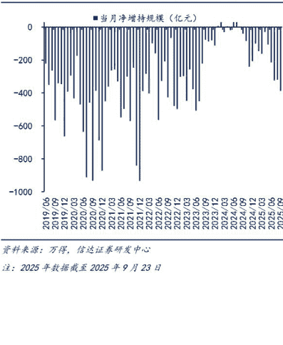 来源：万得、Choice证券中心，2025年截至2025年9月23

## 图28：上市公司分红维持高位
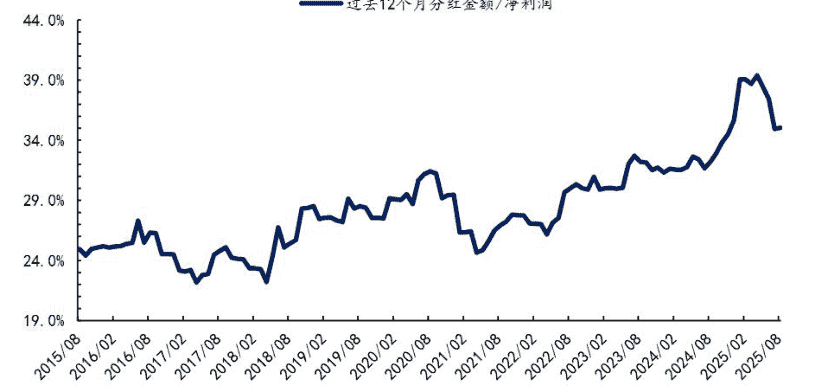 来源：万得、Choice证券中心，2025年截至2025年9月23

## 图31：历史交易金额及印花税
- 交易金额+印花税
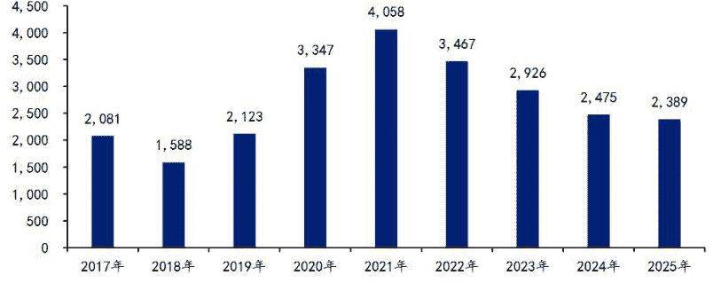 来源：万得、证券研究中心，2025年8月数据

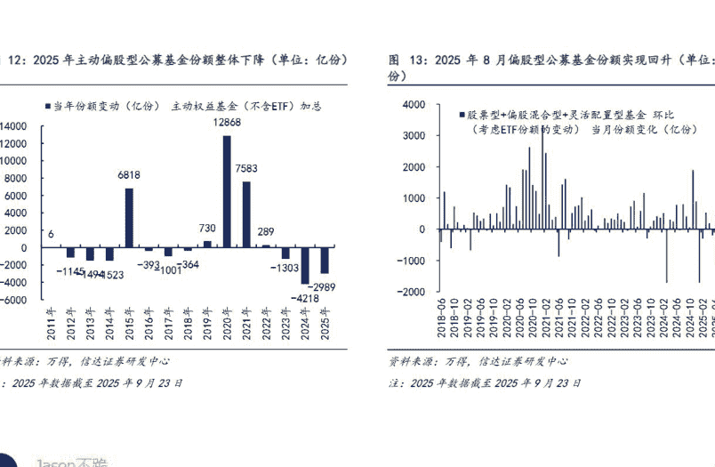 图12：8月主动型股票基金净收益率（单位：百分比） 来源：万得、证券研究中心，2025年8月数据

# Jason 施

zerohedge：2023-07-29 03:29
美国国内PECI指数近期积极，美股最强股票指数尚未显示出失控失败的态势，暂时与通胀指数上行。数据显示，美债收益率线下，美国大盘指数走强。首选计划对通胀的影响的经济学家称不能再等。在收入方面，美国工人的工资增长（同比5.0%）再次超越通胀，后工资增长4.2%是自2021年8月以来的最低水平。通胀率从4.8%下降至4.6%是2025年新低。
10年美国国债收益率变化为4.18%，CME上涨联美债指数10点下降的概率接近9

## 其他国家经济
经济学家们下了对美国年初的就业市场进行预测，这有助于解释为什么预计美联储将继续降低利率。

# 加微信top26888，免费获取资料
微信

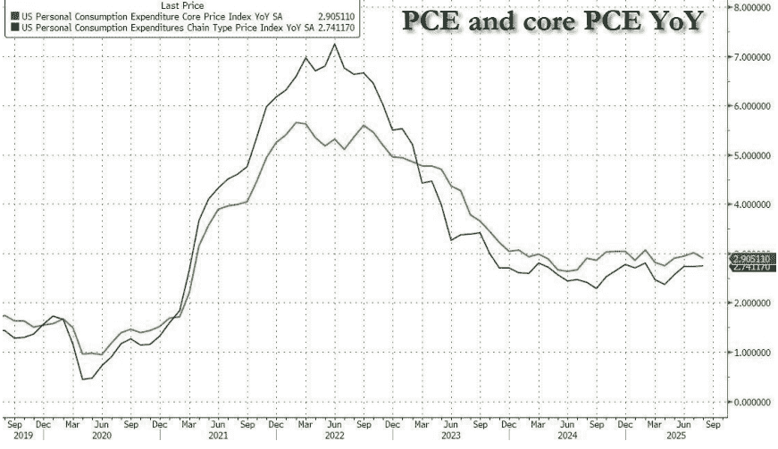
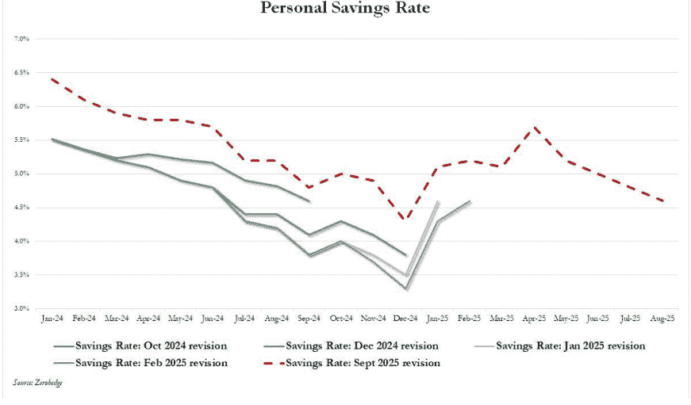

## Target Rate Probabilities for Oct 2025 Fed Meeting
- Trade Date: Current
- Range: 5.25%-5.50%
- Probability: 89.73%
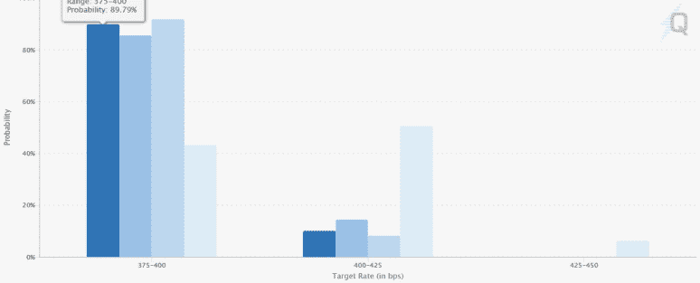

# Jason Ng
2025-09-27 03:43
bloomberg：南非企业养老金增长40%，发展显示，南非退休后收入替代率预计为16%

## 其他国家
- 南非金融监管机构未能将员工缴纳进入退休基金，这种违规已变得频繁。
- 在截至2025年9月内，欠缴总额飙升40%，达到72.9亿美元，影响52,000名员工。
- FSCA专家Unathi Kamlana表示，如果从工资中扣除但未投入资金，则构成了对法律和标准的严重侵害。
- 南非金融监管机构未能将员工缴纳进入退休基金，这种违规行为已变得频繁。
- 金融部门为监管发布的一份报告显示，在截至2025年9月内，欠缴总额飙升40%，达到72.9亿美元。
- FSCA专家Unathi Kamlana在新闻会上表示，“非常希望在未来18-24个月内，随着《金融监管修正法案》的颁布，情况将发生变化。”
- 在期间，未能支付超额缴纳的实体数量翻番，达到15万，影响52,000名员工。

## 中国
bloomberg：中国在扩大债券回购市场，允许符合条件的境外投资者在中国境内进行回购。新的适用于包括外国央行、财富基金和管理人在内的各类投资者。此举旨在将人民币定位为全球储备，增加人民币流动性，并增加资产对境外投资者的吸引力。另一个广阔的圈是香港作为债券市场和人民币化的枢纽，为了提高中国债券的吸引力，当局于7月推出了债券回购服务，允许部分全球投资者使用债券作为流动性的抵押品。香港市场在7月加强了计划，允许人民币以外的货币结算。

## Global Investors Chinese Bond Holdings
- Institutions' holdings of onshore yuan bonds
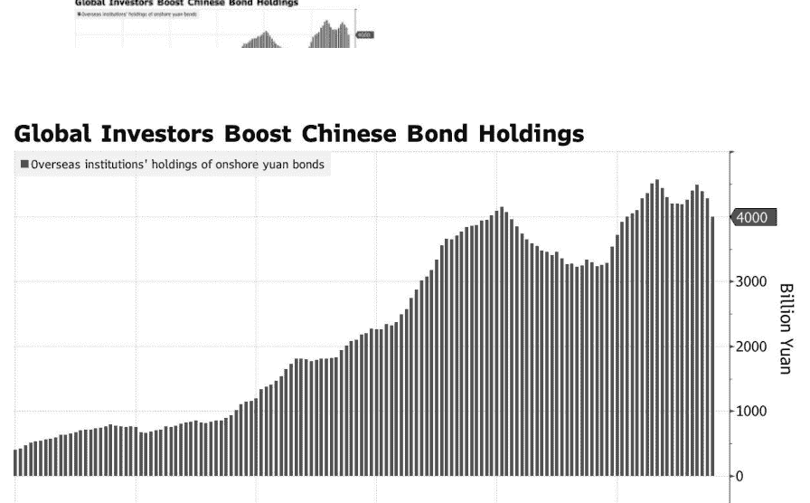

| 2014 | 2015 | 2016 | 2017 | 2018 | 2019 | 2020 | 2021 | 2022 | 2023 | 2024 | 2025 |
| :--- | --- | --- | --- | --- | --- | --- | --- | --- | --- | --- | --- |
| Bloomberg |

# Jason
2025-09-27 04:01
国盈：泡沫需求下降33%。我国房价收入比约为10倍。2024年房产去化周期为24个月左右，我国库存去化周期更是9.3个月的历史低位，房地产市场压力依然巨大。我国住房市场仍面临严峻挑战，除去20%左右的城镇，我国人均住房面积只有33万平方米，仍有一定缺口，28个城市平均空置率为12%。投资成本较高，我国租金回报约为2%，处于较低水平。2023年我国房价仅涨2%，与全球范围内租金回报平均约为4%。考虑到国内外房地产，我国的租金回报仍然低廉。目前个人住房贷款利率在3.1%左右，相较于租金比例仍较高水平，仍在进一步下降。财税方面，目前个人住房贷款利息费扣度为每月1000元的上限，有待提升空间。

## 图表18：2000-2040年销售面积与预测
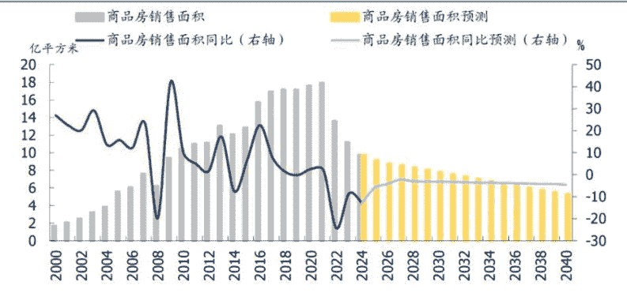 来源：Wind.国盛证券研究所

## 图表7：各国人均居住面积对比（2020年）
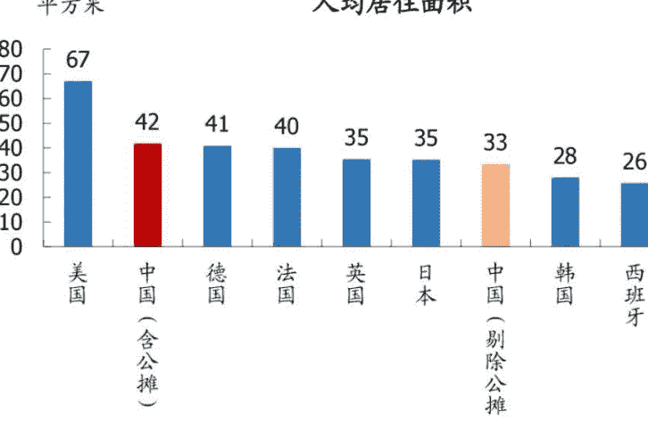 来源：Wind.国盛证券研究所注：此数据为人口普查数据，统计期为10年

## 图表5：地区人均住房相对指标（2022年）
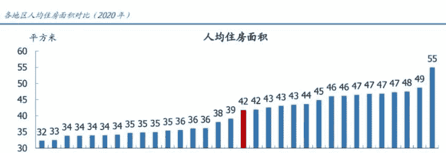 来源：Wind.国证券研究所；数据来源于人口普查数据，统计周期为10年

## 图表9：不同规模城市住房空置率（2022年）
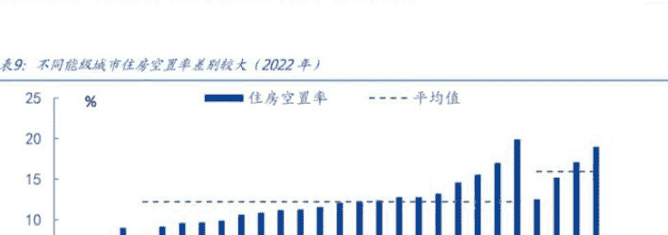 来源：Wind.国证证券研究所

## 图表24：中国房价收入比高于美国
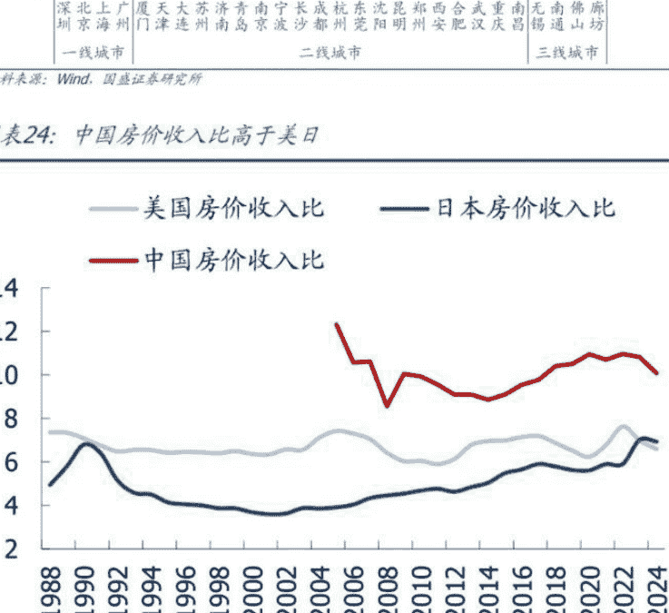 来源：Wind.国证证券研究所

## 表26：我国二手房售比仅有3%
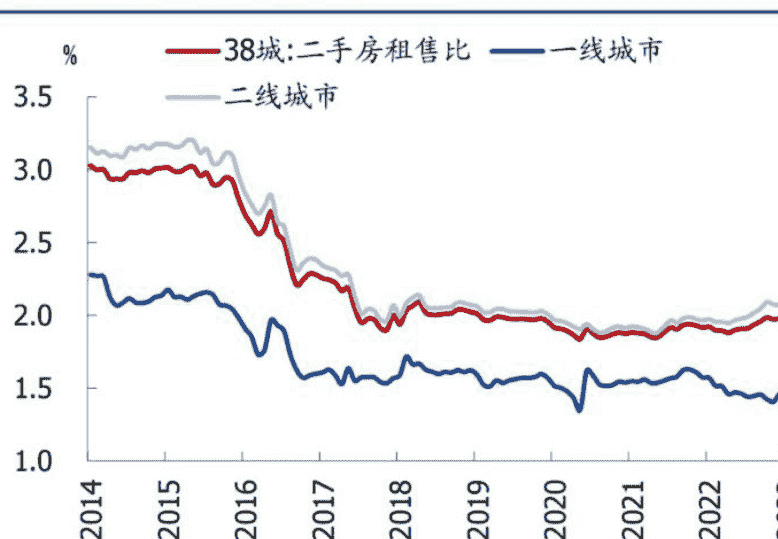 来源：Wind,国盛证券研究所

## 表27：全球重点城市的租金回报明显高于我国（2023年）
| | 租金回报对比 |
| :--- | :--- |
| 北京 | 1.88 |
| 柏林 | 2.95 |
| 悉尼 | 3.3 |
| 巴黎 | 3.48 |
| 伦敦 | 4.52 |
| 上海 | 4.54 |
| 堪培 | 4.92 |
| 金边 | 5.1 |
| 东京 | 5.51 |
| 纽约 | 6.25 |
来源：Wind、国盛证券研究所

## Golden visa applications by nationality
| Nationality | Applications | People |
| :--- | :--- | :--- |
| US | 129 | 386 |
| China | 45 | 152 |
| Hong Kong | 38 | 113 |
| Germany | 23 | 87 |
| Singapore | 17 | 62 |
| Taiwan | 15 | 52 |
| Japan | 7 | 24 |
| Vietnam | 5 | 19 |
| Great Britain | 6 | 16 |

## Active Investor Plus count, as of 31 August
Guardian Source: Migration New Zealand

## 表格：全国核心城市18万以上新房成交情况
| 北京 | 上海 | 成都 | 杭州 |
| :--- | :--- | :--- | :--- |
| 1-8月成交 | 5139 | 9225 | 949 | 1482 |
| 去年同期 | 3456 | 8589 | 627 | 1279 |
| 同比 | +48.7% | +7.4% | +51.4% | +15.9% |
| 1-8月占比 | 21.5% | 29.3% | 1.5% | 5.2% |
| 同比变化 | +5.51百分点 | +4.8% | +0.47% | +1.08% |
数据来源：中指数据CREIS

# Jason
2022-09-27 08:17

募：未来半年配置建议，美国方面，经济与就业出现分化，呈现经济增长，就业从整体来看，对经济宏观科技行业对就业反而构成拖累，科技支撑下的经济韧性并未对未来就业显性。以金融业务与数据处理制造业为主，截至2022年第二季度，科技行业对非就业的贡献率已跌至2.5%，创历史新低。科技投资对GDP的贡献已达到4.5%，科技处于价值回归期，2022年后人工智能技术开始体现在，科技行业对就业的挤压力显著增强，反映出该技术可能具有扩张性的经济影响，或与就业的替代性影响。

根据理论研究，人工智能技术对就业的消极影响并不限于科技行业，可能已经常态。然而，经济与就业之间存在错位，“财政政策“宽松”有助于保持增长，就业与住房的韧性近乎消失。

尽管主权债务的可持续性已成共识，但特朗普前政府可能不会选择在2026年11月之前开展财政政策，“财政扩张”的效果将持续，美联储空间或相对受限，2026年的政策组合可能转向“财政、货币”。基于此情形，我们预计美联储加息终点可能位于3.5%附近，市场预期降约0.5pt；降息周期或于年初结束，市场预期约1年。

展望未来，我们认为当前股市估值处于高位，美联储的宽松货币政策对估值提供支撑，限制估值回落风险，同时盈利维持增长，并随着分析师对估值回归的边界有所拓展。未来股市将继续依赖盈利驱动而非估值扩张，整体上涨胜率较低。策略上，我们对整体估值持积极态度，并在均衡上加强配置，避免过度集中于高估值股票。

美元维持震荡行情，波动区间在95-103之间。欧元独立性因素减弱，更多被美元推弱走势。

预计黄金将维持强势。策略上，建议投资者采取配置，或者通过小规模进行配置，避免大跌的节奏极低。国内方面，经济经历持续下行压力，经济运行依然稳健，6月多项宏观数据显示低于市场，下半年国内经济增长中枢不变，上半年GDP增速从3.2%降至4.7%，下半年增速可能维持于4%左右，受通胀或外部环境影响。

国内政策将维持“宽松”环境，价格上，商品价格、或产量可能下降10基点。数量上，年内国内资金仍维持宽松，利率有望有所上行。

预计第四季度市场供需错将出现，短期震荡处于宽松的市场中枢，长期震荡需额外调整，利率面临上行压力。

对于需要灵活流动性的投资者，可继续持有现金产品，增加稳健性，短期基金或基金；从长期来看，现金类产品在下行周期中优，更多现金类资产或在1%至3%。对于稳健型投资者，预计年国债收益率在4.5%后开始配置价值，可以尝试介入。对于有一定风险承受能力的投资者，届时可以选择期两年以上的中长期债券基金。

A股大盘行情处于上行的底部。一方面，波动性持续增强，国内利率环境下资产的需求与海外避险情绪形成合力，资金将持续向权益类资产寻求收益；另一方面，政策层面将维护国内市场，有利政府有能力维持“稳健”和活跃市场，“软陆”市场有望向好态势，我们预计第四季度A股估值底部支撑尚不足，但行情尚无风险。

从估值来看，当前上证指数分值处于10年来的分位，市率分位56%，股盈率分位53%，估值虽处于低位，程度合理，是部分板块已处于隐含估值低区间。此外，计算机指数指标市盈率180%，市率5.7%，处于过近10年90%的分位，近期科技股可能面临较大的回调压力。

历史经验显示，1997年以来股市从底部回到正常区间的时间不少于2年。本轮行情最低出现在去年2月，参考历史规律，行情或持续到2026年春节节后，行情结束于此。此外，我们还将关注三个核心指标：一是政策后监管是否宽松，二是美元环境是否好转；三是基本面政策是否维持。此外，技术指标在趋势初期价值尚，但在行情未加速时价值可提升。

整体而言，当前股市趋势已经形成，若无触险引发的事件发生，行情震荡调整后将继续，行情的核心驱动力是流动性资金。

金融

加微信top28688，免费获取资料

## 投资策略建议书

| 类别 | 配置建议 (未来6个月) | 配置化 | 配置变化 |
| :--- | :--- | :--- | :--- |
| 资金 | 现金存款 | | |
| 收益 | |配 | | |
| 回收 | |配 | | |
| 主动型 | |配 | | |
| 多元化 | |配 | | |
| 黄金 | |配 | | |
| 市场型 | |配 | | |
| 另类 | |配 | | |

银行资金利率在期内整体走低，基金产品收益将相对平稳。从长期来看，基金产品收益可能处于下降趋势中。
市场波动加大，流动性活跃，长期来看建议将权重加大。根据数据显示，10个月年化收益有望在1.8%以上，可以适当增加投入，对于有一定风险承受能力的投资者，可以选择与风险相匹配的中长期增长基金。
国内权益相对均衡，持有债股共振，“配置”策略的价值凸显。可选跨市场持有海外收益的基金，建议投资者密切跟踪配置变化。
配置性策略具有短期行动力，但注意结构性风险，建议关注高增长，成长为核心，红为蓝筹，科技为未来配置。
国内市场波动，今年波动较大，受外围影响。
随着美联储结束加息，流动性有望宽松，建议投资者继续持有。
8月以来，小型指数平均收益年内由.8%至5.3%，小型市值表现整体，小于小型指数，规模基金持续跑优，建议增加市值配置。此类品种受到资金支撑，黄金等品种将需要适时调整，会有回调筑底，趋势震荡运行，要求在回调中寻找机会，短期内形成强势趋势，流动性有望释放，利好短期均衡。

### 大类资产配置

| 大类资产 | 配置 (未来6个月) | 配置变化 |
| :--- | :--- | :--- | :--- |
| 汇率 | 美元 | 欧元 | 日元 | 人民币 | 中债 | 配置配 |
| | | | |
| | | | |
| | | | |
| 权益 | 中国债 | 境外债 | 可债 | 美股 | A级 | 只 | 价值 | 一类成长 | 港股-科技 | 美股 | 纳斯达克 | 配置强配 |
| | | | |
| | | | |
| | | | |
| | | | |
| 黄金 | | | |

加微信top28688，免费进资料

### 图3：科技对经济的影响显著差异
### 美国行业对就业的贡献-科技就业/非农就业/名义GDP
img/c69c1e58151f088bd6078edaca7_15_0.png
资料来源：Macrobond，招商银行

### 图13：美股企业盈利与经济增速
### 美股企业盈利与经济增速
img/c69c1e58151f088bd6078edaca7_15_1.png
资料来源：Wind，Factset，招商银行

加微信公众号top28688，免费进资料

### 图17：货币政策分化对美元产生压力
### 美元指数vs美德0Y利差（右轴）—美元指数
img/c69c1e58151f088bd6078edaca7_16_0.png
资料来源：Macrobond，招商银行

### 图33：本轮行情和2014-2015年“水牛”延续
### 水牛三要素：利率下降+经济延续+宏观大事
img/c69c1e58151f088bd6078edaca7_16_1.png
资料来源：Wind，招商银行

加微信公众号top28688，免费进资料

# 图34:上证估值中性偏高未泡沫
### 上证估值:PE、PB与股息率倒数者加权
img/c69c1e58151f088bd6078edaca7_17_0.png
资料来源：Wind，招商银行

# 图35:历轮牛市的时间点基本于2年

| | 上证综指 | | 深证综指 | | |
|---|---|---|---|---|---|
| | 起点 | 终 | 上涨月数 | 起点 | 终 | 上涨月数 |
| 第一轮 | 1999-05 | 2001-06 | 25 | 1999-05 | 2001-05 | 24 |
| 第2轮 | 2005-06 | 2007-10 | 28 | 2005-07 | 2008-01 | 30 |
| 第3轮 | 2008-10 | 2009-08 | 10 | 2008-11 | 2010-11 | 24 |
| 第4轮 | 2013-06 | 2015-06 | 24 | 2012-12 | 2015-06 | 30 |
| 第5轮 | 2016-01 | 2018-01 | 24 | - | - | - |
| 第6轮 | 2019-01 | 2021-02 | 25 | 2018-10 | 2021-12 | 39 |

资料来源:Wind，招商银行

加微信公众号top28688，免费进资料

### 图39：美元趋势优于股市新兴市场
### 美元指数与全球资金流
img/c69c1e58151f088bd6078edaca7_18.png
资料来源：Wind，招商银行

然而：2025年中房企的现金净较初期减少了9.49%，房企的加权平均净债率（永续债）为108.71%，相较于初期增加了4.8个点。房企压力增大。

| 财务指标 | 2021年 | 2022年 | 2023年 | 2024年 | 2025H | 期内变动 |
|---|---|---|---|---|---|
| 现金（亿元） | 22832 | 17735 | 14563 | 13111 | 11867 | -9.49% |
| 总债（亿元） | 55675 | 55862 | 53828 | 52313 | 51816 | -9.5% |
| 净负债率（永续债） | 67.06% | 82.10% | 91.53% | 103.84% | 108.71% | +4.8个点 |
| 调整后现金负债率 | 0.94 | 0.65 | 0.48 | 0.41 | 0.37 | -0.04 |
| 短期负债率 | 2.02 | 1.68 | 1.46 | 1.24 | 1.20 | -0.03 |
| 摊销后负债率 | 70.82% | 71.18% | 72.31% | 73.91% | 73.91% | |
| 融资成本 | 5.77% | 5.60% | 5.28% | 4.58% | 3.92% | -1.61个点 |

远期房企整体财务指标
1）2025年中房企经营效率有所提高，融资成本。
2）调整后现金负债率（/负债-预款）（/资产-预款）。针对对外披露的资金能力，计算公式为（货币资金-现金管理-融资余额）/期末负债；其他房企的计算公式为（货币资金-现金管理）/负债。

加微信25888，进资料数据来源：地产中心

### 图：样本企业年度现金持有量及变动（亿元）
img/c69c1e58151f088bd6078edaca7_19.png
数据来源：企业业绩报告，CRIC

### 图：样本企业历年负债率情况
img/c69c1e58151f088bd6078edaca7_19.png
数据来源：企业业绩报告，CRIC

2025-09-27 08:24
8月的数据显示，泰国不再是中国游客出游的首选，韩国、越南后来上，赴日从2024年持续增长至如今经济数据：日本、韩国、越南的中国游客规模超过泰国。来源：财新。

# 日本、韩国、越南的中国游客规模超过泰国。来源：财新。加微信号top26888，免费进资料

# 日本、韩国、越南的中国游客数量超过泰国
越南、新加坡、泰国截至8月；韩国、澳大利亚、印度尼西亚截至7月；其余国家截至6月
120万人
img/c69c1e58151f088bd6078edaca7_20.png
数据来源：各国旅游部中国游客入境人数

2025-09-27 08:30
8月日以来，国内金价增速加速，主因美联储降预期升温、财政扩张下的宽松与通胀需求，以及投机性资金向黄金转换速度运行。预计年内金价将回升或升至4200美元/盎司。年内金价高点或达到3900美元/盎司。为了测算长期情形、黄金价格的变动趋势，本部分设定两种情形进行预测。第一种情形是若国家持续持黄金，其金储增长将引发全球水平，推动黄金溢升。第二种情形可能更为极端，若美元维持强势延续，导致美元化走势不变，美元资产配置将大崩塌，黄金作为避险资产的需求得到强化，对黄金价格将带来显著影响。测算结果显示，两种情形下金价可能将跌至2000美元/盎司。目前黄金储备大部分分布在发达经济体中。据整理信息显示，截至2025年二季度，美国的黄金储备量超过8000吨，领先全球，排名前前的国家多为发达经济体。到目前，按当时的黄金储备的黄金储备占比约为36.4%，新兴市场的黄金储备仅为14.8%，增持空间巨大，“金融

# 微信信号top28688
# 微信信号top23888
添加微信 免费进群 新手微

### 图 明年中金价预测
img/c69c1e58151f088bd6078edaca7_21_0.png

图 美国黄金期货价格趋势

| 1970-1980 | 1981-2000 | 2001-2012 | 2013-2018 | 2019- |
|---|---|---|---|---|
| 黄金与美元挂钩 | 全球投资转向黄金，通胀的“大通胀” | 91事件后，金价跌后反弹 | 美国经济衰退，美元走弱，金价持续走高 | 美联储加息，金价压力 |
| 随着利率下跌，金价开始反弹 | 黄金受通胀预期影响，利率上升 | 避险需求驱动，金价创新高 | 欧元走高，美元走强，金价回落 |
| 黄金进入2008年后新位 | 2008年金融危机，金价暴跌 | | | |
| | | | | |
| | | | | |
| | | | | |
| | | | | |
| 71 | 80 | 83 | 86 | 92 | 95 | 01 | 04 | 07 | 10 | 13 | 16 | 19 | 22 |

图 美国美元期货指数
img/c69c1e58151f088bd6078edaca

| 全球黄金储备量(吨) | 全球黄金储备占总储备比(%) | 新兴市场新增黄金储备 |
|---|---|---|
| 黄金与美元挂钩，黄金上涨 | 市场转型，消费需求回暖 | 100 |
| 1980年代以前，黄金下跌 | 1997年亚洲金融危机，黄金暴跌 | 91事件后，避险需求增加 90 |
| 2008年金融危机 | 2022年，通胀、利率加息 | 80 |
| 2007年，美债暴跌 | 70 |
| 2010年，量化宽松 | 60 |
| 2012年，QE | 50 |
| | | 40 |
| | | 30 |
| | | 20 |
| 50 | 55 | 64 | 77 | 88 | 89 | 94 | 97 | 04 | 10 | 17 | 24 |

资料来源：Wind，招商银行

### 周期情形下金价预测

| 情形 | 方法 | 长期金价 |
|---|---|---|
| 央行大规模购金 | 中国央行进行购金，使黄金占比由15%上升到36% | 回归分析+历史情形 | 1美元/盎司 |
| 美元资产占比下降 | 美元资产被抛售，资产占比由58%下降 | 回归分析+历史情形 | 1.5美元/盎司 |
| | | |
| | | |

img/c69c1e58151f088bd6078edaca7_22.png

# 日经：北京市朝区二手房价格一年上涨33.5%，8月的平均挂牌售价达到70万元（约合人民币86万元）。上月上涨2%，野村认为，“目前日经处于最高点，股市表现良好，股价上涨导致二手房屋的高价层正在被价格挤压。刚需购买第一套房子或转卖为目的的情况较多，支撑上涨的是房屋短缺的迹象。由于新房的供应减少，替代需求转向二手房。北京3区的二手房价格均也出新高。每70平方米的价格为17.21万元（约合人民币53.87万元），7月上涨2.3%。连续16个月环比涨价。

## 京都6区二手房价格内上涨33.5%
img/c69c1e58151f088bd6078edaca7_23_0.png
(数据来源)东京KANTEI

2023-09-27 08:40
盛松成接受21世纪采访 #金融

加微公众号top28688，免费进资料

# 《21世纪：以史为鉴，可以预知》。我们能从日本历史中借鉴哪些经验教训？

盛极一时，中国与上世纪八十年代的日本相似，经历了经济快速增长、房地产泡沫、人口老龄化等问题，这些当时也在日本推动企业“出去”。日本的发展为中国提供了三个方面的启示：一是要保持经济基本面，防范通胀引发的资产泡沫；二是要要素产业重心风险化，避免产业链过度转移；三是财政协同，防止陷入流动危机。在处理日美关系时，中国与上世纪八十年代的日本很大不同，我们中国不会像日本那样遭遇崩溃，也不会经历汇率剧烈贬值。美景近期经历回升，人民币汇率长期处于高位。但我们认为，人民币汇率在中长期增长是有利的，这有利于我们“出口”和提高竞争力，表现出市场均衡、增强汇率竞争良性的特征。

产业化有利于发展中国家，如日本将国内成本转化为国家转型，日本产业结构出现良好。日本历史上的转型是成功的，尤其是出口的规模扩大了其神话，但也导致了再产业化。上世纪80年代初，日本经济虽然辉煌，但由于在1980年至1985年间，日本对美国...

## 中国居民需要更多金融投资

《21世纪》：当前中国储蓄向投资转换面临多重约束，房地产之外的“蓄水池”在哪里？你认为在哪些领域中可以更好地满足理财管理需求？

临松：房地产是投资的重要工具。随着房地产市场调整，单一的“蓄水池”已难以承担储蓄功能。我认为，“蓄水池”应该具备财富效率的核心特征。现在，中国居民需要更多的金融投资，尤其是那些能够创造现金流的优质项目将最具吸引力。此外，优质资产需要与科技和高质量发展适配，新的基建、普惠金融、新型城镇化等，与国家大战略恰好方向一致。

为进一步满足居民理财需求，应加快REIT的发行。2024年已募发REIT量为29只，今年已发行16只，较去年同期有所增长。其中，新基建REIT发行热闹，8月以来发行重心中心，整体占比较高。新基建项目募价值较高，有必要加快审批流程，符合条件的优质资产应尽快上市。在消费方面，目前居民主要集中于购物和农市场、养老、教育、文体等服务设施较少。其可能可以通过购买服务权益来满足“消费”，固定资产占比较低，难以通过增值来增强现金流预测能力。因此，可探索服务类REIT的容量和收益率挂钩工具，以增强消费预期，支持其增长。

《21世纪》：美国90年后进入低利率，中国未来也将出现类似？在“低利率”时代，中国居民消费行为将面临何变化？

临松：低利率时代的资产配置或面临三大变化：

第一，储蓄资金流入居民领域持续增长。从增量转型的结构变化来看，居民储蓄趋势日益明显。中国央行数据显示，8月份居民存款增加11000亿元，多比6000亿元（增长1.7倍），多比去年（7800亿元）且非储蓄资金增加1.8万亿元，多比5500亿元（增长2.14倍），多比去年1.39倍）。这表明大量资金正在加速向资金市场转型。

第二，风险回避有助于改善资产配置结构。历史经验显示，低利率时期不仅限制居民的储蓄意愿，居民理财的压力日益增大。随着利率下行，风险收益回升，权益和多元资产成为配置主流。以保险为例，保险作为长期的财务工具，在保持其收益方面方面具有优势。未来中国居民的资产配置结构有望转向从存款、债券投资、贵金属等转向收益获取以增强确定性收益的转型。

第三，基金下如何调整资产配置模式。面对利率下降和监管的双重压力，业务需要向头部转型，基金下已调整九日。8月，证监会已公布证券基金费用管理规定（征求意见），募型基金的申购、销售费均调整至0.8%，有利于降低成本、合规市场秩序。以住管理基金往往过去往返收益模式、服务费，或通过直接投资与直调策略。未来基金公司将不再以“重视回报”转向

## 《21世纪：在全球面临危机之初，金锚崛起，这是周期现象还是长期趋势？未来黄金在投资组合中扮演什么角色？》

盛朝成：黄金定价因素复杂，但黄金已成为长期趋势，由地缘政治和美联储等共同推动。

从地缘政治来看，每当国家冲突加剧全球资源的紧缺，形成通胀压力，金通通上涨。例如，20世纪70年代的中东冲突引发石油禁运，导致黄金油价飙升；2022年俄乌冲突爆发导致全球黄金价格大幅上涨，期间黄金价格涨幅较大。但美联储确定性有所反复，区域冲突持续不断。

从美联储措辞来看，美元常处于长期强势，同时黄金维持货币保护作用。另一方面，新兴国家发展实力，美国优势以及其本土的强势将导致需求激增，美元大量流入美国。另一方面，美国成为净借入国，美元必须通过套利方式回流美国。无可避免，美元的发行量创造了美国赤字，美国政府总债务占GDP的比重已超过120%，而在20世纪70年代时为35%左右。相应地，目前黄金价格已升至3700美元以上，较近布鲁森森体系时后期立场回倒。

随着美国重启加息，持有黄金的成本下降，同时美债增强的可能性，或对黄金价格形成支撑。但从中长期来看，美国政策重心在于推动“制造回流”，中国加大对科技发展的投入，全产业投资机会不断增加，黄金作为战略防御性资产，机构规模配置的可能不大。

Jason-不翰
2025-09-27 08:50

bloomberg: 自特朗普签署H-18签证命令的命令以来，MSCI指数在过去五个交易日内均下跌，股市遭遇避险。Gavekal Research认为印度资产价格的表现仍疑似继续下去。#其他美国经济形势另外，欧委员会委员计将在未来几周内对中国钢铁及相关产品征25%至50%的关税。

## 加公众号sign28688，免费获取资料群

## India Trails Broad Asia Stock Gauge by Most Since 1995

## Foreigners Set for Longest Streak Since 2023

Jason不妥
2025-09-27

## 《鲍灵悖论》：科技进步，中层萎缩
作为世界上最大的发展家，中国面临着贫富差距、人口龄化、环境压力等严峻挑战。然而，科技进步为解决这些问题提供了机遇。正如凯恩斯在《技术性》中所指，技术进步虽然能够提高率，但也导致劳动力市场的变化。当代，这种矛盾尤为突出。我们需要思考如何通过技术来缓解结构性失业，实现可持续的发展。正如彼得·德鲁在《创新者》中所述，创新是企业的核心动力。

## 加公众号top28688，免费获取资料

在1980年的美国，大学毕业生的平均收入比那些没读大学的人高出46%。2012年，这一比例已经到了56%，相比之前高了10个百分点。出意料的是，虽然大学入学人数大幅增长，但大学文凭的价值缩水，这种现象并不是美国特有的，其他发达国家也出现了类似的情况。大多数父母已经意识到了这一点，不顾一切将自己的孩子送到大学。

1980年，18%的年轻人拥有大学学位；2010年代，这一比例已经增长至39%；2019年，这一比例已经增长至39%，相比之前高了21百分点。出意料的是，虽然大学入学人数出现了增长，但大学学费却反弹。虽然被称为“迷你明星”，这种现象可能并不连续。

既然如此，为什么学费的程度在不断增加？20世纪80年代初期，哈佛大学的李·卡茨（Larry Katz）与芝加哥大学的墨菲（Kevin Murphy）提出了一个简单但很有力的解释：在经济学中，这一理论被认为是“技能导向型的变革”。为了顺利完成，企业还需要技工人（包括大学毕业生），又不需要技工人，这两个群体是无法互换的。想要经营一家快餐店，经理经营肯定不行，我们还需要人来做肉肠、做汉堡。经理可以替他干一会儿，但者中可以替代的也就多了，所以对于公司来说，技人和技工人缺不可。然而，由于现代企业的生产方式和最终产品与十年前相比已经很大变化，企业对于工的需求相同。经济主体模式已经从低技术劳动为核心的制造业，转向高技术、受过教育的劳动力为核心的知识型、服务型经济。与其他大学相比，加微信top28688免费获取资料

需要说明的是，即便在受过大学教育的群体之内，或是在没接受教育的群体之内，收入水平存在显著差异，有些人虽然没接受教育，但收入比大学毕业生还要多。群体中的巨大差异来自运气或个人能力等教育难以影响的因素。刚瑞拥有许多大学学位，她的收入甚至比高中毕业生还要低。

如大学可以让学生获得很多知识，但并非所有知识都能转化为市场的重视。那些未被大学录取的劳动力可能拥有更高的生产，二者之间或许存在巨大差异。如果所有贫困都源于教育，绝非如此。

比尔·盖茨与马克·肯洛格等都没读过大学。虽然高级技术，收入不平等的加剧在很大程度上是因为企业将收入差距扩散到了企业外，包括此外。有证据表明，企业内部的人员之所以越来越专业化，是因为他们受到了科技进步的推动。在信息通信、机器制造等新兴科技行业当中，为了提高技术水平，企业往往会雇用更多的技能人才、提供更高的工资。对于那些没采取新科技的企业，只能不断地用更多的低技术投入来。

贸易的自由与全球化会导致企业之间收入不平等的现象加剧，以及企业内部劳动力分程度增加。在分析全球对劳动力市场的影响时，研究人员发现，职业的重新分配决定了借助于自由化与全球化使得股东风险显的关键因素。这也从一个角度来说，在运输成本与通信成本大幅下降的情况下，技术进步必然促进经济的全球化。

另外，外包模式也会涉及市场问题。当·斯密的市场规律理论表明，只有在市场对接待的需求足够的时候，那些外包公司会在利润的激励下下场，专门经营和接待相关的业务，利用自己的专业化优势创造收益。既然所有的接待，加微信signtop28688免费获取资料

生活成本比之前高出一截。不管是买房还是租房，按单价来算，前者的住房成本都要比后者高。研究人员发现，住房支出与家庭收入之间存在明显规律：住房支出占前总收入的1/4，或后总收入的1/3。这种规律与居住地点无关。由此可见，相比，大学人的收入要高出1%，住房支出也高出1%。通胀会被抵消一部分，或许会有很多人搬到小小的公寓里。

每份工作的持续时间增长了，意味着大家工作的概率下降了。道理很简单，工作持续时间与跳槽概率是相反：如果每个月换工作的概率是10%，那么平均工作的持续时间就是10个月；如果每个月换工作的概率提高到20%，那么平均工作的持续时间就会减少到5个月。相关数据也证实了这一点：在每份工作持续时间上升的同时，就业人口工作的概率也从20世纪90年代中期的3.8%下降到了今天的2.9%。

工作岗位的两极化还有最后一块碎片。最终的结果就是工作岗位的两极化，高薪工作与低薪工作变多了，只有中等收入工作变少。换句话说，中产阶级人数逐渐减少。研究表明，工作岗位的两极化是信息技术与全球化的表现形式。正如我们看到的，全球化相比，信息技术对工作岗位的影响很大。最近针对同国家，市场需求更加大，需要更高学历的劳动力，而其中等学历劳动力的需求逐渐减少。

了解这些之后，我们再回头看家里发生的事。记得之前的大学生变化，大学毕业生变成了所说的“明星”。没错，工作岗位的两极化本质上也是劳动力供给的变化。随着劳动力的供给发生了一些调整，劳动力接受的种类和培训数量都发生了变化，由此积累的工作经验也不多了。另一方面，科技进步会导致从事程序的人越来越多，进而导致工作岗位的两极化。这一给受过大学数据报告显示完全相反：平均来说，现在每份工作的持续时间比十年前延长了。具体来说，现在每份工作平均持续4.2年，而在20世纪90年代初，每份工作的持续时间只有3.2年。

## 2025年展望

## 观点与策略

这种空间割裂之下，某些地区会逐渐贫困化，收入水准和社会地位的不平等程度会愈演愈烈。由于低收入者和高收入人数增加过多，美国首次出现这种明显的。不平等程度已经接近了第一次世界大战之前的水平，由于这种积累，不满情绪正在迅速蔓延，只有采取异常严厉的措施，才有希望扭转局面。

搬迁社区时，上一代居民几乎处于积累水平的顶层，而现在，这些老居民已经没有办法在这里住去了。房税一路通涨，他们的收入和养老金却怎么也没有变。更重要的是，对于乔和贝蒂这样的家庭来说，他们的日子已无法应付各种费用，不得不搬到其他昂贵的社区居住。

农场经济枯竭了，年轻一代无法离开农场去其他工作，但老一代只能留在那里，他们的收入常常低得不可思。20世纪中叶，农场这种经济模式逐渐消失的时候，很多人都不忍留念以前多么美好的农场时代，并慨叹好生活就变成了一座座工厂给毁掉了。就像以前一样，现在的人们又开始怀念起工厂时代了。虽然科技变革会导致经济结构出现变化，但对不同年龄的人来说，这种变化的速度却大不一。

本书的核心观点在于，科技创新会自发将财富聚集到少数人手中。比例采用新科技的企业可以迅速占据整个市场，并利用技术优势不断巩固自己的地位，限制竞争对手的进步。正如开头所言，“奥尔苏姆说竞争的问题在于，只有少数人可以获得最终的胜利。”我们需要强力的机构、相对独立的监管体系去保护市场竞争。很多人都是有这种理解：由于自由市场自然地形成市场竞争的。这其实只对了一半，虽然大多数人由于自由市场的转得很快，但新科技问世时市场会失去，巨大财富会聚集在少数手中。只有“资本主义”能让市场健康发展，保证经济收益传到身上，让每一个参与经济活动的人都能享到足够的好处。

现在很多人把“利益相关者主义”（stakeholder capitalism）和企业责任当作市场麻烦的妄妄辞语。不得承认，如果真的是员工福利，愿意尽可能提高员工的生活质量，那些在买方选择的企业是有能力做到这一点的，德国的“人才代表制”就是一个很好的例子。而且通常，提高员工待遇可以提高生产力，这也符合股东利益。

我认为，当今社会需要的并不是“利益相关者资本主义”，而是更强大、更独立的竞争机构。这些机构的任务不是保护竞争对手，也不是保护商业运转，而是竞争本身。它们应当努力遏制市场支配力，把权力交给市场。尽管大多数情况下，即便监管市场可以正常运转，但一旦市场失效，如果不设监管，这时独立于政府而存在的、“亲竞争”机构就可以发挥它们应有的作用，保证市场的健康发展。

市场和机构双管齐下，共同社会的正常发展：一方面，我要企业可以在市场中积极竞争；另一方面，监管机构要及时矫那些不利竞争的行为，保证竞争的公平性。我们既不能阻止企业逐利，也不能在经济景气时用大量资源拯救破产的企业。竞争管理机构就只“看得的手”、“看不见的手”，可以确保这种正常运转，让企业追求自身利益最大化的同时，也能衔接整个社会的利益达到最大化。

Jason 不
2025-09-27 13:18

推荐了，请查看附件《论文或书籍推荐》
《鲍灵悖论》薛-霍克斯特，

自那以后，政府们就开始对群体分发纸币来换取商品和服务，随之下降，并意外发现了政府控铸币的好处——制造纸币所带来的铸币税。此外，铸币也会损害纸币持有者的利益，因随着时间的推移会出现通货膨胀，他们手中的纸币的购买力会随着下降。通货膨胀一直都是很好用的经济工具，在债务过多时（比如在战争期间），通货膨胀可以在不提高劳动收入率的情况下稀释部分债务。不过这种处处是暂时的，长此以往，通货膨胀恶性地螺旋上升，因为只有政府支出才能维持不变，但很多政府都干预了类似的事情。所以说，尽管通货膨胀可以方便政府开支提供资金，但大多数国家都认为，只有低的、可预测的通货膨胀才能保证经济健康发展，才能保证企业和家庭有一个安全的投资环境。为了做到一点，最好的办法就是成立一个绝对独立的中央银行。

近年来，中央银行的经济学家们正面临更多新闻题，其中最不可思的问题就是过低的通货膨胀。没错。

## 创业神话

股市的繁荣证明了企业巨头的盈利能力，也掩盖了其他公司的悲惨状况。之前我们提到过，在有一半以上的企业加价指数比20世纪80年代还要低，只有那些最顶尖的企业才能掌控市场大到无以复加的市场支配力。由于股市会放大了许多企业巨头的成功，我们不能因为股市持续走高就得出了所有企业都在欣欣向荣的结论（包括私募公司）。市场支配力不仅会给工作岗位和没有股票的家庭带来负面影响，也会损害很多中小型企业的利益。当前经济环境可不是“杀市场的”，在现在我们发现，它甚至不是“杀企业的”，因为大多数的企业的日子都过得格外艰难，尤其是那些小型企业。由此可见，当前经济实际正处于一种“杀巨头的”的环境中。

事实上，大部分人都认为当前时代是一个注重科技创新的时代，创业迎来了前所未有的春天。在过去的三十年里，我们见证了许多科技创业公司的飞速成长，谷歌、亚马逊和脸书等巨头几乎在眨眼间成长为世界上最大的公司。除了这些巨头之外，还有一部分规模较小、不太出名的创业公司也取得了巨大成功，但失败者很多。

Deaton 表示，自20世纪90年代末期开始，45~54岁的美国白人的死亡率开始上升趋势，而其他群体的死亡率却一直在下降。无论是在男性中还是女性中，无论是在高学历人士中还是在低学历人士中，中年人的死亡率都在上升，而低学历者的死亡率上升趋势尤为明显。更令人困惑的是，这完全是美国特有的现象，因为其他国家这一群体的死亡率都在下降。

我们就会发现，在20世纪末期，这一年龄段的美国白人刚好是婴儿潮一代；而在今天，这一年龄段的人恰好是婴儿潮一代的孩子。

安妮·凯伊斯与安格斯·迪顿的研究表明，美国中年白人死亡率上升的主要原因是药物中毒、慢性肝病以及自杀。虽然死亡并不新鲜，但其严重程度足以扭转死亡率下降的大趋势，这就值得人们深思了。安妮·凯伊斯与安格斯·迪顿表示，经济因素或许可以解释这一现象，因为这一一代人成年以后，社会不平等程度刚好开始加速，他们是第一批生活质量不及父母那一代。

## 知识星球TOP 资源分享群
添加微信免费入群
微信:top28688

| 序号 | 公号/星球/社群 | 原价 | 领域 |
| :--- | :--- | :--- | :--- |
| 1 | 生财有木 | 2765/年 | 副业，搞钱 |
| 2 | 怂宗怂吃瓜群 | 365/年 | 时政，历史 |
| 3 | 记忆Legacy/碧树西风 | 365/年 | 成长、... |
| 4 | 欧洲金轨 | | |
