# 南半球聊财经250929

Jason不离
2025-09-29 03:13

##华金：2010年以来中国股市趋势及影响因素一览#A股

加微信进资料群

| 年份 | 上证指数(%) | 沪深指数(%) | 中证500(%) | 创业板指(%) | 全市成交额(%) | 沪深成交额(%) | 创业板成交额(%) | 净流入(亿元) | 净流入占成交(%) | 备注 |
|---|---|---|---|---|---|---|---|---|---|---|
| 2010 | 2.19 | 8.43 | 51.7~53.8 | 58.6~56.3 | 1.49 | 2.35 | | 63.6~25.5 | | 对美股调整后回上 |
| 2011 | 3.43 | -3.06 | 50.9~51.2 | 52.8~53.2 | 1.76 | | -53.00 | 97.7~75.7 | | 资金持续好 |
| 2012 | 3.03 | 0.90 | 49.2~49.8 | 51.1~51.2 | 1.29 | | | 89.9~76.8 | | 美国Q3危机启动 |
| 2013 | -0.78 | 2.90 | 51.1~51.1 | 56.3~56.6 | -1.28 | | 17.60 | 87.1~89.3 | | 东方财经发布会指出“以来最长上涨、资金流入的行情结束了” |
| 2014 | 3.24 | -0.19 | 51.1~51.1 | 59.6~59.6 | -1.90 | 2.13 | -6.90 | 68.3~73.5 | | 沪转基金发行费比例下降 |
| 2015 | -4.17 | 6.88 | 49.7~49.8 | 51.1~50.2 | 3.85 | | 34.60 | 47.9~52.6 | | 财新财经和央行报道“市场活跃度回升人民币、A股净流入量创历史高” |
| 2016 | -1.24 | 1.97 | 50.4~50.4 | 49.4~49.5 | 0.37 | 2.38 | 100 | 63.4~64.7 | | 监管层对小市值进行实施“三去”机制缓解风险的调整 |
| 2017 | -0.26 | 1.24 | 51.7~52.8 | 58.8~60.8 | 1.65 | 3.29 | -63.60 | 86.4~92.7 | | 政策出后市场表现的调整 |
| 2018 | 3.31 | -7.60 | 51.3~53.8 | 59.8~61.3 | -0.04 | -4.28 | | 76.6~59.1 | | 年初、中股市调整 |
| 2019 | -3.37 | 3.53 | 49.2~49.8 | 49.1~47.8 | 1.63 | -1.64 | -6.50 | 29.7~21.9 | | 美国：第三轮贸易战升级、中国监管委员会报告 |
| 2020 | 1.72 | 3.55 | 51.1~51.5 | 56.5~56.4 | 1.88 | 2.40 | | 71.5~44.6 | | 央行工作会议、中共工作会议：坚持稳健货币政策，保持流动性合理 |
| 2021 | -1.06 | -0.28 | 49.6~49.9 | 55.1 | 2.69 | 0.51 | -13.70 | 84.8~37.7 | | 年初，随着美联储加息预期、美元资产走强，新兴市场面临外流压力 |
| 2022 | -2.72 | 1.57 | 49.4~50.1 | 52.8~52.9 | 1.99 | | -38.40 | 41.5~13.5 | | 一年以来最差，由于国际基金发布公告，受外部环境变化、汽车行业受影响 |
| 2023 | 0.06 | -0.72 | 49.7~50.2 | 47.6~49.9 | -0.30 | -1.82 | 5.00 | 42.9~30.1 | | 复升A行情：由于美联储持续加息，国内内外部投资者活跃性继续受抑 |
| 2024 | 21.91 | -1.56 | 49.9~49.8 | 47.2~47.2 | -0.89 | 9.30 | -34.30 | 28.6~23.4 | |

加微信top28688，进资资料群

## 图 7：节后短期内资金多流入

| 年份 | 外资净流入（亿元） | 融资净流入（亿元） | 新成立基金份额（亿） |
|---|---|---|---|
| 2015 | 39.18 | 508.20 | 0 |
| 2016 | 8.09 | 210.40 | 33.64 |
| 2017 | 138.79 | 239.50 | 14.20 |
| 2018 | -169.68 | -220.80 | 10.97 |
| 2019 | 60.91 | 135.07 | 74.69 |
| 2020 | 228.89 | 393.05 | 612.03 |
| 2021 | -37.63 | 90.92 | 90.43 |
| 2022 | -62.52 | 3.74 | 38.27 |
| 2023 | -131.44 | 260.33 | 15.92 |
| 2024 | | 1473.51 | 6.52 |

资料来源：基金证券，wind（统计国庆假期结束后5个交易日流入数据）

## 图 10：近十年跌期间，美股涨幅前行业，以及A股后5个交易日涨幅前行业

| A股 2015 | A股 2016 | A股 2017 | A股 2018 | A股 2019 |
|---|---|---|---|---|
| 电子 | 建筑材料 | 零售 | 传媒 | 银行 |
| 建筑材料 | 食品 | 消费 | 房地产 | 建筑材料 |
| 医药 | 证券 | 医药 | 光伏 | 传媒 |
| 金信 | 房地产 | 钢铁 | 工厂 | 机械 |
| 传媒 | 汽车 | 金融 | 电子 | 银行 |
| A股 2020 | A股 2021 | A股 2022 | A股 2023 | A股 2024 |
|---|---|---|---|---|
| 公用事业 | 传媒 | 证券 | 电子 | 传媒 |
| 医药 | 金融 | 汽车 | 医药 | 银行 |
| 机械 | 工厂 | 建筑材料 | 计算机 | 电子 |
| 金融 | 传媒 | 金融 | 计算机 | 国家 |
| 传媒 | 汽车 | 公用事业 | 金融 | 建筑材料 |

资料来源：华泰研究所，wind

加微信top28688，进阶群

## 图11：十年国庆期间，港股涨幅前行业，以及A股后5个交易日涨幅前行业

| 港股 | A股 | A股 | A股 | A股 | A股 | A股 | A股 |
|---|---|---|---|---|---|---|---|
| 行业排名 | 2015 | 2016 | 2017 | 2018 | 2019 | | |
| 1 | 新能源 | 电力设备 | 能源 | 建筑装修 | 信息科技 | 美护护理 | 电缆 | 原材料 | 医疗保健 |
| 2 | 原材料 | 计算机 | 必需消费 | 建筑装修 | 综合 | 原材料 | 银行 | 房地产 | 建筑材料 |
| 3 | 必需消费 | 有色金属 | 环保 | 金融 | 环保 | 必需消费 | 航州 | 工业 | 必需消费 | 房地产 |
| 4 | 金融 | 工业 | 国企 | 医药 | 生物 | 汽车 | 房地产 | 必需消费 | 航州 |
| 5 | 信息科技 | 航州指数 | 通信 | 原材料 | 美护护理 | 家电 | 必需消费 | 航州 |
| 行业排名 | 2020 | 2021 | 2022 | 2023 | 2024 | | | |
| 1 | 信息科技 | 景瑞 | 社会服务 | 必需消费 | 医药 | 生物 | 电子 | 信息科技 | 电子 |
| 2 | 工业 | 电力设备 | 信息科技 | 美护护理 | 能源 | 电力设备 | 证券 | 汽车 | 房地产 | 计算机 |
| 3 | 医疗保健 | 景瑞 | 金融 | 汽车 | 原材料 | 航州 | 电缆 | 医药 | 医疗保健 | 银行 |
| 4 | 原材料 | 基础材料 | 食品消费 | 必需消费 | 建筑装修 | 计算机 | 能源 | 国企 |
| 5 | 金融 | 华润 | 行业 | 信息科技 | 机械 | 公事业 | 通信 | 建筑装修 |

数据来源：华泰基金研究所，

Jason-connor
2025-09-29 03:20

中国：近期，Shibor 3M持续偏紧，保证金利率条件数据密集，指向流动性持续收缩，但预计3个月后会有缓解；广发指数持续低位，指向四季度环境持续紧凑。信用债持续向上，信用条件自低位调整，由此前的震荡+股市+信用压力过高导致股市+信用压力波动，我国政策导致收益继续维持，配置有望有所保障，对于未来1-3个月的收益与投资场所乐观。

整体来看，流动性与节奏需达成均衡，建议关注大宗商品整体走暖，在外部不确定性增强的情况下，下中行情有望继续运行。国内配置资产配置模型对下一阶段国内资产的配置建议为：积极配置：股票、债权、原油、黄金分别为 50%、25%、8.3%、16.7%；稳健配置建议为：股票、债权、原油、黄金分别为 15%、85%、0%、0%。

根据我们的全球资产配置模型显示，2025年第一期A股之外全球股票市场的配置比例为：美国(15.21%)、德国(0.85%)、英国(0.00%)、日本(0.85%)、越南(13.52%)、印度(14.37%)、香港(1.69%)左右40%按比例配置无风险产品。加微信top28688，资料共享

## 图1：指标提示活动持续宽松

## 图2：指标提示环境持续改善

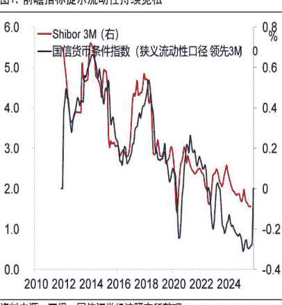
来源：万得、国信证券研究所

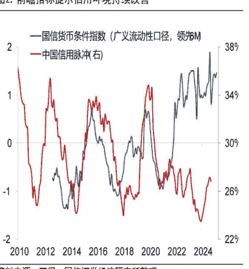
来源：万得、国信证券研究所

## 图3：四类“货币+信用”组合类资产表现一览（权重）

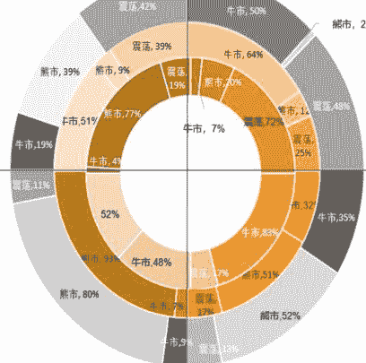
资料来源：万得、国信证券研究所微信top28688，进阶分享

##亚太配置策略

流动性释放与政策利好带动，A股整体向好，多头维持上涨，重心上移。避险情绪受通胀预期等因素修复。目前市场进入底部阶段，短期内政策预期带来反弹，维持震荡。流动性压力下维持震荡，港股有望回暖。

| 指标 | 8周涨幅 | 9周涨幅 | 周波动 |
|---|---|---|---|
| 上证指数 | 3857.9 | 3828.1 | -0.77 |
| 恒生指数 | 12696.2 | 13029.0 | 4.04 |
| 创业板指数 | 2890.1 | 3151.5 | 9.0 |
| 上证50 | 2971.5 | 2941.0 | -1.19 |
| 沪深200 | 4496.8 | 4550.0 | 1.19 |

| 指标 | 8周涨幅 | 9周涨幅 | 周波动 |
|---|---|---|---|
| 中证债 | 7043.9 | 7249.0 | 2.8 |
| 中证500 | 248.7 | 247.6 | -0.45 |
| 中证100 | 202.6 | 202.1 | -0.8 |
| 上证A指 | 229.3 | 223.5 | 0.74 |
| 10年债 | 1.9 | 1.7 | -16.5 |
| 10年债 | 1.84 | 1.73 | -11.8 |

外汇市场强势，人民币汇率出现反弹。受避险情绪影响，美元汇率走强。相对来看，亚洲货币走弱，人民币对美元走弱，但日元、韩元表现走强。因此，人民币汇率有望进一步回升。近期内政策预期影响，人民币汇率或维持反弹。9月韩国股市强势，日本股市疲软。受全球避险情绪影响，日元汇率走强。相对来看，亚洲货币走弱，人民币对美元走弱，但日元、韩元表现走强。近期人民币率值得关注。

| 指标 | 8周涨幅 | 9周涨幅 | 周波动 |
|---|---|---|---|
| 人民币 | 1.4 | 1.5 | 0.4 |
| 美元指数 | 97.8 | 98.5 | 0.61 |
| 日元 | 7.12 | 7.13 | 0.2 |
| 美元(人民币) | 7.12 | 7.15 | 0.32 |

| 指标 | 8周涨幅 | 9周涨幅 | 周波动 |
|---|---|---|---|
| 南美债 | 67.5 | 68.8 | 1.9 |
| 上证债 | 485.2 | 491.0 | 1.2 |
| 韩国债 | 3429.2 | 3730.0 | 8.6 |
| 上债 | 785.1 | 856.6 | 9.0 |

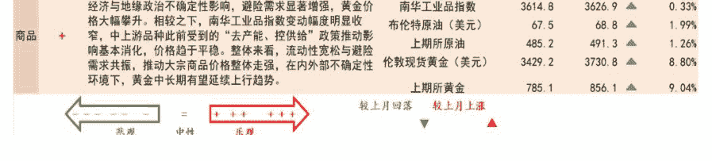

## 图5：亚太配置列表

- 中国
- 日本
- 印度
- 美国
- 韩国
- 越南
- 泰国
- 中国
- 印度
- 德国
- 英国
- 俄罗斯
- 法国
- 德国
- 美国
- 法国
- 德国
- 美国
- 印度
- 法国
- 德国

加微信206886，获取资源分析

## 图6:国内资产配置报告

| 资产类型 | 配置建议 | 相比上期 | 稳健配置建议 | 相比上期 | 风险偏价 |
|---|---|---|---|---|---|
| 股票 | 50.0 | (2.67) | 15.0 | (0.34) | 3.8 |
| 债券 | 25.0 | (6.87) | | (0.58) | 86 |
| 原油 | 8.3 | (5.38) | | 0.0 | | 2.7 |
| 黄金 | 16.7 | | | 0.0 | | 7.6 |

资料来源：万得，国信证券

## 图14:国内配置月变动

| | 国债 | 风险资金 | 信用债 | 金融 | 可持债券 | 消费 | 万能基金 | 国际 | 长债 |
|---|---|---|---|---|---|---|---|---|---|
| 2025-04 | (1.48) | (1.30) | (5.38) | (0.11) | (0.55) | (-1.30) | (1.20) | (-3.50) | (-4.00) | (-4.18) | (-6.06) |
| 2025-05 | (4.35) | (2.92) | (2.46) | (2.39) | (1.76) | (1.26) | (0.34) | (0.11) | (0.14) | (-2.40) |
| 2025-06 | (8.32) | (6.89) | (4.74) | (5.38) | (3.33) | (2.95) | (0.58) | (0.31) | (-1.11) | (-1.67) |
| 2025-07 | (6.19) | (5.30) | (4.75) | (4.57) | (3.80) | (2.19) | (1.53) | (0.0) | (0.10) | (-0.21) |
| 2025-08 | (16.47) | (10.93) | (9.18) | (6.25) | (3.58) | (1.37) | (0.07) | (-0.92) | (-0.55) | (-0.62) |
| 2025-09 | (4.00) | (2.24) | (2.50) | (2.40) | (2.01) | (1.15) | (0.63) | (0.63) | (-2.47) | |

资料来源：万得，国信证券研究所；注：每周一更新，从右至左按资产类别，当月回撤跌幅

## 图15:海外资产月变动

| | 欧洲债 | 亚洲债 | 美国国债 | 黄金 | 美股指数 | 金融基金 | 货币基金 | 衍生商品 | 大宗商品 |
|---|---|---|---|---|---|---|---|---|---|
| 2025-04 | (4.82) | (5.23) | (3.95) | (0.00) | (-0.84) | (-1.22) | (-0.51) | (-1.48) | (0.68) | (-5.04) |
| 2025-05 | (5.15) | (5.70) | (5.40) | (5.33) | (2.86) | (1.49) | (-0.20) | (-0.85) | (-0.74) | |
| 2025-06 | (2.25) | (5.50) | (5.83) | (5.25) | (2.10) | (0.10) | (-1.67) | (1.25) | | |
| 2025-07 | (3.25) | (3.15) | (5.06) | (2.09) | (1.97) | (0.84) | (0.53) | (0.35) | | |
| 2025-08 | (2.25) | (3.95) | (3.65) | (5.00) | (5.10) | (1.17) | (0.10) | (-0.10) | | |
| 2025-09 | (6.40) | (3.65) | (2.50) | (2.40) | (2.01) | (1.15) | (0.63) | (0.63) | (-2.47) | |

资料来源：万得，国信证券研究所；每周一更新，从右至左按资产类别，当月回撤跌幅

# 加微信:top28688 更多资料分享

盛世：在现代金融时代，黄金、ETF（交易型开放基金）等金融工具的创新，黄金作为金融资产的流动性和可交易性显著增强，成为金融资产保护者、保值的首选。从供需关系来看，黄金的需求在市场波动中，增长受限。据统计，场外交易后的黄金需求从2021年的4026吨增长到2024年的4068吨。这种供应失衡的状况进一步推高了黄金价格，占资产配置中的重要地位。

从历史和市场来看，美元指数与黄金价格往往呈现反向变动的趋势。通过对数十年黄金数据的回归分析可以发现，美元指数与黄金价格的反向相关性为突出。从长期趋势来看，黄金价格已步入下行通道，且这种走势已经显露底部。截至今年8月，美元指数约为98，相较于108.6的高点跌幅近10%；而黄金价格则经历了23.9%的显著上涨。目前，全球黄金需求持续回升，包括美国和中国在国内。在低利率环境下，传统避险资产的属性使得黄金成为保值资产，赋予了具有避险属性的黄金，从而引发金价上涨的行情。

黄金的历史价值难以估量，具有独立于任何国家的信用，不受任何货币实物影响，为金融领域带来不可替代的稳定，它是资产配置的“硬资产”。我们认为，黄金的未来走向取决于三大核心因素：政治局势的变化以及美国债问题的解决路径。

##黄金供需平衡

| 项目 | 2021Y | 2022Y | 2023Y | 2024Y | 项目 | 2021Y | 2022Y | 2023Y | 2024Y |
|---|---|---|---|---|---|---|---|---|
| 金矿 | 2247 | 2228 | 2206 | 2112 | 矿产量 | 3573 | 3638 | 3647 | 3673 |
| 黄金消费 | 2048 | 2088 | 2011 | 1878 | 矿产需 | -5 | -7 | 69 | -55 |
| 科技领域 | 337 | 315 | 305 | 326 | 黄金库存 | 1136 | 1136 | 1234 | 1369 |
| 电子行业 | 279 | 258 | 249 | 271 | | | | | |
| 其他行业 | 47 | 47 | 47 | 47 | | | | | |
| 牙科 | 11 | 10 | 9 | 9 | | | | | |
| 投资需求 | 991 | 1113 | 946 | 1182 | | | | | |
| 金条和金币 | 1180 | 1222 | 1190 | 1188 | | | | | |
| 黄金ETF | -189 | -110 | -244 | -7 | | | | | |
| 央行购金 | 450 | 1080 | 1051 | 1086 | | | | | |
| 黄金需求 | 4026 | 4736 | 4508 | 4066 | | | | | |

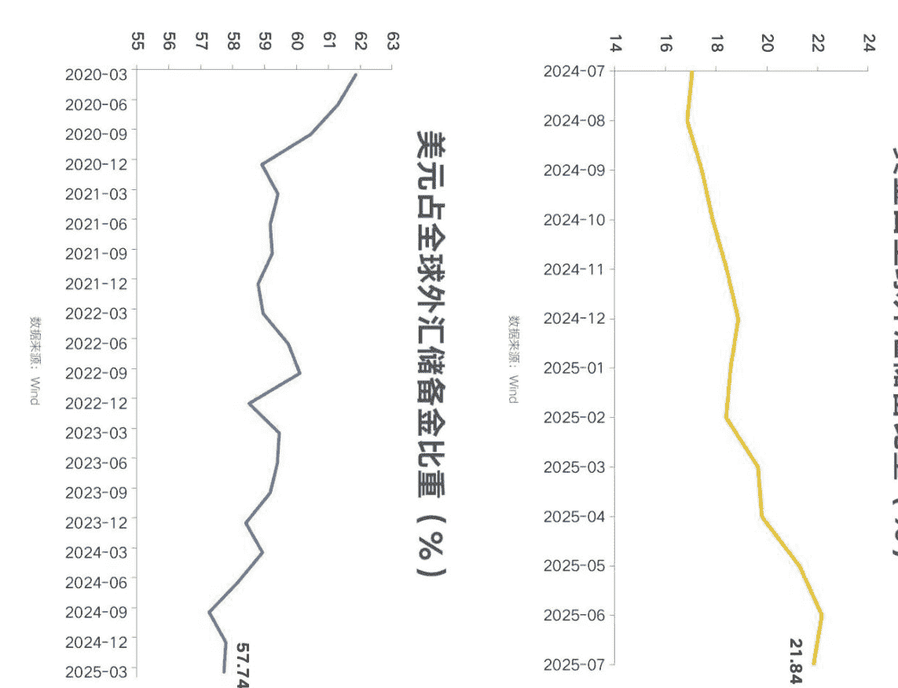

加微信top288688，进资料分享群 *微信

西部：过去3年美联储加息周期，中美政策加剧，导致过去3年美债利率明显高于中债。

这种贬值定价导致人们人民币长期贬值预期，导致通胀“套息差汇聚”，导致了大量的资本外流。

出中国：中美的银行储出低息人民币的货币贷款—将美元兑成人民币—并用这些美元进行投资—贷款到期后将投资基金资金汇回国内，这样可以赚取美利汇率收益。美联储加息周期，中美政策利率倒挂引发通胀压力，中美利差挂紧导致收益收缩，人民币汇升压力，将带来“套息差交易”汇聚，导致资本回流国内。

资本外流的量还有很多，我预计央行银行的常年净流约为96亿元。

1) 中国银行净流中，数据显示跨境流入约96亿元，这可能就是企业的利润未结。
2) 中国银行净流，累计流出10万亿元，可能部分是“套息差汇聚”驱动的。

只要明年人民币升值到7.0，我就可以做一个非常不简单的计算：
(1) 如果当前我们持有71.13美元人民币，按0.68%的年利率，按0.5%的年期CIOR利率，我们明年能够得到72.5元人民币。
(2) 如果明年人民币升值到7.0，就能得到72.8元人民币（小赢）；如果我们明年人民币升值到7.6，就能得到7.4元；如果人民币升值到6.8，就能得到72.8元人民币（大赢）。

当明年人民币升值到7.6，这反向导致了明年人民币“套息差交易”汇聚。

当明年人民币升值到7.0，这将结束过去3年的“套息差交易”。

通过过去经历投资外流，股市处于调整期：政策期→缩股期→投资期→套利期。现在投资可能一切转向消费期。资金回流国内，将系统性修复各类要素价格（包括依次科技投入—出口消费—消费）。公募基金加MTs的持仓已经超过30%，达到了较为险的位置，市场风格即将切换。行业配置建议——

- (1) 底部配置迎来全球回暖的“运筹+硬科技”（黄金/资源/保险/国产资产）
- (2) 四季重视加中国的优质制造业（电力设备/化工/机械）
- (3) 中长期布局“火热转换”的大众消费

# A股 微信pep45

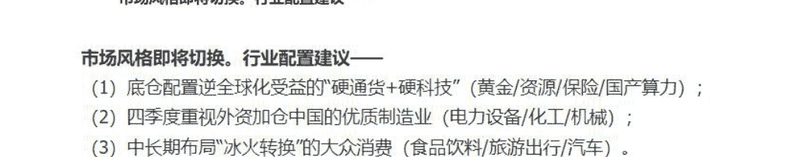

微信信28688，进资料免费共享

图 3：近3年美债加息周期，人民币与“美元套利”的获利流向

# 《中国银行:人民币套利》《外汇市场:美元套利》《国际市场:投机》

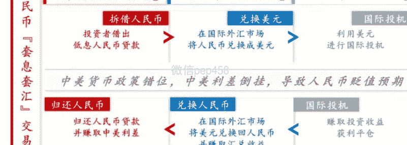

中美央行政策转向，中美利差倒窄，人民币贬值预期

图 4：2020年以来，中国经常项目账户净流回约 6 万亿美元

图 5：2020年以来，中国金融账户净流出约 10 万亿美元

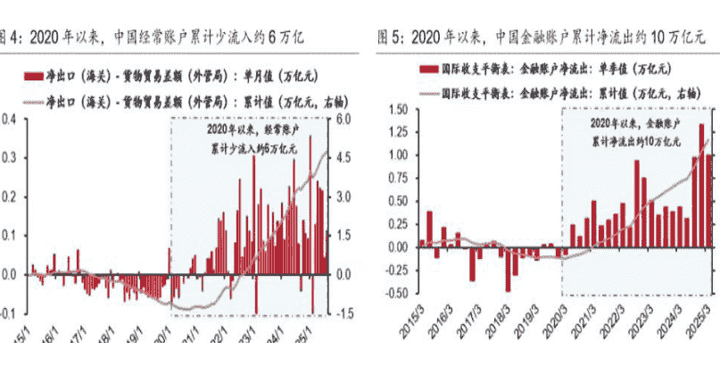

图 7：中美政策加息周期，加剧中国的“出口·通缩”循环

微信top28688，进资料分享群

# 图 9: 人民币升值带来套利交易交易反转

| 现在 | 1年后 | 结果 |
| :--- | :--- | :--- |
| 持有 7.13元人民币 | 1年后人民币利率 SHIBOR 1.68% | 7.25元人民币 |
| 期权汇率 | 1年后汇率 7.0 | 7.28 人民 0.03美元 |
| 持有 1美元 | 1年后美元利率 CIBOR 4.05% | 1.04 美元 |
| | 1年后汇率 6.8 | 7.08 人民 0.17美元 |

资料来源: Wind, 西部证券泰研究中心

西部：近期美股为代表的风险资产和以黄金为主的避险资产同步上涨，历史上往往对应美股的筑底阶段。除了周期性因素外，市场对有关的征收、联储的独立性、汇率的安全性等问题，都指向对本轮美元的调整将是结构性且深远的。# 金融

图 3：决定美元汇值的要素，本轮都包括：

| 相似 | 全面加税 | 货币通缩周期 | 联储宽松 | 货币利好 | 联储降息周期 |
| :--- | :--- | :--- | :--- | :--- | :--- |
| 历史事件 | 全面加税 | 1971 | 停止美元兑换 | 寻找美元贬值 | 1985-2001 |

微信top28688，进资料分享群

# Jason 2025-09-29

广发：资产定价逐步反映2024年名义增长率为3.1%，低于同期。预计年内加通修正，至9月名义复合增速6.3%，优于同期名义增速同比4.4%）。回归模型显示9月最后增速偏离，8月统计调整后，三季度实际预计为4.7%。# 图 2：GDP月度指数

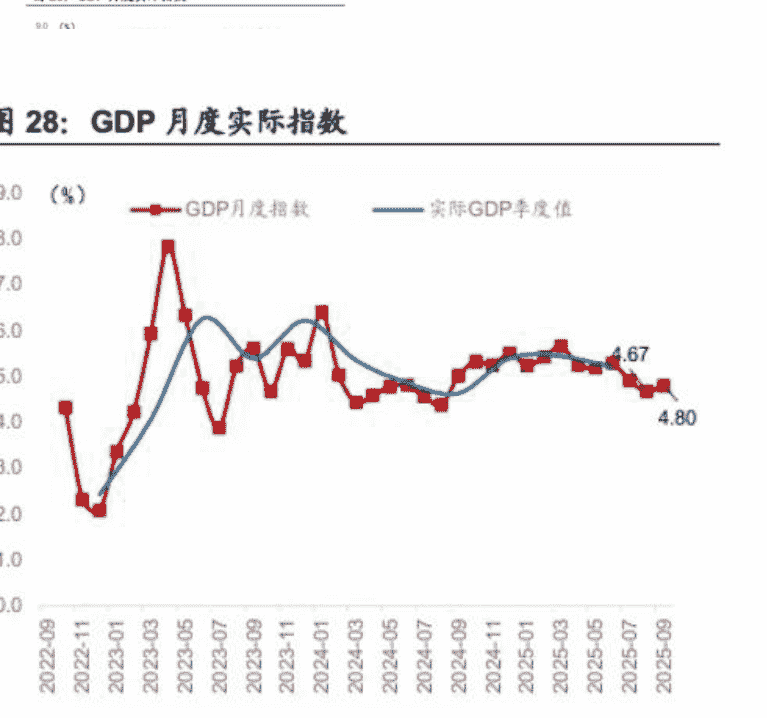

数据来源：Wind，广发证券研究中心

# Jason 2025-09-29

西部：按照全年预算，12月后名义赤字7.2亿元空间，比去年同期实际额有1.5亿元缺口。但是财政政策更加灵活，第四季度仍有调整准线的可能。

微信top28688，资料分享群

# 图 13：年内财政收支

| | 2024 | | 2025 | | |
| :--- | :--- | :--- | :--- | :--- | :--- |
| | 1-8月 | 9-12月 | 全计 | 1-8月 | 9-12月 |
| 一般收入预算 | 亿元 | 147,776 | 71,926 | 219,702 | 148,198 | 62,602 | 322 | 219,850 | 71,652 |
| 同比 | | | | 0.3 | | | -0.4 |
| 政府基金 | 亿元 | 26,821 | 35,269 | 62,090 | 24,649 | -549 | 62,499 | 36,050 |
| 同比 | | | | -1.4 | | | 2.2 |
| 合计 | 亿元 | 174,597 | 107,195 | 281,792 | 174,647 | -226 | 282,349 | 107,702 |
| 同比 | | | | | | | 0.2 | 0.5 |
| 财政支出 | | | | | | | |
| 一般支出预算 | 亿元 | 173,898 | 110,714 | 284,612 | 179,324 | -2,145 | 297,005 | 117,681 |
| 同比 | | | | 3.1 | | | 6.3 |
| 政府基金 | 亿元 | 48,171 | 53,103 | 101,478 | | | 30.0 | 3,320 | 122,884 |
| 同比 | | | | | | | 16.8 |
| 合计 | 亿元 | 222,069 | 164,281 | 386,090 | 241,926 | 1,174 | 421,889 | 179,963 |
| 同比 | | | | 8.9 | | | 9.3 | 9.7 |
| 支出收入 | | | | | | | | | |
| 一般收入预算 | 亿元 | 26,122 | 38,788 | 64,910 | 31,126 | | | 77,115 | 46,029 |
| 政府基金 | 亿元 | 21,350 | 38,388 | 59,688 | 36,153 | | | 52,825 | 26,732 |
| 合计 | 亿元 | 47,472 | 76,826 | 104,298 | 67,279 | | 139,540 |

来源：Wind，广发证券

# Jason 2025-09-29

经历了多年的萎缩后，中国家庭自2024年9月以来可能有所改变。在房产资产中占比大，但在总财富中的份额从过去二十年的45%缩减至38%。与此同时，股票和债券资产的份额有所上升，价格带来的收益已经超过了房产资产的损失。看起来自2024年9月以来，家庭财富反弹了0.5%，自2024年3月至2024年8月期间下降了10%。2025年8月，家庭财富数据实现了增长。家庭财富的增加可能会带动消费。这种带动在财富增加后的六个月内逐渐顶峰，然后在接下来的六个月内回落。这说明存在效应，他们倾向于在财富增加后的半年内增加特定消费。四个与家庭财富相关性较高的类别：娱乐（0.53）、酒（0.43）、汽车和通讯设备（0.35）。这四个类别占零售总额的约36%。

# 金融

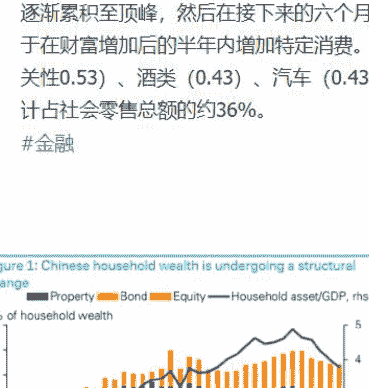
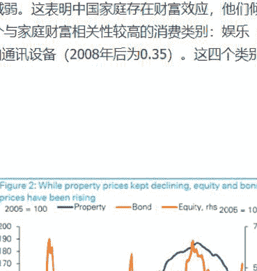
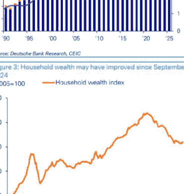
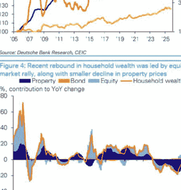

微信top28688，进资料分享群

## 图 7：Alcohol sales have a 0.4 correlation...

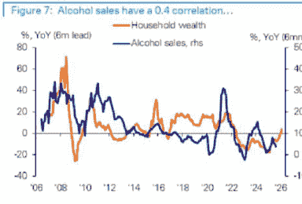

Source: Deutsche Bank Research, Wind

## 图 8：... so as auto sales

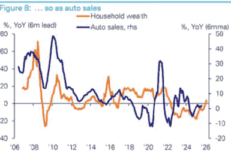

Source: Deutsche Bank Research, Wind

## 图 9：Communication device sales have been highly correlated with wealth since 2000

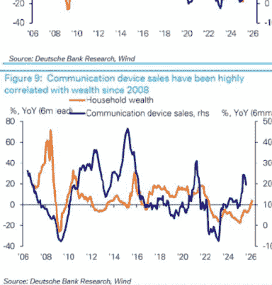

Source: Deutsche Bank Research, Wind

## 图 10：Recreation, communication device, and auto sales are more sensitive to equity prices

- Equity
- Property

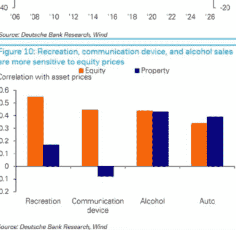

Source: Deutsche Bank Research, Wind

# Jason 2025-09-29

> Bloomberg: 韩国表示我们无法支付3500亿美元的现金给美国，正在协商货币互换。

# 其国家经济

一位韩国高官表示，韩国无选择接受债务违约安排的提议将向美国提供3500亿美元。

微信top28688，进阶资料分享群

一位高级官员表示，韩国无法根据降低关税协议所建议的美国提供3500亿美元现金。

“我们的立场不是一种灵活策略，”国家安全顾问周六晚间在接受A频道新闻电视采访时说。“客观和现实，这不是我们能够处理的水平，”他补充道。“我们无法支付3500亿美元的现金。”

首尔和华盛在7月同意了一项3500亿美元的投资承诺，作为美国关税从25%降至15%的更广泛贸易的一部分，双方在如何构建关税问题上仍存在分歧。

阅读更多：美国和韩国3500亿美元基金问题陷入僵局

韩国官员在寻求贷款和与双边货币互换，以减轻影响，并指出这笔钱项占外汇储备的80%以上。

美国商务部长华·卢特里克暗示告诉韩国官员，华盛更倾向于投资。

# 美国经济节奏

## 图 1：美国国债利息支出增长约7000亿美元

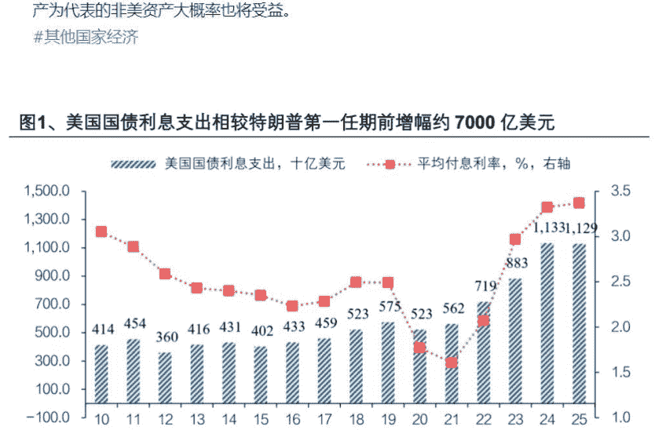

注：上横轴为美国财政年度。2025年截至8月。

数据来源：美国财政部、券证券经济与金融学院

微信top28688，进资料共享

## 表1、美国存量债务及到期滚动情况

| 期限 | 存量, 亿美元 | 未来12个月需滚动的债券规模, 亿美元 | 当时的发行率, % | 当前的国债收益率, % |
| :--- | :--- | :--- | :--- | :--- |
| ≤ 1Y | 63,690 | 63,690 | 4.15 | 3.98 |
| 2Y | 22,026 | 10,726 | 4.58 | 3.61 |
| 3Y | 19,979 | 5,283 | 4.09 | 3.59 |
| 5Y | 39,520 | 8,790 | 0.55 | 3.71 |
| 7Y | 39,435 | 3,874 | 2.38 | 3.90 |
| 10Y | 51,215 | 3,655 | 1.75 | 4.15 |
| 20Y | 12,669 | 324 | - | 4.73 |
| 30Y | 44,148 | 216 | 6.38 | 4.77 |
| 其他 | 1,386 | - | - | - |
| 合计 | 294,068 | 96,559 | - | - |

注 1：数据截至 2025 年 8 月的数据；
注 2：容量规模及未来12个月滚动的规模中，包含Inflation-Protected

## 图 2：历史上联储下降后，市场利率通常不会大幅移动

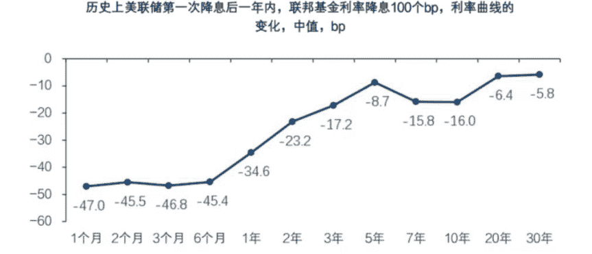

注 1：参考2001年、2002-2003年、2007-2008年、2019年、2024年。
注 2：根据联储首次下降后的1年内利率平均值减去第一次下降之前的差值。

数据来源：Wind，广发证券与金融研究院

微信top28688，进资料群

# Jason不离

2025-09-29 04:14

Charles Hugh Smith: 美国工资占国内总收入的份额，自1970年以来呈流体式变化，累计从劳动力投入转向资本的总额达149万亿美元。#其他国家经济

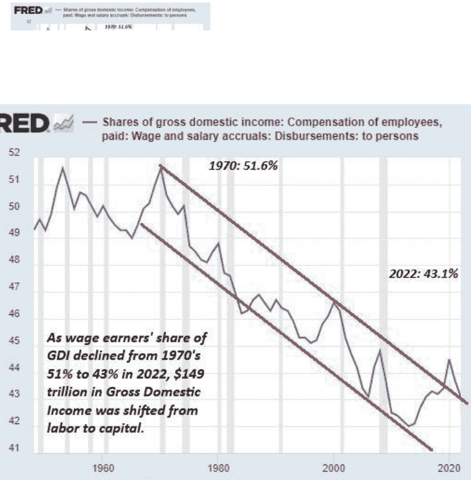

Shares of gross domestic income: Compensation of employees, paid: Wage and salary accruals: Disbursements to persons

| Year | Percentage |
| :--- | :--- |
| 1970 | 51.6% |
| 2022 | 43.1% |

As wage earners' share of GDI declined from 1970's 51% to 43% in 2022, $149 trillion in Gross Domestic Income was shifted from labor to capital.

Source: U.S. Bureau of Economic Analysis

notes added by Charles Hugh Smith wff.oftminds.com May 2024 calculation of $149 trillion derived from FRED data series A4102E1A156NBEA

# 加微信top28688，进阶资料分享群

# Jason-不离

2025-09-24 04:22

欧威尔上表示，美股市估值相当高，似乎是格林斯潘1997年的非理性狂涨的call back，是在互联网破灭前四个出现的。本周末说欧威尔的美股并不希望市场的泡沫继续扩张。从技术上讲，标普500指数周五低至6664，低于近期均衡，但距离50日移动平均线6460和200日平均线6014，从长期来看，回至200日均线将导致近10%。然而，回至4月低点的运行的市场趋势线将损失24%的涨幅。我们现在处于牛市。在2025的大段时间里，市场表现与美国经济趋势一致，标普500指数接近新高，主要受到人工智能相关的巨型科技股推动。然而，当我们预测经济时，情况并没有那么多让投资者忧心的消息。是货币政策，或者政策政策的转向，流动性主动活跃对于市场的流动性至关重要。过去上个月，美股80%的行情已经结束利好，投资者忽视好消息。76%的股票处于增长或反弹。流动性增强，趋势正在改善，投资者转向避险之外，万万美元流动性资金聚在一起，指数基金市场开始配置资本，前十名投资者进场，吸引了大量资金流入。这种增长的循环开始重建，其实很简单，幅度非常直接，这种增长多数股票没有涨，由于少数股票的大幅上涨，指数仍然活跃。

投资者相信美联储会的说法，技术变革将保持充足，增长本身是弱的如果投资者相信这种持续的说法，资本就会流入股市，但如果一个周期发生变化，不利的可能是弱的。#美

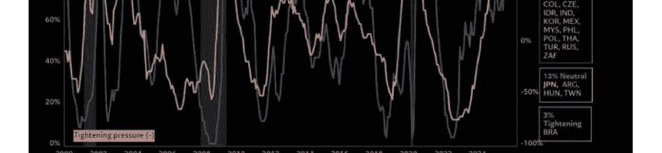

# 加微信top28688，进资料分享群

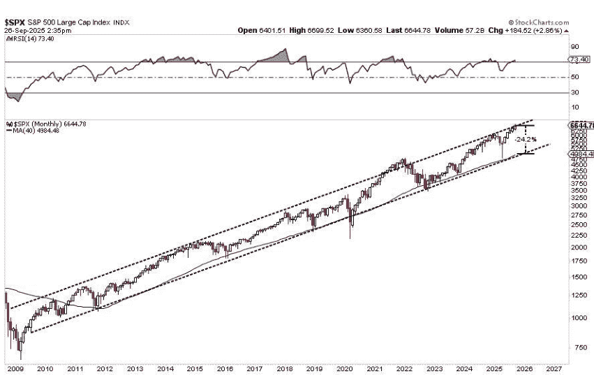

TLK: 标普美国经济意外指数自2月以来首次转为正值。该经济指数是高低有周性的。从历史上来看，当经济指数回升并持正值时，美元往往会走强。与此同时，资产管理公司和杠杆基金的投机性美国美元头寸已达到2021年初以来的最高水平。

## US ECONOMIC SURPRISE INDEX HAS SURGED - WILL USD FOLLOW?

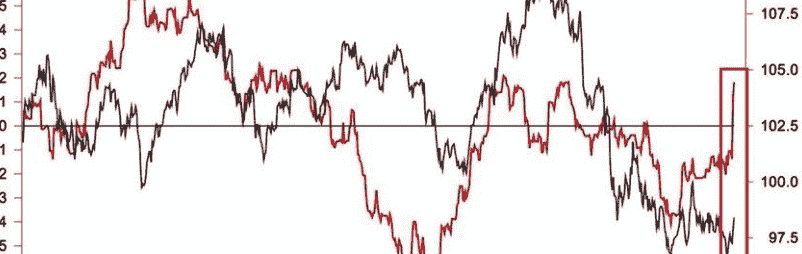

- DOLLAR INDEX SPOT
- Bloomberg ECO US Surprise Index(Left)

Source: Bloomberg, Macrobond and MUFG GMR

### 微信top28688，进资料分享群

# 知识星球TOP

添加微信
资源分享群免费入群

微信:top28688

| 序号 | 公号/星球/社群 | 原价 | 领域 |
| --- | --- | --- | --- |
| 1 | 生财有木 | 2765/年 | 同业，搞钱 |
| 2 | 众宗众吃瓜群 | 365/年 | 时政，历史 |
| 3 | 记忆财富/毅树西风 | 365/年 | 成长，财富 |
| 4 | 欧洲金轨 | 328/年 | 时政，历史 |
| 5 | 卢克文青云会 | 699/年 | 时政，社会 |
| 6 | 体制内主任 | 599/年 | 体制，职场 |
| 7 | 局外人的视角 | 669/年 | 金融，时政 |
| 8 | 溯澎异迁 | 4166/年 | 财富，成长 |
| 9 | 守夜人司令 | 599/年 | 时政，经济 |
| 10 | 江宁知府 | 365/篇 | 时政，国际 |
| 11 | 政堂/顾子明 | 568/年 | 时政，经济 |
| 12 | 唐书 | 1399/年 | 金融，财富 |
| 13 | 大树乡村谈 | 199/年 | 时政，成长 |
| 14 | 水库欧大 | 10000元 | 房产，经济 |
| 15 | 洪灏宏观策略 | 4376/年 | 经济，搞钱 |
| 16 | 金企通鉴/北海南山 | 4576/年 | 股票，行研 |
| 17 | 猫哥的世界 | 299/年 | 时政，社会 |
| 18 | 飞浅龙 | 3600/年 | 股市，经济 |
| 19 | 米联诸见闻 | 599/年 | 经济，金融 |
| 20 | 茶茶财经院 | 330/年 | 房产，股票 |
| 21 | 赢在八小时之外 | 365/年 | 成长，职场 |

...... 更多资源，不再列举

+ 图书、报告、课程等各类高价值资源

- 免费群 每日分享数十份资源
- VIP群 每日分享所有资源（日均20+），75/年
赠送付费资源合集，市场原价数万元
