# 南半球联财经理25093

Jason不诡
2025-09-30 05:41

## CMF: 来税收，三个重要数字值得特别关注。#TAX

从宏观角度来看，人们对未来的预期短期内取决于经济运行的态势，也不取决于税收是否让经济持续下行。税收，实现再分配的关键，在讨论分配时，必须能够落实到居民层面。再分配的完善政府政策取决于直接税收，并在短期内可见的变量。要实现“共同富裕”是可能的。

从长期来看，人们对未来的预期短期内取决于经济运行的态势，也不取决于是否让经济持续下行的方向。在讨论分配的走向时，必须聚焦到居民个人层面，必须视野从收入分配延伸到财富积累。再分配的完善需要政府在短期内可见的变量。要实现“两个观点”即：规范收入分配顺序，防范财富积累机制的意义上进行税收，有三个重要数字值得特别关注：

- 第一，10%，在中国税收收入中，居民以个人身份缴纳的部分不足10%，直接缴税比例明显偏低。
- 第二，0%，在我国税收制度下，财产继承税与赠与税，这在国际上几乎无此有。
- 第三，90%，我国的税收主要是企业承担，而非由企业承担。在涉及分配决策的框架下，企业为法主体，其收入分配决策最终都会交给企业。

因此，需要考虑如何改进和完善再分配，通过收入再分配、费收实现再分配目标。

Jason不诡
2025-09-30 05:49

在大经济高速增长阶段，由于财政增长相对充足，所以对直接税的建设没有足够重视，留出了两个问题：一，税收改革一推再推，错失在经济快速上升时减轻税收的负担；二，个人税的规避使得税人收入覆盖范围狭窄，约占55%。个人税的结构倾向于劳动力市场，因此未能为收入分配做出贡献。这反映了我国改革的局限性。

在经济高速增长时期，财政的财力足够强大。2018年，税收收入占GDP的比重已达到了31%，接近发达国家的平均水平，这种增长的背后却留下了深层次的问题。随着经济增速放缓，税收增长面临结构性压力。2024年，税收收入占GDP的比重持续下降，与全球平均水平存在巨大差异，其中我国的税收比重不到13%，显示出财政财力的不足。

此外，在社会保障的政策性上，由于缴费人Base，缴费比例较低。根据相关规定，要求用于社保平均工资的30%-300%之间，个人与用人共同缴费24%的比例保险费，支出还占社保平均工资的三分之一部分无需缴费。这就导致保障群的比例低于个人收入。这种“制度性差异”确实需要实现收入调节功能，并且与调节目标不匹配。#TAX

加微信2088 进资料群

当前我国财政状况较为困难，当地地方财政面临严峻的财政压力，今年发布的关于社保的司法解释体现税域的困境，这些都是我们讨论财政体制的重要因素之一。

综合分析来看，我国的财政体制目前呈现出如下三个主要特点：

1. 财政收入总量失速。全国一般公共财政预算收入为22万元，相较于2023年增长1.3%，其中税收占比下降3.4%。财政收入减少，依靠财政收入抓总预算收入回正增长，2025年第一季度，地方财政收同比压缩1.2%，创下近年来的新高。此，收入增长不足支持地方财政向债务转型，导致财政负债率升高。这一成为学术界和制定政策的难题。
2. 结构性问题。主要表现为财政依赖收入为主，而财政的比重相对较高。由于收入增长主要依赖非税收入，尤其是土地财政在地方政府财政结构中占据主导地位，当土地财政收增长失速，去年土地出入比下降18.3%，便会导致极大问题。
3. 功能不能以优化收入分配以及提升消费为主。个人在税收体系中所占比较低，且且侧重于劳动，所以对收入分配的调节作用非常有限。此外，增值税是流性的财政体制加剧地方政府约束机制倾向于消费和积累。

Jasonbook
2023-09-29

CAFO：2023年9月29日，改革在发布会上提到，正积极推进规模，本次发出的政策性工具，体现了压力。本次政策性工具在设计上聚焦重大领域，可以用一定资金弥补收支。#TAX

结合当前我国经济运行现状与之前的研究，我们有三点评论：

- 第一，本次改革积极推进政策性工具落地，体现了决策层层增长。近年来，我国曾推出类似政策性工具：
- 一次是2015年推出的专项基金；
- 另一个是2022年推出的开发性工具。
这两次背景其实经济面临明显的需求不足。2025年7月以来，我国经济延续了复苏，但在投资、消费等领域表现出了边际走弱（见CAFO：《2025年8月宏观经济报告》）。在此背景下，改革加强了资金的使用，实现了决策增长。

加微信20868 资料

Jason-不遇
2025-09-30

## 房价与房地产数据

| 城市 | 住宅价格累计跌幅 | 2024年同期跌幅 |
| :--- | :--- | :--- |
| 一线 | 5.08% | 基本持平 |
| 二线 | 3.06% | |
| 三四线 | 5.32% | |

Jason-不遇
2025-09-30

《视》：当前失信被执行人85万。增长趋势：失信被执行人名单十年来首次下降。当年新入失信被执行人名单同比下降。2025年，新入失信被执行人名单增长。9月24日，中国执行信息网显示，当前公布的失信被执行人85万。失信名单制度建立于2013年，为执行促进社会信用体系建设，最高法确立失信执行人名单公开，增强诚信。根据这些规定，未履行法律文书规定的还付义务的人员或单位的，或者有财产隐匿、转移财产等违规情形的，相关规定修改后，被执行人有能力而拒绝履行法律规定的义务的、违反限制消费令的，都会纳入失信执行人名单，限制信用领域。如果失信被执行人是个人，他们会被限制消费，在乘坐交通工具时，不得乘坐飞机、列车等高铁车，不得购买奢侈信用卡，子女不得就读高收费私立学校。他们的行为会被记在诚信档案中，在招标投标、融资信贷、市场等方面受到限制。

加微信306288 资源

个人破产制度帮助负债人破解困境；刘沛军指出，其一，债务人在个人破产的流程中要坚守诚信；其二，负债因破产原因是正常的生活经营所得导致，而不是因为消费、不当处置、利用杠杆等原因；其三，债务人积极面对债务，进入个人破产程序后，经过破产重整和整合，债务人在限期内积极诚信，获得债务部分免除。这是个人破产制度的价值在于，激励负债人积极面对债务困境，对于创业者而言，失之者先行，那么其他债权人也能受益，激励债权人利益最大化。实际上，个人破产并非一些申请人认为的“没用”。2025年，最高法院司法调研组发布的个人破产试点工作报告显示，76%的申请人年龄处于30岁至50岁时期，80%的负债是因为生产经营和生活消费，53%的申请人在100万以下，55%的没有工作和简历。在已受理个人破产案件中，程序占比95%，和解占比3%，清算占比，体现“重整和优先”的导向，“债务人在限期内基础可实现100%清偿，金融债权人接受处置，债务协商效果良好。”

Jason bron
2025-09-20

民生：2025年与黄金的黄金比率。2025年以来，黄金比率最高高于大部分资产，也创造了近十年来最高的收益分（100）。展望来看，2025年以来MSCI新市场和发达市场指数跑出了80%以上的历史分位数（2025年8月宏观数据）。同样相同位的主要资产还有德国DAX指数（100），黄金比率处于中位置（65）。2025年至今，代表高收益资产的波动变为（34.6%），高于黄金和中平均水平（27.7%）。

自2015年、2017年、2019年相比，这几年的共同点在于：黄金比率大幅跨越MSCI发达市场超越标普500，指数遭遇横跌。从宏观环境折射，一方面体现了全球流动性周期和“预防式”下环境，另一方面也放大了各国对转型避险资产的多元配置观点。

加微信30868

货币政策委员会的变动你有害吗？

1. 在经济评估上，与二季度相比，三季度货币委员会删掉了“中国经济面临多等困难和挑战”的表述。
2. 在政策基调层面，与二季度对比，三季度货币委员会增加了“保持政策连续性，增强灵活性”的表述；删掉了“用好存量政策，发力实施增量政策，充分释放政策效应”的表述。
3. 在结构细节上，与二季度对比，三季度货币委员会增加了“把握好政策实施的力度和节奏，抓好各项政策执行，充分释放政策效应”的表述；删掉了“灵活把握政策实施的力度和节奏”的表述。
4. 在结构工具上，与二季度对比，三季度货币委员会增加了“加力支持小微企业、稳定外需”的表述。
5. 其他部分，本次在货币政策的展望部分与二季度基本一致，有利于行业，货币政策传导机制，利率趋势，金融支持经济和金融支持房地产几乎没有变化。

Jason 不
2025-09-30

长江学院：领先指数出现了明显上升，本月为53.4，上月为48.8；领先指数本月也出现了明显上升，本月为50.5，上月是44.1。

图表1

资料来源：长江学院宏观研究院中心与大数据统计经济研究中心。

加微信26888

## 图表10
## 图表11
- 企业投资前瞻指数—分支
- 企业招工前瞻指数—分支

哈佛：生成式AI构成一种“技术变革”，即职场影响将极限。自2023年以来，生成式AI普及初级岗位（Junior）显著下降，而资深岗位（Associate+）持续上升，表明AI扩张导致职场萎缩。2025年8月，全国租金指数累计幅幅6.19%，下降了8.23%。

| 城市 | 租售比 | 城市 | 租售比 |
| :--- | :--- | :--- | :--- |
| 长春 | 3.98% | 太原 | 2.48% |
| 长沙 | 3.68% | 西安 | 2.45% |
| 乌鲁木 | 3.63% | 无锡 | 2.43% |
| 沈阳 | 3.58% | 苏州 | 2.28% |
| 哈尔滨 | 3.58% | 合肥 | 2.28% |
| 西宁 | 3.39% | 太南 | 2.24% |
| 黄贵 | 3.37% | 石家庄 | 2.18% |
| 大连 | 3.24% | 珠州 | 2.18% |
| 银川 | 3.10% | 上海 | 2.06% |
| 重庆 | 3.10% | 青岛 | 2.03% |
| 南宁 | 3.08% | 宁波 | 1.99% |
| 兰州 | 3.04% | 北京 | 1.98% |
| 成都 | 2.79 | 南京 | 1.96 |
| 昆明 | 2.77 | 广州 | 1.82 |
| 武汉 | 2.75 | 三市 | 1.80 |
| 郑州 | 2.69 | 杭州 | 1.71 |
| 南昌 | 2.62 | 厦门 | 1.59 |
| 海口 | 2.58 | 深圳 | 1.57 |
| 福州 | 2.49% | | |

| 城市 | 租金 (元/m²) | 同比涨幅 | 当月增数环比变 | 1-8月增数累计变 | 相比最高点变动 | 指数最高点时间 |
| :--- | :--- | :--- | :--- | :--- | :--- | :--- |
| 上海 | 83.74 | -1.80 | -0.52 | -0.05 | -1.96 | 2024-07 |
| 厦门 | 83.43 | -3.96 | -0.45 | 0.15 | -8.30 | 2023-08 |
| 深圳 | 77.65 | -1.12 | -0.01 | -0.15 | -3.08 | 2021-08 |
| 广州 | 49.37 | -2.66 | -0.09 | -0.80 | -4.34 | 2023-09 |
| 杭州 | 47.31 | -3.82 | -0.34 | -0.07 | -10.39 | 2022-02 |
| 门 | 41.51 | -4.03 | -0.35 | -0.96 | -12.95 | 2021-08 |
| 三亚 | 40.01 | -5.62 | 0.01 | -6.11 | 2018-01 |
| 南京 | 37.68 | -4.86 | -0.81 | -1.85 | 2021-10 |
| 杭州 | 36.28 | -2.73 | 0.00 | -7.42 | 2020-02 |
| 福州 | 33.98 | -5.09 | -0.23 | -1.81 | 2023-08 |
| 成都 | 32.23 | -2.41 | 0.11 | -0.53 | -2.57 | 2024-02 |
| 宁波 | 31.26 | -3.83 | -0.16 | -6.34 | 2023-08 |
| 天津 | 31.02 | -1.20 | -0.24 | 0.16 | -1.48 | 2023-09 |
| 州 | 30.82 | -1.96 | -0.11 | 0.09 | -4.98 | 2023-09 |
| 大连 | 29.78 | -2.92 | -0.33 | 0.53 | -10.73 | 2019-07 |
| 海口 | 29.72 | -3.64 | -0.02 | -2.17 | -16.67 | 2019-02 |
| 长沙 | 28.67 | -4.62 | -0.77 | -2.44 | -7.05 | 2023-08 |
| 无锡 | 27.75 | -2.42 | -0.18 | -0.07 | -5.73 | 2023-07 |
| 武汉 | 27.40 | -3.90 | -0.31 | -0.99 | -11.24 | 2018-02 |
| 西安 | 27.19 | -5.06 | -0.93 | -1.30 | -6.23 | 2024-02 |
| 乌鲁木 | 26.18 | -1.24 | -0.27 | 1.99 | 2025-07 |
| 济南 | 25.53 | -3.64 | -0.49 | -0.44 | 2023-08 |
| 哈尔滨 | 25.29 | -0.65 | -0.50 | 1.10 | 2016-08 |
| 合肥 | 24.78 | -3.24 | -0.70 | -1.64 | -5.11 | 2023-08 |
| 沈阳 | 24.62 | -2.88 | 0.04 | 1.46 | 1.11 | 2024-02 |
| 南京 | 24.40 | -2.54 | -0.19 | -1.76 | -17.43 | 2019-09 |
| 西安 | 24.30 | -2.90 | -0.12 | 1.76 | -10.48 | 2021-08 |
| 青岛 | 23.96 | -4.95 | -0.66 | -0.97 | -9.52 | 2019-08 |
| 重庆 | 23.77 | -4.18 | -0.23 | -1.29 | -12.14 | 2018-02 |
| 兰州 | 23.19 | -3.76 | -0.47 | -0.64 | -15.54 | 2016-12 |
| 台州 | 23.09 | -4.27 | -0.36 | -2.30 | -11.08 | 2019-09 |
| 昆明 | 22.98 | -3.03 | 0.01 | 0.16 | -13.65 | 2020-02 |
| 长春 | 22.97 | -3.40 | -0.64 | -0.83 | -11.78 | 2019-08 |
| 贵州 | 22.97 | -3.31 | 0.14 | -0.63 | -29.47 | 2019-09 |
| 福州 | 22.22 | -3.06 | 0.54 | -0.51 | -22.05 | 2015-03 |
| 烟和 | 21.56 | -0.33 | -0.45 | -1.42 | -9.02 | 2015-02 |
| 石家庄 | 21.18 | -3.35 | 0.32 | 1.21 | -5.18 | 2023-09 |
| 太原 | 20.10 | -3.15 | -0.77 | -1.26 | -16.14 | 2018-02 |
| 银川 | 17.34 | -1.20 | -0.51 | 1.63 | -7.72 | 2016-08 |
| 日照 | 12.54 | -7.18 | -1.34 | -1.61 | -28.19 | 2018-11 |

## 2025年8月各城市租金指数涨幅情况

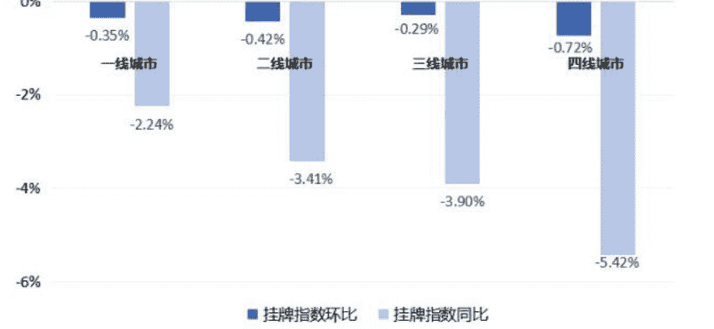

| 城市 | 租金 (元/月·m²) | 指数环比涨幅 | 指数同比涨幅 |
|---|---|---|---|
| 上海市 | 83.74 | -0.52% | -1.80% |
| 北京市 | 83.43 | -0.45% | -3.96% |
| 深圳市 | 77.65 | -0.01% | -1.12% |
| 广州市 | 49.37 | 0.09% | -2.66% |
| 杭州市 | 47.31 | -0.34% | -3.82% |
| 南京市 | 37.68 | -0.81% | -4.86% |
| 福州市 | 33.98 | -0.23% | -5.09% |
| 成都市 | 32.23 | 0.11% | -2.41% |
| 天津市 | 31.02 | -0.24% | -1.20% |
| 大连市 | 29.78 | -0.33% | -2.92% |
| 武汉市 | 27.4 | -0.31% | -3.90% |
| 西安市 | 27.19 | -0.93% | -5.06% |
| 青岛市 | 23.96 | -0.66% | -4.95% |

加微信top28688，进阶资料分享群

## Jason-Leo

2023-09-30 06:33

中期：6月23日以来A股的行情，结构化特征显著，仅有少数行业跑赢大盘指数。前瞻市场情绪较高的AI算力和机器人等相关产业链，我们同样认为在产业周期未发生反转前，中期仍需重点关注，内部结构可能发生变化。创新、消费电子、电池和金属行业经历涨幅较大，结合产能视角认为行业仍处于供给大于需求的右侧。中长期仍具备较高的配置价值，而且有色金属的几个行业直接受限于全球市场秩序的宏观变化，以及工程机械。电电设备、养殖与饲料等行业面临压力，我们出的结构具有较高的配置价值。

# A股

图表1：6月23日以来A股的行情，结构化特征显著，仅有少数行业跑赢大盘指数

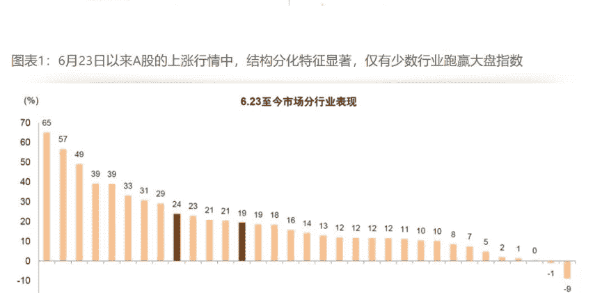

材料来源：Wind，中金行业研究

## A股非金融企业的产能周期

- 营业收入ttm同比
- 资本ttm同比

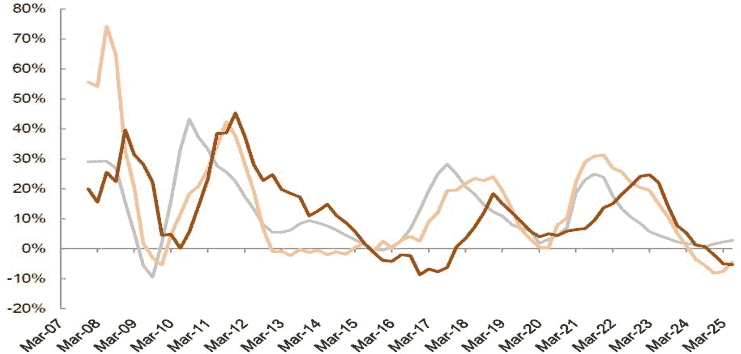

加微信顶28688，资料分享群

## A股新老经济资本支出增速

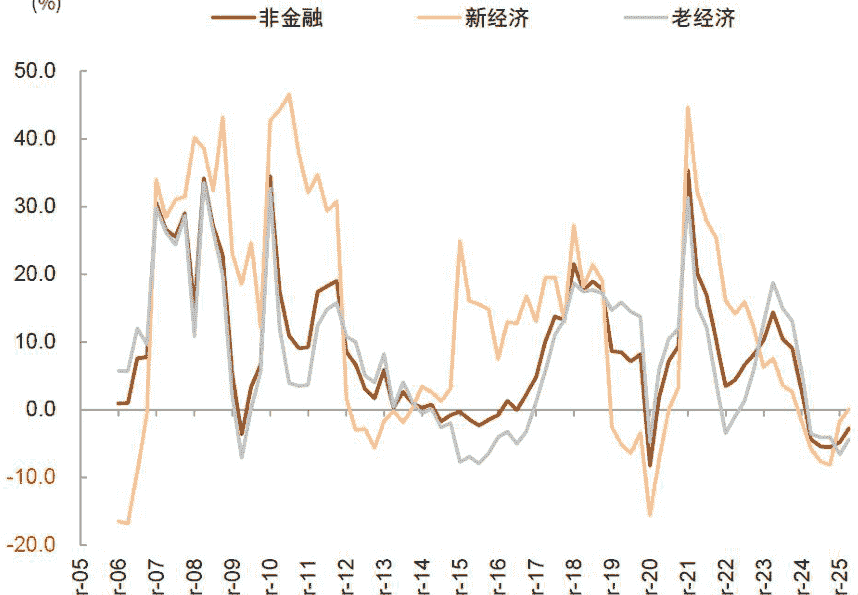

上市公司营业收入/(固定资产+在工程）反映的产出/产能变化

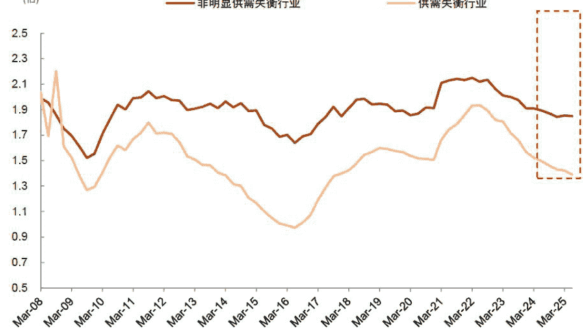

微信top28688，进资料分享群

## 图表13: PB-ROE框架下的二级筛选

| 行业 | PB分值 | ROE分值 | 数值 | ROATTM% | PB | ROE |
|---|---|---|---|---|---|---|
| 养 | 23.0% | 81.5% | 58% | 22.4 | 5.5 | 2.81 |
| 纺织 | 26.3% | 81.9% | 55% | 23.4 | 2.1 | 3.25 |
| 非白 | 25.7% | 71.6% | 46% | 10.4 | 0.4 | 2.87 |
| 医疗 | 10.6% | 48.1% | 38% | 7.6 | 1.5 | 3.64 |
| 环保 | 21.5% | 49.4% | 27% | 6.0 | -0.2 | 1.66 |
| 白电 | 7.2% | 33.3% | 25% | 20.0 | -0.1 | 2.24 |
| 家电 | 15.4% | 40.7% | - | 29.5 | 2.9 | 2.57 |
| 合计 | 46.7% | 57.0% | 19% | 3.7 | 0.7 | 3.84 |
| 证券 | 23.3% | 43.2% | 20% | 7.4 | 1.1 | 1.38 |
| 通信 | 42.6% | 61.7% | 19% | 6.9 | -0.1 | 1.62 |
| 化品 | 27.7% | 45.7% | 18% | 7.0 | 0.4 | 1.95 |
| 饮料 | 23.3% | 35.6% | 13% | 12.8 | -0.2 | 3.87 |
| 保险 | 23.0% | 34.6% | 12% | 7.4 | 0.9 | 1.41 |

注：数据截至2025年9月26日
数据来源：Wind，中国

# 经济复盘

当前我国经济从“供需错配”转向“需求不足”，持续需要投入，如果靠增加“内卷”竞争会导致结构性过剩，物价持续低迷。此时，只有居民收入增长才能让更多需求消化产能，才能经济进入良性循环。

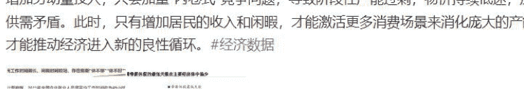

一、我国居民工作时间长、闲暇时间短，存在假期“累”、“不到”三大问题。
二是居民假期“累”，主要是指春节假期数量少，下半年假期少，劳动者享有仅5至15天，年假约10天，低于法国25天、德国20天，也低于墨西哥（12-20天）、巴西（10-22天）、俄罗斯（28天）。
三是居民假期“累”，主要是指假期分布不均，下半年较少。上半年集中（9天），下半年较少（4天），全民集中导致假期体验不好，人均交通拥堵已常态。此外，调整后的工作身心俱疲，摧毁了假期获得，假期感受受损。
四是居民假期“不到”，带薪假落实到位，周末双休难以保障，制度缺乏选择，现实中沦为“纸上兵”。数据显示有40%的职工无法接受年休制度。

加微信28688，资料分享群

## 图表2：中国带薪假的最低天数在主要经济体中偏少

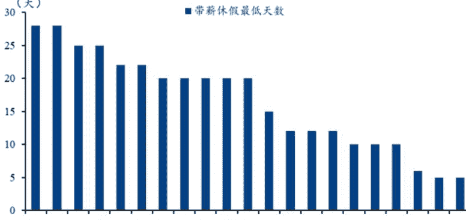

资料来源：国际劳工组织、中国财经整理

2025-09-30 06:48

> zerohedge: 在今年金价飙升45%的背景下，美国财政部黄金储备市值超过了1万美元，这是政府资产债表上标识的90多倍，引发了人们对财政部长贝森特可能重新评估（按市值计）大贵金属的担忧。但贝森特随后否认了这一说法，称这种想法未被考虑。

# 其他国家/经济

## Exhibit 2: The Federal Government's Cash & Other Monetary assets details ($bn)

Most of Treasury's cash & other monetary assets are in the TGA

| Cash & other monetary assets | Cash held by the Treasury | Other | Restricted Cash | International monetary assets | Gold & silver assets | Foreign currency | Total |
|---|---|---|---|---|---|---|
| 9/30/2024 | $870.8 | $5.2 | $71.3 | $203.0 | $11.1 | $16.3 | $1,177.7 |

Source: FY 2024 Financial Report of the US Gov't Bofa GLOBAL RESEARCH

微信top28688，进资料分享群

## Market value of US Gold Reserves

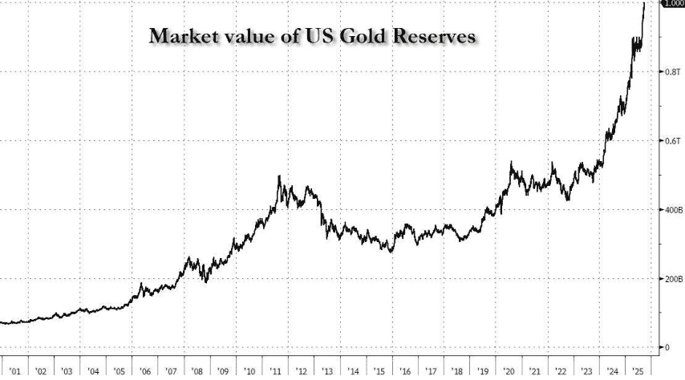

## The US Holds the World's Biggest Gold Stash

| Country | (tons) |
| :--- | :--- |
| United States | 8.1K |
| Germany | 3.4K |
| Italy | 2.5K |
| France | 2.4K |
| Russia | 2.3K |
| China | 1.0K |
| Switzerland | 880.0 |
| Japan | 846.0 |
| Turkey | 637.1 |

Source: IMF, Respective Central Banks
Note: Top 10 reported official national holdings (as at Jun-2025)

招商：2000年以来的扩张期（从政府杠杆来看）：2000-2004，2009-2021至今，全球财政的发展，通常应对商品上涨。另外回2000年以来的多次衰退，在衰退周期商品都不涨。衰退后期商品上涨，防御性避险及时上线。

微信28688，资料分享群

## 结论：坚定看好！

- 全球财政抗通胀，商品价格：韧性开启，商品价格倾向于立。
- 中国“内需”驱动复苏：以往供给侧中，商品都是明显领先的。
- 商品指数回升，有望触底。

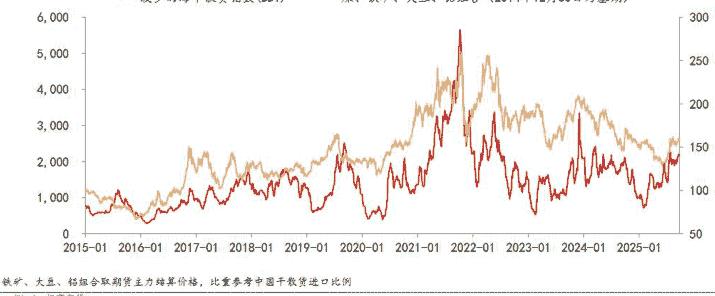

注：铁、矿、大豆、棉丝组合指数，数据参考中粮期货，数据来源：东方财富、同花顺

微信top28688，进资料分享

## 美国的超预期发力

- 中国持续发力，美国财政超预期，后半年趋势增强。

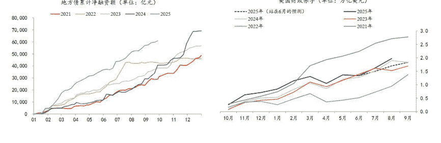

## 此外，全球货币即将进入扩张期

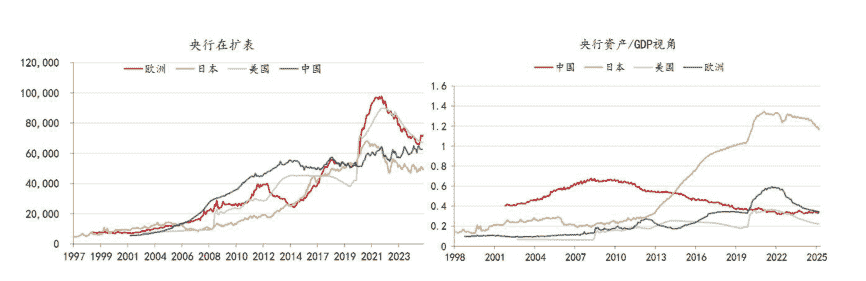

## PPI对比领先，明年转折

- 商品指数领先PPI约2个月
- PPI领先见意见，明年转折。

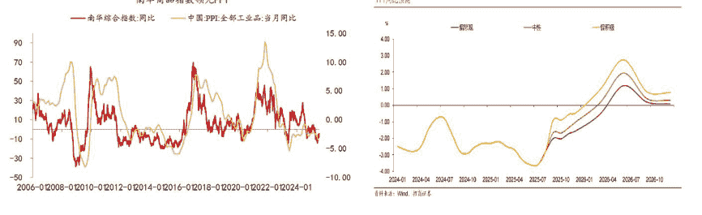

微信top28688，进资料共享

## PPI回升的延伸效应——人民币升值

美国之前的“通缩通胀”压制了通价，通胀的应对引起了人民币的升值。

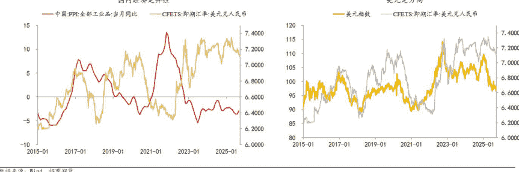

数据来源：Wind，财经数据

2025-09-30 06:55

WGC: 2010年至今五个黄金生产国，十多年来，中国一直是世界领先的黄金生产国。

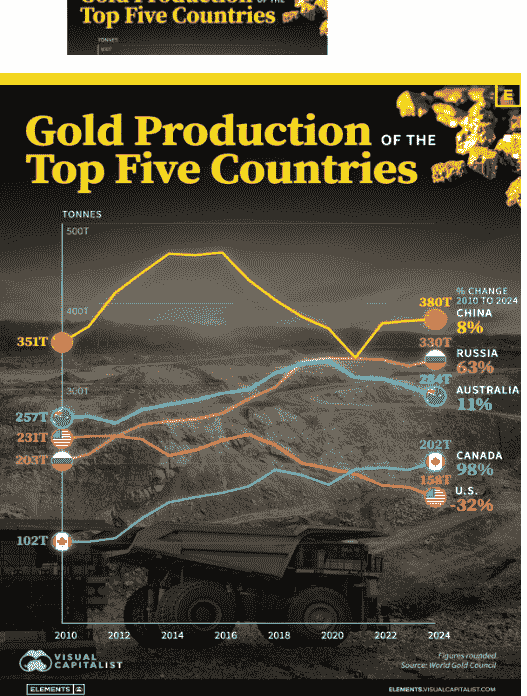

微信搜28688，进资料分享群

2025-09-30 06:57

Bloomberg: 彭博小手表指数追踪二级市场交易量最大的50只手表的价格，该指数在1月底触底，此后一直呈“V”型上涨，截至上周四，从31,535美元的低点反弹至34,001美元，上涨7.8%。二手劳力士价格指数在1月底触底，约为10,964美元，此后回升至11,882美元，上涨17.2%。二手百达翡丽价格触底在88,379美元左右，此后已涨至95,829美元，上涨8.4%。

#金融

IN PARTNERSHIP WITH Bloomberg
Bloomberg x Subdial Watch Index
Down by -0.7% in the last 24 Months

# $34,001

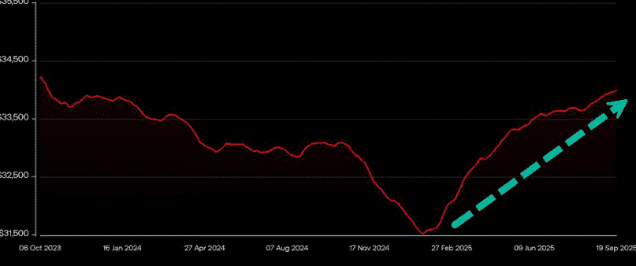

$35,500
$34,500
$33,500
$32,500
2023年10月6日
2024年1月16日
2024年8月27日
2024年11月17日
2025年2月27日
2025年6月19日
Up by 1.9% in the last 24 Months

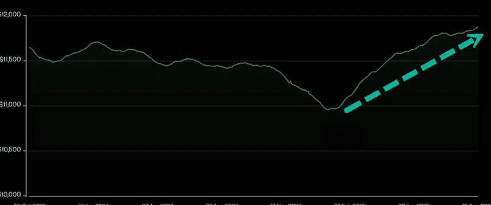

$11,882
$11,500
$11,000
$10,500
2023年10月6日
2024年1月16日
2024年8月27日
2024年11月17日
2025年2月27日
2025年6月19日

微信顶28688，进资料群

2025-09-30 06:59

Bloomberg: 由于中国制药与美国开展业务的方式，它们基本上不受最近宣布的对100%关税影响。

# 经济数据：中国占据主导地位

临床试验中超过一半的国家：CHINA / EU, JAPAN, RUSSIA, SOUTH KOREA, INDIA (60%)

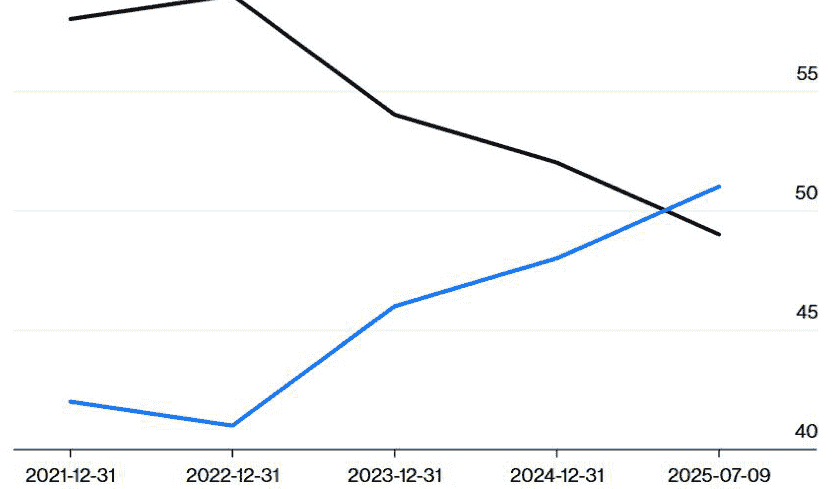

| 55 | 50 | 45 | 40 |
| 2021-12-31 | 2022-12-31 | 2023-12-31 | 2024-12-31 | 2025-07-09 |

资料来源:彭cube

2025-09-30 06:59

Bloomberg: 俄罗斯预计以低于欧洲和土耳其的价格出售天然气，对中国的出口估计为每千立方米248.70美元，而流向西方的价格为401.90美元。

# 天然气价格

- Gas prices for Europe and Turkey > Gas prices for China

$403 per 1000 cubic meters

加微信top28688，进资料群

## 天然气价格预测

俄罗斯预计将其天然气出售给中国的天然气比其他外国客户便宜

- Gas prices for Europe and Turkey > Gas prices for China

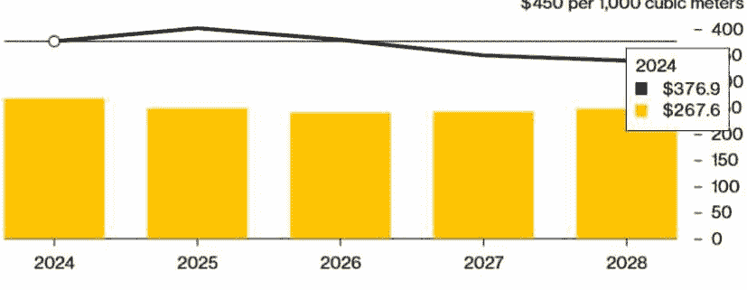

资料来源：俄罗斯2026-2028年经济展望

# bubble

2025年是黄金ETF推出以来第三强的一年。最近一项显示，法国是未来两年最有可能遭遇政府债券危机的国家，超过了包括英国和在内的其他国家。

## 黄金交易基金需求激增

ETF持量低于2020年的历史高点

- Total Known Gold ETF Holdings (try ounces)

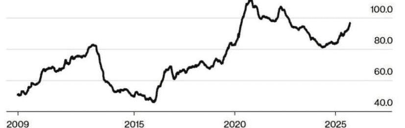

资料来源：彭社

## 意大利和法国的收益率现在一致

此举反映了对意大利债券的需求，法国同行的吸引力减弱

- Gap between Italian, French 10-year yields

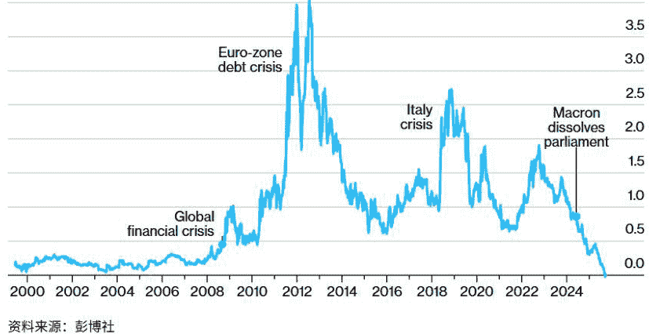

资料来源：彭透社

2022-09-30 07:08

付榜：感觉BTC就是一个算力价格。算力不具备黄金那样的功能。

# 金融

- BTC: 算力的价格

| 电力 | 电力 |
| --- | --- |
| GPU | 矿卡 |
| 算力中心 | 矿山 |
| 算法 | 算法 |
| 大模型 | 加密模型 |
| 应用 | 应用

# 人工智能产业链

加微信28688，进资料分享群

## Jason-离

2025-09-30 07:13

高鑫: 在我们看来，关门的可能性似乎增大，即便在最后一刻也很难预测这些情况

# 其他国家经济

Exhibit 1: Discretionary Spending Represents Only 25% of Federal Outlays

## Exhibit 1: Discretionary Spending Represents Only 25% of Federal Outlays

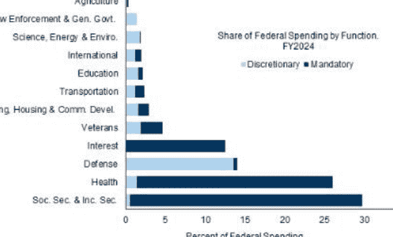

# Jason-离

2025-09-30 09:41

bloomberg: MSCI中国指数9月份上涨约8%，连续五个月上涨。自4月份触底以来，该基指数已上涨40%，超过了标准普500指数和MSCI指数，亚洲股市将创造下2018年以来的最佳涨幅。

## MSCI China Set For Longest Winning Streak Since 2018

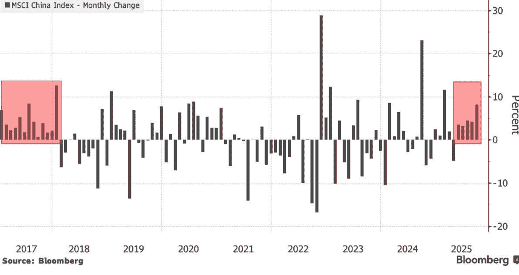

经历了多年的厌恶之后，全球基金经理正在冒险重返中国，受到全球股市上涨和中国高科技产业进步的刺激。

高调显示，全球对上个月是近年来离岸股票最活跃的基金——这与2021年形成对比，当时许多客户认为市场“不可投资”。太平投资管理公司表示，投资现在更显错失机会，而不是风险。官方数据显示，跨资产类别的外资金流入都在增加，这种增长仅在过去10年中的3月发生过。

总而言之，这些趋势表明，由于长期的监管打击和不断升级的房地产危机，这个市场已经失去了全球投资者的青睐。事实证明，今年岸2.7万亿美元的股票反弹引起关注，不容忽视，而全球基金仍然低配的头部表明有足够的空间可以立足。

## 外资持有中国资产全面扩大

2025年，每个资产类别的4年来首次出现净增长

| Bonds | Stocks | Loans | Deposits |

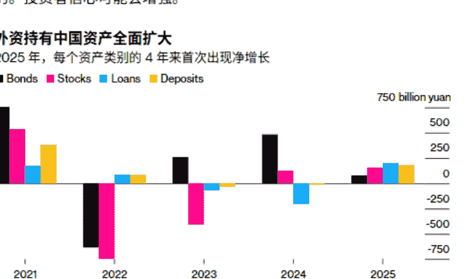

资料来源：中国人民银行数据截至6月底

## Jason不范
2025-09-30 13:38

## 就业数据跟踪#自制图表

## 长江商学院招聘指数
南半球财经

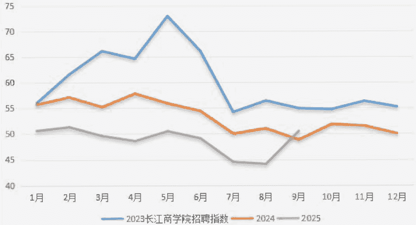

## 非制造业PMI从业人员指数
南半球财经

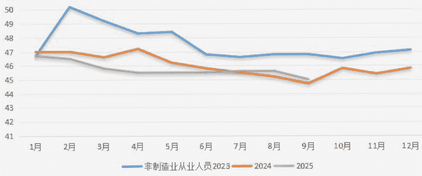

## 制造业PMI从业指数
南半球财经

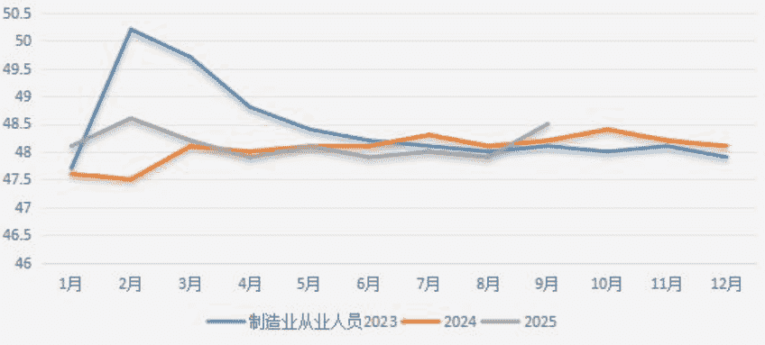

## 企业利润占比 季节性
南半球财经

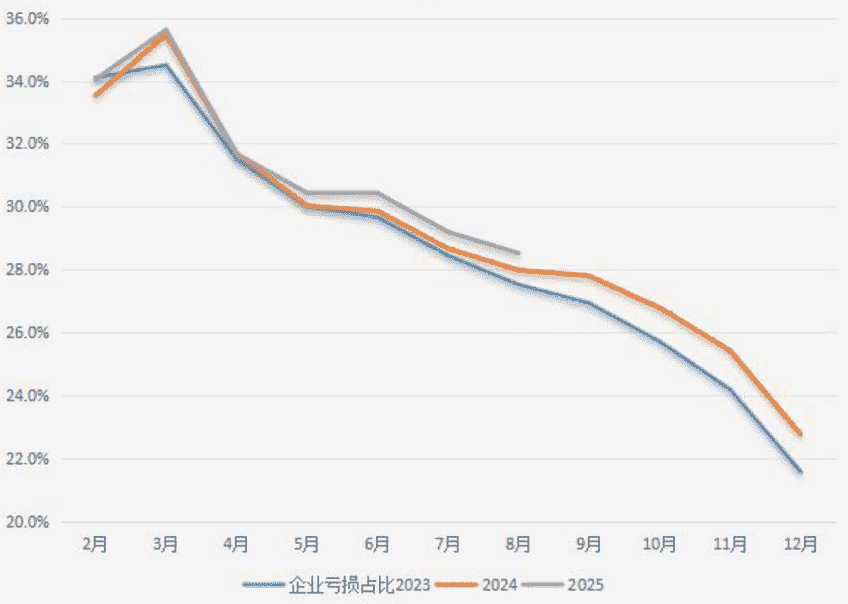

## Jason不遇
2025-09-30 13:43

bloomberg: 外国投资者抛售印度股票的速度比以往任何时候都快，即便如此，Nifty今年仍上涨 4.4%，并有望连续 10 个年度上涨，这要归功于国内机构的不懈购买。数据显示，当地基金和保险公司今年已投入创纪录的 660 亿美元，超过 2024 年的 630 亿美元。

### 股市

## 印度股票的外国外流历史新高

- 外资股权投资净额（年初至今)

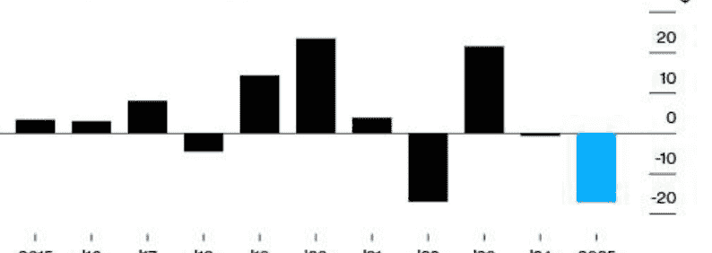

数据来源：彭博社
数据来源：2025年数据包含9月29日的临时数字

## Jason不遇
2025-09-30 15:18

Arouet: 生育率1.0意味着什么？意味着每代人口按约一半的速度在缩减。两代之后大致只剩23%的人口规模。人口目前这条线附近的韩国、中国、意大利、波兰。

## Four grandparents Fertility rate Number of grandchildren

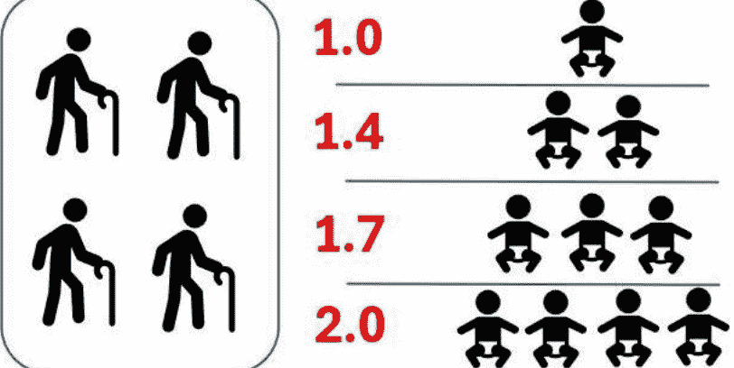

## Jason不能
2025-09-30 16:01

#自制图表

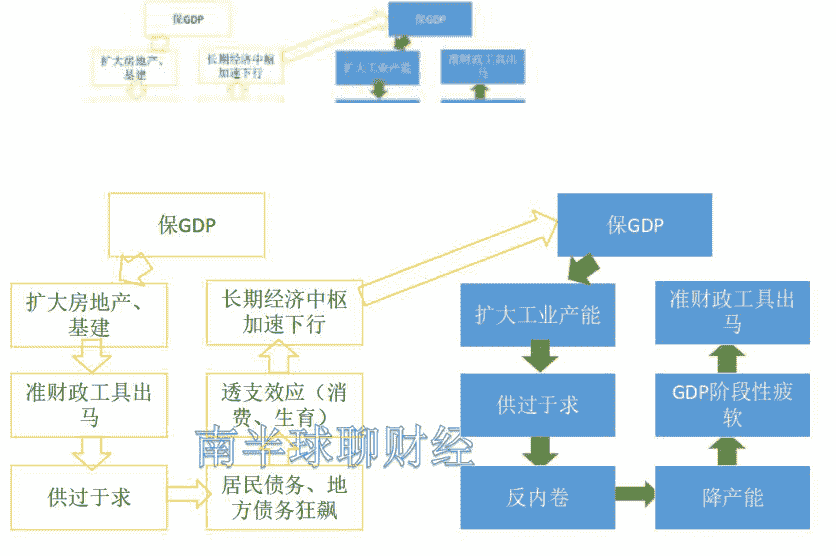

## Jason不跑
2025-09-30 16:08

NBER论文：作者研究了2020-2022年地方的土地价格，发现地方政府通过收购供给、让土地（LGFV）与限价“托管”，造成了价量的背离。2021-2022年土地价格涨得更多，且名义地维持了地方与企业的融资。LGFV拿地从2019年11.4%增加到2022年11.7%。

## Price and Value Divergence in China's Real Estate: The Role of Local Governments
Jeffery (Jifan) Chang, Yuheng Wang, and Wei Xiang
NBER Working Paper No. 34303

### ABSTRACT

During the Covid-19 pandemic (2020-2022), Chinese citizens witnessed a paradox of residential land and new house prices surged while transaction volumes plummeted. This is attributed to government incentives, supporting demand through Local Financing Vehicles (LGFVs), buying land at higher prices than other buyers. These interventions helped sustain governments' financial distress, revealing unintended consequences of fiscal strategies.

Jeffery (Jifan) Chang Shenzhen University of Hong Kong (CUHK-SZ) School of Management zhangyang@link.edu
Wei Xiang Princeton University Department of Economics wxiong@princeton.edu
Yuheng Wang Central University of Finance and Economics yuyhengwang@link.edu

## Jason不跑
2025-09-30 16:20

## 高磊：历史，非衰性降息对股市有利

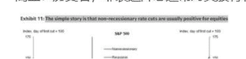

## Jason不
## Exhibit 11: The simple story is that non-recessionary rate cuts are usually positive for equities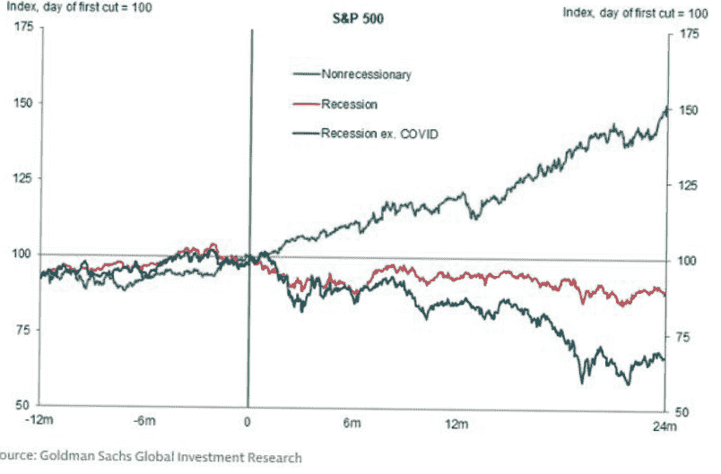

# 知识星球TOP资源分享群

| 序号 | 公号/星球/社群 | 原价 | 领域 |
|---|---|---|---|
| 1 | 生财有木 | 2765/年 | 副业，搞钱 |
| 2 | 众宗吃瓜群 | 365/年 | 时政，历史 |
| 3 | 记忆获鑫/毅树风 | 365/年 | 成长 |
| 4 | 欧洲金轨 | 328/年 | 时政，历史 |
| 5 | 卢克文青会 | 699/年 | 时政，社会 |
| 6 | 体制内主任 | 599/年 | 职场 |
| 7 | 局外人的视 | 669/年 | 金融，时政 |
| 8 | 溯泽异昂 | 4166/年 | 财富，成长 |
| 9 | 宁夜人总司令 | 599/年 | 时政，经济 |
| 10 | 江宁知府 | 365/篇 | 时政，国际 |
| 11 | 政堂/顾子明 | 568/年 | 时政，经济 |
| 12 | 唐书院 | 1399/年 | 金融，财富 |
| 13 | 大树乡谈 | 199/年 | 时政，成长 |
| 14 | 水库联大 | 10000元 | 房产，经济 |
| 15 | 洪灏宏观策略 | 4376/年 | 经济，搞钱 |
| 16 | 金政通鉴/北海南山 | 4576/年 | 股票，行研 |
| 17 | 猫哥的世界 | 299/年 | 时政，社会 |
| 18 | 飞龙弋 | 3600/年 | 股市，经济 |
| 19 | 米联储见闻 | 599/年 | 经济，金融 |
| 20 | 茶茶财经 | 330/年 | 房产，股票 |
| 21 | 赢在八小时之外 | 365/年 | 成长，职场 |

...... 更多资源，不再列举

+ 图书、报告、课程等各类高价值资源
- 免费群 每日分享资源
- VIP群 每日分享所有资源（日均20+），75/年
赠送付费资源合集，市场原价数
