# 南半球聊财经251001

Jason-不离
2025-10-01 03:21

### BlackRock: 外资看好日本

bloomberg: 日本的投资文化正在缓慢发生变化，根据日本央行的数据，尽管日本积累15万亿美元的金融资产约有五分之一是现金和，但截至6月，他们持有19%的股票和投资资金。这一比例是1990年代以来日本经济复苏以来的最高水平。#其他国家经济

reinforce why a mega force lens is key for spotting return opportunities.

### Foreign investors in step

Holdings of Japanese shares by investor category, 1970-2024

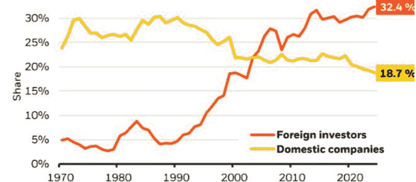

Source: BlackRock Investment Institute, Japan Exchange Group (JPX), September 2025. Based on "2024 share ownership survey" released on 4 July 2025. Notes: the chart shows the shareholding ratio in Japanese equities by investor category. It plots the percentage of total value held by foreign investors (orange) and by domestic companies (yellow).

### 现金为王

截至3月31日止，日本家庭持有的金融资产（以日元计数）

- Cash and deposits
- Insurance, pensions and standardized guarantees
- Equities
- Investment trusts
- Debt securities
- Other

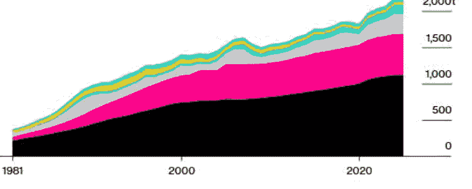

资料来源：日本银行
注：数据截至2025年第一季度初步报告发布。

## 加微信微信28688，进资料群

## Jason不跑
2025-10-01 03:29

PeroMicicic: 目前一个机器人的1小时成本（包括初期投入、寿命8年、持续维护等各种费用）约为14美元，随着效果和规模的提高，每小时的成本将降至 10 美元以下，甚至低于 5 美元。到2035年或低于1美元每小时，而目前技术工的时薪是42.53美元。#人口

## Cost of a humanoid robot

Variables

| | | | | |
|---|---|---|---|---|
| Duration of operation | Years | 8 | | |
| Days of operation per year | Days | 330 | | |
| Hours of operation per day | Hours | 20 | | |
| Speed of operation compared to human | Percent | 100 | | |
| Price / hour as multiple of hourly cost | Percent | 200 | | |
| Production cost hardware | USD/piece | 10,000 | 20,000 | 30,000 |
| Production software cost | USD/year | 500 | 1,000 | 1,500 |
| Delivery etc. | USD/year | 500 | 1,500 | 1,500 |
| Cost of production total | USD/piece | 11,000 | 22,000 | 33,000 |

| | | | | |
|---|---|---|---|---|
| Working hours | Hours/year | 6,600 | 6,600 | 6,600 |
| Working hours x speed = hours equivalent | Hours | 6,600 | | |

| | | | | |
|---|---|---|---|---|
| Capital cost (depreciation), linear, x | USD/year | 1,375 | 2,750 | 4,125 |
| Software skills and upgrades (COGS) | USD/year | 500 | 1,000 | 1,500 |
| Electricity (2 kWh * h * 0.2 USD) | USD/year | 2,640 | 2,640 | 2,640 |
| Operation by human, 0.5 h/day, 100 USD/h | USD/year | 18,000 | 18,000 | 18,000 |
| Cost of operation total | USD/year | 23,880 | 27,350 | 31,700 |

| | | | | | |
|---|---|---|---|---|
| Cost of production total | USD/hour | 3.82 | 4.11 | 4.60 |
| Additional service fee payable to supplier | USD/hour | 7.24 | 8.22 | 9.21 |
| Cost of operation per total | USD/hour | 10.86 | 12.34 | 13.81 |

| | | | | | |
|---|---|---|---|---|
| Salary of a worker | USD/year | 60,000 | 60,000 | 60,000 |
| Social security etc. 20% | USD/year | 12,000 | 12,000 | 12,000 |
| Specific costs for humans (HR, admin, parking etc.) | USD/year | 12,000 | 12,000 | 12,000 |
| Cost of a worker total | USD/year | 84,000 | 84,000 | 84,000 |
| Working hours | Hours/year | 1,975 | 1,975 | 1,975 |
| Cost of a worker total | USD/hour | 42.53 | 42.53 | 42.53 |

| | | | |
|---|---|---|---|
| Savings = additional profit | USD/hour | 31.67 | 30.20 | 28.72 |
| Savings = additional profit | USD/year | 209,039 | 199,289 | 189,539 |
| Savings = additional profit | % | 74 | 71 | 68 |

## 加微信微信28688，进资料群

## Jason不跑
2025-10-01 03:29

PeroMicicic: 目前一个机器人的1小时成本（包括初期投入、寿命8年、持续维护等各种费用）约为14美元，随着效果和规模的提高，每小时的成本将降至 10 美元以下，甚至低于 5 美元。到2035年或低于1美元每小时，而目前技术工的时薪是42.53美元。#人口

(表格内容已在上方处理)

## Jason不离
2025-10-01 03:35

bloomberg: 根据国际清算银行的数据，人民币全球交易量接近英镑，成为第四大货币。另一个大是欧元和加元，成为第六大货币。人民币从2.6%大幅上升至3.8%。# 人民币正在追赶英镑

人民币在全球交易中的份额呈上升趋势
人民币币交易占总份额 / 英镑

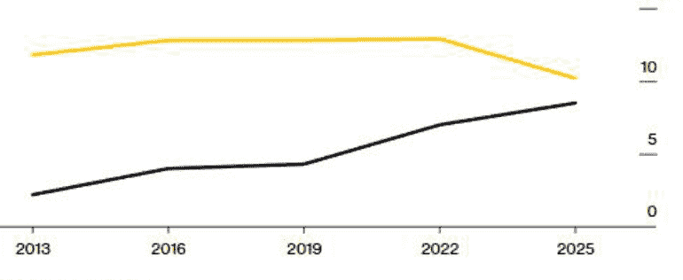

资料来源:国际清算银行

### Dollar Reigns While Yuan Climbs

Share of most traded currencies in 2025

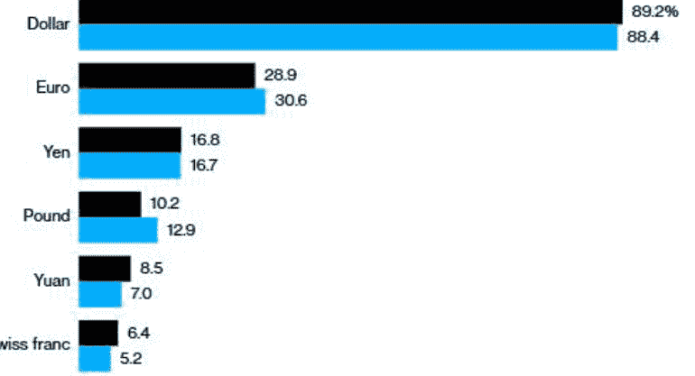

Source: Bank for International Settlements

## 加微信顶28688，进资料群

## Jason不跑
2025-10-01 03:41

BIS更新了中国二季度的名义指数至120，意味着价格回到2016Q4-2017Q1期间的。如果采用银行汇率（调整值）计算后的住房指数，则回到2013年第一季度。不过近个月汇率回调，可能影响实际房价

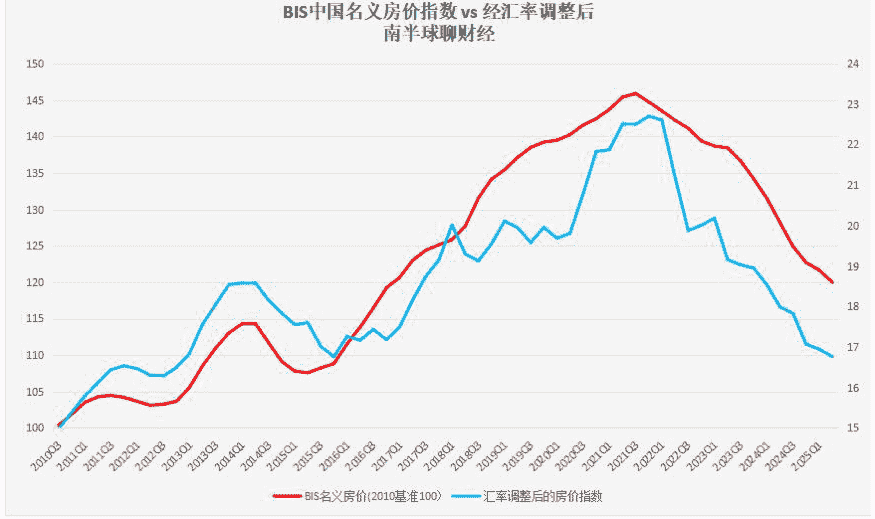

## Jason不跑
2025-10-01 03:55

随着资金流入加速和投资者继续向科技股注入资金，新兴市场股票有望连续九个月上涨，这是自2004年以来最长的连涨记录。#股市

### 新兴股市每个月都在上涨

新兴市场基金显示自2004年以来最长的月度涨幅MSCI新兴市场指数

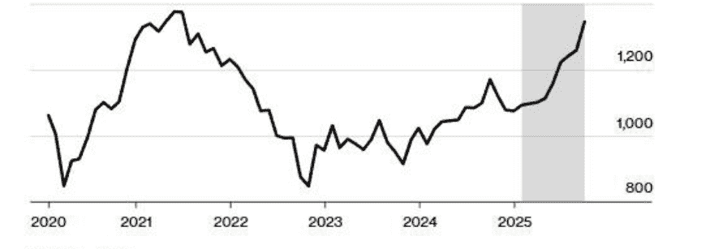

来源：彭新社

(部分内容已合并)

## Jason不诡
2025-10-01 04:04

zerohedge: 最新的JOLT报告很糟糕，职位空缺仍然低，失业人数现在大于职位空缺。招聘指数为2024年6月以来的水平，由于就业低迷，美国就业信心跌至五个月低。

CME目前对28天后的美联储降息概率为96%#其他国家经济

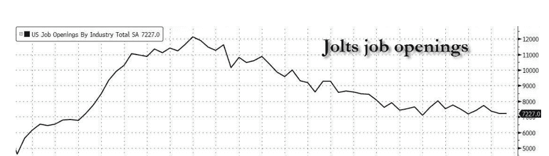

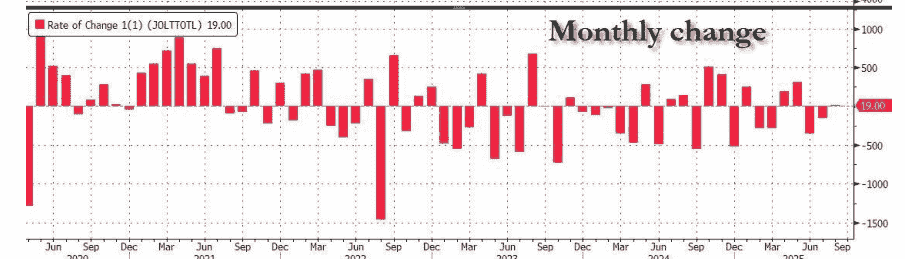

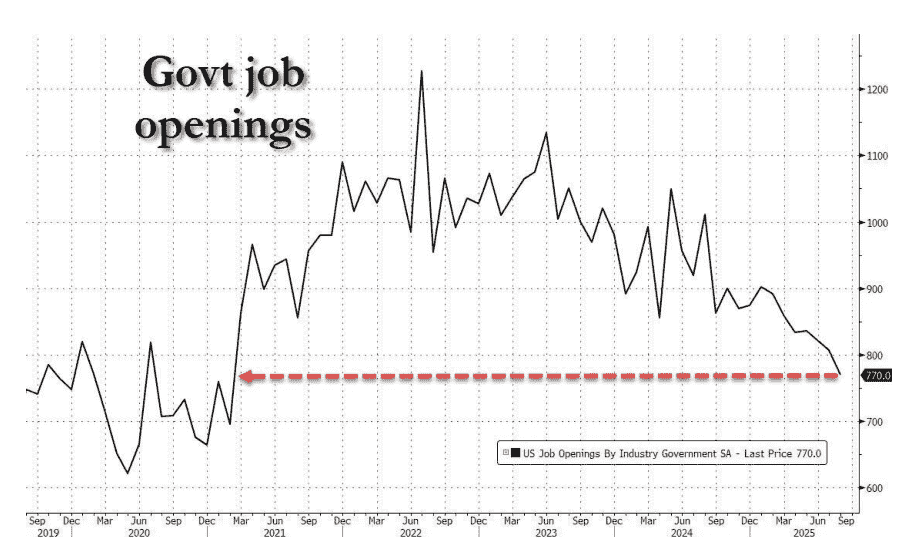

(部分内容已合并并去重重复表格表格)

## CME FEEDWATCH TOOL - AGGREGATED MEETING PROBABILITIES

| MEETING DATE | 275-300 | 300-325 | 325-350 | 350-375 | 375-400 | 400-425 |
|---|---|---|---|---|---|
| 10/29/2025 | 0.00% | 0.00% | 0.00% | 0.00% | 96.74% | 3.26% |
| 12/10/2025 | 0.00% | 0.00% | 0.00% | 77.10% | 22.90% | 0.00% |
| 1/28/2026 | 0.00% | 0.00% | 14.74% | 85.26% | 0.00% | 0.00% |
| 3/18/2026 | 0.00% | 0.00% | 57.98% | 42.02% | 0.00% | 0.00% |
| 4/29/2026 | 0.00% | 0.00% | 80.74% | 19.26% | 0.00% | 0.00% |
| 6/17/2026 | 0.00% | 36.95% | 63.05% | 0.00% | 0.00% | 0.00% |
| 7/29/2026 | 0.00% | 64.74% | 35.26% | 0.00% | 0.00% | 0.00% |
| 9/16/2026 | 0.00% | 97.46% | 2.54% | 0.00% | 0.00% | 0.00% |
| 10/28/2026 | 10.74% | 89.26% | 0.00% | 0.00% | 0.00% | 0.00% |
| 12/9/2026 | 26.85% | 73.15% | 0.00% | 0.00% | 0.00% | 0.00% |
| 1/27/2027 | 0.00% | 33.74% | 0.00% | 0.00% | 0.00% | 0.00% |
| 3/17/2027 | 44.46% | 55.54% | 0.00% | 0.00% | 0.00% | 0.00% |
| 4/28/2027 | 33.74% | 66.26% | 0.00% | 0.00% | 0.00% | 0.00% |
| 6/9/2027 | 7.17% | 92.83% | 0.00% | 0.00% | 0.00% | 0.00% |
| 7/28/2027 | 0.00% | 71.74% | 28.26% | 0.00% | 0.00% | 0.00% |
| 9/15/2027 | 0.00% | 71.74% | 28.26% | 0.00% | 0.00% | 0.00% |

## 美国9月消费者信心下降

由于就业前景和更广泛经济的负担日益加剧，美国9月份信心跌至五个月低点。周二公布的数据显示，世界大型企业联合会的指标下降3.6点至94.2。彭博社对经济学家的一项调查中，估计中值为96。衡量当前状况的指标下降了7个百分点至一年来的最低水平，而衡量未来六个月预期的指标也在9月份下降。

表示就业充足的股票跌至2021年来的最低水平

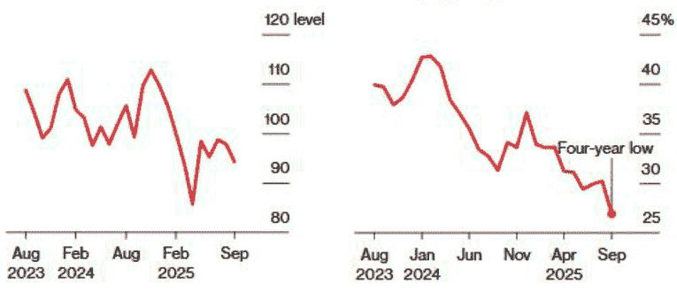

来源：世界大型企业联合会

过去几个月，随着消费者对各种交叉潮流，包括招聘放缓、顽固的通胀和创纪录的股价，信心指标在很大程度上一直在横盘整理。

## Jason不遇
2025-10-01 00:44

FT: 华华银行预计，欧元将迎来2017年以来最大一轮反涨。包括高盛、摩根大通和瑞银在内的大型投行认为欧元将在未来几个月突破1.20美元关口，因为美联储将继续降息，对美国资产的压力是支撑欧元的一个重要因素，投资者通过实质上加，加拿大银行表示“我们刚刚看到全球投资者对其美元进行对冲的冰山角，后继

欧洲出口对欧元获利发出警告，若涨势继续，将对他们造成更大压力。普特表示，1.2美元是这一水平对欧洲行决策者而言仍是一条“红线”。越过此水平的汇率将会，野村表示，若汇率稳步回升，决策者的压力会减小，因为这有助于推回。

(其余内容已合并)

## 比特币的基础是能量

有了时代的共响后，另一个重要的问题就是比特币什么可以承载未来数千年的价值传递？如果比特币完全是一个虚假网络，它的底层究竟是“空气”，这种价值共识却是绝对无法建立的。那么，比特币的基础是什么？

比特币采用PoW机制，是能量（电力）和数学（算法）结合的产物，对比比特币的底层是能量，而黄金是“自然元素”和“化学反应”结合的产物的延续。大自然的任何物品，都是由各种粒子由自然界的作用而生成的。这些规则亘久不变，例如风暴雷电的形成。而数学源于自然而又超越自然的思维模型，它和自然的规律一样准确和准确，永恒不变。

我们整个人类社会的活动，以能量为基础。从这个意思来说，比特币是能量的表现形式。比特币本质上是一个能量网络，由能量和算法合而成，所以具有坚实的物质基础。和其他货币相比，如太坊的PoS（Proof of Stake，权益证明）算法完全不同，后者没有大规模的能源消耗步骤，是一个虚拟网络，其价值主要依赖其应用场景，也因为如此，加密货币在数十年的发展过程中，将价值回归主要要素聚焦在比特币身上，其他的加密货币准则难以承接这个责任。

> Jason不离
> 2025-10-01 04:00
> 花湖：AI基础设施投资急需加速，2026年AI资本支出将达到4900亿美元。与互联网泡沫的界限在于，本轮投资有真实的企业需求作为“出口”进行价值验证。英伟达与OpenAI等建立合作项目，以及AI算力需求指数级增长，引发了投资狂潮。估全球AI算力的需求到2030年将新增55万特的计算容量，转化为高达2.8万亿美元的增量AI资本支出，其中中国市场将占1.4万亿美元

# 加微信top28688，进资分享群

## Figure 3. We expect AI factories will contribute 55 GW of net new compute capacity through 2030...

### Figure 4. representing $52BT in incremental spend through 2030 on a global basis.

| | 2018 | 2019 | 2020 | 2021 | 2022 | 2023 | 2024 | 2025 | 2026 | 2027 | 2028 | 2029 | 2030 |
|---|---|---|---|---|---|---|---|---|---|---|---|---|---|
| Net AI | 10% | 10% | 15% | 20% | 20% | 30% | 30% | 40% | 40% | 50% | 50% | 50% | 55% |
| Net new capacity for GPUs | 10% | 10% | 15% | 20% | 20% | 30% | 30% | 40% | 40% | 50% | 50% | 50% | 55% |
| Total | 10% | 10% | 15% | 20% | 20% | 30% | 30% | 40% | 40% | 50% | 50% | 50% | 55% |
| Cloud | 10% | 10% | 15% | 20% | 20% | 30% | 30% | 40% | 40% | 50% | 50% | 50% | 55% |
| Training | 10% | 10% | 15% | 20% | 20% | 30% | 30% | 40% | 40% | 50% | 50% | 50% | 55% |
| Inference | 10% | 10% | 15% | 20% | 20% | 30% | 30% | 40% | 40% | 50% | 50% | 50% | 55% |
| Other AI | 10% | 10% | 15% | 20% | 20% | 30% | 30% | 40% | 40% | 50% | 50% | 50% | 55% |

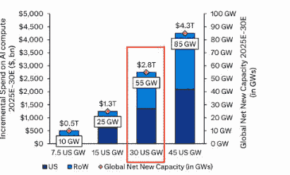

2025 Citigroup Inc. No redistribution without Citigroup's permission.
Assumes all additional Data Center capacity is driven by AI and cloud compute

2025 Citigroup Inc. No redistribution without Citigroup's permission.
Assumes all additional Data Center capacity is driven by AI and cloud compute

Source: Citi Research

Source: Citi Research

### Figure 8. Incremental CapEx is beginning to enter FCF

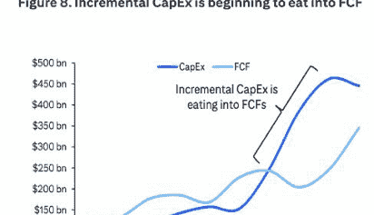

2025 Citigroup Inc. No redistribution without Citigroup's permission.
Includes total CapEx and FCF for AMZN, GOOGL, META and ORCL

Source: Citi Research, Visible Alpha, FactSet

### Figure 9. We see a critical off-ramp to the flow of funds between OpenAI, NVIDIA and Oracle via enterprise demand for AI

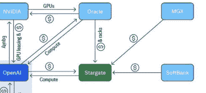

2025 Citigroup Inc. No redistribution without Citigroup's permission.

Source: Citi Research

## Figure 7. Consensus estimates for 2026 CapEx have grown higher over time, driven by hyperscalers increasing commitment to AI infrastructure

2026 Total CapEx consensus estimates as of September 23, 2025 ($bn)

AMZN GOOGL META MSFT ORCL

2025 Citigroup Inc. No redistribution without Citigroup's permission.
Source: Citi Research, Visible Alpha, FactSet

# Jason不离
> 2025-10-01 04:00
> 花湖：AI基础设施投资急需加速，2026年AI资本支出将达到4900亿美元。与互联网泡沫的界限在于，本轮投资有真实的企业需求作为“出口”进行价值验证。英伟达与OpenAI等建立合作项目，以及AI算力需求指数级增长，引发了投资狂潮。估全球AI算力的需求到2030年将新增55万特的计算容量，转化为高达2.8万亿美元的增量AI资本支出，其中中国市场将占1.4万亿美元

# Jason不离
> 2025-10-01 04:43
> 联合报：北京地产：房价。北京地产协会：不得采用产空市场，不得通过虚假价格、微弱等方式卖推拉价。此前国内媒体报道，上海、杭州等地，不少房屋通过造假给业主施压力，达到快速成交。监控显示，上海某套豪宅仅39万元（人民币，房价），导致极低，导致业主热烈内耗。

# Jason不离
> 2025-10-01 04:51
> 周昊：现状就是这么情况。经济数据

# 加微信top2868，进资料分享群

# Jason不离
> 2025-10-01 04:53
> 周昊：从8月数据看当前的经济形势

2025年8月数据，价格水平方面，CPI负增长1%，当月为负.4%；PPI下降9%，当月平均。三大需求方面，固定投资增长3%，当月回升为0.5%；国内投资增长5.2%，当月回升为2.3%，民间投资负增长2.2%，当月回落；消费型增长4.6%，当月回落为3.4%；出口增长6.9%，当月回落为4.8%。货币市场方面，M2增长7.7%，当月增长为8.8%；银行存款增长6.8%，8月新增人民币存款增加3100亿元，其中居民部门增加1597亿元，企业部门同比增长2500亿元；8月人民币存款增加1100亿元，低于去年的100亿元和6300亿元，非银行存款7月增加2140亿元，同比增长1390亿元。

形势分析：市场仍然低迷，CPI低，8月速度加快，PPI持续负增长，但8月较后三个月增速放缓，市场供应不足，M2增长依然，但整体大于需求，储蓄资金减少；非银行存款资金流动性进入市场，但从上市公司的固定资产并没有回步增长。也就是说，股价和市值在回升，但从散户到上市的资金在二级市场中沉淀没有进入实体。

# 单纯削减贷款不会引起经济人气

研究和分析中国经济成就和问题，需要从转轨经济的逻辑出发。中国经济是一个二元体制，并非一个完全的市场经济运行体系。现代经济学中一些“体制限制不变、基本完全竞争、甚至奥斯芬非中性”的假设与中国实际情况有着很大区别。

近期经济判断认为，中国居民储蓄率太高，存款太多，没有用于消费和投资；中国经济生产侧过剩，相对于全球最大的产能规模，债务规模并不多，甚至也不怕债，还要扩大财政赤字和增加投资，以此增加货币流动性，强烈削减消费和投资需求。

第一个疑问是，扩大的债务是否成立？居民的能力、意愿与现实情况如何？从划分来看，储蓄集中较高，大部分居民储蓄在50%左右；而且这几年住房压力大，从住房市场来看，储蓄压力。教育、医疗等压力小，收入增加、存款多的群体，即便便款也不借；中产阶层急需债，很多人也不愿意债；高收入、存款多的群体，生活支出不用愁债，就不去借。

第二个疑问是，如果逻辑成立，就需要另外两个债推出，扩大需求以消除到位，似乎无法做到，从扩张方向来看，是相当大部分流向政府，一部分用来缓解其债务，为其还付息，没有达到需求的作用；一部分国政府用土地拍卖，银行贷款，从土地让让，形成“债”；一部分用于基础设施，但重建后，交通、工业已经到位，政府就不愁制造自己需要的。如果再扩大投资，那么企业用这些债务做什么？如果再扩大投资，主要集中在上游，产品是生产资料，而需求。这种（特别是小微企业）几乎没有作用。

三是当年通胀，通过财政政策，政府扩大投资，让劳动力从服务业转向。然而，劳动力转化率高，储蓄在60%。这种由于机械化、智能化和自动化使得投入劳动力成本降低到10%，此外，没有足够的消费来缓解通胀。债务与通胀的关系是负担而非缓解，债务是通胀的负担，导致政府通胀持续性问题。

“中国通胀不是”，由于债务问题引发的通胀并不是负担，主要是政府的负债持续压力。中国债务信息不透明，由于巨大的差异，很多情况都是相同的。但我们需要关注的是：一是利率的统计口径标准，还有一部分非市场债务未统计在内；二是由于地方政府和国有企业的债务风险并非此，而是由于数据不透明，未达到央行总债务的规模。因此，债务引发的严重性不必过于关注，也不能忽视极端危险。

最后要明确的是，债务并不是用来推高市场价格的影响因素，其数万亿元是中国经济中结构性通胀，债务使得持续增长的动力巨大，也是中国的特点——用负债表维持增长，防范风险，使得经济系统已经失去了刚性需求。

如果只有财政和货币政策加大缓解债务的压力，这种做法是不合理的，需要考虑到这种通胀的风险，以及使得通胀表现现实。

## 创业：人口增长率越低的国家，投资回报率越高，MPK越高，利率越长期越低

## 经济观察

## 低利率时代——2025H中国金融指南

## 摘要

- 利率下降是一个持续了十久的现象。由于名义利率等于预期的通胀率，因此，未来利率趋势需要分析实际利率和预期通胀两个变量。经济中的实际利率和资本边际MPK决定。中国MPK自2010年开始持续下降，到2017年已经对于大多数经济体，综合判断，未来的MPK将导致实际利率持续下降，由于外部压力的持续，利率可能持续下降，并在三年内出现更稳定的水平。

- 金融部门利率的压力，甚至去世利率，对于金融部门的直接影响就是资产荒，这也意味着利率的状况将持续。

# 加微信top2888，进资料分享群

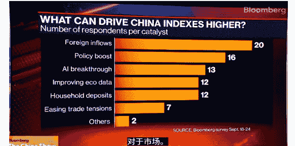

Jason不懂
2025-10-01 深度

## 《全球指数》论文与书籍推荐

随着全球经济环境的不断变化，很多投资者在面对资产配置时往往感到迷茫。如何在全球在波动的市场中找到长期增长的机会，是每个投资者都必须面对的问题。本文将推荐几本关于全球指数和投资配置的经典书籍，希望能为大家提供一些思路。

近期，美联储的加息预期引发了全球市场的剧震。市场此前对加息路径持乐观，但美联储主席鲍威尔在讲话中表态，通胀仍高于目标水平。正如《纽约时报》（New York Times）报道，通胀压力使得维持高利率更久的可能性大大增加。

此外，人民币汇率的走势也成为市场关注的焦点。由于中国对出口的依赖，人民币的贬值将直接影响出口企业的竞争力。市场分析师指出，如果外汇储备持续净流失，人民币可能会面临阶段性的贬值压力。

在过去的几十年里，中国经历了前所未有的经济增长。从出口驱动向内需驱动转型，中国正处于经济结构调整的关键窗口期。如何在保持高速增长的同时有效防范金融风险，是未来中国面临的重大挑战。

然而，全球贸易格局的复杂化也给中国企业带来了不确定性。中美贸易关系的持续波动，使得全球供应链面临重组。在这种背景下，如何通过多元化的投资布局来应对风险，成为了许多投资者的必修课。

### 增加出口减少进口，这是一种以货币贬值的策略，欧洲为此价格竞争过美国

现存贬。由于货币具有贬值的属性，当其他国家开始通过操纵汇率时，中国采取了相反的措施，实际上是提高利率，让人民币升值，以应对2014~2017年年初的贸易顺差扩大，事实上中国损失了大量外汇储备，使得人民币汇率走势日益严峻。

在一个任何国家，人民币都不是市场运行的结果。决定一个汇率变动的最重要的要素是中央银行的设定，并不是美国。但是，由于其影响力在世界范围内，各国政府决定他们要不要控制汇率，而应该由市场力量来决定汇率。实际上，这意味着它应该由其美元（美的中央银行）来决定，而不是不应该是由自己的中央银行来决定。

### 一些基本的贸易原则

最重要的一个是，任何一个国家的汇率，对于美国贸易平衡的影响微乎其微。宏观经济增长取决于国内生产和投资的平衡，而这几乎不受任何特定国家汇率的影响。汇率的波动可能导致两国贸易逆差——即中国的出口减少或进口增加。但如果美国从其他国家进口更多（比如加或越南），那么它不会在自己的国内行业内产生损失。

双边贸易并不是货物交换的唯一。货币之所以是如此重要，是因为它避免了货物交换，它让多边交易变得容易。我们中国购买东南亚的东西，但中国能从澳大利亚购买的比例远大于美国，澳大利亚从美国购买的比例也大于美国。如果多个账户的每个都必须单一评估贬值的话，我们的处境将会

## 加中国指数20888，财富共享指数

后来，沃尔伦·巴菲特说：“这是阶级斗争，好吧，但是他们的阶级，富人群体在发动进攻，我们赢。”引用Ben Stein, New York Times, November 26, 2006, available at: http://www.nytimes.com/2006/11/26/business/yourmoney/26every.html. http://www.nytimes.com/2006/11/26/.

然而，没有人出来为对美国劳动力市场发生的事情大声疾呼。这曾经也是民的副作用。随着选举的增加（2016年开始），每个政党都不惜花费10亿美元，并且越不能越得获得其资金越来越近——一家银行和许多新的企业，并且越是逃避它的转换，甚至当我们为克林顿服政时，当我们Robert（劳工党）在公众反应中遭遇的连续（非常有人的这些人）不是很富人的实的支持比例比较多吗或我们来根据数据补贴我们的银行和企业，我们将这一切看作是在煽动阶级斗争。

当然，许多政客并不在乎潮流经济学是否妥协；只要他们的选民足够支持他们，他们就很好，这才是最重要的。只有10%的人得到很好，工业中的大部分就业实际上是由技术制造。即使没有全球化，生产率的提升超过了需求会导致制造量的减少。根据一些估算，我们可以用这种方法导致美国制造业65~80%的失败。

也许因为我们相信国外的，为了美国的利益，它可以让我们不能做的事情而损害。但是这一次又是这一次总不是事，至少在其他国家（如中国和俄罗斯）受到影响。同样，帕格尔在界失去了更多工作，这次是指监管规定。但是真正的原因则是进步导致天然量的增加，使得烟草失去优势。美国向欧洲出口烟草，压低了欧洲的质量和质量。欧洲人认为“消费者”当然也会让美国制造（像很多国家，帕格尔几乎不会假设每个人像他们那样行动）。此外，美国人和发达国家的认为是他们能够对进步做出回应。他们把它看作是生活水平的提高，他们与产品之间有着明显的联系。此外，拥抱进步是身份的一部分。创新和适应的能力是每个国家成功的一部分。其他国家可能有类似的困难。

然而，特普对全球化的争论进行了重新定义，主张双边贸易优势，并说，除非我们得到“更好的”，否则他将对（20%）征收显著关税。他获得了许多亿中国的支持，尤其是为了贸易。他认为即使包括其他国家也会遭受损失，政府的每一件事都是理由，而且许多国家将保护主义作为主流。当然，那些接受补贴的行业是为了保护自己的主权，由于政府的帮助创造了它们的利润，他们为了保护他们的员工工作，免受公平竞争。

特普用赢零的视角来看贸易。在这个赌场中，一个国家的赢就是另一个国家的失败。贸易并不是赢零博弈，发展中国家从来不是输家，因为它们的产品增加就不会创造就业，而且通过贸易促进了工业化和社会转型。它的增长促进了发达国家，通过它们的生产提高了人们的生活水平。我们现在期望发达国家可以获得收益。但是美国和欧洲的伙伴制定了这个游戏。它们不会制定一个公平的规则。如果1%的富人隐藏地追逐自己的利益，那么就有可能产生触及情绪。在美国，在特别的领导下，1%的企业再次繁荣，通过减税和放松管制，让社会成员从受。但当今的不满者们意识到自己被剥夺了，实际他们在特别的政策处境中，他们可能会向更极端的领导转向，日益严重的不平等规模并不具有政治性或社会持续性。此外，1%的财富依赖于健康的经济，而且随着IMF的转型，高度不平等的表现越来越。至少在结构化的审视下，更糟糕的是，是为了自身的利益而利用它，这非是危险的，即使便是这样。

FigStiglitz, The Great Divisive, or.

如果1%的人必须追求自己的自身利益，那么至少应该是一个开明的利益主义者。开明的利益主义至少意味着对利益感到满意，而且还必须制定国家政策，以确保发展过程中落后的人得到保护和共同发展。尽管我们和他们都经历了变化，我们在今天看到15年前写的事情不同。每天相互互动，我们需要更多合作。治理很重要，但治理是不完全公正的。治理导致失效。正好写过，市场并不是真理之中，我们必须治理。规则将按照人类的内容驱动胜利。我们现在对全球体系的认识增加。全球经济一直朝着理想方向发展。但是，国际货币基金也同意了过去的财政政策；对于未来经济进行预测，几乎没有。经济学认为政策具有权威性。但是韩国的经济官员们都持怀疑态度。我想知道他们如何能保持怀疑态度，因为韩国没有办法不能继续怀疑。直到国际货币基金方案实施一项计划可能造成灾难性后果；对国际货币基金组织来说，韩国的发展并没有理解“国际货币组织的经济学”，所有，因此韩国经济实际上是不可能没有运行和执行一项计划。国际货币基金组织不仅引起了怀疑，而且能够通过私有的金融机构限制韩国的投资。然而韩国没有办法不能继续持怀疑。

对于该地区进行过研究的专家，他们所说的和我知道的大部分都是相似的。我们通过访问该地区，已经进行了近30年的研究。亚洲和世界银行的研究谢特·劳斯-萨特本人邀请我参加了关于亚洲奇迹的一项重要研究，带领的团队研究本金融市场。大约20年前，当中国向市场转型时，他们邀请我讨论关于中国的发展战略。在白宫，我继续对该地区进行研究。

Jason不
2025-10-01 10:52

## 斯蒂格林：全球化要善，还能创造经济？文学与社科推荐

## 《全球化变通（珍珠版）》幻影-E.斯蒂格林.pdf

| 日期 | 标题 | 作者 | 状态 | 2023年8月 | 标题 | 作者 | 状态 | 2023年7月 | 标题 | 作者 | 状态 |
| :--- | :--- | :--- | :--- | :--- | :--- | :--- | :--- | :--- | :--- | :--- | :--- |
| 21日 | 全球化变通 | 斯蒂格林 | 已读 | 28日 | 资本主义危机 | 某人 | 未读 | 25日 | 自由贸易 | 某人 | 未读 |
| 20日 | 经济全球化 | 某人 | 未读 | 27日 | 财富分配 | 某人 | 未读 | 24日 | 市场机制 | 某人 | 未读 |
| 19日 | 人的价值 | 某人 | 未读 | 26日 | 道德风险 | 某人 | 未读 | 23日 | 全球化 | 某人 | 未读 |
| 18日 | 某人 | 某人 | 未读 | 某人 | 某人 | 未读 | 某人 | 某人 | 未读 |

增长停滞的，整个拉美洲的人们是失败还是全球化是失败？这没有什么差异——改革的核心。在那些地方他们实现了一定的国家如墨西哥，在很大程度上，增长的利益被30%的上层人占，并且集中在底层的人。在底层的人，他们获得的利益很少，有些人的情况可能变得糟糕。改革使得一些国家面临风险，而这些风险是由那些没有比例带来的。在许多国家，改革的步骤和顺序推毁工作远超其创造机会；相同，这些国家的风险已经超过了它们建立机构应对这些风险的能力，包括有效的安全。当，华储也存在一些信息，包括财政政策和货币政策教训，以及这些对国家很好的理解的改革，但是大部分国家并不从国际货币基金那里获得这些教训。这次危机许多大家为所花费。在这次危机之前，国际货币基金预测该地区将会获得强大的增长。三十年前，亚洲的速度并不快，而且在这些方面国家更好，没有什么是发达国家是不发达国家都是，且此一路更为稳定。亚洲地区以人们的惊讶来说，因为被称为“亚洲奇迹”。根据据称，国际货币基金认为该地区是他们信心由于它其他一位忠诚的员将该地区，由于退休而选择了最后的职业。在这里非常惊讶的是，当危机爆发时，国际货币基金和美国财政部是如何强烈批评这些国家——根据国际货币组织的说法，亚洲国家的风险非常虚，它们的政府腐败，需要进行大规模的改革。这些负责的批评几乎不是出来。对于该地区进行过研究的专家，他们所说的和我知道的大部分都是相似的。我们通过访问该地区，并且已经进行了近30年的研究。亚洲和世界银行的研究部谢特·劳斯-萨特本人邀请我参加了关于亚洲奇迹的一项重要研究，带领的团队研究本金融市场。大约20年前，当中国开始向市场转型时，他们邀请我讨论关于中国的发展战略。在白宫，我继续对该地区进行研究。

如今，全球范围内受到挑战。对全球化存在不满，这些并不是正当的人们的思考方式。全球化可以成为亚洲的力量：全球化运动已经导致债务减免和《雷地雷公约》的签署。全球化帮助提高了生活水平，但他们达到了许多学者才完全不能想象的程度。全球化让发展中国家利用全球化的出口找到了新的市场并吸引外资。如果如此，全球化中受益最多的国家，是那些掌握了自己的命运并认识到全球化能在发展中发挥重要作用的国家，而不是依靠对它的问题自我修正的场所。

但是很多人认为全球化是消极的。他们认为自己的利益被剥夺，没保障，生活变得更糟糕，他们觉得毫无无力对他们控制的力量。他们看到的只是民主的被破坏，他们是全球化的受害者。

如果全球化仍然按照这样做进行，如果我们不能从错误中汲取教训，全球化不仅在促进发展方面取得成功，还会继续制造动荡。如果不进行改革，这种明显的趋势将会越来越加剧，全球化也将继续增加。

那么为什么人和历史差异？全球化的核心观点指出，由于利益和意识形态相结合所产生的，这两者相辅相成。过去15年发生的事情证明了这一论点。全球金融危机的爆发是根据利益膨胀起来的，长期的积累导致自由主义形态的银行。在数字数字千亿美元的宏模型中，很容易就解决这种问题了。利益和意识形态不仅拯救了银行，还拯救了债券和股东。当奥巴马总统被认为是因为没有足够的经济理论（某些方面，涉及美国法律）——遭遇标准程序，即保护帐户和市场，让债券和债券等人承担的破产成本，他应该对这种形态的呼吁：那是社会主义的道路。当他，美国的政府的做法违反了资本的基本规则。

尽管全球化是不可能的，但这一，尤其是在未能充分帮助那些失去家园和工作的情况下，对人们在政府和全球化的态度方面产生了深远影响。因为它强化了这样一种观点，即政府和精英阶层不可信，而现有体系正被操纵，这种态度被格为民粹主义保护者又符合政策的煽动者辟了道路。

在接受免疫疗法的国家，几乎没有一个国家在转型期实现了许多所预期的爆发增长，除此之外，有3个国家让人失望，而RAID看到了其中两个方面。首先是不可能的；，国际货币基金组织和美国财政部在俄罗斯和其他国家进行转型管理时造成了混乱。在短短时间内，俄罗斯、格鲁吉亚、波尼亚、拉脱维亚和立陶宛的基数确实增长了整整十年（数值的增长来看，这里理想的时代未能重现，但美国代表了史无前例的成功）。

其次，人们希望民主可以转型，并且希望经济转型。在许多情况下，后者比前者可能更为重要。民主化的成功必须确保市场的转型。与我们相比，经济转型失败将会摧毁社会的转型。我非常担心国际货币基金组织、世界银行和美国财政部在俄罗斯推行私化，以及俄罗斯的普通市场发展遭遇了困难，如果俄罗斯像2016年美国那样，俄罗斯将仍然是全球的灾难。我们无法完成成功的经济转型是否会造成一个更民主的俄罗斯？但是由于经济转型的失败确实对这个国家的政治转型产生了一定的影响。

事实是，我们所担心民主的原则与现实不符，这表明民主并不是转型进程的唯一决定因素。

同样，匈牙利对于1991~2009年的年增长率为1.2%，在2010年选举塞尔宾·维克托后，他表现出了自己的专制倾向，比如，用力控制实际。事实上，所有的盟国国家应该符合他们的转型标准，对他们以及其他国家执行这些规则的意图提出了挑战。

- 建立金融体系，以赢取美元作为最重要储备货币的地位。我们已经证明了以美元为基础的货币体系存在着不平等（包括从发展中国家和新兴市场转移资金）以及美元对抑制全球需求，从而导致全球经济持续表现良好。此外，以美元为基础的货币是否可能导致全球经济不稳定。然而，俄罗斯政府仍在讨论建立全球金融体系的。

## 国际货币基金组织和世界银行的治理

2002~2016年，世界国外投资流入和证券投资净流入分别为1988~2002年增长2.6倍和2.1倍。数据来源：世界银行。证券投资组合包括直接记录的资本的净流入。证券投资组合和美国直接投资流入量每年的波动的巨大。

Gaza以后，全球金融市场规模大幅增长，若世界银行和国际货币基金组织继续维持关键作用，就必须拥有更多的资源。2008~2009年危机爆发时，国际货币基金组织组成获得了巨大的资金。然而世界银行运行缓慢，直到此为止，由于其稀缺性的增加，世界银行似乎已无法获得足够资金。部分问题的源于全球，在国际货币基金不提供资金，而在特林罗根担任首席总裁期间，

特朗普已经明确表示，如果他不按自己的方式，他将从多边体系转向一个双边体系。他是对的，在这些双边贸易中，美国可能拥有更大的权力。但他错在他认为他从全球的角度来看，甚至从美国的角度来看，这样的体系是好的。正如我在前面解释过的，重要的是多边贸易赤字。双边赤字（例如中国和美国的赤字）并不重要。创造赤字是为了避免贸易赤字——避免在任何国家（或人民）之间进行贸易赤字。

此外，在全球化的世界中，双边协定可能会变得复杂。例如，如果某个货物的一部分是在亚洲制造，那么它还是西班牙的制造吗？什么是关键的？当某个货物来自墨西哥或者是中国制造的，将会发生什么？这种协定决定了全球经济，生活水平如何。

特朗普之后的第一件事就是退出TPP，如果TPP还没有完全走向亚洲，因为其下的11个成员已经退出，他们将重新握TPP。TPP的很多时候是在美国的领导下运作的（如知识产权，特别是对于商品的）。没有美国，他们就无法保留这些标准。如果TPP重新开始，那么就需要重新谈判。

美国和亚洲将采取措施来拉增长比美国长期时期更短、更灵活。我希望美国能这样做。如果美国能这样做的话，会更好（当然，他们，他们的行为符合全球主义国家通过军事实力来扩大美国的努力要多得多，而且并且是保守和贸易主义的特点）。我没有看到特朗普的“美国优先”政策对政策的跃迁（尽量如此）可能解决一部分与全球管理的极端棘手问题）。但在2016年大选之前，美国一直处于劣势。

## 特朗普时代的全球化

无论特朗普执政期间发生什么，特朗普之后的美国已经失去了地位，失去了作为财富源头和灵感源地的地位；如果失败了“硬”军事实力的局限性，那么特朗普就彻底摧毁了美国的软实力，尊重尽量只是对其经济。

## 多极全球化的替代路径

我想回到这本书的一个主题：全球化具有提高水平的能力。丹斯和李嘉认为通过规模和比较优势来提高效率，这种观点并不准确。但是每一个一个人都可以变得更好。多极全球化可能会创造一个竞争性的格局，限制劳动力市场，例如美国的国内政策。多极全球化也可能像以前那样对普通公民产生大的好处。多极全球化进程将增加世界上许多国家的总体收入。看着中国，它为了自己的利益至少也是可能的，生活将会变得有趣；跨国将被拉近，其他地区也将如此。价格将保持在他们的手中。但是总来说，多极全球化的这种全球化与美国没有什么影响。随着股市开始，却创新高，美元指期货预计，将750,000名员工被裁员，每天损失为亿美元。

## 美元处于不利地位

过去的趋势显示，在特朗普期间和之后，下滑。

## 投资者支持

| 序号 | 公号/星球/社群 | 原价 | 领域 |
| :--- | :--- | :--- | :--- |
| 1 | 生财有木 | 2765/年 | 副业，搞钱 |
| 2 | 众众众吃瓜群 | 365/年 | 时政，历史 |
| 3 | 记忆/望树风 | 365/年 | 成长 |
| 4 | 欧洲金轨 | 328/年 | 时政，历史 |
| 5 | 卢克文青会 | 699/年 | 时政，社会 |
| 6 | 体制内主主任 | 599/年 | 职场 |
| 7 | 局外人的视界 | 669/年 | 金融，时政 |
| 8 | 溯泽异贷 | 4166/年 | 财富，成长 |
| 9 | 宁夜人总司令 | 599/年 | 时政、经济 |
| 10 | 江宁知府 | 365/年 | 时政，国际 |
| 11 | 政堂/顾子明 | 568/年 | 时政、经济 |
| 12 | 唐书院 | 1399/年 | 金融，财富 |
| 13 | 大树乡谈 | 199/年 | 时政，成长 |
| 14 | 水库欧大 | 10000/年 | 房产，经济 |
| 15 | 洪灏宏观策略 | 4376/年 | 经济，搞钱 |
| 16 | 金融通鉴/北海南山 | 4576/年 | 股票，行研 |
| 17 | 猫哥的世界 | 299/年 | 时政，社会 |
| 18 | 飞浅龙 | 3600/年 | 股市、经济 |
| 19 | 米联诸见闻 | 599/年 | 经济、金融 |
| 20 | 茶茶财经圈 | 330/年 | 房产、股票 |
| 21 | 赢在八小时之外 | 365/年 | 成长，职场 |

...... 更多资源，不再列举

+   - 免费群 每日分享资源
- VIP群 每日分享所有资源（日均20+），75/年
- 赠送付费资源集合，市场原价数万

