# 南半球联职经理251003

Jason不赢
2025-10-02 16:18

Robin Brooks: 近期金价上涨开始于威塞尔 8 月 22 日在杰克逊威尔发表演讲之后。美元自此后一直保持稳定，因此并不是投资者远离美元寻求安全，而是投资者远离美元 G10 货币，由于对法定货币债的收益率日益加剧。

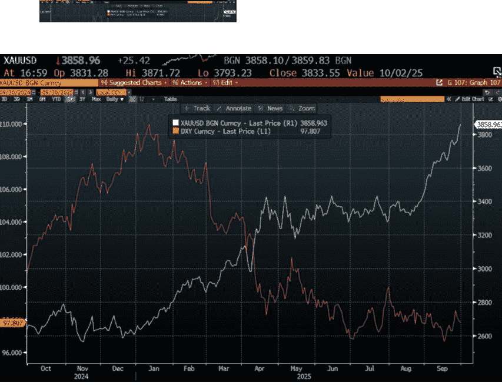

Jason不赢
2025-10-02 16:22

Bloomberg: 外国持有的美国股市已超过 20 万亿美元，创历史新高。目前，美国股市的 30% 由外国投资者持有，这是自 1945 年以来的最高比例。#美股

# 微信top2686，进群资料分享群

# Foreign Holdings of US Equities Hit Record

US stocks owned by foreign investors, $20 trillion dollars

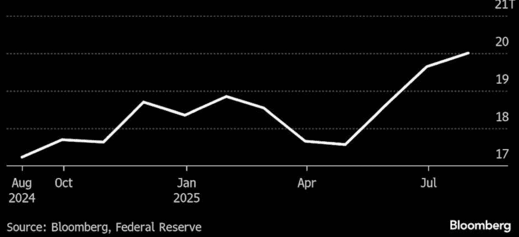

Source: Bloomberg, Federal Reserve

Bloomberg

Jason Noble
2025-10-03 03:57

polymarket目前的各种结果，预期美国关门赢得10/15。其他国家经济

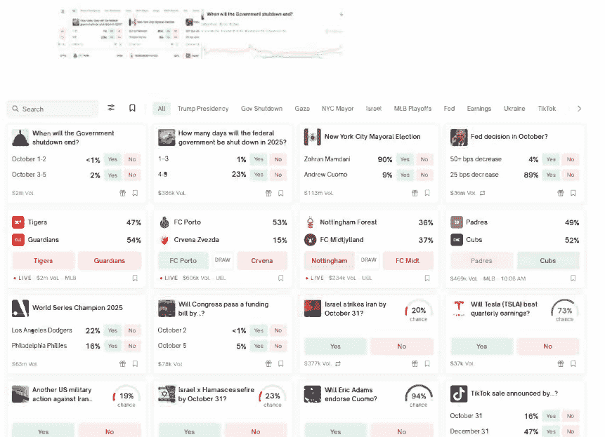

# 加微信top28688，进资料分享群

# When will the Government shutdown end?

$2,062,874 Vol. Oct 15, 2025
October 15 or later 47%
October 10-14 32%
October 6-9 19%
October 3-5 1.8%

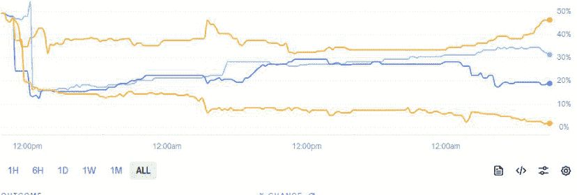

| OUTCOME | % CHANGE | Buy Yes | Buy No |
|---|---|---|---|
| October 1-2 $753,434 Vol. | <1% *1% | 0.1c | 100c |
| October 3-5 $519,340 Vol. | 2% *7% | 1.9c | 98.3c |
| October 6-9 $140,345 Vol. | 19% *8% | 20c | 82c |
| October 10-14 $96,715 Vol. | 32% *4% | 33c | 70c |

> Jason不赢
2025-10-03 01:05
南华早晨: 最新研究发现，每天步行 7,000 步即可完全防止死亡风险下降 47%，心血管疾病风险下降 25%。走越多，报酬越快。#人生

While 7,000 daily steps may feel like a monumental task to many, a more modest 3300 daily steps can be as beneficial. Change begins in the heart of fear and many people might be intimidated into not taking that crucial first step towards a healthier lifestyle.

加微信top28688，进资料分享群

While 10,000 daily steps feel like a monumental task to many, a more modest 7,000 daily steps can be almost as beneficial.

Clare hopes that his team's work will help encourage people not to be intimidated by taking that crucial first step towards a healthier lifestyle.

From cardiovascular disease to cancer to depression, the study review examined the health effects of walking across a wide range of diseases and symptoms.

In the end, researchers determined that walking just 7,000 steps a day was associated with a 47 per cent lower risk of all-cause mortality and a 25 per cent lower risk of cardiovascular disease, among other findings.

"The benefit that you get from going from 5,000 to 7,000, [versus from 7,000 steps] up to 10,000, is much reduced," Claire.

"From going 1,000 to 7,000, you get about a 50 per cent reduction in mortality. Going from that 7,000 to 10,000, you get another 5 per cent. You can still reduce your risk if you keep going, but you get a lot less bang for your buck."

Jason不赢
2025-10-03 04:13

# Bloomberg: 外资在多元化中重新考虑中国资产，非常谨慎 #金融

- 欧洲养老基金和其他类型投资者在回避多年年后，正在探索在中国进行私募投资。
- 人们对中国的兴趣是对于技术突破和乐观情绪增加以及从美国转移私募股权的变动。
- 尽管人们近期引起关注，在投资者中看到一系列在中国进行大规模投资和退出的现象，资本部门仍受到限制。

欧洲养老基金、和其他类型基金在长期多年回避第二大经济体后，再次在探索在中国进行私募投资。

知情人士透露，包括酷斯集团、华平投资和太湖投资集团在内的收购公司正在接受全球投资者关于在中国投资的新闻，他们要求不披露详情，因为认为是保密的。

如今为止，这项新兴基金尚未进行任何投资，与去年相比，由于政治紧张加剧和对中国私营企业的压力，资金转移到亚洲地区，这是一个明显的转变。现在，市场资金对技术突破和乐观情绪增加以及从美国转移趋势有望发展。

加微信top208688，资料分享群

尽管如此，在中国在私募股权领域恢复之前的突出地位仍然困难。全球投资者大幅减少对中国的配置，亚洲私募股权融资份额降至多年低点。2024年，该地区仅占全球私募股权的7%，而2021年为13%，凸显了国际对亚洲的需求已经萎缩。

# 大中华区私募股权退出受困

高估值使私募股权陷入困境

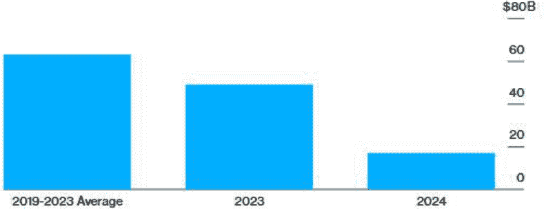

资料来源：AVCJ；贝恩公司
注：包括房地产和1000万美元以下的退出

根据贝恩公司的数据，2020年中国亚太地区交易价值的一半，到2024年其份额下降至27%——大中华区遭受了最严重的退出衰退，导致私募股权退出能力下降。2024年退出价值同比跌69%。与此同时，整个亚洲除中国外，所有市场的交易价值增长了11%。印度脱颖而出，成为明显的亮点。

私募股权行业重新评估中国，自2022年以来，KKR、黑石等等大型公司暂停了在中国的一些退出。根据贝恩公司的数据，去年最大的私募公司仅参与中国交易的6%，低于2018年至2023间的平均24%。

加微信top2688，进阶资料群

# 高盛 (Goldman Sachs Group.) 亚太地区（日本除外）总裁凯·斯尼德 (Kevin Sneader) 表示尽管外国投资者正在重新审视中国，但需谨慎。他在亚洲峰会上表示来自亚洲投资者的资金未能回中国。

知情人士指出，北美投资者很大程度上反对投资中国。某些欧洲投资者，尤其是斯堪纳维亚半岛的投资者，乌克兰战争导致了对中国的信心也陷入了。他们认为这类投资者是间接支持俄罗斯的胜利。美国的关税政策让投资者情绪波动。市场重新引起关注，但在投资者看到中国出来一系列大规模投资和流出后，资本部署将受到限制——这是市场回归的关键信号。华平亚洲地区主管Mahadevia Maharaja表示，现在是重返中国的“好时机”。

“它是世界第二大经济，在那里设立办事处以建立多元化的全球组合是明智之举，”在他最近的一次采访中说。

Jason不赢
2025-10-03 04:28

FT: 今年夏天，俄军将乌克兰制造的轰炸机拦截的第一个就是乌克兰成功率大幅下降。他们对俄罗斯技术优势。

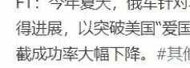

加微信top28868，资料分享群

# Missiles launched by Russia against Ukraine

Launched Intercepted or 'Lost in Location'

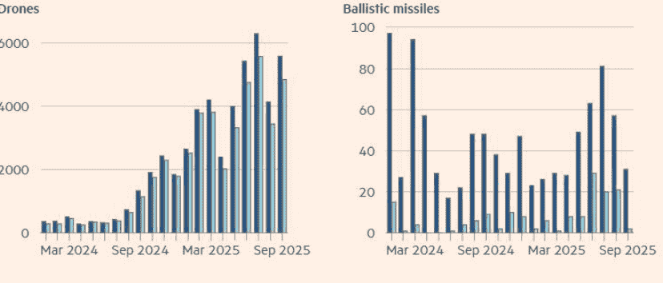

Drones Ballistic Mar 2024 Sep 2024 Mar 2025 Sep 2025

Source: Ukrainian Air Force/Centre for Information Resilience

# FINANCIAL TIMES

Has Russia improved the effectiveness of its ballistic missiles? Russian miss about half in Ukraine

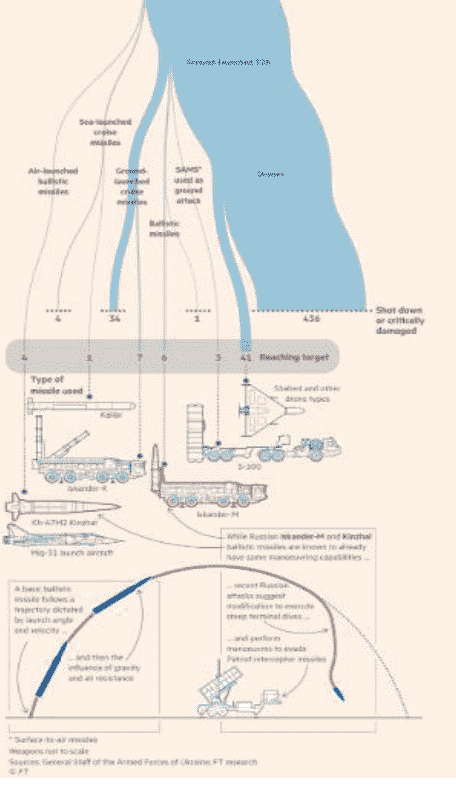

加微信top28688，进资料分享群

# Jason不离

加州大学税利分析：超级富豪与你相比，他们的税率更低：

近年来，400名最富的美国人的有效税率急速下降，他们在缴纳的实际税占其实收入的比例低于普通人。顶层0.002%——有效税率从2010-2017年的30%降到2018-2020年的23.8%。

对富人来说，没有其他收入的，工资收入的所得税是最高的，最高边际税率为37%。股票收益的资本税为15-20%。由于资本税远高于富人的所得税，就避免了对富人不利的税。马斯克购买100万美元股票，那么他就缴纳15-20%的资本税。如果这是工资收入，根据上面的规定，总税额将不到13万。以这种方式，马斯克购买100万美元股票，就能缴税十万多。这种好处是富人的福音。马·霍莱伯在Meta中的基本利润，贝索尔的新财富维持在8万美元。但是不是20%的资本税他们愿意付的，他可能像你一样，用钱买股票作为抵扣。美国的关税利率为7%，这比20%的资本税或37%的高边际所得税便宜得多。富人是可以躲避的美国宪法漏洞吗？

富人通过他们的法律来规避自己的财富，事实上，中产阶级每年的税还要比1%，甚至是0.01%。超级富豪的这种方式逐渐告诉我们，如果征收所得税，他们就可以一直跑，等到女儿继承时要付遗产税在连续循环。他们可以躲避了遗产税。

例如：2018-2020年期间，美国整体人的有效税率为30.2%，相当于唐纳德·特朗普总统第一任期的最后三年。

# The ultra-rich are different from you and me. Their tax rates are lower.

In an innovative new research paper, Berkeley economists found that the total effective tax rates paid by the400 richest Americans have declined sharply in recent years. The findings will likely serve as fuel in an increasingly fierce U.S. policy debate.

By Edward Lepinen

一个世纪以来，美国的税收制度一直被设计为累进式的，最富人的缴纳最高的税率。但近十年来，最富人的财富一直在增长，这项研究似乎表明，当所有财富积累起来，超级富豪缴的税率反而低于中产阶级。

例如：2018-2020年期间，前100名富豪的总体有效税率为22%，接下来的300名为工资薪金所得率为26.6%，与这些财富来自所有或投资的人相比，实际税率为45%。

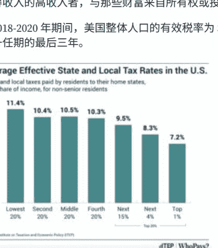

> 从税收收入的整体角度来看，超级富净美国人的税率低于普通美国人。

加微信top2888，进瓷资料群

## Jason不蛋
2025-10-03 04:52

Bloomberg: Prestige Economics表示，随着美国政府关门进入第二周，美元可能会进一步走弱。其他经济学

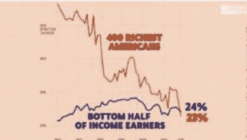

一级外汇预测者表示，随着美国政府关门进入第二周，美元可能会进一步走弱。华盛顿的政治局已经预计周四每周失业人数的发布推迟，并可能推迟到周五发布最新数据报告。Prestige Economics总裁Jason Schenker表示，在缺乏经济数据的情况下，货币政策所说的话将为交易者提供有关美联储利率的线索。

> “政府关门加剧了美元的近期下行风险，”申在接受采访时表示。他超过了彭博的排名进入第二个周的外汇预测者。

# 美元今年下跌超过8%

美国政府关门打击美元

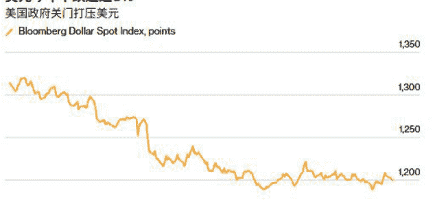

资料来源：彭博

今年到为止，彭博对美元的衡量标准已经下跌了8%，申克预计美元将进一步下跌。美国政府关门导致了。

# 韩国亚太地区（日本除外）总裁凯·斯尼德 (Kevin Sneader) 表示尽管外国投资者正在重新审视中国，但需谨慎。他在亚洲峰会上表示来自亚洲投资者的资金未能回中国。

## 韩国亚太地区（日本除外）总裁凯·斯尼德 (Kevin Sneader) 表示尽管外国投资者正在重新审视中国，但需谨慎。## 韩国亚太地区（日本除外）总裁凯·斯尼德 (Kevin Sneader) 表示尽管外国投资者正在重新审视中国，但需谨慎。## 韩国亚太地区（日本除外）总裁凯·斯尼德 (Kevin Sneader) 表示尽管外国投资者正在重新审视中国，但需谨慎。## 韩国亚太地区（日本除外）总裁凯·斯尼德 (Kevin Sneader) 表示尽管外国投资者正在重新审视中国，但需谨慎。

# 微信top2888，资料分享

# Moving EV Metals Across Africa
Revived rail line expected to cut delivery times

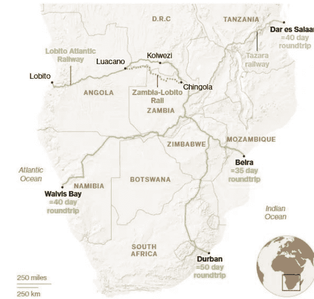

Note: The planned connection between Luacano in Angola and Chingola in Zambia is subject to a feasibility study
Sources: Ivanhoe Mines, US White House

# 美国铀供应

美国仅有 8% 的核燃料来自国内

| Total Uranium Purchased | US Origin Uranium | Foreign Origin Uranium |
| :--- | :--- | :--- |
| Million pounds: 80 | | |

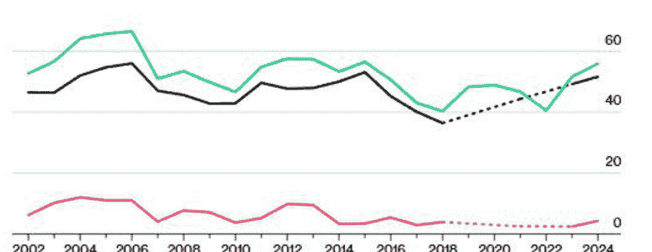

数据来源: 彭博社整理的美国铀能信息数据
注：2019年和2022年数据因行业因素EIA扣留的部分数据

# 加微信top28688，进阶资料分享

Jason-Liang
2025-10-03 05:04

南華報：根據香港交易及結算所數據，2025年前八個月的融資達到1345億港元（173美元），同比增長579%。未來中國大公司的上市可能都會採用“A+H”結構，這種方式可以吸引國內外投資者。香港有潛力在人民幣國際化的發揮作用，作為新資產的試場，香港管理者全球約80%的離岸人民幣流動性池。截至7月，存款達到9,382億人民币（1,207美元），凸顯了其作為貨幣國際關鍵平台的作用。根據銀行金融信息協會的數據，人民幣在全球支付中的份額在過去五年中幅上升，從2020年的1.88%升到2024年7月的峰值4.74%，然後在今年8月回至2.9%。#金錢

# Hong Kong leads 2025 IPOs

Amount raised: Cherry and Zijin Gold (in progress)

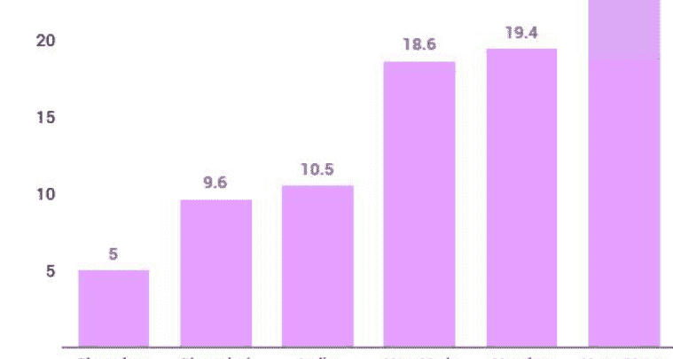

Data excludes closed-end funds, SPACs and REITs; as of September 23, 2025
Source: Bloomberg SCMP Plus

加微微信top28688，進享資料分享群

# Jason-Ocean
2025-09-03 05:08

国际机器人联合会（IFR）最新发布的《2025年世界机器人报告》显示，全球工业机器人安装量2024年同比有所增长，中国市场实现了7%的增长。这一增长使中国当年新增的工业机器人安装量达到29.5万，占全球总量的54%，份额再创新。

摩根士丹指出，2024年，中国产品在国外工业机器人市场的份额从2023年的一起跃升至58%，标志着中国供应链的技术成熟和市场接受达到了新的里程程。

从2025年到2028年，全球工业机器人安装量将以7%的平均复合增长率（CAGR）增长，到2028年达到70.8万。数据来源

# Exhibit 1: Global industrial robot shipments were flat y-y at 542k units in 2024, of China contributed 54% (vs 51% in 2023)

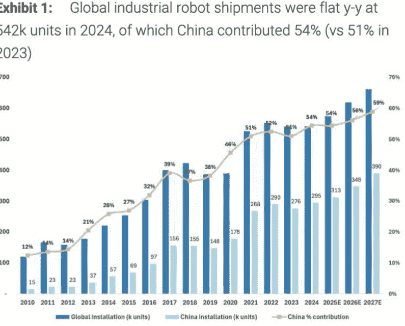

Source: IFR, Morgan Stanley Research. E=IFR estimates

# 加微信top28688，进资料分享群

# Exhibit 5: Local brands' market share further climbed to 58% in 2024 in the China industrial robot market

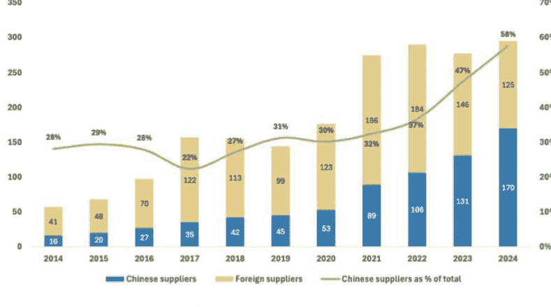

Source: IFR, Morgan Stanley Research

# Exhibit 2: By geography, Asia took the lead at +5% y-y (mainly supported by China's +7% y-y); Europe and The Americas declined in the high single digits (%) y-y, in 2024

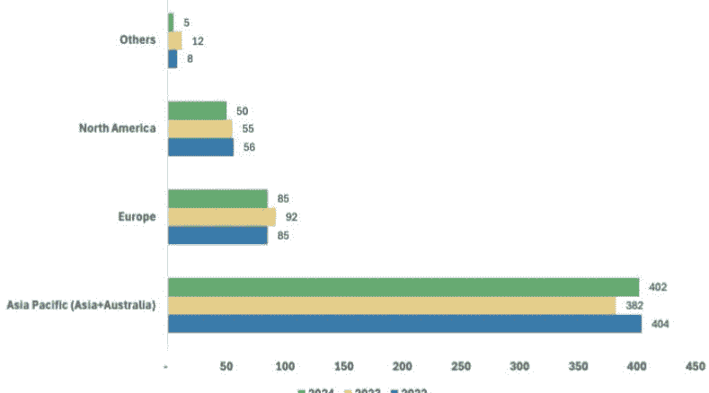

Source: IFR, Morgan Stanley Research

微信top28688，进资分享群

# Jason不遇
2025-10-03 05:09

华尔街见：从2022年10月ChatGPT发布以来，美国的“职位空缺”数量就开始下降（白线），而美（红线）一路高升。AI提高了公司的利润，减少了人力开支，这恐怕不仅是巧合。#美股

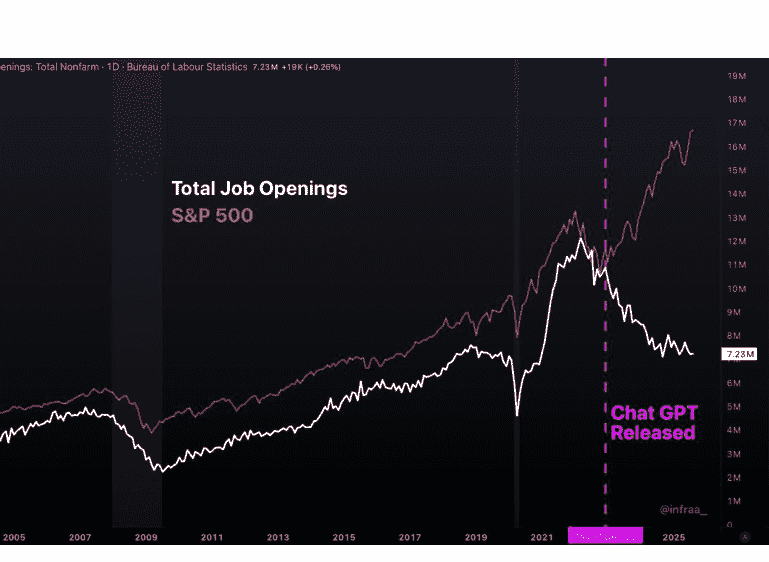

# Jason不遇
2025-10-03 06:48

more birth: 我们研究了生育率在30岁以上或40岁以后下降的趋势。但在2023年，德克萨斯大学华盛顿分校包含30万美国大型数据集的研究发现，生育能力在20岁达到顶峰，然后在30岁后下降。这意味着生育能力在20岁达到顶峰，然后在30岁后下降。33岁时，女性在一个内的怀孕概率仅为1/3，而到40岁时，她的生育能力已飙减10%。换句话，初婚推迟会影响生育。反过来，我们重新审视年龄和不孕症，2021年至2022年的划分显示，尽管生育率根本并没有下降。#人口

# 加微信top28688，进资料分享群

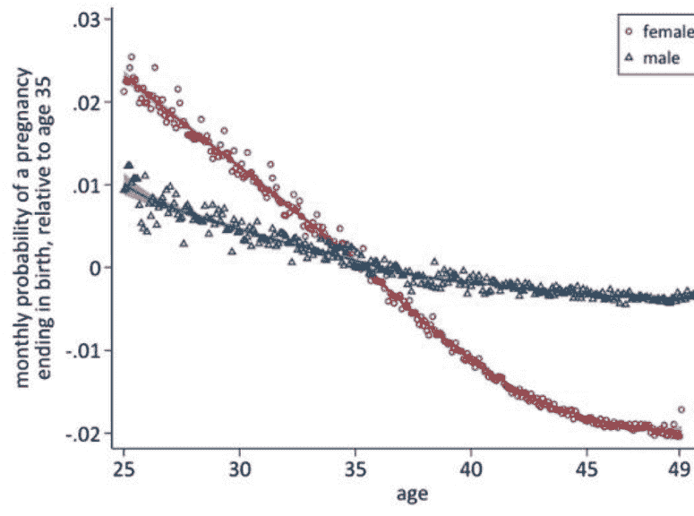
...
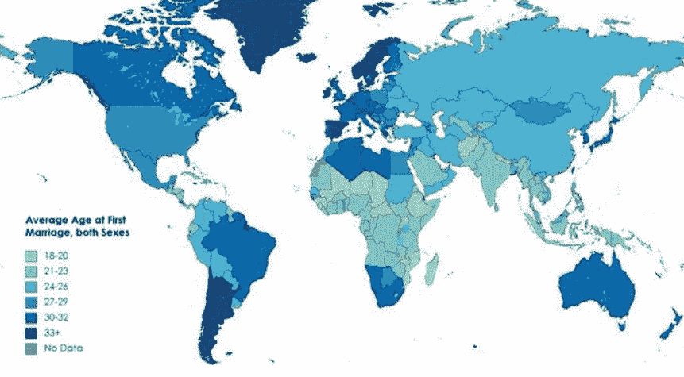

加微信top28688，进资料群

# Did give birth to a child in last 12 months?

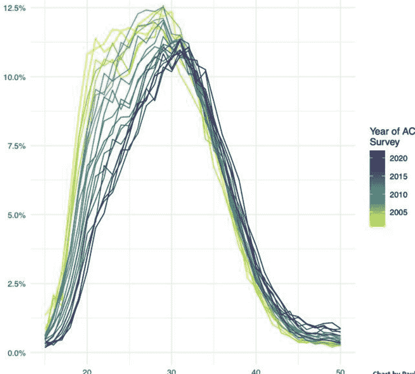

Jason-不
2025-10-03 06:54

TKL: 上周，上海至鹿丹的40英尺集箱租价跌至1735美元，为2023年12月中来的最低水平。这标志着亚洲连续下降。从上海到洛杉矶的运费降至2311美元，也是2023年12月来的最低水平。预计进口将在年底继续下降，预计2026年1月将下降19%。#经济

加微信top28688，进资料群

# Shipping Costs to Europe From China Slump for Eight Weeks

Spot container rates to US, Europe are tumbling amid weaker demand Shanghai-to-Rotterdam spot rate

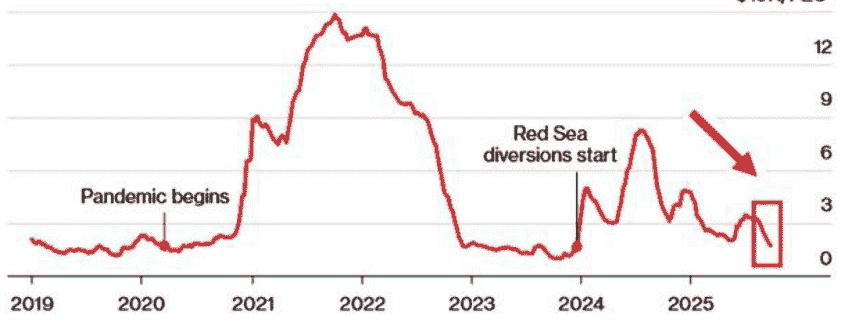

Source: Drewry World Container Index
Note: *40-foot equivalent container unit

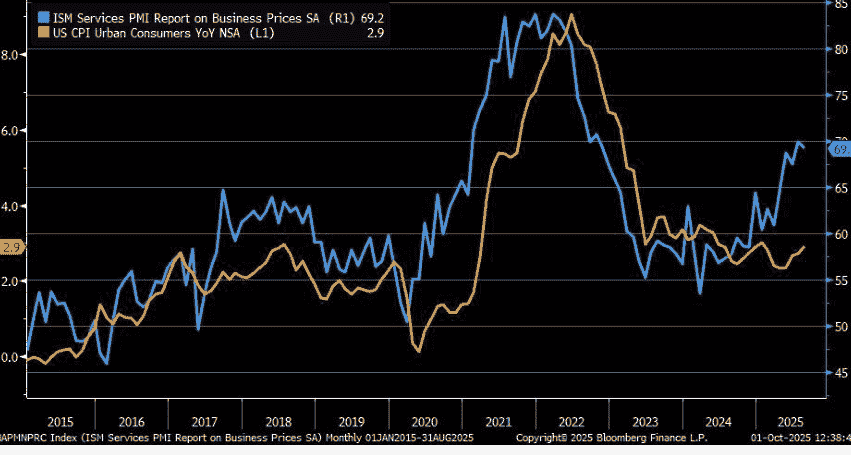

加微信top28688，进资料分享群

# 知识星球TOP 资源分享群添加微信；免费入群 微信:top28688

| 序号 | 公号/星球/社群 | 原价 | 领域 |
| :--- | :--- | :--- | :--- |
| 1 | 生财有木 | 2765/年 | 同业、搞钱 |
| 2 | 众宗吃瓜群 | 365/年 | 时政、历史 |
| 3 | 记忆巷/裁西风 | 365/年 | 成长 |
| 4 | 欧洲金轨 | 328/年 | 时政、历史 |
| 5 | 卢克文云会 | 699/年 | 时政、社会 |
| 6 | 体内主任 | 599/年 | 体制、职场 |
| 7 | 局外人的视界 | 669/年 | 金融、时政 |
| 8 | 溯泽异昂 | 4166/年 | 财富、成长 |
| 9 | 宁夜人司令 | 599/年 | 时政、经济 |
| 10 | 江宁知府 | 365/年 | 时政、国际 |
| 11 | 政堂/顾子明 | 568/年 | 时政、经济 |
| 12 | 唐书院 | 1399/年 | 金融、财富 |
| 13 | 大树乡村谈 | 199/年 | 时政、成长 |
| 14 | 水库联大 | 10000/元 | 房产、经济 |
| 15 | 洪灏宏观策略 | 4376/年 | 经济、搞钱 |
| 16 | 金企通鉴/北海南山 | 4576/年 | 股票、行情 |
| 17 | 猫哥的世界 | 299/年 | 时政、社会 |
| 18 | 飞龙沃 | 3600/年 | 股市、经济 |
| 19 | 米联诸见闻 | 599/年 | 经济、金融 |
| 20 | 茶茶财经 | 330/年 | 房产、股票 |
