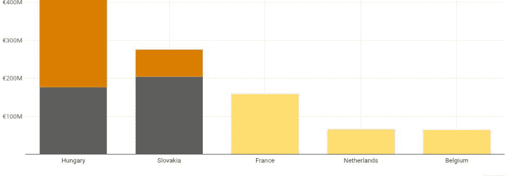
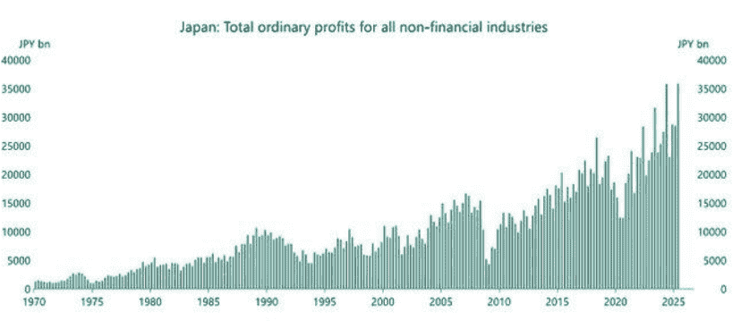
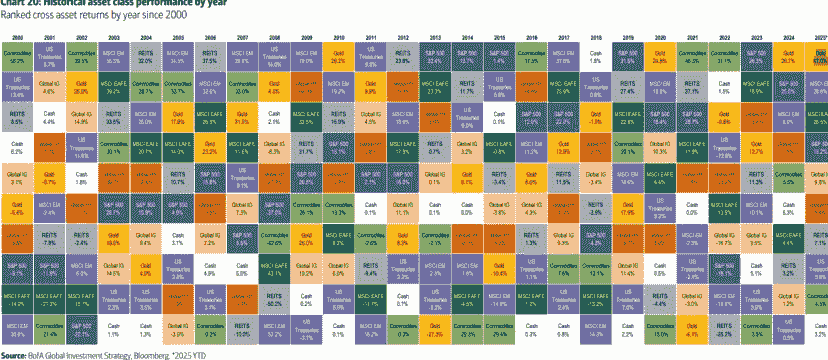
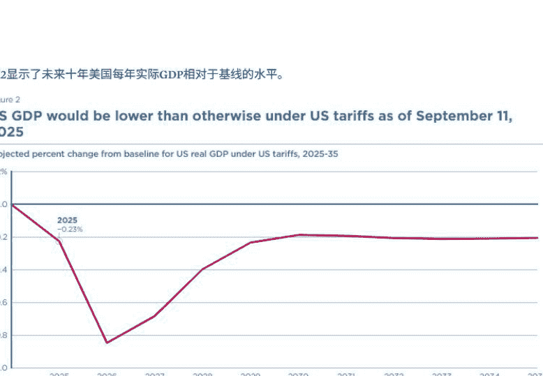
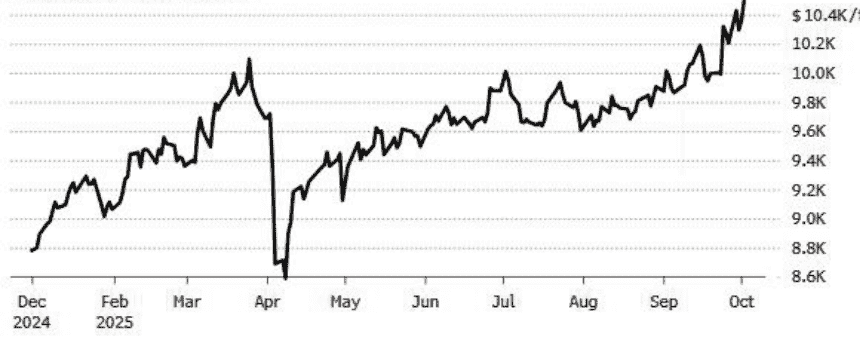
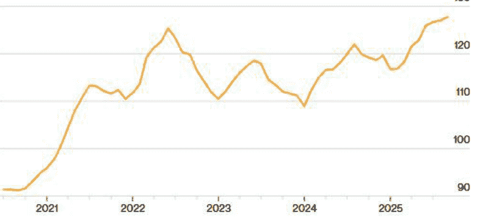
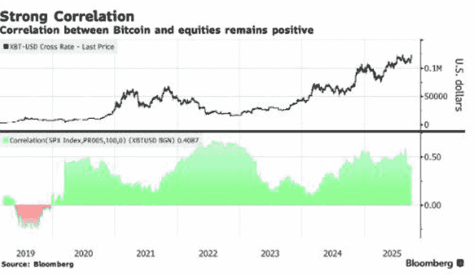
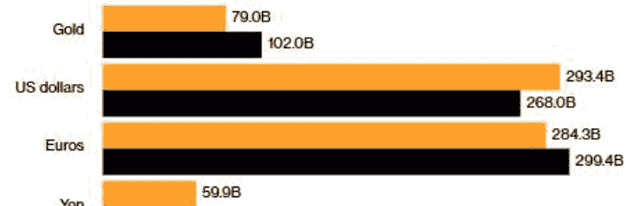
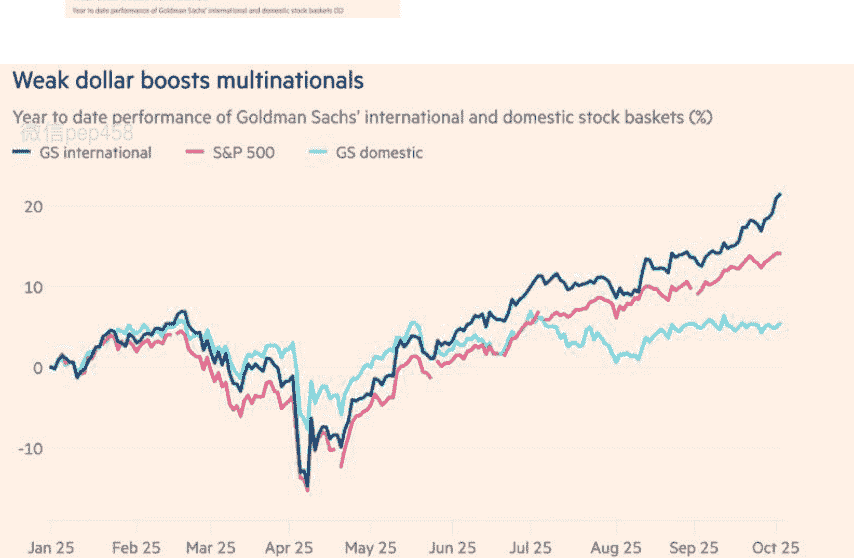

# 南半球聊财经251004

Jason+不능
2025-10-04 06:07

## CREA: 8月欧盟购买俄罗斯能源11.5亿欧元 #其他国家经济

Who are the top purchasers of Russian fossil fuels in the EU?

According to the Centre for Research on Energy and Clean Air, which tracks flows of Russian fossil fuels, the EU spent 1.15 billion euros ($1.35bn) on Russian fossil fuels in August, and the top five importers bought combined 979 million euros ($1.15bn).

- Crude oil
- Liquified Natural gas
- Pipeline gas

加微信进语群

## Who are the top purchasers of Russian fossil fuels in the EU?

According to the Centre for Research on Energy and Clean Air (CREA), which tracks flows of Russian fossil fuels, the EU spent 1.15 billion euros ($1.35bn) on Russian fossil fuels in August, and the top five importers bought combined 979 million euros ($1.15bn).

Source: Centre for Research on Energy and Clean Air (CREA) | Data as of August 2023

Jason+不능
2025-10-04 06:15

Apollo: 我们看好日本。企业利润迎来好趋势，预计未来12个月增长将加速，通胀预计将从目前的低位开始。

bloomberg: 日本在走出“企业破产”的包袱。日本经济泡沫破裂后的长期停滞期间，产生了大量破产企业，到2010年，几乎五分之一的公司为救助其他公司而融资而一扭持续经营，主意不意关关闭它们。破产企业的数量开始缩小，这是七年的最低水平。在截至3月的一年中，破产数量提升了1%，达到10,070，为2014年以来的最高水平。目前，大公司尚未破产，由于长期劳动力短缺，人们抱怨能够得到工厂工作。 #其他国家经济

## 微信top208688，进资料分享

## Japan: Corporate profits for all industries are rising

Jason不离
2025-10-04 06:23

## BOFA:YTD资产回报率 #金融

## The Asset Class Quill of Total Returns

Source: Black Global Investment Strategy, Bloomberg ©2023 HD

微信top28688，进资料分享群

Jason 不离
2025-10-04 06:38

PIIE: 在9月的更新中，我们再次使用 G-Cubed 模型为美国和全球经济造成了未来几年采用关税的悲观预测。我们预测，如果在本末年内增加实施这些关税，与不采取关税的情况相比，这些关税将导致美国经济减少、美国物价上涨和美国经济下降。具体来说，关税将美国经济增长率在2025年降低基准0.23个百分点，在2026年降低0.62个百分点，从2025年9月11日起，通胀率将基准抬高1个百分点。随着时间的推移，通胀率下降基准，美国由于采取行动导致通胀减缓并与增长放缓。尽管如此，美国关税水平仍然高于有关关税的。

仅凭这些关税会导致美国经济增长。但如果关税与美国规模未经过关税的移民人和债务相结合，美国经济增长。 #其他国家经济图2 显示未来十年美国实际 GDP 相对于基准的水平。

Figure 2 US GDP would be lower otherwise under US tariffs as of September 11, 2025

Projected percent change from baseline for US GDP under US tariffs, -3.5%

Source: Working Paper by Warwick McKlin, Marcus Norland, and Geoffrey Shrugman. The global economic effects of Tariffs to 2025

Jason 不离
2025-10-04 06:38

特朗普表示正在向美国民众发放现金。未来的需要是关税增长。此外也将部分关税用于偿还债务。事实上，利用关税收入向民众退税的想法并非首次。早在今年7月，特朗普曾对媒体透露类似构想。 #其他国家经济 微信top28688，进资料分享

## 关收入预期

特朗普民计划的资金基础，建立在对税收入的乐观预期之上，但这一数据与保守估算却巨大。特朗普在采访中声称，新冠税收的“刚开始”，然而，根据媒体此前披露，财政部长贝特提到，预计年度税收入可能超过5000亿美元。而在今年，贝特对市场表示，预计年度税收入可能将300亿美元。这些数字远低于特朗普提出的目标，引发了对该资金来源持续性的疑虑。

与此，特朗普提到了这些资金的另一个用途——债务。这一债务规模与美国财政部的数据基本一致。在接受采访时，特朗普明确指出民主党人声称他们的错。他他还暗示：高盛：伦敦金属交易所价格涨至10,500美元以上，对于2024年5月以来最高水平。由于人工智能金属的供应端与对增长的需求矛盾，电网是“能源安全的环节”。随着人工智能的崛起，地缘政治和混合战争的竞争以及需求增长更加迫切。随着人工智能和国防将电网置于能源安全的核心，哪怕是新的。这种电网是金属密集型的：我们预计到本世纪末，电网和电力基础设施将推动全球需求增长~60%，并预计到2027年份额10,750美元/耗。 #金融

Jason 不涣
2025-10-04 06:43

## Copper Has Gained 19% This Year / LHE copper futures, rolling

Source: Bloomberg, LHE

Jason-不离
2025-10-04 06:47

Bloomberg: 全球肉类价格在9月份创历史新，创自2021年以来最长的月度涨幅。上个月，欧洲央行指出，食品价格的增速快于更广泛的通胀，英国零售商协会表示，更大的劳动力压力和成本持续推高许多农民的投入价格 #金融

## 全球肉类价格创2021年以来最长涨幅

在牛肉成本的推动下，价格连续第八个月上上涨

资料来源：联合国粮食及农业组织

微信top28688，进资料分享群

Jason 不鸡
2025-10-04 06:51

Bloomberg: 比特币接近新纪录，“价值”刺激交易风险反弹，目前今年上涨了30%以上。周五，在另一轮大型人工智能和伙伴关系中，美国股市触及新高，与长期暂停的震荡和商业活动的驱动。美国国债和美元下滑。在美国国利率下降和通胀忧扰之不去，央行买险推动了黄金有望上涨。 #金融

## Strong Correlation

Correlation between Bitcoin and equities remains positive

Source: Bloomberg

加微信top28688，进阶资料分享群

## 博士的要点

瑞士银行持有的黄金价值在显著增加，再次向政府付款。瑞士银行首席经济学家 Karsten Junius 表示，在第三季度，瑞士银行的黄金积累大幅增长，足够。瑞士银行首席经济学家 Sarasin 表示，在第三季度，瑞士银行持有的黄金价值增加了约150亿法郎，这是2024年为止的最大涨幅。Junius在接受采访时说：“由于股市表现良好，投资组合几乎完全消除。”

- Value of holdings at end of 2024
- Estimate of value of holdings at end of Q3/2025

资料来源：瑞士银行、彭博

注：瑞士银行每月公布持有量不变。

## Jason 不离
2025-10-04 07:01

FT: 美元走弱，跨国企业和出口商的表现优于市场软化。许多投资者选择美元来对冲其资产，而利率下行加剧了压力。美元走会在计价中抬高海外收益，同时也使得需要从海外采购的企业面临更高的成本。 #美元 Weak boosts multinationals

Year date performance of Goldman Sachs' international and domestic stock baskets (%)

- GS international
- S&P 500
- GS domestic

Sources: Bloomberg, Goldman Sachs

微信top28688，进资料分享群

## 知识星球TOP资源分享群添加微信；免费入群微信:top28688

| 序号 | 公号/星球/社群 | 原价 | 领域 |
| :--- | :--- | :--- | :--- |
| 1 | 生财有木 | 2765/年 | 同业，搞钱 |
| 2 | 众宗吃瓜群 | 365/年 | 时政，历史 |
| 3 | 记忆/树西风 | 365/年 | 成长 |
| 4 | 欧洲金轨 | 328/年 | 时政，历史 |
| 5 | 卢克文青云会 | 699/年 | 时政，社会 |
| 6 | 体制内主任 | 599/年 | 体制，职场 |
| 7 | 局外人的视界 | 669/年 | 金融，时政 |
| 8 | 泽沛异贷 | 4166/年 | 财富，成长 |
| 9 | 宁夜人总司令 | 599/年 | 时政，经济 |
| 10 | 江宁知府 | 365/篇 | 时政，国际 |
| 11 | 政堂堂/顾子明 | 568/年 | 时政，经济 |
| 12 | 唐书院 | 1399/年 | 金融，财富 |
| 13 | 大树乡谈 | 199/年 | 时政，成长 |
| 14 | 水库欧大 | 10000/年 | 房产，经济 |
| 15 | 洪灏宏观策略 | 4376/年 | 经济，搞钱 |
| 16 | 金企通鉴/北海南山 | 4576/年 | 股票，行研 |
| 17 | 猫哥的世界 | 299/年 | 时政，社会 |
| 18 | 飞浪龙 | 3600/年 | 股市，经济 |
| 19 | 米联诸见闻 | 599/年 | 经济，金融 |
| 20 | 茶茶财经财经 | 330/年 | 房产，股票 |
| 21 | 赢在八小时之外 | 365/年 | 成长，职场 |

...... 更多资源，不再列举

+ 图书、报告、课程等各类高价值资源

- 免费群 每日分享所有资源（日均20+），75/年
- VIP群 每日分享所有资源，赠送付费资源集合，市场原价数万元
