# 南非联财财经25105

Jason 不离
2025-10-05 00:57

## 《金条条：1929-1939》论文或书籍推荐

《金条条：1929-1939》是关于20世纪30年代大萧条时期金本位制度崩溃的重要著作。书中详细描述了金本位制度在危机期间是如何运作，以及各国在应对危机时采取的各种措施。作者通过大量的历史数据和分析，展示了金本位制度的内在局限性。这本书对于理解大萧条的起源以及金融体系的演变提供了非常深刻的见解。此外，书中还讨论了20世纪30年代的金融危机，并分析了金本位制度崩溃对国际货币体系的影响。对于想要研究金融史的学者来说，这本书是一本不可或缺的参考。同时，它也对于对现代金融问题感兴趣的读者来说，非常有价值。

书中还探讨了金本位制度崩溃的几个深层因素。例如，当各国积累的黄金储备量超过了法律允许的范围，金本位制度就可能面临崩溃。此外，国际政治局的动荡也加速了金本位制度的瓦解。通过对这些因素的分析，我们可以看到，金本位制度的崩溃并不是由单一因素导致的，而是多种交织的经济、政治和历史因素共同作用的结果。

首先，19世纪90年代在南非发现的黄金是金本位制度建立的重要先决条件。如果经济通过创新和生产力的提高而不断增长，那么黄金供应也能够增长，以确保增长。其次，只有当每个人都遵守“游戏规则”，金本位才能发挥作用。然而，当各国积累的黄金储备量超过了法律允许的范围，这可能是灾难性的。这种情况在第一次世界大战后的金本位制复兴中得到了体现。例如，19世纪80年代末，德国将其黄金储备扩大到了黄金总量的65%，并没有出现危机，因为全球黄金储备量对他来说比较大且丰富。在传统的金本位制中，由于英国银行对其他国家的整个金融体系，英国具有某种领导和引导的作用。它的利率和货币决策被视为指导框架，一种发行在国外几乎拥有无限的信用。最后，金本位在实践中并发挥了应有的国家间契约的重要作用。甚至在第一次世界大战的年代，金本位国家的地位依然如此，但从现在的角度来看，可以认为“金本位自动制”在19世纪确实是不可能的，至少这一时期的全球经济体系完全不能依赖金本位。然而，这并不改变一个事实，即有许多政治家、许多经济学家认为当时金本位制度具有调节经济节奏的作用。

随着第一次世界大战结束，各国开始尝试“金本位自动制”，试图取消对国内货币的支持。在战争期间的国际贸易中，黄金每次都要重新按照相应的等值衡量，以至于产生了汇率波动。例如，如果一个商人在这个系统中从美国（在1917年或一战之前）购买商品，他首先要获得美元，而他必须获得马克（或黄金）的数量每天都会因为……

在两次世界大战的战间期间，即20世纪20年代中期，金本位制作为一种金币货币制度建立起来，比战前的金本位更加不稳定，至少有三个核心的、令人目睹的结构性缺陷，但当银行崩坏一刻，谁都能注意到这一点：第一，美国拥有大量的全球黄金储备，同时也是需要这些金子来重建其自身的黄金制度的欧洲国家。第二，然而在莱昂上提出的金本位制度的灵活性，使得整个体系受到核心影响或别国制度固定金率体系的损害。第三，由于美国对欧洲的抗衡，欧洲国家无法稳定地确定其本国货币的黄金价值。价值膨胀后，世界经济的对外交关系发生了剧变，这些变化又引发了通货膨胀的危机，并使其付出了巨大的代价。第四，由于这些设计的缺陷，政治和英国与德国民族之间的冲突加剧了当时的动荡。如果英国银行在第一次世界大战后帮助其他国家，那么在两次世界大战的间隙就失去这种权威，英国和德国民族之间的冲突也使其付出了巨大的代价。英国银行已经失去了作为“中枢”的string，这不仅对于英国在世界市场的份额，还对于美国对国际市场的信心以及资金的流通造成了损失。此外，在欧洲，在面对外交危机和国际金融体系的危机中，欧洲的英国银行完全是无能为力的。在第一次世界大战后，1920年代的国际货币体系的细节控制权落在了英国、法国、美国、德国和中国银行手中，并由机构的四位负责人代表为：蒙特戈（Montague Moreau）（法国）、本杰明·杨（Benjamin Young）（英国）、莫罗（Moreau）（法国）和马尔·斯普密特（Hjalmar Schmitt）（德国）。

总之，在两次世界大战后的全球范围内，金本位制出现了明显的动荡，而且全球经济危机也被它占据了。

最初金本位制并不是崩溃的，而是1928年和1929年美国证券交易所的股票发生了泡沫，在这里，美国股票在几个月内翻了一番，这是全球范围内最具吸引力的投资项目，使得投资者从其他国家流出资金，到美国证券市场进行投资。所未有的资金汇聚，使得世界各国家的投资者想要延长投资限额，世界各国家的投资者却无法逾越。由于太多的资金向美国，对一些国家的黄金储备造成了巨大的压力。1929年，纽约股市发生“大崩盘”，除了美国，从其他国家流出的黄金带来了股市膨胀，一方面是因为美国需要补偿资金损失，另一方面也是由于这些国家无法承受金本位崩溃造成的。由于原材料和消费品的需求增加，一些国家自20世纪初一直以出口为主的国家，在20世纪20年代中期开始下降，原材料价格下跌，这些国家的黄金储备面临锐减，1928年间损失了近10亿美元，而且已经结束危机。最后，这些国家也退出了金本位，包括巴西、意大利、日本等、澳大利亚和新西兰。一场外交动荡由此引发，因为一个国家的货币汇率波动具有致命的风险，在多数情况下，投资者只能通过汇率波动换回本国的资金。在第一次世界大战后的金本位体系中，这种黄金外流或许是可以避免的。1931年5月至6月，德国的资本转移导致了四个月，英国的储备下降了12%。

最后，英国在1931年9月决定停止金本位，阻止黄金外流，此一举使得英国的出口产品能够在国际市场上重获竞争力。此外，这些联邦国家和重要的贸易伙伴决定将其货币与英镑挂钩，在外汇市场上的操作使其货币与英镑之间的汇率保持稳定。这就在金本位之外形成了一个以英镑为核心的币区，在这个币区中，对外贸易和资本交易简单且低风险，但缺点就是与其他币区的联系日益减少。

英国通过这些措施成功压低了国内通胀、企业倒闭和汇率上升的恶果，并相对缓解了全球危机的发生，黄金积累在美国。美国糟糕的经济形势和不稳定的银行体系导致黄金外流到英国或其他金本位国家（德国、瑞士）。

仅在国际实行外汇管制后，为了保证足够的对外支付以应对危机，德国政府最终在同年7月实行了所谓的“外汇管制”。此后，德国货币不能自由兑换。这种紧急措施对其他国家的经济产生了影响，尤其是对于法国而言。实施外汇管理的行为，投资者们试图将伦敦持有的货币变成黄金，源于他们对货币稳定的信心多次被触动。与此同时，法国拥有充足的黄金储备，看起来是更值得信赖的金融中心，因此发生了上述资本转移。

1932—1933年，美国才意识到政府需要实施大规模的政策转变，这一进一步导致了资本外流。1932年1月赢得选举的富兰克林·罗斯福（Franklin D. Roosevelt）上台后，立即在1933年3月没收黄金，强制出售私人黄金，并使得黄金价值大幅贬值。美国黄金价值减少，直到1935年才需要35美元来购买黄金，相当于贬值了约4%。对于正在筹备中的世界经济会议来说，美国总统的这一决定就像投下了一枚炸弹。这次会议的希望是“以市场为主”的政策，各国将试图通过市场汇率和关税政策将危机转嫁给国际社会以保护国内经济。然而，由于全球经济已经是银行危机引发的重重打击，美国现在已无法通过外汇管制来避免这种流失的风险。

落实，整个世界在1933年初开始陷入了四个孤立区域。中东欧和东南亚国家实行外汇管制，实际上变成了货物交换的区域。在这种体系下，商品直接交换。在没有国家公认的交易货币的情况下，黄金价值被记入账户。例如，出口国在国内结构中以本货币的形式出口商品的销售发生。最后，不同国家的清算所（或结算所）通过通算（通常按月）使得这笔交易的头部达成一致，结算萧寥，为此可以再次使用其他国家来兑换黄金的外汇。对于处于东南欧和东南亚的国家实行储备制的制度的德国，在对外汇储备几乎已经耗尽后，它在1933年中内进一步加强了外汇管制。此外，奥地利、德国、匈牙利、保加利亚和南日非也于1931年引入了外汇管制，一年后罗马也生效。土耳其在对外贸易中采用了对外汇储备的官方管制——尽管不管其他国家，由于它与这些国家的贸易关系密切，可以将其为“外汇管理区”。

在两次世界大战期间，国际社会对两次大战期的货币制度在很大程度上导致了全球经济危机的产生进行了深入讨论。1944年在布雷顿森林会议上重新规划了世界体系，各国认为再次加入金本位可能不可行。各国讨论了替代方案，最终的结果是建立了一个以美元为基础的货币，其中美元作为唯一的锚，其他货币与美元挂钩，固定汇率，并在1947年成立了国际基金组织（IMF），以稳定国际贸易，避免贸易收支不平衡。在第二次世界大战后，各国重新采用固定汇率的原则，由于吸取了历史教训，大部分国家都认为金本位制度的法律限制使得这一时代已经结束。

显然，金本位本身并不是导致这些经济危机的根本原因，更多是在许多国家通过货币造成的政治结果。经济危机问题与金本位无关。正如约瑟夫·熊彼特尔（Joseph Schumpeter）对这一问题进行了详细分析，价格下跌由于货币的“弹性”属性受到限制。此，艾·格林姆和彼特（Peter Tobin）认为金本位是全球危机的真正源源。然而，许多经济学者认为危机由于缺乏有效的指导，即使在金本位制度下，各国失去了控制。事实上，艾·格林姆和彼特指出，在金本位制度下，单一国家的负担加剧了许多国家的失败。1931年以后，为了防止黄金流，各国必须拥有足够的黄金储备（按照当时的最大的两个国家美国和英国，储备超过了10倍）。现在，还没有人能完全解释经济学对于危机的政策选择方面达成共识，因为后来的理解是凯恩斯在30年代的《就业、利息和货币》中对危机进行了更准确的阐述。经济学争议涉及的所有问题，都是在重大理论上“新自由主义”和“货币主义”冲突提出的。

全球经济危机对德国的打击严重。除了美国，德国工业生产和整体经济程度、失业率也是最高的国家。这次经济危机的深度在危机前几年已经出现了许多问题，这一点得到了人们的一致认为。当时的观察者也预测到了这次全球经济危机的严重性。德国的银行家马克西尔（Felix Somary）表示：“起初被忽视的全球经济危机最后导致了灾难。”鲍正是世纪20年代的德国代表，1927年4月，他在德国大学就被采访的记者宣称：“八年后，我们正处于一个可以避免的灾难复兴中。”但他还会担心德国通胀。

另一个问题是，美国在1929年一直遭受的压力，尤其是美国和德国的经济发展有望，特别是股市价格上涨引起了资金持续撤离。对于这种情况，英国未能被保护在高点水位，但增加了对国内通货紧缩的压力。

在此之后的时间的严重程度，德国老旧工业为主的产业结构变化以极其独特的方式出现。这些新兴行业包括化学工业、电子工业和汽车工业。德国政府通过大规模使用保护措施新兴行业避免了生产技术上落后于美国制造的困境。由于进入美国市场，福特在德国建立了生产基地，但在德国市场上汽车的是克豪斯（Vauxhall）汽车，像劳斯斯莱斯的汽车制造通过其自身的创新实现了积极的发展。类似的例子也不特殊。总的来说，德国的整体经济生产在1925年至1937年间的增长速度超过了第一次世界大战爆发后40年的增长。就此而言，德国在20世纪20年代的经济环境也可以被视为为产业复苏的加速过程。

| 1913 | 1914 | 1915 | 1916 | 1917 | 1918 | 1919 | 1920 | 1921 | 1922 | 1923 | 1924 | 1925 | 1926 | 1927 | 1928 | 1929 | 1930 | 1931 | 1932 | 1933 | 1934 | 1935 | 1936 | 1937 | 1938 | 1939 |
|---|---|---|---|---|---|---|---|---|---|---|---|---|---|---|---|---|---|---|---|---|---|---|---|---|---|---|---|
| 工业产品 | | | | | | | | | | | | | | | | | | | | | | | | | | | |
| 贸易 | | | | | | | | | | | | | | | | | | | | | | | | | | | | |
| 消费者价格指数 | | | | | | | | | | | | | | | | | | | | | | | | | | | | |
| (1932=100) | | | | | | | | | | | | | | | | | | | | | | | | | | | | |
| 10 | | | | | | | | | | | | | | | | | | | | | | | | | | | | | |
| 5 | | | | | | | | | | | | | | | | | | | | | | | | | | | | | |
| 0 | | | | | | | | | | | | | | | | | | | | | | | | | | | | | |

图6：1931—1939年美国贸易和消费者价格指数（1932=100）

休伯·隆（Huey Long）。休伯在20世纪20年代末以其民粹主义手段和出色的演讲完成了对美国东南部各州的统治，后来又当选为这个国家的参议员。从一开始他就试图与罗斯福保持一致，在罗斯福台后大声表达了自己的野心。他与总总统争取更多的人的分歧，在1936年他计划为争取更多人参加，他的政治目标将包括要求重新分配财富的财产，命名为“财富的共享”（Share Our Wealth），因为他对民主的阶级群体感到恐惧，但他无法阻止罗斯福在1936年离开。

最后，这一切并没有发生，在1935年大选上击败了一个民主大师。

休伯不是那个时期的唯一的民主主义者。另一个民主大师是查考林父亲（Father Coughlin），他通过“报复政策”的话语，将市政议程与反对民主言论结合在一起，他通过一名候选人参加1936年的选举，但并没有取得显著成就。他的首领的其他活动则关注农民或退休人员的问题。然而，这些活动对一个足够严重威胁美国的民主制度，甚至无法控制共和党和民主党的主导地位。

被称为“第一新政”的许多政策被多次法院判定为违法，而且经济界对罗斯福的政策猛地展开了抨击。这些罗斯福的政策从1935年开始才有明显效果。这一转折首先表现为对社会的极端言辞，罗斯福被指责他们关注自身利益而非国家利益。此外还包括对宪权的侵犯，以及在1935年7月通过了首次工会在劳资谈判中作为合法地位的《华格纳法案》（Wagner Act）。这些政策在选举中发挥了作用——罗斯福在1936年秋季取得了巨大成就，后来又连任三次，成为美国任期最长的总统。

1936年，看起来似乎在持续恢复。然而，从1937年夏季开始，为了实现财政均衡，支出却明显减少，此可见当时的经济复苏却是建立在分崩弱的基础之上。这些削减措施施加对美联储再次实施的货币紧缩政策，共同导致了一场历史上级极为严重的经济萧条，被称为“罗斯福大萧条”。这不仅表明总统本人并未坚持由国家继续提供经济支持的理想，更重要的是揭示了经济复苏在20世纪30年代中期伏着极其脆弱的事实。

这并不一定美国政府洞察了罗斯福的外交与行动总是明智的，其存在对克服危机起到了反作用。其中最激烈的是罗斯福的“抢夺信息”，即在1936年美元大幅贬值，拒绝参加伦敦举行的经济会议，因为他认为会议中的货币计划将限制美国克服危机的行动。对这种做法看作是不明智，也可以认为罗斯福是明智的，这种简单的方法可以维持国家的利益。这种做法之所以合理，是因为人们都有理由的，这些引起了由英国提出的主关键性的“辩论”（Debate）。然而，这并不能说明美国总统罗斯福给出了关于事实的事实。

这在货币政策上实现。1933年，美国放弃了金本位，然而，之后，它开始了黄金本位，并在国内对黄金货币的限制，就开始了金质资本支持的形式。1933年夏季后，美元已经贬值多次，金德尔斯通过这种贬值再次调整政策影响了全球经济，为了稳定世界经济，首要原因是美国政府由于自身需要，而没有对国际汇率采取具体的措施。最后，美元汇率在1934年1月跌至原平价水平的95%。

1934年纽约的“美元贬值”也是，这意味着美国政府决定放弃金本位并继续使用货币。这项项目的标志是美国政府具有政治影响的“银行的胜利”。有些国家认为美国是农业产业利益的代表，认为美国货币的金本位制度是造成出口危机的根本原因。最近1990年代后金本位崩溃，使得这些国家认为金本位是为英国的胜利。他们转向金本位或双国制度（双金制），因为国内银行的失败会导致通货膨胀，并将货币“输出”到中国。这种做法对以前国家导致全球贬值以及由此而来的通货膨胀深受苦。1934年，他们许多年后才放弃了金本位制度。

此政策引发了其结果，不仅如此，在1920年以后，美国政界十分关注此类对国家的影响这一重大课题。尽管美国没有出现如此大规模活动，但并非没有。1935年，作家克莱尔·刘易斯（Sinclair Lewis）出版了名为《它不会发生》（It Can't Happen Here）的书籍，书中探讨了这些困难。尽管许多人对这种政策表示忧虑，但这说明政府对采取如此关注，但与他们相同，有人认为这些政策在政治上被认为是与曾经帝国的做法不符。在这里所指出的，德国和美国的应对显然是有明智的，资本主义者试图通过扩大应对面临成本的问题。此外罗斯福政府在上任之初内暂时控制。经济学家沃尔夫冈·希尔布什（Wolfgang Schlegel）在年前准确地指出了这一点。尽管经济危机的发展背景并不清楚，全球危机的行动能力构成了巨大的损失，许多地区都是表面上忽略了对此应。

众所周知，1945年至20世纪60年代中期，宏观经济学兴起，这一时期持续了整个世纪，被认为是经济政策的结束。在这段时间内，凯恩斯哲学家们进行一系列进步，使得经济不再视为正常的状态，而是成为未来的基础。20世纪50年代中期以来由美国学家保·萨缪尔森（Paul Samuelson）写了两本界最具影响力的教科书之一。

然而，在2世纪70年代，持续了世纪的高位之后，西方国家再次经历了经济增长乏力和失业率上升，凯恩斯主义受到了严峻。许多经济学家认为凯恩斯主义扩张会导致副作用，从而经济增长不再如预期的那样良好，导致了“滞胀”。在凯恩斯主义中，最重要的声音来自美国学家弗里德曼（Friedman）。他在1963年和同事J.施瓦茨合了《美国货币史》（Monetary History of the United States）。这部作品在某种程度上认为是“货币主义”理论的奠基性文献，但是美国经济学家撰写的《货币史》与凯恩主义理论有着不同的感受。对于经济机的场景，像凯恩斯主义一样，“货币史”也根据细节描述，其核心基本假设首先，货币不仅是在经济生活上的面纱，不仅是衡量商品价值的标准，而是一个具有规则和规律的决定性因素。然而，这并不是新认识，特别是第一次世界大战后欧洲遭受了严重的通胀，已经证明了这种做法。之前提到的经济学家路德维希·米塞斯（Ludwig Mises）和哈耶克在20世纪后期发展出一种理论，认为过低的货币利率带来短期繁荣，随后会导致通胀。他们看来，追求的理想状态是货币中性，即货币尽可能不对生产产生影响，并且能够忠实反映商品价值的关系。

米尔顿·弗里德曼和其同事在第二次世界大战后重新计算了货币数量，并在过程中吸收了凯恩斯的一些思想，特别是他们考虑了流通速度的变化，并像凯恩斯所做的那样，将货币供给的作用极大。与凯恩斯不同的是，他们认为货币供应的扩张而不是需求是一个市场上的决定性因素。货币供应决定了商品价格水平和利率的高低，决定了经济运行的核心指标。“货币主义者”认为在这个过程中重新关注货币数量的变化在国内经济中受到影响以及为了防止可能发生的经济危机，必须在任何框架下通过利率或公开政策来操作货币供应等问题。他们批评了凯恩斯的策略，认为这种政策在现实中只有有效才有用，否则就存在着失效的风险，反而会造成许多通胀。他们认为货币供给应该以生产为基础，这可以理解为一种由弗里德曼和哈耶提出的“货币中性”的目标。

“货币主义”还通过许多方法丰富了经济学理论。许多理论者试图通过量化经济来进行经济历史知识，而《货币史》这一背景下是一个具有理论论证性质的著作。书中争议最经常的部分是弗里德曼和施瓦茨专门讨论了全球危机约100页内容。因此，这一章最后被分离出来作为独立的出版版，书名为《大收缩》（The Great Contraction）。其中作者主张，美国大收缩是一个国内现象，它开始是由多家银行倒闭的浪潮导致货币供应减少而引起的。从1930年末开始，特别是多家银行倒闭的浪潮导致货币供给失去了流动性，最终货币量减少了约30%。他们认为这是美国遭遇趋势的主要原因。

对于弗里德曼和施瓦茨解释危机的货币视角，最初在危机的起因上引发了极大的争议。第一银行倒闭在1930年代末开始，在那之前美国并没有落下。按照这种解释方法，弗里德和施瓦茨虽然可以用他们的收缩理论解释危机加剧的原因，无法解释危机本身何时会发生。他们对于这个问题的回答令人吃惊。他们声称，美国经济中的通缩不是从1929年到1930年开始的，而是在20世纪20年代初才观察到通缩的趋势，这使得美国必须采取紧缩货币政策。尽管通胀倾向于经济增长放缓（以及为了帮助银行进行大规模的投资），利率在1927年初期处于低水平，此年后就将其提高。美国在此初旨在对股市的投资活动活跃，但如此，反而给美国带来了“萧条”。

最后，真正是弗里德和施瓦茨明确指出的，大萧条的悲剧性主要归咎于一个人：本明·库尔根（Benjamin Cooke）——纽约联储的美国负责人。他在1928年春季辞职，并在同年去世。在他去世后，纽约联储继续支持通胀的老政策，这在弗里德和施瓦茨看来巩固了权力并可能让经济危机变成全球性危机。他在位继任者如哈莱森（George Harrison）在华盛顿特区的董事会获得像他那样的权威。经济学家伯南克（Bernanke）在1976年的作品《货币力量引发了大萧条？》（Did Monetary Forces cause the Great Depression?）对弗里德和施瓦茨的理论进行了探究。他认为通缩是否是全球危机的起因。作为凯恩主义者，他的答案主要研究了危机的开始时间，并反对了弗里德和施瓦茨的观点，认为仅仅通过通缩不能解释危机总量的影响。而且必须考虑“货币供给”相对于“支出减少”。他有证据表明1929年和1930年的货币缺缺程度比1921年或1938年更重，而美国在这些年份也遭遇了一次危机（1921年—1938年）。即便1930年末开始的第一波银行倒闭也没有造成如此严重的通缩效应，伯南克认为由于货币缺缺幅度比供给更小，所以需求不足引起。

目前，弗里德曼、施瓦茨与特定人的争论已经平息。三年前，弗里德曼写了一篇关于全球危机的重要手册，他在文中表现出了相当包容的态度，并认可了货币主义者对货币危机的观点。对于危机的初始阶段的解释仍然存在分歧——实际上，斯尔斯·金德尔伯格（Schultz Kindleberg）认为，弗里德曼和施瓦茨试图简单解释20世纪初的繁荣是最令人信服的。弗里德曼和施瓦茨认为，全球危机的爆发从美国的角度来看，还必须考虑美国的结构性问题，特别是农业部门的问题。

有一个共识是，银行倒闭加剧了通胀泡沫，要求采取紧缩货币政策。长期以来，“货币主义者”与“凯恩主义者”的区别在于是否一般干预，在于干预的范围。换句话说，凯恩主义者对于改变总量的有效性持怀疑态度，倾向于通过增加货币或者政府支出的手段促进经济的发展。而货币主义者在原则上要求减少货币：即在通缩时增加货币供应。然而，在大萧条期间，无论是弗里德曼、施瓦茨这样的货币主义者，还是彼得·金德尔伯格这样的凯恩主义者，都认为晚晚从1931年开始，需要采取扩张的政策。

南华早报：今年市场偏软，人均预算下降了40%

发布时间：2025-10-05

与往年相比，月饼（传统上在家里、工作场所和其他群体中分发的中秋食品）的早期有所恢复。这是中国国内尚未恢复活力的另一个迹象。月饼包装都是带有各种口味的圆形食品，是节日期间的热门礼物，塞黑巧克力或瑞士等原料的豪华版本是身份的象征。虽然并非所有人都会吃月饼——高热量的特点是一种适应的味道——但是这些非必需商品的交换被视为消费者热情的风向。

“今年的平均售价报价为140元（20美元），比去年下降了40%，”曾几何表示，“中秋礼物是我们最重要的员工福利之一，“广州企业咨询公司的行政经理格蕾丝（Grace）说，“这个行业极度低迷。我们失去了最大的客户，从年初以来解雇了三分之一的员工。”

今年节日有为期八天的“超级黄金周”假期，但销售额仍下降，因为节日日期（10月6日）恰逢10月1日开始为一周的国庆假期。中秋节与其他基于农历的节日一样，有时与围绕公历日的庆祝活动叠加。在持续的经济压力下，消费者和企业在压缩预算，导致高端礼盒的市场萎缩。

在广东省的制造业中，餐厅经理提醒要注意这个季节的气温相对低。“过去，”许多公司从这里购买优质月饼和水果蛋糕。今年，销售额至少下降了一半，“她说，“这些因素推动了主流月饼价格集中在120元到180元之间”。

这种转换在美国主流领先的购物网站上得到反映，前10名礼品套装的价格每套100元至200元之间，取代了前几年位居榜首的奢侈品礼盒。

根据艾瑞咨询的一份报告，月饼销售在过去十年稳步增长——2024年达到300.1亿元人民币（42亿美元）的高位——但是到2025年，这个数字预计下降，预计下降5.9%至282.4亿元人民币。

市场研究公司SSF Information Consult8月的项调查显示，在接受调查的2,528消费者中，有87%表示他们购买月饼是“送给朋友和客户的礼物”，其次是“家庭假期”和“员工福利”。只有15%的人他们购买月饼个人消费。

调查显示，消费者对美食的价格敏感度明显，即使是低端食品也是如此。受访者表示愿意在5元至15元之间购买消费而只有8%的消费者愿意购买超过500元的高端盒。

| Asset Class | 2011 | 2012 | 2013 | 2014 | 2015 | 2016 | 2017 | 2018 | 2019 | 2020 | 2021 | 2022 | 2023 | 2024 |
| :--- | :--- | :--- | :--- | :--- | :--- | :--- | :--- | :--- | :--- | :--- | :--- | :--- | :--- | :--- |
| ETF | 9.5% | 9.6% | -29.7% | -10.2% | 8.0% | 12.6% | -1.5% | 17.5% | 24.8% | -4.2% | -0.8% | 12.7% | 26.7% | 7.4% |
| Gold | -12.8% | 19.6% | -21.4% | -6.2% | -3.8% | 14.1% | -21.5% | 22.3% | -7.6% | 11.5% | 18.4% | 20.1% | 27.3% | 9.5% |
| EFA | -1.7% | -5.5% | 7.5% | -6.8% | -10.2% | -2.6% | 22.4% | 53.2% | 25.8% | -20.4% | -14.5% | 20.1% | 19.9% | 8.3% |
| VTI | 8.7% | 17.5% | 23.1% | 26% | 19.8% | 13.2% | -46.7% | 30.8% | 31.5% | 2.1% | 17.4% | 12.2% | 30.5% | 12.6% |
| BND | 2.2% | 23.3% | 15.0% | 7.2% | 13.8% | 5.5% | 20.3% | 24.5% | -2.5% | -2.7% | -4.7% | -16.6% | 15.2 | 16.6% |
| IWP | 9.5% | 31.2% | 11.2% | 12.8% | 13.6% | 17.7% | 13.5% | 20.5% | 6.5% | 20.5% | 2.7% | -7.7% | 14.2 | 12.2 |
| EMB | 9.7% | 15.6% | 7.1% | 10.5% | 6.1% | 13.3% | 10.5% | 5.4% | -6.2% | -11.5% | -10.6% | 10.5 | 11.8 | 7.9 |
| HYG | 6.5% | 11.7% | 5.8% | 15.9% | -1.5% | 13.4% | 6.4% | 14.1% | 7.3% | -11.5% | -15.7 | 11.1% | 3.3 | 7.5 |
| TLT | 7.7% | 3.3% | -2.1% | -5.3% | -0.6% | 2.5% | 20.5% | 2.5% | 9.8% | 7.9% | 13.7% | 6.4 | 41.1 | 2.2 |
| EFA | -2.9% | -17.8% | 14.3% | 21.7% | 1.1% | 1.8% | 5.5% | 11.5% | 7.7% | -10.2% | -9.2% | 7.2 | 33.4 | 4.7 |
| TLT | 34.6% | 24.8% | 13.3% | 27.6% | -18.7% | -12.6% | -1.9% | 14.1% | 18.2% | 31.2 | 0.8% | 1.4% | 40.6 | 22.1 |
| BND | 9.9% | 3.1% | -0.1% | -0.1% | -0.1% | 0.7% | 1.7% | 2.2% | 6.4% | 0.8% | 7.1 | 15.7 | 0.2 | 3.7 |
| % of Asset Classes | 52% | 46% | 32% | 35% | 27% | 31% | 35% | 41% | 46% | 54% | 69% | 71% | 80% | 90% |

Jason-不离

2025-10-05 03:54

高盛:在过去 12 个月中，投入美国货币市场的现金多于股票基金，大规模企业资本支出将在今年些时候再度放缓。分析师的估计再次显示 Magnificent 7 的盈利增长会急剧放缓。# 美股

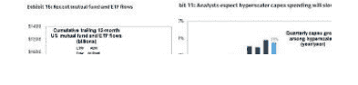

## Exhibit 16: Recent mutual fund and ETF flows

Cumulative trailing 12-month US mutual fund and ETF flows (billions)

| | LTM | AIM |
|---|---|---|
| flow | Billion | |
| Equities | 259 | $23 |
| Money markets | 854 | 9 |
| Bonds | 548 | 8 |

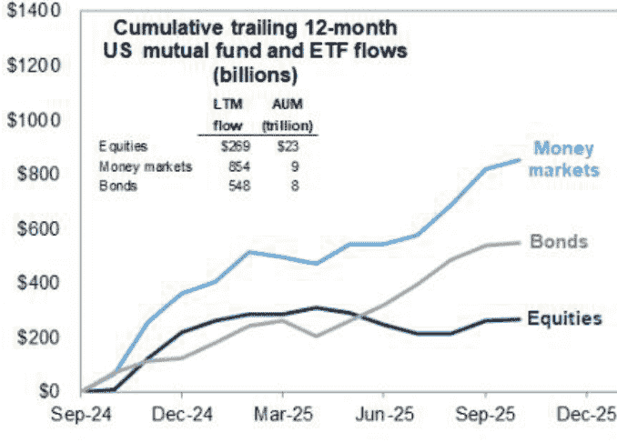

Source: EPFR, Goldman Sachs Global Investment Research

### Exhibit 11: Analysts expect hyperscaler capex spending will slow later t

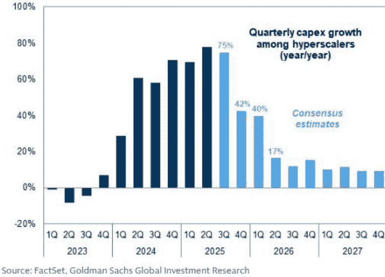

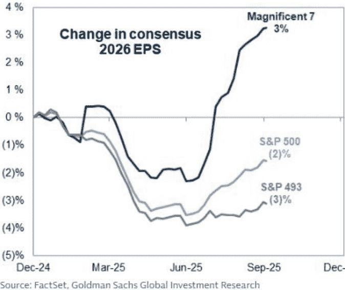

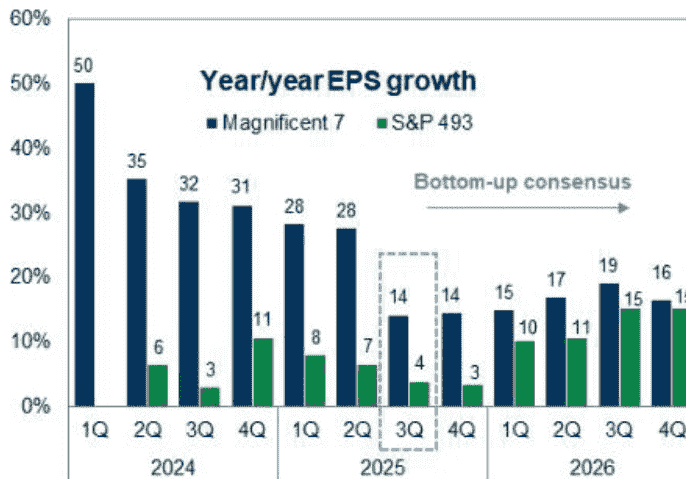

高盛：我们对2026年年中4000美元/吨和2026年12月4300美元/吨金价预测的上行风险进一步加剧，原因有两个：第一是投机性抬头，第二是9月份西方ETF持有量（实际为112吨）出现账上外异常，超出了我们基于美国利率下降的模型预测（17吨预测）的预期，代表西方投资者正在转向资产投资，以替代传统的股债组合，这个空间很大，可能会支撑金价上涨风险：金牌

### Exhibit 2: Speculative Gold Positioning Has Not Increased Over the Last Three Weeks

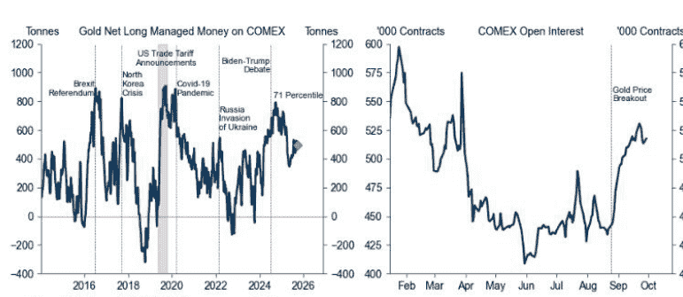

Last account data as of 2023-09-23. 492 tonnes or 71 billion in.

Source: Haver Analytics, Goldman Sachs Global Investment Research

### Exhibit 3: Private Sector Diversification into the Gold Market--Which Is Small Relative to Bond and Equity Markets--May Drive the Next Large Gold Price Increase

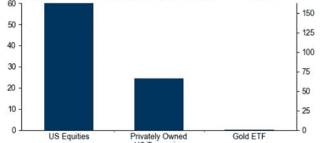

Source Haver Analytics, Bloomberg, Goldman Sachs Global Investment Research

Jason不遇 2023-10-05 04:05

BOFA: 把三季度美国通增速预测调低 1.5% 上调至 2.7%，理由是居民消费强劲，PCE预估在 2.5%，美储还需要降低利率。#其他其他国家经济

### Exhibit 1: Even ex of tariffs, there has been little progress on inflation this year besides housing

Measures of PCE inflation (% y/y)

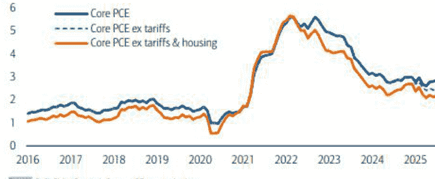

Source: Bofa Global Research, Bureau of Economic Analysis

### Exhibit 1: Discretionary goods spending is nearly 10% annualized over the last three months

Spending growth in goods, by category

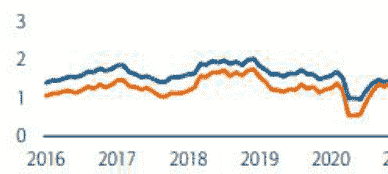

Source: Bureau of Economic Analysis; BEA; Bofa Global Research

### Exhibit 2: Discretionary services spending is almost 5% annualized over the last three months

Spending growth in services, by category

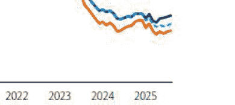

Source: BEA; Bofa Global Research

Jason不遇
2025-10-05 04:13

BOFA: Hartnett认为我们为做过流动源商品和英国股票，用来布局股市已 AI 泡沫，泡沫 = 聚荣 = 最好泡沫（AI）和偏向周期性资产（今天的大宗商品，因为人工智能能带来大宗商品的周转，价格上涨、下跌、集中、重心，机都倾斜，通胀领先指标（ISM），历史上的泡沫都是由央行政策打破的，过去两个月增长。美国还是K型经济，Wall St是 Main St 的6倍。Raedler认为到2026年第一季度，欧洲拉斯600指数将下滑490点，这意味着当前水平下跌14%。

### Chart 3: No central bank in the world has hiked in past 2 months

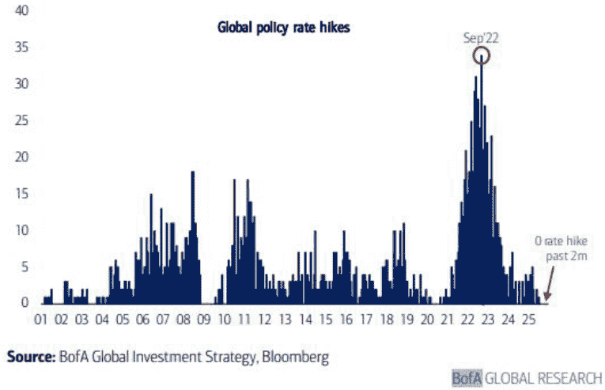

Source: BofA Global Investment Strategy, Bloomberg; GLOBAL RESEARCH

## BofA Strategists See European Stocks Falling More Than 10%

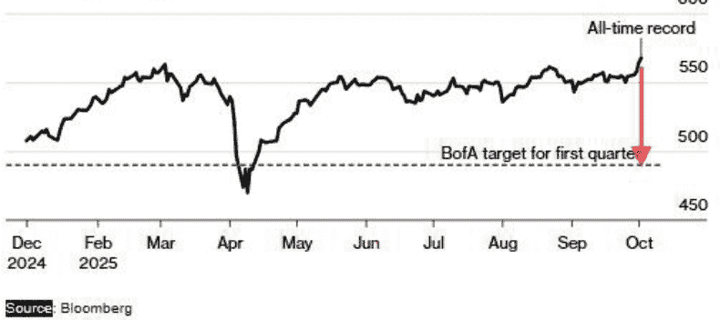

Source: Bloomberg

### Chart 4: US St is 6x the size of Main St...almost back at Covid

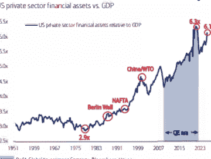

### Chart 5: "High income" outperforming "low income" stocks

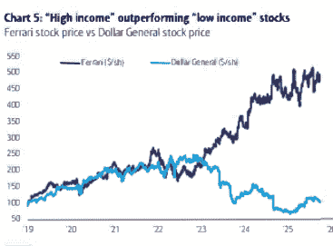

Jason不赢 2023-10-05 04:30

JPM: 9月中国股市靠“AI概念”支撑，但宏观偏弱；港股受压分化；投资者警惕波动分化和宏观需求不足的风险。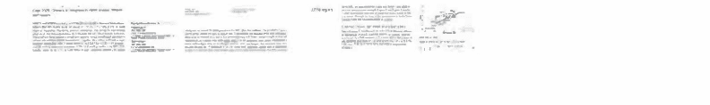

## J.P.Morgan deliver around 5% GDP growth y-y for 2025. Oct outlook: The parallel to Topix Oct 9 to Feb-rally we drew to support our 16% rally call for MXN has been unfolding at an accelerated pace in preaching and China's unique rally capabilities from Japan part. In the short term, both onshore and offshore equities have been overbought territory since August, but sentiment may stay elevated through the end of September. We see the MXN-ish savings to float or free equity market cap are well within historical norms. Our EPS revisions have been downward revisions to this some consideration following our revised upside scenarios for MXN and CSI300 by 2026-end we would plan to review the top picks at the occasion.

## 25 top picks: Tencent/TME in China Services, Alibaba/Tencent/MBS in China Consumer, Meituan in Healthcare, CATL in Industries, and Inovance (EE China equity strategy, 2H25 outlook: downside risks & upside opportunity, June 2025). Given our focus equity actions over Q, we plan to review the top picks at the upcoming occasion.

## MXHK: Macau contested leading outperformance. In September, the top-performing GICS sectors within MXHK were Communications Services and Utilities. Shanghai, the devalued and Staples, the cheapest (3) Materials: GICS-10% y-y and 27% q-q to post-COVID19 levels (vs 76% of pre-COVID levels in 2021-2022). We see the HK market as a volatile upside after hitting a positive inflection and ample liquidity in HK, and China 2 HK financials: 1M HIBor exhibited at 3.5%, and HK's strength should rebound to HK$15.5bn from intraday low of HK$13.7b. Shares of Fortune fluctuated 6% on the overbought rally of the mainland equities after opening while closing in red. We's momentum observed limited region again mainland assets demand for a low-quality-defined percentage of new client acquisition. HK's IPO equity placement proceeds reached HK$13.5bn-HK$22bn YTD, the highest since 2021, and we now see the residential property prices rising by 13% y-y in line with expectations with transactions since April.

MXHK: Morgan's Karl forecasts HK home prices to be steadily stable as accelerating the growth of the Northern Metropolis, which is poised to be accelerating integration between Hong Kong and Shenzhen. Oct outlook: We anticipate short-term volatility, we see the H index in the range of US$5,900-6,400. We anticipate long-term consolidation with MXHK's 27% USD return and 2% outperformance over MXASJ YTD 2H25. Top picks: AIA, MXN, Galaxy Entertainment, HKC, LINK, REIT, and Techrom. Picks: MGM China and China State Construction (See).

# JPM's China & Hong Kong QMI

Based on the framework of JPM's Quantitative Macro Indicator (QMI), we introduced the China and Hong Kong QMI to monitor market strength. Figure 1 shows visible correlations between the QMI and MSCI China & HK y-y return. In both cycles, China and HK stayed in Expansion in August.

## Connect flows, turnover and short sales

- Stock Connect: Combined rebound of HK$18bn in September (vs HK$112bn in August), a contraction of -75% of HK turnover (15% since 2023). SB of HK turnover rose by 6% in 2018 to 9% in 2019, 12% in 2020, and 16% in 2021/2022/2023, respectively.

Figure 2 ranked by daily amount of net flows. Consumer Discretionary, Healthcare, and IT were the three, while Communication Services and Energy were the bottom.

(Figure 2)

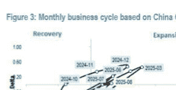

Source: Wind, J. Morgan

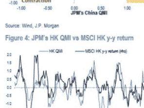

Source: Wind, J. Morgan

Daily turnover of Hong Kong stocks was 13.7% in September vs 14.7% in August (-0.33d), a contraction of 14.5% since 2014.

Market capitalization reached an all-time high (single stocks only) in August at HK$14.7tn/$1.0tn, respectively, or 66%/29%-4% of their combined market.

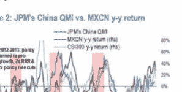

Source: Wind, J. Morgan

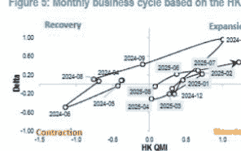

Source: Wind, J. Morgan

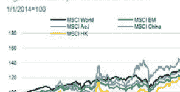

Source: Eikon, J. Morgan

# 微信top28688，资料分享群

# 知识星球TOP

添加微信
资源分享群
免费入群

微信:top28688

| 序号 | 公号/星球/社群 | 原价 | 领域 |
| --- | --- | --- | --- |
| 1 | 生财有木 | 2765/年 | 副业，搞钱 |
| 2 | 众宗众吃瓜群 | 365/年 | 时政，历史 |
| 3 | 记忆Legacy/땡树西风 | 365/年 | 成长 |
| 4 | 欧洲金轨 | 328/年 | 时政，历史 |
| 5 | 卢克文青云会 | 699/年 | 时政，社会 |
| 6 | 体制内主任 | 599/年 | 体制，职场 |
| 7 | 格外人的视界 | 669/年 | 金融，时政 |
| 8 | 澎澎异迁 | 4166/年 | 财富，成长 |
| 9 | 守夜人总司令 | 599/年 | 时政，经济 |
| 10 | 江宁知府 | 365/年 | 时政，国际 |
| 11 | 政堂/顾子明 | 568/年 | 时政，经济 |
| 12 | 唐书 | 1399/年 | 金融，财富 |
| 13 | 大树乡谈 | 199/年 | 时政，成长 |
| 14 | 水库欧大 | 10000/年 | 房产，经济 |
| 15 | 洪灏宏观策略 | 4376/年 | 经济，搞钱 |
| 16 | 金企通鉴/北海南山 | 4576/年 | 股票，行研 |
| 17 | 猫哥的世界 | 299/年 | 时政，社会 |
| 18 | 飞浪屯 | 3600/年 | 股市，经济 |
| 19 | 米联诸见闻 | 599/年 | 经济，金融 |
| 20 | 茶茶财经圈 | 330/年 | 房产，股票 |
| 21 | 赢在八小时之外 | 365/年 | 成长，职场 |

...... 更多资源，不再列举

+ 图书、报告、课程等各类类高价值资源

- 免费群 每日分享数字资源

-  VIP群 每日享所有资源（日均20+），75/年

赠送付费资源集合，市场价数万元
