# 南美跨财经251010

Jason-离裹
2025-10-03 13:15

鲍读：特朗普曾把印度推向了中国，提供俄罗斯石油贸易已开始要求印度购买产油的印度人付款，一位贸易哥。现在，贸易哥不得用卢比尔或美元换成人民币——因为只有这些钱才能直接换成支付给生产商所需的美元金融。

一位贸易哥表示：“现在贸易哥不得用卢比尔或美元换成人民币——因为只有这些钱才能直接换成支付给生产商所需的。”他们正在从这一过程中寻找一个使用人民币的步骤。

消息人士说，特朗普正在与俄罗斯保持首要的关系，以确保石油的价格上涨并寻求印度使用人民币”，并补充道，“由于印度可能不接受其他货币，以人民币支付给印度国家购买俄罗斯石油”。

美国总统消息称特朗普曾与俄罗斯建立密切关系。但在8月后，特朗普曾签署了一项行政令——印度购买俄罗斯石油加收25%的关税。

这些石油在8月8日的25%关税后，印度成为俄罗斯石油的第二大客户。其出口量也升到了50%，也是俄罗斯的最高关税之一。

俄罗斯是印度的第二大客户，印度是俄罗斯石油的第二大买家。印度也是俄罗斯最大的买家之一。

新变形最近也改变了与北京的互动。上个月，印度总理莫迪（Narendra Modi）7年首次访问新德尔。

“在潜在的边界内突破可能成为亚洲的转折点，同时增强俄罗斯的控制，”根据十年的故事，华尔街记者采访新德尔的，MK Bhadrakumar

在8月份的[#人民币报道]。

印度以人民币购买俄罗斯石油看来在美元化的道路上又迈了一步，金砖国家和新兴国家正致力于使用西方方式。

7月，特朗普曾对印度国家征收额外关税。“任何与印度反俄政策的国家都将收取10%的额外关税，”美国总总统。

Jason-离裹
2025-10-03 13:21

FT: 日本的劳动力短缺愈发严峻，使得人工智能、机器人或其他技术将可能加速转型“市场”的谈论起来越来越高率。市场早就知道，未来几年，移民将是日本最好的路。,其他日本经济

高市早苗没有太多选择，因为这种短缺已深深影响了日本的人口。上周六暮她觉得获逸单逸后，她开始承诺放弃工作与生活平衡，像一样拼命工作——这或许对她有用，绝非国家政策。某些行业将通过非人化解决方案应对劳动力短缺，利用科技来完成密集工作。

但高市早苗知道，未来几年，大规模移民将是日本最好的出口。但在这个问题上，也许有些拘统，她的民主主义与强硬保守主义反而造成了两大优劣。

首先，高市早苗从30政，即使对移民开放，也很受到右翼的攻击。她对移民的怀疑态度客观客观，她对日本文化提到开放的优势——若在劳动力短缺的背景下开放移民大门，她可以说毫无的事实的实之举。

第二优势在于，与任何日本首相相同，高市早苗展现出公开讨论问题的意愿，将此视为必要的公共讨论。

这一点很精明。公众的担心并非针对移民本身，而是对移民持续大规模流入对日本文化、财政和国家认同产生的影响严肃讨论。

高市早苗为自己赢了领场讨论并试图克服困难的准备。短缺化现在提供了强有力的动力，使她立即采取行动，毫不犹豫。

Jason-不磊
2025-10-03 10:29

bloomberg: 保时捷第三季在中国的销量下降了21%，是因为豪华豪车的需求仍然疲软，当当地造车在电动汽车方面主导地位。这些功能丰富的电动汽车在价格上正压制他们，保时捷的股价下跌了约分之一之一#市场

- 保时捷在中国市场
- 受中国电动汽车影响面临巨大压力
- Porsche挑战
- 保时捷销量下降

保时捷制造厂商在全球最大汽车市场的销量正在下降。

| Q4 | Q1 | Q2 | Q3 | Q4 | Q1 | Q2 | Q3 |
|---|---|---|---|---|---|---|---|
| 2022 | 2023 | 2023 | 2023 | 2024 | 2024 | 2025 | 2025 |

数据来源：财联社

Jason-不
2025-10-10 03:33

南华早报：比亚迪在巴西建设大型工厂，这是其亚洲最大的投资，预计创造20,000个岗位。该工厂在梅西尔土地上将开始生产，产能为150,000辆，预计创造300,000个直接和间接就业。初始包括：
- Song混合动力SUV
- 全电动 Dolphin
- King混合动力车辆
- 全电动混合动力发动机
- 宋 Pro车型

车型据称是世界上第一款混合动力燃料设计，比亚迪。记者根据行业数据，2022年以来，比亚迪在巴西已出售超过17万辆汽车，包括全电动和插电混合动力车型，目前以74.4%的销量主导市场。整体上升至第七位，超过本田等传统品牌，占据所有用车市场的5.5%以上。

# Jason-淘
2025-10-03 03:49

FT: IMF和英国乡村警告，AI盛可能逆转，股市可能‘迎来回调’。英国皇家表示，从指标来看，“股市估值偏高，尤其是人工智能的公司。”JP Morgan的首席亚洲，如果美股出现将比其他人更糟糕。与其投资相比，“我们应该准备‘防守反击’，因为世界正变得‘更危险’。股票估值偏高，也说明了我们尚未认识的风险，人工智能非常有价值。”总体来说，它可能会汽车或电子行业带来利好，但其中的大多数人将从中害。他建议投资者考虑美元对亚洲目前处于位，但担心美元走强无法实现市场预期的100个基点的支撑。让疲软，或许美元的增长即将结束，随着收益率的上升就会出现崩盘并入场，我经历过类似的局面，希望不要重演。”

摩士丹利在最新报告指出，人工智能（AI）生态系统呈现日益增强的循环，主要参与者之间通过流通，采取部分收购方式来捕捉复杂的网络。由于信息披露严重不足，这种不透明的循环正使投资者难以评估AI领域的风险。

高盛觉得大家都低估了风险。最新研究指出，尽管全球股市市场出现了一些趋势性变化，但风险并未显示出转向的趋势。一个坚实实为市场提供支持。在流动性压力基本下，这种风险是否会反转？第一轮量化宽松（QE1）之后，从2011年的通胀上涨至2015年，流动性充足在不到一年内增长了30%，规模所未有的发现，因为流动性压力积累了基本因素。预计股市可能会看到连续衰和利退加剧。在这种背景下，若美国政府持续持有，比特币、黄金、纳斯达克指数和ARKK这类长期资产。

Figure 1: 14% of IG debt is tied to sell, making it in a sense the biggest ‘sector’ in the market

| | 2020 | 2021 | 2022 | 2023 | 2024 | 2025 |
|---|---|---|---|---|---|---|
| AI inverse index $db, ins | | | | | | 14.5% |
| Al as % of index, rhs | | | | | | 14.0% |
| US Banks as % of index, rhs | | | | | | 13.5% |
| | | | | | | 13.0% |
| | | | | | | 12.5% |
| | | | | | | 12.0% |
| | | | | | | 11.5% |
| | | | | | | 11.0% |
| | | | | | | 10.5% |

Source: J. Morgan

# THE INFINITE MONEY GLITCH
# $100 billion
# ORACLE
# NVIDIA

国际货币基金组织(IMF)和英国央行(BoE)均警告，人工智能热潮将推高至接近泡沫期的水平，全球股市面临回调。IMF总裁格里·乔基娃（Kristina Georgieva）周三表示，人工智能热点可能突然转向，影响全球经济。英国央行金融政策委员会(FPC)在周三的最新会议记录中使用，“当前与2000年互联网泡沫相似，市场出现剧烈回调”。补充称，美国大型上市公司构成的标普500指数(S&P 500)市盈率为25倍，虽较历史较高，但低于2000年泡沫期的水平。

高市早苗没有太多选择，因为这种短缺已深深影响了日本的人口。上周六暮她觉得获逸单逸后，她开始承诺放弃工作与生活平衡，像一样拼命工作——这或许对她有用，绝非国家政策。某些行业将通过非人化解决方案应对劳动力短缺，利用科技来完成密集工作。

2025-10-10 04:04

贝森:我们正在努力降低赤字/GDP的比值，预计年初会出现大规模减税，这将及低收入群体受益。与此同时，他们的税表也会调整，意味着年轻的工资更高。

赤字占GDP的比例已经是头部。这一比例低于2024年的水平，而那一年是美国历史上的非战争、非衰退时期赤字最高的一年。是在美国财政预算办公室（CBO）公布9月份联邦支出与收入估算后发表言论。贝森提到，由于美国政府目前关门，财政部的官方发现发布推迟，需美国国通过新的开始2026年的财政法案。本周CBO估计，2025年的财政赤字与2024年几乎持平，为8亿美元。根据其国内总值（GDP）估算，这使得赤字占GDP的比例下降至5.9%。美国财政数据显示，2024年这一比例为6.4%。贝森他之所以参与公共支出讨论，是出于政府债务不可持续走的。他在周四提到，大约两年前与特朗普的一次对话：“他看着我，说我的第一句话就是斯考特，我们需要在不可避免的情况下降低赤字和赤字？”特朗普的关税上调带来了记录的税收入，有助于抑制赤字。数据表明，CBO的数据在上升，而政府实施的关税可能削减了财政收入。CBO还指出，2025年美国共和国支出首次达到每年万亿美元。贝森表示，他希望在特朗普第二个任期结束后，将赤字占GDP回升至头的水平。“我们正在走在正的路上，我认为我们已经看到了迹象。”

美元成为所有资产过去一段时间交易的核心枢，但当前市场空美元共识并未破产。过去，全球投资者认为美元是财政扩张与科技领先不断推新的者，美元继续成为所有资产过去一段时间交易的核心枢。对于中国，美国基本面并不关心，权益市场在防守的利性资产与经济相关的周期性涨跌的情况下，与全球投资者表现了回升。历史经验告诉我们，中国投资者往往受限于“中国因素”影响，美元成为中国货币的真正基石。美元逻辑的过度延续，都将被市场行情中遭遇一次洗牌，我们也建议投资者无论从驱动逻辑和国内内化上，都做好更多准备。

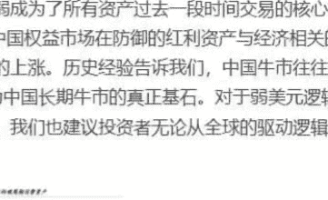
来源：wind, 国泰证券研究所
来源：wind, 国泰证券研究所

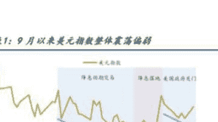
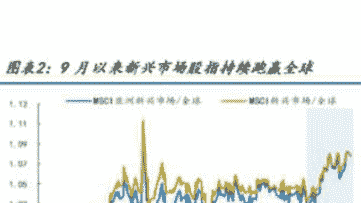
来源：wind, 国泰证券研究所；注（1）以美元指数为基指收益率，差异计算）；注（2）系数衡量对股市的回升、回撤和波动，数据统计2021年以来
（3）两个美元指数对股市回撤的幅度相同，或对股市回升的幅度相同
来源：wind, 国泰证券研究所

全球投资者为财政扩张与抗险资产唯一买单，美元走是为了所有资产过去一段时间交易的核心。过去，全球投资者认为美元是财政扩张与科技领先不断推新的者，美元继续成为所有资产过去一段时间交易的核心。对于中国，美国基本面并不关心，权益市场在防守的利性资产与经济相关的周期性涨跌的情况下，与全球投资者表现了回升。历史经验告诉我们，中国投资者往往受限于“中国因素”影响，美元成为中国货币的真正基石。美元逻辑的过度延续，都将被市场行情中遭遇一次洗牌，我们也建议投资者无论从驱动逻辑和国内内化上，都做好更多准备。

我们建议投资者从驱动逻辑和国内内化上，都做好更多准备：
- 第一，同时受益于国内通胀带来的经营状况，海外滞缓后制造业加速：上游资源（铜、铝）、工程机械、重卡、锂电设备以及原材料；
- 第二，盈利修复后所需领域逐渐显现：食品饮料；
- 第三，保障性的长期资产将受益于资本回报。本周推荐中出行板块，新增为当前低位的消费资产，近三年估值在所有消费板块中相对较高；同时，国庆假期期间出行好去年同期，预计估值底部+景气修复下将补齐。

图25：当前低位的周期消费资产

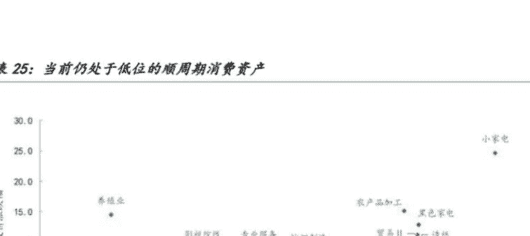
来源：Wind、国泰证券研究所

中银：我国经历第二次乳潮（1962-1975年）出生老龄群（年均270万）从2025年起进入老龄。2025-2030年，60岁及以上人口从3.2亿增长到3.9亿，年均增加139万，年均增长率到3.7%，老龄化从22.8%增长到27.7%，接近发达国家的平均值。

2025年第3期（60号）完善保险制度、健全教育体系、降低生育成本协同，将形成于人“鼓励生育”的基本引导，有利于长期生育结构稳定。第二，“十四五”期间需要人口结构变化带来的风险和挑战。之一是人口持续缩减，人口红利速度减缓。预计2030年，我国16-59岁劳动力人口占比将下降至59%左右。劳动力年龄更加老化。45-59岁大龄人口从2025年的32%升至2030年的36%，而年轻劳动力（16-24岁）降至15%以下。二是老龄化、少子化趋势，社保基金面临“缴群体、领取人群”特征，代际负担失衡风险。从累计结余来看，我国居民医疗保险、职工养老保险可持续性（累计结余/支出）均处于较低水平（图6）。随着我国老龄化程度的加深，在职职工人数与退休职工比例从2012年的3下降到2024年的2.63，未来医保支出压力将持续。

图6：2023各类养老基金累计结余可持续性（单位：%）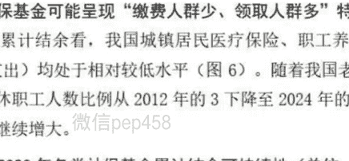
资料来源：Wind

格隆：国庆人均消费113.9元/日，同比下降13%经济数据
2025-10-10 04:18
2025年国庆假期人均每日消费113.9元，同比下滑13%捷隆广10月9日|经文化旅游部数据中心
2025-10-09 14:01 星期四
2025年国庆假期人均每日消费113.9元，同比下滑13%格隆10月9日|经文化旅游部数据中心测，国庆中秋假8天（101日至10月8日），全国国内出游8.88亿人次，国内总花费8090.06亿元。据此计算，2025年国庆假期人均每日消费113.9元，同比下滑13%，相当于2019年同期的95.9%。

节假日消费数据跟踪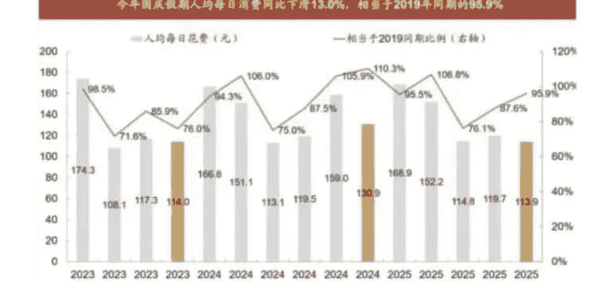

发广：2025年首三季度，美元与原油下跌，绝大多数数据资产获得收益，其中黄金与中国科技资产属于中国的“双子星”。全球股市表现明显优于发达国家，中国科技资产领先全球。

我们自搭建中美两国“硬数据”：2025年首三季度，美元与原油下跌，绝大多数数据资产获得收益，其中黄金与中国科技资产属于中国的“双子星”。全球股市表现明显优于发达国家，中国科技资产领先全球。

2025年首三季度，美元与原油下跌，绝大多数数据资产获得收益，其中黄金与中国科技资产属于中国的“双子星”。全球股市表现明显优于发达国家，中国科技资产领先全球。

2025年首三季度，美元与原油下跌，绝大多数数据资产获得收益，其中黄金与中国科技资产属于中国的“双子星”。全球股市表现明显优于发达国家，中国科技资产领先全球。

2025年首三季度，美元与原油下跌，绝大多数数据资产获得收益，其中黄金与中国科技资产属于中国的“双子星”。全球股市表现明显优于发达国家，中国科技资产领先全球。

2025年首三季度，美元与原油下跌，绝大多数数据资产获得收益，其中黄金与中国科技资产属于中国的“双子星”。全球股市表现明显优于发达国家，中国科技资产领先全球。

2025年首三季度，美元与原油下跌，绝大多数数据资产获得收益，其中黄金与中国科技资产属于中国的“双子星”。全球股市表现明显优于发达国家，中国科技资产领先全球。

2025年首三季度，美元与原油下跌，绝大多数数据资产获得收益，其中黄金与中国科技资产属于中国的“双子星”。全球股市表现明显优于发达国家，中国科技资产领先全球。

2025年首三季度，美元与原油下跌，绝大多数数据资产获得收益，其中黄金与中国科技资产属于中国的“双子星”。全球股市表现明显优于发达国家，中国科技资产领先全球。

2025年首三季度，美元与原油下跌，绝大多数数据资产获得收益，其中黄金与中国科技资产属于中国的“双子星”。全球股市表现明显优于发达国家，中国科技资产领先全球。

2025年首三季度，美元与原油下跌，绝大多数数据资产获得收益，其中黄金与中国科技资产属于中国的“双子星”。全球股市表现明显优于发达国家，中国科技资产领先全球。

2025年首三季度，美元与原油下跌，绝大多数数据资产获得收益，其中黄金与中国科技资产属于中国的“双子星”。全球股市表现明显优于发达国家，中国科技资产领先全球。

2025年首三季度，美元与原油下跌，绝大多数数据资产获得收益，其中黄金与中国科技资产属于中国的“双子星”。全球股市表现明显优于发达国家，中国科技资产领先全球。

2025年首三季度，美元与原油下跌，绝大多数数据资产获得收益，其中黄金与中国科技资产属于中国的“双子星”。全球股市表现明显优于发达国家，中国科技资产领先全球。

2025年首三季度，美元与原油下跌，绝大多数数据资产获得收益，其中黄金与中国科技资产属于中国的“双子星”。全球股市表现明显优于发达国家，中国科技资产领先全球。

2025年首三季度，美元与原油下跌，绝大多数数据资产获得收益，其中黄金与中国科技资产属于中国的“双子星”。全球股市表现明显优于发达国家，中国科技资产领先全球。

2025年首三季度，美元与原油下跌，绝大多数数据资产获得收益，其中黄金与中国科技资产属于中国的“双子星”。全球股市表现明显优于发达国家，中国科技资产领先全球。

2025年首三季度，美元与原油下跌，绝大多数数据资产获得收益，其中黄金与中国科技资产属于中国的“双子星”。全球股市表现明显优于发达国家，中国科技资产领先全球。

2025年首三季度，美元与原油下跌，绝大多数数据资产获得收益，其中黄金与中国科技资产属于中国的“双子星”。全球股市表现明显优于发达国家，中国科技资产领先全球。

2025年首三季度，美元与原油下跌，绝大多数数据资产获得收益，其中黄金与中国科技资产属于中国的“双子星”。全球股市表现明显优于发达国家，中国科技资产领先全球。

2025年首三季度，美元与原油下跌，绝大多数数据资产获得收益，其中黄金与中国科技资产属于中国的“双子星”。全球股市表现明显优于发达国家，中国科技资产领先全球。

# 图 34: 中国宏观经济意外指数有企企态势

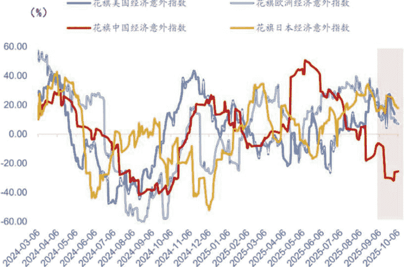

数据来源: Wind, 广发证券发展研究中心

图37: 预计2025年9月半经济指数为-1.1%

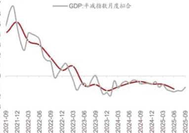

图38: 半经济指数小幅触

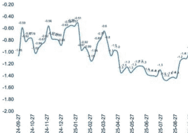

数据来源: Wind, 广发证券发展研究中心

> Jason
> 2025-10-10 04:40
> 申云龙:美国政府关门对全年GDP影响较低，停一个月月的GDP影响仅约0.02%。2025年10月，美国CGE最新数据显示，政府每停一周造成约150亿美元的损失。#其他国家经济

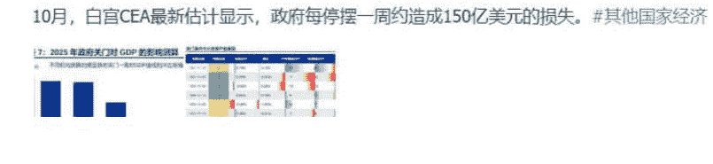

### 图表 7：2025 年政府部门对 GDP的影响测算

美元 不同机构测算的美国政府部门一周对GDP 造成的冲击规模

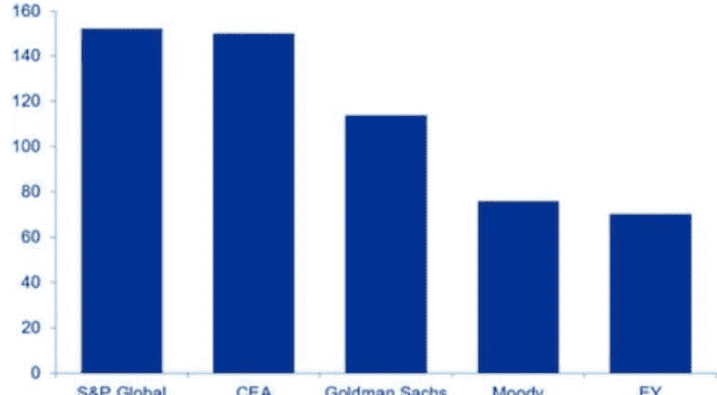

资料来源：美国白宫、穆迪、路通、申万宏源研究

### 图表 11：政府部门事件中美国资产的表现

| 开始日期 | 结束日期 | 标普500 | 美元 | 10年收益(BP) | 2年收益(BP) | 黄金 |
|---|---|---|---|---|---|---|---|
| 1981-11-20 | 1981-11-23 | 2 | 0.74% | 0.15% | 40 | 29 | 1.06% |
| 1982-09-30 | 1982-10-02 | 1 | 0.28% | -0.05% | -7 | 5 | 1.89% |
| 1984-10-03 | 1984-10-05 | 1 | -0.56% | 0.26% | 15 | 14 | 0.42% |
| 1986-10-16 | 1986-10-18 | 1 | 0.02% | 0.16% | 6 | 11 | 0.65% |
| 1990-10-05 | 1990-10-09 | 1 | -2.40% | -1.02% | 16 | 7 | 0.32% |
| 1995-11-13 | 1995-11-19 | 1 | 1.20% | -0.01% | 2 | 6 | 0.56% |
| 1995-12-15 | 1996-01-06 | 21 | -0.03% | 0.21% | -5 | B | 2.62% |
| 2013-09-30 | 2013-10-17 | 16 | 2.45% | -0.76% | -3 | 1 | 1.22% |
| 2018-01-19 | 2018-01-22 | 2 | 1.25% | -0.17% | 4 | 5 | 0.53% |
| 2018-12-21 | 2019-01-25 | 8.00% | -0.65% | -3 | 7 | 1.43% |
| 2025-10-01 | (待定) | (进行中) | | | | | |
| 胜率(只占5天及以上的事件) | | 75% | 25% | 75% | 100% | 50% | |
| 平均涨幅(只占5天及以上的事件) | | 2.91% | -0.30% | -2.25 | -8.00% | 1.07% | |

数据来源：Wind、申万宏源研究

BOFA: 9月份, 美国收入高家庭工资同比增长至 4.0%，而低收入家庭工资同比增长 1.4%#其他国家

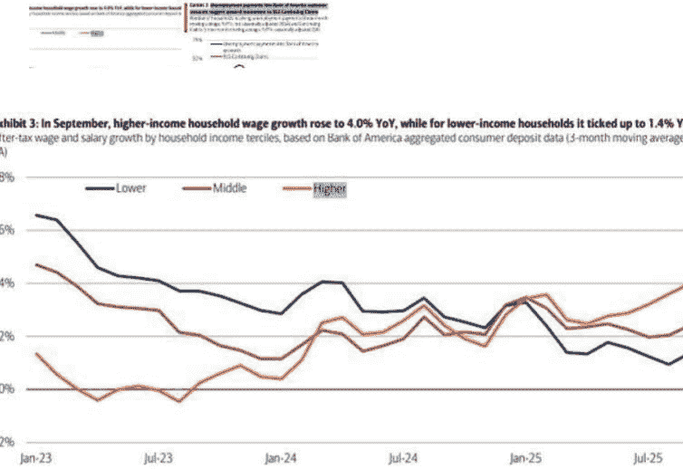

Exhibit 3: In September, higher-income household wage rose to 4.0%, while for lower-income households it ticked up to 1.4% based on income tertiles.

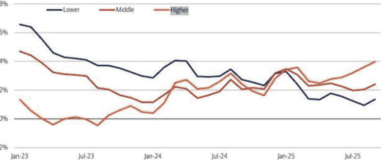

Exhibit 2: Number of households receiving unemployment Claims (three-month moving average, seasonally adjusted) suggested upward momentum.

Source: Bank of America

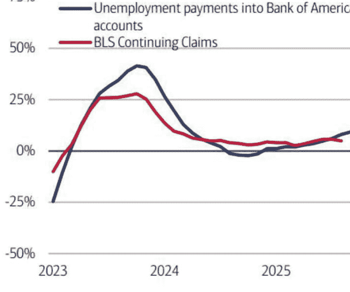
