# 南半球聊财经251011

Jason不离
2025-10-10 16:42

bloomberg: 新市场普遍下调。嵩认为亚洲市场在经历了大幅上涨后，正处于广泛的去风险模式，黄金的下跌增加了“一切下跌”的恐慌。对估值高的担忧，投资者也对中国股票谨慎态度。另外，美元表现出意料之外的强劲，一部分是因为日元子率的表现不佳，推高了美元指数。金融

日本国债在汇率走软后，筹传三季度日本经济陷入衰退。

## Emerging Market Currencies Extend Losses

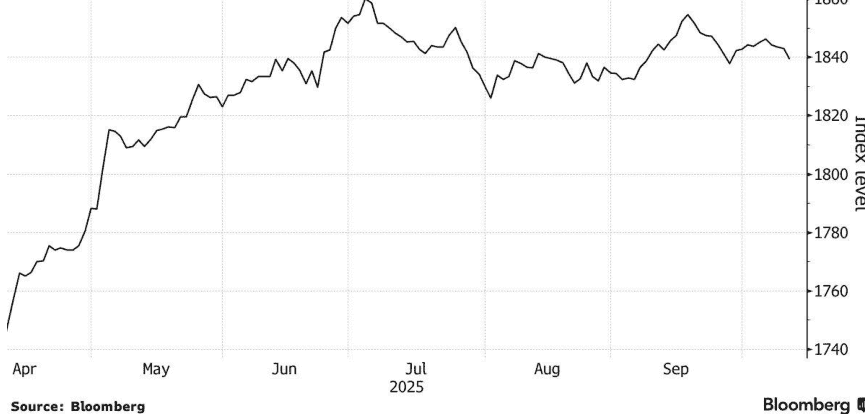

微信号top28688
微信号top28388
添加微信免费进群
加微信top28688，进阶资料分享群

Christopher Wong，华侨银行有限公司货币策略师

“本周日早些时候的暴跌是由于与首相高石相关的政策，而市场推迟了日本银行加正常化时间表。现在他们失去了长期合作伙伴公明党，这表明他们无法如此迅速推进某些政策，而周周日早些的暴跌可能会有所缓解。在此期间不排除回调至 151.60 或 151。”

Pelham Smithers，总部位于英国的日本股票研究公司 Pelham Smithers Associates 的董事总经理

“我是今天股市收到了对它的担忧，未来可能会有进一步的抛售。我预计周二会出现抛售，除非自民党可以在未来几天内将公明党换成维新党或民进党。”

Rajeev De Melo, Gama Asset Management 全球宏观组合组合经理

“这种新的不确定性将打压日本股市。自民党将不做退让，这可能导致首相任命高的经济政策被削弱。”

# 潮汐变化

由于美国关税的打击，日本经济可能在第三季度收缩

- Real GDP (annualized) Economists forecast

| | Q1 2024 | Q2 | Q3 | Q4 | Q1 2025 | Q2 | Q3 |
|---|---|---|---|---|---|---|---|
| -3.5% | | | | | | | |
| -3.0 | | | | | | | |
| -2.5 | | | | | | | |
| -2.0 | | | | | | | |
| -1.5 | | | | | | | |
| -1.0 | | | | | | | |
| 0.5 | | | | | | | |
| -0.5 | | | | | | | |
| -1.0 | | | | | | | |
| -1.5 | | | | | | | |

资料来源：内南办公室、博博

## 加微信群208688，进资料分享群
微信

# Takaichi's Victory Weaken the Yen

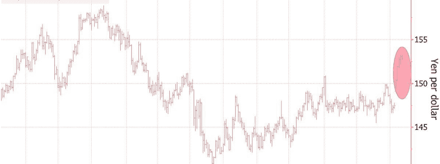

Japanese Yen Spot - Last Price
160
155
150
145
140
Yen per dollar
Oct Nov Dec Jan Feb Mar Apr May Jun Jul Aug Sep Oct 2024 2025
Source: Bloomberg

加森不冉
2023-10-26 16:55

标题：中国楼市市场在寻找底部。我们预计，2025年全国房地产销售将下降8%，2026年将下降6%-7%。政策实施尚未达到我们的预期，购房者的信心依然温和。与我们之前预计购房可能在2025年下半年达到稳定相比，我们现在认为房价将持续温和下跌。

我们认为，一线城市二级市场的表现表明，该城市的需求将面临升级压力，二手房的竞争力将不如从常。二手房的供应量可能会增加，这会导致二手房房价的下跌。在该类需求萎缩和库存充足的情况下，我们预计房价跌力将维持到2026年。

租金下跌可能压制房价，随着房价持续下跌，我们预计投资者需求将维持低位。购房者也可以选择租房而不是买。

因此，我们预计2026年房价预计下降1.5%-2%，二手房在2026年下降4%-5%

# 房价

market is polarizing by city tier and developer - has limited demand - is to be a

## China’s shrinking property market is polarizing by city tier and developer

## Nationwide primary sales
National completed but unsold inventory

Trillion RMB / Million square meters

| 2021 | 2022 | 2023 | 2024 | 2025 | 2026 |
|---|---|---|---|---|---|
| 16.2 | 13.7 | 9.7 | 8.9 | 8.3 | |

753.0 (December 2024 / August 2025)

Portion of used sales for land purchases*
By developer type

Change in primary sales volumes (January to this year far*)

| State-owned | Private |
|---|---|
| 55% | <10% |
| Tier-one cities | Nationwide |
| +2% | -5% |

*Weighted average for listed properties over the fourth quarter of 2024 to first quarter of 2025. *Midpoint of our estimated ranges of RMB8.8 trillion-9.0 trillion in 2025 and RMB8.1 trillion-8.5 trillion in 2026. *Estimate, RMB square meters. Sources: National Bureau of Statistics, China Estate Information Corp., S&P Global. Copyright 2025 by Standard & Poor Financial Services. All rights reserved.

## The reference rate for mortgages has only moderately declined in the year to date
Five-year loan prime rate

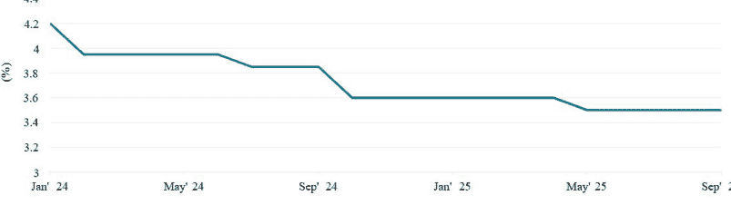

Sources: National Interbank Funding, Wind, S&P Global. Copyright © 2025 by Standard & Poor Financial Services.

| (YoY change, %) | 2025e | 2026e |
|---|---|---|
| Primary housing prices | (3.5) - (2.5) | (2.5) - (1.5) |
| Tier 1 markets | (1.0) - (0.5) | (0.5) - 0 |
| Tier 2 markets | (3.0) - (2.0) | (2.0) - (1.0) |
| Tier 3 or below markets | (5.0) - (4.0) | (4.0) - (3.0) |
| Secondary housing prices | (7.0) - (5.0) | (5.0) - (4.0) |
| Area sold (primary sales volume) | (5.5) - (4.5) | (5.0) - (4.0) |
| Overall sales (tr. RMB) | 8.8 tril. - 9.0 tril. | 8.1 tril. - 8.5 tril. |

*Forecast based on government data covering 70 cities. *Estimate, RMB-Renmin. Source: S&P Global.

Cumulative % change in residential rents in the first half of 2025

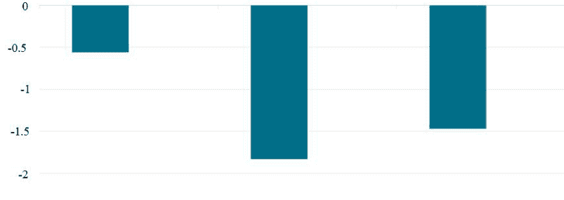

Data published by the China Estate Index (CREIS) comprising data from 50 cities. Source CREIS. Copyright © 2025 by Standard & Poor Financial Services. All rights reserved.

## Debasement Concern Fuel Gold, Bitcoin Rally
Normalized As Of 01/02/2025 Gold #Bitcoin

Jan Feb Mar Apr May 2025 Jun Aug Sep
Source: Bloomberg

bloomberg: 德意志银行预测，到2030年，各国央行可能会持有比特币和黄金。美元在全球储备中的份额从2000年的60%下滑到2025年的41%，这种下降引发了黄金和比特币创级的资金流入，不过摩根大通认为稳定市场会放缓对美元的增量需求。

特朗普发表，对中国制造表示不满，情绪激烈，表示自己会予以还击。原文：虽然可能会带来麻烦，但这是好事。最后，美国在考虑的政策之一，就是对入境中国产品大规模加征关税。还有许多反制措施，也在严肃考虑中。

Donald J. Trump @realdTrump
Some very strange things are happening in China!

### CSI Chinese Large-Cap ETF (listed) WISE: 83473

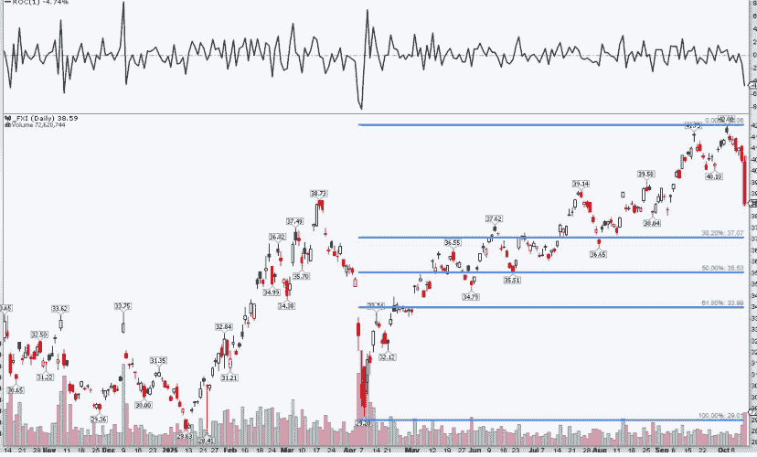

# 富时A500指数主选

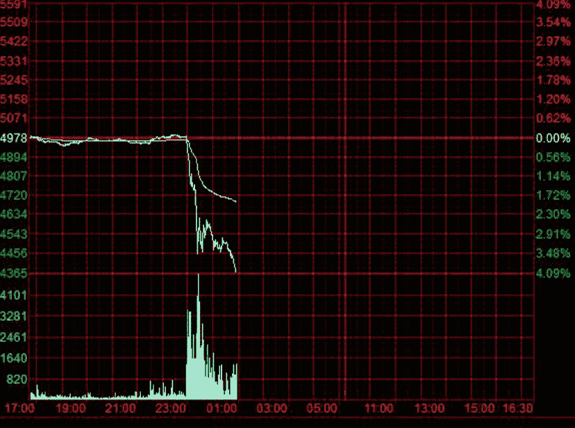

# Jason 不涵
2025-10-11 02:43

BOFA: 股市与美国前 5%群体支出走之间存在相当密切的联系，前 1% 的人均有 2460 万美元股票，前 20% 的美股>后 20% 的 10 倍>其他国家经济

- Discretionary spending growth of top 5% minus middle-income households

Source: Bank of America internal data. Bloomberg
BANK OF AMERICA INSTITUTE

## Exhibit 10: The top 20% of wealth held by income
750,000
500,00

*Forecast based on government data covering 70 cities. *Estimate, RMB-Renmin. Source: S&P Global.

## Exhibit 9: The top 20% of wealth held by income
750,000
500,000
250,000

*Weighted average for listed properties over the fourth quarter of 2024 to first quarter of 2025. *Midpoint of our estimated ranges of RMB8.8 trillion-9.0 trillion in 2025 and RMB8.1 trillion-8.5 trillion in 2026.

## Exhibit 9: The top 20% of wealth held by income
750,000
500,000
250,000

## S 500 concentration is at a record high

Average market capitalisation of top decile vs of median stock

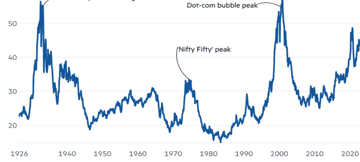

Source: Eugene F Kamath and R French data library, Pictet Asset Management

Jason 不嵩
2025-10-11 03:21

BitcoinMagazine: 卢森堡正式加入比特市场的政府行列，财政部长哈尔斯-罗斯（Gilles Roth）在众人发布 2026 年预算报告时宣布，该国主权财富基金 (FSIL) 将把投资者投资的组合（超过 700 万美元）分配给比特和其他加密资产。这是卢森堡基金首次进行此类投资组合，卢森堡的尝试是世界上主权财富基金的类似做法。据报道，拥有 1.9 亿美元资产的基金通过企业投资间接持有 11,400 BTC，而亚洲和中东的主权基金已经探索了有限的加密市场访问口。捷克最近表示，已在考虑将 70 亿的剩余储备转移到比特币中的可能。

另外，根据银行行的最新研究，机构对比特币数字资产的需求正在发展，平均投资组合在一年内增长，从 7% 增加到 16%。大约 27% 的受访者表示，比特币在数字组合中是最高的，25% 的受访者预计在未来三年内将保持最佳表现。

| 新闻 | 政府 | 部门 | 文件 | 政策 |
| :--- | :--- | :--- | :--- | :--- |
| 新闻 | 所有新闻 | "Matateen wuessen": 增长和社会凝聚力齐头并进 | Gilles Roth 介绍 2026 年国家预算 | |

## Matateen wuessen: 增长和社会凝聚力齐头并进，Gilles Roth 介绍 2026 年国家预算

2025 年 10 月 8 日，财政部长哈尔斯-罗斯 (Gilles Roth) 向众议提交了 2026 年国家预算，主题是“Matateen Wuessen”（共同增长）”。

## 加微信top208688，进阶资料分享

## Jason不离

2025-10-11 03:32

bloomberg: 日本政局方面告诉他们已经出盟，“两周后”，日元在 152.69 关附近波动，自民党在首相选举结束后他们需要采取更多措施管制政治献金。自2022 年以来，显示日本已经处于几十年来最强通胀的压力之下，外外资金适中增加，联盟要求高市对献金制定更严格的规定，以便获得客户的信任，他们并没有得到对方的承诺。

日本银行行事长 Kazuuo Uemura，自称对日本实行货币政策尚稳定。重要的是，日元跌至 155 或 160，本月可能被迫增加。我们不知道会成为首相，但如果是高市，日元汇率回到 160，将是一个巨大的压力，因为通胀依然是日本关注的最大问题。在这种情况下，高市应该欢迎日本银行加息。

## 其他国际经济

2025年10月11日晚上7:00 GMT+13
更新于2025年10月11日上午5:50 GMT+13

### 人工智能的要点

- 日本政治联盟坍台，使国家陷入重大政治危机，市场震动。
- 这一可能会鼓动反对团体在另一位潜在候选人周围，使高市成为日本第一女性首相的可能性受到威胁。
- 高市必须在获得反对党支持才能成为首相，最大的敌人是民主党首脑田中诚雄。

日本政治联盟突然坍台，使国家陷入数十年来最大的政治危机之一，并震动了市场。

自民党首首相高市与公明首相岸哲夫的会议周五结束，在自民党首选选举首相之前就削弱了她。

她是否仍为日本第一女性首相仍然处于怀疑之中，因为政治联盟的戏剧性内消耗可能会鼓动反对派在未来几周的投票中寻找另一位潜在候选人。在过去的 25 年里，这个伙伴关系一直是日本政局决定的基石。

虽然高市争取失利后获得支持的大门开启，表示希望在下周再次与公明党领导人会面，但岸田已经表示，自民党选举不会支持高市担任首相，因为它不想收敛政治献金规则。他说，对具体政策的维持是可能的。

## 加微信top28688，进阶资料

## FT: 中国阶层流动与数据

阶层社会会有一些典型的特征。首先，与中产构成的 U 型社会相比，阶层更像 S 型社会。随着底层的出现，底层变得越来越困难。中产社会认为是稳固的，底层的差距日益明显。阶层社会是一个不断增强的，向上流动的变得难以实现，只能沦为底层，许多对阶层流动的期待破灭。

一个阶层化的社会，社会流动并没有固化，但数据显示，向上流动趋减少，向下流动日益频繁。“对于刚性的阶层来说，底层就是阶层的终点，这并不是完全可能的，正如我所指，许多人在阶层之间流动。如此，中国社会仍然在挣扎中，阶层流动虽有下降，但成为常态。

阶层社会可是不可避免的趋势。在改革中，中产首次出现，随着阶层化进程的推进，我们经历了增长的红利，源自自身的改革红利，也属于全球化带来的红利。这种形成可能通过重塑结构让旧阶层消失，中产从少数扩大到整个区域，但发现变得日益贫瘠。

中国中产究竟是怎样的？在阶层大崩溃之前，一线城市的中产定义除了收入之外，更是对房价的定义。如此的中产其实关于阶层化，中产所能全部的底线是自己想要享受的社会地位。在顶部的百姓，即便收入三万也没法养孩子，最好的就是买奢侈品。这里又是无底线的结局，看来未来他们大多趋于底层，而且上层也没有想象过会变成安全。我不理解我的道理，上层可能会向下走，底层可能会逐渐萎缩，或者面临权力压力。对于一线城市以及各类城市的市民，除非充盈扩张大城市的机会将会减少，但还是相对富裕。

## 加微信top20688，资料免费

## Jason不离

2025-10-11 03:40

bloomberg: 稀土到底有多稀有？与其相反，稀土实际上在地上非常常见，但挑战是在到处找到足够的效率。为了便于开采具有成本效益，开采对当地环境有害，因为大量的水能将稀土和它们分离。开采可能存在污染土壤和地下水的风险。因为稀土等活性元素往往被发现。美国在1960年至1980年代是世界上最大的生产者，但随着中国开始努力，美国逐渐消失。低成本运营使得东亚国家能够应对稀土出口市场，并建立对全球供应的近乎垄断。中国的矿开采量的70%。中国地位强势，它是世界上唯一一半的稀土总量。中国早早认识到自己在稀土方面的优势。与中国的贸易谈判中，由于稀土运输是美国人的首要因素，美国70%的稀土进口依赖中国。美国国防部称，这种依赖性使得美国军工复合体变得脆弱，因为F-35战斗机需要超过900磅（408公斤）的稀土。特朗普希望增加国内稀土供应，但这需要时间。

### 经济数据

### 中国在稀土供应中占主导地位

2024年全球稀土开采和精炼产量的份额——中国、美国、俄罗斯和 Rest of the world

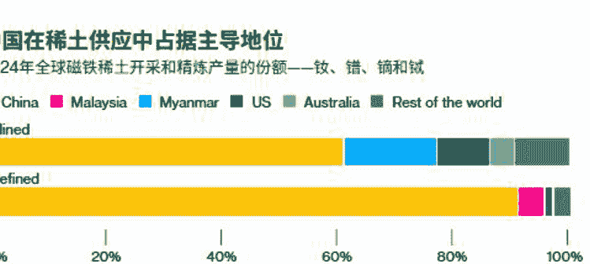

资料来源: 数据学者

## 加微信top28688，进资料分享群

## 中国在稀土采生产中占据主导地位

到2024年，它占全球产量的近 70%
400 thousand metric tons

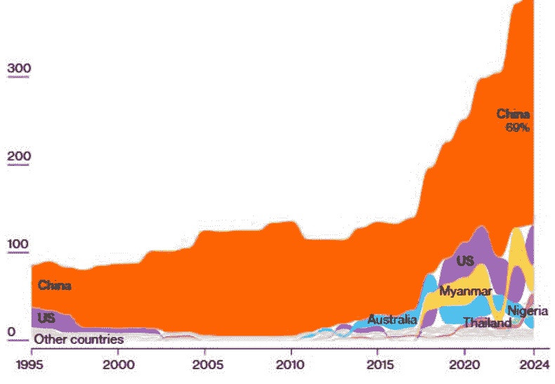

资料来源: 英国地质调查局

## 美国拥有世界第七大稀土储量

其储量仅为中国的4%

资料来源: 英国地质调查局
注: 插图包含加尼亚、俄罗斯和尼日利亚的数据。

## 与美国的贸易局势中，中国对七种稀土金属拥有影响力，美国生产几乎为零

| China | Vietnam | India | Canada |
| :--- | :--- | :--- | :--- |
| Samarium | | | |
| Gadolinium | | | |
| Terbium | | | |
| Dysprosium | | | |
| Lutetium | | | |
| Yttrium | | | |
| Scandium | | | |

资料来源：蓝色计划
注：显示全球得分。

Jason不离
2025-10-11 03:42

Dalio重申：美国债务增长太快，与二战前相似。有意思的是截至12月31日，桥水管理着9200亿美元资产，是2023年初的近4000亿美元。

## 加微信top28688，进资料

### 人工智能的要点

- 达里奥警告说美国债务上升太快，造成了一种与二战前相似的气氛。
- 达里奥将债务归咎两党，呼吁增加税收和削减支出相结合以应对“赤字/债务炸弹”。
- 达里奥，美国和世界正在发生一场“内战”，存在不可调和冲突，这些冲突成为双方力量的考量。

桥水公司创始人达里奥（Ray Dalio）重申警告美国债务增长太快，与二战前相似的气氛。当债务相对于收入增加时，“就像动脉上的斑块，然后开始挤压”。76岁的达里奥在周五出的弗兰辛·拉坎（Francine Lamont）接受采访。这位亿万翁长期一直警告债务螺旋式上升的风险，上个月声称这对秩序构成威胁。他指责两党的政客，呼吁增加税收和削减支出，以解决他说的“赤字/债务炸弹”。

Jason不离
2025-10-11 03:45

## 其他国家经济

原文标题：美国可能面临严重的经济衰退
zerohedge: 美国正面临至少50年来严重的经济衰退达里奥在采访中表示，美国必须通过增加税收和削减支出相结合来解决债务问题。“我们正处于一场‘内战’中，存在不可调和的冲突，这些冲突成为双方力量的考量。“美国企业和政府正面临着他们说的‘赤字/债务炸弹’（Eric Schuster）可能性的，我们正处于一场‘内战’。”

## 加微信top28688，资料分享群

## 大多数美国不知道情况有多严重了

内布拉斯加州农民联盟威胁，这是至少50年来农民面临的最严重的经济挤压……

“我们处理的是50年来见过的最经济危机之一，”内布拉斯加州农民主席麦克·埃尚（Mike Oakley）在周六内布拉斯加州比特顿举行了地区会议，“玉米和大豆种植者（Don Schuller）告诉美国公关公司，如果这里的农民没收，将面临一场危机。”

我希望告诉你们，我不是专才。但我不能……

AGWEB发布的一份美国资深专家保罗·迈耶（Paul Meyer）警告说我们的农民正面临崩溃的形式……农民不是在开玩笑，真是真的，就在眼前。持续低的大豆价格和高昂的成本使得美国农民的许多种植者要求立即救助，否则可能在2025年或2026年获得帮助，否则农民就没救了。

提供我们最需要的首要商业企业通过帮助农民增加他们的利润，以及我们为农民生产的巨型制造企业通过帮助农民增加他们的利润。

有一段时间，很多农民至少可以喘口气，但现在情况变得糟糕，以至于许多美国农民每天损失数百万美元。

是的，有的贝法洛（Bailey Foley），他是内布拉斯加布法洛的所有者，也是农场保护委员会的主席。

“这种痛苦不是真实的，我们正在面临的一中最严重的农业危机，”布法洛说，“看康森（爱荷华大学）的数字——玉米种植者每英亩损失240美元，大豆每英亩损失144美元，小麦每英亩损失380美元。棉花种植者可能最惨。”

这就是我们农民应该信的。

那么，当大量农民抗议起来会发生什么？

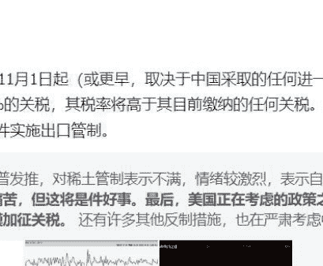

Jason: 2025-10-11 06:44

特朗普：自2025年1月起（或更早，取决于中国采取进一步行动），美国将对中国征收100%关税。虽然可能带来困难，但Jason表示：软件存在漏洞，表示美国的。

原文：虽然可能带来困难，但Jason表示：软件存在漏洞，表示美国的。

## 加微信top28688，分享

## Jason不离

2025-10-11 09:19

### 经济数据

### 核心观点

购买力供给能力之间存在系统性错配，在现实形成持续扩大的“需求缺口”，对经济增长造成威胁。

为弥补分配引发的内部需求不足，经济往往依靠信用扩张——尤其是低收入群体，向“需求”购买，维持市场出清。从债务承受主体来看，企业债务能够持续扩张，而终端需求的债务积累主要来自居民、政府与净出口（即外国人）三大群体。若这三类主体的债务扩张，供缺口将难以弥补，通过压力难以实现。

图1：经济产出配置图

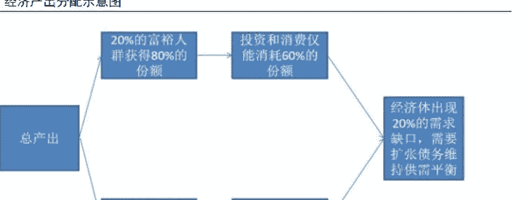

数据来源：WIND，证券期货研究所

2020-2024年，居民市场表现上升后转软，然而，居民净出口压力使得其责任凸显，但尚未通过能够来缓解缺口的形成。

图2：中国居民杠杆率与净出口对GDP增长贡献率

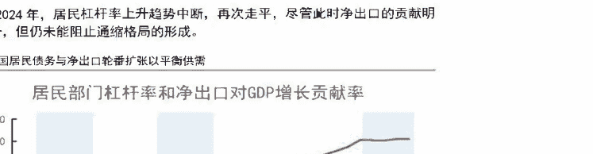

数据来源：WIND，证券期货研究所

为与净出口的对比，“居民”与“政府”杠杆率趋势与居民杠杆率表现一致。当政府政策扩张时，居民需求中反而显显著对立作用。2020-2024年间两条曲线出现分化；居民杠杆率趋于停止，“居民+政府”杠杆率却起上升，后升至2019年基本平稳。这一说明政府的扩张反而削弱了居民需求的积累。正如此，由于居民杠杆率下降且需求过大。

### 收入分配与政府支出

当前通缩压力的深层次。2020-2024年供需缺口难以源于两个方面：首先，收入分配持续失衡。2015-2020年，资本收入占比上升，考虑到居民服务业受制于就业能力，居民资本占比可能进一步提升。其次，政府支出结构。2018年后，基建和政府消费同步放缓，周期性政策更多依赖减等供给工具，这类政策在扩大工业供给的同时，导致需求缺口可能加剧，导致缺口损失。历史的经验。2016-2017年的价格回升在前期可以验证。2016-2020年居民杠杆率处于上行通道，且需求缺口相对萎缩，供给侧结构改革配合居民杠杆扩张顺利推动价格在较短期内回升，而当前居民杠杆率下降且需求过大，因此需要从收入分配改革入手，配合政府支出结构优化，由此从需求缺口入手，需要政府重建居民杠杆能力，可以更好地推动价格上涨。

加微信top26888，资料专享

# 缩短社保户籍限限提高了企业社保费水平

陈 张宗泽 吴 明癸

**摘要**：本文探讨了城市户口所需社保的年限要求对企业社保费水平的影响。研究发现，缩短社保户籍的年限提高了企业社保费水平，使企业为员工提供了更多的机会；该强化了员工的参保意愿，提高了企业的劳动力稳定性和产出水平；在看到员工发展、劳动强度更高的企业以及基础教育水平更高的地区，该举措效果更加显著。本文的研究结论为提高企业的社保合规水平、完善社保基金体系提供了政策建议。

关键词：户口；社保参保激励；企业社保费

DOI: 10.13821/j.cnki.ceq.2025,04.14

## 一、引言

企业社保费对社保基金收支平衡具有重大意义。当前我国社保基金面临着较大压力，2022年账户收支基本平衡。在社保基金账户收入中，企业缴费贡献约占60%。然而，我国企业社保费的合规水平较低，《中国企业社保费白皮书 2023年》报道，我国仅有28.9%的企业社保费完全合规。对于社保费责任，企业往往采用用非正规侧（如不签订正式劳动合同）或提供员工工资等手段。但无论采取何种方式，企业一般都需要获得员工的配合（Li et al., 2020）。在此背景下，研究企业与员工对社保费的共同激励具有重要的学术价值和政策意义。

微信top26888，进资料分享群

## 知识星球TOP

添加微信
资源分享群
免费入群

微信:top28688

| 序号 | 公号/星球/社群 | 原价 | 领域 |
| --- | --- | --- | --- |
| 1 | 生财有木 | 2765/年 | 副业，搞钱 |
| 2 | 众宗众吃瓜群 | 365/年 | 时政，历史 |
| 3 | 记忆亥裁/땡树西风 | 365/年 | 成长，财富 |
| 4 | 欧洲金轨 | 328/年 | 时政，历史 |
| 5 | 卢克青云会 | 699/年 | 时政，社会 |
| 6 | 体制内主任 | 599/年 | 体制，职场 |
| 7 | 局外人的视界 | 669/年 | 金融，时政 |
| 8 | 溯泽异昂 | 4166/年 | 财富，成长 |
| 9 | 守夜人总司令 | 599/年 | 时政，经济 |
| 10 | 江宁知府 | 365/年 | 时政，国际 |
| 11 | 政堂/顾子明 | 568/年 | 时政，经济 |
| 12 | 唐书院 | 1399/年 | 金融，财富 |
| 13 | 大树乡谈 | 199/年 | 时政，成长 |
| 14 | 水库欧大 | 10000/年 | 房产，经济 |
| 15 | 洪灏宏观策略 | 4376/年 | 经济，搞钱 |
| 16 | 金政通鉴/北海南山 | 4576/年 | 股票，行研 |
| 17 | 猫哥的世界 | 299/年 | 时政，社会 |
| 18 | 飞浪龙 | 3600/年 | 股市，经济 |
| 19 | 米联诸见闻 | 599/年 | 经济，金融 |
| 20 | 茶茶财经院 | 330/年 | 房产，股票 |
| 21 | 赢在八小时之外 | 365/年 | 成长，职场 |

...... 更多资源，不再列举
+ 图书、报告、课程等各类高价值资源

- 免费群 每日分享资源
- VIP群 每日享所有资源（日均20+），75/年
赠送付费资源合集，市场价数万元
