# 南半球聊财经251012

Jason-不蛋
2025-10-12 02:21

BCA:欧洲的人口结构糟糕。在德国，55至64岁的人口比15到24岁的人口多70%。
谁支付他们的医疗保障和养老金？基于技能的移民会有帮助，但与欧洲的制度相反。
根据根组合的数据，该地区大部分地区的移民市场参与率远低于本地出生的人。
教育成就就差多，即使是第二代也是如此。其他国家经济

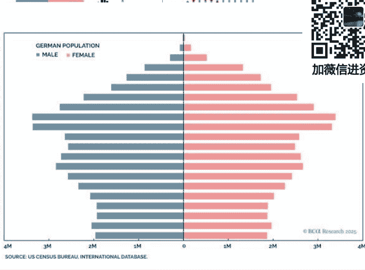

加微信进资料群

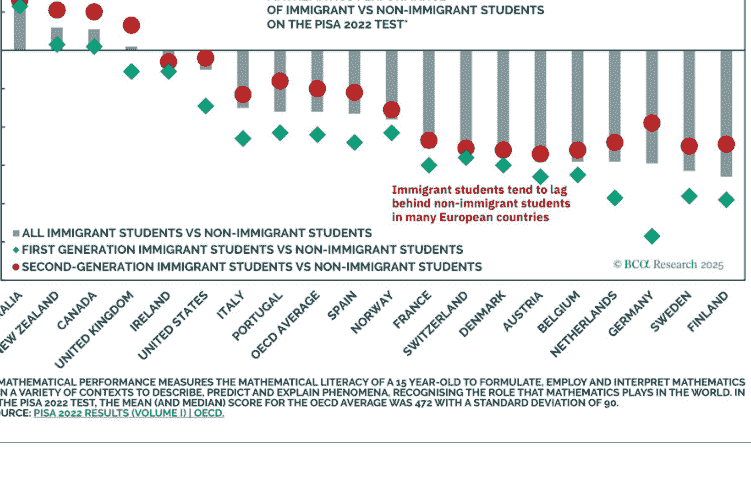

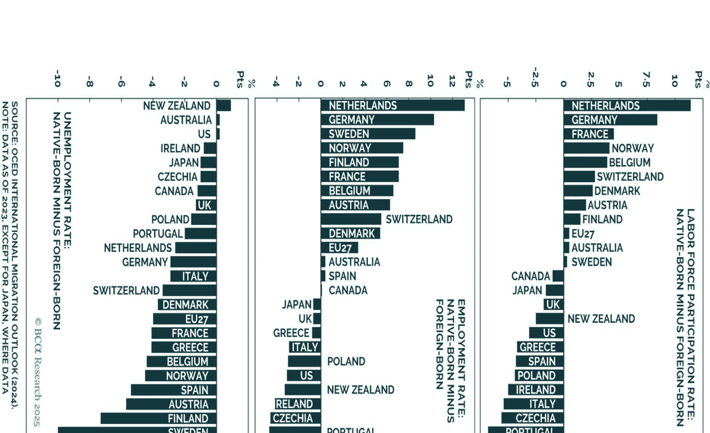

# 国信：复盘4月贸易对资产价格影响#金融


## 核心观点

进入第四季度，中美贸易将进入新一轮密集博弈。总体而言，中美贸易往来的长期中期不确定性依然强烈，当下的4月-5月中美贸易交易的主要要回归，并对这一时期商品和债券等资产走势，对下阶段可能出现的市场波动提供借鉴。

时间线：4月，特朗普宣布对中国加征34%的“等关税”，中美贸易经历了一段极为紧张的时期。

4月2日，特朗普宣布对中国商品加征34%的“等关税”回应，4月8日美国关税从30%提高到84%，并在全面范围内提升至125%。

进入5月，美国试图缓解内部压力，美国重回常态，并表示通过对外对话解决贸易摩擦。5月12日，美国宣布对中国商品加征的91%关税，取消对4月2日加征的34%关税，暂停其中的24个百分之90天，恢复15%。从4月以来的贸易谈判进入胶着阶段，并在8月的塞尔威尔会议上再次延续90天。

股市与商品：美国政府对“等关税”回应后，美股市走强。同时，全球增长增速缓慢。在贸易不确定性下，股市出现较大不确定性，大宗商品暴涨，其中涨幅远大于国内商品。

未来，若贸易转向向下、向上，更容易出现商品价格上涨高于其他大宗商品的情况，趋势上受贸易政策带来的影响往往在短期内出清，但可能带来超级行情。另外，特别需要注意的是，当前贸易谈判主要集中在中两国之间，与4月贸易关税直接冲击全球的所有情况无关。

债市：底部反压，股市有阶段性反弹
逢4月美股市回调，债券收益率跌破180BP。上一轮中美贸易摩擦结束以来，关税和制裁措施对债券市场的影响加速。4月份关税政策发布后美国债市出现了约5BP的波动，随后继续加码贸易关税制裁，反映出债市市场的影响增大减缓。

向前，我们认为10月股市反弹更大。首先，7月和8月国内经济压力较大，国内债市政策有望继续放宽，在当前10-1月限内维持40BP左右，处于历史中位上方，反映了一个相对中性的位置，在货币政策稳定的背景下持续没有下行压力。A股仍呈现均衡的特征，债市的情绪得到缓解。

# 美国与商品：增长堪加，避险情绪升温

特许财经：富报，美元指数显著走强。4月2日美国对“对等税”政改公布，两个日内美元指数再度拉升。4月10日，截至部分美国国家和地区的“对等税”等待期结束，美元指数再度回升，美元指数一度接近92，创2022年以来最高。4月5日，美元指数终至97.2的三低点。

同时，市场情绪持续乐观，进一步推高了黄金价格。由于黄金受“对等税”关税政策利好影响，避险资金进一步推升，在4月7日到4月22日出现回落。

在美元强势下，全球市场出现不确定性增加，大宗商品价格普遍走低。例如，4月2日下午“对等税”命令生效，4月3日LMC铜下跌930美元/吨，4月4日更是跌6.0%。但是，由于海外大宗商品影响，国内大宗商品价格仍保高位，美元对相对强势，整个4月跌幅仅为4%。

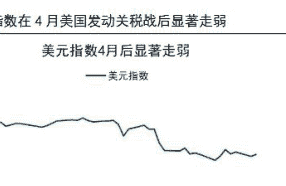

数据来源：Wind，国信证券经济研究所

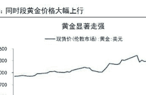

数据来源：Wind，国信证券经济研究所

由于4月对对等税引发的通货资产价格走软，贸易局势不确定性将直接推升避险情绪。在这种情况下，方向上，更容易出现黄金价格上涨优于其他大宗商品跌幅的情况。同时，贸易引发对前景的担忧。贸易不确定性带来的影响往往在短期内释放，引发市场机会。此外，要特别指出的是，当贸易局势成为焦点时，美国宣布对等税关税将影响全球的市场情况，不同，其影响可能有所区别。

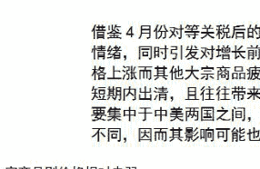

数据来源：Wind，国信证券经济研究所

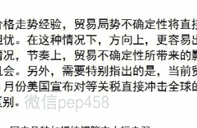

数据来源：Wind，国信证券经济研究所

### 图6：4月初对等关税发布后主要资产价格跌幅对比

### 4月初对等关税前后主要资产涨幅 ■ 事件前一个月涨幅 事件后一个月涨幅

| /BP (债券) | 美元指数 | LME指数 | 棉指数 | 黄金 | 10年债 | 10年美债 | 标普500 | 沪深300 | 人民币 |
|---|---|---|---|---|---|---|---|---|---|
| 15 | | | | | 8.8 5.4 | 1.0 0.0 | 0.0 0.3 | | |
| 10 | | | 3.1 | | | | | | | |
| 5 | | | | | | | | | | |
| 0 | | -2.21 -4.4 -4.6 -1.9 | | | -1.1 -3.0 | | | |
| -10 | | | | | -18.6 | -3.7 | | | |
| -15 | | | | | | | | | | |
| -25 | | | | | | | | | | |

资料来源：Wind, 国资债券研究所整理。注：中国债及美国债为收益率变动。

### 展望：基本面承压，债市有望阶段性反弹

参考上一轮调整调整经验，突发贸易和制裁事件对债券市场的冲击非常迅速。4月关税政策发布后两个日市场出现了超过5BP的波动，随后中美围绕贸易问题加剧，但反映在债市上的影响大幅减弱。

目前看来，我们认为10月股市反弹更大。首先，7月和8月国内经济压力较大，国内债市政策有望继续放宽，在当前10-1月限内维持40BP左右，处于历史中位上方，反映了一个相对中性的位置，在货币政策稳定的背景下持续没有下行压力。A股仍呈现均衡的特征，债市的情绪得到缓解。


证券研究报告

图1: 国信证券月度GDP 测算
图2: 股市相关分析
图3: 月度实际增速一路绿板（30天）

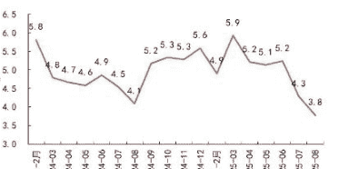

数据来源：Wind，国信证券研究所

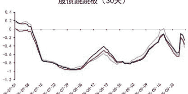

数据来源：Wind，国信证券研究所

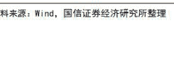

数据来源：Wind，国信证券研究所

# 银河：如何看待中美贸易博弈

Jason
2025-10-12

财经：虽然5月12日联合声明之后，中美贸易压力依然显著。美国商务部再次对华部分领域（USGM）发起调查、处罚，包括半导体、AI、电动汽车、太阳能、钢铁等领域增加了25%的限制，试图挽救美国造船业领先地位。此外，钢铁是全球最重要的资源之一，由于自身供应严重缺口，直接影响全球市场运行。

我们认为，特朗普取消关税的可能性较低。一方面，特朗普在5月通过社交媒体声称“没有必要”取消关税，这属于双方谈判的筹码。另一方面，特朗普在5月12日关税豁免期之前，考虑到谈判需要，可能会为后续谈判留出时间。

大局下，中美博弈强度极其复杂。这种态势未能从根本上改变两国竞争的轨迹，双方继续维护主导地位。

* 中国宏观政策如何应对？
短期内，外部不确定性依然是中国宏观政策的主线。强化“稳性为主”，着力稳就业、稳预期、稳市场、防范重大风险。根据形势变化，及时推出增量储备，前瞻性调整，加强国内循环，全力扩大外需，增强消费。货币政策发力加大，保持流动性充足，外部环境引发的波动积极的政策价值有望得到。

* 市场影响几何？
中国股票：A股或微小波动，市场节奏切换。短期内，不确定性的上升将降低市场对中国资产的风险预期，前期利益较大使得投资者需要重新视市场是否合理。不过，我们仍然看好中国市场机会。其一，供应链面临性压力，对基本面的真实影响有限；二，中国周期政策仍有较大空间，增量扩储政策可能会发生变化；其三，二季度以来中国版“准基金”已经取得了良好的红利，股市波动加大，市场节奏可能再次发生作用。进入四季，不确定性的上升将推动市场风格发生变化，我们认为从红利板块向权重切换，主题，内压、外需、国家安全、扩内等方向上可以关注。

中国债券：预期利好，中国政策转向短期来看。第一，不确定性的上升将导致股市风险加大，股市路径或将向好；二，货币宽松周期的重塑有助于推动收益率的下降。中后期，还需要综合财政加码与货币宽松“反”对政策策略的影响。向上的推力和向下的压力平衡，我们认为第四季度10年国债收益率将在1.65%-1.85%区间震荡，先下后上或成“V”字。

汇率：短期内政策转向为汇率的重要因素，我们人民币汇率的波动将在7.1-7.2之间。如果贸易摩擦反复再次重现，将给人民币汇率造成一定的贬值压力。但是特朗普政府政策策略的预期将得到强烈反弹，将造成美元的信用的增强，加剧美债挂权的独立性的丧失，从而回归“美元”。对于我们而言，人民币的贬值压力可能为

# 中国数据 |CGS

股票，应对政策下行，人民银行已经积累了足够的应对措施，能够有效管理市场环境。基于在多次波动行动中取得了较好的信誉，这有助于市场实现收益目标，对建立人民币信誉的影响正逐渐形成。然而，中国财政的进一步加码或下行的阶段中，如果贸易摩擦反复重现，人民币汇率的变动可能无法实现升值。

# 重心转向

[content]数据 |CGS

股票，应对政策下行，人民银行已经积累了足够的应对措施，能够有效管理市场环境。
```search]
```
```
```
```]

美国：股市下行是重塑预期的释放，短期内，政府政策的干预导致股市反弹。由于不确定性，目前处于低位，有望回到底部。长期周期内，贸易政策的持续影响可能导致股市持续性。。企业，企业，债，，，政策的释放可能导致通胀“软”，我们关注未来方向。

[content]

```


[content]
# 涛

海涛：金金金，租金回报率远高于利率，是一个漫长的过程。最重要的是，美国造船业的冲击非常非常。，，由于不确定性，美国造船业的领先地位。如果我们看看海外的经验，证实租金回报率远高于利率，房价是成立的。例如，美国在2007年房价回升到2012年回落。在此期间，日本从1991年进入下行，利率下降到10%，2004年才开始回升。在此期间，租赁回报率一度获得5%以上的。我们认为，回归到“利率”。分母是房价，而房价是波动的，由于租金是存款，存款，租金不会波动的，由于不确定性，美国造船业的冲击非常非常。此外，最重要的是，这几年都不算异常，如果租金回报率太高了，还需要看利率，也许可能吧。记得在2019年写过篇文章，租金涨平了吗？》其实表达类似的逻辑，如果房价在上涨期，租金回报涨能够覆盖房价，持有房产占有的资金和房屋维护费用，每年，这需要租金回报有多高，每个市场不一样，投资者可以自行测算。

[content]

[content]
```
```search]
```
```
```
```
```
```
```
```
```
```
```
```
```
```
```
```
```
```
```
```
```
```
```
[/content]

[content]
```
```
```
```
```
```
```
```
```
```
```
```
```
```
```
```
```
```
```
```
```
```
```
```
```
```
```
```
```
```
```
```
```
```
```
```
```
```
```
```
```
```


# Jason-不离

2025-10-12 03:10 经济观察报：目前，我国实际纳税人占比不到10%，更值得注意的是，工资所得的征税能力显著强于资本利得。此外，高净人群的复杂资产配置也对征税构成挑战。#TAX

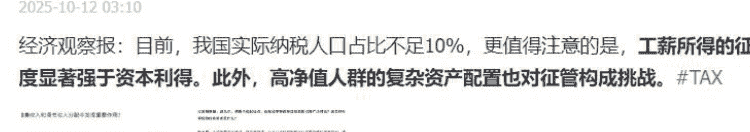

个税如何在个人收入和税收调节中发挥重要作用？

9月10日，经济观察报聚焦个税改革相关问题，采访了金律律师事务所合伙人叶永青。他认为，在当前的背景下，要共同形成共识以促进经济发展、提消费的需求，个税改革的重要性越发凸显。从改革起点来看，核心诉求在于：不少中高收入人群的税负负担仍然高，且在持续增长的压力下，长期稳定不合理。从高收入、消费的角度出发，通过个税改革调节，扩大内涵，减轻中低收入税负担，直接增加其可支配收入，提振消费具有立竿见影的效果。

叶永青认为，当前对高收入群体的税收调节仍在不断加强。这背后的原因在于：历史上，我国税制在资本相关规则与处理方面尚待完善。现行税制中，劳动所得最高适用高达45%的边际税率，而资本利得普遍适用20%。更值得注意的是，工资所得的征税能力显著强于资本利得。此外，高净人群的复杂资产配置也对征税构成挑战，其收入渠道涵盖内外复杂账户、信托收益权、股收益、非上市公司股权、房地产增值等多个维度，现行征税体系难以实现全面覆盖。

经济观察：这几年，调整税起起点、优化税率结构改革建议总引发广泛讨论？这类背后的社会诉求是什么？

叶永青：税收改革作为改革，背后是经济、社会公平和现代化多元因素的深度转变。这并非简单的“提高税起起点”，更是关乎国家税治理体系的。主要原因包括以下几点：

首先，税收被认为是社会改革的重要组成部分，且与每个人的利益息相关，因此引起关注。在当前国家的背景下，由于与许多相似的政策有助于促进经济发展、提振消费的需求，减少中低收入群体，能够增加可支配收入，对提振消费有立竿见的效果。

2018年税起起点调整后，居民收入与生活成本（尤其是大城市的住房、教育、医疗支出）已显著提高。此外，现行的个扣扣标准未能充分反映不同地区、不同家庭的负担差异及适应性，因此调整的呼声依然存在。

但是，需要指出的是，我国税起起点是直接导致纳税人口的下降。目前，我国纳税人口占比不是10%，进一步提高税起起点，个税的调节功能将进一步精细化。从意义上来说，简单提高税起起点并非最佳选择，税制改革、税制现代化才是核心。我国税起点的长远方向，是建立更加灵活、定型的分类与相结合的个税制改革，这要求不仅优化税起起点，还要逐步扩大涵盖范围，完善专项附加扣除项目（如子女教育、养老老人等），考虑建立物价指数、收入水平挂钩的动态调整机制。

综上所述，税收改革议题的周期性反映了发展、社会结构变化对税制度的适应性要求。

## 经济观察：个税改革还有哪些关注的地方

叶永青：个税改革的一个重要方向，是推动其与遗产税、赠与税形成完整的体系。赠与税和遗产税是关键组成部分，从未来富裕的目标出发，改变资产积累的简单模式也是重要的；另一方面，出口税（Exit Tax）是对未来实现税收的处理，对于国际资产布局趋势，这一税十分必要。出口税又被称为离境税，是美国自20世纪60年代开始应用的。

经济观察：在调节收入差异的过程中，个税承担怎样的功能？这项政策的主要方向是什么

叶永青：个税在调节收入分配中的核心目标，是通过税制设计，有效缩小收入差距，服务于共同富裕。政策导向遵循“调、均、扩”的基本逻辑，具体体现在：强化高收入群体的税收调节，现行3%至45%的累进税率是实现这一目标的主要手段。改革的关键在于确保收入来源多元化、精准覆盖各类收入。

技术方面，依托大数据构建全生命周期的档案，完善个税识别技术至关重要。此外，通过CRS（Common Reporting Standard，共同报告标准）跨境信息交换，强制执行对境外账户、资金的穿透监管，完善个税治理漏洞。这需要落实《所得税法》第八条规定，加强机关的执行力度。

经济观察：今年收入增长显著，这种分化现象与事实密切相关

叶永青：收入增长的韧性，主要是政策性减负（主导因素）和空间弹性因素叠加的结果。一方面，过去一段时间，国内外环境变化的背景下，收入增长面临压力；另一方面，个税在收入分配方面有效发挥功能，一定程度上反映了在协调体系中的不同定位。

博客：美国富豪家族已超过2400万，几乎占美国人口的五分之一。其中三分之一的富豪是在2017年后出现的，这并不意味着他们认为百万美元量级应该解决所有财务问题，而是现在真正需要的。越来越多富豪的财富以快速速度增长，例如住房市场或积累的退休账户，如401(k)或IRA账户。2023年，对比2017年上涨了8个百分点，资产超过500万美元的家庭平均有24%，存放在易交易的银行或投资账户中；负债接近100万美元的家庭仅为17%。这是一些年轻人所感受到的间接影响。

### Millionaire Households Are on the Rise
Share of US households over $1M in net worth

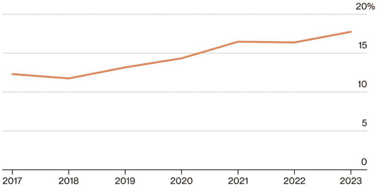

Source: US Census Bureau Survey of Income and Program Participation (SIPP)

### Less-Wealthy Millionaires Have More Illiquid Assets
Share of wealth held in each asset type by household’s net worth, 2023

| Asset | 12M households ($1-$2M) | 8.5M have ($2-$5M) | 3.5M have ($5M+) |
|---|---|---|---|
| Business | 4% | 4% | 14% |
| Liquid assets | 17% | 22% | 24% |
| Retirement | 33% | 37% | 33% |
| Housing | 39% | 31% | 23% |

Source: US Census Bureau SIPP

Note: Liquid assets refers to bank accounts as well as stocks, mutual funds and bonds that can be readily sold.

### Gen X Added the Most Millionaire Households
Number of millionaire households in 2017 2023

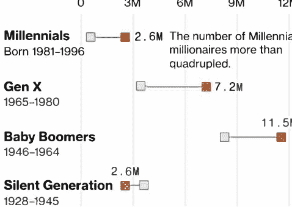

#### Millennials Born 1981-1996 2.6M The number of Millennial millionaires more than quadrupled.
#### Gen X 1965–1980 7.2M
#### Baby Boomers 1946–1964 11.5M
#### Silent Generation 1928–1945 2.6M

Source: US Census Bureau SIPP

Note: Generations are assigned based on the head of household's age.

### 4-bedroom home in NYC suburbs
Typical price in Westchester County, NY

2017: $758,070
2025: $1,096,635

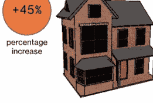

### Two Mercedes E350 sedans
Suggested retail price

2017: $111,200
2025: $132,800

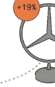

### 4-year education for two children
Tuition & fees

2017: $376,592
2025: $493,408


### 2-bedroom Upstate NY cottage
Typical price in Ulster County, NY

2017: $166,766
2025: $341,257

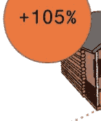

### 19-ft Sea Ray SPX speedboat
MSRP

2017: $35,549
2025: $59,360


### Total
2017: $1,448,177
2025: $2,123,460

Sources: Zillow, Mercedes-Benz, Sea Ray, Boatguide.com

# Jason-不离

2025-10-12 03:19 货币历史上最大的清算事件。根据数据，过去24小时内，比特币飙升至26,000美元，以太坊也暴跌至15,000美元。许多受影响的加密货币资产都是特朗普的World Liberty Financial平台总推出后，WLFI币暴跌50%，此后回升至13美元。

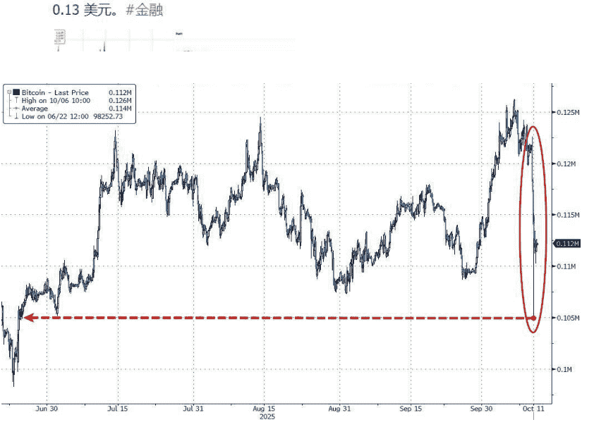

## World Liberty Financial to USD

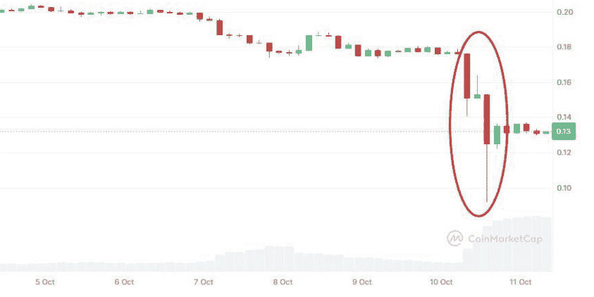

Statista: 根据组织的最新数据，2022年韩国66岁以上的人口的相对贫困率创历史新高，39.7%。尽管如此，这一数字比2011年高出7.8%有所改善。分析指出，该国在过去十年中社会保障方面取得了重大进展。新西兰显示，从2019年的20%到2022年的34%，65岁及以上受访者表示他们减少了社交活动，28%的人推迟了医疗。丹麦、芬兰和瑞典内的国家持续记录一些最低的比例，低于10%，这反映了它巨大的福利体系。

## Where Is Pension poverty The Most Prevalent?
Share of people 66 and older living in relative income poverty in selected countries in 2022 (in percent) P.p. change since 2019

| Country | Percentage | Change |
|---|---|---|
| South Korea | 39.7 | -3.5 |
| Estonia | 37.4 | +2.9 |
| New Zealand | 34.0 | +13.9 |
| Costa Rica | 25.8 | +1.0 |
| United States | 23.1 | +0.1 |
| United Kingdom | 14.9 | -0.6 |
| Spain | 13.1 | +1.5 |
| Canada | 11.6 | -1.0 |
| Sweden | 9.4 | -1.7 |
| Norway | 4.1 | -0.2 |

Income poverty refers to income below half the national median equalized household income.
Source: OECD


# Jason不离

2025-10-12 03:42

《人口与经济 - 生育友好指数构建、测及差异研究：经济激励和其他支持政策对学生孩子的决定或是否有子女有多大影响？这个系统似乎相似。尽管如此生育是新生的大关口，但生育环境又是如何呢？本文框架考量了三个关键因素：生育、妇幼儿保健和生育支持机制。政府支持的带钱政策在上海、浙江以及江苏、吉林和黑龙江等东北三省的生育率落于政策力度。

表7 生育友好各省域测试结果

| 排名 | 省行政区 | 得分 | 排名 | 省行政区 | 得分 | 排名 | 省行政区 | 得分 |
|---|---|---|---|---|---|---|---|---|
| 1 | 云南 | 92.96 | 12 | 广西 | 88.18 | 24 | 陕西 | 84.04 |
| 2 | 浙江 | 92.33 | 14 | 湖北 | 87.64 | 25 | 天津 | 83.55 |
| 3 | 吉林 | 90.14 | 15 | 江苏 | 87.25 | 26 | 肃 | 83.55 |
| 4 | 河北 | 89.04 | 16 | 山西 | 87.10 | 27 | 内蒙古 | 83.28 |
| 5 | 河南 | 88.99 | 17 | 贵州 | 86.97 | 28 | 福建 | 82.36 |
| 6 | 江西 | 88.87 | 18 | 山东 | 86.66 | 29 | 北京 | 82.05 |
| 7 | 江湖 | 88.85 | 19 | 甘肃 | 86.48 | 30 | 海南 | 81.53 |
| 8 | 宁夏 | 88.47 | 20 | 湖北 | 86.12 | 31 | 西藏 | 81.22 |
| 9 | 青海 | 88.37 | 21 | 黑龙江 | 85.37 | | |
| 10 | 安徽 | 88.33 | 22 | 上海 | 85.21 | | |
| 11 | 贵州 | 88.29 | 23 | 重庆 | 85.16 | | |

# Jason不离

2025-10-12 03:53 资产收益率=金融


| Asset Class | 2011 | 2012 | 2013 | 2014 | 2015 | 2016 | 2017 | 2018 | 2019 | 2020 | 2021 | 2022 | 2023 | 2024 | 2025 |
|---|---|---|---|---|---|---|---|---|---|---|---|---|---|---|---|
| ETFs | 9.6% | 6.6% | 2.3% | -2.2% | -10.7% | -0.8% | 12.9% | 17.5% | 24.8% | -4.3% | -0.6% | 12.7% | 25.7% | 52.4% | 169% |
| Gold | 11.5% | 1.5% | 13.3% | 13.5% | 13.0% | 13.7% | 11.3% | 10.8% | 10.1% | | | | | | | 2.1% | 0.6% | 0.1% |
| U.S. Treasury | 14.7% | 18.0% | 15.3% | 15.5% | 12.8% | 15.1% | 15.8% | 15.8% | 15.8% | 15.8% | 15.8% | 15.8% | 1.6% | 10.1% |
| Emerging Markets | -5.7% | -2.3% | -0.8% | -1.7% | -10.9% | -3.6% | 0.0% | 1.5% | 11.3% | 2.2% | | 5.8% | 15.8% | 15.8% | 10.1% |
| Corporate Bonds | 7.7% | 15.5% | 23.9% | 17.7% | 16.9% | 9.7% | 7.0% | 22.4% | 23.2% | 14.5% | 20.1% | 14.8% | 19.1% | 19.1% | 10.1% |
| Real Estate | 2.7% | 25.2% | 33.1% | 25.5% | 31.7% | 38.5% | 37.4% | 29.2% | 42.9% | 42.6% | 63.1% | 64.8% | 14 | 1.8% | 7.7% | 10.3% |
| Small Cap | -4.4% | 16.7% | 18.7% | 21.5% | 14.1% | 11.5% | 20.4% | 25.1% | 20.5% | 16.5% | 15.8% | 22.5% | 22.7% | 22.7% | 2.2% | 10.3% |
| Large Cap | -4.4% | 16.7% | 19.7% | 21.5% | 15.1% | 13.5% | 21.4% | 23.5% | 21.5% | 18.5% | 17.8% | 20.5% | 20.7% | 20.7% | 2.2% | 10.3% |
| TIPS | 13.3% | 6.5% | 8.6% | 3.5% | 5.0% | 7.3% | 7.0% | -5.1% | -6.8% | -7.7% | -11.3% | -15.7% | 6.1% | 4.1% | 4.2 | 2.4 |
| Commodities | -2.5% | -7.5% | -7.1% | -27.1% | -29.6% | -27.8 | -24.5 | -11.6 | -11.8 | -7.14 | 13.9 | 14.2 | -2.2 | -3.2 | -0.5 | 1.7% |
| Cash | 8.8% | 17.6% | 23.2% | 24.4% | 28.6% | 29.5% | 24.6% | 24.5% | 29.8% | 23.2% | 25.1% | 25.1% | 25.1% | 25.1% | | |


Jason不塞
2025-10-12 03:58

# 安居9月购房者信心指数和找房热度#房产


## 购房者信心指数

2025年9月购房者信心指数
88.1

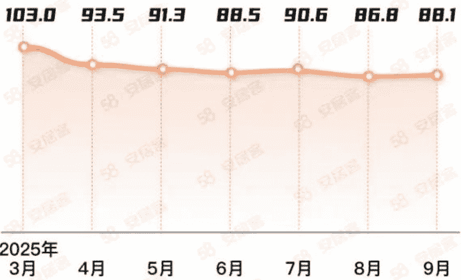

### 2025年9月全国找房热度
环比下降 5.92%

### 找房活跃城市排行TOP6

- 1、宁波 -0.17%
- 2、深圳 -1.32%
- 3、南昌 -1.79%
- 4、武汉 -2.33%
- 5、常州 -2.79%
- 6、无锡 -3.06%

| 城市组团 | 环比涨跌 | 一线城市 | 环比涨跌 |
|---|---|---|---|
| 全国 | -5.92% | 北京 | -6.83% |
| 一线城市 | -5.49% | 上海 | -8.30% |
| 二线城市 | -5.25% | 广州 | -4.47% |
| 三线城市 | -7.63% | 深圳 | -1.32% |

Jason不离
2025-10-12 04:00

正正: 截至7月底美国对中国商品平均关税税率为40.4%,若加征100%则提升至140.4%，低于4月贸易战中的156%理论值，但等同于中美贸易再次陷入停滞，对中国出口同样带来压力。经济数据

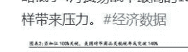

### 图表2:若加征100%关税，美国对华商品关税率或突破140%

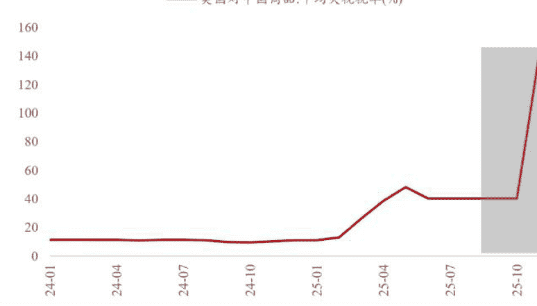

资料来源: Bloomberg, 正正证券研究所

### 图表3:截至25Q2,中国占全球商品出口份额维持在 14.7%

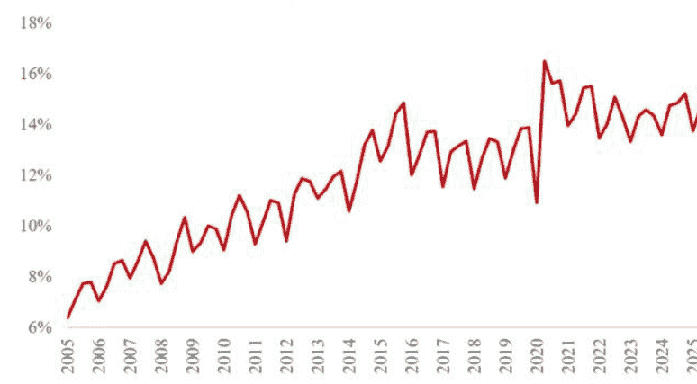

Jason-不瀚

CF40: 美方新一轮的关税增加大概率不会全面实施，而是会被推迟，因为11月1日这一生效期为双方从IMF到APEC峰前的后续谈判预留了窗口。但此前的缓和趋势已被重置，新一轮谈判将是全新的开始。长期来看，这种不确定的贸易和科技关系将进一步巩固两国追求供应链自主可控的决心#经济数据

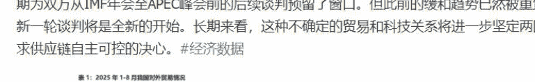

### 表 1：2025年1-8月我国对外的贸易情况

| 贸易伙伴 | 占比 (%) | 同比增速 | 占比 (%) | 同比增速 |
| :--- | :--- | :--- | :--- | :--- |
| 世界 | | 5.9% | - | 28.2% |
| 美国 | 11.5% | -15.5% | 23.7% | -17.2% |
| 东盟 | 17.7% | 14.6% | 23.1% | 46.1% |
| 欧盟 | 15.1% | 7.5% | 25.1% | 21.5% |
| 非洲 | 5.7% | 24.7% | 7.6% | 77.8% |

数据来源：Wind, CF40研究院

Jason-不瀚

花旗：中国就业市场表现稳定、内部分化。新经济（AI、机器人、数字服务）在抢人，老经济（地产、建筑、传统制造）在招改，企业仍需固守。2025年8月平均每周工作48.5小时，高于《劳动法》44小时上限，却是全球最高，不利于刺激服务消费。国企扩充3万人。仍维持弹性 10 bp，降准50 bp#经济数据

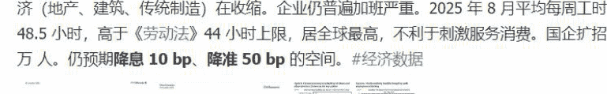

# China Economics
10 October 2025

## Citi Research

Is China's labor market good or bad? An elevated unemployment rate has been one of the top concerns among investors. As GDP growth and construction slowed into 2025, however, doesn't appear inclined to launch big stimulus or unemployment measures. The question is, what's the real picture of China's job market?

Headline job statistics also not worried. While the unemployment rate of 5.3% in August was flat from a year ago, the requisite rise suggests the production season passed. Prime-age employment edged up 1.1pt YoY to 18.9%, feeling marginally pressured (Figure 1). New unemployment rate recorded 9.6 million as of August, up 5.4 million Jan-Aug, on track for the full-year of 12.2 million (Figure 2).

Figure 1. Prime-age employment has been stable, while youth unemployment rate remains elevated (img/9031606c6bf2b92bdebcdaa8a641bba0_25_0.png)

Figure 2. New urban employment recorded 46 million as of August, on track for the full-year (img/9031606c6bf2b92bdebcdaa8a641bba0_25_1.png)

2025 Citi Group. No redistribution without Citigroup's permission. Source: NBS, Citi Research
2025 Citi Group. No redistribution without Citigroup's permission. Source: NBS, Citi Research

Job sentiment indices have improved. Job sentiment index (CCI) has shown marked improvements 2024, standing at post-Covid. Web searches for job seeking have trended down and fallen below historical averages so far (Figure 3). The PMI relative trend expanded to 50.9 (expansionary) in September, the highest since January, showing corporate intentions. The PMI index of manufacturing employment also bounced to the highest level since February at 48.9%. The exception was the PMI Index for non-mfg, which deteriorated to the one-year low of 45% on weak construction (Figure 4).

# China Economics
# China Research

Figure 3. The job sentiment index has shown market improvement since 2024

Figure 4. The BCI and PMI's sub-indices expanded recently, while deteriorating for num (img/9031606c6bf2b92bdebcdaa8a641bba0_26_0.png)

(img/9031606c6bf2b92bdebcdaa8a641bba0_26_1.png)

2023 ChinaCI. No redistribution without ChinaCI's permission. Source: Research Column.
2023 ChinaCI. No redistribution without ChinaCI's permission. Source: Word, CEIC, CI.

Job pressures across various sectors. [1] The new economy is competing for talent, Major companies have struggled to adapt to the AI boom with intense hiring. Tech companies are struggling to recruit high-quality talent, driving a fierce need to hire 20k graduates and interns over three years; Huawei aims to retain 100% of its graduates, while Baidu and Alibaba aim to increase share of AI-related jobs. However, traditional sectors face severe job pressure and acute uncertainty. [2] Rising opportunities in AI-related fields (Eastixin, March 24). User services also expanded by 26% YoY in the AI sector. Retail services grew by 72.2% YoY, driven by rising demand and demand for growing services. Service sectors responded rapidly, with 42% YoY in manufacturing services show demand for professional care. [3] Exporting sectors are in a better shape than expected, with demand in electronics, machinery, and new energy growing faster than expectations. Foreign trade directly and indirectly supports 180 million jobs. [4] The old economy is struggling, as property, services, and construction were clearly under pressure amid the housing downturn. Monthly data shows weakening employment in manufacturing, furniture, and clothing (others follow).

Figure 5. The new economy is for talent, and urban services serve as the key cushion

Figure 6. The old economy could be struggling, with employment shrinking (img/9031606c6bf2b92bdebcdaa8a641bba0_26_2.png)

(img/9031606c6bf2b92bdebcdaa8a641bba0_26_3.png)

2023 ChinaCI. No redistribution without ChinaCI's permission. Source: Zhaoping, ChinaCI.
2023 ChinaCI. No redistribution without ChinaCI's permission. Source: Word, CEBS, CEIC.

Figure 7. Export sectors could be in a better shape than expected

The employed still work for long. Average weekly hours at 48.5 in August was above the 44-hour limit allowed by the Labor Law and the high industry de-facto demand. The long hours reflect 100% industrial demand, indicating that the shorter -02Y hour YoY in August. Mediation shows its impact on reducing overtime as employees leave on month. Disadvantage excessive overtime and the latest mode aims to support workers balance might merit generate benefits, providing supporting service quality.

(img/9031606c6bf2b92bdebcdaa8a641bba0_26_4.png)

Figure 8. The employed are still working very long hours compared to global peers (img/9031606c6bf2b92bdebcdaa8a641bba0_26_5.png)

2023 ChinaCI. No redistribution without ChinaCI's permission. Source: China Customs, NBS, ChinaCI
2023 ChinaCI. No redistribution without ChinaCI's permission. Source: OECD

Jason不离
2025-10-12 04:40

PIIE: 中国房地产市场自2021以来，正处于持续、系统性的退潮。这场大退不仅是周期性调整，更是结构性转型，且有可能持续。积极方面，房价长期抑制生育#房价

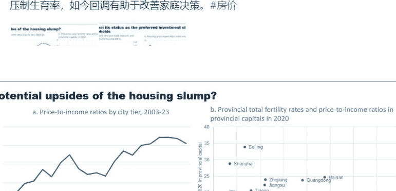

## Potential uses of the housing slump?

a. Price-to-income ratios by city, 2023
b. Provincial fertility rates and price-to-income ratios in provincial cities in 2020

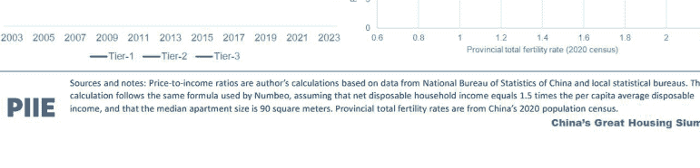

Sources and note: Price-to-income ratios are authors' calculations based on data from National Bureau of Statistics and local statistical bureaus. The figures capture the income of households. We use per capita gross average disposable income, and the median apartment size is 90 square meters. Provincial fertility rates are from China's 2020 population census.

# China Research
# Research

## Housing has lost its status as the preferred investment class by Chinese households

a. Real returns on household one-year bank deposits and real you change of NBS 70-city housing prices
b. Housing expectation index and income confidence index

(img/9031606c6bf2b92bdebcdaa8a641bba0_27_2.png)

Note: The Income Confidence Index is directly published by the PIIE in its quarterly deposit survey reports. It is a diffusion index calculated by including various measures. Housing Price Expectation Index is constructed by the author using PIIE survey data and the same methodology as the Income Confidence Index. The real returns on bank deposits are the nominal deposit rates minus CPI inflation.


### When will the Chinese housing crisis bottom out?

Real housing price indexes in China, the US, Ireland, Spain, and Japan since the housing market market peaks

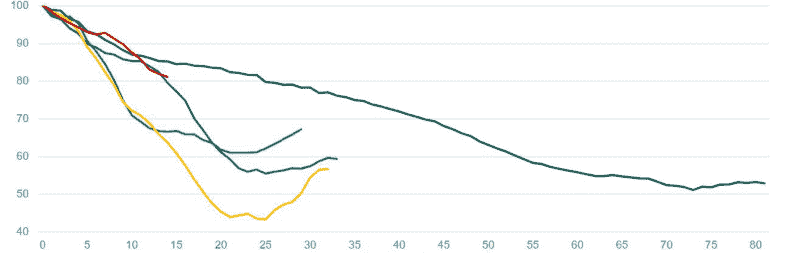

Source: Bank for International Settlements. Note: All price indexes are in real terms and normalized to 100 at the quarter of each country's housing market peak. The data for China are compiled by the PIIE based on China's official NBS-70 index for secondary markets.


### While official price data show only modest declines, private sector data point to steeper price declines

Comparing the NBS 70-city index and Centa Leading Index for secondary home prices in select cities, January 2012-July 2025

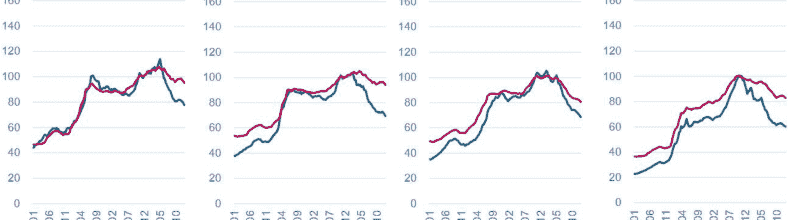

Source: Centeline Property Agency, National Bureau of Statistics of China, Wind. Note: All series are indexed with June 2021 levels as 100.

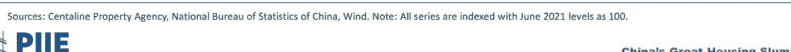

# 知识星球TOP

添加微信
免费入群

微信:top28688

| 序号 | 公号/星球/社群 | 原价 | 领域 |
| :--- | :--- | :--- | :--- |
| 1 | 生财有木 | 2765/年 | 副业，搞钱 |
| 2 | 众宗众吃瓜群 | 365/年 | 时政，历史 |
| 3 | 记忆Legacy/땡树西风 | 365/年 | 成长， |
| 4 | 欧洲金轨 | 328/年 | 时政，历史 |
| 5 | 卢克青云会 | 699/年 | 时政，社会 |
| 6 | 体制内主任 | 599/年 | 体制；职场 |
| 7 | 局外人的视界 | 669/年 | 金融，时政 |
| 8 | 溯泽异迁 | 4166/年 | 财富，成长 |
| 9 | 守夜人总司令 | 599/年 | 时政，经济 |
| 10 | 江宁知府 | 365/年 | 时政，国际 |
| 11 | 政事堂/顾子明 | 568/年 | 时政，经济 |
| 12 | 唐书院 | 1399/年 | 金融，财富 |
| 13 | 大树乡村谈 | 199/年 | 时政，成长 |
| 14 | 水库欧大 | 10000/年 | 房产，经济 |
| 15 | 洪灏宏观策略 | 4376/年 | 经济，搞钱 |
| 16 | 金企通鉴/北海南山 | 4576/年 | 股票，行研 |
| 17 | 猫哥的世界 | 299/年 | 时政，社会 |
| 18 | 飞浪龙 | 3600/年 | 股市，经济 |
| 19 | 米联诸见闻 | 599/年 | 经济，金融 |
| 20 | 茶财经财经 | 330/年 | 房产，股票 |
| 21 | 赢在八小时之外 | 365/年 | 成长，职场 |

...... 更多资源，不再列举
+ 图书、报告、课程等各类高价值资源

- 免费群 每日分享资源
- VIP群 每日分享所有资源（日均20+），75/年 赠送付费资源集合，市场价数万元
